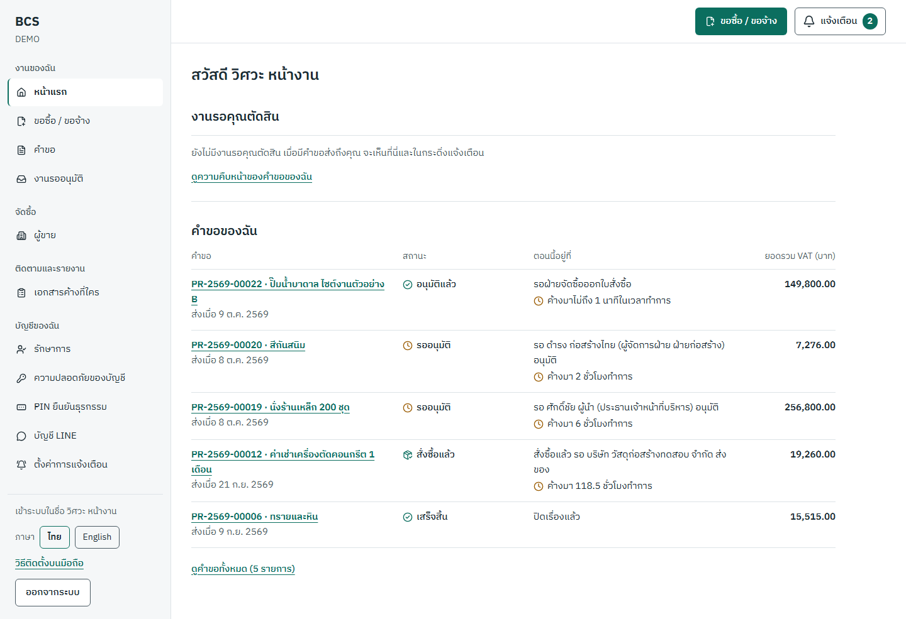
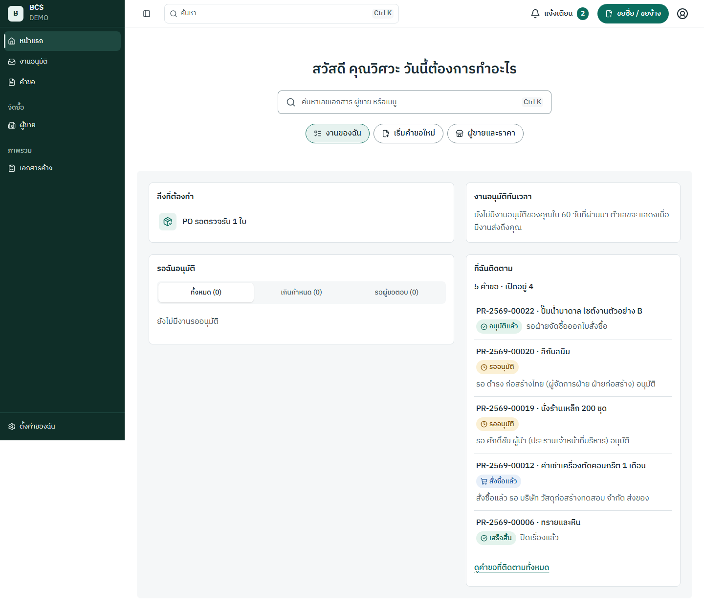
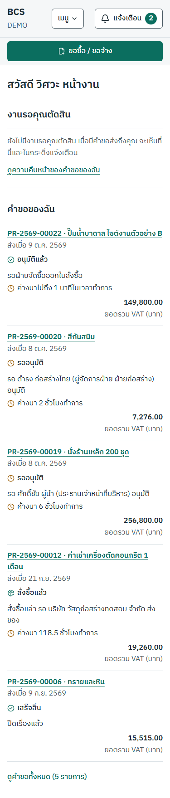
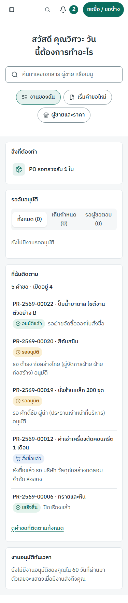

# รายงานเส้นชัย A2 — หน้าจอใหม่แบบใกล้ Zip ในโทนเขียว

สำหรับผู้ใช้ (เจ้าของโปรเจกต์) และคนที่จะนำ demo: รอบ A2 เปลี่ยนอะไร ผลตรวจเป็นอย่างไร และเหลืออะไรที่ต้องทำเอง · เขียนในข้อ S16-13 (2026-10-10) ตาม §17.8

**สถานะ:** ข้อของ agent ในรอบ A2 เสร็จครบ (`[demo]` 18 จาก 18 รวมข้อนี้) · เหลือข้อ S16-15 ที่ผู้ใช้ต้องลองเองและติ๊กเอง
ฉาก demo ทั้ง 9 ฉากผ่านบนหน้าจอใหม่ · staging เปิดหน้าจอใหม่แล้ว

## รอคุณ (Blocked on me)

### 1. ลองหน้าจอใหม่แล้วติ๊ก S16-15 (`[คน]`)

1. เปิด <https://www.budgetcontrolsystem.com> บนคอมและบนมือถือ
2. เข้าระบบทีละคนด้วย `req_con` (ผู้ขอ) · `vp_ops` (ผู้อนุมัติ) · `proc_officer` (จัดซื้อ) · อีเมล `<รหัส>@demo.bcs.local` รหัสผ่านคือ `SEED_DEV_PASSWORD` ที่ตั้งใน Vercel (`vp_ops` และ `proc_officer` ต้องใส่รหัส 6 หลักจากแอป authenticator ด้วย · `docs/DEMO_RUNBOOK.md` ข้อ 1.5)
3. ทำตามลำดับคลิกใน `docs/DEMO_RUNBOOK.md` ข้อ 4 "ฉากเปิด" และฉาก 5 กับ 7
4. ถ้าใช้ง่ายขึ้น ให้ติ๊ก S16-15 ใน `spec.md` เอง หรือพิมพ์บอกว่า "ลองแล้วใช้ได้" · ถ้าเจอจุดที่ต้องแก้ ให้พิมพ์บอกเป็นข้อ ๆ แล้ว agent จะเพิ่มเป็นข้อ NEW
5. ข้อมูลบน staging ตอนนี้มีคำขอที่เคยลองไว้ ถ้าอยากเริ่มจากข้อมูลสะอาด กดปุ่ม reset ตาม `docs/DEMO_RUNBOOK.md` ข้อ 2 ก่อน (ลบข้อมูลบน staging ทั้งหมด จึงต้องเป็นคุณที่กด)

หลังเส้นชัย A2: ซ้อม demo (D-08) บนหน้าจอใหม่ แล้วไปเส้นชัย B เมื่อพร้อม

### 2. ดิสก์ C: ของเครื่องเกือบเต็ม

เหลือราว 1 GB จาก 465 GB ระหว่างทำข้อนี้ เทสต์รอบหนึ่งล้มเพราะเขียนไฟล์ชั่วคราวไม่ได้ (รันใหม่แล้วผ่าน) · โฟลเดอร์ใหญ่ที่สุดใน Temp คือ `C:\Users\User\AppData\Local\Temp\wsl-crashes` (ราว 12 GB เป็นไฟล์บันทึกตอน WSL ล่ม) ซึ่งอยู่นอกโปรเจกต์ agent จึงไม่ลบเอง ถ้าไม่ได้ใช้ ลบทิ้งได้จาก File Explorer หรือใช้ Disk Cleanup ของ Windows

### 3. CI บน GitHub ยังแดง (ไม่ต้องทำอะไรตอนนี้)

CI ล้มตั้งแต่ข้อ S16-03 เพราะเทสต์บนโปรไฟล์มือถือ 2 ตัวไม่ผ่านบนเครื่องของ GitHub จึงไม่ deploy staging อัตโนมัติ · ข้อนี้ deploy ด้วยมือแทน · บันทึกเป็น NEW-88 `[go-live]` · S1-14 ยังรอ ruleset ของ main ที่ต้องใช้ GitHub Pro เหมือนเดิม

### 4. การเปลี่ยน `src/server/authz/permissions.ts` ที่ต้องให้คนอ่าน (§15.8)

#### S16-06 ผู้ติดตามคำขอ (2026-10-09)

ไฟล์สิทธิ์ถูก "แช่แข็ง" ตั้งแต่ S1-08 ข้อนี้เพิ่มสิทธิ์ใหม่ 2 ตัวตามที่ spec สั่ง (§2.4 · FR-INT-013) และไม่ได้เปลี่ยนสิทธิ์เดิมของใคร

| สิทธิ์ใหม่ | ใครได้ | เงื่อนไขที่ service ตรวจเพิ่ม |
| --- | --- | --- |
| `request.follow` ติดตามหรือเลิกติดตามคำขอ | ทุกคนที่เห็นคำขอนั้นอยู่แล้ว (ชุดเดียวกับ `request.view`) | ทำได้กับตัวเองเท่านั้น · ผู้ขอไม่ต้องติดตามคำขอของตัวเอง |
| `request.followers.manage` เพิ่มหรือเอาผู้ติดตามออก | ผู้ขอของคำขอนั้นเท่านั้น | เพิ่มได้เฉพาะคนที่เห็นคำขอนั้นอยู่แล้ว (OQ-39 ค่าเริ่มต้น "ไม่ได้") จึงไม่มีใครเห็นใบเสนอราคาหรือไฟล์แนบเพิ่มเพราะถูกเพิ่มเป็นผู้ติดตาม |

สิ่งที่ควรรู้

- ผู้ติดตามที่ไม่ใช่ผู้ขอ แก้ ส่ง ยกเลิก แนบไฟล์ หรือเพิ่มผู้ติดตามไม่ได้ (FR-INT-013 AC3) เพราะคำสั่งเหล่านี้นับ "เจ้าของ" เป็นผู้ขอคนเดียว · มีเทสต์ปฏิเสธทุกคำสั่งใน `tests/integration/request-followers.test.ts`
- ผู้ติดตามได้แจ้งเตือนเมื่อคำขออนุมัติ ตีกลับ หรือไม่อนุมัติ พร้อมผู้ขอ (§10.1) · คนที่ถูกผู้ขอเพิ่มได้แจ้ง "คุณถูกเพิ่มเป็นผู้ติดตาม" · คนที่ตัดสินเองไม่ได้แจ้งซ้ำ · ผู้ติดตามที่ถูกปิดบัญชีหรือเปิดคำขอไม่ได้แล้วไม่ได้แจ้ง (แก้ตามรีวิว)
- ทุกครั้งที่ติดตาม เลิกติดตาม เพิ่ม หรือเอาออก มีบันทึก (event `request.follower_added` และ `request.follower_removed`) ที่ดูได้ในหน้าตรวจสอบ
- คนที่เห็นคำขอเพราะติดตามอย่างเดียว จะถูกถามยืนยันก่อนเลิกติดตาม เพราะเลิกแล้วจะเปิดคำขอไม่ได้อีก (แก้ตามรีวิว)
- จุดที่ควรตัดสินภายหลัง: ถ้าคนที่ติดตามแล้วถูกถอดบทบาทที่ทำให้เห็นคำขอ เขาจะยังเห็นคำขอนั้นต่อในฐานะผู้ติดตาม (§2.4 นับผู้ติดตามเป็นเจ้าของสำหรับการดู) จนกว่าจะเลิกติดตามหรือผู้ขอเอาออก · บันทึกเป็น NEW-74 `[go-live]`

## เปลี่ยนแปลง (Changed)

### ข้อที่เสร็จในรอบ A2

| ข้อ | งาน | เสร็จ | commit |
| --- | --- | --- | --- |
| S16-01 | เครื่องมือ: ภาพก่อนแก้ spec_check ADR-057 ถึง 062 sub-spec S16 และ skill shadcn | 2026-10-09 | d3d1df1 |
| S16-02 | ฐานดีไซน์: token สีเขียว คอมโพเนนต์ shadcn/ui lint กันสีตายตัว และหน้า `/dev/ui` | 2026-10-09 | b4d4fd2 |
| S16-03 | ค้นหาและคำสั่ง ⌘K ตาม scope สิทธิ์ | 2026-10-09 | 699c9c0 |
| S16-04 | โครงหน้าใหม่: Sidebar เขียวเข้มที่ยุบได้ แถบบน และเมนูแบบ Sheet บนมือถือ | 2026-10-09 | ee17c5f |
| S16-05 | dialog เลือกประเภทคำขอและฟอร์มทีละขั้น | 2026-10-09 | c35ed89 |
| S16-06 | ผู้ติดตามคำขอ (รวม NEW-29) | 2026-10-09 | 5803c74 |
| S16-07 | หน้าคำขอและหน้า PO แบบแท็บ การ์ดขั้นแบบตราประทับ และแถบตัดสิน | 2026-10-09 | ef453ca |
| S16-08 | สรุปผู้บริหาร `/insights` | 2026-10-09 | 7c5684c |
| S16-09 | หน้าแรกแบบใหม่ การ์ด 4 ใบ และหน้า `/suppliers` | 2026-10-10 | 85dcf71 |
| S16-10 | ปรับหน้าที่เหลือของ Workspace ให้ใช้โครงใหม่ | 2026-10-10 | 21250b3 |
| S16-11 | สีและป้ายสถานะของ LIFF | 2026-10-10 | 1f0cb84 |
| S16-12 | ตรวจดีไซน์และรีวิวโค้ดทั้งรอบ | 2026-10-10 | 9576a1f |
| S16-13 | runbook บนหน้าจอใหม่ deploy staging และรายงานนี้ | 2026-10-10 | ข้อนี้ |
| NEW-72 | เทสต์ property ของเวลาทำการเกินเพดานเวลาเมื่อเปิด coverage | 2026-10-09 | d3d1df1 |
| NEW-73 | ตัวเลขข้างเมนูนับจากรายการปลายทางชุดเดียวกับหน้าแรก | 2026-10-10 | c11588f |
| NEW-77 | ฉาก 5 ล้มบางครั้งเพราะ axe ตรวจระหว่างหัวเมนูกำลังเลื่อน | 2026-10-09 | 99b4e5c |
| NEW-84 | dialog เริ่มคำขอทิ้งประเภทที่เลือกเมื่อจอเปลี่ยนขนาด | 2026-10-10 | b6f212a |
| NEW-85 | e2e ทั้งชุดล้ม 2 ฉากเพราะงบ `CON-OPEX-2569` หมดระหว่างรอบ | 2026-10-10 | 2ba67b2 |

เหลือในรอบ: S16-14 (`[go-live]` · @ ในความเห็น) และ S16-15 (`[คน]` · ผู้ใช้ลองเอง)

### ผลของคำสั่ง

__RESULTS__

### หน้าแรกก่อนและหลัง

ผู้ใช้ `req_con2` (ฉาก 5) · ภาพก่อนแก้ถ่ายใน S16-01 · ภาพหลังถ่ายจากฉาก demo หลังแก้ตามรีวิวใน S16-12

| | ก่อน | หลัง |
| --- | --- | --- |
| คอม 1440 px |  |  |
| มือถือ 375 px |  |  |

สิ่งที่ต่าง: ก่อนแก้หน้าแรกเป็นรายการยาวสองส่วน ("งานรอคุณตัดสิน" และ "คำขอของฉัน") ใต้เมนูสีขาว · หลังแก้ทักชื่อพร้อมช่องค้นหา ⌘K กลางหน้า ชิปทางลัด 3 อัน ("งานของฉัน" "เริ่มคำขอใหม่" "ผู้ขายและราคา") และการ์ด 4 ใบที่ตัวเลขกดลงไปรายการได้ · เมนูเป็นสีเขียวเข้ม ยุบเหลือไอคอนได้ และแสดงเฉพาะเมนูที่ผู้ใช้มีสิทธิ์

ภาพทุกหน้าของรอบนี้อยู่ใน `docs/design-review/a2/` (ตารางตรวจดีไซน์ `docs/design-review/a2.md`) · ผลรีวิวโค้ดทั้งรอบอยู่ใน `docs/reports/ux-a2-review.md`

### runbook

`docs/DEMO_RUNBOOK.md` ข้อ 4 เขียนใหม่: ทุกฉากบนเว็บเริ่มจากหน้าแรกด้วยตัวเลขในการ์ด ⌘K หรือปุ่ม "ขอซื้อ / ขอจ้าง" · เพิ่ม "ฉากเปิด" ตาม Demo ของ §16.12 · ฉากใน LIFF มีทางเว็บสำรองบอกไว้ในแถวเดียวกัน · ปุ่ม reset staging (ข้อ 2 · ADR-056) ไม่เปลี่ยน

## สิ่งที่พบ (Found)

- **CI ล้มทุกรอบตั้งแต่ S16-03** (NEW-88 `[go-live]`): บนเครื่องของ GitHub เทสต์บนโปรไฟล์มือถือ 2 ตัวไม่ผ่าน (⌘K กับแป้นพิมพ์ไทย และเมนูตามสิทธิ์ที่หมดเวลา 30 วินาที) ทั้งที่บนเครื่องนี้ผ่าน · ผลคือ staging ไม่อัปเดตเองหลัง push ต้อง deploy ด้วยมือ · ไม่กระทบ demo เพราะฉาก demo ทั้ง 9 ผ่านทั้งบนเครื่องและใน CI
- **staging ค้างที่ S16-02 มา 2 วัน** ก่อนข้อนี้ เพราะเหตุเดียวกัน · deploy ครั้งนี้ใส่ migration ใหม่ 1 ตัว (เพิ่ม index ให้การค้นหา ไม่แตะข้อมูลเดิม) และค่าตั้งค่า `procurement.queueTargetBusinessMinutes` ไม่บังคับ จึงไม่ต้อง seed ใหม่
- **ข้อ `[go-live]` ที่เพิ่มระหว่างรอบ** (ไม่กระทบ demo ทำก่อนใช้งานจริง): ผู้ติดตามที่หมดสิทธิ์แล้วยังเห็นคำขอ (NEW-74) · ความเร็วของหน้าคำขอ หน้าเอกสาร `/insights` หน้าแรก และตัวเลขข้างเมนูเมื่อข้อมูลโต (NEW-75 NEW-80 NEW-82 NEW-83 NEW-87) · ติดตามคำขอที่ปิดแล้ว (NEW-76) · เขียนความเห็นเองในหน้าเอกสาร (NEW-78) · การ์ดงบตามสิทธิ์ `budget.view` (NEW-79) · เทสต์ webhook ของ LINE ที่ล้มเป็นครั้งคราว (NEW-81) · ย้ายฟอร์มเดิมไปใช้คอมโพเนนต์ shadcn/ui (NEW-86) · CI (NEW-88)
- **เทสต์ที่ล้มเป็นครั้งคราวเมื่อเครื่องหนัก** (ผ่านเมื่อรันแยก): webhook ของ LINE (NEW-81) · outbox · การออกเลขเอกสารพร้อมกัน 50 ใบ · ⌘K กับแป้นพิมพ์ไทย · ถ้าเจอใน `pnpm verify` ให้รันเทสต์นั้นแยกก่อนสรุปว่าโค้ดผิด
- **ภาพเต็มหน้าที่ 1440 px** แสดงเมนูสีเขียวสั้นกว่าหน้า เพราะเมนูติดอยู่กับจอขณะเลื่อน (ภาพถ่ายทั้งหน้าในครั้งเดียว) บนจอจริงเมนูเต็มความสูงเสมอ ไม่ใช่บั๊ก
