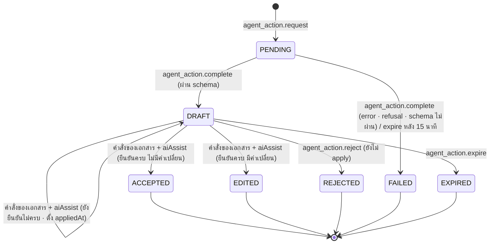

# S13 · AI Agent ของระยะ 1 — sub-spec

เอกสารนี้ขยาย §16.17 สำหรับการลงมือ · spec.md มีลำดับเหนือกว่าเสมอ ถ้าขัดกันให้ยึด spec แล้วแก้ไฟล์นี้
สถานะ: ร่าง P1-04 (2026-10-11) · รอตรวจ P1-05 และผู้ใช้อนุมัติ P1-06 · เลข BR GC INV event error และความสามารถในไฟล์นี้เป็นร่าง จะเพิ่มลง spec ในข้อที่สร้างโค้ดนั้น

## ขอบเขต

| เรื่อง | รายละเอียด |
| --- | --- |
| FR | FR-AI-303 Document Agent (ข้อแรก: ใบเสนอราคาและใบส่งของก่อน ใบแจ้งหนี้หลังงานของ S8 เข้า main · §16.2 ข้อ 6) · FR-AI-302 Intake Agent · FR-AI-301 Approval Brief · FR-AI-307 Insight Agent · FR-AI-309 ⌘K "ถาม BCS AI" · FR-AI-308 ร่างกฎ DOA จากระเบียบ |
| ระดับความอิสระ | L0 (Brief Insight) และ L1 (Document Intake ร่าง DOA) เท่านั้น (ADR-004 · §12.3) · ไม่มี L2 L3 และไม่มีสถานะ `AUTO_APPLIED` ในระยะ 1 |
| นอกขอบเขต | FR-AI-304 ถึง FR-AI-306 (ระยะ 2) · อ่านใบแจ้งหนี้จากกล่องอีเมลอัตโนมัติ (FR-INTG-302 · S14) · การเทรนหรือ fine-tune (NG-6) · ชุดประเมินด้วยเอกสารจริง (ข้อ `[go-live]` · P0-02) · LINE chat (S17 เป็นเจ้าของ เรียก interface ของขั้นนี้) · แอป BCS Go |
| ขึ้นกับ | P1-07 (สร้างสาย 3 · ฐานร่วม) · `src/core/money` `vat` `thai` `forms` `invoice` เดิม · ตัวอ่าน e-Tax เดิม (`readEtaxContent` ใน `src/server/services/invoices/etax.ts` · BR-IVC-05) · `doa.import_draft` เดิม (FR-DOA-001 AC2) · บริการอ่านเดิมของ ⌘K งบ กระดาน KPI สรุปผู้บริหาร |
| ใช้ของสายอื่น | S6: ราคาอ้างอิง (FR-DOA-101) แคตตาล็อกราคาตกลง (FR-INT-102) สัญญาณคำขอซ้ำ (FR-INT-103) · S8: entity ใบแจ้งหนี้และคำสั่งสร้างร่างใบแจ้งหนี้ · ใช้ได้เมื่อเข้า main แล้ว ก่อนนั้นใช้ทางสำรองในหัวข้อ "interface" |
| ของเดิมที่แตะ | `src/lib/env.ts` (เลิกบังคับ `AI_ENABLED=false` · ADR-142) · คำสั่ง `request.create_draft` `request.edit` `request.submit` `request.resubmit` `gr.post` `doa.import_draft` รับ `aiAssist` แบบไม่บังคับและตรวจด่านยืนยัน (ADR-148) · ไม่เปลี่ยนผลการคำนวณเงินใด ๆ · ปิด AI แล้วทุกคำสั่งทำงานเหมือนเดิมทุกไบต์ของผล |

## ชั้น demo และชั้นของจริงของ "เสร็จเมื่อ"

| เกณฑ์ต้นฉบับ §16.8 | ชั้น demo รอบนี้ | ชั้นของจริง `[go-live]` และของที่ต้องได้ |
| --- | --- | --- |
| แต่ละฟีเจอร์ผ่านชุดทดสอบความแม่นตามเกณฑ์ที่ตั้งไว้ก่อนเปิดใช้ | ชุดประเมินสังเคราะห์ (หัวข้อ "ชุดประเมิน"): เอกสารตามชีต DocSamples พร้อมส่วนขยาย (ไฟล์สร้างใน S13-03) · คำขอสังเคราะห์จาก History · คำถาม Insight · ระเบียบสังเคราะห์ 2 ฉบับ · เกณฑ์ OQ-141 · วัดกับ Claude จริงด้วย key dev ของ BCS (S13-10) · ผ่านแล้วบันทึก gate ชั้น `SYNTHETIC` ซึ่งใช้ได้บน local และ staging | เอกสารจริงที่ลบข้อมูลอ่อนไหวแล้ว (P0-02) พร้อมคำตอบที่คนตรวจ · เกณฑ์ OQ-142 ที่ลูกค้าตั้ง · key production ของ BCS (P0-13 · OQ-143) · สัญญาและการไม่เก็บข้อมูลกับ Anthropic (OQ-144 · NFR-PRIV-06) · gate ชั้น `REAL` บังคับใน production · ประเมินรายคืนอัตโนมัติ (S13-13) |
| ปิด AI แล้วทุกฟีเจอร์ยังทำงาน (EG-1 · NG-5) | เทสต์ที่รันฉาก `@demo` เดิมและเทสต์ของคำสั่งที่แตะ เมื่อ `AI_ENABLED=false` และเมื่อปิดโมดูล `AI` | เหมือนชั้น demo บน staging ที่ใช้ key จริง |
| ข้อมูลที่ส่งให้ AI | ข้อมูลสังเคราะห์เท่านั้น (OQ-19) | ข้อมูลจริงหลัง OQ-19 และ OQ-144 ปิด |

## Demo ของขั้น

ผู้ใช้และยอดจาก `scripts/inputs_p1/` (SIMEC) · P1-08 กำหนดฉากจริง

1. `fm_p02` (โครงการคอนโดบางนา) เปิดฟอร์มซื้อของ ขั้น 0 ลากไฟล์ใบเสนอราคา DOC-049 (เช่ารถแบ็คโฮ PC200 25 วัน ราคารวม VAT แบบฟอร์มภาษาอังกฤษ สแกนเอียง) → AI เติมผู้ขาย SP0068 รายการ 25 วัน × 5,187.36 ยอดรวม 129,684.00 (ก่อน VAT 121,200.00 VAT 8,484.00) และเสนอให้เปลี่ยนเป็นประเภท "จ้างบริการ" → ผู้ขอยืนยันช่องเงินทีละช่อง เปลี่ยนประเภท กรอกเหตุผลผู้ขายรายเดียว (ATT-QUOTES) แล้วส่ง → เส้นทาง PR-03 ไป `ceo`
2. `ceo` เปิดงาน เห็นกล่อง "สรุปจาก AI": ยอดตามฐาน DOA งบเช่าเครื่องจักรของโครงการ P02 คงเหลือหลังคำขอนี้ ใบเสนอราคาเดียวพร้อมเหตุผล ราคาอ้างอิงของรายการ (เมื่อ S6 เข้า main) · ตัวเลขทุกตัวมาจากโค้ด ไม่มีปุ่มให้ AI ตัดสิน
3. `store_p04` บันทึกตรวจรับของคำขอท่อ PPR 1 นิ้ว 18 ท่อน (DOC-001 ถึง DOC-003) กด "อ่านใบส่งของ" DOC-002 → จำนวนรับ 18 ท่อนถูกเติมที่บรรทัด PO และยืนยันก่อนบันทึก
4. (หลัง S8 เข้า main) `fin_ap1` อ่านใบแจ้งหนี้ DOC-003 เลขที่ INV-00373 → ร่างใบแจ้งหนี้ 5,580.00 + VAT 390.60 = 5,970.60 → ยืนยันทุกช่องแล้วเข้าจับคู่ 3 ทาง · DOC-054 (e-Tax XML) อ่านด้วยตัวอ่าน e-Tax โดยไม่เรียก AI
5. `ceo` กด ⌘K พิมพ์ "งบไหนใกล้หมด" → "ถาม BCS AI" → ตอบว่างบดำเนินงานฝ่ายการตลาดเหลือต่ำกว่า 10% พร้อมลิงก์ · `se_p01a` ถามคำเดียวกัน → "ไม่พบข้อมูลในสิทธิ์ของคุณ"
6. `admin` อัปโหลด "ระเบียบอำนาจอนุมัติ (สังเคราะห์)" REG-A → ร่าง 8 ข้อตรง DOA-SIMEC ฉบับ 1 พร้อมข้อความต้นทาง → lint ผ่าน → สร้างฉบับร่างด้วยคำสั่งเดิม (ไม่ส่งเผยแพร่) · REG-B ที่เขียนแบบ "20,001" ถูก lint จับเป็น `DOA_LINT_GAP`
7. `admin` ปิด Intake Agent ที่ `/admin/ai` → ขั้น 0 หายจากฟอร์ม และฟอร์มกรอกเองได้ครบ

## สถาปัตยกรรม

| ชั้น | ไฟล์ | หน้าที่ |
| --- | --- | --- |
| core (pure) | `src/core/ai-checks` | ตรวจผลอ่าน (BR-AI-14 BR-AI-15) · แปลงเป็นใบเสนอราคาและบรรทัดตรวจรับ (BR-AI-25) · ตรวจข้อความที่มี placeholder (ADR-144) · คิด credits (BR-AI-23) · ให้คะแนนชุดประเมิน (BR-AI-26) · เพิ่มใน branch coverage 100% ของ §7.0 ข้อ 4 |
| integration | `src/integrations/ai` | ที่เดียวที่ import `ai` `@ai-sdk/anthropic` (P-3 · ADR-060) · `AiClient` มี `extract(schema, prompt, files)` `write(schema, prompt)` `answerWithTools(tools, messages)` · โหมด `fixture` และ `live` (ADR-142) · prompt ที่มีเลขรุ่น `<agent>@<n>` (ADR-143) · ตารางราคาและรุ่นโมเดล · ไฟล์ gate ของชุดประเมิน |
| service ของ agent | `src/server/services/ai/agents/*` | `document.ts` `intake.ts` `brief.ts` `insight.ts` `doa-drafter.ts` · เรียก `AiClient` และคำสั่งของ `agent_action` เท่านั้น ห้ามเรียกคำสั่งที่เปลี่ยนเงินหรือการอนุมัติ (BR-AI-01) |
| ด่านยืนยัน | `src/server/services/ai/assist.ts` | `applyAiAssist` `assertNoPendingAiReview` `isAgentAvailable` · ไม่ import `src/integrations/ai` · service ของเอกสาร (คำขอ ตรวจรับ DOA ใบแจ้งหนี้ของ S8) import ได้เฉพาะไฟล์นี้ (ADR-148) |
| งานเบื้องหลัง | `src/server/jobs/ai-*.ts` | `ai-document-read` (จาก `agent_action.requested`) · `ai-approval-brief` (จาก `approval_task.assigned` `approval_task.reassigned`) · `ai-actions-expire` (ทุกชั่วโมง) · `ai-credit-monthly` (วันที่ 1 เวลา 00:05 เวลาไทย) (ADR-145) |
| route | `POST /api/ai/ask` (stream) · `POST /api/ai/read` · `POST /api/ai/intake` · `GET /api/ai/actions/[id]` (อ่านอย่างเดียว) | ทุก route เรียก service · GET ไม่เปลี่ยนสถานะ |

ตัวแปรใน `.env` (ภาคผนวก B): `AI_ENABLED` · `AI_MODE=fixture|live` · `ANTHROPIC_API_KEY` · `AI_MODEL_DEFAULT` และ `AI_MODEL_DOCUMENT` `AI_MODEL_INTAKE` `AI_MODEL_BRIEF` `AI_MODEL_INSIGHT` `AI_MODEL_DOA_DRAFTER` (ค่าเริ่มต้นตาม OQ-145) · กติกา: `AI_ENABLED=true` ต้องมี `AI_MODE` · `live` ต้องมี key · `fixture` ใช้ได้เฉพาะ `APP_ENV=local` และเทสต์ (staging และ production ปฏิเสธตอนเริ่มแอป)

ค่าเริ่มต้นของการเรียก (ตรวจกับเอกสารของ Claude API ใน S13-01): structured outputs ผ่าน `output_config.format` จาก Zod ไม่ใช้ tool บังคับ เพราะ Claude Opus 5.5 และ Sonnet 5.5 ปฏิเสธ `tool_choice` แบบบังคับ (ADR-141) · ตั้ง `effort` ต่อ agent ชัดเจน · `stop_reason = refusal` → FAILED ทางกรอกเอง · ไฟล์ PDF ส่งเป็น document block ภาพเป็น image block · ใช้ prompt caching กับ system prompt และ schema ที่คงที่

## Entity และ migration

ทุกตารางมี `organizationId` · FK คู่ `(organizationId, id)` ตาม ADR-039 · `createdAt` `updatedAt` · unique ทางธุรกิจรวม `organizationId` · เพิ่ม migration ต่อท้ายเท่านั้น

**enum ใหม่:** `AiAgent` (`DOCUMENT` `INTAKE` `APPROVAL_BRIEF` `INSIGHT` `DOA_DRAFTER`) · `AiPurpose` (`QUOTATION_READ` `DELIVERY_NOTE_READ` `INVOICE_READ` `INTAKE` `BRIEF` `QUESTION` `DOA_DRAFT`) · `AiLevel` (`L0` `L1`) · `AgentActionStatus` (`PENDING` `DRAFT` `ACCEPTED` `EDITED` `REJECTED` `FAILED` `EXPIRED`) · `AiCreditKind` (`GRANT` `USE`) · `AiCreditSource` (`MONTHLY` `TOPUP` `CALL`)

**`AgentAction`** (§12.2 · aggregate มี `version`)

| ฟิลด์ | ชนิด | หมายเหตุ |
| --- | --- | --- |
| `agent` `purpose` `level` | enum | `level` ได้จาก `AiAgentSetting` ตอนเรียก |
| `status` | `AgentActionStatus` | ตาม state machine |
| `subjectType` `subjectId` | String? · Uuid? | `REQUEST` `PURCHASE_ORDER` `INVOICE` `APPROVAL_TASK` `DOA_VERSION` · ว่างได้จนกว่าจะ apply (Intake จากแชท) |
| `requestedById` | Uuid? → Member | ว่างเมื่อ SYSTEM เรียก (Brief) |
| `channel` | `Channel` | WEB LIFF LINE_CHAT SYSTEM |
| `conversationId` | Uuid? | คำถามต่อเนื่องของ Insight |
| `promptVersion` `model` | String · String? | BR-AI-04 BR-AI-09 · `model` ว่างเฉพาะ FAILED ก่อนเรียก |
| `inputRefs` | Json | id ของไฟล์ เอกสาร งาน และผลเครื่องมือ ไม่เก็บสำเนาเอกสาร (BR-AI-04) |
| `inputText` | String? (≤ 2,000) | ข้อความที่ผู้ใช้พิมพ์ หลังผ่าน redactor (BR-AI-18) |
| `output` `verification` `fieldConfidence` | Json? | ผลตาม schema · ผลตรวจรายข้อ · ความมั่นใจต่อฟิลด์หน่วย bp (0–10000) |
| `review` `diff` | Json? | `{ requiredPaths, confirmedPaths }` · ค่าของ AI เทียบค่าสุดท้ายของช่องที่คนแก้ |
| `appliedAt` `appliedById` | Timestamptz? · Uuid? | เวลาที่ค่าถูกเขียนเข้าเอกสารร่าง |
| `decidedById` `decidedAt` | Uuid? · Timestamptz? | ผู้ยอมรับ แก้ หรือทิ้ง (`acceptedById` ของ §12.2) |
| `feedback` `feedbackNote` | enum? (`HELPFUL` `NOT_HELPFUL`) · String? | สำหรับ L0 |
| `errorCode` `expireReason` | String? · enum? (`SUPERSEDED` `SUBJECT_CLOSED` `STALE`) | |
| `inputTokens` `outputTokens` `cacheReadTokens` `cacheWriteTokens` `costCredits` `latencyMs` | Int | CHECK ≥ 0 · `latencyMs` ว่างได้ |

index: `(organizationId, subjectType, subjectId, status)` · `(organizationId, agent, createdAt)` · `(organizationId, requestedById, createdAt)` · unique `(organizationId, id)`

**`AiAgentSetting`**: `agent` · `enabled` Boolean (ค่าเริ่มต้น false) · `level` · `minConfidenceBp` Int (ค่าเริ่มต้น 9000 · CHECK 0–10000 · OQ-148) · `updatedById` · `version` · unique `(organizationId, agent)`

**`AiCreditLedger`** (append-only · trigger ห้าม UPDATE DELETE แบบ ledger อื่นตาม §6.3): `kind` · `source` · `credits` Int (CHECK > 0) · `periodMonth` Date (วันที่ 1 ของเดือนตามเวลาไทย) · `agentActionId` Uuid? · `platformAdminId` Uuid? · `contractRef` `reason` String? · `occurredAt` · unique `(organizationId, agentActionId)` เมื่อ `kind = USE` · unique `(organizationId, periodMonth)` เมื่อ `source = MONTHLY`

**`Organization.settings.ai`** (Zod · แก้ได้เฉพาะ PLATFORM_ADMIN ผ่านหน้า platform): `monthlyCredits` Int (ค่าเริ่มต้นตาม OQ-143) · `alertAtBp` Int (8000)

**ของเดิมที่เพิ่ม:** ไม่มีคอลัมน์ใหม่ในตารางเงิน · data ของ event `request.drafted` และ `doa_version.drafted` เพิ่ม `agentActionId` (เพิ่ม `schemaVersion`) · ไม่สร้างตาราง `PromptVersion` `AiEvalRun` ในระยะ 1 (ADR-143)

seed (local และ staging เท่านั้น): SIMEC เปิดโมดูล `AI` (`contractRef` = `SYNTHETIC-P1`) · `AiAgentSetting` ครบ 5 ตัว enabled · GRANT รายเดือน · องค์กร demo เดิมปิด `AI` เพื่อให้ `@demo` ไม่เปลี่ยน

## State machine



| จาก | คำสั่ง | ไป | ใครทำได้ | event |
| --- | --- | --- | --- | --- |
| — | `agent_action.request` | PENDING | USER ที่มี `ai.assist` `ai.ask` หรือ `ai.doaDraft` และสิทธิ์ของเอกสาร · SYSTEM (Brief) | `agent_action.requested` |
| PENDING | `agent_action.complete` | DRAFT | SYSTEM ในฐานะ AI_AGENT (`agentId` = `<agent>@<n>`) | `agent_action.drafted` |
| PENDING | `agent_action.complete` · `agent_action.expire` (PENDING เกิน 15 นาที) | FAILED | SYSTEM | `agent_action.failed` |
| DRAFT (L1) | คำสั่งของเอกสาร + `aiAssist` ที่ยังยืนยันไม่ครบ | DRAFT (`appliedAt`) | ผู้มีสิทธิ์แก้เอกสารนั้น | `agent_action.applied` |
| DRAFT (L1) | คำสั่งของเอกสาร + `aiAssist` ยืนยันครบ | ACCEPTED หรือ EDITED | ผู้มีสิทธิ์แก้เอกสารนั้น | `agent_action.accepted` · `agent_action.edited` |
| DRAFT (L1 ยังไม่ apply) | `agent_action.reject` | REJECTED | ผู้เรียก | `agent_action.rejected` |
| DRAFT | `agent_action.expire` | EXPIRED | SYSTEM (job) | `agent_action.expired` |
| DRAFT (L0) | `agent_action.give_feedback` | DRAFT | ผู้เห็นผล | `agent_action.feedback_given` |

เหตุหมดอายุ: `SUPERSEDED` (อ่านเอกสารเดิมใหม่หรือ Brief ใหม่หลังส่งต่องาน) · `SUBJECT_CLOSED` (คำขอยกเลิกหรือร่างหมดอายุ งานอนุมัติปิด) · `STALE` (DRAFT ระดับ L1 ที่ไม่ถูก apply ใน 24 ชั่วโมง) · DRAFT ที่ apply แล้วไม่หมดอายุแบบ STALE เพราะยังกันการส่งเอกสาร · L0 ที่แสดงผลแล้วอยู่ที่ DRAFT เป็นสถานะสุดท้าย

คำสั่งอื่น: `ai_agent.update` (ORG_ADMIN · event `ai_agent.enabled` `ai_agent.disabled` `ai_agent.updated`) · `ai_credit.grant` (PLATFORM_ADMIN · `ai_credit.granted`) · `ai_credit.grant_monthly` (job · `ai_credit.granted`) · ถึงเกณฑ์แจ้ง → `ai_credit.threshold_reached` · หมด → `ai_credit.exhausted`

## กฎ

| ID | กฎ |
| --- | --- |
| BR-AI-11 | เรียก agent ได้เมื่อผ่านทุกด่านตามลำดับ: `AI_ENABLED` · `requireModule(ctx, 'AI')` · `AiAgentSetting.enabled` · ชุด (agent, promptVersion, model) ผ่าน gate ของชั้นที่ env ต้องการ (production = `REAL` · อื่น = `SYNTHETIC`) · credits คงเหลือ > 0 · ไม่เกิน 10 ครั้งต่อนาทีต่อสมาชิก · ไม่ผ่านด่านใด → ปฏิเสธด้วยรหัสของด่านนั้น (`AI_AGENT_DISABLED` `MODULE_DISABLED` `AI_NOT_EVALUATED` `AI_CREDITS_EXHAUSTED` `RATE_LIMITED`) หน้าจอไม่แสดงปุ่ม AI และฟีเจอร์เดิมทำงานต่อ (EG-1) |
| BR-AI-12 | Document Agent รับไฟล์ที่ผู้เรียกมีสิทธิ์เห็นและสถานะ `AVAILABLE` ชนิด PDF JPEG PNG WebP ตรวจ magic bytes ไม่เกิน 20 MB และไม่เกิน 20 หน้า (ระเบียบ DOA ไม่เกิน 50 หน้า) ไม่เช่นนั้น `AI_FILE_UNSUPPORTED` · ไฟล์ e-Tax (PDF/A-3 ที่ฝัง XML หรือ XML) อ่านด้วยตัวอ่าน BR-IVC-05 ก่อนเสมอ ไม่เรียก AI ไม่คิด credits |
| BR-AI-13 | ผลของ AI ต้องผ่าน Zod schema ก่อนเป็น DRAFT ไม่ผ่าน → FAILED (`AI_OUTPUT_INVALID`) · ผลที่ผ่าน schema ทุกฉบับผ่านการตรวจของระบบ (BR-AI-14 BR-AI-15) ผลตรวจไม่ทำให้ FAILED แต่ทำให้ฟิลด์ที่เกี่ยวข้องถูกไฮไลต์และต้องยืนยันทีละช่อง |
| BR-AI-14 | การตรวจยอด: ยอดต่อบรรทัด = จำนวน × ราคาต่อหน่วยปัด half-up (BR-MONEY-02) ต้องเท่ายอดบรรทัดที่อ่านได้ทุกสตางค์ (`LINE_AMOUNT`) · เอกสารราคาไม่รวม VAT: ยอดก่อน VAT ที่คำนวณ = Σ ยอดต่อบรรทัด − ส่วนลด ต้องเท่ายอดก่อน VAT ที่อ่านได้ (`NET_TOTAL`) และ VAT ที่อ่านได้เทียบ `vatFromNet` ของยอดที่คำนวณ: เท่ากัน PASS · ต่างไม่เกิน 1.00 บาท WARN · เกิน FAIL (`VAT_AMOUNT` · เกณฑ์เดียวกับ BR-IVC-01) · เอกสารราคารวม VAT: ยอดรวมที่คำนวณ = Σ บรรทัด − ส่วนลด แล้วใช้ `vatFromGross` (BR-VAT-03) · ยอดรวมที่อ่านได้ต้องเท่ายอดก่อน VAT + VAT ที่อ่านได้ (`GROSS_TOTAL`) และเอกสารราคารวม VAT ต้องเท่ายอดรวมที่คำนวณด้วย · อัตรามาจาก `TaxRate` ณ วันที่เอกสารตามเวลาไทย ไม่มีอัตรา → `VAT_RATE_MISSING` FAIL และข้ามการตรวจ VAT · ผู้ขายไม่จด VAT (BR-VAT-04): VAT ต้องเป็น 0 ตรวจด้วย `NON_VAT_SELLER` แทน `VAT_AMOUNT` · ใบส่งของไม่มียอดจึงข้ามการตรวจยอด |
| BR-AI-15 | การตรวจตัวตนและวันที่: เลขผู้เสียภาษีผู้ขายผ่าน BR-TAXID-01 (`TAXID_CHECKSUM`) และตรงผู้ขายของบริบท (ผู้ขายที่เลือกหรือของ PO · `SELLER_MATCH`) · สาขาไม่ตรง: ใบกำกับ FAIL อื่น WARN (`SELLER_BRANCH`) · เลขผู้ซื้อที่อ่านได้ไม่ตรงองค์กร: ใบกำกับ FAIL อื่น WARN (`BUYER_MATCH`) · วันที่เอกสารหลังวันนี้ตามเวลาไทยของ `ctx.now` → FAIL (`DOC_DATE_FUTURE` · จับปี พ.ศ. ที่ไม่ได้แปลงด้วย) · เก่ากว่า 365 วัน → WARN (`DOC_DATE_OLD`) · สกุลเงินไม่ใช่ THB → FAIL ทั้งเอกสารและไม่แปลงเป็นค่าในฟอร์ม (`CURRENCY` · NG-9) |
| BR-AI-16 | ความมั่นใจของฟิลด์ (bp) = min(ค่าที่โมเดลให้ × 100, เพดานจากผลตรวจ: FAIL → 0 · WARN → 5000 · PASS หรือไม่มีการตรวจ → 10000) · ช่องที่ต้องยืนยันทีละช่อง = กลุ่มสำคัญทุกค่า (เงิน จำนวน เลขผู้เสียภาษี สาขา ประเภทคำขอ) + ค่าที่ความมั่นใจต่ำกว่า `minConfidenceBp` · ช่องอื่นยืนยันรวมด้วยปุ่ม "ยืนยันค่าที่เหลือทั้งหมด" ที่ผู้ใช้ต้องกดเอง (OQ-148 · BR-AI-02) |
| BR-AI-17 | ค่าของ AI เข้าเอกสารผ่านคำสั่งเดิมของเอกสารนั้นที่รับ `aiAssist = { agentActionId, confirmedPaths }` โดยผู้กระทำเป็นคน (actor USER) ในธุรกรรมเดียวกัน · AgentAction ต้องเป็นขององค์กรเดียวกัน สถานะ DRAFT ระดับ L1 และ purpose ตรงเอกสาร · คำสั่งที่ส่งหรือบันทึกขั้นถัดไป (`request.submit` `request.resubmit` `gr.post` คำสั่งยืนยันใบแจ้งหนี้ของ S8 `doa.import_draft`) ปฏิเสธด้วย `AI_REVIEW_PENDING` เมื่อมี AgentAction สถานะ DRAFT ที่ apply แล้วผูกกับเอกสาร หรือ `aiAssist` ที่ส่งมายืนยันไม่ครบ |
| BR-AI-18 | ข้อมูลส่วนบุคคล: schema ของผลอ่านไม่มีเลขบัญชีธนาคาร · ข้อความที่ระบบประกอบส่งให้ AI (Brief Insight Intake) ผ่าน redactor ที่แทนเลขบัญชี (รูปแบบ 10–12 หลักและแบบมีขีด) และเลข 13 หลักของบุคคลธรรมดาด้วย `[ปิดบัง]` · ผลเครื่องมือของ Insight ไม่มีเลขผู้เสียภาษีของผู้ขายบุคคลธรรมดา · log มีเฉพาะ id ของ AgentAction ไม่มี input output (NFR-SEC-09) · ไฟล์ภาพและ PDF ส่งทั้งไฟล์เพราะปิดบังพิกเซลไม่ได้ จึงใช้ได้กับข้อมูลจริงเมื่อ OQ-144 ปิดเท่านั้น |
| BR-AI-19 | Intake Agent: เสนอประเภทได้เฉพาะประเภทที่องค์กรเปิดและผู้ขอสร้างได้ · ไม่เติมคำถามคัดกรอง BR-FORM-05 (OQ-149) บรรทัดงบ cost center แผนกที่ตั้งเบิก ผู้อนุมัติ และไฟล์แนบ (มาจาก BR-FORM-02 และ DOA) · schema ของผลสร้างจาก FormVersion ของประเภทนั้น (BR-AI-10) · รายการจับคู่ `CatalogItem` ด้วยรหัสที่โค้ดตรวจว่ามีจริง · ผู้ขายจับคู่ด้วยเลขผู้เสียภาษีและสาขา หรือชื่อตรงทะเบียน ไม่พบ → ใส่ชื่อเป็นข้อความ ไม่สร้างผู้ขาย · ช่องทางซื้อที่แนะนำคำนวณด้วยโค้ดตามลำดับ: ราคาตกลง (FR-INT-102) → ขอซ้ำจากคำขอเดิมใน 180 วัน (FR-INT-101 · `intake.reorderLookbackDays`) → คำขอปกติพร้อมเอกสารที่กฎแนบไฟล์ต้องการตามยอด (BR-FORM-04) |
| BR-AI-20 | Approval Brief: ข้อเท็จจริง (facts) สร้างด้วยโค้ดภายใต้สิทธิ์ของผู้รับงาน ได้แก่ ยอดตามฐาน DOA และข้อที่ใช้ · งบคงเหลือหลังคำขอ (เฉพาะผู้มี `budget.view` ของบรรทัดนั้น) · จำนวนใบเสนอราคา รายถูกสุดหรือไม่ และเหตุผล · ราคาอ้างอิงและตำแหน่งของราคา (FR-DOA-101) · จำนวน PO กับผู้ขายใน 12 เดือนและราคาล่าสุด · สัญญาณคำขอซ้ำ (FR-INT-103) · เวลาที่เหลือของ SLA · AI เขียนได้ไม่เกิน 4 ประโยค ประโยคละไม่เกิน 120 ตัวอักษร อ้าง fact ด้วย placeholder · ข้อความไม่ผ่าน ADR-144 หรือมีคำแนะนำให้ตัดสิน → ทิ้งข้อความ แสดง facts อย่างเดียว · สร้างเฉพาะงานของ `PURCHASE_REQUEST` และ `PURCHASE_ORDER` · ไม่อยู่ในข้อความ LINE (OQ-146) |
| BR-AI-21 | Insight Agent เรียกได้เฉพาะเครื่องมือในตาราง "เครื่องมือของ Insight" ภายใต้ `ctx` ของผู้ถาม ไม่มีเครื่องมือที่เขียน ไม่มี SQL ที่ AI เขียน (BR-AI-07) · ไม่เกิน 6 การเรียกต่อคำถาม คำถามไม่เกิน 500 ตัวอักษร คุยต่อเนื่องไม่เกิน 10 รอบ · ตัวเลขในคำตอบมาจากผลเครื่องมือผ่าน placeholder (ADR-144) · ทุกคำตอบที่อ้างข้อมูลมีลิงก์ที่เครื่องมือคืน · ไม่มีผลในสิทธิ์ → "ไม่พบข้อมูลในสิทธิ์ของคุณ" ไม่เดา |
| BR-AI-22 | ร่าง DOA: ผู้เรียกต้องมี `admin.doa.draft` และเป็น Member ขององค์กร (PLATFORM_ADMIN เรียกไม่ได้ · NG-12 · OQ-147) · ผลอยู่ในรูปแบบนำเข้าของ FR-DOA-001 AC2 ทุกข้อมีข้อความต้นทางและเลขหน้า · โค้ดตรวจว่าข้อความต้นทางพบในเอกสาร (PDF ที่มีข้อความ) ตำแหน่งที่อ้างมีอยู่ และวงเงินเป็นสตริงบาท · แสดงผล lint ของ BR-DOA-08 คู่กับร่าง · สร้างฉบับร่างด้วย `doa.import_draft` โดยผู้เรียกหลังยืนยันทุกข้อ ไม่ส่งเผยแพร่เอง |
| BR-AI-23 | credits: credits ของการเรียก = ceil(Σ token × ราคาต่อล้าน token หน่วย micro-USD ÷ (1,000,000 × 1,000)) ปัดครั้งเดียวที่ท้าย (1 credit = 0.001 USD · OQ-143) · บันทึก USE หนึ่งแถวต่อ AgentAction ในธุรกรรมของ `agent_action.complete` · ไม่มี token → ไม่คิด · คงเหลือของเดือน = Σ GRANT − Σ USE · ก่อนเรียกต้องคงเหลือ > 0 (การเรียกสุดท้ายทำให้ติดลบได้) · ใช้ถึง `alertAtBp` ของ GRANT ของเดือน → แจ้งครั้งเดียวต่อเดือน · ตารางราคาอยู่ใน config ของ integration พร้อมวันที่ตรวจ |
| BR-AI-24 | ORG_ADMIN ปิด agent รายตัวมีผลกับการเรียกใหม่ทันที (BR-AI-05) · การเรียกที่ PENDING อยู่ทำต่อจนจบ · DRAFT เดิมยังยืนยันหรือแก้ได้เพราะไม่เรียก AI · `AI_ENABLED=false` ปิดทุก agent ทั้งระบบ · ระดับที่ตั้งได้ในระยะ 1 คือ L0 และ L1 เท่านั้น |
| BR-AI-25 | แปลงผลอ่านเป็นใบเสนอราคา (BR-FORM-06): ไม่รวม VAT → `amount` = ยอดก่อน VAT ที่อ่านได้ `includesVat` = false · รวม VAT → `amount` = ยอดรวมที่อ่านได้ `includesVat` = true · `NET_TOTAL` หรือ `GROSS_TOTAL` FAIL → ไม่เติม `amount` (`AMOUNT_UNVERIFIED`) · มีส่วนลด → เติมเฉพาะ `amount` ไม่เติมบรรทัดคำขอ (`DISCOUNT_NOT_MAPPABLE`) · ผู้ขายไม่อยู่ในทะเบียน → `supplierId` ว่าง (`SUPPLIER_NOT_REGISTERED`) · ใบส่งของ → จำนวนรับต่อบรรทัด PO ที่ AI เสนอ เติมเฉพาะบรรทัดที่มีจริงใน PO หน่วยตรงกัน และไม่ซ้ำ (`PO_LINE_UNKNOWN` `UOM_MISMATCH` `DUPLICATE_PO_LINE`) · เกินยอดค้างรับเติมได้แต่ไฮไลต์ (`OVER_OPEN` · gr.post ตัดสินตามกฎเดิม) |
| BR-AI-26 | ให้คะแนนชุดประเมิน: เทียบหลัง normalize (เลขผู้เสียภาษีตาม BR-TAXID-01 · เลขเอกสารตัดช่องว่างหัวท้ายและเทียบแบบ BR-IVC-03 · เงินเป็นสตางค์ · จำนวนเป็นทศนิยม 4 ตำแหน่ง · วันที่ ISO) · ความแม่นต่อฟิลด์ = floor(ถูก × 10000 ÷ ทั้งหมด) bp · ผ่านเมื่อ ≥ เกณฑ์ (เท่ากันผ่าน) · "หลุด" = ค่าผิดที่ความมั่นใจ ≥ `minConfidenceBp` และผลตรวจ PASS · เกณฑ์ตาม OQ-141 (demo) และ OQ-142 (ของจริง) |

| ID | Invariant | ทดสอบด้วย |
| --- | --- | --- |
| INV-AI-01 | event ที่ `actorType = AI_AGENT` มี `aggregateType = agent_action` เท่านั้น · ไม่มี AgentAction สถานะอื่นนอก enum ระยะ 1 | integration test สแกน Event หลังรันชุด AI ทั้งหมด |
| INV-AI-02 | AgentAction ที่ไม่ใช่ PENDING มี `promptVersion` · ทุกแถว USE อ้าง AgentAction เดียว · `costCredits` เท่า USE ของมัน | integration test |
| INV-AI-03 | `AI_ENABLED=false` หรือปิดโมดูล `AI` แล้ว `@demo` และเทสต์ของคำสั่งที่รับ `aiAssist` ผ่านเหมือนเดิม (EG-1) | เทสต์ใน `pnpm verify` |
| INV-AI-04 | Insight ไม่คืน ref นอก scope ของผู้ถาม | เทสต์ที่วนผู้ใช้ seed ทุกบทบาท (นับเอง) กับชุดคำถามสิทธิ์ ตรวจทุก ref ด้วย `get*Access` ของผู้ถาม |
| INV-AI-05 | service ที่แตะเงินหรือการอนุมัติไม่ import `src/integrations/ai` (P-3) | ESLint boundary + เทสต์ |

**เครื่องมือของ Insight** (ห่อบริการอ่านเดิม · ADR-147 · ผลเงินเป็นสตริงบาท อัตราเป็น bp)

| เครื่องมือ | input | ห่อ | สิทธิ์ |
| --- | --- | --- | --- |
| `search_documents` | q | `searchForMember` | ตาม FR-PLT-014 |
| `get_request` | number | `getRequestAccess` + `getRequestView` | `request.view` |
| `my_requests` | status? | `listMyRequests` | OWN |
| `my_tasks` | due? | `listMyTasks` | OWN ASSIGNED |
| `pending_approvals` | departmentCode? overdueOnly? | `boardView` | `board.pending.view` |
| `budget_status` | fiscalYear? departmentCode? lowOnly? | `budgetDashboard` `budgetScopeDetail` | `budget.view` |
| `spend_summary` | from to groupBy | `insightsView` | `report.view` |
| `kpi_summary` | period | `kpiView` | `report.view` |
| `purchase_orders` | status? supplier? | `listPurchaseOrders` | `po.view` |
| `find_supplier` | q | `searchSuppliers` | `supplier.view` (mask ตาม BR-AUTH-04) |

## ร่าง golden case

```yaml
# draft: tests/golden/ai-verify.yaml
suite: ai-verify
fixture:
  rates:
    - { code: VAT_STANDARD, rateBp: 700, effectiveFrom: "2025-10-01", effectiveTo: "2026-09-30" }
    - { code: VAT_STANDARD, rateBp: 700, effectiveFrom: "2026-10-01", effectiveTo: "2027-09-30" }
  orgTaxId: "0999997000015"
  now: "2026-10-11T03:00:00Z"
  suppliers:
    SP0056: { taxId: "0999998010561", branch: "00000", vatRegistered: true }
    SP0058: { taxId: "0999998010588", branch: "00000", vatRegistered: true }
    SP0175: { taxId: "0999998011657", branch: "00000", vatRegistered: true }
    SPNV1: { taxId: "3999998020014", branch: "00000", vatRegistered: false }
  bases:
    DOC-001: { docType: QUOTATION, supplier: SP0056, docDate: "2026-10-01", currency: THB, priceIncludesVat: false, seller: { taxId: "0999998010561", branch: "00000" }, lines: [{ qty: "18", unitPrice: "310.00", amount: "5580.00" }], net: "5580.00", vat: "390.60", gross: "5970.60" }
    DOC-010: { docType: QUOTATION, supplier: SP0058, docDate: "2026-10-01", currency: THB, priceIncludesVat: true, seller: { taxId: "0999998010588", branch: "00000" }, lines: [{ qty: "26", unitPrice: "2514.50", amount: "65377.00" }], net: "61100.00", vat: "4277.00", gross: "65377.00" }
    DOC-057: { docType: TAX_INVOICE, supplier: SP0175, docDate: "2026-10-01", currency: THB, priceIncludesVat: false, seller: { taxId: "0999998011657", branch: "00000" }, buyer: { taxId: "0999997000015" }, lines: [{ qty: "20000", unitPrice: "32.50", amount: "650000.00" }], discountTotal: "13000.00", net: "637000.00", vat: "44590.00", gross: "681590.00" }
    DN-002: { docType: DELIVERY_NOTE, supplier: SP0056, docDate: "2026-10-03", currency: THB, seller: { taxId: "0999998010561", branch: "00000" }, lines: [{ qty: "18", unit: "ท่อน" }] }
cases:
  - { id: GC-AI-01, title: ใบเสนอราคาตรงทุกยอด, input: { base: DOC-001 }, expect: { status: PASS, computed: { net: "5580.00", vat: "390.60", gross: "5970.60" } } }
  - { id: GC-AI-02, title: ยอดบรรทัดเกิน 1 สตางค์, input: { base: DOC-001, set: { lines.0.amount: "5580.01" } }, expect: { status: FAIL, fail: [LINE_AMOUNT], flagged: [lines.0.amount] } }
  - { id: GC-AI-03, title: จำนวนทศนิยม 2502.5 สตางค์ปัดเป็น 2503 แต่ AI อ่าน 25.02, input: { base: DOC-001, set: { lines: [{ qty: "2.5", unitPrice: "10.01", amount: "25.02" }], net: "25.02", vat: "1.75", gross: "26.77" } }, expect: { status: FAIL, fail: [LINE_AMOUNT, NET_TOTAL], flagged: [lines.0.amount, net], computed: { net: "25.03", vat: "1.75", gross: "26.78" } } }
  - { id: GC-AI-04, title: ราคารวม VAT, input: { base: DOC-010 }, expect: { status: PASS, computed: { gross: "65377.00", vat: "4277.00", net: "61100.00" } } }
  - { id: GC-AI-05, title: VAT ต่าง 1.00 พอดี เตือน, input: { base: DOC-001, set: { vat: "391.60", gross: "5971.60" } }, expect: { status: WARN, warn: [VAT_AMOUNT], flagged: [vat], vatDiff: "1.00" } }
  - { id: GC-AI-06, title: VAT ต่าง 1.01 ไม่ผ่าน, input: { base: DOC-001, set: { vat: "391.61", gross: "5971.61" } }, expect: { status: FAIL, fail: [VAT_AMOUNT], flagged: [vat], vatDiff: "1.01" } }
  - { id: GC-AI-07, title: ยอดรวมไม่เท่าก่อน VAT บวก VAT, input: { base: DOC-001, set: { gross: "5970.06" } }, expect: { status: FAIL, fail: [GROSS_TOTAL], flagged: [gross] } }
  - { id: GC-AI-08, title: บรรทัดส่วนลดก่อนคิด VAT, input: { base: DOC-057 }, expect: { status: PASS, computed: { net: "637000.00", vat: "44590.00", gross: "681590.00" } } }
  - { id: GC-AI-09, title: VAT 8753.5 สตางค์ปัดขึ้น, input: { base: DOC-001, set: { lines: [{ qty: "1", unitPrice: "1250.50", amount: "1250.50" }], net: "1250.50", vat: "87.54", gross: "1338.04" } }, expect: { status: PASS, computed: { net: "1250.50", vat: "87.54", gross: "1338.04" } } }
  - { id: GC-AI-10, title: AI ปัด VAT ลง ต่าง 1 สตางค์ เตือน, input: { base: DOC-001, set: { lines: [{ qty: "1", unitPrice: "1250.50", amount: "1250.50" }], net: "1250.50", vat: "87.53", gross: "1338.03" } }, expect: { status: WARN, warn: [VAT_AMOUNT], flagged: [vat], vatDiff: "0.01" } }
  - { id: GC-AI-11, title: เลขผู้เสียภาษีหลักตรวจผิด, input: { base: DOC-001, set: { seller.taxId: "0999998010562" } }, expect: { status: FAIL, fail: [TAXID_CHECKSUM, SELLER_MATCH], flagged: [seller.taxId] } }
  - { id: GC-AI-12, title: เลขถูกแต่เป็นผู้ขายอื่น, input: { base: DOC-001, set: { seller.taxId: "0999998010081" } }, expect: { status: FAIL, fail: [SELLER_MATCH], flagged: [seller.taxId] } }
  - { id: GC-AI-13, title: เลขมีขีดยังตรง, input: { base: DOC-001, set: { seller.taxId: "0-9999-98010-56-1" } }, expect: { status: PASS } }
  - { id: GC-AI-14, title: ใบกำกับสาขาไม่ตรง, input: { base: DOC-057, set: { seller.branch: "00001" } }, expect: { status: FAIL, fail: [SELLER_BRANCH], flagged: [seller.branch] } }
  - { id: GC-AI-15, title: ใบกำกับออกให้บริษัทอื่น, input: { base: DOC-057, set: { buyer.taxId: "0999997000023" } }, expect: { status: FAIL, fail: [BUYER_MATCH], flagged: [buyer.taxId] } }
  - { id: GC-AI-16, title: ใบเสนอราคาระบุผู้ซื้ออื่น เตือน, input: { base: DOC-001, set: { buyer.taxId: "0999997000023" } }, expect: { status: WARN, warn: [BUYER_MATCH], flagged: [buyer.taxId] } }
  - { id: GC-AI-17, title: ผู้ขายไม่จด VAT แต่มี VAT, input: { base: DOC-001, set: { supplier: SPNV1, seller.taxId: "3999998020014", lines: [{ qty: "1", unitPrice: "1000.00", amount: "1000.00" }], net: "1000.00", vat: "70.00", gross: "1070.00" } }, expect: { status: FAIL, fail: [NON_VAT_SELLER], skip: [VAT_AMOUNT], flagged: [vat] } }
  - { id: GC-AI-18, title: ผู้ขายไม่จด VAT ไม่มี VAT, input: { base: DOC-001, set: { supplier: SPNV1, seller.taxId: "3999998020014", lines: [{ qty: "1", unitPrice: "1000.00", amount: "1000.00" }], net: "1000.00", vat: "0.00", gross: "1000.00" } }, expect: { status: PASS, skip: [VAT_AMOUNT], computed: { net: "1000.00", vat: "0.00", gross: "1000.00" } } }
  - { id: GC-AI-19, title: วันที่เอกสารพรุ่งนี้, input: { base: DOC-001, set: { docDate: "2026-10-12" } }, expect: { status: FAIL, fail: [DOC_DATE_FUTURE], flagged: [docDate] } }
  - { id: GC-AI-20, title: 17:30Z เป็นวันที่ 12 ตามเวลาไทยแล้ว, input: { base: DOC-001, now: "2026-10-11T17:30:00Z", set: { docDate: "2026-10-12" } }, expect: { status: PASS } }
  - { id: GC-AI-21, title: ปี พ.ศ. ที่ไม่ได้แปลง, input: { base: DOC-001, set: { docDate: "2569-10-01" } }, expect: { status: FAIL, fail: [DOC_DATE_FUTURE, VAT_RATE_MISSING], skip: [VAT_AMOUNT], flagged: [docDate, vat, gross] } }
  - { id: GC-AI-22, title: เอกสารเก่ากว่า 365 วัน, input: { base: DOC-001, set: { docDate: "2025-10-05" } }, expect: { status: WARN, warn: [DOC_DATE_OLD], flagged: [docDate] } }
  - { id: GC-AI-23, title: ไม่มีอัตรา VAT ณ วันที่เอกสาร, input: { base: DOC-001, now: "2027-10-02T03:00:00Z", set: { docDate: "2027-10-01" } }, expect: { status: FAIL, fail: [VAT_RATE_MISSING], skip: [VAT_AMOUNT], flagged: [vat, gross] } }
  - { id: GC-AI-24, title: สกุลเงินไม่ใช่บาท, input: { base: DOC-001, set: { currency: USD } }, expect: { status: FAIL, fail: [CURRENCY], flagged: ["*"] } }
  - { id: GC-AI-25, title: ใบส่งของไม่มียอดเงิน, input: { base: DN-002 }, expect: { status: PASS, skip: [LINE_AMOUNT, NET_TOTAL, VAT_AMOUNT, GROSS_TOTAL] } }
```

```yaml
# draft: tests/golden/ai-quotation-map.yaml
suite: ai-quotation-map
vatRateBp: 700
note: input คือ base หรือเคสของ ai-verify (ผลอ่าน + ผลตรวจ) · quoteNet คำนวณด้วยสูตรเดิมของ BR-FORM-06
cases:
  - { id: GC-AI-30, input: { reading: DOC-001 }, expect: { quotation: { supplierId: SP0056, amount: "5580.00", includesVat: false }, quoteNet: "5580.00", priceIncludesVat: false, lines: [{ qty: "18", uom: "ท่อน", unitPrice: "310.00" }], flags: [] } }
  - { id: GC-AI-31, input: { reading: DOC-010 }, expect: { quotation: { supplierId: SP0058, amount: "65377.00", includesVat: true }, quoteNet: "61100.00", priceIncludesVat: true, lines: [{ qty: "26", uom: "ถัง", unitPrice: "2514.50" }], flags: [] } }
  - { id: GC-AI-32, title: DOC-049 เช่าแบ็คโฮราคารวม VAT, input: { reading: { docType: QUOTATION, supplier: SP0068, priceIncludesVat: true, lines: [{ qty: "25", unit: "วัน", unitPrice: "5187.36", amount: "129684.00" }], net: "121200.00", vat: "8484.00", gross: "129684.00" } }, expect: { quotation: { supplierId: SP0068, amount: "129684.00", includesVat: true }, quoteNet: "121200.00", flags: [] } }
  - { id: GC-AI-33, title: มีส่วนลด เติมเฉพาะยอด, input: { reading: { docType: QUOTATION, supplier: SP0175, priceIncludesVat: false, lines: [{ qty: "20000", unit: "ลิตร", unitPrice: "32.50", amount: "650000.00" }], discountTotal: "13000.00", net: "637000.00", vat: "44590.00", gross: "681590.00" } }, expect: { quotation: { supplierId: SP0175, amount: "637000.00", includesVat: false }, quoteNet: "637000.00", lines: null, flags: [DISCOUNT_NOT_MAPPABLE] } }
  - { id: GC-AI-34, title: ใบเขียนมือไม่มีเลขที่ (DOC-055), input: { reading: { docType: QUOTATION, supplier: SP0132, docNo: null, priceIncludesVat: false, lines: [{ qty: "24", unit: "คน-เดือน", unitPrice: "18500.00", amount: "444000.00" }], net: "444000.00", vat: "31080.00", gross: "475080.00" } }, expect: { quotation: { supplierId: SP0132, amount: "444000.00", includesVat: false }, quoteNet: "444000.00", flags: [] } }
  - { id: GC-AI-35, title: ยอดไม่ผ่านการตรวจ ไม่เติมยอด, input: { reading: GC-AI-03 }, expect: { quotation: { supplierId: SP0056, amount: null, includesVat: false }, lines: [{ qty: "2.5", unitPrice: "10.01" }], flags: [AMOUNT_UNVERIFIED] } }
  - { id: GC-AI-36, title: VAT เตือนไม่กระทบยอดก่อน VAT, input: { reading: GC-AI-05 }, expect: { quotation: { supplierId: SP0056, amount: "5580.00", includesVat: false }, quoteNet: "5580.00", flags: [] } }
  - { id: GC-AI-37, title: ผู้ขายไม่อยู่ในทะเบียน, input: { reading: DOC-001, set: { supplier: null, seller.name: "ร้านตัวอย่างวัสดุ" } }, expect: { quotation: { supplierId: null, supplierName: "ร้านตัวอย่างวัสดุ", amount: "5580.00", includesVat: false }, flags: [SUPPLIER_NOT_REGISTERED] } }
```

```yaml
# draft: tests/golden/ai-dn-map.yaml
suite: ai-dn-map
fixture:
  poLines:
    - { lineNo: 1, description: ท่อ PPR 1 นิ้ว, uom: ท่อน, openQty: "18" }
    - { lineNo: 2, description: ข้อต่อ PPR 1 นิ้ว, uom: ตัว, openQty: "40" }
cases:
  - { id: GC-AI-80, input: { dnLines: [{ qty: "18", unit: ท่อน, poLineNo: 1 }] }, expect: { prefill: [{ lineNo: 1, received: "18" }], flags: [] } }
  - { id: GC-AI-81, title: หน่วยไม่ตรง, input: { dnLines: [{ qty: "3", unit: เส้น, poLineNo: 1 }] }, expect: { prefill: [], flags: [{ code: UOM_MISMATCH, dnLine: 0 }] } }
  - { id: GC-AI-82, title: บรรทัดที่ไม่มีใน PO, input: { dnLines: [{ qty: "5", unit: ตัว, poLineNo: 3 }] }, expect: { prefill: [], flags: [{ code: PO_LINE_UNKNOWN, dnLine: 0 }] } }
  - { id: GC-AI-83, title: สองบรรทัดชี้บรรทัด PO เดียว, input: { dnLines: [{ qty: "10", unit: ตัว, poLineNo: 2 }, { qty: "30", unit: ตัว, poLineNo: 2 }] }, expect: { prefill: [], flags: [{ code: DUPLICATE_PO_LINE, lineNo: 2 }] } }
  - { id: GC-AI-84, title: เกินยอดค้างรับ เติมแต่ไฮไลต์, input: { dnLines: [{ qty: "18.5", unit: ท่อน, poLineNo: 1 }] }, expect: { prefill: [{ lineNo: 1, received: "18.5" }], flags: [{ code: OVER_OPEN, lineNo: 1 }] } }
```

```yaml
# draft: tests/golden/ai-credits.yaml
suite: ai-credits
fixture:
  prices:  # micro-USD ต่อ 1 ล้าน token · ค่าจริงอยู่ใน config ที่ S13-01 ตรวจ
    A: { input: 2000000, output: 10000000, cacheWrite: 2500000, cacheRead: 200000 }
    H: { input: 100000, output: 500000, cacheWrite: 125000, cacheRead: 10000 }
cases:
  - { id: GC-AI-40, input: { model: A, tokens: { input: 12000, output: 800 } }, expect: { credits: 32 } }
  - { id: GC-AI-41, title: 0.002 credit ปัดขึ้น, input: { model: A, tokens: { input: 1 } }, expect: { credits: 1 } }
  - { id: GC-AI-42, title: 1 credit พอดี, input: { model: A, tokens: { input: 500 } }, expect: { credits: 1 } }
  - { id: GC-AI-43, title: เกิน 1 credit ไป 0.002, input: { model: A, tokens: { input: 501 } }, expect: { credits: 2 } }
  - { id: GC-AI-44, title: รวม cache ปัดครั้งเดียว 33.5 → 34, input: { model: A, tokens: { input: 3000, cacheWrite: 1000, cacheRead: 100000, output: 500 } }, expect: { credits: 34 } }
  - { id: GC-AI-45, input: { model: H, tokens: { input: 4000, output: 300 } }, expect: { credits: 1 } }
  - { id: GC-AI-46, title: ล้มก่อนได้ token, input: { model: A, tokens: {} }, expect: { credits: 0, ledgerRow: false } }
  - { id: GC-AI-47, title: แจ้งเมื่อใช้ถึง 80% ครั้งเดียว, input: { grant: 20000, alertAtBp: 8000, uses: [15999, 1, 5] }, expect: { remaining: [4001, 4000, 3995], alertAfterUse: 1 } }
  - { id: GC-AI-48, title: คงเหลือ 1 เรียกได้ ติดลบแล้วเรียกไม่ได้, input: { grant: 20000, used: 19999, calls: [32, 1] }, expect: { results: [ok, AI_CREDITS_EXHAUSTED], remaining: -31 } }
```

```yaml
# draft: tests/golden/ai-brief-text.yaml
suite: ai-brief-text
fixture:
  facts:
    budgetRemainingAfter: { kind: money, value: "12345.50" }
    quoteCount: { kind: integer, value: 1 }
    refPosition: { kind: enum, value: ABOVE }
cases:
  - { id: GC-AI-50, input: { sentences: ["งบคงเหลือหลังคำขอนี้ {{fact:budgetRemainingAfter}} บาท"] }, expect: { ok: true, rendered: ["งบคงเหลือหลังคำขอนี้ 12,345.50 บาท"] } }
  - { id: GC-AI-51, title: ตัวเลขอารบิกนอก placeholder, input: { sentences: ["งบเหลือ 12,345.50 บาท"] }, expect: { ok: false, reason: DIGIT_OUTSIDE_PLACEHOLDER } }
  - { id: GC-AI-52, title: เลขไทยนอก placeholder, input: { sentences: ["มีใบเสนอราคา ๑ ราย"] }, expect: { ok: false, reason: DIGIT_OUTSIDE_PLACEHOLDER } }
  - { id: GC-AI-53, title: อ้าง fact ที่ไม่มี, input: { sentences: ["ผู้ขายเคยส่งของช้า {{fact:supplierLateCount}} ครั้ง"] }, expect: { ok: false, reason: UNKNOWN_FACT } }
  - { id: GC-AI-54, title: เกิน 4 ประโยค, input: { sentences: ["ก", "ข", "ค", "ง", "จ"] }, expect: { ok: false, reason: TOO_LONG } }
  - { id: GC-AI-55, title: แนะนำให้ตัดสิน, input: { sentences: ["ราคาอยู่ในช่วงอ้างอิง ควรอนุมัติ"] }, expect: { ok: false, reason: DECISION_ADVICE } }
```

```yaml
# draft: tests/golden/ai-eval-score.yaml
suite: ai-eval-score
cases:
  - { id: GC-AI-60, fn: matchField, input: { field: seller.taxId, expected: "0999998010561", actual: "0-9999-98010-56-1" }, expect: { match: true } }
  - { id: GC-AI-61, fn: matchField, input: { field: docNo, expected: "INV-00373", actual: " inv-00373 " }, expect: { match: true } }
  - { id: GC-AI-62, fn: matchField, input: { field: gross, expected: "5970.60", actual: "5,970.6" }, expect: { match: true } }
  - { id: GC-AI-63, fn: matchField, input: { field: docNo, expected: null, actual: "-" }, expect: { match: false } }
  - { id: GC-AI-64, fn: fieldScore, input: { correct: 21, total: 22, thresholdBp: 9800, missed: 0 }, expect: { scoreBp: 9545, pass: false } }
  - { id: GC-AI-65, fn: fieldScore, input: { correct: 49, total: 50, thresholdBp: 9800, missed: 0 }, expect: { scoreBp: 9800, pass: true } }
  - { id: GC-AI-66, title: แม่นเท่าเกณฑ์แต่ค่าผิดค่าเดียวไม่ถูกไฮไลต์ (ฟิลด์สำคัญ), fn: fieldScore, input: { correct: 49, total: 50, thresholdBp: 9800, missed: 1, critical: true }, expect: { scoreBp: 9800, pass: false } }
  - { id: GC-AI-67, title: ฟิลด์รองไม่นับกฎหลุด, fn: fieldScore, input: { correct: 46, total: 50, thresholdBp: 9000, missed: 1, critical: false }, expect: { scoreBp: 9200, pass: true } }
```

```yaml
# draft: tests/golden/ai-intake-channel.yaml
suite: ai-intake-channel
fixture:
  rules: [{ id: ATT-QUOTES, when: { field: $amountGross, op: gt, value: "100000.00" } }]
  catalog: [{ itemCode: PLB-002, agreedUnitPrice: "300.00", supplier: SP0056 }]
  pastRequests: [{ itemCode: MAT-011, number: PR-2569-00120, daysAgo: 40 }]
  reorderLookbackDays: 180
cases:
  - { id: GC-AI-70, input: { lines: [{ itemCode: PLB-002, qty: "18" }], amountGross: "5970.60" }, expect: { channel: CATALOG, requiredRules: [] } }
  - { id: GC-AI-71, input: { lines: [{ itemCode: MAT-011, qty: "47" }], amountGross: "19864.55" }, expect: { channel: REORDER, reorderFrom: PR-2569-00120, requiredRules: [] } }
  - { id: GC-AI-72, title: เท่าเกณฑ์พอดี, input: { lines: [{ itemCode: null, qty: "1" }], amountGross: "100000.00" }, expect: { channel: STANDARD, requiredRules: [] } }
  - { id: GC-AI-73, title: เกินเกณฑ์ 1 สตางค์, input: { lines: [{ itemCode: null, qty: "1" }], amountGross: "100000.01" }, expect: { channel: STANDARD, requiredRules: [ATT-QUOTES] } }
```

ตัวเลขทุกเคสคำนวณซ้ำด้วย BigInt แล้ว (สคริปต์ใน `scratch/p1-04/`) · เลขผู้เสียภาษีสังเคราะห์ผ่านหรือไม่ผ่าน mod-11 ตามที่เคสต้องการ

## ชุดประเมิน (§12.4)

| agent | เคสชั้น demo | เมตริก | เกณฑ์ค่าเริ่มต้น (OQ-141) |
| --- | --- | --- | --- |
| Document | DocSamples 57 ฉบับ (ใบเสนอราคา 22 ใบส่งของ 14 ใบกำกับ 19 e-Tax 2) + ส่วนขยายอย่างน้อย 12 ฉบับใน S13-03: หลายบรรทัด (3–8) ผู้ขายไม่จด VAT สาขาไม่ใช่ 00000 ผู้รับเหมาบุคคลธรรมดาที่หัก ณ ที่จ่าย 3% วันที่ ค.ศ. และ พ.ศ. ตัวเลขไทย ใบกำกับราคารวม VAT ใบเสนอราคามีส่วนลด ใบส่งของรับไม่ครบ ใบเสนอราคาสกุล USD | ความแม่นต่อฟิลด์ต่อชนิด (BR-AI-26) · สัดส่วนเอกสารที่คนต้องแก้ · ค่าผิดที่หลุด · ความสอดคล้องของความมั่นใจ | ฟิลด์สำคัญ (เลขที่ เลขผู้เสียภาษีผู้ขาย สาขาของใบกำกับ ยอดก่อน VAT VAT ยอดรวม จำนวนของใบส่งของ) ≥ 9800 bp ต่อชนิดและหลุด 0 · ฟิลด์อื่น ≥ 9000 bp · e-Tax 10000 bp |
| Intake | 60 เคสจาก History (ข้อความสังเคราะห์จากชื่อเรื่อง รายการ จำนวน หน่วย ไซต์ และวันต้องการ · ครบ 4 ประเภทซื้อ) + 10 เคสแนบใบเสนอราคา | ประเภทถูก · บรรทัด (รหัส จำนวน หน่วย) ถูก · ไม่เติมคำถามคัดกรอง | ประเภท ≥ 9500 bp · บรรทัด ≥ 9000 bp · คำถามคัดกรอง 10000 bp |
| Brief | 30 งานจาก History ที่มี pattern (ESCALATED SPLIT DUPLICATE OVERDUE LOW_BUDGET ใบเสนอราคาเดียวเกินเกณฑ์) | ธงที่ต้องกล่าวถึงครบ · ไม่มีคำแนะนำให้ตัดสิน · ข้อความผ่าน ADR-144 | ธงครบ ≥ 9500 bp · คำแนะนำ 0 · ข้อความผ่าน ≥ 9500 bp (ไม่ผ่านแสดง facts ซึ่งยังถูก) |
| Insight | 30 คำถามภาษาไทย (งบ งานค้าง เอกสาร ผู้ขาย KPI) + ชุดสิทธิ์ 12 คำถามที่วนทุกบทบาท | เลือกเครื่องมือถูก · ตัวเลขตรงผลเครื่องมือ · ref นอก scope | เครื่องมือ ≥ 9000 bp · ตัวเลข 10000 bp · นอก scope 0 |
| ร่าง DOA | REG-A (ตรง DOA-SIMEC ฉบับ 1 · 8 ข้อ) · REG-B (เขียนแบบ "20,001" ใน proposal) | ข้อตรงทุกฟิลด์ · lint | REG-A 8/8 และ lint ผ่าน · REG-B lint พบ `DOA_LINT_GAP` |

- ไฟล์เอกสารสังเคราะห์สร้างจาก DocSamples ด้วย Playwright เป็น HTML แม่แบบ + ฟอนต์ OFL ที่เก็บในโปรเจกต์ + การบิดภาพด้วย CSS (เอียง เบลอ ตราประทับ ภาพถ่าย) วันที่ของเอกสาร = วันฐานคงที่ 2026-10-01 − `docDaysAgo` ไฟล์จึงไม่เปลี่ยนตามวันรัน · e-Tax XML สร้างตามโครงที่ตัวอ่าน BR-IVC-05 ใช้ · เก็บใน `tests/fixtures/ai-docs/` พร้อม manifest sha256 (ADR-146)
- `pnpm ai:eval [--agent <ชื่อ>] [--live] [--model <id>] [--record]` · ไม่มี `--live` → เล่นคำตอบที่บันทึกไว้ (`tests/fixtures/ai/<agent>/<caseId>.json`) เพื่อทดสอบตัวให้คะแนน · `--live` ต้องมี key · `--record` เขียนผลลง `docs/reports/ai-eval/` และ gate เมื่อผ่าน
- เทสต์ทุกฟีเจอร์รันได้โดยไม่มี key (fixture ที่เขียนมือ รวมคำตอบผิดโดยตั้งใจเพื่อทดสอบการตรวจ) · วัดกับ Claude จริงเฉพาะ S13-10 และข้อ `[go-live]`

## FR และ AC

### FR-AI-303 Document Agent: อ่านใบเสนอราคา ใบส่งของ ใบแจ้งหนี้
- AC1 แนบใบเสนอราคา (BR-AI-12) ที่ขั้นใบเสนอราคาหรือขั้น 0 ของฟอร์ม → ระบบอ่านเบื้องหลังพร้อมสถานะ "กำลังอ่านเอกสาร" (`role="status"`) แล้วแสดงค่าที่อ่านได้ (ผู้ขาย เลขผู้เสียภาษี สาขา เลขที่ วันที่ รายการ ยอดก่อน VAT VAT ยอดรวม ธงรวม VAT) ข้างไฟล์ต้นฉบับ · ทุกค่ามีป้าย "เติมโดย AI โปรดตรวจ" (§8.12 · BR-AI-02)
- AC2 ผลการตรวจของระบบตรงร่าง golden `ai-verify` · ฟิลด์ที่ไม่ผ่านหรือความมั่นใจต่ำกว่าเกณฑ์ไฮไลต์และต้องยืนยันทีละช่อง (BR-AI-16)
- AC3 ใบเสนอราคาที่ยืนยันแล้วบันทึกเป็น `RequestQuotation` ผ่าน `request.edit` + `aiAssist` ผลตรงร่าง golden `ai-quotation-map` และ GC-FORM-09 ถึง GC-FORM-11 ยังผ่าน (§8.12 FR-AI-303 · BR-FORM-06)
- AC4 หน้าตรวจรับ "อ่านใบส่งของ" → เติมจำนวนรับตามร่าง golden `ai-dn-map` · ผู้ตรวจรับยืนยันทุกบรรทัดแล้วบันทึกด้วย `gr.post` เดิม · ยืนยันไม่ครบ → `AI_REVIEW_PENDING`
- AC5 ไฟล์ e-Tax อ่านด้วย BR-IVC-05 · เทสต์ยืนยันว่า `AiClient` ไม่ถูกเรียกและไม่มี USE ใน `AiCreditLedger`
- AC6 (หลังงานของ S8 เข้า main) ใบแจ้งหนี้ → ร่างใบแจ้งหนี้ผ่านคำสั่งของ S8 พร้อม `aiAssist` ค่าทุกช่องต้องให้ FINANCE ยืนยันก่อนเข้าจับคู่ 3 ทาง ซึ่งทำงานเหมือนกรอกมือ (§8.12)
- AC7 ชุดประเมินชั้น demo ผ่านเกณฑ์ OQ-141 กับ Claude จริงและบันทึก gate · ชั้นของจริงด้วย P0-02 ตามเกณฑ์ OQ-142 (§8.12 · ข้อ `[go-live]`)
- AC8 ปิด AI (ระบบ โมดูล หรือ agent) → ปุ่มอ่านเอกสารไม่แสดง ฟอร์มกรอกมือครบ และ `POST /api/ai/read` ปฏิเสธด้วยรหัสของด่าน (BR-AI-11 · EG-1 · NG-5 · §8.12 "ไม่มี AI ในชั้น 1")
- AC9 `readDocument` รับไฟล์จากแชท LINE ที่ S17 เก็บไว้ได้ และผลเป็นร่างที่ต้องยืนยันใน LIFF (§8.12 FR-LINE-301)

ข้อที่เป็นเจ้าของ: S13-04 (AC1–AC5 AC8 AC9) · S13-09 (AC6) · S13-10 (AC7 ชั้น demo) · S13-12 (AC7 ชั้นของจริง)

### FR-AI-302 Intake Agent: จัดประเภท เติมฟอร์ม แนะนำช่องทางซื้อ
- AC1 ขั้น 0 "ให้ AI ช่วยกรอกจากไฟล์" ของฟอร์มทีละขั้นไม่บังคับ (§8.12 · §9.10 · FR-INT-011) รับข้อความและหรือไฟล์ → เติมชื่อเรื่อง รายการ จำนวน หน่วย ราคา ผู้ขาย ต้องการภายใน สถานที่ส่ง · ทุกค่ามีป้ายและต้องยืนยันตาม BR-AI-16 ก่อนส่ง ไม่เช่นนั้น `request.submit` → `AI_REVIEW_PENDING` (BR-AI-02)
- AC2 ประเภทที่ AI เสนอต่างจากฟอร์มที่เปิด → แถบ "ประเภทที่น่าจะตรงกว่า: <ชื่อ> · เปลี่ยนประเภท" ผู้ขอตัดสินเอง · ประเภทที่ปิดหรือผู้ขอสร้างไม่ได้ไม่ถูกเสนอ
- AC3 ไม่เติมคำถามคัดกรอง บรรทัดงบ cost center แผนกที่ตั้งเบิก ผู้อนุมัติ ไฟล์แนบ (BR-AI-19 · OQ-149) · ช่องทางซื้อที่แนะนำตรงร่าง golden `ai-intake-channel`
- AC4 รายการจับคู่ `CatalogItem` ด้วยรหัสที่มีจริงเท่านั้น · ผู้ขายจับคู่ด้วยเลขผู้เสียภาษีและสาขาหรือชื่อในทะเบียน ไม่พบ → ใส่ชื่อเป็นข้อความโดยไม่สร้างผู้ขาย
- AC5 `intakeFromMessage` และ `createDraftFromIntake` ให้ S17 สร้างคำขอร่างจากข้อความหรือรูปในแชท (channel `LINE_CHAT` · actor เป็นผู้ขอ) ซึ่งส่งไม่ได้จนกว่าผู้ขอยืนยันใน LIFF (§8.12 FR-LINE-301) · `isAgentAvailable` คืน false เมื่อปิด AI เพื่อให้ S17 ใช้ฟอร์ม LIFF แทน (EG-1)
- AC6 ชุดประเมิน Intake ผ่านเกณฑ์ OQ-141

ข้อที่เป็นเจ้าของ: S13-05 (AC1–AC5) · S13-10 (AC6)

### FR-AI-301 Approval Brief บนการ์ดอนุมัติ
- AC1 งานอนุมัติของคำขอหรือ PO ที่ถูกมอบใหม่ เมื่อ agent เปิด → job สร้างสรุปจาก facts ของโค้ด (BR-AI-20) · แถบตัดสินบนเว็บและหน้างานใน LIFF แสดงกล่อง "สรุปจาก AI" แยกจากข้อมูลอื่น มีไอคอน Sparkles สี info และข้อความ "AI อาจผิดพลาด ตรวจกับเอกสาร" (§12.5) · ยังไม่พร้อม → แสดง facts และ "กำลังสรุป"
- AC2 ตัวเลขทุกตัวในกล่องมาจาก facts (BR-AI-03) · ข้อความที่ไม่ผ่านร่าง golden `ai-brief-text` ถูกทิ้งและแสดง facts อย่างเดียว
- AC3 กล่องไม่มีปุ่มตัดสิน · agent ไม่เรียกคำสั่งตัดสิน (BR-AI-01) · INV-AI-01 ผ่าน
- AC4 การ์ด LINE ไม่มีสรุปของ AI (OQ-146 · BR-NOTI-01 · BR-LINE-06)
- AC5 facts ของผู้รับงานแต่ละคนอยู่ในสิทธิ์ของคนนั้น (งบคงเหลือเฉพาะผู้มี `budget.view`) · ส่งต่องานหรือรักษาการ → สรุปเดิม EXPIRED แล้วสร้างใหม่ให้ผู้รับใหม่
- AC6 ราคาอ้างอิงมาจากบริการของ FR-DOA-101 (S6) · ยังไม่มีบริการหรือไม่มีข้อมูล → fact "ไม่มีราคาอ้างอิง" ไม่เดา
- AC7 ชุดประเมิน Brief ผ่านเกณฑ์ OQ-141

ข้อที่เป็นเจ้าของ: S13-06 (AC1–AC6) · S13-10 (AC7)

### FR-AI-307 Insight Agent ตอบคำถามข้อมูลภาษาไทยผ่านฟังก์ชันที่เขียนไว้
- AC1 ตอบผ่านเครื่องมือในตาราง "เครื่องมือของ Insight" เท่านั้น ไม่มีเครื่องมือที่เขียน ไม่มี SQL ที่ AI เขียน (BR-AI-07 · BR-AI-21)
- AC2 ภายใต้สิทธิ์ของผู้ถาม: เทสต์ที่วนผู้ใช้ seed ทุกบทบาทกับชุดคำถามสิทธิ์ไม่พบ ref นอก scope (INV-AI-04)
- AC3 ตัวเลขในคำตอบมาจากผลเครื่องมือผ่าน placeholder (BR-AI-03 · ADR-144) · ทุกคำตอบที่อ้างข้อมูลมีลิงก์ไปเอกสารหรือรายการ
- AC4 ไม่มีข้อมูลในสิทธิ์ → "ไม่พบข้อมูลในสิทธิ์ของคุณ" · คำถามนอกเรื่องจัดซื้อ → บอกขอบเขตที่ตอบได้
- AC5 ทุกคำถามเป็น AgentAction ระดับ L0 พร้อม credits และเครื่องมือที่ใช้ (BR-AI-04) · เกินอัตรา → `RATE_LIMITED`
- AC6 ชุดประเมิน Insight ผ่านเกณฑ์ OQ-141

ข้อที่เป็นเจ้าของ: S13-07 (AC1–AC5) · S13-10 (AC6)

### FR-AI-309 ⌘K โหมด "ถาม BCS AI"
- AC1 ใช้ command palette เดียวกับ FR-PLT-014 · เมื่อเปิดโมดูล `AI` และ Insight ผ่าน BR-AI-11 มีแถวสุดท้าย "ถาม BCS AI: <ข้อความ>" (§8.12 · §9.10)
- AC2 เลือกแถวแล้วเปิด Sheet แชทที่ stream คำตอบด้วย Message Bubble และ Marker ของ shadcn/ui สถานะรอใช้ `role="status"` ป้าย AI ใช้สี info กับ Sparkles (§12.5) · เทสต์หน้าจอใช้ `@shadcn/helpers` โดยไม่มี key (ADR-060)
- AC3 ตอบผ่าน Insight Agent (FR-AI-307) ภายใต้สิทธิ์ของผู้ถาม (BR-AI-07) และตัวเลขมาจากโค้ด (BR-AI-03) (§8.12)
- AC4 คำถามส่งด้วย `POST /api/ai/ask` · `GET /api/search` ยังอ่านอย่างเดียว ไม่สร้าง Event และเทสต์ AC1–AC5 ของ FR-PLT-014 ยังผ่าน
- AC5 ปิด AI → ไม่มีแถว "ถาม BCS AI" และ ⌘K ทำงานเหมือนเดิม

ข้อที่เป็นเจ้าของ: S13-07

### FR-AI-308 ร่างกฎ DOA จากเอกสารระเบียบให้คนตรวจ
- AC1 ผู้มี `admin.doa.draft` อัปโหลดระเบียบ (PDF ไม่เกิน 50 หน้า) ที่ `/admin/doa/ai-draft` → ร่างข้อ DOA ในรูปแบบนำเข้าของ FR-DOA-001 AC2 ทุกข้อมีข้อความต้นทางและเลขหน้า (BR-AI-22)
- AC2 แสดงผล lint ของ BR-DOA-08 คู่กับร่าง · ระเบียบที่เขียนช่วงแบบ "20,001" ถูกจับเป็น `DOA_LINT_GAP` (BR-DOA-02)
- AC3 ผู้เรียกยืนยันทีละข้อ แล้วกด "สร้างฉบับร่าง" ซึ่งเรียก `doa.import_draft` ด้วยตัวผู้เรียก (actor USER) · event `doa_version.drafted` มี `agentActionId` · ไม่มีการส่งเผยแพร่อัตโนมัติ และการเผยแพร่ยังผ่าน lint diff ทดลองส่ง 4-eyes และ step-up เดิม
- AC4 PLATFORM_ADMIN และผู้ไม่มีสิทธิ์ → `FORBIDDEN` (NG-12 · OQ-147) · เทสต์กรณีปฏิเสธ
- AC5 ชุดประเมิน REG-A และ REG-B ผ่านเกณฑ์ OQ-141

ข้อที่เป็นเจ้าของ: S13-08 (AC1–AC4) · S13-10 (AC5)

### ฐานของโมดูล (ไม่มี FR ของตัวเอง · BR-AI-04 BR-AI-05 BR-AI-09)
- AC1 ORG_ADMIN เปิดปิด agent รายตัวและตั้ง `minConfidenceBp` ที่ `/admin/ai` มี event และแจ้ง ORG_ADMIN · ผู้อื่น `FORBIDDEN`
- AC2 PLATFORM_ADMIN ตั้ง credits ต่อเดือนพร้อม `contractRef` โดยไม่เห็นข้อมูลธุรกิจ · ใช้ถึง 80% แจ้ง ORG_ADMIN และ PLATFORM_ADMIN · หมด → `AI_CREDITS_EXHAUSTED` · ผลตรงร่าง golden `ai-credits`
- AC3 ทุกการเรียกบันทึก agent promptVersion model ข้อมูลที่ใช้ ผลลัพธ์ ความมั่นใจ สิ่งที่คนแก้ เวลา และ credits (BR-AI-04) · AUDITOR และ ORG_ADMIN ดูได้ PLATFORM_ADMIN ดูไม่ได้

ข้อที่เป็นเจ้าของ: S13-01 S13-02

## สิทธิ์ event error และการแจ้งเตือน

**ความสามารถ (ร่างสำหรับ §2.4)**

| Capability | ผู้ได้รับ (scope) | ไม่ได้ |
| --- | --- | --- |
| `ai.assist` | ทุก member (OWN) · service ตรวจสิทธิ์ของเอกสารปลายทางซ้ำ: `request.create` (OWN) · `gr.post` · สิทธิ์บันทึกใบแจ้งหนี้ของ S8 | PLATFORM_ADMIN · ผู้ไม่มีสิทธิ์ของเอกสาร |
| `ai.ask` | ทุก member (OWN) · ผลอยู่ใน scope ของตน | PLATFORM_ADMIN |
| `ai.brief.view` | ผู้รับงาน (ASSIGNED) ของงานนั้น | ผู้ขอ ผู้ติดตาม |
| `ai.doaDraft` | ผู้มี `admin.doa.draft` (ORG) | PLATFORM_ADMIN ทีม BCS (NG-12) |
| `admin.ai.manage` | ORG_ADMIN (ORG) | role อื่น |
| `ai.actions.view` | AUDITOR ORG_ADMIN (ORG) · ผู้เรียก (OWN) | PLATFORM_ADMIN นอก break-glass |
| `platform.ai.credits` | PLATFORM_ADMIN · ต้องมี `contractRef` และเหตุผล ไม่ต้อง break-glass (แบบ BR-AUTH-08) | ทุก role ขององค์กร |

**event (ร่างสำหรับ §10.2)**

| Aggregate | Event types |
| --- | --- |
| agent_action | `agent_action.requested` `agent_action.drafted` `agent_action.failed` `agent_action.applied` `agent_action.accepted` `agent_action.edited` `agent_action.rejected` `agent_action.expired` `agent_action.feedback_given` |
| ai_agent | `ai_agent.enabled` `ai_agent.disabled` `ai_agent.updated` |
| ai_credit | `ai_credit.granted` `ai_credit.threshold_reached` `ai_credit.exhausted` |

**รหัส error (ร่างสำหรับ §14.2)**

| Code | HTTP | ข้อความภาษาไทย (แม่แบบ) |
| --- | --- | --- |
| `AI_FILE_UNSUPPORTED` | 400 | AI อ่านไฟล์นี้ไม่ได้ ({reason}) รองรับ PDF JPEG PNG WebP ไม่เกิน {maxPages} หน้า |
| `AI_AGENT_DISABLED` | 403 | ผู้ช่วย AI {agent} ปิดอยู่ กรอกข้อมูลเองได้ตามปกติ |
| `AI_NOT_EVALUATED` | 403 | ผู้ช่วย AI {agent} รุ่นนี้ยังไม่ผ่านชุดประเมิน จึงยังใช้ไม่ได้ |
| `AI_REVIEW_PENDING` | 409 | ยังมีค่าที่ AI เติมซึ่งยังไม่ได้ยืนยัน {count} ช่อง |
| `AI_CREDITS_EXHAUSTED` | 422 | credits ของ AI เดือนนี้หมดแล้ว กรอกข้อมูลเองได้ตามปกติ |
| `AI_OUTPUT_INVALID` | 502 | AI ตอบในรูปแบบที่ตรวจไม่ได้ กรุณากรอกเอง |

ใช้รหัสเดิม: `MODULE_DISABLED` `FORBIDDEN` `RATE_LIMITED` (reason `AI`) `EXTERNAL_SERVICE_ERROR` (service `Claude`)

**การแจ้งเตือน (ร่างสำหรับ §10.1 · ไม่มีข้อความ LINE จากขั้นนี้ จึงไม่ขัด BR-NOTI-01)**

| เหตุ | ผู้รับ | ช่องทาง | ความด่วน | แม่แบบ |
| --- | --- | --- | --- | --- |
| `agent_action.drafted` ที่อ่านเบื้องหลังแล้วผู้เรียกออกจากหน้าไป | ผู้เรียก | ในระบบ | IMMEDIATE | `ai.result_ready` |
| `agent_action.failed` ของการอ่านเบื้องหลัง | ผู้เรียก | ในระบบ | IMMEDIATE | `ai.result_failed` |
| `ai_credit.threshold_reached` · `ai_credit.exhausted` | ORG_ADMIN · PLATFORM_ADMIN | อีเมล · ในระบบ | IMMEDIATE | `admin.ai_credits` |
| `ai_agent.enabled` · `ai_agent.disabled` | ORG_ADMIN | ในระบบ | IMMEDIATE | `admin.ai_agent_changed` |

S17 เป็นเจ้าของข้อความตอบในแชทเมื่ออ่านรูปเสร็จ (ห้ามมีรายการและราคาตาม BR-NOTI-01)

## การอ่านชีตของไฟล์ระยะ 1

| ชีต | คอลัมน์ | ใช้ทำอะไร | ข้อ |
| --- | --- | --- | --- |
| DocSamples | ทุกคอลัมน์ | คำตอบที่ถูกของชุดประเมิน Document และต้นทางของไฟล์เอกสาร · ไม่ seed ลงฐานข้อมูล · ขยายเคสใน `doc_samples()` ของ `p1_history.py` แล้วสร้าง xlsx ใหม่ (`pnpm inputs:check` ตรวจยอดเดิม) | S13-03 |
| History | `ref` `requester` `requestType` `title` `site` `itemCode` `qty` `unit` `unitPrice` `supplier` `pattern` `form` | สร้างเคส Intake (ข้อความสังเคราะห์) และเลือกงานของเคส Brief · ข้อมูลในฐานมาจาก P1-02 ไม่อ่านซ้ำ | S13-03 S13-05 S13-06 |
| DOA · DOA_Policy | ทุกคอลัมน์ | คำตอบที่ถูกของ REG-A REG-B และต้นทางของระเบียบสังเคราะห์ · ฐานข้อมูลมาจาก P1-02 | S13-08 |
| Items | `code` `nameTh` `unit` | ชื่อรายการในเอกสารสังเคราะห์ · การจับคู่ในระบบใช้ `CatalogItem` ที่ S6 seed | S13-03 |
| Suppliers · SupplierPayment | `taxId` `branchCode` `vatRegistered` `payeeType` | ผู้ขายของเอกสารสังเคราะห์และ fixture ของการตรวจ · ฐานข้อมูลมาจาก P1-02 | S13-03 |
| Questions | — | OQ-141 ถึง OQ-149 มีแถวคำถาม (fragments) | P1-04 |

## หน้าจอ

| จุด | route | คอมโพเนนต์ (§9.10) | หมายเหตุ |
| --- | --- | --- | --- |
| ขั้น 0 ของฟอร์ม | `/requests/new/[type]` | Textarea · Attachment (react-dropzone) · Button · Spinner กับ `role="status"` · Alert | ไม่บังคับ · ข้ามได้ |
| ค่าที่ AI เติม | ทุกฟอร์มที่รับ `aiAssist` | Badge (info + Sparkles) · Checkbox "ยืนยันแล้ว" ต่อช่อง · Button "ยืนยันค่าที่เหลือทั้งหมด" · Sheet แสดงไฟล์ต้นฉบับด้วย `` หรือ `<iframe>` ของเบราว์เซอร์ | ไม่ใช้ react-pdf (§5.5) · ช่องที่ไฮไลต์ใช้ token สี warning |
| ขั้นใบเสนอราคา · หน้าตรวจรับ | ฟอร์ม · `/purchase-orders/[id]` แท็บการรับของ | Button "อ่านจากไฟล์" ต่อแถว | |
| กล่องสรุปบนแถบตัดสิน | `/requests/[id]` `/purchase-orders/[id]` | Card ขอบ info · Item (facts) · ToggleGroup มีประโยชน์ไหม | ไม่มีปุ่มตัดสิน |
| กล่องสรุปใน LIFF | `/liff/tasks/[taskId]` | HTML และ CSS ชุดเบาเดิม | ห้ามคอมโพเนนต์ Workspace (ADR-052) |
| ถาม BCS AI | ⌘K → Sheet | Command · Sheet · Message · Bubble · Marker · Input Group | stream ผ่าน `@ai-sdk/react` |
| ตั้งค่า AI | `/admin/ai` | Table · Switch · Progress (credits) · Badge ระดับ L0 L1 | ORG_ADMIN |
| ร่าง DOA จากระเบียบ | `/admin/doa/ai-draft` | Attachment · Table (ข้อ ข้อความต้นทาง ผล lint) · Checkbox · Button | ต่อไปหน้าแก้ DOA เดิม |
| credits ต่อองค์กร | `/platform/tenants/[orgId]/ai` | Field · Input · Table (ประวัติ GRANT) | PLATFORM_ADMIN |

ข้อความไทยและอังกฤษทุกจุด · ไม่มี pop-up ที่เด้งเอง (NG-13) · ไม่มีปุ่มสีม่วงหรือพื้นไล่สี (§12.5) · screenshot 375 และ 1440 px และ axe ตามหัวข้อ 11 ของ CLAUDE.md

## เรื่องที่ผู้ใช้ต้องตัดสิน

| เรื่อง | ตัวเลือก | ค่าที่แนะนำ | เหตุผล | ผลถ้าเลือกทางอื่น | OQ |
| --- | --- | --- | --- | --- | --- |
| เกณฑ์ผ่านชุดประเมินชั้น demo | (ก) ตามตาราง "ชุดประเมิน" · (ข) 98% ทุกฟิลด์ · (ค) ไม่ตั้งเกณฑ์ | (ก): ฟิลด์สำคัญ ≥ 98% และค่าผิดที่หลุดเป็น 0 · ฟิลด์อื่น ≥ 90% | ใช้ตัวอย่างใน §12.4 และคำถามเดิม · เอกสารสังเคราะห์น้อย 98% จึงแทบเท่ากับห้ามผิดในฟิลด์สำคัญ · คนยืนยันทุกค่าอยู่แล้วจึงเน้น "ผิดต้องถูกไฮไลต์" | (ข) ฟิลด์รองเช่นชื่อรายการทำให้ไม่ผ่านโดยไม่กระทบเงิน · (ค) demo อาจโชว์ค่าผิดโดยไม่มีธง | OQ-141 |
| เกณฑ์ผ่านกับเอกสารจริงก่อน go-live | ลูกค้าตั้ง · ใช้ค่าชั้น demo | ลูกค้าตั้งร่วมกับ BCS เริ่มจากค่าชั้น demo | §12.4 กำหนดให้ตั้งร่วมกับลูกค้า | ใช้ค่าของ BCS เอง ลูกค้าอาจไม่ยอมรับผล | OQ-142 |
| key ของ BCS (P0-13) และงบ credits | key dev สำหรับ demo + key production แยก · รอ key จนถึง go-live · ใช้คำตอบที่บันทึกไว้บน staging | แยก key dev (local staging) กับ production มีวงเงินใช้จ่ายรายเดือนในบัญชี Anthropic · credits 20,000 ต่อองค์กรต่อเดือน (≈ 20 USD · SIMEC ประมาณใช้ 8,000–12,000) · 1 credit = 0.001 USD ปัดขึ้นครั้งเดียวต่อการเรียก · ประเมินรายคืนจ่ายจาก key ของ BCS | demo ระยะ 1 ต้องโชว์ AI จริง (P1-08) แต่ P0-13 ติดแท็ก go-live · คำตอบที่บันทึกไว้บน staging จะทำให้ demo ไม่ใช่ของจริง (ADR-142 ปฏิเสธ) | รอ key → S13-10 ติดอยู่และฉาก AI ของ P1-08 เล่นไม่ได้ · credits ต่ำไป AI หยุดกลางเดือน สูงไปต้นทุนบาน | OQ-143 |
| ข้อมูลส่วนบุคคลที่ส่งให้ AI | ส่งทั้งไฟล์ภายใต้สัญญา · ไม่ใช้ AI กับเอกสารของบุคคลธรรมดา · ไม่ใช้ AI กับข้อมูลจริง | ข้อมูลสังเคราะห์เท่านั้นจนกว่า OQ-19 และข้อนี้ปิด · production: ส่งทั้งไฟล์ภายใต้ DPA ของ Anthropic ที่ไม่นำไปเทรน ขอการไม่เก็บข้อมูล บันทึกใน ROPA และรายการผู้ประมวลผลภายนอก · ไม่เก็บเลขบัญชีจากผลอ่าน · ข้อความที่ระบบสร้างปิดบังเลขบัญชีและเลขบัตร | ภาพปิดบังไม่ได้ (ขัด BR-AI-08 ตามตัวอักษร) และเลขผู้เสียภาษีของบุคคลธรรมดาคือเลขบัตร · ข้อมูลไปนอกประเทศเหมือน OQ-19 | ไม่ใช้กับบุคคลธรรมดา → ใบของผู้รับเหมารายย่อยกรอกมือ · ไม่ใช้ข้อมูลจริง → ไม่มี AI ใน production | OQ-144 |
| รุ่นโมเดลต่องาน | ตามตาราง · Opus 5.5 ทุกงาน · Haiku 5.5 ทุกงาน | อ่านเอกสาร `claude-sonnet-5-5` (เทียบ `claude-opus-5-5` ใน S13-10 แล้วใช้รุ่นที่ถูกกว่าที่ผ่านเกณฑ์) · Intake และ Brief `claude-haiku-5-5` · Insight `claude-sonnet-5-5` · ร่าง DOA `claude-opus-5-5` | งานสั้นใช้รุ่นถูก งานอ่านภาพและเครื่องมือใช้รุ่นกลาง งานที่ใช้น้อยแต่ยากใช้รุ่นสูง · เปลี่ยนด้วย config และต้องผ่านชุดประเมินใหม่ (BR-AI-09) | Opus ทุกงาน ค่าใช้จ่ายราว 2 เท่าของ Sonnet · Haiku ทุกงาน เสี่ยงอ่านภาพเอียงและลายมือไม่ผ่าน | OQ-145 |
| Approval Brief กับ BR-NOTI-01 | ไม่อยู่บนการ์ด LINE · บรรทัดเดียวไม่มีรายการและราคา · สรุปเต็มบนการ์ด | ไม่อยู่บนการ์ด LINE · ดูในหน้างาน LIFF หลังยืนยันตัวตนและแถบตัดสินบนเว็บ | สรุปต้องพูดถึงรายการและราคา ซึ่ง BR-NOTI-01 และ BR-LINE-06 ห้าม · การ์ดส่งตอนมอบงานก่อนสรุปเสร็จ การเพิ่มภายหลังต้อง push ซ้ำ (BR-LINE-07) | บรรทัดเดียว → push เพิ่มต่องาน · สรุปเต็ม → ต้องแก้ BR-NOTI-01 | OQ-146 |
| FR-AI-308 กับ NG-12 | ใช้ได้โดยคนของลูกค้า · ปิดในระยะ 1 · ทีม BCS ใช้ช่วยลูกค้า | ใช้ได้เฉพาะ member ของลูกค้าที่มี `admin.doa.draft` · ผู้เรียกเป็นผู้ร่างตามบันทึก · ยืนยันทีละข้อ แล้วผ่าน lint diff ทดลองส่ง 4-eyes step-up เดิม · PLATFORM_ADMIN และทีม BCS ใช้ไม่ได้ | NG-12 ห้ามทีม BCS ร่าง แต่ไม่ห้ามเครื่องมือที่ลูกค้าใช้เอง ผู้ส่งและผู้อนุมัติยังเป็นคนของลูกค้า | ปิด → ตัด FR-AI-308 ออกจากระยะ 1 · ให้ทีม BCS ใช้ → ขัด NG-12 | OQ-147 |
| ช่องที่ต้องยืนยันทีละช่อง | กลุ่มสำคัญ + ความมั่นใจต่ำ · ทุกช่อง · เฉพาะความมั่นใจต่ำ | เงิน จำนวน เลขผู้เสียภาษี สาขา ประเภทคำขอ และค่าที่ความมั่นใจต่ำกว่า 9000 bp หรือไม่ผ่านการตรวจ · ที่เหลือกด "ยืนยันค่าที่เหลือทั้งหมด" | ความมั่นใจที่โมเดลบอกเชื่อไม่ได้เต็มที่ ช่องที่กระทบเงินจึงให้คนดูเสมอ | ทุกช่อง → ช้า ผู้ใช้กดผ่าน · เฉพาะความมั่นใจต่ำ → ค่าเงินผิดที่ AI มั่นใจหลุดได้ | OQ-148 |
| Intake เติมคำถามคัดกรอง | ไม่เติม · เติมแต่บังคับยืนยัน | ไม่เติม ผู้ขอตอบเอง | คำตอบเลือก DPA และผู้ตรวจคู่ขนาน (BR-FORM-05 · Workflow_Reviewers) จึงเป็นเรื่อง PDPA ที่คนต้องรับผิดชอบ | เติม → ผู้ขอกดยืนยันโดยไม่อ่าน DPA ไม่ถูกขอ | OQ-149 |
| ถ้อยคำ §8.12 FR-AI-303 "ไม่มี AI ใน demo หรือชั้น 1" | แก้ถ้อยคำ · คงไว้ | แก้เป็น "ไม่มี AI ในชั้น 1 และฉาก `@demo` เดิม · demo ระยะ 1 ใช้เอกสารสังเคราะห์ (ADR-064)" | P1-08 มีฉาก AI ใน `@p1demo` | คงไว้ → ฉาก AI ของ demo ระยะ 1 ขัด spec | — (แก้ spec ใน P1-06) |
| ขอผ่านแชท LINE เมื่อปิด AI (EG-1) | ตอบลิงก์ฟอร์ม LIFF · ไม่ตอบ | ตอบลิงก์ฟอร์ม LIFF ของประเภทที่ผู้ขอเลือก · S13 ให้ `isAgentAvailable` | ฟีเจอร์นอก S13 ต้องทำงานเมื่อปิด AI | ไม่ตอบ → ผู้ขอคิดว่าระบบเสีย | ของ S17 |
| ราคาอ้างอิงบนการ์ดอนุมัติ (FR-DOA-101) กับ BR-NOTI-01 | — | S6 ตัดสินส่วนการ์ด · Brief ทำตาม OQ-146 | เรื่องเดียวกันต้องตอบแบบเดียวกัน | — | ของ S6 · OQ-146 |

## OQ และ ADR ของขั้น

| ID | คำถาม | ค่าเริ่มต้นระหว่างรอ | ผู้ตอบ | ต้องได้คำตอบก่อน |
| --- | --- | --- | --- | --- |
| OQ-141 | เกณฑ์ผ่านชุดประเมิน AI ชั้น demo กับเอกสารสังเคราะห์ (§12.4) | Document: ฟิลด์สำคัญ (เลขที่ เลขผู้เสียภาษีผู้ขาย สาขาของใบกำกับ ยอดก่อน VAT VAT ยอดรวม จำนวนของใบส่งของ) ≥ 98% ต่อชนิดเอกสารและค่าผิดที่ไม่ถูกไฮไลต์เป็น 0 · ฟิลด์อื่น ≥ 90% · e-Tax 100% · Intake ประเภท ≥ 95% บรรทัด ≥ 90% · Brief ธงครบ ≥ 95% และไม่มีคำแนะนำให้ตัดสิน · Insight ตัวเลขตรง 100% และนอก scope 0 · ร่าง DOA ระเบียบสังเคราะห์ครบ 8 ข้อ | ผู้ใช้ (BCS) | S13-10 |
| OQ-142 | เกณฑ์ผ่านชุดประเมินด้วยเอกสารจริงก่อนเปิด AI ใน production | ค่าเดียวกับ OQ-141 จนกว่าลูกค้าตั้ง | ลูกค้า (CEO CFO บัญชี) + BCS | go-live |
| OQ-143 | ใช้ Claude API key ของ BCS แบบไหน (P0-13) และให้ credits AI ต่อองค์กรเดือนละเท่าไร | key dev ของ BCS สำหรับ local และ staging แยกจาก key production ทั้งสองมีวงเงินใช้จ่ายรายเดือน · 20,000 credits ต่อองค์กรต่อเดือน (1 credit = 0.001 USD ปัดขึ้นครั้งเดียวต่อการเรียก) · แจ้งเมื่อใช้ถึง 80% · ค่าประเมินรายคืนจ่ายจาก key ของ BCS | ผู้ใช้ (BCS) | S13-02 (credits) · S13-10 และ P1-11 (key dev) |
| OQ-144 | ยินยอมให้ส่งเอกสารและข้อความที่มีข้อมูลส่วนบุคคลให้ Claude ซึ่งประมวลผลนอกประเทศได้แค่ไหน | ข้อมูลสังเคราะห์เท่านั้นจนกว่า OQ-19 และข้อนี้ปิด · production ส่งไฟล์ทั้งไฟล์ภายใต้ DPA ที่ไม่นำข้อมูลไปเทรนและขอการไม่เก็บข้อมูล บันทึกใน ROPA · ไม่เก็บเลขบัญชีจากผลอ่าน · ข้อความที่ระบบสร้างส่ง AI ปิดบังเลขบัญชีและเลขบัตรประชาชน | ลูกค้า (DPO / กฎหมาย) | go-live |
| OQ-145 | ใช้ Claude รุ่นไหนกับ AI แต่ละงาน | อ่านเอกสาร `claude-sonnet-5-5` (เทียบ `claude-opus-5-5` ใน S13-10 แล้วใช้รุ่นที่ถูกกว่าที่ผ่านเกณฑ์) · Intake และ Brief `claude-haiku-5-5` · Insight `claude-sonnet-5-5` · ร่าง DOA `claude-opus-5-5` · เปลี่ยนด้วย config เมื่อผ่านชุดประเมิน (BR-AI-09) | ผู้ใช้ (BCS) | S13-10 |
| OQ-146 | ให้สรุปจาก AI (Approval Brief) อยู่บนการ์ดอนุมัติใน LINE ไหม | ไม่อยู่บนการ์ด LINE · ดูในหน้างาน LIFF หลังยืนยันตัวตนและแถบตัดสินบนเว็บ (BR-NOTI-01 BR-LINE-06) | ลูกค้า (CEO กฎหมาย) | go-live |
| OQ-147 | ให้ผู้ดูแล DOA ของบริษัทใช้ AI ร่างกฎ DOA จากเอกสารระเบียบไหม (NG-12) | ใช้ได้เฉพาะ member ของบริษัทที่มี `admin.doa.draft` ยืนยันทีละข้อแล้วผ่าน lint diff ทดลองส่ง 4-eyes และ step-up เดิม · PLATFORM_ADMIN และทีม BCS ใช้ไม่ได้ | ลูกค้า (CEO ตรวจสอบภายใน) + ผู้ใช้ | go-live |
| OQ-148 | ค่าที่ AI เติมแบบไหนต้องให้คนยืนยันทีละช่อง | เงิน จำนวน เลขผู้เสียภาษี สาขา ประเภทคำขอ และค่าที่ความมั่นใจต่ำกว่า 9000 bp หรือไม่ผ่านการตรวจของระบบ ยืนยันทีละช่อง · ที่เหลือยืนยันรวมด้วยปุ่มที่ผู้ใช้กดเอง | ลูกค้า (จัดซื้อ บัญชี) | go-live |
| OQ-149 | ให้ AI ตอบคำถามคัดกรอง (ผู้ขายประมวลผลข้อมูลส่วนบุคคล เข้าระบบ เข้าพื้นที่) แทนผู้ขอไหม | ไม่ให้ ผู้ขอตอบเอง | ลูกค้า (กฎหมาย DPO) | go-live |

| ID | การตัดสินใจ | สถานะ |
| --- | --- | --- |
| ADR-141 | เรียก Claude ด้วย structured outputs แบบ `output_config.format` ที่สร้างจาก Zod ไม่ใช้ tool แบบบังคับ เพราะ Claude Opus 5.5 และ Sonnet 5.5 ปฏิเสธ `tool_choice` แบบบังคับ · ตั้ง effort ต่อ agent ชัดเจน · stop reason แบบ refusal เป็น FAILED แล้วใช้ทางกรอกเอง · ถ้า AI SDK ทำไม่ได้ใช้ `@anthropic-ai/sdk` ใน adapter เดียวกันตาม ADR-060 | ร่าง P1-04 รออนุมัติ P1-06 |
| ADR-142 | ตัวแปร `AI_MODE` มีสองค่า `fixture` และ `live` แบบเดียวกับ `REGISTRY_MODE` (ADR-025): เทสต์และ CI ใช้ fixture เสมอ · `live` ต้องมี key · staging และ production ปฏิเสธ fixture ตอนเริ่มแอปเพื่อไม่ให้ demo ใช้คำตอบที่บันทึกไว้ · เลิกบังคับ `AI_ENABLED=false` ใน `src/lib/env.ts` | ร่าง P1-04 รออนุมัติ P1-06 |
| ADR-143 | prompt เก็บในโค้ดพร้อมเลขรุ่น `<agent>@<n>` · ผลประเมินเก็บเป็นไฟล์ใน `docs/reports/ai-eval/` · gate เป็นไฟล์ในโค้ดที่บอกชุด agent prompt รุ่นโมเดล และชั้น (`SYNTHETIC` `REAL`) ที่ผ่าน · ระยะ 1 ยังไม่สร้างตาราง `PromptVersion` `AiEvalRun` ของ §6.5 | ร่าง P1-04 รออนุมัติ P1-06 |
| ADR-144 | ตัวเลขในข้อความของ AI ใส่ด้วย placeholder ที่โค้ดแทนค่าจากฐานข้อมูลหรือผลเครื่องมือเท่านั้น · ตัวเลขอารบิกหรือเลขไทยนอก placeholder ทำให้ข้อความถูกทิ้งและแสดงข้อเท็จจริงจากโค้ดแทน (บังคับ BR-AI-03 ด้วยโค้ด) | ร่าง P1-04 รออนุมัติ P1-06 |
| ADR-145 | อ่านเอกสารและสร้าง Approval Brief เป็นงาน Inngest ที่เริ่มจาก event ไม่สร้างตอนเปิดหน้าเพราะห้าม GET เปลี่ยนสถานะ · หน้าจอถามสถานะด้วย GET อ่านอย่างเดียว · Insight stream ผ่าน POST | ร่าง P1-04 รออนุมัติ P1-06 |
| ADR-146 | เอกสารสังเคราะห์ของชุดประเมิน AI สร้างด้วย Playwright จากชีต DocSamples (HTML แม่แบบ ฟอนต์ OFL การบิดภาพด้วย CSS วันฐานคงที่) เก็บใน `tests/fixtures/ai-docs/` พร้อม manifest sha256 | ร่าง P1-04 รออนุมัติ P1-06 |
| ADR-147 | เครื่องมือของ Insight Agent ห่อบริการอ่านเดิมภายใต้ `ctx` ของผู้ถาม จึงใช้การตรวจ scope ชุดเดียวกับหน้าจอ · ไม่มีเครื่องมือเขียน · ผลเครื่องมือตัดข้อมูลที่ถูก mask ออก | ร่าง P1-04 รออนุมัติ P1-06 |
| ADR-148 | ค่าที่ AI เติมเข้าเอกสารผ่านคำสั่งเดิมของเอกสารนั้นที่รับ `aiAssist` ในธุรกรรมเดียวกันโดยคน · ด่าน `AI_REVIEW_PENDING` อยู่ใน `src/server/services/ai/assist.ts` ที่ไม่ import adapter AI · AI ไม่มีคำสั่งเขียนเอกสารธุรกิจ | ร่าง P1-04 รออนุมัติ P1-06 |


## Checklist และ effort

**ทำทีละข้อ:** 1 ข้อต่อ 1 แชตในสาย 3 (`.worktrees/l3`) พิมพ์ `ทำข้อถัดไปของเส้นชัย F` แล้วตั้ง effort ตามตารางนี้ · ทุกข้อเริ่มด้วยรวม main เข้าสายตาม skill `bcs-lane` · เทสต์ทุกข้อรันได้โดยไม่มี key (โหมด fixture · ADR-142) ข้อที่ต้องใช้ key ของ BCS คือ S13-10 เท่านั้น ถ้ายังไม่มี key ให้ทำข้ออื่นก่อน · S13-09 รอ entity ใบแจ้งหนี้ของ S8 เข้า main (§16.2 ข้อ 6) · ข้อที่ช่อง "ตรวจหลังเสร็จ" เป็น "ตรวจ" ให้รันคำสั่งจากบรรทัด "ตรวจก่อน:" รอผลตรวจขึ้น แล้วพิมพ์ `แก้ตามผลตรวจ` · กฎ golden และชื่อ event error ความสามารถของขั้นนี้อยู่ใน `docs/sub-specs/S13.md` แต่ละข้อเพิ่มส่วนของตัวเองลง spec พร้อมเทสต์

| ข้อ | งานหลัก | effort แนะนำ | เริ่มได้เมื่อ | ตรวจหลังเสร็จ |
| --- | --- | --- | --- | --- |
| S13-01 | adapter AI env gate และขอบเขต import | `high` | หลัง P1-07 | ตรวจ |
| S13-02 | AgentAction ตั้งค่า agent credits ด่านยืนยัน และหน้าตั้งค่า | `high` | หลัง S13-01 | ตรวจ |
| S13-03 | เอกสารสังเคราะห์และเครื่องมือชุดประเมิน | `high` | หลัง S13-01 | ตรวจ |
| S13-04 | Document Agent ใบเสนอราคาและใบส่งของ | `high` | หลัง S13-02 S13-03 | ตรวจ |
| S13-05 | Intake Agent ขั้น 0 และ interface ให้ S17 | `high` | หลัง S13-04 | ตรวจ |
| S13-06 | Approval Brief | `high` | หลัง S13-02 (ราคาอ้างอิงครบเมื่องานของ S6 เข้า main) | ตรวจ |
| S13-07 | Insight Agent และ ⌘K ถาม BCS AI | `high` | หลัง S13-02 | ตรวจ |
| S13-08 | ร่าง DOA จากระเบียบ | `high` | หลัง S13-04 | ตรวจ |
| S13-09 | Document Agent ใบแจ้งหนี้ | `high` | หลัง entity ใบแจ้งหนี้ของ S8 เข้า main | ตรวจ |
| S13-10 | วัดผลกับ Claude จริง เลือกรุ่น บันทึก gate | `high` | หลัง S13-04 ถึง S13-08 และมี key dev ใน `.env` ของสาย (OQ-143) | ตรวจ |
| S13-11 | รีวิวทั้งขั้นและส่งเข้า main | `high` | หลัง S13-01 ถึง S13-10 | อยู่ในข้อ |
| S13-12 | `[go-live]` ชุดประเมินเอกสารจริงและข้อมูลส่วนบุคคล | `high` | หลัง P0-02 OQ-142 OQ-144 | ตรวจ |
| S13-13 | `[go-live]` ประเมินรายคืนและ key production | `medium` | หลัง P0-13 | — |

- [ ] **S13-01** `[demo]` ฐานของโมดูล AI ตามหัวข้อ "สถาปัตยกรรม" ของ `docs/sub-specs/S13.md` (ADR-141 ADR-142 ADR-143): ติดตั้ง `ai` `@ai-sdk/anthropic` `@ai-sdk/react` และ `@shadcn/helpers` (§5.5) แล้วตรวจกับเอกสารปัจจุบันว่า structured outputs ใช้ `output_config.format` ได้โดยไม่ใช้ tool แบบบังคับ · adapter `src/integrations/ai` (`AiClient` โหมด fixture และ live · รุ่นโมเดลต่อ agent ตาม OQ-145 · ตารางราคา · prompt พร้อมเลขรุ่น) · `src/lib/env.ts` เลิกบังคับ `AI_ENABLED=false` และเพิ่มกติกาของ `AI_MODE` · ไฟล์ gate ของชุดประเมิน · ESLint ห้าม import `src/integrations/ai` นอก `src/server/services/ai/agents` และ `src/server/jobs/ai-*` (P-3) · แก้ `.env.example` และภาคผนวก B
  - เสร็จเมื่อ: เทสต์ของ adapter ผ่านในโหมด fixture โดยไม่มี key · เริ่มแอปด้วย `APP_ENV=staging` กับ `AI_MODE=fixture` ถูกปฏิเสธ และ `AI_MODE=live` ที่ไม่มี key ถูกปฏิเสธ · เทสต์ lint ยืนยันว่า service คำขอ PO ตรวจรับ อนุมัติ งบ และ DOA import adapter ไม่ได้ · `pnpm test:e2e --grep @demo` ผ่าน · `pnpm verify` ผ่าน
  - แยกงาน: ทำเองได้
- [ ] **S13-02** `[demo]` AgentAction และการควบคุมตามหัวข้อ "Entity และ migration" "State machine" และ "กฎ" ของ `docs/sub-specs/S13.md` (ADR-148 · BR-AI-04 BR-AI-05): migration `AgentAction` `AiAgentSetting` `AiCreditLedger` (trigger ห้าม UPDATE และ DELETE ของ ledger) · คำสั่งของ AgentAction ตั้งค่า agent และ credits ผ่าน `runCommand()` พร้อม event · `src/server/services/ai/assist.ts` และ `aiAssist` แบบไม่บังคับใน `request.create_draft` `request.edit` `request.submit` `request.resubmit` `gr.post` `doa.import_draft` · credits ตาม OQ-143 · job หมดอายุและ credits รายเดือน · หน้า `/admin/ai` และ `/platform/tenants/[orgId]/ai` · seed เปิดโมดูล `AI` ให้ SIMEC (local และ staging) และคงองค์กร demo เดิมปิด · เพิ่มแถว §2.4 §10.1 §10.2 §14.2 และ golden ชุด ai-credits ลง spec
  - เสร็จเมื่อ: เคสชุด ai-credits ในหัวข้อ "ร่าง golden case" ของ sub-spec ผ่าน · เทสต์สิทธิ์ที่สร้างจาก §2.4 ครอบความสามารถใหม่รวมกรณี PLATFORM_ADMIN ถูกปฏิเสธ · ทุก transition ของ AgentAction มี event · เทสต์ว่าคำขอที่มีค่าของ AI ยังไม่ยืนยันส่งไม่ได้ · ปิด AI แล้วเทสต์เดิมของคำสั่งที่รับ `aiAssist` ผ่านไม่เปลี่ยน · `pnpm test:e2e --grep @demo` ผ่าน · `pnpm verify` ผ่าน
  - แยกงาน: ทำเองได้ (ฐานของทุกข้อถัดไป)
- [ ] **S13-03** `[demo]` ชุดประเมินชั้น demo ตามหัวข้อ "ชุดประเมิน" ของ `docs/sub-specs/S13.md` (ADR-146): เพิ่มเคสอย่างน้อย 12 ฉบับใน `doc_samples()` ของ `scripts/inputs_p1/p1_history.py` (หลายบรรทัด ผู้ขายไม่จด VAT สาขาไม่ใช่ 00000 บุคคลธรรมดาหัก ณ ที่จ่าย วันที่ ค.ศ. และ พ.ศ. ตัวเลขไทย ใบกำกับราคารวม VAT ส่วนลด ใบส่งของรับไม่ครบ สกุล USD) แล้วสร้างไฟล์ระยะ 1 ใหม่ · สคริปต์สร้างไฟล์เอกสารสังเคราะห์ลง `tests/fixtures/ai-docs/` พร้อม manifest · เคสของ Intake Brief Insight และระเบียบ REG-A REG-B · คำสั่ง `pnpm ai:eval` และคำตอบที่บันทึกสำหรับโหมด fixture · เพิ่ม golden ชุด ai-eval-score ลง spec
  - เสร็จเมื่อ: `pnpm inputs:check` ผ่านและ DocSamples มีอย่างน้อย 69 ฉบับ · เทสต์ว่าไฟล์ใน `tests/fixtures/ai-docs/` ตรง sha256 ใน manifest · เคสชุด ai-eval-score ผ่าน · `pnpm ai:eval` โหมด fixture รันครบทุก agent และรายงานเมตริกต่อฟิลด์ต่อชนิดเอกสาร · `pnpm verify` ผ่าน
  - แยกงาน: แยก subagent ได้ 2 ส่วน (สคริปต์สร้างไฟล์ · ตัวให้คะแนนและเคส) แล้วตรวจว่าคำตอบในเคสมาจากชีต DocSamples และ History ก่อนรับ
- [ ] **S13-04** `[demo]` Document Agent ใบเสนอราคาและใบส่งของ (FR-AI-303 AC1–AC5 AC8 AC9): `src/core/ai-checks` (ตรวจยอด ตรวจตัวตน แปลงเป็นใบเสนอราคาและบรรทัดตรวจรับ) เขียนเทสต์ก่อนโค้ด · prompt และ schema · job อ่านเอกสาร · ไฟล์ e-Tax ใช้ BR-IVC-05 โดยไม่เรียก AI · ปุ่มอ่านจากไฟล์ในขั้นใบเสนอราคาและหน้าตรวจรับ และกล่องค่าที่ AI เติมที่ให้ยืนยันทีละช่องตาม OQ-148 (§12.5) · เพิ่ม golden ชุด ai-verify ai-quotation-map ai-dn-map ลง spec และ `src/core/ai-checks` ใน branch coverage 100% ของ §7.0
  - เสร็จเมื่อ: เคสชุด ai-verify ai-quotation-map ai-dn-map ผ่าน · GC-FORM-09 ถึง GC-FORM-11 ยังผ่าน · เทสต์ AC1–AC5 AC8 AC9 ของ FR-AI-303 ผ่านในโหมด fixture รวมเทสต์ว่าไฟล์ e-Tax ไม่เรียก AI และไม่คิด credits · หน้าใหม่ผ่านขั้นตอนงานหน้าจอ §9.9 · `pnpm verify` ผ่าน
  - แยกงาน: ทำเอง (เงินและการตรวจยอด)
- [ ] **S13-05** `[demo]` Intake Agent (FR-AI-302 AC1–AC5 · OQ-149): ขั้น 0 ของฟอร์มทีละขั้น (FR-INT-011) · schema จาก FormVersion (BR-AI-10) · เสนอเปลี่ยนประเภท · จับคู่รายการกับแคตตาล็อกของ S6 เมื่ออยู่ใน main · ช่องทางซื้อที่แนะนำ · ไม่เติมคำถามคัดกรอง · `intakeFromMessage` `createDraftFromIntake` `isAgentAvailable` ให้ S17 (FR-LINE-301) · เพิ่ม golden ชุด ai-intake-channel ลง spec
  - เสร็จเมื่อ: เคสชุด ai-intake-channel ผ่าน · เทสต์ AC1–AC5 ของ FR-AI-302 ผ่านในโหมด fixture · เทสต์ว่าคำขอร่างจาก `createDraftFromIntake` ส่งไม่ได้จนกว่าผู้ขอยืนยัน · ปิด Intake แล้วฟอร์มไม่มีขั้น 0 และเทสต์ของ FR-INT-011 ยังผ่าน · `pnpm verify` ผ่าน
  - แยกงาน: ทำเองได้ · ถ้าสาย 1 ต้องใช้ interface ก่อนจบขั้น ส่งส่วนนี้เข้า main หลังรีวิวส่วนนั้นตาม skill `bcs-lane`
- [ ] **S13-06** `[demo]` Approval Brief (FR-AI-301 AC1–AC6 · OQ-146): facts จากโค้ดภายใต้สิทธิ์ของผู้รับงาน · job สร้างสรุปจาก event การมอบงานและส่งต่องาน (ADR-145) · ข้อความผ่านตัวตรวจ placeholder (ADR-144) · กล่องบนแถบตัดสินและหน้างาน LIFF ชุดเบา (ADR-052) · ไม่อยู่บนการ์ด LINE · ราคาอ้างอิงจากบริการของ FR-DOA-101 เมื่องานของ S6 อยู่ใน main · เพิ่ม golden ชุด ai-brief-text ลง spec
  - เสร็จเมื่อ: เคสชุด ai-brief-text ผ่าน · เทสต์ AC1–AC6 ของ FR-AI-301 ผ่าน รวมเทสต์ว่าผู้ไม่มี `budget.view` ไม่เห็นงบคงเหลือใน facts และข้อความ LINE ไม่มีข้อความของ AI (BR-NOTI-01) · งบ JavaScript ของ LIFF ผ่าน · `pnpm verify` ผ่าน
  - แยกงาน: ทำเองได้
- [ ] **S13-07** `[demo]` Insight Agent และ ⌘K (FR-AI-307 AC1–AC5 · FR-AI-309): เครื่องมือในตาราง "เครื่องมือของ Insight" ของ `docs/sub-specs/S13.md` (ADR-147) · `POST /api/ai/ask` แบบ stream · แถว "ถาม BCS AI" ใน command palette เดิม (FR-PLT-014) · Sheet แชทด้วย Message Bubble และ Marker · คำตอบใช้ placeholder (ADR-144)
  - เสร็จเมื่อ: เทสต์ AC ของ FR-AI-307 และ FR-AI-309 ผ่านในโหมด fixture · เทสต์สิทธิ์ที่วนผู้ใช้ seed ทุกบทบาท (นับเอง) กับชุดคำถามสิทธิ์ไม่พบ ref นอก scope · เทสต์ AC1–AC5 ของ FR-PLT-014 ยังผ่าน · เทสต์หน้าจอแชทใช้ `@shadcn/helpers` โดยไม่มี key · `pnpm verify` ผ่าน
  - แยกงาน: แยก subagent ได้ 2 ส่วน (เครื่องมือกับเทสต์สิทธิ์ · หน้าจอแชท) แล้วตรวจว่าหน้าจอเรียก service ตัวเดียวกับที่เทสต์สิทธิ์ใช้ก่อนรับ
- [ ] **S13-08** `[demo]` ร่าง DOA จากระเบียบ (FR-AI-308 AC1–AC4 · OQ-147): ระเบียบสังเคราะห์ REG-A REG-B จากชีต DOA ของไฟล์ระยะ 1 · prompt และ schema รูปแบบนำเข้าของ FR-DOA-001 · ตรวจข้อความต้นทาง ตำแหน่ง และวงเงิน · แสดงผล lint (BR-DOA-08) · สร้างฉบับร่างด้วย `doa.import_draft` โดยผู้เรียก · หน้า `/admin/doa/ai-draft`
  - เสร็จเมื่อ: เทสต์ AC1–AC4 ของ FR-AI-308 ผ่านในโหมด fixture รวมกรณี PLATFORM_ADMIN และผู้ไม่มี `admin.doa.draft` ถูกปฏิเสธ (NG-12) · REG-B ได้ `DOA_LINT_GAP` · event `doa_version.drafted` มี `agentActionId` และผู้กระทำเป็นคน · golden ของ DOA เดิมยังผ่าน · `pnpm verify` ผ่าน
  - แยกงาน: ทำเอง (DOA)
- [ ] **S13-09** `[demo]` Document Agent ใบแจ้งหนี้ (FR-AI-303 AC6) หลัง entity ใบแจ้งหนี้ของ S8 อยู่ใน main: prompt และ schema ของใบกำกับ · ส่งผลเข้าคำสั่งสร้างร่างใบแจ้งหนี้ของ S8 พร้อม `aiAssist` · ด่านยืนยันในคำสั่งยืนยันใบแจ้งหนี้ · ไฟล์ e-Tax ยังใช้ BR-IVC-05
  - เสร็จเมื่อ: เทสต์ AC6 ของ FR-AI-303 ผ่านในโหมด fixture · ใบแจ้งหนี้ที่ร่างจาก AI และยืนยันแล้วได้ผลจับคู่เหมือนกรอกมือ (golden ของการจับคู่ยังผ่าน) · `pnpm verify` ผ่าน
  - แยกงาน: ทำเองได้
- [ ] **S13-10** `[demo]` วัดผลกับ Claude จริงด้วย key dev ของ BCS (FR-AI-303 AC7 ชั้น demo · FR-AI-302 AC6 · FR-AI-301 AC7 · FR-AI-307 AC6 · FR-AI-308 AC5 · OQ-141 OQ-143 OQ-145): `pnpm ai:eval --live` ทุก agent · การอ่านเอกสารเทียบ `claude-sonnet-5-5` กับ `claude-opus-5-5` แล้วใช้รุ่นที่ถูกกว่าที่ผ่านเกณฑ์ · ปรับ prompt จนผ่านโดยไม่แก้คำตอบของชุดประเมิน · บันทึก gate ชั้น `SYNTHETIC` และคำตอบสำหรับโหมด fixture · รายงาน `docs/reports/p1-ai-eval.md` (เมตริก ต้นทุนต่อเอกสาร credits ต่อเดือนโดยประมาณ)
  - เสร็จเมื่อ: ทุก agent ผ่านเกณฑ์ OQ-141 ตามรายงาน · gate มีชุดที่ผ่านครบ 5 agent · เทสต์โหมด fixture ยังผ่านกับคำตอบที่บันทึกใหม่ · `pnpm verify` ผ่าน · ไม่มี key → เขียน "ติดอยู่" และแจ้งผู้ใช้ในหัวข้อ "รอคุณ"
  - แยกงาน: ทำเอง
- [ ] **S13-11** `[demo]` รีวิวทั้งขั้น S13: รวม main เข้าสาย แล้ว `/code-review high main...HEAD` แก้ข้อที่กระทบความถูกต้อง เงิน สิทธิ์ หรือ "เสร็จเมื่อ" บันทึก `docs/reports/p1-review-S13.md` แล้วส่งงานของขั้นเข้า main ตาม skill `bcs-lane` หัวข้อ 4
  - เสร็จเมื่อ: ไม่มีข้อที่กระทบความถูกต้องค้าง · `pnpm verify --strict --e2e` ผ่าน · `pnpm test:e2e --grep @demo` ผ่าน · งานของขั้นอยู่ใน main
  - แยกงาน: ใช้คำสั่งรีวิวเดียวทั้งขั้น
- [ ] **S13-12** `[go-live]` ชุดประเมินด้วยเอกสารจริง (FR-AI-303 AC7 ชั้นของจริง · OQ-142 OQ-144): เก็บเอกสารจาก P0-02 ในที่เก็บที่ปลอดภัยนอก repo พร้อมคำตอบที่คนตรวจ · วัดทุก agent ที่อ่านเอกสาร · บันทึก gate ชั้น `REAL` · Anthropic อยู่ในรายการผู้ประมวลผลภายนอกพร้อม DPA และ ROPA (NFR-PRIV-06) · production ใช้ได้เฉพาะ gate ชั้น `REAL`
  - เสร็จเมื่อ: รายงานผ่านเกณฑ์ OQ-142 · OQ-144 ปิดแล้ว · เทสต์ว่า `APP_ENV=production` ปฏิเสธ gate ชั้นอื่น · `pnpm verify` ผ่าน
  - แยกงาน: ทำเอง
- [ ] **S13-13** `[go-live]` ประเมินรายคืนและ key production (P0-13 · OQ-143): workflow ตามเวลาของ CI รัน `pnpm ai:eval --live` ด้วย secret ของ BCS แล้วแจ้งทีม BCS ทางอีเมลเมื่อไม่ผ่าน · วงเงินใช้จ่ายรายเดือนในบัญชี Anthropic · credits ต่อองค์กรตามสัญญา
  - เสร็จเมื่อ: workflow รันผ่าน 2 คืนติด และแจ้งเตือนเมื่อจำลองให้ไม่ผ่าน · key production อยู่ใน secret ของ hosting · `pnpm verify` ผ่าน
  - แยกงาน: ทำเองได้


## interface กับขั้นอื่นและความเสี่ยง

**ที่ S13 ให้**

| ชื่อ | ผู้ใช้ | สัญญา |
| --- | --- | --- |
| `readDocument(ctx, { fileId, purpose: 'QUOTATION' \| 'DELIVERY_NOTE' \| 'INVOICE', subject? })` | S17 (รูปในแชท) · S8 (ปุ่มอ่านในหน้าใบแจ้งหนี้) | คืน `{ agentActionId }` (PENDING) หรือ `{ source: 'ETAX_XML', reading }` เมื่อเป็น e-Tax · ผลอยู่ใน AgentAction ไม่เขียนเอกสาร |
| `getAgentAction(ctx, id)` และ `GET /api/ai/actions/[id]` | หน้าจอ · S17 LIFF | DTO ของ status output verification fieldConfidence requiredPaths (ตาม `ai.actions.view` หรือผู้เรียก) |
| `intakeFromMessage(ctx, { text?, fileIds? })` | S17 FR-LINE-301 | คืน `{ agentActionId }` · ไฟล์ผ่าน Document Agent ก่อน |
| `createDraftFromIntake(ctx, { agentActionId, requestTypeCode? })` | S17 | เรียก `request.create_draft` + `aiAssist` (ยังไม่ยืนยัน) ด้วย actor ผู้ขอ channel `LINE_CHAT` คืน `{ requestId, version }` · ส่งได้หลังยืนยันใน LIFF |
| `isAgentAvailable(ctx, agent)` | S17 · ทุกหน้าจอ | `{ available, reason? }` ตาม BR-AI-11 ไม่เรียก AI |
| `applyAiAssist(tx, ctx, { subject, aiAssist, finalValues })` · `assertNoPendingAiReview(tx, subject)` · `AiAssistInput` (Zod) | S8 (คำสั่งร่างและยืนยันใบแจ้งหนี้) · S17 | ไฟล์ `src/server/services/ai/assist.ts` ไม่ import adapter · เรียกในธุรกรรมของคำสั่งเอกสาร |
| `approvalBriefOf(ctx, taskId)` | S17 (การ์ดในแอป BCS Go) | `{ status, facts, sentences? }` ของผู้รับงานคนนั้น · ไม่ใช้ในข้อความ push หรือ LINE |
| event `agent_action.drafted` `agent_action.failed` | S17 | ใช้ตอบในแชทโดยไม่ใส่รายการและราคา |

**ที่ S13 ใช้ (สมมติฐาน · ผู้ร่างของขั้นนั้นยืนยัน)**

| ชื่อ | ผู้ให้ | สมมติฐาน | ทางสำรองก่อนเข้า main |
| --- | --- | --- | --- |
| `priceReferenceForRequest(ctx, requestId)` | S6 (FR-DOA-101) | ต่อบรรทัด: ช่วงราคา (ต่ำ กลาง สูง จำนวนตัวอย่าง) ราคาตกลง และตำแหน่ง ABOVE WITHIN BELOW NONE ภายใต้สิทธิ์ของผู้ดู | fact "ไม่มีราคาอ้างอิง" |
| `CatalogItem` และราคาตกลง | S6 (FR-INT-102) | รหัส ชื่อ หน่วย หมวด ราคาตกลง ผู้ขาย seed จากชีต Items | ไม่จับคู่รายการ ช่องทางแนะนำ = ขอซ้ำหรือคำขอปกติ |
| `duplicateSignalsOf(ctx, requestId)` | S6 (FR-INT-103) | รายการคำขอที่อาจซ้ำหรือแตกยอด | ไม่มี fact นี้ |
| `Invoice` + คำสั่งสร้างร่าง (เสนอชื่อ `invoice.create_draft`) | S8 | รับ `{ poId, supplierId, source: AI_EXTRACTION \| ETAX_XML \| MANUAL, fileId, header, lines, discountTotal?, aiAssist }` · คำสั่งยืนยันหรือส่งจับคู่เรียก `assertNoPendingAiReview` · บรรทัดส่วนลดรองรับได้ | S13-09 รอ |
| lane ที่ 3 และโมดูล `AI` | P1-07 | ไม่ต้องมีชนิดเอกสาร DOA ใหม่ | — |

**ความเสี่ยง**

| ความเสี่ยง | การควบคุม |
| --- | --- |
| AI อ่านเงินผิดแต่มั่นใจ | การตรวจยอดด้วย core (BR-AI-14) · กลุ่มสำคัญยืนยันทีละช่อง · เมตริก "หลุด" = 0 |
| prompt injection จากข้อความในเอกสารหรือชื่อเรื่องคำขอ | AI ไม่มีคำสั่งเขียน · Insight อ่านใน scope ของผู้ถามเท่านั้น · ผลผ่าน schema และคนยืนยัน · แสดงผลแบบ escape |
| AI SDK ทำ structured outputs ด้วย tool แบบบังคับแล้วรุ่นใหม่ปฏิเสธ | ตรวจใน S13-01 · ADR-141 ทางสำรอง |
| `schema.prisma` ไฟล์เดียว ทุกสายเพิ่ม relation ใน `Organization` และ `Member` จึง conflict ตอนรวม | เพิ่มบรรทัด relation ของ S13 เป็นกลุ่มเดียวมีหมายเหตุ `// S13` · แก้ conflict แบบเพิ่มทั้งสองฝั่ง · เสนอให้ P1-07 พิจารณาแยก schema หลายไฟล์ |
| ค่าใช้จ่ายบาน | credits ต่อองค์กร · วงเงินในบัญชี Anthropic · prompt caching · Haiku กับงานสั้น |
| key ยังไม่มีเมื่อถึง S13-10 | ข้ออื่นทั้งหมดไม่ต้องใช้ key · S13-10 เขียน "ติดอยู่" แล้วรายงาน |
| ข้อมูลเอกสารสังเคราะห์ไม่สมจริง (ส่วนใหญ่บรรทัดเดียว ไม่มีผู้ขายไม่จด VAT) | S13-03 เพิ่มเคสอย่างน้อย 12 ฉบับก่อนวัดผล |
