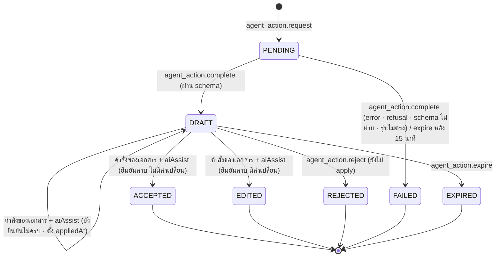

# S13 · AI Agent ของระยะ 1 — sub-spec

เอกสารนี้ขยาย §16.17 สำหรับการลงมือ · spec.md มีลำดับเหนือกว่าเสมอ ถ้าขัดกันให้ยึด spec แล้วแก้ไฟล์นี้
สถานะ: ร่าง P1-04 (2026-10-11) · ตรวจแล้วใน P1-05 · ผู้ใช้อนุมัติตามที่แนะนำทั้ง 88 เรื่องของ `docs/reports/p1-decisions.md` ใน P1-06 (2026-10-12) · เลข BR GC INV event error และความสามารถในไฟล์นี้เป็นร่าง จะเพิ่มลง spec ในข้อที่สร้างโค้ดนั้น

วิธีอ่าน: ไฟล์นี้ยาว ให้อ่านเฉพาะหัวข้อที่ข้อ checklist อ้าง (หาเลขบรรทัดด้วย `grep -n "^## " docs/sub-specs/S13.md`) · AC ของ FR ชั้น 2 อยู่ในหัวข้อ "FR และ AC" ของไฟล์นี้ เทสต์ใช้แท็ก `[FR-xxx-1nn/ACn]` ตามเลขในไฟล์นี้

## ขอบเขต

| เรื่อง | รายละเอียด |
| --- | --- |
| FR | FR-AI-303 Document Agent (ข้อแรก: ใบเสนอราคาและใบส่งของก่อน ใบแจ้งหนี้หลังงานของ S8 เข้า main · §16.2 ข้อ 6) · FR-AI-302 Intake Agent · FR-AI-301 Approval Brief · FR-AI-307 Insight Agent · FR-AI-309 ⌘K "ถาม BCS AI" · FR-AI-308 ร่างกฎ DOA จากระเบียบ |
| ระดับความอิสระ | L0 (Brief Insight) และ L1 (Document Intake ร่าง DOA) เท่านั้น (ADR-004 · §12.3) · ไม่มี L2 L3 และไม่มีสถานะ `AUTO_APPLIED` ในระยะ 1 |
| นอกขอบเขต | FR-AI-304 ถึง FR-AI-306 (ระยะ 2) · อ่านใบแจ้งหนี้จากกล่องอีเมลอัตโนมัติ (FR-INTG-302 · S14) · การเทรนหรือ fine-tune (NG-6) · ชุดประเมินด้วยเอกสารจริง (ข้อ `[go-live]` · P0-02) · webhook และหน้าแชท LINE (S17 เป็นเจ้าของ เรียก interface ของขั้นนี้) · แอป BCS Go · เครื่องมือ Insight ของใบแจ้งหนี้และรอบจ่าย (S8 S9) · ปุ่มอ่านใบส่งของใน LIFF `/liff/gr/[poId]` · ใบแจ้งหนี้ e-Tax (ทางนำเข้าของ S8 ไม่ผ่าน AI) |
| ขึ้นกับ | P1-07 (สาย 3 · โมดูล `AI` ของ SIMEC ใน seed · `src/server/services/ai/assist-contract.ts` ที่มี `AiAssistInput` และตัวว่างของ `assertNoPendingAiReview` `applyAiAssist` พร้อมแถว `AI_REVIEW_PENDING` ใน §14.2 · ฟิลด์ `aiAssist` ไม่บังคับใน input ของ `gr.post` · event `request.drafted` schemaVersion 2 ที่มี `source` และ `agentActionId?` · บล็อก `// --- S13 ---` ใน `schema.prisma` · หัวข้อ golden ของ AI ที่จองไว้ท้าย §12) · `src/core/money` `vat` `thai` `forms` `invoice` เดิม · ตัวอ่าน e-Tax เดิม (`readEtaxContent` ใน `src/server/services/invoices/etax.ts` · BR-IVC-05) · `doa.import_draft` เดิม (FR-DOA-001 AC2) · บริการอ่านเดิมของ ⌘K งบ กระดาน KPI สรุปผู้บริหาร |
| ใช้ของสายอื่น | S6: `getPriceReference` `listRequestFlags` `getRouteView` `CatalogItem` + `PriceAgreement` · S8: `invoice.createDraftFromReading` `invoice.update` `invoice.submit` และทางนำเข้า e-Tax · S17: job ของ S17-08 เรียก `intakeFromMessage` · ใช้ได้เมื่อเข้า main แล้ว ก่อนนั้นใช้ทางสำรองในหัวข้อ "interface" |
| ของเดิมที่แตะ | `src/lib/env.ts` (เลิกบังคับ `AI_ENABLED=false` · ADR-142) · คำสั่ง `request.create_draft` `request.edit` `request.submit` `request.resubmit` `gr.post` `doa.import_draft` รับ `aiAssist` แบบไม่บังคับเป็น hook บรรทัดเดียวต่อคำสั่ง (ADR-148 · ฟิลด์ของ `gr.post` P1-07 เพิ่มไว้แล้ว) · `QuotationInput` ของ `request.edit` รับ `supplierId?` · ไม่เปลี่ยนผลการคำนวณเงินใด ๆ · ปิด AI แล้วทุกคำสั่งทำงานเหมือนเดิมทุกไบต์ของผล |

## ชั้น demo และชั้นของจริงของ "เสร็จเมื่อ"

| เกณฑ์ต้นฉบับ §16.8 | ชั้น demo รอบนี้ | ชั้นของจริง `[go-live]` และของที่ต้องได้ |
| --- | --- | --- |
| แต่ละฟีเจอร์ผ่านชุดทดสอบความแม่นตามเกณฑ์ที่ตั้งไว้ก่อนเปิดใช้ | ชุดประเมินสังเคราะห์ (หัวข้อ "ชุดประเมิน"): เอกสารตามชีต DocSamples และเคสเพิ่มใน `tests/fixtures/ai-docs/cases.yaml` (ไฟล์สร้างใน S13-05) · คำขอสังเคราะห์จาก Request_History · คำถาม Insight · ระเบียบสังเคราะห์ 2 ฉบับ · เกณฑ์ OQ-141 · วัดกับ Claude จริงด้วย key dev ของ BCS (S13-13 S13-14) · ผ่านแล้วบันทึก gate ชั้น `SYNTHETIC` ซึ่งใช้ได้บน local และ staging | เอกสารจริงที่ลบข้อมูลอ่อนไหวแล้ว (P0-02) พร้อมคำตอบที่คนตรวจ · เกณฑ์ OQ-142 ที่ลูกค้าตั้ง · key production ของ BCS (P0-13 · OQ-143) · สัญญาและการไม่เก็บข้อมูลกับ Anthropic (OQ-144 · NFR-PRIV-06) · gate ชั้น `REAL` บังคับใน production · ประเมินรายคืนอัตโนมัติ (S13-17) |
| ปิด AI แล้วทุกฟีเจอร์ยังทำงาน (EG-1 · NG-5) | เทสต์ที่รันฉาก `@demo` เดิมและเทสต์ของคำสั่งที่แตะ เมื่อ `AI_ENABLED=false` และเมื่อปิดโมดูล `AI` | เหมือนชั้น demo บน staging ที่ใช้ key จริง |
| ข้อมูลที่ส่งให้ AI | ข้อมูลสังเคราะห์เท่านั้น (OQ-19) | ข้อมูลจริงหลัง OQ-19 และ OQ-144 ปิด |

## Demo ของขั้น

ผู้ใช้และยอดจาก `scripts/inputs_p1/` (SIMEC) · P1-08 กำหนดฉากจริง

1. `fm_p02` (โครงการคอนโดบางนา) เปิดฟอร์มซื้อของ ขั้น 0 ลากไฟล์ใบเสนอราคา DOC-049 (เช่ารถแบ็คโฮ PC200 25 วัน ราคารวม VAT แบบฟอร์มภาษาอังกฤษ สแกนเอียง) → AI เติมผู้ขาย SP0068 รายการ 25 วัน × 5,187.36 ยอดรวม 129,684.00 (ก่อน VAT 121,200.00 VAT 8,484.00) และเสนอให้เปลี่ยนเป็นประเภท "จ้างบริการ" → ผู้ขอยืนยันช่องเงินทีละช่อง เปลี่ยนประเภท กรอกเหตุผลผู้ขายรายเดียว (ATT-QUOTES) แล้วส่ง → ใบเสนอราคาบันทึกพร้อมผู้ขายในทะเบียนและไฟล์ที่อ่าน → เส้นทาง PR-03 ไป `ceo`
2. `ceo` เปิดงาน เห็นกล่อง "สรุปจาก AI": ยอดตามฐาน DOA งบเช่าเครื่องจักรของโครงการ P02 คงเหลือหลังคำขอนี้ ใบเสนอราคาเดียวพร้อมเหตุผล ป้ายราคาอ้างอิงของรายการ (เมื่อ S6 เข้า main) · ตัวเลขทุกตัวมาจากโค้ด ไม่มีปุ่มให้ AI ตัดสิน
3. `store_p04` บันทึกตรวจรับที่ `/receiving/[poId]` ของคำขอท่อ PPR 1 นิ้ว 18 ท่อน (DOC-001 ถึง DOC-003) กด "อ่านใบส่งของ" DOC-002 → จำนวนรับ 18 ท่อนถูกเติมที่บรรทัด PO และยืนยันก่อนบันทึก
4. (หลัง S8 เข้า main) `fin_ap1` อ่านใบแจ้งหนี้ DOC-003 เลขที่ INV-00373 → ร่างผ่าน `invoice.createDraftFromReading` 5,580.00 + VAT 390.60 = 5,970.60 → ยืนยันทุกช่องแล้วส่ง (`invoice.submit`) เข้าจับคู่ 3 ทาง · DOC-054 (e-Tax XML) นำเข้าด้วยทาง e-Tax ของ S8 โดยไม่เรียก AI
5. `ceo` กด ⌘K พิมพ์ "งบไหนใกล้หมด" → "ถาม BCS AI" → ตอบว่างบดำเนินงานฝ่ายการตลาดเหลือต่ำกว่าเกณฑ์ 10% พร้อมลิงก์ (ชื่อและร้อยละแทนค่าจากผลเครื่องมือ) · `se_p01a` ถามคำเดียวกัน → "ไม่พบข้อมูลในสิทธิ์ของคุณ"
6. `admin` อัปโหลด "ระเบียบอำนาจอนุมัติ (สังเคราะห์)" REG-A → ร่างครบทุกข้อของ DOA-SIMEC ฉบับ 1 (ชีต DOA หลัง P1-07) พร้อมข้อความต้นทางและเลขหน้า → ตรวจทีละข้อคู่กับหน้า PDF → lint ผ่าน → สร้างฉบับร่างด้วยคำสั่งเดิม (ไม่ส่งเผยแพร่) · REG-B ที่เขียนแบบ "20,001" ถูก lint จับเป็น `DOA_LINT_GAP`
7. `admin` ปิด Intake Agent ที่ `/admin/ai` → ขั้น 0 หายจากฟอร์ม และฟอร์มกรอกเองได้ครบ

## สถาปัตยกรรม

| ชั้น | ไฟล์ | หน้าที่ |
| --- | --- | --- |
| core (pure) | `src/core/ai-checks` | normalize ส่วนลดและตรวจผลอ่าน (BR-AI-14 BR-AI-15) · ความมั่นใจ (BR-AI-16) · แปลงเป็นใบเสนอราคาและบรรทัดตรวจรับ (BR-AI-25) · ตัวตรวจข้อความที่มี placeholder (BR-AI-27 · ADR-144) · คิด credits (BR-AI-23) · ให้คะแนนชุดประเมิน (BR-AI-26) · เพิ่มใน branch coverage 100% ของ §7.0 ข้อ 4 |
| config (ไม่มี I/O) | `src/lib/ai-config.ts` | รุ่น prompt ปัจจุบันต่อ purpose · รุ่นโมเดลต่อ agent (จาก env) · ตารางราคาพร้อมวันที่ตรวจ · รายการ gate ของชุดประเมิน · ขีดจำกัด (BR-AI-21 BR-AI-27) · ทั้ง `assist-contract.ts` service และ adapter import ได้ (§4.10 · ADR-143) |
| integration | `src/integrations/ai` | ที่เดียวที่ import `ai` `@ai-sdk/anthropic` (P-3 · ADR-060) · `AiClient` มี `extract(schema, prompt, files)` `write(schema, prompt)` `answerWithTools(tools, messages)` · โหมด `fixture` และ `live` (ADR-142) · ข้อความ prompt ต่อ purpose ที่ export เลขรุ่นของตัวเอง (เทสต์ว่าตรง `ai-config`) · คืนรุ่นที่ตอบจริงจาก response |
| service ของ agent | `src/server/services/ai/agents/*` | `document.ts` `intake.ts` `brief.ts` `insight.ts` `doa-drafter.ts` · เรียก `AiClient` และคำสั่งของ `agent_action` เท่านั้น ห้ามเรียกคำสั่งที่เปลี่ยนเงินหรือการอนุมัติ (BR-AI-01) |
| เครื่องมือของ Insight | `src/server/services/ai/tools/*` | ห่อบริการอ่านที่ตรวจ scope เองแล้ว และ query ใหม่ของ PO และผู้ขายที่กรอง scope (ADR-147) |
| API สาธารณะของโมดูล | `src/server/services/ai/index.ts` | `readDocument` `intakeFromMessage` `getAgentAction` `isAgentAvailable` `approvalBriefOf` (หัวข้อ "interface") |
| ด่านยืนยัน | `src/server/services/ai/assist-contract.ts` | P1-07 วาง `AiAssistInput` (Zod `{ agentActionId, confirmedPaths }`) และตัวว่าง `assertNoPendingAiReview(tx, ctx, subject)` (คืน ok) `applyAiAssist(tx, ctx, subject, input?)` (ไม่มี input = ไม่ทำอะไร · มี input = `MODULE_DISABLED`) · S13-03 เปลี่ยนตัวว่างเป็นของจริงโดยไม่เปลี่ยน signature · ไม่ import `src/integrations/ai` และ `agents` · service ของเอกสาร (คำขอ ตรวจรับ DOA ใบแจ้งหนี้ของ S8) import ได้เฉพาะไฟล์นี้ (ADR-148) |
| งานเบื้องหลัง | `src/server/jobs/ai-*.ts` | `ai-agent-run` (จาก `agent_action.requested` ของ Document Intake ร่าง DOA) · `ai-approval-brief` (จาก `approval_task.assigned` `approval_task.reassigned` เฉพาะขั้นอนุมัติ · BR-AI-20) · `ai-actions-expire` (ทุกชั่วโมง · หมดอายุและล้างเนื้อหาตาม BR-AI-18) · `ai-credit-monthly` (วันที่ 1 เวลา 00:05 เวลาไทย) (ADR-145) |
| route | `POST /api/ai/ask` (stream) · `POST /api/ai/read` · `POST /api/ai/intake` · `GET /api/ai/actions/[id]` (อ่านอย่างเดียว) | ทุก route เรียก service · GET ไม่เปลี่ยนสถานะ |

ตัวแปรใน `.env` (ภาคผนวก B): `AI_ENABLED` · `AI_MODE=fixture|live` · `ANTHROPIC_API_KEY` · `AI_MODEL_DEFAULT` และ `AI_MODEL_DOCUMENT` `AI_MODEL_INTAKE` `AI_MODEL_BRIEF` `AI_MODEL_INSIGHT` `AI_MODEL_DOA_DRAFTER` (ค่าเริ่มต้นตาม OQ-145) · กติกา: `AI_ENABLED=true` ต้องมี `AI_MODE` · `live` ต้องมี key · `fixture` ใช้ได้เฉพาะ `APP_ENV=local` และเทสต์ (staging และ production ปฏิเสธตอนเริ่มแอป)

ค่าเริ่มต้นของการเรียก (ตรวจกับเอกสารของ Claude API ใน S13-01): structured outputs ผ่าน `output_config.format` จาก Zod ไม่ใช้ tool บังคับ เพราะ Claude Opus 5.5 และ Sonnet 5.5 ปฏิเสธ `tool_choice` แบบบังคับ (ADR-141) · schema ไม่ใช้ min max ของตัวเลข โค้ดตรวจและตัดช่วงเอง · ตั้ง `effort` ต่อ agent ชัดเจน · ไม่เปิด fallback ของรุ่นทั้งแบบที่ API ทำให้ฝั่งเซิร์ฟเวอร์และแบบที่โค้ดสลับรุ่นเอง เพราะ gate ผูกกับรุ่น · เก็บรุ่นที่ตอบจริงจาก response ลง `AgentAction.model` ไม่ตรงรุ่นที่ขอ → FAILED (`AI_MODEL_MISMATCH`) · `stop_reason = refusal` → FAILED ทางกรอกเอง · ไฟล์ PDF ส่งเป็น document block ภาพเป็น image block · prompt caching กับ system prompt และ schema ที่คงที่ ใช้ TTL 5 นาทีค่าเดียว

โหมด fixture เลือกคำตอบที่บันทึกด้วยคีย์ `<purpose>/<sha256 ของไฟล์หรือข้อความที่ normalize แล้ว>` ใน `tests/fixtures/ai/` (ไฟล์คำตอบเก็บ promptVersion และรุ่นที่บันทึกไว้ด้วย) · เทสต์ส่งคำตอบเองได้ · ไม่พบคำตอบ → FAILED (`FIXTURE_MISSING`)

## Entity และ migration

ทุกตารางมี `organizationId` · FK คู่ `(organizationId, id)` ตาม ADR-039 · `createdAt` `updatedAt` · unique ทางธุรกิจรวม `organizationId` · เพิ่ม migration ต่อท้ายเท่านั้น · relation ใน model ที่หลายสายแก้ (`Organization` `Member` `FileObject` `Request` `PurchaseOrder`) เพิ่มใต้บล็อก `// --- S13 ---` ที่ P1-07 จองไว้

**enum ใหม่:** `AiAgent` (`DOCUMENT` `INTAKE` `APPROVAL_BRIEF` `INSIGHT` `DOA_DRAFTER`) · `AiPurpose` (`QUOTATION_READ` `DELIVERY_NOTE_READ` `INVOICE_READ` `INTAKE` `BRIEF` `QUESTION` `DOA_DRAFT`) · `AiLevel` (`L0` `L1`) · `AgentActionStatus` (`PENDING` `DRAFT` `ACCEPTED` `EDITED` `REJECTED` `FAILED` `EXPIRED`) · `AiCreditKind` (`GRANT` `USE`) · `AiCreditSource` (`MONTHLY` `TOPUP` `CALL`)

**`AgentAction`** (§12.2 · aggregate มี `version`)

| ฟิลด์ | ชนิด | หมายเหตุ |
| --- | --- | --- |
| `agent` `purpose` `level` | enum | `level` ได้จาก `AiAgentSetting` ตอนเรียก |
| `status` | `AgentActionStatus` | ตาม state machine |
| `subjectType` `subjectId` | String? · Uuid? | `REQUEST` `PURCHASE_ORDER` `INVOICE` `APPROVAL_TASK` `DOA_VERSION` `CHAT_INTAKE` · ว่างได้จนกว่าจะ apply (ขั้น 0 ก่อนมีร่าง · Insight) · `CHAT_INTAKE` ไม่มี FK (ตารางของ S17) · `applyAiAssist` เปลี่ยนเป็นเอกสารที่รับค่า |
| `requestedById` | Uuid? → Member | ว่างเมื่อ SYSTEM เรียก (Brief) · Intake จากแชท = เจ้าของร่าง |
| `channel` | `Channel` | WEB LIFF LINE_CHAT SYSTEM |
| `conversationId` | Uuid? | คำถามต่อเนื่องของ Insight |
| `promptVersion` `model` | String · String? | `<purpose>@<n>` (ADR-143) · รุ่นที่ตอบจริงจาก response (BR-AI-04 BR-AI-09) · `model` ว่างเฉพาะ FAILED ก่อนเรียก |
| `inputRefs` | Json | id ของไฟล์ เอกสาร งาน `chatIntakeId` AgentAction ของไฟล์ที่ Intake ใช้ facts ที่ Brief ใช้ และผลเครื่องมือ ไม่เก็บสำเนาเอกสาร (BR-AI-04) |
| `inputText` | String? (≤ 2,000) | ข้อความที่ผู้ใช้พิมพ์บนเว็บ หลังผ่าน redactor (BR-AI-18) · Intake จากแชทไม่เก็บ (ข้อความอยู่ใน `ChatIntake` ของ S17) |
| `idempotencyKey` | String? (≤ 200) | คีย์กันซ้ำของ `intakeFromMessage` (S17 ส่ง `chat_intake:<chatIntakeId>:<ลำดับข้อความ>`) · ว่างเมื่อเรียกทางอื่น |
| `output` `verification` `fieldConfidence` | Json? | ผลตาม schema · ผลตรวจรายข้อ · ความมั่นใจต่อฟิลด์หน่วย bp (0–10000) |
| `review` `diff` | Json? | `{ requiredPaths, confirmedPaths }` · ค่าของ AI เทียบค่าสุดท้ายของช่องที่คนแก้ |
| `appliedAt` `appliedById` | Timestamptz? · Uuid? | เวลาที่ค่าถูกเขียนเข้าเอกสารร่าง |
| `decidedById` `decidedAt` | Uuid? · Timestamptz? | ผู้ยอมรับ แก้ หรือทิ้ง (`acceptedById` ของ §12.2) |
| `feedback` `feedbackNote` | enum? (`HELPFUL` `NOT_HELPFUL`) · String? | สำหรับ L0 |
| `errorCode` `expireReason` | String? · enum? (`SUPERSEDED` `SUBJECT_CLOSED` `STALE`) | |
| `contentPurgedAt` | Timestamptz? | เวลาที่ล้าง `output` ตาม BR-AI-18 (คงแถวและ metadata) |
| `inputTokens` `outputTokens` `cacheReadTokens` `cacheWriteTokens` `costCredits` `latencyMs` | Int | CHECK ≥ 0 · `latencyMs` ว่างได้ |

index: `(organizationId, subjectType, subjectId, status)` · `(organizationId, agent, createdAt)` · `(organizationId, requestedById, createdAt)` · unique `(organizationId, id)` · unique `(organizationId, idempotencyKey)` เมื่อไม่ว่าง

**`AiAgentSetting`**: `agent` · `enabled` Boolean (ค่าเริ่มต้น false) · `level` · `minConfidenceBp` Int (ค่าเริ่มต้น 9000 · CHECK 0–10000 · OQ-147) · `updatedById` · `version` · unique `(organizationId, agent)`

**`AiCreditLedger`** (append-only · trigger ห้าม UPDATE DELETE แบบ ledger อื่นตาม §6.3): `kind` · `source` · `credits` Int (CHECK > 0) · `periodMonth` Date (วันที่ 1 ของเดือนตามเวลาไทย) · `agentActionId` Uuid? · `platformAdminId` Uuid? · `contractRef` `reason` String? · `occurredAt` · unique `(organizationId, agentActionId)` เมื่อ `kind = USE` · unique `(organizationId, periodMonth)` เมื่อ `source = MONTHLY`

**`Organization.settings.ai`** (Zod · แก้ได้เฉพาะ PLATFORM_ADMIN ผ่านหน้า platform): `monthlyCredits` Int (ค่าเริ่มต้นตาม OQ-143) · `alertAtBp` Int (8000)

**ของเดิมที่เพิ่ม:** ไม่มีคอลัมน์ใหม่ในตารางเงิน · `QuotationInput` ของ `request.edit` รับ `supplierId?` (uuid · ต้องเป็นผู้ขายของ tenant · `writeQuotations` ใส่ลง `RequestQuotation.supplierId` ที่มีอยู่แล้ว · S13-07) · event `request.drafted` ใช้ `agentActionId?` ของ schemaVersion 2 ที่ P1-07 นิยาม ไม่ bump เอง · `doa_version.drafted` เพิ่ม `agentActionId?` แบบไม่บังคับ (S13 เป็นขั้นเดียวที่แก้ event นี้) · `Invoice.agentActionId` ของ S8 ได้ FK คู่ไป `AgentAction` ใน S13-12 · ไม่สร้างตาราง `PromptVersion` `AiEvalRun` ในระยะ 1 (ADR-143)

seed (local และ staging เท่านั้น): `AiAgentSetting` ครบ 5 ตัว enabled และ GRANT รายเดือนของ SIMEC · โมดูล `AI` ของ SIMEC มาจาก P1-07 (`contractRef` `SEED-P1`) ขั้นนี้ไม่ seed โมดูลซ้ำ · องค์กร DEMO ไม่เปิด `AI` เพื่อให้ `@demo` ไม่เปลี่ยน

## State machine



| จาก | คำสั่ง | ไป | ใครทำได้ | event |
| --- | --- | --- | --- | --- |
| — | `agent_action.request` | PENDING | USER ที่มี `ai.assist` `ai.ask` หรือ `ai.doaDraft` และสิทธิ์ของเอกสาร · SYSTEM (Brief) | `agent_action.requested` |
| PENDING | `agent_action.complete` | DRAFT | SYSTEM ในฐานะ AI_AGENT (`agentId` = promptVersion) | `agent_action.drafted` |
| PENDING | `agent_action.complete` · `agent_action.expire` (PENDING เกิน 15 นาที) | FAILED | SYSTEM | `agent_action.failed` |
| DRAFT (L1) | คำสั่งของเอกสาร + `aiAssist` ที่ยังยืนยันไม่ครบ | DRAFT (`appliedAt`) | ผู้มีสิทธิ์แก้เอกสารนั้น | `agent_action.applied` |
| DRAFT (L1) | คำสั่งของเอกสาร + `aiAssist` ยืนยันครบ | ACCEPTED หรือ EDITED | ผู้มีสิทธิ์แก้เอกสารนั้น | `agent_action.accepted` · `agent_action.edited` |
| DRAFT (L1 ยังไม่ apply) | `agent_action.reject` | REJECTED | ผู้เรียก | `agent_action.rejected` |
| DRAFT | `agent_action.expire` | EXPIRED | SYSTEM (job) | `agent_action.expired` |
| DRAFT (L0) | `agent_action.give_feedback` | DRAFT | ผู้เห็นผล | `agent_action.feedback_given` |

เหตุหมดอายุ: `SUPERSEDED` (อ่านเอกสารเดิมใหม่ หรือ Brief ใหม่หลังส่งต่องาน) · `SUBJECT_CLOSED` (คำขอยกเลิกหรือร่างหมดอายุ งานอนุมัติปิด) · `STALE` (DRAFT ระดับ L1 ที่ไม่ถูก apply ใน 24 ชั่วโมง) · DRAFT ที่ apply แล้วไม่หมดอายุแบบ STALE เพราะยังกันการส่งเอกสาร · L0 ที่แสดงผลแล้วอยู่ที่ DRAFT เป็นสถานะสุดท้าย

คำสั่งอื่น: `ai_agent.update` (ORG_ADMIN · event `ai_agent.enabled` `ai_agent.disabled` `ai_agent.updated`) · `ai_credit.grant` (PLATFORM_ADMIN · `ai_credit.granted`) · `ai_credit.grant_monthly` (job · `ai_credit.granted`) · ถึงเกณฑ์แจ้ง → `ai_credit.threshold_reached` · หมด → `ai_credit.exhausted` · `agent_action.purge_content` (job · `agent_action.content_purged` · ไม่เปลี่ยนสถานะ)

## กฎ

| ID | กฎ |
| --- | --- |
| BR-AI-11 | เรียก agent ได้เมื่อผ่านทุกด่านตามลำดับ: `AI_ENABLED` · `requireModule(ctx, 'AI')` · `AiAgentSetting.enabled` · โหมด live: ชุด (agent, purpose, promptVersion, model) อยู่ใน gate ของชั้นที่ env ต้องการ (production = `REAL` · อื่น = `SYNTHETIC`) · โหมด fixture ข้ามด่าน gate (ใช้ได้เฉพาะ local และเทสต์ · ADR-142) · credits คงเหลือ > 0 · ไม่เกิน 10 ครั้งต่อนาทีต่อสมาชิก · ไม่ผ่านด่านใด → ปฏิเสธด้วยรหัสของด่านนั้น (`AI_AGENT_DISABLED` `MODULE_DISABLED` `AI_NOT_EVALUATED` `AI_CREDITS_EXHAUSTED` `RATE_LIMITED`) หน้าจอไม่แสดงปุ่ม AI และฟีเจอร์เดิมทำงานต่อ (EG-1) · ไม่ใช้ fallback ของรุ่น · รุ่นใน response ไม่ตรงรุ่นที่ขอ → FAILED (`AI_MODEL_MISMATCH`) |
| BR-AI-12 | Document Agent รับไฟล์ที่ผู้เรียกมีสิทธิ์เห็นและสถานะ `AVAILABLE` ชนิด PDF JPEG PNG WebP ตรวจ magic bytes ไม่เกิน 20 MB ไม่เช่นนั้น `AI_FILE_UNSUPPORTED` · ระยะ 1 ไม่นับหน้าเอง (ไม่มีตัวอ่าน PDF ใน §5.5 · เรื่องที่ผู้ใช้ต้องตัดสิน) API ปฏิเสธเพราะเอกสารยาวเกิน → FAILED (`AI_FILE_TOO_LONG`) · ไฟล์ e-Tax (PDF/A-3 ที่ฝัง XML หรือ XML) ตรวจด้วย `readEtaxContent` (BR-IVC-05) ก่อนเสมอ ไม่ส่ง AI ไม่สร้าง AgentAction ไม่คิด credits และปฏิเสธด้วย `AI_FILE_UNSUPPORTED` reason `ETAX` ให้หน้าจอพาไปทางนำเข้า e-Tax ของ S8 (prefill `ETAX_XML`) |
| BR-AI-13 | ผลของ AI ต้องผ่าน Zod schema ก่อนเป็น DRAFT ไม่ผ่าน → FAILED (`AI_OUTPUT_INVALID`) · ผลที่ผ่าน schema ทุกฉบับผ่านการตรวจของระบบ (BR-AI-14 BR-AI-15) ผลตรวจไม่ทำให้ FAILED แต่ทำให้ฟิลด์ที่เกี่ยวข้องถูกไฮไลต์และต้องยืนยันทีละช่อง |
| BR-AI-14 | การตรวจยอด (ชุด ai-verify): ส่วนลดอยู่ในช่อง `discountTotal` ไม่ติดลบ · บรรทัดที่ยอดติดลบตรวจ `LINE_AMOUNT` แล้วโค้ดย้ายไปรวมเป็น `discountTotal` (normalize) · มีทั้ง `discountTotal` และบรรทัดติดลบ → `DISCOUNT_AMBIGUOUS` FAIL และข้ามการตรวจยอดรวม · ยอดต่อบรรทัด = จำนวน × ราคาต่อหน่วยปัด half-up (BR-MONEY-02) ต้องเท่ายอดบรรทัดที่อ่านได้ทุกสตางค์ (`LINE_AMOUNT`) · ยอดฐาน = Σ ยอดต่อบรรทัดที่คำนวณ − ส่วนลด · ราคาไม่รวม VAT: ยอดก่อน VAT ที่อ่านได้ต้องเท่ายอดฐาน (`NET_TOTAL`) · VAT ที่คำนวณ = `vatFromNet(ยอดฐาน)` · ยอดรวมที่อ่านได้ต้องเท่ายอดก่อน VAT + VAT ที่อ่านได้ (`GROSS_TOTAL`) · ราคารวม VAT: ยอดรวมที่อ่านได้ต้องเท่ายอดฐาน (`GROSS_TOTAL`) · VAT ที่คำนวณ = `vatFromGross(ยอดฐาน)` (BR-VAT-03) · ยอดก่อน VAT ที่อ่านได้ต้องเท่ายอดรวม − VAT ที่อ่านได้ (`NET_TOTAL`) · ทั้งสองแบบ: VAT ที่อ่านได้เทียบ VAT ที่คำนวณ เท่ากัน PASS · ต่างไม่เกิน 1.00 บาท WARN · เกิน FAIL (`VAT_AMOUNT` · เกณฑ์เดียวกับ BR-IVC-01) · อัตรามาจาก `TaxRate` ณ วันที่เอกสารตามเวลาไทย ไม่มีอัตรา → `VAT_RATE_MISSING` FAIL และข้าม `VAT_AMOUNT` · ผู้ขายไม่จด VAT (BR-VAT-04): VAT ต้องเป็น 0 ตรวจด้วย `NON_VAT_SELLER` แทน `VAT_AMOUNT` · ผลอ่านระยะ 1 ไม่มีบรรทัดยกเว้น VAT (BR-VAT-02) ทุกบรรทัดถือว่าคิด VAT เอกสารที่มีบรรทัดยกเว้นจึงได้ `VAT_AMOUNT` FAIL แล้วคนแก้ · ใบส่งของไม่มียอดจึงข้ามการตรวจยอด |
| BR-AI-15 | การตรวจตัวตนและวันที่: ผู้ขายของบริบท = ผู้ขายที่ผู้ใช้เลือกหรือของ PO (ไม่ใช่ค่าที่ AI อ่าน) · เลขผู้เสียภาษีผู้ขายผ่าน BR-TAXID-01 (`TAXID_CHECKSUM`) และตรงผู้ขายของบริบท (`SELLER_MATCH`) · สาขาไม่ตรง: ใบกำกับ FAIL อื่น WARN (`SELLER_BRANCH`) · ไม่มีผู้ขายของบริบท → ข้าม `SELLER_MATCH` `SELLER_BRANCH` และดูการจด VAT จากผู้ขายในทะเบียนที่เลขและสาขาตรง (ไม่พบถือว่าจด) · เลขผู้ซื้อที่อ่านได้ไม่ตรงองค์กร: ใบกำกับ FAIL อื่น WARN (`BUYER_MATCH`) · วันที่เอกสารหลังวันนี้ตามเวลาไทยของ `ctx.now` → FAIL (`DOC_DATE_FUTURE` · จับปี พ.ศ. ที่ไม่ได้แปลงด้วย) · อายุเอกสารเกิน 365 วัน (366 ขึ้นไป) → WARN (`DOC_DATE_OLD`) · สกุลเงินไม่ใช่ THB → FAIL ทั้งเอกสารและไม่แปลงเป็นค่าในฟอร์ม (`CURRENCY` · NG-9) |
| BR-AI-16 | ความมั่นใจ (ชุด ai-confidence): โมเดลคืนจำนวนเต็มต่อฟิลด์ โค้ดตัดให้อยู่ใน 0–100 · ความมั่นใจของฟิลด์ (bp) = min(ค่านั้น × 100, เพดานจากผลตรวจ: FAIL → 0 · WARN → 5000 · PASS หรือไม่มีการตรวจ → 10000) · ช่องที่ต้องยืนยันทีละช่อง = กลุ่มสำคัญทุกค่า (เงิน จำนวน เลขผู้เสียภาษี สาขา ประเภทคำขอ) + ค่าที่ความมั่นใจต่ำกว่า `minConfidenceBp` (เท่าเกณฑ์ไม่ต้อง) · ช่องอื่นยืนยันรวมด้วยปุ่ม "ยืนยันค่าที่เหลือทั้งหมด" ที่ผู้ใช้ต้องกดเอง (OQ-147 · BR-AI-02) |
| BR-AI-17 | ค่าของ AI เข้าเอกสารผ่านคำสั่งเดิมของเอกสารนั้นที่รับ `aiAssist = { agentActionId, confirmedPaths }` โดยผู้กระทำเป็นคน (actor USER) ในธุรกรรมเดียวกัน (`applyAiAssist`) · AgentAction ต้องเป็นขององค์กรเดียวกัน สถานะ DRAFT ระดับ L1 และ purpose ตรงเอกสาร (`QUOTATION_READ` `INTAKE` → คำขอ · `DELIVERY_NOTE_READ` → ตรวจรับ · `INVOICE_READ` → ใบแจ้งหนี้ · `DOA_DRAFT` → DOA) · subject ที่ว่างหรือเป็น `CHAT_INTAKE` เปลี่ยนเป็นเอกสารที่รับค่า · ช่องที่ต้องยืนยันนับว่ายืนยันแล้วเมื่ออยู่ใน `confirmedPaths` หรือค่าสุดท้ายต่างจากค่าของ AI (คนแก้) หรือไม่มีในเอกสารแล้ว (คนลบ) · คำสั่งที่ส่งหรือบันทึกขั้นถัดไป (`request.submit` `request.resubmit` `gr.post` `invoice.submit` ของ S8 `doa.import_draft`) เรียก `assertNoPendingAiReview` และปฏิเสธด้วย `AI_REVIEW_PENDING` เมื่อมี AgentAction สถานะ DRAFT ที่ apply แล้วผูกกับเอกสารและยังยืนยันไม่ครบ หรือ `aiAssist` ที่ส่งมายืนยันไม่ครบ · `gr.post` ตรวจตามลำดับของ BR-APP-08 ของ S17: `capturedByMemberId` ของ `offline` → สิทธิ์และ SoD → สถานะ PO → version → `capturedAt` → ตรรกะเดิม → `aiAssist` |
| BR-AI-18 | ข้อมูลส่วนบุคคล: schema ของผลอ่านไม่มีเลขบัญชีธนาคาร · ข้อความที่ระบบประกอบส่งให้ AI (Brief Insight Intake) ผ่าน redactor ที่แทนเลขบัญชี (รูปแบบ 10–12 หลักและแบบมีขีด) และเลข 13 หลักของบุคคลธรรมดาด้วย `[ปิดบัง]` · ผลเครื่องมือของ Insight ไม่มีเลขผู้เสียภาษีของบุคคลธรรมดา อีเมล โทรศัพท์ และที่อยู่ · log มีเฉพาะ id ของ AgentAction ไม่มี input output (NFR-SEC-09) · Intake จากแชทไม่เก็บ `inputText` · `output` ของ AgentAction ที่ subject ยังเป็น `CHAT_INTAKE` (ไม่ถูก apply) ถูกล้างเมื่ออายุเกิน 7 วัน (ค่าคงที่ใน `ai-config` · OQ-144) · `inputText` และ `output` ของ AgentAction อื่นที่ไม่ถูก apply (Insight ทุกครั้ง · Brief หลังงานอนุมัติปิด · ระดับ L1 ที่ REJECTED EXPIRED หรือ FAILED) ล้างตามระยะในตาราง "เรื่องที่ผู้ใช้ต้องตัดสิน" (ค่าคงที่ใน `ai-config` · `// TODO(OQ-144)`) ที่ apply แล้วเก็บตามอายุเอกสารที่รับค่า (NFR-PRIV-04) · ไฟล์ภาพและ PDF ส่งทั้งไฟล์เพราะปิดบังพิกเซลไม่ได้ จึงใช้ได้กับข้อมูลจริงเมื่อ OQ-144 ปิดเท่านั้น |
| BR-AI-19 | Intake Agent: เสนอประเภทได้เฉพาะประเภทที่องค์กรเปิดและผู้ขอสร้างได้ · ไม่เติมคำถามคัดกรอง BR-FORM-05 (OQ-148) บรรทัดงบ cost center แผนกที่ตั้งเบิก ผู้อนุมัติ และไฟล์แนบอื่น (มาจาก BR-FORM-02 และ DOA · ไฟล์ใบเสนอราคาที่อ่านผูกกับ `RequestQuotation.fileId` ตาม BR-AI-25) · schema ของผลสร้างจาก FormVersion ของประเภทนั้น (BR-AI-10) · ไฟล์ที่แนบไป Intake อ่านในการเรียกเดียวกันของ Intake (S13-08: ไฟล์ส่งไปกับข้อความใน extract เดียว ตามชุดประเมินของ S13-05 · อ้างใน `inputRefs.fileIds` ของ INTAKE · ไม่มี AgentAction แยกต่อไฟล์ · ใบเสนอราคาที่ต้องการค่าครบใช้ปุ่มอ่านจากไฟล์ของ Document Agent ในขั้นใบเสนอราคา) · รายการจับคู่ `CatalogItem` ด้วยรหัสที่โค้ดตรวจว่ามีจริง · ผู้ขายจับคู่ด้วยเลขผู้เสียภาษีและสาขา หรือชื่อตรงทะเบียน ไม่พบ → ใส่ชื่อเป็นข้อความ ไม่สร้างผู้ขาย · ช่องทางซื้อที่แนะนำคำนวณด้วยโค้ด (ชุด ai-intake-channel): ทุกบรรทัดมี `PriceAgreement` ที่มีผล ณ วันนี้ (FR-INT-102 · `validTo` ไม่รวมวันนั้น) → CATALOG · ไม่เช่นนั้นทุกบรรทัดมีคำขอเดิมที่ผู้ขอคนนี้เป็นผู้ขอเองใน 180 วัน (FR-INT-101 · ขอซ้ำได้เฉพาะคำขอของตนตาม BR-FORM-07 ของ S6 · คำขอของผู้อื่นไม่นับและเลขของมันไม่ถูกแสดง · 180 เป็นค่าคงที่ `reorderLookbackDays` ใน `ai-config` เพราะยังไม่มีค่าตั้งนี้ในองค์กร) → REORDER · ไม่เช่นนั้น STANDARD พร้อมกฎแนบไฟล์ตามยอด (BR-FORM-04) |
| BR-AI-20 | Approval Brief: สร้างเฉพาะงานของขั้นชนิด APPROVAL ตามชนิดขั้นจาก `getRouteView` ของ S6 (งานของขั้น REVIEW และ COMMITTEE ไม่มีสรุปและไม่ใช้ credits) บนเส้นทางที่ subject เป็น `REQUEST` หรือ `PURCHASE_ORDER` · facts สร้างด้วยโค้ดทุกครั้งที่อ่าน ภายใต้ `ctx` ของผู้ดู (ผู้ที่ตัดสินงานนั้นได้ตอนนี้: ผู้รับงานหรือผู้รักษาการ) ได้แก่ ยอดตามฐาน DOA และข้อที่ใช้ (`ApprovalRoute.amountBasis` `amountSatang` `ruleCode`) · งบคงเหลือหลังคำขอ (เฉพาะผู้มี `budget.view` ของบรรทัดนั้น) · จำนวนใบเสนอราคา รายถูกสุดหรือไม่ และเหตุผล · ป้ายราคาอ้างอิงต่อบรรทัด (alert HIGH LOW หรือไม่มีป้าย · FEW_SAMPLES · deviationBp ว่างเมื่อราคารวม VAT) จาก `getPriceReference` ของ S6 · จำนวน PO กับผู้ขายใน 12 เดือนและราคาล่าสุด (นับเฉพาะ PO ที่ผู้ดูเห็นตาม `po.view` ด้วย query เดียวกับ `listPurchaseOrdersForAsker` · ไม่เห็นสักใบ → ไม่มี fact นี้) · ธงคำขอซ้ำและแตกยอดจาก `listRequestFlags` ของ S6 (ชนิดและจำนวน · เลขคำขอที่ซ้ำแสดงเฉพาะคำขอที่ผู้ดูมี `request.view`) · เวลาที่เหลือของ SLA · งาน PURCHASE_ORDER ใช้คำขอต้นทางของบรรทัด PO ไม่มีหรือไม่มีสิทธิ์ → ไม่มี fact นั้น · AI เขียนประโยคครั้งเดียวต่องาน (job) จาก facts ของผู้รับงาน เก็บเฉพาะประโยคที่มี placeholder พร้อมรายการ key ของ facts ทั้งหมดที่ส่งให้ AI ตอนเขียน · ตอนอ่านแทนค่าจาก facts ของผู้ดู และแสดงประโยคเฉพาะเมื่อ facts ของผู้ดูมี key ครบทุกตัวที่ส่งให้ AI ตอนเขียน (ไม่ใช่เฉพาะ key ที่ประโยคอ้าง เพราะประโยคอาจสรุปค่าด้วยคำโดยไม่มี placeholder เช่น "งบใกล้หมด") ไม่ครบ → ไม่แสดงประโยคทั้งหมด แสดง facts อย่างเดียว · ข้อความไม่ผ่าน BR-AI-27 (โปรไฟล์ BRIEF) → ทิ้ง · ไม่อยู่ในการ์ด LINE และ push (OQ-107 ของ S6) |
| BR-AI-21 | Insight Agent เรียกได้เฉพาะเครื่องมือในตาราง "เครื่องมือของ Insight" ภายใต้ `ctx` ของผู้ถาม ทุกเครื่องมือตรวจสิทธิ์และ scope ในตัว (ADR-147) ไม่มีเครื่องมือที่เขียน ไม่มี SQL ที่ AI เขียน (BR-AI-07) · ไม่เกิน 6 การเรียกต่อคำถาม คำถามไม่เกิน 500 ตัวอักษร คุยต่อเนื่องไม่เกิน 10 รอบ · ตัวเลข เลขเอกสาร รหัส วันที่ และร้อยละในคำตอบใส่ด้วย placeholder ของค่าที่เครื่องมือคืน (BR-AI-27 โปรไฟล์ INSIGHT) · server ตรวจทีละประโยคก่อน stream ประโยคที่ไม่ผ่าน → หยุดข้อความ แสดงผลเครื่องมือเป็นตารางพร้อมลิงก์ และบันทึกเหตุใน AgentAction · ทุกคำตอบที่อ้างข้อมูลมีลิงก์ที่เครื่องมือคืน · ไม่มีผลในสิทธิ์ → "ไม่พบข้อมูลในสิทธิ์ของคุณ" ไม่เดา |
| BR-AI-22 | ร่าง DOA: ผู้เรียกต้องมี `admin.doa.draft` และเป็น Member ขององค์กร (PLATFORM_ADMIN เรียกไม่ได้ · NG-12 · OQ-146) · ผลอยู่ในรูปแบบนำเข้าของ FR-DOA-001 AC2 ทุกข้อมีข้อความต้นทางและเลขหน้า · โค้ดตรวจว่าวงเงินเป็นสตริงบาท และชนิดเอกสาร หน่วยงาน ตำแหน่งที่อ้างมีอยู่ในองค์กร · ระยะ 1 ไม่ตรวจข้อความต้นทางด้วยโค้ด (ไม่มีตัวอ่าน PDF ใน §5.5): หน้าจอแสดงข้อความต้นทางคู่กับ PDF ที่เปิดหน้านั้นให้คนยืนยันทีละข้อ · แสดงผล lint ของ BR-DOA-08 คู่กับร่าง · สร้างฉบับร่างด้วย `doa.import_draft` + `aiAssist` โดยผู้เรียกหลังยืนยันทุกข้อ ไม่ส่งเผยแพร่เอง |
| BR-AI-23 | credits (ชุด ai-credits): credits ของการเรียก = ceil(Σ token × ราคาต่อล้าน token หน่วย micro-USD ÷ (1,000,000 × 1,000)) ปัดครั้งเดียวที่ท้าย (1 credit = 0.001 USD · OQ-143) · รุ่นที่มีอัตรา prompt ยาว: prompt (input + cacheWrite + cacheRead) เกิน `longPromptAbove` ของรุ่น → ทั้งการเรียกใช้อัตราที่สอง · ราคา cacheWrite ของ TTL 5 นาทีค่าเดียว · บันทึก USE หนึ่งแถวต่อ AgentAction ในธุรกรรมของ `agent_action.complete` · ไม่มี token → ไม่คิด · คงเหลือของเดือน = Σ GRANT − Σ USE · ก่อนเรียกต้องคงเหลือ > 0 (การเรียกสุดท้ายทำให้ติดลบได้) · ใช้ถึง `alertAtBp` ของ GRANT ของเดือน → แจ้งครั้งเดียวต่อเดือน · ตารางราคาอยู่ใน `ai-config` พร้อมวันที่ตรวจ |
| BR-AI-24 | ORG_ADMIN ปิด agent รายตัวมีผลกับการเรียกใหม่ทันที (BR-AI-05) · การเรียกที่ PENDING อยู่ทำต่อจนจบ · DRAFT เดิมยังยืนยันหรือแก้ได้เพราะไม่เรียก AI · `AI_ENABLED=false` ปิดทุก agent ทั้งระบบ · ระดับที่ตั้งได้ในระยะ 1 คือ L0 และ L1 เท่านั้น |
| BR-AI-25 | แปลงผลอ่านเป็นใบเสนอราคา (BR-FORM-06 · ชุด ai-quotation-map): ผู้ขายจับคู่ด้วยเลขผู้เสียภาษีและสาขาในทะเบียน พบ → `supplierId` และ `supplierName` = ชื่อในทะเบียน · ไม่พบ → `supplierId` ว่าง `supplierName` = ชื่อที่อ่านได้ (`SUPPLIER_NOT_REGISTERED`) · `fileId` = ไฟล์ที่อ่าน · ไม่รวม VAT → `amount` = ยอดก่อน VAT ที่อ่านได้ `includesVat` = false · รวม VAT → `amount` = ยอดรวมที่อ่านได้ `includesVat` = true · `NET_TOTAL` `GROSS_TOTAL` หรือ `DISCOUNT_AMBIGUOUS` FAIL → ไม่เติม `amount` (`AMOUNT_UNVERIFIED`) · `CURRENCY` FAIL → ไม่เติมอะไรเลย · มีส่วนลด → เติมเฉพาะ `amount` ไม่เติมบรรทัดคำขอ (`DISCOUNT_NOT_MAPPABLE`) · ใบส่งของ (ชุด ai-dn-map) → จำนวนรับต่อบรรทัด PO ที่ AI เสนอ เติมเฉพาะบรรทัดที่มีจริงใน PO หน่วยตรงกัน และไม่ซ้ำ (`PO_LINE_UNKNOWN` `UOM_MISMATCH` `DUPLICATE_PO_LINE`) · เกินยอดค้างรับเติมได้แต่ไฮไลต์ (`OVER_OPEN` · gr.post ตัดสินตามกฎเดิม) · ผลอ่านไม่มีเลขบรรทัด PO: โค้ด (ไม่ใช่ AI) จับคู่บรรทัดใบส่งของกับบรรทัด PO ด้วยข้อความรายการ (`matchPoLine`: ข้อความเดียวกันโดยไม่สนช่องว่างและตัวพิมพ์ หรือบรรทัด PO เดียวที่ข้อความมีหรืออยู่ในข้อความนั้น · ไม่พบหรือพบหลายบรรทัด → `PO_LINE_UNKNOWN` ให้ผู้ตรวจรับกรอกเอง) · path ของค่าที่เสนอ: ใบเสนอราคา `quotations.<fileId>.supplierName|supplierId|amount|includesVat` (ผูกกับไฟล์ที่อ่าน จึงไม่เพี้ยนเมื่อเรียงใบเสนอราคาใหม่) · ใบตรวจรับ `lines.<poLineId>.received` |
| BR-AI-26 | ให้คะแนนชุดประเมิน (ชุด ai-eval-score): เทียบหลัง normalize (เลขผู้เสียภาษีตาม BR-TAXID-01 · เลขเอกสารตัดช่องว่างหัวท้ายและเทียบแบบ BR-IVC-03 · คำตอบ "ไม่มีเลขที่" ใน DocSamples = null · บรรทัดติดลบในคำตอบแปลงเป็น `discountTotal` แบบ BR-AI-14 · เงินเป็นสตางค์ · จำนวนเป็นทศนิยม 4 ตำแหน่ง · วันที่ ISO) · ความแม่นต่อฟิลด์ = floor(ถูก × 10000 ÷ ทั้งหมด) bp · ผ่านเมื่อ ≥ เกณฑ์ (เท่ากันผ่าน) · "หลุด" = ค่าผิดที่ความมั่นใจ ≥ `minConfidenceBp` และผลตรวจ PASS · ฟิลด์สำคัญที่หลุดแม้ค่าเดียวไม่ผ่าน · เกณฑ์ตาม OQ-141 (demo) และ OQ-142 (ของจริง) |
| BR-AI-27 | ตัวตรวจข้อความของ AI (ชุด ai-text · ADR-144): ค่าในข้อความใส่ด้วย `{{v:<key>}}` ของ facts หรือผลเครื่องมือ · ตรวจทีละประโยคตามลำดับและคืนเหตุแรก: key ไม่มีอยู่ (`UNKNOWN_VALUE`) · ตัวเลขอารบิกหรือเลขไทยนอก placeholder (`DIGIT_OUTSIDE_PLACEHOLDER`) · คำแนะนำให้ตัดสินตามรายการคำไทยและอังกฤษใน `ai-config` เทียบแบบไม่สนตัวพิมพ์ (`DECISION_ADVICE`) · จำนวนประโยคเกินโปรไฟล์ (`TOO_MANY_SENTENCES`) · ประโยคยาวเกินโปรไฟล์ นับ code point หลังแทนค่า (`SENTENCE_TOO_LONG`) · โปรไฟล์ BRIEF 4 ประโยค 120 ตัว · INSIGHT 8 ประโยค 200 ตัว · แทนค่า: money คั่นหลักพันทศนิยม 2 ตำแหน่ง · bp เป็นร้อยละทศนิยมไม่เกิน 2 ตำแหน่งตัดศูนย์ท้าย · date เป็นวันที่ไทยปี พ.ศ. · ref เป็นลิงก์ของเอกสาร |

| ID | Invariant | ทดสอบด้วย |
| --- | --- | --- |
| INV-AI-01 | event ที่ `actorType = AI_AGENT` มี `aggregateType = 'AgentAction'` เท่านั้น · ไม่มี AgentAction สถานะอื่นนอก enum ระยะ 1 | integration test สแกน Event หลังรันชุด AI ทั้งหมด |
| INV-AI-02 | AgentAction ที่ไม่ใช่ PENDING มี `promptVersion` · ทุกแถว USE อ้าง AgentAction เดียว · `costCredits` เท่า USE ของมัน | integration test ใน S13-02 |
| INV-AI-03 | `AI_ENABLED=false` หรือปิดโมดูล `AI` แล้ว `@demo` และเทสต์ของคำสั่งที่รับ `aiAssist` ผ่านเหมือนเดิม (EG-1) | เทสต์ใน `pnpm verify` |
| INV-AI-04 | Insight ไม่คืน ref หรือฟิลด์นอก scope ของผู้ถาม | เทสต์ที่วนผู้ใช้ seed ทุกบทบาท (นับเอง) กับชุดคำถามสิทธิ์ ตรวจทุก ref ด้วย `get*Access` ของผู้ถาม รวมผู้ขอทั่วไปที่ถาม PO ของผู้อื่นและข้อมูลติดต่อหรือเลขผู้เสียภาษีของผู้ขาย |
| INV-AI-05 | service ที่แตะเงินหรือการอนุมัติ โค้ดของ `src/app/liff` และ webhook ไม่ import `src/integrations/ai` และ `src/server/services/ai/agents` (P-3) | ESLint boundary + เทสต์ |

**เครื่องมือของ Insight** (ADR-147 · ผลเงินเป็นสตริงบาท อัตราเป็น bp · ผลมีเฉพาะฟิลด์ที่คำตอบต้องใช้)

| เครื่องมือ | input | ห่อหรือ query | สิทธิ์และ scope |
| --- | --- | --- | --- |
| `search_documents` | q | `searchForMember` | บริการตรวจ scope เอง (FR-PLT-014) |
| `get_request` | number | `getRequestAccess` + `getRequestView` | `request.view` ของคำขอนั้น |
| `my_requests` | status? | `listMyRequests` | ของผู้ถามเท่านั้น |
| `my_tasks` | due? | `listMyTasks` | ของผู้ถามเท่านั้น |
| `pending_approvals` | departmentCode? overdueOnly? | `boardView` | `board.pending.view` (บริการตรวจเอง) |
| `budget_status` | fiscalYear? departmentCode? lowOnly? | `budgetDashboard` `budgetScopeDetail` | `budget.view` (บริการตรวจเอง) · คืนเกณฑ์งบใกล้หมดเป็น bp |
| `spend_summary` | from to groupBy | `insightsView` | `report.view` (บริการตรวจเอง) |
| `kpi_summary` | period | `kpiView` | `report.view` ระดับ ORG (บริการตรวจเอง) |
| `purchase_orders` | status? supplier? | query ใหม่ `listPurchaseOrdersForAsker` ใน `src/server/services/ai/tools/` (ไม่ใช้ `listPurchaseOrders` ซึ่งไม่ตรวจ scope) | `authorize(ctx, 'po.view')`: ORG เห็นทั้งหมด · OWN เฉพาะ PO ที่ตนสร้างหรือเป็นผู้ขอของคำขอต้นทาง · ASSIGNED เฉพาะ PO ที่ตนเคยเป็นผู้รับงานหรือผู้ถูกรักษาการบนเส้นทาง (ความหมายเดียวกับ `getPoAccess`) |
| `find_supplier` | q | query ใหม่ `findSuppliersForAsker` ใช้ `supplierAccess` (ไม่ใช้ `searchSuppliers` ซึ่งคืนทุกฟิลด์) | BASIC: รหัส ชื่อ สถานะ หมวด · FULL เพิ่มเลขผู้เสียภาษีของนิติบุคคล · ไม่มีอีเมล โทรศัพท์ ที่อยู่ และเลขของบุคคลธรรมดาทุกระดับ (BR-AI-18) |

## ร่าง golden case

ตำแหน่งใน spec: P1-07 จองหัวข้อ golden ของ AI ไว้ท้าย §12 ให้ขั้นนี้ล่วงหน้า · กฎ BR-AI ต่อท้ายตารางเดิมของ §12.1 · INV-AI (ไม่มีตารางเดิมรองรับ) และ golden ทุกชุดของขั้นนี้วางใต้หัวข้อที่ P1-07 จองไว้ · ห้ามสร้างหัวข้อย่อยใหม่ใน §7 หรือ §12 เอง และห้ามอ้างเลขหัวข้อที่ยังไม่มีใน spec ใน checklist เพราะ spec_check FAIL

เลข GC-AI เรียงตามข้อ checklist ที่เพิ่มชุดนั้นลง spec: ai-credits (S13-02) · ai-eval-score (S13-05) · ai-verify ai-confidence ai-quotation-map ai-dn-map (S13-06) · ai-intake-channel (S13-08) · ai-text (S13-09) · runner เทียบเฉพาะคีย์ที่อยู่ใน expect และเทียบ `flagged` `fail` `warn` `skip` แบบไม่สนลำดับ

```yaml
# draft: tests/golden/ai-credits.yaml
suite: ai-credits
note: ราคาเป็น micro-USD ต่อ 1 ล้าน token (ค่าในเคสเป็น fixture · ค่าจริงอยู่ใน src/lib/ai-config.ts ที่ S13-01 ตรวจ) · 1 credit = 1,000 micro-USD · prompt = input + cacheWrite + cacheRead · prompt เกิน longPromptAbove → ทั้งการเรียกใช้อัตรา long
fixture:
  prices:
    A: { input: 2000000, output: 10000000, cacheWrite: 2500000, cacheRead: 200000 }
    H: { input: 100000, output: 500000, cacheWrite: 125000, cacheRead: 10000, longPromptAbove: 100000, long: { input: 500000, output: 2500000, cacheWrite: 625000, cacheRead: 50000 } }
cases:
  - { id: GC-AI-01, input: { model: A, tokens: { input: 12000, output: 800 } }, expect: { credits: 32 } }
  - { id: GC-AI-02, title: 0.002 credit ปัดขึ้น, input: { model: A, tokens: { input: 1 } }, expect: { credits: 1 } }
  - { id: GC-AI-03, title: 1 credit พอดี, input: { model: A, tokens: { input: 500 } }, expect: { credits: 1 } }
  - { id: GC-AI-04, title: เกิน 1 credit ไป 0.002, input: { model: A, tokens: { input: 501 } }, expect: { credits: 2 } }
  - { id: GC-AI-05, title: รวม cache ปัดครั้งเดียว 33.5 → 34, input: { model: A, tokens: { input: 3000, cacheWrite: 1000, cacheRead: 100000, output: 500 } }, expect: { credits: 34 } }
  - { id: GC-AI-06, input: { model: H, tokens: { input: 4000, output: 300 } }, expect: { credits: 1 } }
  - { id: GC-AI-07, title: prompt 100000 พอดี ใช้อัตราปกติ 10.5 → 11, input: { model: H, tokens: { input: 100000, output: 1000 } }, expect: { credits: 11 } }
  - { id: GC-AI-08, title: prompt เกินไป 1 token ใช้อัตรา long ทั้งการเรียก, input: { model: H, tokens: { input: 100001, output: 1000 } }, expect: { credits: 53 } }
  - { id: GC-AI-09, title: ล้มก่อนได้ token, input: { model: A, tokens: {} }, expect: { credits: 0, ledgerRow: false } }
  - { id: GC-AI-10, title: แจ้งเมื่อใช้ถึง 80% ครั้งเดียว, input: { grant: 20000, alertAtBp: 8000, uses: [15999, 1, 5] }, expect: { remaining: [4001, 4000, 3995], alertAfterUse: 1 } }
  - { id: GC-AI-11, title: คงเหลือ 1 เรียกได้ ติดลบแล้วเรียกไม่ได้, input: { grant: 20000, used: 19999, calls: [32, 1] }, expect: { results: [ok, AI_CREDITS_EXHAUSTED], remaining: -31 } }
```

```yaml
# draft: tests/golden/ai-eval-score.yaml
suite: ai-eval-score
cases:
  - { id: GC-AI-12, fn: matchField, input: { field: seller.taxId, expected: "0999998010561", actual: "0-9999-98010-56-1" }, expect: { match: true } }
  - { id: GC-AI-13, fn: matchField, input: { field: docNo, expected: "INV-00373", actual: " inv-00373 " }, expect: { match: true } }
  - { id: GC-AI-14, fn: matchField, input: { field: gross, expected: "5970.60", actual: "5,970.6" }, expect: { match: true } }
  - { id: GC-AI-15, fn: matchField, input: { field: docNo, expected: null, actual: "-" }, expect: { match: false } }
  - { id: GC-AI-16, title: คำตอบ "ไม่มีเลขที่" ของ DocSamples เทียบเป็น null, fn: matchField, input: { field: docNo, expected: "ไม่มีเลขที่", actual: null }, expect: { match: true } }
  - { id: GC-AI-17, title: บรรทัดส่วนลดติดลบในคำตอบแปลงเป็น discountTotal (DOC-057), fn: normalizeAnswer, input: { lines: [{ qty: "20000", unitPrice: "32.50" }, { qty: "1", unitPrice: "-13000.00" }] }, expect: { lines: 1, discountTotal: "13000.00" } }
  - { id: GC-AI-18, fn: fieldScore, input: { correct: 21, total: 22, thresholdBp: 9800, missed: 0 }, expect: { scoreBp: 9545, pass: false } }
  - { id: GC-AI-19, fn: fieldScore, input: { correct: 49, total: 50, thresholdBp: 9800, missed: 0 }, expect: { scoreBp: 9800, pass: true } }
  - { id: GC-AI-20, title: แม่นเท่าเกณฑ์แต่ค่าผิดค่าเดียวไม่ถูกไฮไลต์ (ฟิลด์สำคัญ), fn: fieldScore, input: { correct: 49, total: 50, thresholdBp: 9800, missed: 1, critical: true }, expect: { scoreBp: 9800, pass: false } }
  - { id: GC-AI-21, title: ฟิลด์รองไม่นับกฎหลุด, fn: fieldScore, input: { correct: 46, total: 50, thresholdBp: 9000, missed: 1, critical: false }, expect: { scoreBp: 9200, pass: true } }
```

```yaml
# draft: tests/golden/ai-verify.yaml
suite: ai-verify
note: supplier = ผู้ขายของบริบท (ที่ผู้ใช้เลือกหรือของ PO) ไม่ใช่ค่าที่ AI อ่าน · null = ไม่มีบริบท · set เปลี่ยนค่าตาม path (null = ไม่มีช่องนั้น) · suppliers คือทะเบียน
fixture:
  rates:
    - { code: VAT_STANDARD, rateBp: 700, effectiveFrom: "2025-10-01", effectiveTo: "2026-09-30" }
    - { code: VAT_STANDARD, rateBp: 700, effectiveFrom: "2026-10-01", effectiveTo: "2027-09-30" }
  orgTaxId: "0999997000015"
  now: "2026-10-11T03:00:00Z"
  suppliers:
    SP0056: { taxId: "0999998010561", branch: "00000", vatRegistered: true }
    SP0058: { taxId: "0999998010588", branch: "00000", vatRegistered: true }
    SP0175: { taxId: "0999998011657", branch: "00000", vatRegistered: true }
    SP0109: { taxId: "3999998020014", branch: "00000", vatRegistered: false }
  bases:
    DOC-001: { docType: QUOTATION, supplier: SP0056, docDate: "2026-10-01", currency: THB, priceIncludesVat: false, seller: { taxId: "0999998010561", branch: "00000" }, lines: [{ qty: "18", unit: ท่อน, unitPrice: "310.00", amount: "5580.00" }], net: "5580.00", vat: "390.60", gross: "5970.60" }
    DOC-010: { docType: QUOTATION, supplier: SP0058, docDate: "2026-10-01", currency: THB, priceIncludesVat: true, seller: { taxId: "0999998010588", branch: "00000" }, lines: [{ qty: "26", unit: ถัง, unitPrice: "2514.50", amount: "65377.00" }], net: "61100.00", vat: "4277.00", gross: "65377.00" }
    DOC-057: { docType: TAX_INVOICE, supplier: SP0175, docDate: "2026-10-01", currency: THB, priceIncludesVat: false, seller: { taxId: "0999998011657", branch: "00000" }, buyer: { taxId: "0999997000015" }, lines: [{ qty: "20000", unit: ลิตร, unitPrice: "32.50", amount: "650000.00" }], discountTotal: "13000.00", net: "637000.00", vat: "44590.00", gross: "681590.00" }
    DOC-002: { docType: DELIVERY_NOTE, supplier: SP0056, docDate: "2026-10-03", currency: THB, seller: { taxId: "0999998010561", branch: "00000" }, lines: [{ qty: "18", unit: ท่อน }] }
cases:
  - { id: GC-AI-22, title: ใบเสนอราคาตรงทุกยอด, input: { base: DOC-001 }, expect: { status: PASS, computed: { net: "5580.00", vat: "390.60", gross: "5970.60" } } }
  - { id: GC-AI-23, title: ยอดบรรทัดเกิน 1 สตางค์, input: { base: DOC-001, set: { lines.0.amount: "5580.01" } }, expect: { status: FAIL, fail: [LINE_AMOUNT], flagged: [lines.0.amount] } }
  - { id: GC-AI-24, title: จำนวนทศนิยม 2502.5 สตางค์ปัดเป็น 2503 แต่ AI อ่าน 25.02, input: { base: DOC-001, set: { lines: [{ qty: "2.5", unit: ท่อน, unitPrice: "10.01", amount: "25.02" }], net: "25.02", vat: "1.75", gross: "26.77" } }, expect: { status: FAIL, fail: [LINE_AMOUNT, NET_TOTAL], flagged: [lines.0.amount, net], computed: { net: "25.03", vat: "1.75", gross: "26.78" } } }
  - { id: GC-AI-25, title: VAT ต่าง 1.00 พอดี เตือน, input: { base: DOC-001, set: { vat: "391.60", gross: "5971.60" } }, expect: { status: WARN, warn: [VAT_AMOUNT], flagged: [vat], vatDiff: "1.00" } }
  - { id: GC-AI-26, title: VAT ต่าง 1.01 ไม่ผ่าน, input: { base: DOC-001, set: { vat: "391.61", gross: "5971.61" } }, expect: { status: FAIL, fail: [VAT_AMOUNT], flagged: [vat], vatDiff: "1.01" } }
  - { id: GC-AI-27, title: ยอดรวมไม่เท่าก่อน VAT บวก VAT, input: { base: DOC-001, set: { gross: "5970.06" } }, expect: { status: FAIL, fail: [GROSS_TOTAL], flagged: [gross] } }
  - { id: GC-AI-28, title: VAT 8753.5 สตางค์ปัดขึ้น, input: { base: DOC-001, set: { lines: [{ qty: "1", unit: งาน, unitPrice: "1250.50", amount: "1250.50" }], net: "1250.50", vat: "87.54", gross: "1338.04" } }, expect: { status: PASS, computed: { net: "1250.50", vat: "87.54", gross: "1338.04" } } }
  - { id: GC-AI-29, title: AI ปัด VAT ลง ต่าง 1 สตางค์ เตือน, input: { base: DOC-001, set: { lines: [{ qty: "1", unit: งาน, unitPrice: "1250.50", amount: "1250.50" }], net: "1250.50", vat: "87.53", gross: "1338.03" } }, expect: { status: WARN, warn: [VAT_AMOUNT], flagged: [vat], vatDiff: "0.01" } }
  - { id: GC-AI-30, title: ราคารวม VAT ตรงทุกยอด, input: { base: DOC-010 }, expect: { status: PASS, computed: { gross: "65377.00", vat: "4277.00", net: "61100.00" } } }
  - { id: GC-AI-31, title: ราคารวม VAT · VAT ต่าง 0.01 เตือน, input: { base: DOC-010, set: { vat: "4277.01", net: "61099.99" } }, expect: { status: WARN, warn: [VAT_AMOUNT], flagged: [vat], vatDiff: "0.01" } }
  - { id: GC-AI-32, title: ราคารวม VAT · VAT ต่าง 1.01 ไม่ผ่าน, input: { base: DOC-010, set: { vat: "4278.01", net: "61098.99" } }, expect: { status: FAIL, fail: [VAT_AMOUNT], flagged: [vat], vatDiff: "1.01" } }
  - { id: GC-AI-33, title: ราคารวม VAT · ยอดรวมอ่านผิด 1 สตางค์, input: { base: DOC-010, set: { gross: "65377.01", net: "61100.01" } }, expect: { status: FAIL, fail: [GROSS_TOTAL], flagged: [gross] } }
  - { id: GC-AI-34, title: ราคารวม VAT · ก่อน VAT ไม่เท่ายอดรวมลบ VAT, input: { base: DOC-010, set: { net: "61100.10" } }, expect: { status: FAIL, fail: [NET_TOTAL], flagged: [net] } }
  - { id: GC-AI-35, title: ส่วนลดในช่อง discountTotal ก่อนคิด VAT, input: { base: DOC-057 }, expect: { status: PASS, computed: { net: "637000.00", vat: "44590.00", gross: "681590.00" } } }
  - { id: GC-AI-36, title: บรรทัดส่วนลดติดลบแปลงเป็น discountTotal, input: { base: DOC-057, set: { lines: [{ qty: "20000", unit: ลิตร, unitPrice: "32.50", amount: "650000.00" }, { qty: "1", unit: รายการ, unitPrice: "-13000.00", amount: "-13000.00" }], discountTotal: null } }, expect: { status: PASS, normalized: { lines: 1, discountTotal: "13000.00" }, computed: { net: "637000.00", vat: "44590.00", gross: "681590.00" } } }
  - { id: GC-AI-37, title: มีทั้ง discountTotal และบรรทัดติดลบ, input: { base: DOC-057, set: { lines: [{ qty: "20000", unit: ลิตร, unitPrice: "32.50", amount: "650000.00" }, { qty: "1", unit: รายการ, unitPrice: "-13000.00", amount: "-13000.00" }] } }, expect: { status: FAIL, fail: [DISCOUNT_AMBIGUOUS], skip: [NET_TOTAL, VAT_AMOUNT, GROSS_TOTAL], flagged: [discountTotal, lines.1.amount, net, vat, gross] } }
  - { id: GC-AI-38, title: เลขผู้เสียภาษีหลักตรวจผิด, input: { base: DOC-001, set: { seller.taxId: "0999998010562" } }, expect: { status: FAIL, fail: [TAXID_CHECKSUM, SELLER_MATCH], flagged: [seller.taxId] } }
  - { id: GC-AI-39, title: เลขถูกแต่เป็นผู้ขายอื่น, input: { base: DOC-001, set: { seller.taxId: "0999998010081" } }, expect: { status: FAIL, fail: [SELLER_MATCH], flagged: [seller.taxId] } }
  - { id: GC-AI-40, title: เลขมีขีดยังตรง, input: { base: DOC-001, set: { seller.taxId: "0-9999-98010-56-1" } }, expect: { status: PASS } }
  - { id: GC-AI-41, title: ไม่มีผู้ขายของบริบท ข้ามการเทียบผู้ขาย, input: { base: DOC-001, set: { supplier: null } }, expect: { status: PASS, skip: [SELLER_MATCH, SELLER_BRANCH] } }
  - { id: GC-AI-42, title: ใบกำกับสาขาไม่ตรง, input: { base: DOC-057, set: { seller.branch: "00001" } }, expect: { status: FAIL, fail: [SELLER_BRANCH], flagged: [seller.branch] } }
  - { id: GC-AI-43, title: ใบกำกับออกให้บริษัทอื่น, input: { base: DOC-057, set: { buyer.taxId: "0999997000023" } }, expect: { status: FAIL, fail: [BUYER_MATCH], flagged: [buyer.taxId] } }
  - { id: GC-AI-44, title: ใบเสนอราคาระบุผู้ซื้ออื่น เตือน, input: { base: DOC-001, set: { buyer.taxId: "0999997000023" } }, expect: { status: WARN, warn: [BUYER_MATCH], flagged: [buyer.taxId] } }
  - { id: GC-AI-45, title: ผู้ขายไม่จด VAT แต่มี VAT, input: { base: DOC-001, set: { supplier: SP0109, seller.taxId: "3999998020014", lines: [{ qty: "1", unit: งาน, unitPrice: "1000.00", amount: "1000.00" }], net: "1000.00", vat: "70.00", gross: "1070.00" } }, expect: { status: FAIL, fail: [NON_VAT_SELLER], skip: [VAT_AMOUNT], flagged: [vat] } }
  - { id: GC-AI-46, title: ผู้ขายไม่จด VAT ไม่มี VAT, input: { base: DOC-001, set: { supplier: SP0109, seller.taxId: "3999998020014", lines: [{ qty: "1", unit: งาน, unitPrice: "1000.00", amount: "1000.00" }], net: "1000.00", vat: "0.00", gross: "1000.00" } }, expect: { status: PASS, skip: [VAT_AMOUNT], computed: { net: "1000.00", vat: "0.00", gross: "1000.00" } } }
  - { id: GC-AI-47, title: วันที่เอกสารพรุ่งนี้, input: { base: DOC-001, set: { docDate: "2026-10-12" } }, expect: { status: FAIL, fail: [DOC_DATE_FUTURE], flagged: [docDate] } }
  - { id: GC-AI-48, title: 17:30Z เป็นวันที่ 12 ตามเวลาไทยแล้ว, input: { base: DOC-001, now: "2026-10-11T17:30:00Z", set: { docDate: "2026-10-12" } }, expect: { status: PASS } }
  - { id: GC-AI-49, title: ปี พ.ศ. ที่ไม่ได้แปลง, input: { base: DOC-001, set: { docDate: "2569-10-01" } }, expect: { status: FAIL, fail: [DOC_DATE_FUTURE, VAT_RATE_MISSING], skip: [VAT_AMOUNT], flagged: [docDate, vat, gross] } }
  - { id: GC-AI-50, title: อายุ 365 วันพอดี ไม่เตือน, input: { base: DOC-001, set: { docDate: "2025-10-11" } }, expect: { status: PASS } }
  - { id: GC-AI-51, title: อายุ 366 วัน เตือน, input: { base: DOC-001, set: { docDate: "2025-10-10" } }, expect: { status: WARN, warn: [DOC_DATE_OLD], flagged: [docDate] } }
  - { id: GC-AI-52, title: ไม่มีอัตรา VAT ณ วันที่เอกสาร, input: { base: DOC-001, now: "2027-10-02T03:00:00Z", set: { docDate: "2027-10-01" } }, expect: { status: FAIL, fail: [VAT_RATE_MISSING], skip: [VAT_AMOUNT], flagged: [vat, gross] } }
  - { id: GC-AI-53, title: สกุลเงินไม่ใช่บาท, input: { base: DOC-001, set: { currency: USD } }, expect: { status: FAIL, fail: [CURRENCY], flagged: ["*"] } }
  - { id: GC-AI-54, title: ใบส่งของไม่มียอดเงิน, input: { base: DOC-002 }, expect: { status: PASS, skip: [LINE_AMOUNT, NET_TOTAL, VAT_AMOUNT, GROSS_TOTAL] } }
```

```yaml
# draft: tests/golden/ai-confidence.yaml
suite: ai-confidence
note: modelConfidence คือจำนวนเต็มที่โมเดลคืน (schema ไม่จำกัดช่วง โค้ดตัดให้อยู่ใน 0–100) · check คือผลตรวจของช่องนั้น (null = ไม่มีการตรวจ)
fixture:
  minConfidenceBp: 9000
  critical: [net, vat, gross, discountTotal, "lines.*.qty", "lines.*.unitPrice", "lines.*.amount", seller.taxId, seller.branch, buyer.taxId, requestType]
cases:
  - { id: GC-AI-55, title: เท่าเกณฑ์พอดีไม่ต้องยืนยันทีละช่อง, input: { field: lines.0.description, modelConfidence: 90, check: null }, expect: { confidenceBp: 9000, mustConfirm: false } }
  - { id: GC-AI-56, title: ต่ำกว่าเกณฑ์ 100 bp, input: { field: lines.0.description, modelConfidence: 89, check: null }, expect: { confidenceBp: 8900, mustConfirm: true } }
  - { id: GC-AI-57, title: ผลตรวจเตือนเพดาน 5000, input: { field: docDate, modelConfidence: 100, check: WARN }, expect: { confidenceBp: 5000, mustConfirm: true } }
  - { id: GC-AI-58, title: ผลตรวจไม่ผ่านเพดาน 0, input: { field: gross, modelConfidence: 100, check: FAIL }, expect: { confidenceBp: 0, mustConfirm: true } }
  - { id: GC-AI-59, title: ฟิลด์เงินต้องยืนยันแม้มั่นใจเต็ม, input: { field: gross, modelConfidence: 100, check: PASS }, expect: { confidenceBp: 10000, mustConfirm: true } }
  - { id: GC-AI-60, title: ค่าเกิน 100 ตัดเหลือ 100, input: { field: lines.0.description, modelConfidence: 130, check: null }, expect: { confidenceBp: 10000, mustConfirm: false } }
```

```yaml
# draft: tests/golden/ai-quotation-map.yaml
suite: ai-quotation-map
note: checks คือผลตรวจของ ai-verify ที่ส่งเข้ามา (ไม่มี = ผ่านทั้งหมด) · ทุกเคสอ่านจากไฟล์ FILE-1 · quoteNet คำนวณด้วยสูตรเดิมของ BR-FORM-06 · set เปลี่ยนค่าตาม path
fixture:
  vatRateBp: 700
  fileId: FILE-1
  registry:
    SP0056: { taxId: "0999998010561", branch: "00000", nameTh: บริษัท ศรีสยามบิลด์สุขภัณฑ์ จำกัด }
    SP0058: { taxId: "0999998010588", branch: "00000", nameTh: บริษัท กรุงเก่าวัสดุเซรามิค จำกัด }
    SP0068: { taxId: "0999998010685", branch: "00000", nameTh: บริษัท พูนผลพาณิชย์เช่าเครื่องจักร จำกัด }
    SP0132: { taxId: "0999998011223", branch: "00000", nameTh: บริษัท โปรเฟสชั่นแนลบิลด์เซอร์วิส จำกัด }
    SP0175: { taxId: "0999998011657", branch: "00000", nameTh: บริษัท อุตสาหกิจไทยปิโตรเลียม จำกัด }
  readings:
    DOC-001: { docType: QUOTATION, priceIncludesVat: false, seller: { taxId: "0999998010561", branch: "00000", name: บริษัท ศรีสยามบิลด์สุขภัณฑ์ จำกัด }, lines: [{ qty: "18", unit: ท่อน, unitPrice: "310.00", amount: "5580.00" }], net: "5580.00", vat: "390.60", gross: "5970.60" }
    DOC-010: { docType: QUOTATION, priceIncludesVat: true, seller: { taxId: "0999998010588", branch: "00000", name: บริษัท กรุงเก่าวัสดุเซรามิค จำกัด }, lines: [{ qty: "26", unit: ถัง, unitPrice: "2514.50", amount: "65377.00" }], net: "61100.00", vat: "4277.00", gross: "65377.00" }
    DOC-049: { docType: QUOTATION, priceIncludesVat: true, seller: { taxId: "0999998010685", branch: "00000", name: บริษัท พูนผลพาณิชย์เช่าเครื่องจักร จำกัด }, lines: [{ qty: "25", unit: วัน, unitPrice: "5187.36", amount: "129684.00" }], net: "121200.00", vat: "8484.00", gross: "129684.00" }
    DOC-055: { docType: QUOTATION, docNo: null, priceIncludesVat: false, seller: { taxId: "0999998011223", branch: "00000", name: บริษัท โปรเฟสชั่นแนลบิลด์เซอร์วิส จำกัด }, lines: [{ qty: "24", unit: คน-เดือน, unitPrice: "18500.00", amount: "444000.00" }], net: "444000.00", vat: "31080.00", gross: "475080.00" }
    QT-DISC: { docType: QUOTATION, priceIncludesVat: false, seller: { taxId: "0999998011657", branch: "00000", name: บริษัท อุตสาหกิจไทยปิโตรเลียม จำกัด }, lines: [{ qty: "20000", unit: ลิตร, unitPrice: "32.50", amount: "650000.00" }], discountTotal: "13000.00", net: "637000.00", vat: "44590.00", gross: "681590.00" }
cases:
  - { id: GC-AI-61, input: { reading: DOC-001 }, expect: { quotation: { supplierId: SP0056, supplierName: บริษัท ศรีสยามบิลด์สุขภัณฑ์ จำกัด, amount: "5580.00", includesVat: false, fileId: FILE-1 }, quoteNet: "5580.00", priceIncludesVat: false, lines: [{ qty: "18", uom: ท่อน, unitPrice: "310.00" }], flags: [] } }
  - { id: GC-AI-62, input: { reading: DOC-010 }, expect: { quotation: { supplierId: SP0058, supplierName: บริษัท กรุงเก่าวัสดุเซรามิค จำกัด, amount: "65377.00", includesVat: true, fileId: FILE-1 }, quoteNet: "61100.00", priceIncludesVat: true, lines: [{ qty: "26", uom: ถัง, unitPrice: "2514.50" }], flags: [] } }
  - { id: GC-AI-63, title: DOC-049 เช่าแบ็คโฮราคารวม VAT, input: { reading: DOC-049 }, expect: { quotation: { supplierId: SP0068, amount: "129684.00", includesVat: true, fileId: FILE-1 }, quoteNet: "121200.00", flags: [] } }
  - { id: GC-AI-64, title: มีส่วนลด เติมเฉพาะยอด, input: { reading: QT-DISC }, expect: { quotation: { supplierId: SP0175, amount: "637000.00", includesVat: false }, quoteNet: "637000.00", lines: null, flags: [DISCOUNT_NOT_MAPPABLE] } }
  - { id: GC-AI-65, title: ใบเขียนมือไม่มีเลขที่ (DOC-055), input: { reading: DOC-055 }, expect: { quotation: { supplierId: SP0132, amount: "444000.00", includesVat: false }, quoteNet: "444000.00", flags: [] } }
  - { id: GC-AI-66, title: ยอดไม่ผ่านการตรวจ ไม่เติมยอด, input: { reading: DOC-001, set: { lines: [{ qty: "2.5", unit: ท่อน, unitPrice: "10.01", amount: "25.02" }], net: "25.02", vat: "1.75", gross: "26.77" }, checks: { fail: [LINE_AMOUNT, NET_TOTAL] } }, expect: { quotation: { supplierId: SP0056, amount: null, includesVat: false, fileId: FILE-1 }, lines: [{ qty: "2.5", uom: ท่อน, unitPrice: "10.01" }], flags: [AMOUNT_UNVERIFIED] } }
  - { id: GC-AI-67, title: VAT เตือนไม่กระทบยอดก่อน VAT, input: { reading: DOC-001, set: { vat: "391.60", gross: "5971.60" }, checks: { warn: [VAT_AMOUNT] } }, expect: { quotation: { supplierId: SP0056, amount: "5580.00", includesVat: false }, quoteNet: "5580.00", flags: [] } }
  - { id: GC-AI-68, title: ส่วนลดกำกวม ไม่เติมยอด, input: { reading: QT-DISC, set: { lines: [{ qty: "20000", unit: ลิตร, unitPrice: "32.50", amount: "650000.00" }, { qty: "1", unit: รายการ, unitPrice: "-13000.00", amount: "-13000.00" }] }, checks: { fail: [DISCOUNT_AMBIGUOUS] } }, expect: { quotation: { supplierId: SP0175, amount: null, includesVat: false }, lines: null, flags: [AMOUNT_UNVERIFIED, DISCOUNT_NOT_MAPPABLE] } }
  - { id: GC-AI-69, title: เลขผู้เสียภาษีถูกแต่ไม่อยู่ในทะเบียน, input: { reading: DOC-001, set: { seller.taxId: "0999998019992", seller.name: ร้านตัวอย่างวัสดุ } }, expect: { quotation: { supplierId: null, supplierName: ร้านตัวอย่างวัสดุ, amount: "5580.00", includesVat: false, fileId: FILE-1 }, flags: [SUPPLIER_NOT_REGISTERED] } }
```

```yaml
# draft: tests/golden/ai-dn-map.yaml
suite: ai-dn-map
fixture:
  poLines:
    - { lineNo: 1, description: ท่อ PPR 1 นิ้ว, uom: ท่อน, openQty: "18" }
    - { lineNo: 2, description: ข้อต่อ PPR 1 นิ้ว, uom: ตัว, openQty: "40" }
cases:
  - { id: GC-AI-70, input: { dnLines: [{ qty: "18", unit: ท่อน, poLineNo: 1 }] }, expect: { prefill: [{ lineNo: 1, received: "18" }], flags: [] } }
  - { id: GC-AI-71, title: หน่วยไม่ตรง, input: { dnLines: [{ qty: "3", unit: เส้น, poLineNo: 1 }] }, expect: { prefill: [], flags: [{ code: UOM_MISMATCH, dnLine: 0 }] } }
  - { id: GC-AI-72, title: บรรทัดที่ไม่มีใน PO, input: { dnLines: [{ qty: "5", unit: ตัว, poLineNo: 3 }] }, expect: { prefill: [], flags: [{ code: PO_LINE_UNKNOWN, dnLine: 0 }] } }
  - { id: GC-AI-73, title: สองบรรทัดชี้บรรทัด PO เดียว, input: { dnLines: [{ qty: "10", unit: ตัว, poLineNo: 2 }, { qty: "30", unit: ตัว, poLineNo: 2 }] }, expect: { prefill: [], flags: [{ code: DUPLICATE_PO_LINE, lineNo: 2 }] } }
  - { id: GC-AI-74, title: เกินยอดค้างรับ เติมแต่ไฮไลต์, input: { dnLines: [{ qty: "18.5", unit: ท่อน, poLineNo: 1 }] }, expect: { prefill: [{ lineNo: 1, received: "18.5" }], flags: [{ code: OVER_OPEN, lineNo: 1 }] } }
```

```yaml
# draft: tests/golden/ai-intake-channel.yaml
suite: ai-intake-channel
fixture:
  asOf: "2026-10-11"
  rules: [{ id: ATT-QUOTES, when: { field: $amountGross, op: gt, value: "100000.00" } }]
  catalog:
    - { itemCode: PLB-002, agreements: [{ supplier: SP0056, unitPrice: "300.00", validFrom: "2026-10-01", validTo: "2027-10-01" }] }
    - { itemCode: PLB-003, agreements: [{ supplier: SP0056, unitPrice: "3250.00", validFrom: "2025-10-01", validTo: "2026-10-11" }] }
  pastRequests: [{ itemCode: MAT-011, number: PR-2569-00120, daysAgo: 40 }]   # คำขอของผู้ขอคนนี้เอง (คำขอของผู้อื่นไม่อยู่ในรายการนี้ · BR-AI-19)
  reorderLookbackDays: 180
cases:
  - { id: GC-AI-75, input: { lines: [{ itemCode: PLB-002, qty: "18" }], amountGross: "5970.60" }, expect: { channel: CATALOG, requiredRules: [] } }
  - { id: GC-AI-76, title: ราคาตกลงสิ้นสุดวันนี้ (validTo ไม่รวมวันนั้น), input: { lines: [{ itemCode: PLB-003, qty: "4" }], amountGross: "13910.00" }, expect: { channel: STANDARD, requiredRules: [] } }
  - { id: GC-AI-77, input: { lines: [{ itemCode: MAT-011, qty: "47" }], amountGross: "19864.55" }, expect: { channel: REORDER, reorderFrom: PR-2569-00120, requiredRules: [] } }
  - { id: GC-AI-78, title: เท่าเกณฑ์พอดี, input: { lines: [{ itemCode: null, qty: "1" }], amountGross: "100000.00" }, expect: { channel: STANDARD, requiredRules: [] } }
  - { id: GC-AI-79, title: เกินเกณฑ์ 1 สตางค์, input: { lines: [{ itemCode: null, qty: "1" }], amountGross: "100000.01" }, expect: { channel: STANDARD, requiredRules: [ATT-QUOTES] } }
```

```yaml
# draft: tests/golden/ai-text.yaml
suite: ai-text
note: ลำดับการตรวจและการแทนค่าตาม BR-AI-27 · rendered คือข้อความหลังแทนค่า
fixture:
  profiles:
    BRIEF: { maxSentences: 4, maxChars: 120 }
    INSIGHT: { maxSentences: 8, maxChars: 200 }
  decisionAdvice: [ควรอนุมัติ, แนะนำให้อนุมัติ, ควรปฏิเสธ, แนะนำให้ปฏิเสธ, ควรตีกลับ, should approve, should reject, recommend approv, recommend reject]
  values:
    budgetRemainingAfter: { kind: money, value: "12345.50" }
    quoteCount: { kind: integer, value: 1 }
    priceAlert: { kind: enum, value: HIGH }
    t1.0.name: { kind: text, value: งบดำเนินงานฝ่ายการตลาด }
    t1.0.remainingBp: { kind: bp, value: 850 }
    t1.lowThresholdBp: { kind: bp, value: 1000 }
    t2.0.number: { kind: ref, value: PR-2569-00120 }
cases:
  - { id: GC-AI-80, input: { profile: BRIEF, sentences: ["งบคงเหลือหลังคำขอนี้ {{v:budgetRemainingAfter}} บาท"] }, expect: { ok: true, rendered: ["งบคงเหลือหลังคำขอนี้ 12,345.50 บาท"] } }
  - { id: GC-AI-81, title: ตัวเลขอารบิกนอก placeholder, input: { profile: BRIEF, sentences: ["งบเหลือ 12,345.50 บาท"] }, expect: { ok: false, reason: DIGIT_OUTSIDE_PLACEHOLDER } }
  - { id: GC-AI-82, title: เลขไทยนอก placeholder, input: { profile: BRIEF, sentences: ["มีใบเสนอราคา ๑ ราย"] }, expect: { ok: false, reason: DIGIT_OUTSIDE_PLACEHOLDER } }
  - { id: GC-AI-83, title: อ้างค่าที่ไม่มี, input: { profile: BRIEF, sentences: ["ผู้ขายเคยส่งของช้า {{v:supplierLateCount}} ครั้ง"] }, expect: { ok: false, reason: UNKNOWN_VALUE } }
  - { id: GC-AI-84, title: เกิน 4 ประโยค, input: { profile: BRIEF, sentences: ["ก", "ข", "ค", "ง", "จ"] }, expect: { ok: false, reason: TOO_MANY_SENTENCES } }
  - { id: GC-AI-85, title: แนะนำให้ตัดสิน, input: { profile: BRIEF, sentences: ["ราคาอยู่ในช่วงอ้างอิง ควรอนุมัติ"] }, expect: { ok: false, reason: DECISION_ADVICE } }
  - { id: GC-AI-86, title: ประโยคยาว 120 ตัวพอดี, input: { profile: BRIEF, sentences: ["กขคงกขคงกขคงกขคงกขคงกขคงกขคงกขคงกขคงกขคงกขคงกขคงกขคงกขคงกขคงกขคงกขคงกขคงกขคงกขคงกขคงกขคงกขคงกขคงกขคงกขคงกขคงกขคงกขคงกขคง"] }, expect: { ok: true } }
  - { id: GC-AI-87, title: ประโยคยาว 121 ตัว, input: { profile: BRIEF, sentences: ["กขคงกขคงกขคงกขคงกขคงกขคงกขคงกขคงกขคงกขคงกขคงกขคงกขคงกขคงกขคงกขคงกขคงกขคงกขคงกขคงกขคงกขคงกขคงกขคงกขคงกขคงกขคงกขคงกขคงกขคงก"] }, expect: { ok: false, reason: SENTENCE_TOO_LONG } }
  - { id: GC-AI-88, title: Insight แทนชื่อและร้อยละ, input: { profile: INSIGHT, sentences: ["{{v:t1.0.name}} เหลือ {{v:t1.0.remainingBp}} ต่ำกว่าเกณฑ์ {{v:t1.lowThresholdBp}}"] }, expect: { ok: true, rendered: ["งบดำเนินงานฝ่ายการตลาด เหลือ 8.5% ต่ำกว่าเกณฑ์ 10%"] } }
  - { id: GC-AI-89, title: เลขเอกสารผ่าน placeholder, input: { profile: INSIGHT, sentences: ["คำขอ {{v:t2.0.number}} รออนุมัติ"] }, expect: { ok: true, rendered: ["คำขอ PR-2569-00120 รออนุมัติ"] } }
  - { id: GC-AI-90, title: ร้อยละที่ AI เขียนเอง, input: { profile: INSIGHT, sentences: ["งบการตลาดเหลือต่ำกว่า 10%"] }, expect: { ok: false, reason: DIGIT_OUTSIDE_PLACEHOLDER } }
  - { id: GC-AI-91, title: คำแนะนำภาษาอังกฤษ, input: { profile: INSIGHT, sentences: ["You should approve {{v:t2.0.number}}"] }, expect: { ok: false, reason: DECISION_ADVICE } }
```

ตัวเลขทุกเคสคำนวณซ้ำด้วยสคริปต์อิสระที่ใช้ int และ Decimal (`scratch/p1-04/s13_ref.py` อ่านบล็อก yaml จากไฟล์นี้แล้วรันตามกฎ) · เลขผู้เสียภาษีสังเคราะห์ผ่านหรือไม่ผ่าน mod-11 ตามที่เคสต้องการ และ 0999998019992 ผ่าน mod-11 แต่ไม่อยู่ในทะเบียนผู้ขายของไฟล์ระยะ 1

## ชุดประเมิน (§12.4)

| agent | เคสชั้น demo | เมตริก | เกณฑ์ค่าเริ่มต้น (OQ-141) |
| --- | --- | --- | --- |
| Document | DocSamples 55 ฉบับที่อ่านด้วย AI (ใบเสนอราคา 22 ใบส่งของ 14 ใบกำกับ 19 · e-Tax 2 ฉบับไม่อยู่ในชุดเพราะไม่ผ่าน AI) + เคสเพิ่มอย่างน้อย 12 ฉบับใน `tests/fixtures/ai-docs/cases.yaml`: หลายบรรทัด (3–8) ผู้ขายไม่จด VAT สาขาไม่ใช่ 00000 ผู้รับเหมาบุคคลธรรมดา วันที่ ค.ศ. และ พ.ศ. ตัวเลขไทย ใบกำกับราคารวม VAT ใบเสนอราคามีส่วนลด ใบส่งของรับไม่ครบ ใบเสนอราคาสกุล USD | ความแม่นต่อฟิลด์ต่อชนิดและต่อ purpose (BR-AI-26) · สัดส่วนเอกสารที่คนต้องแก้ · ค่าผิดที่หลุด · ความสอดคล้องของความมั่นใจ | ฟิลด์สำคัญ (เลขที่ เลขผู้เสียภาษีผู้ขาย สาขาของใบกำกับ ยอดก่อน VAT VAT ยอดรวม จำนวนของใบส่งของ) ≥ 9800 bp ต่อชนิดและหลุด 0 · ฟิลด์อื่น ≥ 9000 bp |
| Intake | 60 เคสจาก Request_History (ข้อความสังเคราะห์จากชื่อเรื่อง รายการ จำนวน หน่วย ไซต์ และวันต้องการ · ครบ 4 ประเภทซื้อ) + 10 เคสแนบใบเสนอราคา | ประเภทถูก · บรรทัด (รหัส จำนวน หน่วย) ถูก · ไม่เติมคำถามคัดกรอง | ประเภท ≥ 9500 bp · บรรทัด ≥ 9000 bp · คำถามคัดกรอง 10000 bp |
| Brief | 30 งานของขั้นอนุมัติจาก Request_History ที่มี pattern (ESCALATED SPLIT DUPLICATE OVERDUE LOW_BUDGET ใบเสนอราคาเดียวเกินเกณฑ์) | ธงที่ต้องกล่าวถึงครบ · ไม่มีคำแนะนำให้ตัดสิน · ข้อความผ่าน BR-AI-27 | ธงครบ ≥ 9500 bp · คำแนะนำ 0 · ข้อความผ่าน ≥ 9500 bp (ไม่ผ่านแสดง facts ซึ่งยังถูก) |
| Insight | 30 คำถามภาษาไทย (งบ งานค้าง เอกสาร ผู้ขาย KPI) + ชุดสิทธิ์ 12 คำถามที่วนทุกบทบาท | เลือกเครื่องมือถูก · ค่าตรงผลเครื่องมือ · ref หรือฟิลด์นอก scope | เครื่องมือ ≥ 9000 bp · ค่า 10000 bp · นอก scope 0 |
| ร่าง DOA | REG-A (ตรงทุกข้อของ DOA-SIMEC ฉบับ 1 ตามชีต DOA หลัง P1-07) · REG-B (เขียนแบบ "20,001" ใน proposal) | ข้อตรงทุกฟิลด์ · lint | REG-A ตรงทุกข้อและ lint ผ่าน · REG-B lint พบ `DOA_LINT_GAP` |

- ไฟล์เอกสารสังเคราะห์สร้างจาก DocSamples และ `cases.yaml` ด้วย Playwright เป็น HTML แม่แบบ + ฟอนต์ OFL ที่เก็บในโปรเจกต์ + การบิดภาพด้วย CSS (เอียง เบลอ ตราประทับ ภาพถ่าย) วันที่ของเอกสาร = วันฐานคงที่ 2026-10-01 − `docDaysAgo` ไฟล์จึงไม่เปลี่ยนตามวันรัน · เก็บใน `tests/fixtures/ai-docs/` พร้อม manifest sha256 (ADR-146) · ไม่แก้ `scripts/inputs_p1/` และไฟล์ระยะ 1 · ยอดของเคสเพิ่มตรวจด้วยเทสต์ที่คำนวณด้วย `src/core/money` (ผู้ขายไม่จด VAT ใช้ VAT 0 · สกุล USD คาดผล `CURRENCY` FAIL)
- `pnpm ai:eval [--agent <ชื่อ>] [--purpose <purpose>] [--live] [--model <id>] [--record]` · ไม่มี `--live` → เล่นคำตอบที่บันทึกไว้ใน `tests/fixtures/ai/` เพื่อทดสอบตัวให้คะแนน · `--live` ต้องมี key · `--record` เขียนผลลง `docs/reports/ai-eval/` และเพิ่ม gate เมื่อผ่าน
- เทสต์ทุกฟีเจอร์รันได้โดยไม่มี key (fixture ที่เขียนมือ รวมคำตอบผิดโดยตั้งใจเพื่อทดสอบการตรวจ) · วัดกับ Claude จริงเฉพาะ S13-13 S13-14 และข้อ `[go-live]`

## FR และ AC

### FR-AI-303 Document Agent: อ่านใบเสนอราคา ใบส่งของ ใบแจ้งหนี้
- AC1 — แนบใบเสนอราคา (BR-AI-12) ที่ขั้นใบเสนอราคาหรือขั้น 0 ของฟอร์ม → ระบบอ่านเบื้องหลังพร้อมสถานะ "กำลังอ่านเอกสาร" (`role="status"`) แล้วแสดงค่าที่อ่านได้ (ผู้ขาย เลขผู้เสียภาษี สาขา เลขที่ วันที่ รายการ ยอดก่อน VAT VAT ยอดรวม ธงรวม VAT) ข้างไฟล์ต้นฉบับ · ทุกค่ามีป้าย "เติมโดย AI โปรดตรวจ" (§8.12 · BR-AI-02)
- AC2 — ผลการตรวจของระบบตรงร่าง golden `ai-verify` · ความมั่นใจและช่องที่ต้องยืนยันทีละช่องตรงร่าง golden `ai-confidence` (BR-AI-16)
- AC3 — ใบเสนอราคาที่ยืนยันแล้วบันทึกเป็น `RequestQuotation` ผ่าน `request.edit` + `aiAssist` พร้อม `supplierId` ของผู้ขายในทะเบียนและ `fileId` ของไฟล์ที่อ่าน ผลตรงร่าง golden `ai-quotation-map` และ GC-FORM-09 ถึง GC-FORM-11 ยังผ่าน (§8.12 FR-AI-303 · BR-FORM-06)
- AC4 — หน้าตรวจรับ `/receiving/[poId]` "อ่านใบส่งของ" → เติมจำนวนรับตามร่าง golden `ai-dn-map` · ผู้ตรวจรับยืนยันทุกบรรทัดแล้วบันทึกด้วย `gr.post` เดิม · ยืนยันไม่ครบ → `AI_REVIEW_PENDING`
- AC5 — ไฟล์ e-Tax ตรวจพบด้วย BR-IVC-05 ก่อนเรียก AI → `readDocument` ปฏิเสธด้วย `AI_FILE_UNSUPPORTED` reason `ETAX` และหน้าจอพาไปทางนำเข้า e-Tax ของ S8 · เทสต์ยืนยันว่า `AiClient` ไม่ถูกเรียก ไม่มี AgentAction และไม่มี USE ใน `AiCreditLedger`
- AC6 — (หลังงานของ S8 เข้า main) ใบแจ้งหนี้ → ร่างผ่าน `invoice.createDraftFromReading` + `aiAssist` (prefill `AI_READING`) ค่าทุกช่องต้องให้ FINANCE ยืนยัน · `invoice.submit` ปฏิเสธด้วย `AI_REVIEW_PENDING` จนยืนยันครบ · จับคู่ 3 ทางทำงานเหมือนกรอกมือ (§8.12)
- AC7 — ชุดประเมินชั้น demo ผ่านเกณฑ์ OQ-141 กับ Claude จริงและบันทึก gate ทุก purpose ของ Document · ชั้นของจริงด้วย P0-02 ตามเกณฑ์ OQ-142 (§8.12 · ข้อ `[go-live]`)
- AC8 — ปิด AI (ระบบ โมดูล หรือ agent) → ปุ่มอ่านเอกสารไม่แสดง ฟอร์มกรอกมือครบ และ `POST /api/ai/read` ปฏิเสธด้วยรหัสของด่าน (BR-AI-11 · EG-1 · NG-5 · §8.12 "ไม่มี AI ในชั้น 1")
- AC9 — รูปจากแชท LINE (FileObject ที่ S17 เก็บ ผู้อัปโหลด = เจ้าของร่าง) อ่านด้วย Document Agent ภายใน `intakeFromMessage` ได้เหมือนไฟล์จากเว็บ และผลเป็นร่างที่ต้องยืนยันใน LIFF (§8.12 FR-LINE-301)

ข้อที่เป็นเจ้าของ: S13-06 (ตัวตรวจใน core ของ AC2–AC4) · S13-07 (AC1–AC5 AC8) · S13-08 (AC9) · S13-12 (AC6) · S13-13 S13-14 (AC7 ชั้น demo) · S13-16 (AC7 ชั้นของจริง)

### FR-AI-302 Intake Agent: จัดประเภท เติมฟอร์ม แนะนำช่องทางซื้อ
- AC1 — ขั้น 0 "ให้ AI ช่วยกรอกจากไฟล์" ของฟอร์มทีละขั้นไม่บังคับ (§8.12 · §9.10 · FR-INT-011) รับข้อความและหรือไฟล์ → เติมชื่อเรื่อง รายการ จำนวน หน่วย ราคา ผู้ขาย ต้องการภายใน สถานที่ส่ง · ทุกค่ามีป้ายและต้องยืนยันตาม BR-AI-16 ก่อนส่ง ไม่เช่นนั้น `request.submit` → `AI_REVIEW_PENDING` (BR-AI-02)
- AC2 — ประเภทที่ AI เสนอต่างจากฟอร์มที่เปิด → แถบ "ประเภทที่น่าจะตรงกว่า: <ชื่อ> · เปลี่ยนประเภท" ผู้ขอตัดสินเอง · ประเภทที่ปิดหรือผู้ขอสร้างไม่ได้ไม่ถูกเสนอ
- AC3 — ไม่เติมคำถามคัดกรอง บรรทัดงบ cost center แผนกที่ตั้งเบิก ผู้อนุมัติ ไฟล์แนบอื่น (BR-AI-19 · OQ-148) · ช่องทางซื้อที่แนะนำตรงร่าง golden `ai-intake-channel` · คำขอเดิมของผู้อื่นที่มีรายการเดียวกันไม่ทำให้ได้ REORDER และไม่มีเลขคำขอของผู้อื่นในผล (เทสต์)
- AC4 — รายการจับคู่ `CatalogItem` ด้วยรหัสที่มีจริงเท่านั้น และราคาตกลงจาก `PriceAgreement` ที่มีผล ณ วันนี้ (S6) · ผู้ขายจับคู่ด้วยเลขผู้เสียภาษีและสาขาหรือชื่อในทะเบียน ไม่พบ → ใส่ชื่อเป็นข้อความโดยไม่สร้างผู้ขาย
- AC5 — `intakeFromMessage(ctx, { chatIntakeId, text, fileIds, idempotencyKey? })` ที่ job ของ S17 เรียกด้วย ctx ของเจ้าของร่าง เขียน AgentAction agent INTAKE subjectType `CHAT_INTAKE` channel `LINE_CHAT` ไม่เก็บข้อความซ้ำ และไม่สร้างคำขอ · เรียกซ้ำด้วย `idempotencyKey` เดิมในองค์กรเดียวกัน → คืน AgentAction เดิมตามสถานะปัจจุบันโดยไม่เรียกโมเดลและไม่มีแถว USE เพิ่ม · ร่างคำขอเกิดเมื่อเจ้าของกดใน LIFF ผ่าน `request.create_draft` + `aiAssist` ของ S17 ซึ่งส่งไม่ได้ (`AI_REVIEW_PENDING`) จนผู้ขอยืนยันครบ (§8.12 FR-LINE-301) · `isAgentAvailable` คืน false เมื่อปิด AI เพื่อให้ S17 ใช้ฟอร์ม LIFF แทน (EG-1)
- AC6 — ชุดประเมิน Intake ผ่านเกณฑ์ OQ-141

ข้อที่เป็นเจ้าของ: S13-08 (AC1–AC5) · S13-13 (AC6)

### FR-AI-301 Approval Brief บนการ์ดอนุมัติ
- AC1 — งานของขั้นชนิด APPROVAL (ชนิดขั้นจาก `getRouteView` ของ S6) บนคำขอหรือ PO ที่ถูกมอบหรือส่งต่อ เมื่อ agent เปิด → job สร้างประโยคสรุปจาก facts ของโค้ด (BR-AI-20) · งานของขั้น REVIEW และ COMMITTEE ของ S6 ไม่มีสรุปและไม่ใช้ credits · แถบตัดสินบนเว็บและหน้างานใน LIFF แสดงกล่อง "สรุปจาก AI" แยกจากข้อมูลอื่น มีไอคอน Sparkles สี info และข้อความ "AI อาจผิดพลาด ตรวจกับเอกสาร" (§12.5) · ยังไม่พร้อม → แสดง facts และ "กำลังสรุป"
- AC2 — ตัวเลขทุกตัวในกล่องมาจาก facts (BR-AI-03) · ข้อความที่ไม่ผ่านร่าง golden `ai-text` (โปรไฟล์ BRIEF) ถูกทิ้งและแสดง facts อย่างเดียว
- AC3 — กล่องไม่มีปุ่มตัดสิน · agent ไม่เรียกคำสั่งตัดสิน (BR-AI-01) · INV-AI-01 ผ่าน
- AC4 — การ์ด LINE และ push ไม่มีสรุปของ AI (OQ-107 ของ S6 · BR-NOTI-01 · BR-LINE-06)
- AC5 — facts สร้างใหม่ทุกครั้งที่อ่านด้วยสิทธิ์ของผู้ดู (งบคงเหลือเฉพาะผู้มี `budget.view`) · ส่งต่องาน → สรุปเดิม EXPIRED แล้วสร้างใหม่ให้ผู้รับใหม่ · ผู้รักษาการเห็น facts ตามสิทธิ์ของตัวเอง และเห็นประโยคเฉพาะเมื่อ facts ของตนมี key ครบทุกตัวที่ส่งให้ AI ตอนเขียนประโยค (BR-AI-20 · เทสต์ว่าผู้รักษาการที่ไม่มี `budget.view` ไม่เห็นประโยคแม้ประโยคไม่อ้างงบด้วย placeholder) · fact จำนวน PO และราคาล่าสุดนับเฉพาะ PO ที่ผู้ดูเห็นตาม `po.view` (เทสต์ด้วยผู้อนุมัติที่ไม่มี `po.view` ของ PO ของฝ่ายอื่น)
- AC6 — ป้ายราคาอ้างอิงมาจาก `getPriceReference` ของ S6 (FR-DOA-101) และธงคำขอซ้ำจาก `listRequestFlags` · ยังไม่มีบริการ ไม่มีข้อมูล หรือผู้ดูไม่มีสิทธิ์ → fact "ไม่มีราคาอ้างอิง" ไม่เดา
- AC7 — ชุดประเมิน Brief ผ่านเกณฑ์ OQ-141

ข้อที่เป็นเจ้าของ: S13-09 (AC1–AC6) · S13-13 (AC7)

### FR-AI-307 Insight Agent ตอบคำถามข้อมูลภาษาไทยผ่านฟังก์ชันที่เขียนไว้
- AC1 — ตอบผ่านเครื่องมือในตาราง "เครื่องมือของ Insight" เท่านั้น ไม่มีเครื่องมือที่เขียน ไม่มี SQL ที่ AI เขียน (BR-AI-07 · BR-AI-21)
- AC2 — ภายใต้สิทธิ์ของผู้ถาม: เครื่องมือตรวจ scope เอง (ADR-147) · เทสต์ที่วนผู้ใช้ seed ทุกบทบาทกับชุดคำถามสิทธิ์ไม่พบ ref หรือฟิลด์นอก scope รวมผู้ขอทั่วไปที่ถาม PO ของผู้อื่นและข้อมูลติดต่อหรือเลขผู้เสียภาษีของผู้ขาย (INV-AI-04)
- AC3 — ตัวเลข เลขเอกสาร รหัส และร้อยละในคำตอบมาจากผลเครื่องมือผ่าน placeholder (BR-AI-03 · ADR-144 · ร่าง golden `ai-text` โปรไฟล์ INSIGHT) · ตรวจทีละประโยคก่อน stream · ประโยคไม่ผ่าน → หยุดข้อความและแสดงผลเครื่องมือเป็นตารางพร้อมลิงก์ · ทุกคำตอบที่อ้างข้อมูลมีลิงก์ไปเอกสารหรือรายการ
- AC4 — ไม่มีข้อมูลในสิทธิ์ → "ไม่พบข้อมูลในสิทธิ์ของคุณ" · คำถามนอกเรื่องจัดซื้อ → บอกขอบเขตที่ตอบได้
- AC5 — ทุกคำถามเป็น AgentAction ระดับ L0 พร้อม credits และเครื่องมือที่ใช้ (BR-AI-04) · เกินอัตรา → `RATE_LIMITED`
- AC6 — ชุดประเมิน Insight ผ่านเกณฑ์ OQ-141

ข้อที่เป็นเจ้าของ: S13-10 (AC1–AC5) · S13-13 (AC6)

### FR-AI-309 ⌘K โหมด "ถาม BCS AI"
- AC1 — ใช้ command palette เดียวกับ FR-PLT-014 · เมื่อเปิดโมดูล `AI` และ Insight ผ่าน BR-AI-11 มีแถวสุดท้าย "ถาม BCS AI: <ข้อความ>" (§8.12 · §9.10)
- AC2 — เลือกแถวแล้วเปิด Sheet แชทที่ stream คำตอบด้วย Message Bubble และ Marker ของ shadcn/ui สถานะรอใช้ `role="status"` ป้าย AI ใช้สี info กับ Sparkles (§12.5) · เทสต์หน้าจอใช้ `@shadcn/helpers` โดยไม่มี key (ADR-060)
- AC3 — ตอบผ่าน Insight Agent (FR-AI-307) ภายใต้สิทธิ์ของผู้ถาม (BR-AI-07) และตัวเลขมาจากโค้ด (BR-AI-03) (§8.12)
- AC4 — คำถามส่งด้วย `POST /api/ai/ask` · `GET /api/search` ยังอ่านอย่างเดียว ไม่สร้าง Event และเทสต์ AC1–AC5 ของ FR-PLT-014 ยังผ่าน
- AC5 — ปิด AI → ไม่มีแถว "ถาม BCS AI" และ ⌘K ทำงานเหมือนเดิม

ข้อที่เป็นเจ้าของ: S13-10

### FR-AI-308 ร่างกฎ DOA จากเอกสารระเบียบให้คนตรวจ
- AC1 — ผู้มี `admin.doa.draft` อัปโหลดระเบียบ (PDF ไม่เกิน 20 MB) ที่ `/admin/doa/ai-draft` → ร่างข้อ DOA ในรูปแบบนำเข้าของ FR-DOA-001 AC2 ทุกข้อมีข้อความต้นทางและเลขหน้าแสดงคู่กับ PDF ที่เปิดหน้านั้น (BR-AI-22)
- AC2 — แสดงผล lint ของ BR-DOA-08 คู่กับร่าง · ระเบียบที่เขียนช่วงแบบ "20,001" ถูกจับเป็น `DOA_LINT_GAP` (BR-DOA-02)
- AC3 — ผู้เรียกยืนยันทีละข้อ แล้วกด "สร้างฉบับร่าง" ซึ่งเรียก `doa.import_draft` + `aiAssist` ด้วยตัวผู้เรียก (actor USER) · ร่างจาก AI ต้องมีฉบับเดียวต่อการเรียก (`versionIds` ยาว 1 เพราะ subject ของ AgentAction คือ `DOA_VERSION` เดียว) YAML ที่มีหลายฉบับ → `VALIDATION_FAILED` · event `doa_version.drafted` มี `agentActionId` · ไม่มีการส่งเผยแพร่อัตโนมัติ และการเผยแพร่ยังผ่าน lint diff ทดลองส่ง 4-eyes และ step-up เดิม
- AC4 — PLATFORM_ADMIN และผู้ไม่มีสิทธิ์ → `FORBIDDEN` (NG-12 · OQ-146) · เทสต์กรณีปฏิเสธ
- AC5 — ชุดประเมิน REG-A และ REG-B ผ่านเกณฑ์ OQ-141

ข้อที่เป็นเจ้าของ: S13-11 (AC1–AC4) · S13-13 (AC5)

### ฐานของโมดูล (ไม่มี FR ของตัวเอง · BR-AI-04 BR-AI-05 BR-AI-09)
- AC1 — ORG_ADMIN เปิดปิด agent รายตัวและตั้ง `minConfidenceBp` ที่ `/admin/ai` มี event และแจ้ง ORG_ADMIN · ผู้อื่น `FORBIDDEN`
- AC2 — PLATFORM_ADMIN ตั้ง credits ต่อเดือนพร้อม `contractRef` โดยไม่เห็นข้อมูลธุรกิจ · ใช้ถึง 80% แจ้ง ORG_ADMIN และ PLATFORM_ADMIN · หมด → `AI_CREDITS_EXHAUSTED` · ผลตรงร่าง golden `ai-credits`
- AC3 — ทุกการเรียกบันทึก agent promptVersion รุ่นที่ตอบจริง ข้อมูลที่ใช้ ผลลัพธ์ ความมั่นใจ สิ่งที่คนแก้ เวลา และ credits (BR-AI-04) · AUDITOR และผู้เรียกดูเนื้อหาได้ ORG_ADMIN ดู metadata ได้แต่ไม่เห็น `inputText` `output` ของผู้อื่น (ตาม `ai.actions.view`) PLATFORM_ADMIN ดูไม่ได้ · เทสต์กรณีปฏิเสธ
- AC4 — โหมด live: ชุดที่ไม่อยู่ใน gate ของชั้นที่ env ต้องการ → `AI_NOT_EVALUATED` · รุ่นใน response ไม่ตรงรุ่นที่ขอ → FAILED · โหมด fixture ข้ามด่าน gate และถูกปฏิเสธบน staging และ production (BR-AI-11 · ADR-142)

ข้อที่เป็นเจ้าของ: S13-01 (AC4) · S13-02 (AC1–AC3 ส่วน service) · S13-04 (AC1 AC2 ส่วนหน้าจอ)

## สิทธิ์ event error และการแจ้งเตือน

**ความสามารถ (ร่างสำหรับ §2.4)**

| Capability | ผู้ได้รับ (scope) | ไม่ได้ |
| --- | --- | --- |
| `ai.assist` | ทุก member (OWN) · service ตรวจสิทธิ์ของเอกสารปลายทางซ้ำ: `request.create` (OWN) · `gr.post` · สิทธิ์บันทึกใบแจ้งหนี้ของ S8 | PLATFORM_ADMIN · ผู้ไม่มีสิทธิ์ของเอกสาร |
| `ai.ask` | ทุก member (OWN) · ผลอยู่ใน scope ของตน | PLATFORM_ADMIN |
| `ai.brief.view` | ผู้ที่ตัดสินงานนั้นได้ตอนนี้ (ผู้รับงานหรือผู้รักษาการ ตาม authz เดิม) | ผู้ขอ ผู้ติดตาม |
| `ai.doaDraft` | ผู้มี `admin.doa.draft` (ORG) | PLATFORM_ADMIN ทีม BCS (NG-12) |
| `admin.ai.manage` | ORG_ADMIN (ORG) | role อื่น |
| `ai.actions.view` | เนื้อหา (`inputText` `output` `verification` `diff`): AUDITOR (ORG) · ผู้เรียก (OWN) · metadata (agent purpose สถานะ เวลา credits ผู้เรียก เครื่องมือที่ใช้): ORG_ADMIN (ORG) เพิ่ม (เรื่องที่ผู้ใช้ต้องตัดสิน · ORG_ADMIN ไม่มี `budget.view` และ `report.view` แต่ผลของ Insight มีข้อมูลงบและรายงานในสิทธิ์ของผู้ถาม) | PLATFORM_ADMIN นอก break-glass |
| `platform.ai.credits` | PLATFORM_ADMIN · ต้องมี `contractRef` และเหตุผล ไม่ต้อง break-glass (แบบ BR-AUTH-08) | ทุก role ขององค์กร |

**event (ร่างสำหรับ §10.2)**

| Aggregate | Event types |
| --- | --- |
| agent_action | `agent_action.requested` `agent_action.drafted` `agent_action.failed` `agent_action.applied` `agent_action.accepted` `agent_action.edited` `agent_action.rejected` `agent_action.expired` `agent_action.feedback_given` `agent_action.content_purged` |
| ai_agent | `ai_agent.enabled` `ai_agent.disabled` `ai_agent.updated` |
| ai_credit | `ai_credit.granted` `ai_credit.threshold_reached` `ai_credit.exhausted` |

**รหัส error (ร่างสำหรับ §14.2)**

| Code | HTTP | ข้อความภาษาไทย (แม่แบบ) |
| --- | --- | --- |
| `AI_FILE_UNSUPPORTED` | 400 | AI อ่านไฟล์นี้ไม่ได้ ({reason}) รองรับ PDF JPEG PNG WebP ไม่เกิน 20 MB · ไฟล์ e-Tax ใช้การนำเข้า e-Tax |
| `AI_AGENT_DISABLED` | 403 | ผู้ช่วย AI {agent} ปิดอยู่ กรอกข้อมูลเองได้ตามปกติ |
| `AI_NOT_EVALUATED` | 403 | ผู้ช่วย AI {agent} รุ่นนี้ยังไม่ผ่านชุดประเมิน จึงยังใช้ไม่ได้ |
| `AI_CREDITS_EXHAUSTED` | 422 | credits ของ AI เดือนนี้หมดแล้ว กรอกข้อมูลเองได้ตามปกติ |
| `AI_OUTPUT_INVALID` | 502 | AI ตอบในรูปแบบที่ตรวจไม่ได้ กรุณากรอกเอง |

ใช้รหัสเดิม: `MODULE_DISABLED` `FORBIDDEN` `RATE_LIMITED` (reason `AI`) `EXTERNAL_SERVICE_ERROR` (service `Claude`) · `AI_MODEL_MISMATCH` `AI_FILE_TOO_LONG` `FIXTURE_MISSING` เป็นค่า `AgentAction.errorCode` ไม่ใช่รหัส API · `AI_REVIEW_PENDING` (409) P1-07 เพิ่มใน §14.2 และทะเบียน error พร้อม `assist-contract.ts` ขั้นนี้ไม่เพิ่มแถวเอง · ใช้ร่วมกับ S8 และคิวออฟไลน์ของ S17 จัดเป็น NEEDS_ATTENTION

**การแจ้งเตือน (ร่างสำหรับ §10.1 · ไม่มีข้อความ LINE และ push จากขั้นนี้ จึงไม่ขัด BR-NOTI-01)**

| เหตุ | ผู้รับ | ช่องทาง | ความด่วน | แม่แบบ |
| --- | --- | --- | --- | --- |
| `agent_action.drafted` ที่อ่านเบื้องหลังแล้วผู้เรียกออกจากหน้าไป | ผู้เรียก | ในระบบ | IMMEDIATE | `ai.result_ready` |
| `agent_action.failed` ของการอ่านเบื้องหลัง | ผู้เรียก | ในระบบ | IMMEDIATE | `ai.result_failed` |
| `ai_credit.threshold_reached` · `ai_credit.exhausted` | ORG_ADMIN · PLATFORM_ADMIN | อีเมล · ในระบบ | IMMEDIATE | `admin.ai_credits` |
| `ai_agent.enabled` · `ai_agent.disabled` | ORG_ADMIN | ในระบบ | IMMEDIATE | `admin.ai_agent_changed` |

Intake จากแชทไม่ส่งข้อความในแชทหลังอ่านเสร็จ (LIFF แสดงสถานะจาก `getAgentAction` · S17 ตอบด้วย reply token เท่านั้น) · ถ้างานของ S17 อยู่ใน main แล้ว template ใหม่ของขั้นนี้เพิ่มคีย์ `push.<templateKey>.title` ไทยและอังกฤษตามตัวสร้าง push ของ S17

## การอ่านชีตของไฟล์ระยะ 1

| ชีต | คอลัมน์ | ใช้ทำอะไร | ข้อ |
| --- | --- | --- | --- |
| DocSamples | ทุกคอลัมน์ | คำตอบที่ถูกของชุดประเมิน Document และต้นทางของไฟล์เอกสาร · ไม่ seed ลงฐานข้อมูล · ไม่แก้ชีต เคสเพิ่มอยู่ใน `tests/fixtures/ai-docs/cases.yaml` (ADR-146) · ตัวให้คะแนน normalize "ไม่มีเลขที่" และบรรทัดติดลบตาม BR-AI-26 | S13-05 |
| Request_History | `ref` `requester` `requestType` `title` `site` `itemCode` `qty` `unit` `unitPrice` `supplier` `pattern` `form` | สร้างเคส Intake (ข้อความสังเคราะห์) และเลือกงานของเคส Brief · ข้อมูลในฐานมาจาก P1-02 ไม่อ่านซ้ำ | S13-05 S13-08 S13-09 |
| DOA · DOA_Policy | ทุกคอลัมน์ | คำตอบที่ถูกของ REG-A REG-B และต้นทางของระเบียบสังเคราะห์ · ใช้ DOA-SIMEC ฉบับ 1 หลัง P1-07 (ไม่มีชีต DOA_P1_Draft แล้ว) · ฐานข้อมูลมาจาก P1-02 และ P1-07 | S13-11 |
| Items | `code` `nameTh` `unit` | ชื่อรายการในเอกสารสังเคราะห์ · การจับคู่ในระบบใช้ `CatalogItem` ที่ S6 seed | S13-05 |
| Suppliers · SupplierPayment | `taxId` `branchCode` `vatRegistered` `payeeType` | ผู้ขายของเอกสารสังเคราะห์และ fixture ของการตรวจ · ฐานข้อมูลมาจาก P1-02 | S13-05 |
| Questions | — | OQ ของขั้นนี้มีแถวคำถาม (fragments) | P1-04 |

## หน้าจอ

| จุด | route | คอมโพเนนต์ (§9.10) | หมายเหตุ |
| --- | --- | --- | --- |
| ขั้น 0 ของฟอร์ม | `/requests/new/[type]` | Textarea · Attachment (react-dropzone) · Button · Spinner กับ `role="status"` · Alert | ไม่บังคับ · ข้ามได้ |
| ค่าที่ AI เติม | ทุกฟอร์มของ Workspace ที่รับ `aiAssist` | Badge (info + Sparkles) · Checkbox "ยืนยันแล้ว" ต่อช่อง · Button "ยืนยันค่าที่เหลือทั้งหมด" · Sheet แสดงไฟล์ต้นฉบับด้วย `` หรือ `<iframe>` ของเบราว์เซอร์ | Workspace เท่านั้น · ใน LIFF ใช้แผงชุดเบาของ S17-08 (ADR-052) · ไม่ใช้ react-pdf (§5.5) · ช่องที่ไฮไลต์ใช้ token สี warning |
| ขั้นใบเสนอราคา · หน้าตรวจรับ | ฟอร์มคำขอ · `/receiving/[poId]` | Button "อ่านจากไฟล์" ต่อแถว | LIFF `/liff/gr/[poId]` ไม่มีปุ่มอ่านในระยะ 1 |
| กล่องสรุปบนแถบตัดสิน | `/requests/[id]` `/procurement/pos/[id]` | Card ขอบ info · Item (facts) · ToggleGroup มีประโยชน์ไหม | ไม่มีปุ่มตัดสิน |
| กล่องสรุปใน LIFF | `/liff/tasks/[id]` (หน้าของ S6) | `src/ui/liff/ai-brief-box.tsx` HTML และ CSS ชุดเบาเดิม แทรกบรรทัดเดียวใน `src/app/liff/tasks/[id]/page.tsx` | ห้ามคอมโพเนนต์ Workspace (ADR-052) |
| ถาม BCS AI | ⌘K → Sheet | Command · Sheet · Message · Bubble · Marker · Input Group | stream ผ่าน `@ai-sdk/react` ใน client component ของ Workspace (เงื่อนไข §5.5 ที่ขอแก้) · แสดงผลแบบ escape |
| ตั้งค่า AI | `/admin/ai` | Table · Switch · Progress (credits) · Badge ระดับ L0 L1 | ORG_ADMIN |
| ร่าง DOA จากระเบียบ | `/admin/doa/ai-draft` | Attachment · Table (ข้อ ข้อความต้นทาง หน้า ผล lint) · Checkbox · Button · `<iframe>` PDF ที่หน้าที่อ้าง | ต่อไปหน้าแก้ DOA เดิม |
| credits ต่อองค์กร | `/platform/tenants/[orgId]/ai` | Field · Input · Table (ประวัติ GRANT) | PLATFORM_ADMIN |

ข้อความไทยและอังกฤษทุกจุด · ไม่มี pop-up ที่เด้งเอง (NG-13) · ไม่มีปุ่มสีม่วงหรือพื้นไล่สี (§12.5) · screenshot 375 และ 1440 px และ axe ตามหัวข้อ 11 ของ CLAUDE.md

## เรื่องที่ผู้ใช้ต้องตัดสิน

| เรื่อง | ตัวเลือก | ค่าที่แนะนำ | เหตุผล | ผลถ้าเลือกทางอื่น | OQ |
| --- | --- | --- | --- | --- | --- |
| เกณฑ์ผ่านชุดประเมินชั้น demo | (ก) ตามตาราง "ชุดประเมิน" · (ข) 98% ทุกฟิลด์ · (ค) ไม่ตั้งเกณฑ์ | (ก): ฟิลด์สำคัญ ≥ 98% และค่าผิดที่หลุดเป็น 0 · ฟิลด์อื่น ≥ 90% | ใช้ตัวอย่างใน §12.4 และคำถามเดิม · เอกสารสังเคราะห์น้อย 98% จึงแทบเท่ากับห้ามผิดในฟิลด์สำคัญ · คนยืนยันทุกค่าอยู่แล้วจึงเน้น "ผิดต้องถูกไฮไลต์" | (ข) ฟิลด์รองเช่นชื่อรายการทำให้ไม่ผ่านโดยไม่กระทบเงิน · (ค) demo อาจโชว์ค่าผิดโดยไม่มีธง | OQ-141 |
| เกณฑ์ผ่านกับเอกสารจริงก่อน go-live | ลูกค้าตั้ง · ใช้ค่าชั้น demo | ลูกค้าตั้งร่วมกับ BCS เริ่มจากค่าชั้น demo | §12.4 กำหนดให้ตั้งร่วมกับลูกค้า | ใช้ค่าของ BCS เอง ลูกค้าอาจไม่ยอมรับผล | OQ-142 |
| key ของ BCS (P0-13) และงบ credits | key dev สำหรับ demo + key production แยก · รอ key จนถึง go-live · ใช้คำตอบที่บันทึกไว้บน staging | แยก key dev (local staging) กับ production มีวงเงินใช้จ่ายรายเดือนในบัญชี Anthropic · credits 20,000 ต่อองค์กรต่อเดือน (≈ 20 USD · SIMEC ประมาณใช้ 8,000–12,000) · 1 credit = 0.001 USD ปัดขึ้นครั้งเดียวต่อการเรียก · ประเมินรายคืนจ่ายจาก key ของ BCS | demo ระยะ 1 ต้องโชว์ AI จริง (P1-08) แต่ P0-13 ติดแท็ก go-live · คำตอบที่บันทึกไว้บน staging จะทำให้ demo ไม่ใช่ของจริง (ADR-142 ปฏิเสธ) | รอ key → S13-13 S13-14 ติดอยู่และฉาก AI ของ P1-08 เล่นไม่ได้ · credits ต่ำไป AI หยุดกลางเดือน สูงไปต้นทุนบาน | OQ-143 |
| ข้อมูลส่วนบุคคลที่ส่งให้ AI และระยะเก็บผลของ AI | ส่งทั้งไฟล์ภายใต้สัญญา · ไม่ใช้ AI กับเอกสารของบุคคลธรรมดา · ไม่ใช้ AI กับข้อมูลจริง | ข้อมูลสังเคราะห์เท่านั้นจนกว่า OQ-19 และข้อนี้ปิด · production: ส่งทั้งไฟล์ภายใต้ DPA ของ Anthropic ที่ไม่นำไปเทรน ขอการไม่เก็บข้อมูล บันทึกใน ROPA และรายการผู้ประมวลผลภายนอก · ไม่เก็บเลขบัญชีจากผลอ่าน · ข้อความที่ระบบสร้างปิดบังเลขบัญชีและเลขบัตร · Intake จากแชทไม่เก็บข้อความซ้ำ และล้างผลที่ไม่ถูกใช้หลัง 7 วันเท่าระยะเก็บข้อความแชทของ S17 | ภาพปิดบังไม่ได้ (ขัด BR-AI-08 ตามตัวอักษร) และเลขผู้เสียภาษีของบุคคลธรรมดาคือเลขบัตร · ข้อมูลไปนอกประเทศเหมือน OQ-19 · สำเนาข้อความแชทใน AgentAction จะทำให้การลบข้อความแชทไม่มีผล | ไม่ใช้กับบุคคลธรรมดา → ใบของผู้รับเหมารายย่อยกรอกมือ · ไม่ใช้ข้อมูลจริง → ไม่มี AI ใน production · เก็บผลไม่จำกัด → ข้อความแชทอยู่ในระบบนานกว่าที่ลูกค้าตกลง | OQ-144 |
| ระยะเก็บคำถามและผลของ AI ที่ไม่ได้ใช้ (นอกแชท) | ล้างหลัง 90 วัน · เก็บตามอายุเอกสาร 5 ปี · ไม่ล้าง | ล้าง `inputText` และ `output` ของ Insight ทุกครั้ง Brief หลังงานอนุมัติปิด และผลระดับ L1 ที่ REJECTED EXPIRED FAILED เมื่ออายุเกิน 90 วันเท่า CommandLog (NFR-PRIV-04) · คงแถว metadata credits และ `diff` · ผลที่ apply แล้วเก็บตามอายุเอกสารที่รับค่า | คำถามที่พิมพ์และคำตอบอาจมีชื่อคนหรือข้อมูลธุรกิจ · ค่าเริ่มต้นของ OQ-144 ตอบเฉพาะแชท · PDPA ให้เก็บเท่าที่จำเป็น (NFR-PRIV-02) · 90 วันพอให้ตรวจย้อนคำถามที่มีปัญหา | 5 ปี → คำถามของผู้บริหารและผลเครื่องมืออยู่ในระบบนานโดยไม่มีเอกสารใดอ้าง · ไม่ล้าง → ขัดหลักเก็บเท่าที่จำเป็น และลบตามคำขอเจ้าของข้อมูล (NFR-PRIV-05) ยาก | OQ-144 (ขยาย · P1-06 เพิ่มลงค่าเริ่มต้น) |
| ใครดูเนื้อหาของคำถามและผลของ AI ได้ | AUDITOR และผู้เรียก (ORG_ADMIN ดู metadata) · AUDITOR ORG_ADMIN และผู้เรียก | AUDITOR (ORG) และผู้เรียก (OWN) ดูเนื้อหา · ORG_ADMIN ดู metadata (agent สถานะ เวลา credits เครื่องมือที่ใช้) เพื่อดูแลการใช้งานและ credits | ORG_ADMIN ไม่มี `budget.view` และ `report.view` แต่คำตอบ Insight ของผู้บริหารมีตัวเลขงบและรายงาน · AUDITOR เห็นข้อมูลเหล่านี้ทั้งองค์กรอยู่แล้ว | ORG_ADMIN เห็นเนื้อหา → ผู้ดูแลระบบเห็นงบและยอดซื้อเกินสิทธิ์ของตนผ่านหน้าประวัติ AI | — (ไม่มี OQ · สิทธิ์ใหม่ §2.4 · P1-05 สรุปเป็นการตัดสินใจของผู้ใช้ · ตัดสินใน P1-06) |
| รุ่นโมเดลต่องาน | ตามตาราง · Opus 5.5 ทุกงาน · Haiku 5.5 ทุกงาน | อ่านเอกสาร `claude-sonnet-5-5` (เทียบ `claude-opus-5-5` ใน S13-13 แล้วใช้รุ่นที่ถูกกว่าที่ผ่านเกณฑ์) · Intake และ Brief `claude-haiku-5-5` · Insight `claude-sonnet-5-5` · ร่าง DOA `claude-opus-5-5` | งานสั้นใช้รุ่นถูก งานอ่านภาพและเครื่องมือใช้รุ่นกลาง งานที่ใช้น้อยแต่ยากใช้รุ่นสูง · เปลี่ยนด้วย config และต้องผ่านชุดประเมินใหม่ (BR-AI-09) | Opus ทุกงาน ค่าใช้จ่ายราว 2 เท่าของ Sonnet · Haiku ทุกงาน เสี่ยงอ่านภาพเอียงและลายมือไม่ผ่าน | OQ-145 |
| ราคาและสรุปจาก AI นอกหน้าที่ยืนยันตัวตน (การ์ด LINE push) และถ้อยคำ §12.5 | ตามค่าเริ่มต้นของ OQ-107 · สรุปบรรทัดเดียวบนการ์ด · สรุปเต็มบนการ์ด | ตาม OQ-107 ของ S6 (ข้อเดียวของเรื่องนี้): สรุปจาก AI ไม่อยู่บนการ์ด LINE และ push ดูได้ในหน้างาน LIFF เว็บ และแอป · P1-06 แก้แถว §12.5 จาก "แถบตัดสินและการ์ด LINE" เป็น "แถบตัดสินและหน้างาน LIFF (ไม่อยู่บนการ์ด LINE)" | สรุปต้องพูดถึงรายการและราคา ซึ่ง BR-NOTI-01 และ BR-LINE-06 ห้าม · การ์ดส่งตอนมอบงานก่อนสรุปเสร็จ การเพิ่มภายหลังต้อง push ซ้ำ (BR-LINE-07) | บรรทัดเดียว → push เพิ่มต่องาน · สรุปเต็ม → ต้องแก้ BR-NOTI-01 · ไม่แก้ §12.5 → spec ขัดกับ sub-spec | OQ-107 (S6) · แก้ §12.5 ใน P1-06 |
| FR-AI-308 กับ NG-12 | ใช้ได้โดยคนของลูกค้า · ปิดในระยะ 1 · ทีม BCS ใช้ช่วยลูกค้า | ใช้ได้เฉพาะ member ของลูกค้าที่มี `admin.doa.draft` · ผู้เรียกเป็นผู้ร่างตามบันทึก · ยืนยันทีละข้อ แล้วผ่าน lint diff ทดลองส่ง 4-eyes step-up เดิม · PLATFORM_ADMIN และทีม BCS ใช้ไม่ได้ | NG-12 ห้ามทีม BCS ร่าง แต่ไม่ห้ามเครื่องมือที่ลูกค้าใช้เอง ผู้ส่งและผู้อนุมัติยังเป็นคนของลูกค้า | ปิด → ตัด FR-AI-308 ออกจากระยะ 1 · ให้ทีม BCS ใช้ → ขัด NG-12 | OQ-146 |
| ช่องที่ต้องยืนยันทีละช่อง | กลุ่มสำคัญ + ความมั่นใจต่ำ · ทุกช่อง · เฉพาะความมั่นใจต่ำ | เงิน จำนวน เลขผู้เสียภาษี สาขา ประเภทคำขอ และค่าที่ความมั่นใจต่ำกว่า 9000 bp หรือไม่ผ่านการตรวจ · ที่เหลือกด "ยืนยันค่าที่เหลือทั้งหมด" | ความมั่นใจที่โมเดลบอกเชื่อไม่ได้เต็มที่ ช่องที่กระทบเงินจึงให้คนดูเสมอ | ทุกช่อง → ช้า ผู้ใช้กดผ่าน · เฉพาะความมั่นใจต่ำ → ค่าเงินผิดที่ AI มั่นใจหลุดได้ | OQ-147 |
| Intake เติมคำถามคัดกรอง | ไม่เติม · เติมแต่บังคับยืนยัน | ไม่เติม ผู้ขอตอบเอง | คำตอบเลือก DPA และผู้ตรวจคู่ขนาน (BR-FORM-05 · Workflow_Reviewers) จึงเป็นเรื่อง PDPA ที่คนต้องรับผิดชอบ | เติม → ผู้ขอกดยืนยันโดยไม่อ่าน DPA ไม่ถูกขอ | OQ-148 |
| ตัวอ่าน PDF สำหรับนับหน้าและตรวจข้อความต้นทางของร่าง DOA | (ก) เพิ่มไลบรารีอ่าน PDF (เช่น `unpdf`) ลง §5.5 · (ข) ไม่เพิ่ม: จำกัดขนาดไฟล์ ให้ API ปฏิเสธเอกสารที่ยาวเกิน และให้คนตรวจข้อความต้นทางคู่กับหน้า PDF | (ข) ในระยะ 1 | ไม่เพิ่ม dependency นอก §5.5 ในรอบนี้ · ทุกข้อของร่าง DOA คนยืนยันพร้อมเปิดหน้าที่อ้าง และการเผยแพร่ยังผ่าน lint diff ทดลองส่ง 4-eyes step-up · เพิ่ม (ก) ภายหลังได้โดยไม่เปลี่ยนข้อมูล | (ก) เพิ่ม dependency ที่ต้องดูแล 1 ตัว แต่จับข้อความต้นทางที่ AI แต่งขึ้นได้ด้วยโค้ด · (ข) ข้อความต้นทางที่ AI แต่งขึ้นอาศัยคนตรวจ | — (ไม่มี OQ · P1-05 สรุปเป็นการตัดสินใจของผู้ใช้ผ่าน ADR · ตัดสินใน P1-06 · แก้ §5.5 ถ้าเลือก (ก)) |
| เงื่อนไข §5.5 ของ `@ai-sdk/react` | แก้เงื่อนไข · คงไว้ | แก้เป็น "`ai` `@ai-sdk/anthropic` ใน `src/integrations/ai` เท่านั้น · `@ai-sdk/react` ใช้ได้เฉพาะ client component ของหน้าจอแชท Workspace ที่เรียก `POST /api/ai/ask` (ไม่ใช่ LIFF · ADR-052)" | hook ของหน้าจอแชทต้องอยู่ใน client component จึงอยู่ใน `src/integrations/ai` ไม่ได้ · ไม่มีการเรียก Claude จาก client | คงไว้ → หน้าจอแชท stream ด้วย `@ai-sdk/react` ขัด spec และกฎ ESLint ไม่ตรง spec | — (ไม่มี OQ · P1-05 สรุปเป็นการตัดสินใจของผู้ใช้ผ่าน ADR · แก้ spec ใน P1-06) |
| ถ้อยคำ §8.12 FR-AI-303 "ไม่มี AI ใน demo หรือชั้น 1" | แก้ถ้อยคำ · คงไว้ | แก้เป็น "ไม่มี AI ในชั้น 1 และฉาก `@demo` เดิม · demo ระยะ 1 ใช้เอกสารสังเคราะห์ (ADR-064)" | P1-08 มีฉาก AI ใน `@p1demo` | คงไว้ → ฉาก AI ของ demo ระยะ 1 ขัด spec | — (ไม่มี OQ · P1-05 สรุปเป็นการตัดสินใจของผู้ใช้ผ่าน ADR · แก้ spec ใน P1-06) |
| ขอผ่านแชท LINE เมื่อปิด AI (EG-1) | ตอบลิงก์ฟอร์ม LIFF · ไม่ตอบ | ตอบลิงก์ฟอร์ม LIFF ของประเภทที่ผู้ขอเลือก · S13 ให้ `isAgentAvailable` | ฟีเจอร์นอก S13 ต้องทำงานเมื่อปิด AI | ไม่ตอบ → ผู้ขอคิดว่าระบบเสีย | OQ-161 (S17) |

## OQ และ ADR ของขั้น

แถวคำถามค้างและการตัดสินใจของขั้นนี้อยู่ใน spec §18.3 (OQ-141 ถึง OQ-148) และ §18.1 (ADR-141 ถึง ADR-148) และไฟล์ `docs/decisions/ADR-nnn.md` · ไฟล์นี้ไม่เก็บสำเนา เพื่อไม่ให้สองที่ไม่ตรงกันเมื่อผู้ใช้ตอบ (P1-06) · ตารางเรื่องที่ผู้ใช้ต้องตัดสินข้างบนบอกว่าแต่ละเรื่องอยู่ใน OQ ไหน

## Checklist และ effort

checklist และตาราง effort ของขั้นนี้อยู่ใน spec §16.17 (S13-01 ถึง S13-17) ซึ่งเป็นฉบับที่ใช้ทำงานและติ๊ก · ไฟล์นี้ไม่เก็บสำเนา

## interface กับขั้นอื่นและความเสี่ยง

**ที่ S13 ให้**

| ชื่อ | ผู้ใช้ | สัญญา |
| --- | --- | --- |
| `readDocument(ctx, { fileId, purpose: 'QUOTATION' \| 'DELIVERY_NOTE' \| 'INVOICE', subject? }, { idempotencyKey })` | หน้าเว็บของ S13 · ปุ่มอ่านในหน้าใบแจ้งหนี้ของ S8 (S13-12) | คืน `{ agentActionId }` (PENDING) · ไฟล์ e-Tax → `AI_FILE_UNSUPPORTED` reason `ETAX` ไม่เรียก AI · ผลอยู่ใน AgentAction ไม่เขียนเอกสาร · `subject`: ใบเสนอราคา = คำขอของผู้ขอเองที่เป็นร่างหรือถูกส่งกลับ (ไม่ใส่ได้ขณะยังไม่มีร่าง) · ใบส่งของ = PO ที่ผู้เรียกตรวจรับได้ตอนนี้ (บังคับ) · INVOICE เพิ่มใน S13-12 |
| `getAgentAction(ctx, id)` และ `GET /api/ai/actions/[id]` | หน้าจอ · LIFF ของ S17 | DTO ของ status output verification fieldConfidence requiredPaths (ตาม `ai.actions.view` หรือผู้เรียก) |
| `intakeFromMessage(ctx, { chatIntakeId, text, fileIds, idempotencyKey? }) → AgentAction` | job ของ S17-08 (ctx ของเจ้าของร่าง เมื่อ `isAgentAvailable` เป็นจริง · ส่ง `idempotencyKey` = `chat_intake:<chatIntakeId>:<ลำดับข้อความ>`) | AgentAction agent INTAKE subjectType `CHAT_INTAKE` subjectId = chatIntakeId channel `LINE_CHAT` requestedById = เจ้าของ · ไม่เก็บ `inputText` · รูปอ่านด้วย Document Agent ในการเรียกเดียวกัน · ทำงาน synchronous ในงานของผู้เรียก คืนสถานะ DRAFT หรือ FAILED · `idempotencyKey` ที่มีอยู่แล้วในองค์กร → คืน AgentAction เดิมตามสถานะปัจจุบัน ไม่เรียกโมเดลและไม่คิด credits ซ้ำ (unique `(organizationId, idempotencyKey)`) · ไม่สร้างคำขอ ไม่ฟัง event ของ S17 และไม่ส่งข้อความในแชท |
| `isAgentAvailable(ctx, agent)` | S17 · ทุกหน้าจอ | `{ available, reason? }` ตาม BR-AI-11 ไม่เรียก AI · false → ฟอร์ม LIFF (EG-1) |
| `AiAssistInput` (Zod `{ agentActionId, confirmedPaths }`) · `applyAiAssist(tx, ctx, subject, input?)` · `assertNoPendingAiReview(tx, ctx, subject)` ใน `src/server/services/ai/assist-contract.ts` | คำสั่งเดิมของคำขอ ตรวจรับ DOA · S8 (`invoice.createDraftFromReading` `invoice.update` `invoice.submit`) · S17 (`chat_intake.draft` → `request.create_draft` + `aiAssist`) | P1-07 วางสัญญาและตัวว่าง (`assertNoPendingAiReview` คืน ok · `applyAiAssist` ไม่มี input = ไม่ทำอะไร มี input = `MODULE_DISABLED`) และแถว `AI_REVIEW_PENDING` ใน §14.2 · S13-03 เปลี่ยนตัวว่างเป็นของจริงโดยไม่เปลี่ยน signature: `applyAiAssist` เรียกหลังคำสั่งเขียนเอกสารแล้ว อ่านค่าสุดท้ายของเอกสารตาม `subject` จาก `tx` เพื่อหาช่องที่คนแก้หรือลบ (BR-AI-17) · ไม่ import adapter · เรียกในธุรกรรมของคำสั่งเอกสาร · `AI_REVIEW_PENDING` (409) ในคิวออฟไลน์ของ S17 เป็น NEEDS_ATTENTION |
| `approvalBriefOf(ctx, taskId)` | หน้างานเว็บ (รวมในแอป BCS Go ที่โหลดหน้าเว็บ) และ LIFF | `{ status, facts, sentences? }` ของผู้ดูคนนั้น · ไม่ใช้ในข้อความ push หรือ LINE |

**ที่ S13 ใช้ (ชื่อตามคำตัดสินของ P1-04)**

| ชื่อ | ผู้ให้ | สัญญา | ทางสำรองก่อนเข้า main |
| --- | --- | --- | --- |
| `getPriceReference(ctx, { requestId })` ใน `src/server/services/price-reference` | S6 (FR-DOA-101) | ต่อบรรทัด: stats (สตางค์) deviationBp (ว่างเมื่อคำขอราคารวม VAT) alert HIGH LOW หรือไม่มีป้าย status FEW_SAMPLES ราคาตกลง · ตรวจ `request.view` หรือการเป็นผู้รับงาน | fact "ไม่มีราคาอ้างอิง" |
| `listRequestFlags(ctx, requestId)` | S6 (FR-INT-103) | `RequestFlag` (kind DUPLICATE SPLIT matchedRequestIds) ของเส้นทางล่าสุด ตาม `request.view` หรือผู้รับงาน | ไม่มี fact นี้ |
| `getRouteView(ctx, routeId)` | S6 | ชนิดขั้น (APPROVAL REVIEW COMMITTEE) และผู้ตัดสินต่อ slot · Brief สร้างเฉพาะงานของขั้น APPROVAL · ยอดตามฐาน DOA และข้อที่ใช้อ่านจาก `ApprovalRoute` (`amountBasis` `amountSatang` `ruleCode`) ไม่ใช่จากมุมมองนี้ | ก่อนงานของ S6 เข้า main ทุกขั้นเป็น APPROVAL |
| `CatalogItem` + `PriceAgreement` ที่มีผล ณ วันที่ | S6 (FR-INT-102) | รหัส ชื่อ หน่วย หมวด · ราคาตกลงก่อน VAT ต่อผู้ขาย `validFrom` `validTo` (ไม่รวมวันนั้น) | ไม่จับคู่รายการ ช่องทางแนะนำ = ขอซ้ำหรือคำขอปกติ |
| `invoice.createDraftFromReading` · `invoice.update` · `invoice.submit` | S8 | input fileId supplierId? poId? ค่าหัว บรรทัด agentActionId · ร่าง prefill `AI_READING` · `fieldSources` ใช้แสดงแหล่งที่มาเท่านั้น · `invoice.submit` เรียก `assertNoPendingAiReview` · `Invoice.agentActionId` uuid ไม่มี FK จน S13-12 | S13-12 รอ |
| ทางนำเข้า e-Tax ของใบแจ้งหนี้ (prefill `ETAX_XML`) | S8 | ไม่ผ่าน AI | — |
| `ChatIntake` และ job ของ S17-08 | S17 | webhook ไม่เรียก AI · job เรียก `intakeFromMessage` · ร่างเกิดเมื่อเจ้าของกดใน LIFF (`chat_intake.draft` → `request.create_draft` + `aiAssist`) · `request.drafted` มี `source` CHAT_INTAKE | ไม่มี Intake จากแชท |
| สาย 3 · โมดูล `AI` ของ SIMEC (`SEED-P1`) · `assist-contract.ts` ตัวว่าง · แถว `AI_REVIEW_PENDING` ใน §14.2 · ฟิลด์ `aiAssist` และ `offline` ไม่บังคับใน input ของ `gr.post` · `request.drafted` schemaVersion 2 · บล็อก `// --- S13 ---` · หัวข้อ golden ของ AI ท้าย §12 | P1-07 | ไม่ต้องมีชนิดเอกสาร DOA ใหม่ | — |

**ความเสี่ยง**

| ความเสี่ยง | การควบคุม |
| --- | --- |
| AI อ่านเงินผิดแต่มั่นใจ | การตรวจยอดด้วย core (BR-AI-14) · กลุ่มสำคัญยืนยันทีละช่อง · เมตริก "หลุด" = 0 |
| prompt injection จากข้อความในเอกสารหรือชื่อเรื่องคำขอ | AI ไม่มีคำสั่งเขียน · ข้อความที่ผู้ขอเขียนเอง (ชื่อเรื่อง เหตุผลใบเสนอราคาเดียว) ส่งให้ AI เป็นข้อมูลในบล็อกที่คั่นชัดพร้อมคำสั่งว่าไม่ใช่คำสั่ง และ Brief แสดงข้อความนั้นผ่าน placeholder ของ facts ไม่ให้ AI เรียบเรียงใหม่ (ตัวกรอง DECISION_ADVICE จับคำแนะนำที่เรียบเรียงใหม่ได้ไม่ครบ) · Insight อ่านใน scope ของผู้ถามเท่านั้น · ผลผ่าน schema และคนยืนยัน · แสดงผลแบบ escape |
| AI SDK ทำ structured outputs ด้วย tool แบบบังคับแล้วรุ่นใหม่ปฏิเสธ หรือเปิด fallback ของรุ่นเอง | ตรวจใน S13-01 · ADR-141 ทางสำรอง · เทสต์ว่าไม่มี fallback และรุ่นที่ตอบตรงรุ่นที่ขอ |
| `schema.prisma` ไฟล์เดียว ทุกสายเพิ่ม relation ใน model ร่วม | เพิ่มใต้บล็อก `// --- S13 ---` ที่ P1-07 จองไว้ · แก้ conflict แบบเพิ่มต่อท้ายทั้งสองฝั่ง (skill `bcs-lane` หัวข้อ 5) |
| คำสั่ง `request.*` และ `gr.post` ถูกแก้หลายสาย (S6 `request.submit` · S17 `gr.post` offline และ `request.create_draft`) | `aiAssist` เป็น hook บรรทัดเดียวต่อคำสั่ง · S13-03 ส่งเข้า main ทันทีหลังรีวิวข้อนั้น · ฟิลด์ `aiAssist` และ `offline` ของ `gr.post` P1-07 เพิ่มไว้แล้ว (S17 เติม `OfflineCaptureInput` ใน `offline-input.ts` ของตัวเอง) ลำดับตรวจตาม BR-APP-08 ของ S17: `capturedByMemberId` → สิทธิ์และ SoD → สถานะ PO → version → `capturedAt` → ตรรกะเดิม → `aiAssist` · แก้ conflict แบบเพิ่มทั้งสองฝั่ง |
| หน้างาน LIFF `src/app/liff/tasks/[id]/page.tsx` สาย 1 (S6) แก้พร้อมกัน | กล่อง Brief อยู่ในไฟล์ของตัวเอง `src/ui/liff/ai-brief-box.tsx` แทรกบรรทัดเดียว · แก้ conflict แบบเพิ่มทั้งสองฝั่ง |
| `src/server/services/requests/quotations.ts` (`QuotationInput.supplierId`) ที่ S6 อ่านผล | เพิ่มฟิลด์ไม่บังคับต่อท้าย · ผลการคำนวณ `netSatang` ไม่เปลี่ยน · GC-FORM-09 ถึง GC-FORM-11 เป็นด่าน |
| ไฟล์ xlsx ระยะ 1 ชนข้ามสาย | ขั้นนี้ไม่แก้ `scripts/inputs_p1/` และไฟล์ระยะ 1 (เคสเพิ่มอยู่ใน `cases.yaml` · ADR-146) · ถ้าต้องแก้ภายหลังใช้กติกาสร้างใหม่ของ ADR-065 |
| ค่าใช้จ่ายบาน | credits ต่อองค์กร · วงเงินในบัญชี Anthropic · prompt caching · Haiku กับงานสั้น · อัตรา prompt ยาวใน config |
| key ยังไม่มีเมื่อถึง S13-13 | ข้ออื่นทั้งหมดไม่ต้องใช้ key · S13-13 S13-14 เขียน "ติดอยู่" แล้วรายงาน |
| ข้อมูลเอกสารสังเคราะห์ไม่สมจริง (ส่วนใหญ่บรรทัดเดียว ไม่มีผู้ขายไม่จด VAT) | S13-05 เพิ่มเคสอย่างน้อย 12 ฉบับก่อนวัดผล |
