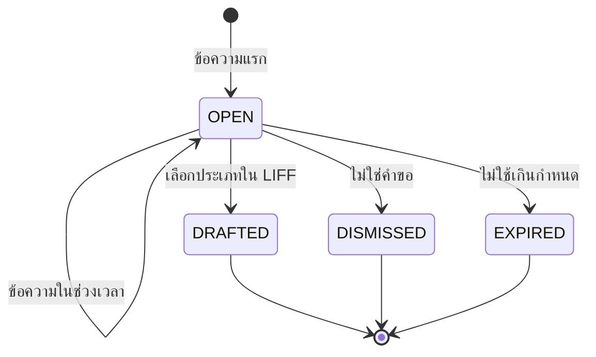

# S17 · LINE และแอป BCS Go — sub-spec

เอกสารนี้ขยาย §16.18 สำหรับการลงมือ · spec.md มีลำดับเหนือกว่าเสมอ ถ้าขัดกันให้ยึด spec แล้วแก้ไฟล์นี้

สถานะ: ร่าง P1-04 (2026-10-11) · ตรวจแล้วใน P1-05 · ผู้ใช้อนุมัติตามที่แนะนำทั้ง 88 เรื่องของ `docs/reports/p1-decisions.md` ใน P1-06 (2026-10-12) · เลข BR GC INV event error และความสามารถในไฟล์นี้เป็นร่าง จะเพิ่มลง spec ในข้อที่สร้างโค้ดนั้น

วิธีอ่าน: ไฟล์นี้ยาว ให้อ่านเฉพาะหัวข้อที่ข้อ checklist อ้าง (หาเลขบรรทัดด้วย `grep -n "^## " docs/sub-specs/S17.md`) · AC ของ FR ชั้น 2 อยู่ในหัวข้อ "FR และ AC" ของไฟล์นี้ เทสต์ใช้แท็ก `[FR-xxx-1nn/ACn]` ตามเลขในไฟล์นี้

## ขอบเขต

- FR: FR-LINE-301 (ขอผ่านแชท) · FR-LINE-302 (หน้าแรกใน LIFF) · FR-LINE-303 (rich menu ตามบทบาท) · FR-PLT-301 (แอป BCS Go: push biometric สแกน ตรวจรับออฟไลน์) · golden (ร่าง): `line-rich-menu` `chat-intake` `notification-route` `offline-queue` `offline-receiving` `step-up-methods`
- ข้อ: S17-01 ถึง S17-18 `[demo]` แบ่งสองสาย (ADR-072): สาย 3 ส่วน LINE (S17-01 ถึง S17-04 S17-06 ถึง S17-08) · สาย 1 ส่วน BCS Go ต่อจาก S6 (S17-05 S17-09 ถึง S17-18) · S17-19 ถึง S17-21 `[go-live]`
- นอกขอบเขต: หน้างาน `/liff/tasks/[id]` (ของ S6) · แอป iOS ในชั้น demo (PWA บน iOS ใช้ LINE แจ้งเตือนเหมือนเดิม) · web push ใน PWA (§9.7) · passkey เป็นวิธีเข้าระบบ (OQ-168) · สแกน barcode ของสินค้า (OQ-163) · แชทในกลุ่มและห้อง · ไฟล์ วิดีโอ เสียง ตำแหน่งในแชท · ถาม AI ในแชท (FR-AI-309 อยู่ใน ⌘K) · LINE ของลูกค้าและแอปบน store (`[go-live]`) · เปลี่ยนผลเงินของการตรวจรับ (ทางออฟไลน์ใช้ `gr.post` และ `receiveIncrement` เดิม)
- ขึ้นกับ: P1-07 (เปิดโมดูล `BCS_GO` ของ SIMEC ใน seed · `DECISION_STEP_UP_METHODS` `policyStepUpMethods` และค่า `ApprovalSubjectType` ใหม่ · `request.drafted` schemaVersion 2 ที่มี source `CHAT_INTAKE` · ฟิลด์ `offline` และ `aiAssist` ใน input ของ `gr.post` พร้อม stub `OfflineCaptureInput` ใน `src/server/services/receiving/offline-input.ts` · รหัส `AI_REVIEW_PENDING` · หัวข้อย่อยท้าย §7 ที่จองให้ S17) · S6 เส้นชัย D (หน้างาน LIFF ของขั้นผู้ตรวจ กรรมการ และราคาอ้างอิง · `reviewers` `fallback` ของ WorkflowRule และ `DoaRule.steps` อ่านอย่างเดียว · `DocumentVerification` ของ QR · เหตุผลของธงซ้ำในหน้าแก้ร่าง LIFF) · S13 เส้นชัย F (`isAgentAvailable` `intakeFromMessage` `getAgentAction` และ `aiAssist`) · D-03 (channel LINE ของ BCS) · ผู้ใช้: ตอบ OQ-167 ก่อน S17-15 · Firebase project และ keystore ของ demo ตาม runbook ของ S17-17 ก่อน P1-13 `[คน]` · โมดูล: `CORE` (LINE หน้าแรก เมนู `gr.post`) · `BCS_GO` (แอป push สำเนาออฟไลน์ สแกน) · `AI` (ไม่บังคับ)

## ชั้น demo และชั้นของจริงของ "เสร็จเมื่อ"

| เกณฑ์ต้นฉบับ §16.8 | ชั้น demo รอบนี้ (`[demo]`) | ชั้นของจริง (`[go-live]`) และของที่ต้องได้ |
| --- | --- | --- |
| ผู้อนุมัติได้ push ในแอปและตัดสินด้วย biometric | ในสาย: e2e ในเบราว์เซอร์ด้วย fake FCM และ virtual authenticator ของ Chromium · หลังส่งเข้า main: Android ติดตั้งเอง (APK จาก workflow บน main) + Firebase project ของ BCS (ผู้ใช้สร้าง project keystore และ secret ของ CI เองตาม runbook ของ S17-17) + staging ของ P1-11 · ลองบนเครื่องจริงใน P1-13 `[คน]` (P1-11 ไม่มีขั้นของแอป) · passkey ใน WebView ของ Android (ใช้ไม่ได้ → PWA ใน Chrome ระหว่างรอ · ADR-166) | แอป Android และ iOS บน store ตาม OQ-166 · APNs key · release signing · assetlinks และ AASA ของโดเมน production (S17-20) |
| ผู้ตรวจรับสแกน barcode และบันทึกตรวจรับตอนออฟไลน์แล้วส่งครบไม่ซ้ำเมื่อกลับมาออนไลน์ | ในสาย: e2e ตัดเน็ตด้วย Playwright แล้วตรวจว่า GR เกิดครั้งเดียว · PWA พิมพ์เลข PO · หลังส่งเข้า main: แอป Android สแกน QR บน PO (ML Kit) ใน P1-13 | อุปกรณ์จริงที่หน้างานของลูกค้า สัญญาณจริง และผู้ใช้จริงฝ่ายละ 1 คน (P0-14 · S17-21) |
| ผู้ขอส่งคำขอผ่านแชท LINE ด้วยข้อความหรือรูปโดยยืนยันใน LIFF ก่อนส่ง | ในสาย: e2e กับ fake LINE ทั้งเปิดและปิด AI · หลังส่งเข้า main: channel LINE ของ BCS (D-03) ใน P1-13 (key ของ BCS P0-13 เมื่อวัดกับ Claude จริง) | LINE ของลูกค้า (P0-04 · OQ-15 OQ-16 · S17-19) |

## Demo ของขั้น

ผู้ใช้และยอดจากไฟล์ระยะ 1 (`scripts/inputs_p1/p1_org.py` `p1_history.py` `p1_suppliers.py`) · ฉากจริงกำหนดใน P1-08

1. เมนูตามบทบาท: `pm_p07` เห็น หน้าแรก ขอซื้อ ติดตามสถานะ ช่วยเหลือ · `dm_coni` (DM@CONI) เห็นเพิ่ม งานรออนุมัติ · `store_p07` (RECEIVER) เห็น ตรวจรับ · `proc_officer` เห็น งานจัดซื้อ · `dm_proc` (PROCUREMENT + DM@PROC PROC_MGR@HQ) เห็น 6 ปุ่ม · `admin` ให้ role RECEIVER แก่ `fm_p07` แล้วเมนูของ `fm_p07` เปลี่ยนภายใน 1 นาที
2. หน้าแรกใน LIFF: `dm_coni` แตะ หน้าแรก เห็นสิ่งที่ต้องทำ รอฉันอนุมัติ และที่ฉันติดตาม ตัวเลขเท่าหน้าแรกเว็บของตัวเอง
3. ขอผ่านแชท: `se_p01a` ส่งรูปใบเสนอราคา (ภาพถ่ายแบบ DOC-031: เหล็กข้ออ้อย DB25 SD40 1 ตัน ก่อน VAT 24,411.00 VAT 1,708.77 รวม 26,119.77) และพิมพ์ "ขอซื้อเหล็กข้ออ้อย DB25 1 ตัน ส่งไซต์พระราม 9" → ได้ปุ่ม "ตรวจและส่งคำขอ" → LIFF: เปิด AI = เห็นสถานะการอ่าน แล้วประเภทและค่าที่ AI เสนอมีป้ายให้ยืนยันตามกฎของ S13 · ปิด AI = เลือกประเภทและกรอกเอง → กดส่ง → DOA ส่งไป `vp_ops` (รวม VAT เกิน 20,000 ไม่เกิน 100,000)
4. push และ biometric: `pm_p07` ส่งงานถนนแอสฟัลต์ 9,500 ตร.ม. 2,642,900.00 (แบบ H229) ผ่านผู้ตรวจคู่ขนานของ S6 → `ceo` ได้ push หัวเรื่อง "มีงานรออนุมัติ" เนื้อความ "PR-2569-xxxxx" (ไม่มียอด ชื่อ และชื่อเรื่อง) → แตะเปิดหน้าเอกสารในแอป → อนุมัติ → ยอดตั้งแต่ 100,000 จึงยืนยันด้วยลายนิ้วมือ (passkey) → ไทม์ไลน์แสดงช่องทาง "แอป BCS Go"
5. ตรวจรับออฟไลน์: `store_p07` เตรียม PO ของโครงการ P07 (เช่น PO ของ H042 คอนกรีตผสมเสร็จ 2 ลบ.ม. 2,780.00 ต่อหน่วย) → ปิดสัญญาณ → สแกน QR บน PO → บันทึกรับ 2 ลบ.ม. เลขใบส่งของ และรูป → เปิดสัญญาณ → อัปโหลดรูปแล้วส่งเอง ได้ GR 1 ใบ PO เป็น RECEIVED · จำลองสัญญาณหลุดหลังส่ง → ส่งซ้ำได้ผลเดิม ไม่มี GR ใบที่สอง
6. ปิด AI (`AI_ENABLED=false`) แล้วเล่นฉาก 3 ซ้ำได้ครบ (EG-1)

## Entity และ migration

กติการ่วม §6.1: `id` uuid v7 · `organizationId` NOT NULL มี index · unique ทางธุรกิจรวม `organizationId` · FK คู่ `(organizationId, id)` ตาม ADR-039 (ตารางปลายทางต้องมี `@@unique([organizationId, id])` เพิ่มที่ตารางที่ยังไม่มี) · เวลา timestamptz · `createdAt` `updatedAt` ทุกตาราง · migration แบบเพิ่มอย่างเดียว (NFR-MNT-04) · ขั้นนี้ไม่มีคอลัมน์เงินใหม่

**ตารางใหม่**

| Entity | ฟิลด์ (ชนิด) | กฎและข้อจำกัด |
| --- | --- | --- |
| `ChatIntake` | memberId (uuid FK Member) · status (`ChatIntakeStatus`: `OPEN` `DRAFTED` `DISMISSED` `EXPIRED`) · text (text null) · textTruncated (bool) · messageCount (int) · imageCount (int) · openedAt · lastMessageAt · expiresAt (timestamptz) · linkSentAt (null · ตั้งเมื่อคำสั่งตัดสินให้ส่งปุ่มเปิด LIFF) · requestTypeId (uuid null FK RequestType) · requestId (uuid null FK Request) · agentActionId (uuid null FK คู่ AgentAction · เพิ่มใน migration ของ S17-08) · draftedAt · closedAt · purgedAt (null) · version (int) | CHECK `char_length(text) <= 2000` (นับ code point) · CHECK `imageCount BETWEEN 0 AND 10` · `messageCount >= 0` · `DRAFTED` ⇔ มี `requestId` (S17-01) · unique (org, requestId) · index (org, memberId, status, lastMessageAt) · เห็นได้เฉพาะเจ้าของ (ไม่มี capability ให้ผู้อื่น) |
| `ChatIntakeItem` | intakeId (uuid FK ChatIntake) · seq (int) · kind (`ChatIntakeItemKind`: `TEXT` `IMAGE`) · lineMessageId (text) · fileId (uuid null FK FileObject) · fetchStatus (`ChatIntakeFetchStatus`: `NOT_NEEDED` `PENDING` `STORED` `FAILED`) · fetchError (text null รหัสเท่านั้น) · receivedAt | unique (org, intakeId, seq) · unique (org, lineMessageId) กันประมวลผลซ้ำ · ไม่เก็บข้อความต่อรายการ · CHECK (S17-01): `seq >= 1` · `TEXT` = `NOT_NEEDED` ไม่มีไฟล์ · `IMAGE` ไม่ใช่ `NOT_NEEDED` และมี `fileId` เมื่อ `STORED` เท่านั้น |
| `LineInboundMessage` | lineWebhookEventId (uuid FK LineWebhookEvent) · lineMessageId (text) · kind (`ChatIntakeItemKind`) · text (text null) · receivedAt · consumedAt (null) | unique (org, lineWebhookEventId) · ที่พักข้อความระหว่างรับ webhook กับประมวลผล · ลบแถวเมื่อประมวลผลแล้วหรืออายุเกิน 24 ชั่วโมง (ไม่ใช่เอกสารธุรกิจ) · CHECK: มี `text` ได้เฉพาะ `TEXT` (S17-01) |
| `PushDevice` | memberId (uuid FK Member) · platform (`PushPlatform`: `ANDROID` `IOS`) · tokenEnc (text AES-256-GCM พร้อม key id) · tokenHash (text sha256 hex) · appVersion (text) · deviceLabel (text null ≤ 60) · registeredAt · lastSeenAt · revokedAt (null) · revokeReason (`PushDeviceRevokeReason` null: `LOGOUT` `USER` `DEACTIVATED` `UNREGISTERED` `REPLACED`) · version | unique (org, tokenHash) เฉพาะแถวที่ `revokedAt IS NULL` · index (org, memberId, revokedAt) · ไม่เกิน 5 เครื่องที่ใช้งานต่อ member (เกินแล้วเพิกถอนเครื่องเก่าสุดด้วย `REPLACED`) · CHECK (S17-01): `tokenHash` hex ตัวพิมพ์เล็ก 64 ตัว · `deviceLabel` ≤ 60 · `revokedAt` กับ `revokeReason` มีพร้อมกัน |
| `LineRichMenuVariant` | channelConfigId (uuid FK LineChannelConfig) · variantKey (text เช่น `LINKED:APPROVER`) · richMenuId (text) · madeAt | unique (org, variantKey) · `LineChannelConfig.richMenuUnlinkedId` ยังเป็นเมนูเริ่มต้น · `richMenuLinkedId` คงไว้เป็นชุด `LINKED` จนถึง migration ขั้น contract |
| `MemberPasskey` (S17-15 หลัง OQ-167) | memberId (uuid FK Member) · credentialId (text base64url) · publicKey (bytea) · signCount (bigint) · transports (text[]) · deviceLabel (text null ≤ 60) · lastUsedAt (null) · revokedAt (null) · revokeReason (`PasskeyRevokeReason` null: `USER` `IDENTITY_RESET` `DEACTIVATED`) · version | unique (org, credentialId) · index (org, memberId, revokedAt) · ไม่เกิน 10 ที่ใช้งานต่อ member · ผูกกับ member แบบ PIN (ไม่ใช่ตาราง global ของ Better Auth) |
| `PasskeyChallenge` (S17-15) | memberId (uuid FK Member) · purpose (`PasskeyChallengePurpose`: `REGISTER` `STEP_UP`) · challengeHash (text sha256) · subjectType (text null) · subjectId (uuid null) · expiresAt (ออก + 5 นาที) · usedAt (null) | unique (org, challengeHash) · ใช้ครั้งเดียว: `usedAt` ตั้งในธุรกรรมเดียวกับการเพิ่ม passkey หรือ grant · ไม่ใช่เอกสารธุรกิจ ลบแถวที่หมดอายุเกิน 1 วันใน job รายชั่วโมงของ S17-06 |

**ของเดิมที่เพิ่ม**

| ที่ | เพิ่ม | เหตุ |
| --- | --- | --- |
| `GoodsReceipt` | `offlineCapturedAt` timestamptz null | เวลาที่บันทึกในเครื่องตามที่ส่งมา (OQ-170) · null = บันทึกออนไลน์ |
| `OfflineCaptureInput` (Zod ไม่ใช่ migration · S17-12) | เติม stub `z.never()` ของ P1-07 ใน `src/server/services/receiving/offline-input.ts` เป็น `{ capturedAt, capturedByMemberId, expectedPoVersion }` | ฟิลด์ `offline` ใน input ของ `gr.post` P1-07 วางไว้แล้ว · S17 ไม่แก้ schema input ของ `gr.post` (BR-APP-08) · แต่ BR-APP-08 ต้องเปลี่ยนส่วนเขียนของคำสั่งด้วย (`receivedAt` `offlineCapturedAt` ของ `GoodsReceipt` · `poVersion` ในผล · data `offline` ของ `gr.posted`) ซึ่งจุดเรียกของ P1-07 ยังไม่ครอบ (คอลัมน์เกิดใน S17-01) จึงแก้เฉพาะบรรทัดเหล่านั้นใน `src/server/services/receiving/index.ts` ใน S17-12 และบอกในรีวิวท้ายขั้น |
| enum `Channel` | `APP` | Event ของแอป BCS Go (BR-APP-02) |
| enum `NotificationChannel` | `PUSH` | `Notification.sentChannel` |
| enum `StepUpMethod` | `PASSKEY` | หลักฐาน step-up (BR-AUTH-09) |
| type `StepUpChannel` (ไม่ใช่ migration) | `APP` | ช่องทางของ `security.pin_locked` และ grant ในแอป (S17-15) |
| `OrgSettingsSchema` (Zod ไม่ใช่ migration) | `chatIntake?: { enabled (ค่าเริ่มต้น false), windowMinutes 30, maxImages 10, maxTextChars 2000, hourlyLimit 20, expireHours 24, textRetentionDays 7 }` · `bcsGo?: { offlineRetentionDays 7 (สูงสุด 30), maxPreparedPos 50 }` · ทุกคีย์ไม่บังคับ เป็นจำนวนเต็มตั้งแต่ 1 และไม่เกิน `S17_SETTING_LIMITS` ของ `src/lib/s17-settings.ts` (windowMinutes 1440 · maxImages 10 · maxTextChars 2000 · hourlyLimit 1000 · expireHours 168 · textRetentionDays 30 · offlineRetentionDays 30 · maxPreparedPos 200 · S17-01) | องค์กรเดิมไม่เปลี่ยนพฤติกรรม (ปิดเป็นค่าเริ่มต้น) · SIMEC เปิดผ่านชีต Settings |
| `Member.notificationPrefs` (Zod) | `appPush?: boolean` ค่าเริ่มต้น false | OQ-165 |
| env (ภาคผนวก B) | `PUSH_PROVIDER` (`fcm` `fake` `off`) · `FCM_PROJECT_ID` · `FCM_SERVICE_ACCOUNT_JSON_B64` · `FCM_API_BASE_URL` และ `FCM_TOKEN_URL` (local เท่านั้น) · `BCS_GO_ANDROID_PACKAGE` · `BCS_GO_ANDROID_CERT_SHA256` · `BCS_GO_IOS_APP_ID` (S17-20) | ADR-163 ADR-165 |

## State machine

ทุกตารางเขียนใน `src/core/state-machines/*.ts` แบบเดียวกับ §6.4 พร้อมเทสต์ที่วนทุกคู่ (สถานะ, command)

**ร่างจากแชท (`ChatIntake`)**



| จาก | คำสั่ง | ไป | ใครทำได้ | event |
| --- | --- | --- | --- | --- |
| — | `chat_intake.receive` (ข้อความแรก หรือหลังพ้นช่วงเวลา) | OPEN | member ที่ผูก LINE (ช่องทาง `LINE_CHAT` · idempotencyKey = webhookEventId) | `chat_intake.opened` |
| OPEN | `chat_intake.receive` (ภายในช่วงเวลา) | OPEN | เจ้าของ | `chat_intake.message_added` |
| OPEN DRAFTED | `chat_intake.store_image` (ดึงรูปจาก LINE สำเร็จหรือล้ม) | เดิม | SYSTEM (job) | `chat_intake.image_fetched` |
| OPEN | `chat_intake.link_agent_action` (เก็บ id ของ AgentAction ล่าสุด) | เดิม | SYSTEM (job `chat-intake-ai`) | `chat_intake.ai_requested` |
| OPEN | `chat_intake.draft` | DRAFTED | เจ้าของใน LIFF · ต้องมี `request.create` | `chat_intake.drafted` · `request.drafted` (source `CHAT_INTAKE`) |
| OPEN | `chat_intake.dismiss` | DISMISSED | เจ้าของใน LIFF | `chat_intake.dismissed` |
| OPEN | `chat_intake.expire` | EXPIRED | SYSTEM (job ทุกชั่วโมง) | `chat_intake.expired` |
| DRAFTED DISMISSED EXPIRED | `chat_intake.purge` (สถานะคงเดิม ตั้ง `purgedAt`) | เดิม | SYSTEM | `chat_intake.purged` |

**อุปกรณ์รับ push (`PushDevice`)**

| จาก | คำสั่ง | ไป | ใครทำได้ | event |
| --- | --- | --- | --- | --- |
| — | `push_device.register` | ACTIVE (`revokedAt` null) | เจ้าของในแอป (`self.pushDevices` · โมดูล `BCS_GO`) | `push_device.registered` |
| ACTIVE | `push_device.revoke` | REVOKED | เจ้าของ (`USER` `LOGOUT`) · SYSTEM (`UNREGISTERED` `REPLACED`) · ปิดใช้งาน member (`DEACTIVATED` ในธุรกรรมเดียวกับ BR-AUTH-06) | `push_device.revoked` |

**passkey (`MemberPasskey`)**

| จาก | คำสั่ง | ไป | ใครทำได้ | event |
| --- | --- | --- | --- | --- |
| — | `self.add_passkey` | ACTIVE | เจ้าของ (`self.passkeys` · หลักฐานพิสูจน์ตัวตนสด · challenge `REGISTER`) | `auth.passkey_added` |
| ACTIVE | `self.remove_passkey` | REVOKED | เจ้าของ | `auth.passkey_removed` (by `SELF`) |
| ACTIVE | `IDENTITY_RESET` หรือปิดใช้งาน member (ในธุรกรรมของคำสั่งนั้น) | REVOKED | ตามคำสั่งเดิม | `auth.passkey_removed` (by `IDENTITY_RESET` หรือ `DEACTIVATED`) |

**รายการในคิวตรวจรับออฟไลน์ (ในเครื่อง ไม่ใช่ตารางในฐาน · `src/core/offline-queue`)**

`attempts` = จำนวนครั้งที่ส่ง `gr.post` (ไม่นับการอัปโหลดรูป) · key และ `capturedAt` สร้างในหน้า `/go/receive` แล้วส่งเข้า core เป็น input (core ไม่อ่านนาฬิกาหรือค่าสุ่ม · §17.3)

| จาก | เหตุ | ไป |
| --- | --- | --- |
| — | ผู้ใช้กดบันทึก | `QUEUED` (attempts 0) |
| `QUEUED` `RETRY` | ถึงคิว ออนไลน์ session เป็นผู้บันทึก และมีรูปที่ยังไม่มี fileId | `UPLOADING` (BR-APP-14) |
| `QUEUED` `RETRY` `UPLOADING` | ถึงคิว ออนไลน์ session เป็นผู้บันทึก และรูปมี fileId ครบ | `SENDING` (ครั้งแรกตรึง input · attempts + 1) |
| `UPLOADING` | อัปโหลดล้มชั่วคราว · 401 · ไฟล์ถูกปฏิเสธ | `RETRY` · `WAIT_LOGIN` · `NEEDS_ATTENTION` |
| `SENDING` | ผลตาม BR-APP-07 | `SENT` (ลบจากเครื่อง) · `RETRY` · `WAIT_LOGIN` · `NEEDS_ATTENTION` · `CHECK_SERVER` |
| `SENDING` `UPLOADING` | แอปถูกปิดกลางทาง | `RETRY` (ส่งต่อด้วย key เดิม) |
| `WAIT_LOGIN` | ผู้บันทึกเข้าระบบอีกครั้ง | `RETRY` |
| `CHECK_SERVER` | ผลของ key จาก `GET /api/go/receiving/gr` | `SENT` · `NEEDS_ATTENTION` |
| attempts = 0 (`QUEUED` `UPLOADING` `RETRY` `WAIT_LOGIN`) · `NEEDS_ATTENTION` | ผู้ใช้ทิ้ง | `DISCARDED` |
| `NEEDS_ATTENTION` | ผู้ใช้แก้แล้วส่งใหม่ (`CONFLICT_VERSION` ต้องเตรียมสำเนาใหม่ก่อน) | `DISCARDED` + รายการใหม่ key ใหม่ |
| attempts = 0 · `NEEDS_ATTENTION` | `capturedAt` เก่ากว่า `offlineRetentionDays` | `EXPIRED` (แสดง ไม่ส่ง ทิ้งได้) |
| attempts ≥ 1 ที่ผลยังไม่รู้ (`SENDING` `RETRY` `WAIT_LOGIN` `CHECK_SERVER`) | เก่าเท่าไรก็ตาม | ไม่หมดอายุ ส่งด้วย key เดิมต่อ (BR-APP-10) |

## กฎ

**ขอผ่านแชทและหน้า LIFF (BR-LINE)**

| ID | กฎ |
| --- | --- |
| BR-LINE-10 | ข้อความชนิด text และ image จากแชท 1:1 ของ member ที่ผูกแล้ว ใน mode active ขององค์กรที่เปิด `chatIntake.enabled` เปิดหรือเติม `ChatIntake` ตาม golden `chat-intake`: เติมร่าง OPEN ล่าสุดเมื่อ `now − lastMessageAt < windowMinutes` ไม่เช่นนั้นเปิดร่างใหม่ · รูปเกิน `maxImages` ไม่เพิ่มและบอกให้แนบใน LIFF · ข้อความรวมเกิน `maxTextChars` (นับเป็น code point ตรงกับ `char_length` ของ CHECK) ตัดที่ขอบ grapheme ให้ไม่เกินเกณฑ์และตั้ง `textTruncated` · เกิน `hourlyLimit` ข้อความต่อชั่วโมงไม่ทำอะไรและแจ้งครั้งเดียวต่อชั่วโมง · ชนิดอื่นได้คำแนะนำ · ผู้ที่ยังไม่ผูกได้ข้อความชวนผูกบัญชี · กลุ่ม ห้อง และ mode standby ไม่ตอบ |
| BR-LINE-11 | ข้อความที่พิมพ์ไม่อยู่ใน `LineWebhookEvent` (คงกติกาเดิม) · เก็บใน `LineInboundMessage` จนประมวลผลแล้วลบ (ไม่เกิน 24 ชั่วโมง) · ใน `ChatIntake.text` เก็บไม่เกิน `textRetentionDays` แล้ว purge (OQ-162) · ห้าม log ข้อความ ชื่อไฟล์ และ LINE user id (NFR-SEC-09) |
| BR-LINE-12 | ร่างคำขอจากแชทเกิดเมื่อเจ้าของเลือกประเภทใน LIFF เท่านั้น (POST `chat_intake.draft`) ผ่านตรรกะของ `request.create_draft` เดิมในธุรกรรมเดียวกัน: ชื่อเรื่องตั้งต้น = บรรทัดแรกที่ไม่ว่าง (ตัดช่องว่างหัวท้าย) ตัดที่ขอบ grapheme ให้ยาวไม่เกิน 200 UTF-16 code unit (เพดานของ `DraftInput.title`) · รูปแนบเป็น `OTHER` (ผู้ขอเปลี่ยนชนิดเอง กฎเอกสารแนบตรวจตอนส่งตามเดิม) · มี AgentAction ของร่างนี้ที่ใช้ได้ → ส่ง `aiAssist` เข้า `request.create_draft` (BR-LINE-13) · `request.drafted` มี source `CHAT_INTAKE` (schemaVersion 2 ของ P1-07) · ข้อความแชทแสดงเป็นข้อมูลอ้างอิงจนถูก purge · ส่งได้ด้วย `request.submit` ใน LIFF โดยผู้ขอเท่านั้น (ธงซ้ำต้องกรอกเหตุผลในหน้าแก้ร่าง LIFF ตาม BR-DUP-05 ของ S6) ไม่มีทางส่งจากแชท |
| BR-LINE-13 | AI เป็นส่วนเสริม: webhook ไม่เรียก AI · job `chat-intake-ai` ของ S17 (ฟัง `chat_intake.opened` `chat_intake.message_added` `chat_intake.image_fetched` แบบหน่วงรวมข้อความ) เรียก `isAgentAvailable(ctx, INTAKE)` แล้ว `intakeFromMessage(ctx, { chatIntakeId, text, fileIds, idempotencyKey })` ของ S13 ด้วย ctx ของเจ้าของร่าง เมื่อไม่มีรูปของร่างที่ยัง `PENDING` · `idempotencyKey` = `chat_intake:<chatIntakeId>:<seq>` (seq ของ `ChatIntakeItem` ล่าสุดที่รวมในการเรียก) ชุดข้อความเดิมจึงได้ AgentAction เดิมโดยไม่เรียกโมเดลซ้ำ ส่วนข้อความใหม่ได้ key ใหม่ · เรียกใน step แยกจากการเก็บ id (`chat_intake.link_agent_action`) เพื่อไม่เรียกซ้ำเมื่อ job ลองใหม่ · LIFF อ่านสถานะและค่าที่เสนอด้วย `getAgentAction` · ค่าเข้าร่างผ่าน `aiAssist` ของ `request.create_draft` และ `request.edit` เท่านั้น · ช่องที่ต้องยืนยันทีละช่องและ `AI_REVIEW_PENDING` ตอนส่งเป็นไปตาม BR-AI-16 BR-AI-17 ของ S13 · ไม่ส่งข้อความในแชทเมื่ออ่านเสร็จ · ปิดโมดูล `AI` ปิด agent หรือ AI ล้ม → BR-LINE-10 ถึง 12 ทำงานครบด้วยฟอร์ม LIFF (EG-1 NG-5) · S17 import ได้เฉพาะ API สาธารณะของ S13 ใน `src/server/services/ai` ไม่ import `src/integrations/ai` (lint) |
| BR-LINE-14 | รูปดึงจาก LINE ใน job (ไม่ใช่ใน webhook) · ตรวจ magic bytes ว่าเป็น JPEG หรือ PNG และไม่เกิน 20 MB (NFR-SEC-08) · เก็บเป็น `FileObject` ผู้อัปโหลด = เจ้าของร่าง · ดึงไม่ได้ (เกินเวลาที่ LINE เก็บ หรือ 4xx) → `FAILED` และ LIFF แจ้งให้แนบใหม่ · ลองซ้ำเฉพาะ 5xx และเครือข่าย |
| BR-LINE-15 | ตอบด้วย reply token เมื่อยังไม่หมดอายุ (BR-LINE-07) ภายในงบเวลาของ BR-LINE-05 · token หมดอายุก่อนตอบ: push ข้อความที่มีปุ่มเปิด LIFF 1 ครั้งต่อร่าง เฉพาะร่างที่ยังไม่เคยได้ปุ่ม (`linkSentAt` ว่าง) · ข้อความอื่น (ชวนผูก คำแนะนำ แจ้งส่งถี่) ไม่ push (golden `chat-intake`) · ข้อความตอบไม่มีข้อความที่ผู้ใช้พิมพ์ รายการ ราคา หรือชื่อผู้ขาย (BR-NOTI-01 BR-LINE-06) · ปุ่มเปิด `/liff/requests/new?intake=<id>` ผ่าน `liffLink` · การเปิดลิงก์ (GET) ไม่สร้างร่าง · `/liff/requests/new` ที่ไม่มี `intake` แสดงร่างจากแชทที่ OPEN ของผู้ใช้ให้เลือกต่อ (ทางสำรองเมื่อไม่ได้ปุ่ม) · ไม่ส่งข้อความเมื่อ AI อ่านเสร็จ (LIFF แสดงสถานะ) |
| BR-LINE-16 | rich menu ของผู้ผูกแล้วเลือกด้วย `selectRichMenu` (pure · golden `line-rich-menu`) จากธงที่ service คำนวณ ณ ตอนสลับ: `doaApprover` = ดำรงตำแหน่งที่ approver แบบ `POSITION_OF_DEPARTMENT` หรือ `POSITION_OF_ORG` ของ DOA ฉบับที่มีผลอ้าง (รวม `approvers` ของขั้น PARALLEL หรือกรรมการ) หรือถูกระบุในแบบ `MEMBER` · `activeDelegate` = ผู้รักษาการที่ `ACTIVE` · `workflowReviewer` = member ที่ resolve ได้ตาม BR-WF-08 จาก `reviewers` หรือ `fallback` (แบบ `POSITION_AT` หรือ `MEMBER`) ของ WorkflowRule ใน WorkflowVersion ที่มีผล (ตารางของ S6 อ่านอย่างเดียว) · ผู้อนุมัติ = ธงใดธงหนึ่ง · ผู้ตรวจรับ = role `RECEIVER` · จัดซื้อ = role `PROCUREMENT` · ไม่ใช้จำนวนงานค้าง · ปุ่มเรียง หน้าแรก ขอซื้อ [งานรออนุมัติ] [ตรวจรับ] [งานจัดซื้อ] ติดตามสถานะ ช่วยเหลือ ไม่เกิน 6 ปุ่ม (เกินให้ตัด ติดตามสถานะ) · 4 ปุ่ม = 2+2 แถว · 5 = 3+2 · 6 = 3+3 · ปุ่มหลักคือปุ่มบทบาทแรก ไม่มีให้เป็น ขอซื้อ · member ที่ไม่ ACTIVE หรือไม่ผูก = `UNLINKED` |
| BR-LINE-17 | job `line-rich-menu` เดิมสลับเมนูภายใน 1 นาทีเมื่อ `line.linked` `line.unlinked` `member.role_granted` `member.role_revoked` `position.assigned` `position.unassigned` `delegation.started` `delegation.ended` `delegation.revoked` และสลับทุกคนที่ผูกเมื่อ `doa_version.published` `doa_version.superseded` `doa_version.withdrawn` `workflow_version.published` `workflow_version.superseded` `workflow_version.withdrawn` · อ่านสถานะล่าสุดทุกครั้ง (ไม่เชื่อข้อมูลใน event) · หลายคนพร้อมกันใช้ bulk link ของ LINE (ตรวจ API ตอนลงมือ) · เมนูไม่ใช่สิทธิ์: ทุกหน้าที่ปุ่มเปิดตรวจสิทธิ์เอง (BR-AUTH-05) |
| BR-LINE-18 | `/liff/home` ใช้ `homeTodo` `homeApprovals` `homeFollowing` ของ `src/server/services/home` ที่อ่าน `src/server/queries/home.ts` ชุดเดียวกับหน้าแรกเว็บ · render ฝั่งเซิร์ฟเวอร์ แต่ละส่วนโหลดและล้มแยกกัน · ลิงก์ไปหน้า LIFF ที่มี ไม่เช่นนั้นเปิดหน้าเว็บนอก LINE · ไม่โหลดไลบรารีหรือคอมโพเนนต์ของ Workspace (ADR-052) |

**การแจ้งเตือนและ token (BR-NOTI · BR-TOK)**

| ID | กฎ |
| --- | --- |
| BR-NOTI-05 | push เป็นช่องทางของ `IMMEDIATE` เฉพาะ template ในรายการเดียวกับ LINE (`LINE_TEMPLATES` ของ `src/server/notifications/deliver.ts`) ยกเว้น `digest.daily` · ส่งเมื่อองค์กรเปิด `BCS_GO` ผู้รับเปิด `appPush` และมีเครื่องที่ใช้งานอย่างน้อย 1 เครื่อง · ส่งแทน LINE ตาม OQ-165 ลำดับ PUSH → LINE → อีเมล (golden `notification-route`) · ผู้ที่ไม่เปิด `appPush` ได้ทางเดิมทุกประการ |
| BR-NOTI-06 | ข้อความ push (ขึ้นหน้าจอล็อก) สร้างด้วยตัวสร้างเดียวสำหรับทุก template: หัวเรื่องจากคีย์ข้อความ `push.<templateKey>.title` ไทยและอังกฤษ (ไม่มีคีย์ → "มีการแจ้งเตือนใหม่" / "New notification") · เนื้อความเป็นเลขเอกสารจาก `data.number` เท่านั้น ไม่ใช้ชื่อเรื่อง ไม่มียอดเงิน ชื่อคน ผู้ขาย รายการ หรือชื่อและเลขบัญชี (เข้มกว่า BR-NOTI-01 · OQ-107 ของ S6) · ข้อมูลแนบมีแค่ `notificationId` และ path ภายในแอป · ภาษาตาม locale ของผู้รับ (BR-NOTI-03) · เทสต์วนทุก template ใน `LINE_TEMPLATES` ว่ามีคีย์หัวเรื่องทั้งสองภาษา |
| BR-NOTI-07 | ผล push ต่อเครื่อง: `UNREGISTERED` หรือ token ผิดรูป → เพิกถอนเครื่องนั้น (`UNREGISTERED`) แล้วลองเครื่องอื่น ไม่เหลือ → LINE แล้วอีเมล · 401 403 ของ FCM (ปัญหาของ BCS ไม่ใช่ผู้รับ) → แจ้งเตือนผู้ดูแลแพลตฟอร์มและส่งทางถัดไปทันที · 429 5xx และเครือข่าย → ลองซ้ำแบบเดียวกับ LINE แล้วส่งทางถัดไปให้งานอนุมัติถึงภายใน 5 นาทีนับจากครั้งแรก (FR-LINE-007 AC3) · เวลาของทุกช่องทางนับจากครั้งแรกของ push เดียวกัน ไม่เริ่มนับใหม่ที่ LINE: push ลองซ้ำไม่เกิน 2 นาที (`PUSH_DELIVERY_GIVE_UP_MS`) แล้ว LINE ใช้เวลาที่เหลือถึงเพดานเดิม `LINE_DELIVERY_GIVE_UP_MS` (4 นาที) แล้วอีเมลภายใน `LINE_FALLBACK_WITHIN_MS` (5 นาที) · ผู้รับที่ไม่ผูก LINE ไปอีเมลเมื่อ push เลิกลอง |
| BR-NOTI-08 | ปิด `appPush` = กลับไปทางเดิม ไม่ใช่ไม่แจ้ง · งานอนุมัติและงานเกิน SLA ยังปิดไม่ได้ (BR-NOTI-04) · สรุปรายวันไม่ไปทาง push |
| BR-TOK-06 | push ข้อความตอบในแชท และลิงก์ของ S17 ไม่มี ActionToken หรือ secret ที่ตัดสินหรือเปลี่ยนสถานะได้ · การกระทำทุกอย่างผ่าน session และ `runCommand()` · GET อ่านอย่างเดียว |

**ตัวตนและ step-up (BR-AUTH)**

| ID | กฎ |
| --- | --- |
| BR-AUTH-09 | passkey เป็นหลักฐาน step-up ชนิด `PASSKEY` เมื่อ assertion ผ่านการตรวจลายเซ็น · `origin` ใน clientData และ RP ID ตรงกับ origin และโดเมนของ `APP_URL` ของ environment (ไม่ตรง → `ORIGIN_MISMATCH`) · `signCount` ใหม่ต้องมากกว่าที่เก็บเมื่อค่าใดค่าหนึ่งไม่เป็น 0 (ไม่เช่นนั้นปฏิเสธ reason `SIGN_COUNT` และแจ้งเจ้าของทาง `security.notice` · passkey ที่ sync ข้ามเครื่องส่ง 0 เสมอจึงผ่าน) แล้วบันทึกค่าใหม่ในธุรกรรมของ grant · challenge มาจาก `PasskeyChallenge` ชนิด `STEP_UP` ที่ออกให้ member ของ session สำหรับเอกสารนั้น ภายใน 5 นาทีและยังไม่ใช้ · มี flag ยืนยันผู้ใช้ (UV) · credential เป็นของ member ของ session และยังไม่ถูกเพิกถอน · ได้ grant แบบเดียวกับ PIN (เอกสารเดียว 5 นาที ใช้ครั้งเดียว) โดยตั้ง `usedAt` ของ challenge ในธุรกรรมเดียวกัน แล้วเปลี่ยน session id (NFR-SEC-04) · คำสั่งตัดสินทุกตัวทั้งเดิมและของชนิดเอกสารใหม่ใช้ `DECISION_STEP_UP_METHODS` และ `policyStepUpMethods` ของ P1-07 ซึ่งขั้นนี้เปลี่ยนเป็น PIN และ PASSKEY ที่เดียว (OQ-168) · รวมชนิดที่ต้อง step-up ทุกครั้ง (`DOA_VERSION` `WORKFLOW_VERSION` `ORG_AUTHORITY_CHANGE` `BANK_ACCOUNT_CHANGE` · BR-DOA-15 BR-DOA-25) · งาน REVIEW ของ S6 ไม่ต้อง step-up (BR-WF-09) |
| BR-AUTH-10 | เพิ่ม passkey ด้วยคำสั่ง `self.add_passkey` (capability `self.passkeys` ผ่าน `runCommand`) ที่ต้องมีหลักฐานพิสูจน์ตัวตนสดแบบเดียวกับตั้ง PIN (`proveIdentityForPin`: รหัสผ่านหรือ TOTP · ไม่มีหรือหมดอายุ → `STEP_UP_REQUIRED` reason `IDENTITY_PROOF`) และ challenge ชนิด `REGISTER` ที่ยังไม่ใช้ · ลงทะเบียนด้วย `userVerification = required` · ลบของตัวเองด้วย `self.remove_passkey` ได้ทุกเมื่อ · ทั้งสองคำสั่งเขียน event และแจ้งเจ้าของทางอีเมล (`security.notice`) · ไม่เปิด endpoint ลงทะเบียนหรือเข้าระบบด้วย passkey ของปลั๊กอินใต้ `/api/auth/*` (ถ้า OQ-167 เลือกปลั๊กอินของ Better Auth ต้องกั้น endpoint นั้นด้วยหลักฐานเดียวกันพร้อมเทสต์ปฏิเสธ) · ล้มซ้ำเกิน rate limit → `RATE_LIMITED` |
| BR-AUTH-11 | passkey ยังไม่ใช้แทนการเข้าระบบ (OQ-168) · `IDENTITY_RESET` (BR-AUTH-07) เพิกถอน passkey ของผู้นั้นทั้งหมดในธุรกรรมเดียวกับการรีเซ็ต · ปิดใช้งาน member เพิกถอนพร้อม BR-AUTH-06 · member ที่ไม่ ACTIVE ใช้ passkey ทำ step-up ไม่ได้ |
| BR-AUTH-12 | ปิดใช้งาน member เพิกถอน `PushDevice` ทั้งหมดในธุรกรรมเดียวกับ BR-AUTH-06 · ออกจากระบบในแอปเพิกถอนเครื่องนั้น · token ที่ลงทะเบียนซ้ำโดย member อื่นย้ายมาและเพิกถอนของเดิม (`REPLACED`) |

**แอป BCS Go และตรวจรับออฟไลน์ (BR-APP)**

| ID | กฎ |
| --- | --- |
| BR-APP-01 | แอปไม่มีโค้ดธุรกิจ: Capacitor โหลดเว็บของ environment ด้วย `server.url` · `allowNavigation` เฉพาะ origin นั้น (ลิงก์อื่นเปิดเบราว์เซอร์ของเครื่อง) · ปลั๊กอินเฉพาะ push กล้อง และ barcode (§5.5) · JS ของปลั๊กอินโหลดแบบ dynamic เฉพาะเมื่ออยู่ในแอป และหน้า LIFF ห้าม import (ADR-052) · แอปคือเว็บ จึงใช้กฎของเว็บทุกข้อ (เช่น ตัดสิน `BANK_ACCOUNT_CHANGE` ได้พร้อม step-up ตาม BR-DOA-25) |
| BR-APP-02 | ช่องทาง `APP` ของ ctx และ Event ตรวจจากเครื่องหมายใน user agent ของแอป ใช้เพื่อ audit และ KPI เท่านั้น ไม่ใช้ให้สิทธิ์เพิ่ม · แอปคือเว็บ (BR-APP-01) จึงทุกจุดที่ตรวจ `ctx.channel` แบบ allowlist ที่รับ `WEB` ต้องรับ `APP` ด้วย พร้อมเทสต์ใน S17-09: `src/server/services/approvals/policy-decide.ts` (ตอนนี้รับเฉพาะ `WEB` `LIFF` อื่น ๆ ได้ `FORBIDDEN` reason `CHANNEL` · ตัดสิน `DOA_VERSION` `ORG_AUTHORITY_CHANGE` ในแอปจะล้มถ้าไม่แก้) และการตรวจช่องทางของ BR-DOA-25 ถ้า P1-07 หรือ S9 ทำด้วย `ctx.channel` · enum ช่องทางใน schema ของ event (เช่น `src/server/events/schemas/approval-task.ts`) `CHANNELS` ของ `src/server/context` และรายการ `CHANNELS` ของหน้าจอเพิ่ม `APP` ไม่เช่นนั้นการตัดสินในแอปเขียน Event ไม่ได้ |
| BR-APP-03 | ข้อมูลธุรกิจในเครื่องมีได้เฉพาะของ `/go/receive` ใน IndexedDB ของ origin (`idb-keyval`): สำเนา PO ที่เตรียมและคิวตรวจรับพร้อมรูป · ขอ `navigator.storage.persist()` ตอนเตรียมครั้งแรก ไม่ได้ → เตือนด้วย Alert ในหน้า (ไม่ใช่ pop-up ที่เด้งเอง · NG-13) ว่าเครื่องอาจล้างรายการที่ยังไม่ส่ง · service worker เก็บเฉพาะหน้า shell ของ `/go/receive` และไฟล์ static ที่มีแฮช ไม่เก็บ response ของข้อมูล · หน้าออฟไลน์เรียก route handler `/api/go/*` ที่ URL คงที่ ไม่ใช้ server action (shell ที่เก็บไว้อาจมาจาก build เก่า) |
| BR-APP-04 | เตรียมได้เฉพาะ PO ที่ผู้ใช้ตรวจรับได้ (ขอบเขตและ SoD ของ `gr.post`) สถานะ `SENT` หรือ `PARTIALLY_RECEIVED` ไม่เกิน `maxPreparedPos` ใบ · สำเนามี เลข PO ชื่อผู้ขาย สถานที่ส่ง บรรทัด (คำอธิบาย หน่วย จำนวนสั่ง จำนวนรับแล้ว) เปอร์เซ็นต์รับเกินที่ยอมได้ `version` เวลาที่เตรียม และ `tokenHash` ของ `DocumentVerification` ทุกแถวของ PO นั้น (รวมแถวที่ superseded) · ไม่มีราคา ยอดเงิน งบ เลขบัญชี หรือผู้ติดต่อ · ฟอร์มออฟไลน์มีช่องเดียวกับ `/liff/gr/[poId]` (รับ ปฏิเสธ การจัดการของเสีย การจัดการส่วนเกินเมื่อเกินเปอร์เซ็นต์ เลขใบส่งของ หมายเหตุ รูป) · สำเนาเก่ากว่า `offlineRetentionDays` ใช้เริ่มบันทึกใหม่ไม่ได้ |
| BR-APP-05 | รายการในคิวมี idempotencyKey ของตัวเอง (uuid v7 ที่หน้าสร้างตอนบันทึก) · เครื่องไม่สร้างหรือจองเลขเอกสาร: เลข GR ออกที่เซิร์ฟเวอร์ในธุรกรรมของ `gr.post` ตาม BR-NUM-01 ด้วย `ctx.now` (ปีของเลขตาม `postedAt` ไม่ใช่ `capturedAt`) จึงไม่มีเลขซ้ำหรือช่องว่างจากคิว (INV-NUM-01) · input ถูกตรึงเมื่อส่ง `gr.post` ครั้งแรก (หลังรูปได้ fileId ครบ) และส่งซ้ำด้วย key และ input เดิมเสมอ · แก้หรือทิ้งได้เฉพาะรายการที่ยังไม่เคยส่ง `gr.post` (attempts = 0) หรือ `NEEDS_ATTENTION` (แก้ = รายการใหม่ key ใหม่ · `CONFLICT_VERSION` ต้องเตรียมสำเนาใหม่ออนไลน์ก่อนและหน้าแสดงจำนวนที่รับแล้วล่าสุด) · `SENDING` และรายการที่ attempts ≥ 1 ซึ่งผลยังไม่รู้ (`RETRY` `WAIT_LOGIN` `CHECK_SERVER`) แก้และทิ้งไม่ได้ |
| BR-APP-06 | ลำดับ: เลือกรายการที่ `capturedAt` เก่าสุดที่ไม่มีรายการก่อนหน้าของ PO เดียวกันค้าง (`QUEUED` `UPLOADING` `SENDING` `RETRY` `WAIT_LOGIN` `NEEDS_ATTENTION` `CHECK_SERVER`) · ส่งทีละรายการ · PO อื่นไม่ถูกบล็อก · `expectedPoVersion` = version ล่าสุดที่เครื่องรู้ของ PO นั้น (จากสำเนา แล้วจากผลของรายการที่ส่งสำเร็จ) · ลองซ้ำรอ `min(15 วินาที × 2^(n−1), 300 วินาที)` |
| BR-APP-07 | ผลจาก `gr.post`: 2xx → `SENT` · ไม่มีคำตอบ 5xx และ `RATE_LIMITED` → `RETRY` · `UNAUTHENTICATED` → `WAIT_LOGIN` · `IDEMPOTENCY_CONFLICT` (key นี้ถูกบันทึกแล้วด้วย input ที่เซิร์ฟเวอร์ตีความต่าง เช่นหลัง deploy) → `CHECK_SERVER`: ห้ามส่งด้วย key ใหม่ หน้าเรียก `GET /api/go/receiving/gr?key=` (อ่านอย่างเดียว · เฉพาะ key ของผู้ใช้ใน session) แล้วผลที่บันทึกสำเร็จ → `SENT` · ปฏิเสธที่บันทึก → `NEEDS_ATTENTION` · ไม่พบ → `NEEDS_ATTENTION` reason `NOT_RECORDED` · รหัส 4xx อื่นทั้งหมด (`CONFLICT_VERSION` `INVALID_STATE_TRANSITION` `FORBIDDEN` `SOD_VIOLATION` `BUDGET_INSUFFICIENT` `VALIDATION_FAILED` `NOT_FOUND` `AI_REVIEW_PENDING` และรหัสที่คิวไม่รู้จัก) → `NEEDS_ATTENTION` พร้อมเหตุที่อ่านง่าย · ไม่มีการส่งเกินหรือแก้เองอัตโนมัติ |
| BR-APP-08 | `gr.post` รับ `offline` ไม่บังคับ (ฟิลด์ที่ P1-07 วางใน input แล้ว · ชนิด `OfflineCaptureInput` = `{ capturedAt, capturedByMemberId, expectedPoVersion }` ที่ S17 เติมใน `src/server/services/receiving/offline-input.ts` · ไม่แก้ schema input ของ `gr.post` แต่ส่วนเขียน `receivedAt` `offlineCapturedAt` ผล `poVersion` และ data ของ `gr.posted` แก้ใน `receiving/index.ts` ตามแถว `OfflineCaptureInput` ของหัวข้อ "Entity และ migration") และตรวจตามลำดับ: ผู้ส่งต้องเป็น `capturedByMemberId` (`FORBIDDEN`) → สิทธิ์และ SoD เดิม → สถานะ PO เดิม (`INVALID_STATE_TRANSITION`) → `expectedPoVersion` ต้องเท่า version ปัจจุบัน (`CONFLICT_VERSION`) → `capturedAt` ต้องไม่ก่อน `sentAt` ของ PO ไม่เกิน `now` + 5 นาที และไม่เก่ากว่า `offlineRetentionDays` (`VALIDATION_FAILED` reason `CAPTURED_AT`) → ตรรกะเดิมทุกประการ (`receiveIncrement` tolerance ถืองบ variance) → `aiAssist` ของ S13 ถ้ามี · `offlineCapturedAt` = `capturedAt` · `receivedAt` = min(`capturedAt`, `ctx.now`) · `postedAt` และ Event ใช้ `ctx.now` · ทุกการคำนวณเงินหรือกำหนดเวลาที่อิงวันตรวจรับ (งบ รายงานรับของแล้วยังไม่มีใบกำกับ วันคืนเงินประกันของ S8) ใช้ `postedAt` ส่วน `receivedAt` ใช้แสดงและในเอกสาร (OQ-170) · ผลคืน `poVersion` ใหม่ · ไม่มี `offline` = พฤติกรรมเดิม |
| BR-APP-09 | `SENT` ลบรายการและรูปจากเครื่องทันที · หมดอายุตามตาราง state machine (ยังไม่เคยส่งหรือ `NEEDS_ATTENTION` เท่านั้น) · ออกจากระบบด้วยปุ่มในแอป: ถ้าออนไลน์ส่งรายการที่ผลยังไม่รู้ด้วย key เดิมก่อน แล้วเตือนแยกชนิด (ยังไม่ส่ง · อาจบันทึกแล้ว ให้ดู GR ล่าสุดของ PO ก่อนบันทึกใหม่ · ถูกปฏิเสธ) และลบคิวกับสำเนาของผู้ใช้นั้นเมื่อยืนยัน · session หมดอายุแล้วคนอื่นเข้าระบบในเครื่องเดียวกัน: รายการของผู้ใช้เดิมถูกพัก ไม่ส่งด้วย session ปัจจุบัน แสดงเฉพาะจำนวน จนเจ้าของกลับมาหรือผู้ใช้ปัจจุบันยืนยันลบพร้อมคำเตือนเดียวกัน (เครื่องกันก่อน เซิร์ฟเวอร์กันซ้ำด้วย BR-APP-08) |
| BR-APP-10 | (invariant) รายการคิว 1 รายการทำให้เกิด GR ไม่เกิน 1 ใบ: key เดิมตลอดชีวิตของรายการ + INV-PLT-01 + `CommandLog` ที่เก็บ 90 วัน · `offlineRetentionDays` ≤ 30 (schema ของ settings) · รายการที่ผลยังไม่รู้ส่งด้วย key เดิมเท่านั้น และเมื่อ `CommandLog` ของ key หมดอายุแล้ว การตรวจ `capturedAt` ของ BR-APP-08 ปฏิเสธ จึงไม่มีทางได้ GR ใบที่สอง |
| BR-APP-11 | QR ที่สแกนรับเฉพาะ `<APP_URL>/verify/<token>` ของ S6 (BR-QR-01 BR-QR-02) ที่ origin ตรงกับ environment · ค่าอื่นไม่เปิดและไม่ส่งไปไหน · เครื่องคำนวณ sha256 ของ token ด้วย WebCrypto เป็น hex ตัวพิมพ์เล็ก (รูปเดียวกับ `DocumentVerification.tokenHash` ของ S6) แล้วใช้เฉพาะ hash: ออฟไลน์เทียบกับ `tokenHash` ในสำเนา · ออนไลน์ `GET /api/go/resolve?h=<hash>` (`h` ที่ไม่ใช่ hex ตัวพิมพ์เล็ก 64 ตัวตอบเหมือนไม่พบ) อ่าน `DocumentVerification` ชนิด `PURCHASE_ORDER` ขององค์กรใน session (รวมแถวที่ `supersededAt` ไม่ว่าง เพราะกระดาษหน้างานอาจเป็นฉบับก่อน) แล้วตรวจขอบเขตของ `gr.post` · ไม่พบและนอกสิทธิ์ตอบเหมือนกัน → "ไม่พบ PO นี้ในรายการที่ตรวจรับได้" · PWA พิมพ์เลข PO แทน |
| BR-APP-12 | push token เก็บแบบเข้ารหัส AES-256-GCM ด้วย `ENCRYPTION_KEY` พร้อม key id (NFR-SEC-07) และ sha256 สำหรับ unique · ห้าม log token (NFR-SEC-09) · ลงทะเบียนต้องอยู่ในแอปที่ login แล้ว |
| BR-APP-13 | โมดูล `BCS_GO`: ลงทะเบียน push เตรียมสำเนา resolve QR และหน้า `/go/*` เรียก `requireModule(ctx, 'BCS_GO')` · ปิดโมดูล → ไม่ส่ง push (กลับทางเดิม) และเตรียมหรือบันทึกใหม่ไม่ได้ · `/api/go/receiving/gr` (POST และ GET ผลของ key) และ `/api/go/files/*` ไม่ตรวจโมดูลเพราะ `gr.post` และไฟล์อยู่ใน `CORE` · หน้า `/go/receive` ตอนปิดโมดูลแสดงเฉพาะคิวที่ค้างให้ส่งต่อ (ไม่ให้ข้อมูลหาย) |
| BR-APP-14 | รูปของรายการอัปโหลดก่อนส่ง `gr.post` ครั้งแรก (`UPLOADING`) ทีละรูปผ่าน `/api/go/files/request` และ `/api/go/files/complete` ที่เรียก `requestUpload` `completeUpload` เดิม (ผู้อัปโหลด = ผู้บันทึก ตาม `photosUsable`) แล้วเก็บ fileId ในรายการ · PUT ยังไม่สำเร็จ → ขอ ticket ใหม่ · PUT สำเร็จแต่ไม่รู้ผล complete → complete ซ้ำด้วย ticket เดิมเมื่อออกมาไม่ถึง 14 นาที (ticket อายุ 15 นาที · complete ใช้ key `upload:<key>` จึงได้ fileId เดิม) ไม่เช่นนั้นขอใหม่ · complete ได้ `TICKET_INVALID` (ticket หมดอายุเพราะนาฬิกาคลาด) → ขอ ticket ใหม่ ไม่ใช่ `NEEDS_ATTENTION` · ล้มชั่วคราว → `RETRY` (attempts ไม่เพิ่ม) · ไฟล์ถูกปฏิเสธ (`TYPE_NOT_ALLOWED` `TOO_LARGE` `EMPTY` `CONTENT_MISMATCH`) → `NEEDS_ATTENTION` · fileId ครบแล้วจึงตรึง input พร้อม `photoFileIds` (golden `offline-queue`) |

**invariant ที่ใช้ร่วม:** INV-PLT-01 (คิวออฟไลน์ การอัปโหลด และ webhook ที่ส่งซ้ำ) · INV-TOK-01 (ไม่มี token ใหม่) · INV-EVT-02 (ทุกคำสั่งข้างบนเขียน Event) · INV-TEN-01 และ INV-TEN-02 (ตารางใหม่ทุกตาราง)

## ร่าง golden case

เวลาเป็น UTC · `now` ของเซิร์ฟเวอร์ 2026-11-02T03:00:00Z ถ้าไม่บอก · ค่าเงินคำนวณซ้ำด้วยสคริปต์ BigInt ตาม `lineNet` และ `receiveIncrement` เดิม · กฎ BR INV และ golden ใหม่ของ S17 ที่ไม่มีตารางหรือหัวข้อเดิมรองรับ (ทุกชุดข้างล่างและตาราง BR-APP) วางใต้หัวข้อที่ P1-07 จองไว้ให้ S17 ท้าย §7 ส่วน BR ของตระกูลที่มีตารางเดิมต่อท้ายตารางเดิม (ห้ามสร้างหัวข้อ §7.x เอง และห้ามอ้างเลขหัวข้อที่ยังไม่มีใน spec ใน checklist เพราะ spec_check FAIL) · ทุกชุดมีตัวคำนวณอ้างอิงใน `scripts/spec_check.py` · เลข GC เรียงตามข้อที่เพิ่มลง spec: GC-LINE ใน S17-03 แล้ว S17-06 · GC-APP ใน S17-10 S17-11 S17-12 แล้ว S17-15 (ข้อ passkey อยู่ท้ายเพราะอาจต้องรอ OQ-167)

```yaml
# draft: tests/golden/line-rich-menu.yaml
suite: line-rich-menu
# selectRichMenu (src/core/line-menu · pure) · ธงมาจาก service ตาม BR-LINE-16: doaApprover (DOA ฉบับที่มีผลอ้างตำแหน่งที่ดำรงหรือระบุตัว รวมกรรมการ) · activeDelegate · workflowReviewer (ผู้ตรวจหรือผู้ตรวจสำรองของ workflow ฉบับที่มีผล)
cases:
  - { id: GC-LINE-01, title: ยังไม่ผูก, input: { linked: false }, expect: { variant: UNLINKED, buttons: [link, help], rows: [2], primary: link } }
  - { id: GC-LINE-02, title: ผู้ขออย่างเดียว (pm_p07), input: { linked: true, memberStatus: ACTIVE, roles: [], doaApprover: false, activeDelegate: false, workflowReviewer: false }, expect: { variant: LINKED, buttons: [home, request, track, help], rows: [2, 2], primary: request } }
  - { id: GC-LINE-03, title: ผู้ดำรงตำแหน่งใน DOA (dm_coni), input: { linked: true, memberStatus: ACTIVE, roles: [], doaApprover: true, activeDelegate: false, workflowReviewer: false }, expect: { variant: "LINKED:APPROVER", buttons: [home, request, tasks, track, help], rows: [3, 2], primary: tasks } }
  - { id: GC-LINE-04, title: ผู้ตรวจรับ (store_p07), input: { linked: true, memberStatus: ACTIVE, roles: [RECEIVER], doaApprover: false, activeDelegate: false, workflowReviewer: false }, expect: { variant: "LINKED:RECEIVER", buttons: [home, request, receive, track, help], rows: [3, 2], primary: receive } }
  - { id: GC-LINE-05, title: จัดซื้อ (proc_officer), input: { linked: true, memberStatus: ACTIVE, roles: [PROCUREMENT], doaApprover: false, activeDelegate: false, workflowReviewer: false }, expect: { variant: "LINKED:PROCUREMENT", buttons: [home, request, procurement, track, help], rows: [3, 2], primary: procurement } }
  - { id: GC-LINE-06, title: ผู้อนุมัติที่เป็นจัดซื้อ (dm_proc) 6 ปุ่มพอดี, input: { linked: true, memberStatus: ACTIVE, roles: [PROCUREMENT], doaApprover: true, activeDelegate: false, workflowReviewer: false }, expect: { variant: "LINKED:APPROVER:PROCUREMENT", buttons: [home, request, tasks, procurement, track, help], rows: [3, 3], primary: tasks } }
  - { id: GC-LINE-07, title: ครบสามบทบาท ตัดติดตามสถานะ, input: { linked: true, memberStatus: ACTIVE, roles: [RECEIVER, PROCUREMENT], doaApprover: true, activeDelegate: false, workflowReviewer: false }, expect: { variant: "LINKED:APPROVER:RECEIVER:PROCUREMENT", buttons: [home, request, tasks, receive, procurement, help], rows: [3, 3], primary: tasks } }
  - { id: GC-LINE-08, title: ผู้รักษาการที่ ACTIVE นับเป็นผู้อนุมัติ, input: { linked: true, memberStatus: ACTIVE, roles: [], doaApprover: false, activeDelegate: true, workflowReviewer: false }, expect: { variant: "LINKED:APPROVER", buttons: [home, request, tasks, track, help], rows: [3, 2], primary: tasks } }
  - { id: GC-LINE-09, title: ผู้ตรวจของ workflow (S6) นับเป็นผู้อนุมัติ, input: { linked: true, memberStatus: ACTIVE, roles: [], doaApprover: false, activeDelegate: false, workflowReviewer: true }, expect: { variant: "LINKED:APPROVER", buttons: [home, request, tasks, track, help], rows: [3, 2], primary: tasks } }
  - { id: GC-LINE-10, title: ผู้ตรวจรับที่รักษาการด้วย, input: { linked: true, memberStatus: ACTIVE, roles: [RECEIVER], doaApprover: false, activeDelegate: true, workflowReviewer: false }, expect: { variant: "LINKED:APPROVER:RECEIVER", buttons: [home, request, tasks, receive, track, help], rows: [3, 3], primary: tasks } }
  - { id: GC-LINE-11, title: role ที่ไม่มีปุ่มไม่เปลี่ยนเมนู (ceo มี EXECUTIVE), input: { linked: true, memberStatus: ACTIVE, roles: [EXECUTIVE], doaApprover: true, activeDelegate: false, workflowReviewer: false }, expect: { variant: "LINKED:APPROVER", buttons: [home, request, tasks, track, help], rows: [3, 2], primary: tasks } }
  - { id: GC-LINE-12, title: member ที่ถูกปิดใช้งาน, input: { linked: true, memberStatus: DEACTIVATED, roles: [RECEIVER], doaApprover: false, activeDelegate: false, workflowReviewer: false }, expect: { variant: UNLINKED, buttons: [link, help], rows: [2], primary: link } }
```

```yaml
# draft: tests/golden/chat-intake.yaml
suite: chat-intake
# routeChatMessage และ titleFromText (src/core/chat-intake · pure) · settings: windowMinutes 30 · maxImages 10 · maxTextChars 2000 (code point) · hourlyLimit 20 · expireHours 24 · ชื่อเรื่องไม่เกิน 200 UTF-16 code unit · via ที่ไม่บอก = REPLY เมื่อ reply ไม่ใช่ NONE
cases:
  - { id: GC-LINE-13, title: ข้อความแรกของผู้ที่ผูกแล้ว, input: { enabled: true, source: user, mode: active, sender: LINKED_ACTIVE, messageType: text, textChars: 40, openIntake: null, sentLastHour: 0 }, expect: { action: OPEN_NEW, reply: INTAKE_LINK } }
  - { id: GC-LINE-14, title: ภายใน 29 นาที 59 วินาทีเติมร่างเดิม, input: { enabled: true, source: user, mode: active, sender: LINKED_ACTIVE, messageType: image, now: "2026-11-02T03:00:00Z", openIntake: { lastMessageAt: "2026-11-02T02:30:01Z", images: 1, textChars: 40 }, sentLastHour: 1 }, expect: { action: APPEND, reply: INTAKE_LINK_SAME } }
  - { id: GC-LINE-15, title: ครบ 30 นาทีพอดีเปิดร่างใหม่, input: { enabled: true, source: user, mode: active, sender: LINKED_ACTIVE, messageType: text, textChars: 10, now: "2026-11-02T03:00:00Z", openIntake: { lastMessageAt: "2026-11-02T02:30:00Z", images: 1, textChars: 40 }, sentLastHour: 2 }, expect: { action: OPEN_NEW, reply: INTAKE_LINK } }
  - { id: GC-LINE-16, title: รูปที่ 11 ไม่เพิ่ม, input: { enabled: true, source: user, mode: active, sender: LINKED_ACTIVE, messageType: image, now: "2026-11-02T03:00:00Z", openIntake: { lastMessageAt: "2026-11-02T02:59:00Z", images: 10, textChars: 0 }, sentLastHour: 10 }, expect: { action: LIMIT_IMAGES, reply: ADD_IN_LIFF } }
  - { id: GC-LINE-17, title: ข้อความรวมเกิน 2000 ตัดเหลือ 2000, input: { enabled: true, source: user, mode: active, sender: LINKED_ACTIVE, messageType: text, textChars: 150, now: "2026-11-02T03:00:00Z", openIntake: { lastMessageAt: "2026-11-02T02:59:00Z", images: 0, textChars: 1900 }, sentLastHour: 3 }, expect: { action: APPEND, keptChars: 100, textTruncated: true, reply: INTAKE_LINK_SAME } }
  - { id: GC-LINE-18, title: สติกเกอร์ได้คำแนะนำ, input: { enabled: true, source: user, mode: active, sender: LINKED_ACTIVE, messageType: sticker, openIntake: null, sentLastHour: 0 }, expect: { action: UNSUPPORTED, reply: TEXT_OR_PHOTO_HINT } }
  - { id: GC-LINE-19, title: ยังไม่ผูกบัญชี, input: { enabled: true, source: user, mode: active, sender: UNLINKED, messageType: text, openIntake: null, sentLastHour: 0 }, expect: { action: LINK_PROMPT, reply: LINK_PROMPT } }
  - { id: GC-LINE-20, title: ข้อความในกลุ่มไม่ตอบ, input: { enabled: true, source: group, mode: active, sender: LINKED_ACTIVE, messageType: text, openIntake: null, sentLastHour: 0 }, expect: { action: IGNORE, reply: NONE } }
  - { id: GC-LINE-21, title: mode standby ไม่ตอบ, input: { enabled: true, source: user, mode: standby, sender: LINKED_ACTIVE, messageType: text, openIntake: null, sentLastHour: 0 }, expect: { action: IGNORE, reply: NONE } }
  - { id: GC-LINE-22, title: องค์กรไม่เปิดขอผ่านแชท (พฤติกรรมเดิม), input: { enabled: false, source: user, mode: active, sender: LINKED_ACTIVE, messageType: text, openIntake: null, sentLastHour: 0 }, expect: { action: IGNORE, reply: NONE } }
  - { id: GC-LINE-23, title: ข้อความที่ 21 ในชั่วโมงแจ้งครั้งเดียว, input: { enabled: true, source: user, mode: active, sender: LINKED_ACTIVE, messageType: text, openIntake: null, sentLastHour: 20, limitNoticeSentThisHour: false }, expect: { action: RATE_LIMITED, reply: RATE_LIMIT_NOTICE } }
  - { id: GC-LINE-24, title: ข้อความที่ 22 ในชั่วโมงเงียบ, input: { enabled: true, source: user, mode: active, sender: LINKED_ACTIVE, messageType: text, openIntake: null, sentLastHour: 21, limitNoticeSentThisHour: true }, expect: { action: RATE_LIMITED, reply: NONE } }
  - { id: GC-LINE-25, title: ชื่อเรื่องจากบรรทัดแรกที่ไม่ว่าง, input: { text: "  \nขอซื้อเหล็กข้ออ้อย DB25 1 ตัน\nส่งไซต์พระราม 9" }, expect: { title: "ขอซื้อเหล็กข้ออ้อย DB25 1 ตัน" } }
  - { id: GC-LINE-26, title: ชื่อเรื่องไม่เกิน 200 code unit ตัดที่ขอบ grapheme, input: { text: { repeat: "ที่", times: 130 } }, expect: { title: { repeat: "ที่", times: 66 }, graphemes: 66, codeUnits: 198 } }
  - { id: GC-LINE-27, title: ชื่อเรื่อง 200 code unit พอดีไม่ตัด, input: { text: { repeat: "A", times: 200 } }, expect: { title: { repeat: "A", times: 200 }, graphemes: 200, codeUnits: 200 } }
  - { id: GC-LINE-28, title: ไม่ตัดกลางสระและวรรณยุกต์ที่ขอบ 200, input: { text: { concat: [ { repeat: "A", times: 199 }, "ที่" ] } }, expect: { title: { repeat: "A", times: 199 }, graphemes: 199, codeUnits: 199 } }
  - { id: GC-LINE-29, title: หมดอายุที่ 24 ชั่วโมงพอดี, input: { now: "2026-11-02T03:00:00Z", intakes: [ { id: a, status: OPEN, lastMessageAt: "2026-11-01T03:00:00Z" }, { id: b, status: OPEN, lastMessageAt: "2026-11-01T03:00:01Z" }, { id: c, status: DRAFTED, lastMessageAt: "2026-10-30T03:00:00Z" } ] }, expect: { expire: [a] } }
  - { id: GC-LINE-30, title: reply token หมดอายุ ร่างใหม่ได้ปุ่มทาง push ครั้งเดียว, input: { enabled: true, source: user, mode: active, sender: LINKED_ACTIVE, messageType: text, textChars: 20, openIntake: null, sentLastHour: 0, replyTokenExpired: true }, expect: { action: OPEN_NEW, reply: INTAKE_LINK, via: PUSH } }
  - { id: GC-LINE-31, title: reply token หมดอายุ ร่างที่ได้ปุ่มแล้วไม่ตอบ, input: { enabled: true, source: user, mode: active, sender: LINKED_ACTIVE, messageType: image, now: "2026-11-02T03:00:00Z", openIntake: { lastMessageAt: "2026-11-02T02:50:00Z", images: 1, textChars: 20, linkSent: true }, sentLastHour: 2, replyTokenExpired: true }, expect: { action: APPEND, reply: NONE } }
```

```yaml
# draft: tests/golden/notification-route.yaml
suite: notification-route
# planDelivery และ pushMessage (src/core/notification-route · pure) · IN_APP ส่งเสมอจึงไม่อยู่ในรายการ · ค่าที่ไม่บอก: lineActive true · lineReachable true · bcsGo true
cases:
  - { id: GC-APP-01, title: ไม่ได้เปิดแจ้งในแอป ทางเดิมไม่เปลี่ยน, input: { template: task.assigned, urgency: IMMEDIATE, lineLinked: true, appPush: false, activeDevices: 1 }, expect: { channels: [LINE, EMAIL] } }
  - { id: GC-APP-02, title: เปิดแจ้งในแอป, input: { template: task.assigned, urgency: IMMEDIATE, lineLinked: true, appPush: true, activeDevices: 1 }, expect: { channels: [PUSH, LINE, EMAIL] } }
  - { id: GC-APP-03, title: เปิดแต่ไม่มีเครื่อง, input: { template: task.assigned, urgency: IMMEDIATE, lineLinked: true, appPush: true, activeDevices: 0 }, expect: { channels: [LINE, EMAIL] } }
  - { id: GC-APP-04, title: องค์กรปิด BCS_GO, input: { template: task.assigned, urgency: IMMEDIATE, lineLinked: true, appPush: true, activeDevices: 1, bcsGo: false }, expect: { channels: [LINE, EMAIL] } }
  - { id: GC-APP-05, title: ไม่ได้ผูก LINE, input: { template: request.approved, urgency: IMMEDIATE, lineLinked: false, appPush: true, activeDevices: 2 }, expect: { channels: [PUSH, EMAIL] } }
  - { id: GC-APP-06, title: แม่แบบความปลอดภัยไปอีเมลเท่านั้น, input: { template: security.notice, urgency: IMMEDIATE, lineLinked: true, appPush: true, activeDevices: 1 }, expect: { channels: [EMAIL] } }
  - { id: GC-APP-07, title: DIGEST ไม่ส่งทันที, input: { template: gr.posted, urgency: DIGEST, lineLinked: true, appPush: true, activeDevices: 1 }, expect: { channels: [], digest: true } }
  - { id: GC-APP-08, title: ส่งต่อถึงผู้ดูแลเป็นอีเมล, input: { template: task.escalated, data: { role: ADMIN }, urgency: IMMEDIATE, lineLinked: true, appPush: true, activeDevices: 1 }, expect: { channels: [EMAIL] } }
  - { id: GC-APP-09, title: เนื้อหา push ไม่มียอด ชื่อ และชื่อเรื่อง, input: { template: task.assigned, locale: th, data: { taskId: t1, number: PR-2569-00031, title: "งานถนนแอสฟัลต์ 9,500 ตร.ม. · ถนนเลี่ยงเมืองราชบุรี", amount: "2642900.00", requesterName: สมชาย ศรีสุข } }, expect: { push: { title: มีงานรออนุมัติ, body: PR-2569-00031, data: { path: /tasks/t1 } }, absent: ["2642900", "2,642,900", สมชาย, งานถนน] } }
  - { id: GC-APP-10, title: ผล push ต่อเครื่อง, input: { answers: [ UNREGISTERED, INVALID_TOKEN, AUTH_401, AUTH_403, QUOTA_429, SERVER_503, NETWORK ] }, expect: { actions: [ REVOKE_DEVICE_TRY_NEXT, REVOKE_DEVICE_TRY_NEXT, ALERT_NEXT_CHANNEL, ALERT_NEXT_CHANNEL, RETRY, RETRY, RETRY ] } }
  - { id: GC-APP-11, title: แม่แบบที่ยังไม่มีคีย์หัวเรื่องใช้ข้อความกลาง, input: { template: example.no_title_key, locale: th, data: { number: PR-2569-00032, amount: "1500.00" } }, expect: { push: { title: มีการแจ้งเตือนใหม่, body: PR-2569-00032 }, absent: ["1500"] } }
```

```yaml
# draft: tests/golden/offline-queue.yaml
suite: offline-queue
# คิวในเครื่อง (src/core/offline-queue · pure) · offlineRetentionDays 7 · ผู้ใช้ใน session = store_p07 ถ้าไม่บอก · attempts = จำนวนครั้งที่ส่ง gr.post (ไม่บอก = 0) · key และ capturedAt มาจากหน้า
cases:
  - id: GC-APP-12
    title: แปลงผลจากเซิร์ฟเวอร์เป็นสถานะ
    input: { results: [ { http: 201 }, { network: true }, { http: 500 }, { http: 503 }, { http: 429, code: RATE_LIMITED }, { http: 401, code: UNAUTHENTICATED }, { http: 409, code: CONFLICT_VERSION }, { http: 409, code: INVALID_STATE_TRANSITION }, { http: 409, code: IDEMPOTENCY_CONFLICT }, { http: 409, code: AI_REVIEW_PENDING }, { http: 403, code: SOD_VIOLATION }, { http: 403, code: FORBIDDEN }, { http: 422, code: BUDGET_INSUFFICIENT }, { http: 400, code: VALIDATION_FAILED }, { http: 404, code: NOT_FOUND }, { http: 400, code: UNLISTED_CODE } ] }
    expect: { outcomes: [SENT, RETRY, RETRY, RETRY, RETRY, WAIT_LOGIN, NEEDS_ATTENTION, NEEDS_ATTENTION, CHECK_SERVER, NEEDS_ATTENTION, NEEDS_ATTENTION, NEEDS_ATTENTION, NEEDS_ATTENTION, NEEDS_ATTENTION, NEEDS_ATTENTION, NEEDS_ATTENTION] }
  - id: GC-APP-13
    title: ส่งตามเวลาที่บันทึก ทีละรายการต่อ PO และต่อ version
    input: { now: "2026-11-02T03:00:00Z", online: true, items: [ { key: k1, po: PO-A, capturedAt: "2026-11-02T02:00:00Z", status: QUEUED }, { key: k2, po: PO-B, capturedAt: "2026-11-02T01:00:00Z", status: QUEUED }, { key: k3, po: PO-A, capturedAt: "2026-11-02T01:30:00Z", status: QUEUED } ], knownVersion: { PO-A: 4, PO-B: 2 }, serverAnswers: ALL_OK_VERSION_PLUS_1 }
    expect: { sendOrder: [ { key: k2, expectedPoVersion: 2 }, { key: k3, expectedPoVersion: 4 }, { key: k1, expectedPoVersion: 5 } ] }
  - id: GC-APP-14
    title: รายการที่ต้องดูบล็อกเฉพาะ PO เดียวกัน
    input: { now: "2026-11-02T03:00:00Z", online: true, items: [ { key: k1, po: PO-A, capturedAt: "2026-11-02T01:00:00Z", status: NEEDS_ATTENTION, attempts: 1 }, { key: k2, po: PO-A, capturedAt: "2026-11-02T01:10:00Z", status: QUEUED }, { key: k3, po: PO-B, capturedAt: "2026-11-02T01:20:00Z", status: QUEUED } ], knownVersion: { PO-A: 4, PO-B: 2 } }
    expect: { next: k3, waiting: { k2: PREVIOUS_NEEDS_ATTENTION } }
  - id: GC-APP-15
    title: ส่งซ้ำใช้ key และ input ที่ตรึงไว้
    input: { now: "2026-11-02T03:00:00Z", online: true, items: [ { key: k1, po: PO-A, capturedAt: "2026-11-02T01:00:00Z", status: RETRY, attempts: 1, nextTryAt: "2026-11-02T02:59:45Z", frozen: { expectedPoVersion: 4 } } ], knownVersion: { PO-A: 6 } }
    expect: { next: k1, key: k1, expectedPoVersion: 4 }
  - id: GC-APP-16
    title: เวลารอลองซ้ำ
    input: { failuresSoFar: [1, 2, 3, 4, 5, 6, 7] }
    expect: { waitSeconds: [15, 30, 60, 120, 240, 300, 300] }
  - id: GC-APP-17
    title: ยังไม่ถึงเวลาลองซ้ำ ข้ามไป PO อื่น
    input: { now: "2026-11-02T03:00:00Z", online: true, items: [ { key: k1, po: PO-A, capturedAt: "2026-11-02T01:00:00Z", status: RETRY, attempts: 2, nextTryAt: "2026-11-02T03:00:30Z" }, { key: k2, po: PO-B, capturedAt: "2026-11-02T02:00:00Z", status: QUEUED } ], knownVersion: { PO-A: 4, PO-B: 2 } }
    expect: { next: k2 }
  - id: GC-APP-18
    title: ออฟไลน์ไม่ส่ง
    input: { now: "2026-11-02T03:00:00Z", online: false, items: [ { key: k1, po: PO-A, capturedAt: "2026-11-02T01:00:00Z", status: QUEUED } ], knownVersion: { PO-A: 4 } }
    expect: { next: null }
  - id: GC-APP-19
    title: session หมดอายุแล้วคนอื่นเข้าระบบ รายการถูกพักไว้
    input: { now: "2026-11-02T03:00:00Z", online: true, session: store_p06, items: [ { key: k1, po: PO-A, by: store_p07, capturedAt: "2026-11-02T01:00:00Z", status: QUEUED } ], knownVersion: { PO-A: 4 } }
    expect: { next: null, held: { k1: OTHER_MEMBER } }
  - id: GC-APP-20
    title: ไม่มี session รอเข้าระบบ
    input: { now: "2026-11-02T03:00:00Z", online: true, session: null, items: [ { key: k1, po: PO-A, capturedAt: "2026-11-02T01:00:00Z", status: QUEUED } ], knownVersion: { PO-A: 4 } }
    expect: { next: null, waitLogin: true }
  - id: GC-APP-21
    title: ยังไม่เคยส่งเก็บได้ 7 วันพอดี ส่วนรายการที่ผลยังไม่รู้ไม่หมดอายุ
    input: { now: "2026-11-09T03:00:00Z", online: true, items: [ { key: k1, po: PO-A, capturedAt: "2026-11-02T03:00:00Z", status: QUEUED, attempts: 0 }, { key: k2, po: PO-B, capturedAt: "2026-11-02T02:59:59Z", status: QUEUED, attempts: 0 }, { key: k3, po: PO-C, capturedAt: "2026-11-01T00:00:00Z", status: RETRY, attempts: 1, nextTryAt: "2026-11-09T02:59:00Z" }, { key: k4, po: PO-D, capturedAt: "2026-11-01T12:00:00Z", status: NEEDS_ATTENTION, attempts: 1 } ], knownVersion: { PO-A: 4, PO-B: 2, PO-C: 7, PO-D: 3 } }
    expect: { next: k3, expired: [k2, k4] }
  - id: GC-APP-22
    title: แก้และทิ้งได้เมื่อยังไม่เคยส่งหรือผลรู้แล้วเท่านั้น
    input: { items: [ { key: k1, status: QUEUED, attempts: 0 }, { key: k2, status: RETRY, attempts: 1 }, { key: k3, status: SENDING, attempts: 1 }, { key: k4, status: NEEDS_ATTENTION, attempts: 1, code: VALIDATION_FAILED }, { key: k5, status: WAIT_LOGIN, attempts: 1 }, { key: k6, status: CHECK_SERVER, attempts: 1 }, { key: k7, status: RETRY, attempts: 0 }, { key: k8, status: NEEDS_ATTENTION, attempts: 1, code: CONFLICT_VERSION, copyPreparedAt: "2026-11-02T01:00:00Z", failedAt: "2026-11-02T02:00:00Z" } ] }
    expect: { edit: { k1: EDIT_IN_PLACE, k2: LOCKED, k3: LOCKED, k4: RESUBMIT_NEW_KEY, k5: LOCKED, k6: LOCKED, k7: EDIT_IN_PLACE, k8: REFRESH_COPY_FIRST }, discard: { k1: ALLOWED, k2: LOCKED, k3: LOCKED, k4: ALLOWED, k5: LOCKED, k6: LOCKED, k7: ALLOWED, k8: ALLOWED } }
  - id: GC-APP-23
    title: แอปถูกปิดกลางการส่ง
    input: { restartAt: "2026-11-02T03:00:00Z", items: [ { key: k1, po: PO-A, status: SENDING, attempts: 1, frozen: { expectedPoVersion: 4 } } ] }
    expect: { items: [ { key: k1, status: RETRY, attempts: 1, nextTryAt: "2026-11-02T03:00:00Z", frozen: { expectedPoVersion: 4 } } ] }
  - id: GC-APP-24
    title: ส่งสำเร็จแล้วลบจากเครื่องและจำ version
    input: { items: [ { key: k1, po: PO-A, status: SENDING, attempts: 1, photos: 2 } ], answer: { http: 201, poVersion: 5 }, knownVersion: { PO-A: 4 } }
    expect: { items: [], photosLeft: 0, knownVersion: { PO-A: 5 } }
  - id: GC-APP-25
    title: ขั้นอัปโหลดรูปก่อนส่ง (ticket ใช้ซ้ำได้เมื่อออกมาไม่ถึง 14 นาที)
    input: { now: "2026-11-02T03:00:00Z", photos: [ { fileId: f1 }, { putDone: true, ticketIssuedAt: "2026-11-02T02:46:01Z" }, { putDone: true, ticketIssuedAt: "2026-11-02T02:46:00Z" }, { putDone: false, ticketIssuedAt: "2026-11-02T02:59:00Z" }, {} ] }
    expect: { steps: [ DONE, COMPLETE_SAME_TICKET, REQUEST_NEW_TICKET, REQUEST_NEW_TICKET, REQUEST_NEW_TICKET ] }
  - id: GC-APP-26
    title: รูปได้ fileId ครบแล้วตรึง input แล้วส่ง
    input: { now: "2026-11-02T03:00:00Z", online: true, items: [ { key: k1, po: PO-A, capturedAt: "2026-11-02T01:00:00Z", status: UPLOADING, attempts: 0, photos: [ { fileId: f1 }, { fileId: f2 } ] } ], knownVersion: { PO-A: 4 } }
    expect: { next: k1, step: POST, status: SENDING, attempts: 1, frozen: { expectedPoVersion: 4, photoFileIds: [f1, f2] } }
  - id: GC-APP-27
    title: IDEMPOTENCY_CONFLICT ถามผลที่บันทึกของ key ก่อน ไม่ส่งด้วย key ใหม่
    input: { items: [ { key: k1, po: PO-A, status: CHECK_SERVER, attempts: 2 }, { key: k2, po: PO-B, status: CHECK_SERVER, attempts: 1 }, { key: k3, po: PO-C, status: CHECK_SERVER, attempts: 1 } ], lookup: { k1: { recorded: true, ok: true, poVersion: 5 }, k2: { recorded: true, ok: false, code: CONFLICT_VERSION }, k3: { recorded: false } }, knownVersion: { PO-A: 4, PO-B: 2, PO-C: 9 } }
    expect: { sent: [k1], items: [ { key: k2, status: NEEDS_ATTENTION, code: CONFLICT_VERSION }, { key: k3, status: NEEDS_ATTENTION, reason: NOT_RECORDED } ], knownVersion: { PO-A: 5, PO-B: 2, PO-C: 9 } }
  - id: GC-APP-28
    title: ออกจากระบบตอนออฟไลน์เตือนแยกตามสิ่งที่รู้
    input: { online: false, items: [ { key: k1, status: QUEUED, attempts: 0 }, { key: k2, status: RETRY, attempts: 1 }, { key: k3, status: NEEDS_ATTENTION, attempts: 1 }, { key: k4, status: CHECK_SERVER, attempts: 1 } ] }
    expect: { sendFirst: [], warn: { k1: NOT_SENT, k2: MAY_BE_RECORDED, k3: REJECTED, k4: MAY_BE_RECORDED }, deleteOnConfirm: [k1, k2, k3, k4] }
```

```yaml
# draft: tests/golden/offline-receiving.yaml
suite: offline-receiving
# runner ใน tests/integration เล่นกับ Postgres จริงผ่าน route handler และ gr.post เหมือนเครื่องส่ง (idempotencyKey = key)
# PO SENT เมื่อ 2026-10-30T02:00:00Z · บรรทัดเดียว · เงินเป็นบาท 2 ตำแหน่ง · commitDelta = ถืองบเพิ่มของ PO หลังส่งทุกรายการ · receivedAt = min(capturedAt, postedAt)
cases:
  - { id: GC-APP-29, title: ผลเงินเท่าตรวจรับออนไลน์ (เทียบ GC-GR-05), input: { po: { ordered: "100", unitPrice: "10.00", version: 3 }, tolerancePct: 5, items: [ { key: k1, received: "104", capturedAt: "2026-11-02T01:00:00Z", expectedPoVersion: 3 } ] }, expect: { results: [ { outcome: SENT, poVersion: 4 } ], grCount: 1, accepted: "104", commitDelta: "40.00", variances: [], poStatus: RECEIVED } }
  - { id: GC-APP-30, title: รับเกินเท่า tolerance พอดี, input: { po: { ordered: "100", unitPrice: "10.00", version: 3 }, tolerancePct: 5, items: [ { key: k1, received: "105", capturedAt: "2026-11-02T01:00:00Z", expectedPoVersion: 3 } ] }, expect: { results: [ { outcome: SENT, poVersion: 4 } ], grCount: 1, accepted: "105", commitDelta: "50.00", variances: [], poStatus: RECEIVED } }
  - { id: GC-APP-31, title: เกิน tolerance 1 หน่วยและคืนส่วนเกิน, input: { po: { ordered: "100", unitPrice: "10.00", version: 3 }, tolerancePct: 5, items: [ { key: k1, received: "106", excessDisposition: RETURN_EXCESS, capturedAt: "2026-11-02T01:00:00Z", expectedPoVersion: 3 } ] }, expect: { results: [ { outcome: SENT, poVersion: 4 } ], grCount: 1, accepted: "105", commitDelta: "50.00", variances: [ { type: OVER, quantity: "1", amount: "10.00", needsApproval: false } ], poStatus: RECEIVED } }
  - { id: GC-APP-32, title: ส่วนที่รับเกินปัดครึ่งขึ้นครั้งเดียว, input: { po: { ordered: "10", unitPrice: "333.33", version: 3 }, tolerancePct: 5, items: [ { key: k1, received: "10.5", capturedAt: "2026-11-02T01:00:00Z", expectedPoVersion: 3 } ] }, expect: { results: [ { outcome: SENT, poVersion: 4 } ], grCount: 1, accepted: "10.5", commitDelta: "166.67", variances: [], poStatus: RECEIVED } }
  - { id: GC-APP-33, title: สัญญาณหลุดหลังเซิร์ฟเวอร์บันทึกแล้วส่งซ้ำ, input: { po: { ordered: "100", unitPrice: "10.00", version: 3 }, tolerancePct: 0, items: [ { key: k1, received: "60", capturedAt: "2026-11-02T01:00:00Z", expectedPoVersion: 3 } ], steps: [ { send: k1, dropResponse: true }, { send: k1 } ] }, expect: { stepResults: [ { outcome: RETRY, committedOnServer: true }, { outcome: SENT, poVersion: 4, sameGrAsCommitted: true } ], grCount: 1, grPostedEvents: 1, accepted: "60", commitDelta: "0.00", poStatus: PARTIALLY_RECEIVED } }
  - { id: GC-APP-34, title: สองรายการของ PO เดียวกันตามลำดับ, input: { po: { ordered: "100", unitPrice: "10.00", version: 3 }, tolerancePct: 5, items: [ { key: k1, received: "60", capturedAt: "2026-11-02T01:00:00Z", expectedPoVersion: 3 }, { key: k2, received: "45", capturedAt: "2026-11-02T01:30:00Z", expectedPoVersion: 4 } ] }, expect: { results: [ { outcome: SENT, poVersion: 4 }, { outcome: SENT, poVersion: 5 } ], grCount: 2, accepted: "105", commitDelta: "50.00", variances: [], poStatus: RECEIVED } }
  - { id: GC-APP-35, title: มีคนตรวจรับ PO เดียวกันระหว่างออฟไลน์, input: { po: { ordered: "100", unitPrice: "10.00", version: 3 }, tolerancePct: 0, before: [ { onlineGrBy: OTHER_RECEIVER, received: "30" } ], items: [ { key: k1, received: "60", capturedAt: "2026-11-02T01:00:00Z", expectedPoVersion: 3 } ] }, expect: { results: [ { outcome: NEEDS_ATTENTION, code: CONFLICT_VERSION } ], grCount: 1, accepted: "30", commitDelta: "0.00", poStatus: PARTIALLY_RECEIVED } }
  - { id: GC-APP-36, title: PO ถูกยกเลิกระหว่างออฟไลน์, input: { po: { ordered: "100", unitPrice: "10.00", version: 3 }, tolerancePct: 0, before: [ { cancelPo: RETURN_TO_POOL } ], items: [ { key: k1, received: "60", capturedAt: "2026-11-02T01:00:00Z", expectedPoVersion: 3 } ] }, expect: { results: [ { outcome: NEEDS_ATTENTION, code: INVALID_STATE_TRANSITION } ], grCount: 0 } }
  - { id: GC-APP-37, title: งบไม่พอสำหรับส่วนเกินใน tolerance, input: { po: { ordered: "100", unitPrice: "10.00", version: 3 }, tolerancePct: 5, budgetAvailable: "30.00", items: [ { key: k1, received: "104", capturedAt: "2026-11-02T01:00:00Z", expectedPoVersion: 3 } ] }, expect: { results: [ { outcome: NEEDS_ATTENTION, code: BUDGET_INSUFFICIENT } ], grCount: 0, commitDelta: "0.00" } }
  - { id: GC-APP-38, title: ส่งด้วย session ของคนอื่น, input: { po: { ordered: "100", unitPrice: "10.00", version: 3 }, tolerancePct: 0, actor: store_p06, items: [ { key: k1, by: store_p07, received: "10", capturedAt: "2026-11-02T01:00:00Z", expectedPoVersion: 3 } ] }, expect: { results: [ { outcome: NEEDS_ATTENTION, code: FORBIDDEN } ], grCount: 0 } }
  - { id: GC-APP-39, title: ขอบของเวลาที่บันทึก (PO แยกต่อรายการ), input: { po: { ordered: "100", unitPrice: "10.00", version: 3 }, tolerancePct: 0, separatePos: true, items: [ { key: k1, poSentAt: "2026-10-20T00:00:00Z", received: "1", capturedAt: "2026-11-02T03:05:00Z" }, { key: k2, poSentAt: "2026-10-20T00:00:00Z", received: "1", capturedAt: "2026-11-02T03:05:01Z" }, { key: k3, poSentAt: "2026-10-20T00:00:00Z", received: "1", capturedAt: "2026-10-26T03:00:00Z" }, { key: k4, poSentAt: "2026-10-20T00:00:00Z", received: "1", capturedAt: "2026-10-26T02:59:59Z" }, { key: k5, poSentAt: "2026-11-01T00:00:00Z", received: "1", capturedAt: "2026-11-01T00:00:00Z" }, { key: k6, poSentAt: "2026-11-01T00:00:00Z", received: "1", capturedAt: "2026-10-31T23:59:59Z" } ] }, expect: { results: [ { key: k1, outcome: SENT, receivedAt: "2026-11-02T03:00:00Z", offlineCapturedAt: "2026-11-02T03:05:00Z", postedAt: "2026-11-02T03:00:00Z" }, { key: k2, outcome: NEEDS_ATTENTION, code: VALIDATION_FAILED, reason: CAPTURED_AT }, { key: k3, outcome: SENT, receivedAt: "2026-10-26T03:00:00Z", offlineCapturedAt: "2026-10-26T03:00:00Z", postedAt: "2026-11-02T03:00:00Z" }, { key: k4, outcome: NEEDS_ATTENTION, code: VALIDATION_FAILED, reason: CAPTURED_AT }, { key: k5, outcome: SENT, receivedAt: "2026-11-01T00:00:00Z", offlineCapturedAt: "2026-11-01T00:00:00Z", postedAt: "2026-11-02T03:00:00Z" }, { key: k6, outcome: NEEDS_ATTENTION, code: VALIDATION_FAILED, reason: CAPTURED_AT } ] } }
  - { id: GC-APP-40, title: เกิน tolerance โดยไม่ระบุการจัดการส่วนเกิน, input: { po: { ordered: "100", unitPrice: "10.00", version: 3 }, tolerancePct: 5, items: [ { key: k1, received: "106", capturedAt: "2026-11-02T01:00:00Z", expectedPoVersion: 3 } ] }, expect: { results: [ { outcome: NEEDS_ATTENTION, code: VALIDATION_FAILED, reason: EXCESS_DISPOSITION_REQUIRED } ], grCount: 0, commitDelta: "0.00" } }
  - { id: GC-APP-41, title: อัปโหลดรูปแล้วคำตอบหาย ส่งซ้ำใช้ fileId เดิม, input: { po: { ordered: "100", unitPrice: "10.00", version: 3 }, tolerancePct: 0, items: [ { key: k1, received: "60", photos: 2, capturedAt: "2026-11-02T01:00:00Z", expectedPoVersion: 3 } ], steps: [ { upload: k1, completeAnswerLost: 1 }, { send: k1, dropResponse: true }, { send: k1 } ] }, expect: { fileObjects: 2, stepResults: [ { photosStored: 2, sameFileIdAfterRetry: true }, { outcome: RETRY, committedOnServer: true }, { outcome: SENT, poVersion: 4, sameGrAsCommitted: true } ], grCount: 1, photoLinks: 2, accepted: "60", commitDelta: "0.00", poStatus: PARTIALLY_RECEIVED } }
```

ขอบของ GC-APP-39: ช้ากว่า `now` ได้ไม่เกิน 5 นาทีรวมขอบ (k1 k2) และ `receivedAt` ของ k1 ถูกจำกัดที่เวลาที่ถึงระบบ · เก่าได้ไม่เกิน 7 วันรวมขอบ (k3 k4) · ไม่ก่อน `sentAt` ของ PO รวมขอบ (k5 k6)

```yaml
# draft: tests/golden/step-up-methods.yaml
suite: step-up-methods
# stepUpMethodsFor (อ่าน DECISION_STEP_UP_METHODS ของ P1-07) และ passkeyAssertionVerdict (pure) · subjects = STEP_UP_SUBJECT_TYPES หลัง P1-07 · stepUpNeeded เดิมไม่เปลี่ยน · originMatches (origin และ RP ID ตรง APP_URL) เป็น true ถ้าไม่บอก
cases:
  - { id: GC-APP-42, title: ทุกชนิดเอกสารที่ต้อง step-up รับ PIN และ passkey, input: { subjects: [REQUEST, PURCHASE_ORDER, VARIANCE, DOA_VERSION, ORG_AUTHORITY_CHANGE, BUDGET_TRANSFER, BUDGET_OVERRUN, WORKFLOW_VERSION, INVOICE, PO_CHANGE, PAYMENT_RUN, BANK_ACCOUNT_CHANGE] }, expect: { methods: [PIN, PASSKEY] } }
  - { id: GC-APP-43, title: passkey ที่ไม่มี UV ไม่นับ, input: { assertion: { signatureValid: true, challengeFresh: true, challengeUnused: true, userVerified: false, credentialOwnedBySessionUser: true } }, expect: { verdict: REFUSED, reason: UV_REQUIRED } }
  - { id: GC-APP-44, title: passkey ของผู้อื่น, input: { assertion: { signatureValid: true, challengeFresh: true, challengeUnused: true, userVerified: true, credentialOwnedBySessionUser: false } }, expect: { verdict: REFUSED, reason: NOT_OWNER } }
  - { id: GC-APP-45, title: challenge เก่าเกิน 5 นาที, input: { assertion: { signatureValid: true, challengeFresh: false, challengeUnused: true, userVerified: true, credentialOwnedBySessionUser: true } }, expect: { verdict: REFUSED, reason: CHALLENGE_EXPIRED } }
  - { id: GC-APP-46, title: challenge ที่ใช้แล้ว, input: { assertion: { signatureValid: true, challengeFresh: true, challengeUnused: false, userVerified: true, credentialOwnedBySessionUser: true } }, expect: { verdict: REFUSED, reason: CHALLENGE_USED } }
  - { id: GC-APP-47, title: passkey ผ่าน ได้ grant แบบ PIN, input: { assertion: { signatureValid: true, challengeFresh: true, challengeUnused: true, userVerified: true, credentialOwnedBySessionUser: true } }, expect: { verdict: GRANT, method: PASSKEY, ttlSeconds: 300, uses: 1, rotateSession: true } }
  - { id: GC-APP-48, title: ขอบของเกณฑ์ step-up ไม่เปลี่ยน, input: { stepUpThreshold: "100000.00", amounts: ["99999.99", "100000.00"] }, expect: { stepUpNeeded: [false, true] } }
  - { id: GC-APP-49, title: assertion จาก origin อื่น, input: { assertion: { signatureValid: true, challengeFresh: true, challengeUnused: true, userVerified: true, credentialOwnedBySessionUser: true, originMatches: false } }, expect: { verdict: REFUSED, reason: ORIGIN_MISMATCH } }
```

## FR และ AC

### FR-LINE-301 ขอผ่านแชทด้วยการพิมพ์หรือถ่ายรูป
- AC1 — ผู้ผูกแล้วส่งข้อความหรือรูปในแชท 1:1 ขององค์กรที่เปิดขอผ่านแชท → เปิดหรือเติมร่างจากแชท และตอบด้วย reply ภายในเวลาของ BR-LINE-05 พร้อมปุ่ม "ตรวจและส่งคำขอ" ที่เปิด LIFF (token หมดอายุ → push ครั้งเดียวต่อร่าง) · ข้อความตอบไม่มีข้อความที่พิมพ์ รายการ หรือราคา (BR-NOTI-01 BR-LINE-06)
- AC2 — ช่วงเวลาเติมร่าง ขีดจำกัดรูปและข้อความ ชนิดที่ไม่รับ ผู้ที่ยังไม่ผูก กลุ่ม standby และส่งถี่เกินไป เป็นไปตาม golden `chat-intake` · webhook ที่ส่งซ้ำ (webhookEventId เดิม) ไม่เพิ่มรายการซ้ำ (BR-LINE-04 INV-PLT-01)
- AC3 — รูปถูกดึงจาก LINE ใน job ตรวจ magic bytes และขนาด เก็บเป็นไฟล์ของผู้ส่ง · ดึงไม่ได้ → LIFF แจ้งให้แนบใหม่ ส่วนอื่นของร่างยังใช้ได้
- AC4 — ใน LIFF เจ้าของเลือกประเภท → ได้ร่างคำขอ (ชื่อเรื่องจากบรรทัดแรกไม่เกินเพดานของ `request.create_draft` รูปแนบเป็น OTHER ข้อความแชทแสดงเป็นข้อมูลอ้างอิง) → ผู้ขอตรวจ แก้ และกดส่งใน LIFF เอง ผ่าน DOA งบ และกฎเอกสารแนบเดิม · ร่างที่ติดธงซ้ำต้องกรอกเหตุผลในหน้าแก้ร่าง LIFF ก่อนส่ง (BR-DUP-05 ของ S6) · ไม่มีทางส่งคำขอจากแชทโดยตรง (§8.12)
- AC5 — เปิดโมดูล AI และ agent → job ของ S17 ส่งข้อความและรูปให้ Intake Agent ของ S13 (รูปอ่านด้วย Document Agent ภายใน `intakeFromMessage` ตาม AC9 ของ FR-AI-303 ใน S13 · §8.12) (`intakeFromMessage` พร้อม `idempotencyKey` ต่อชุดข้อความ job ที่ลองซ้ำจึงได้ AgentAction เดิม) · LIFF แสดงสถานะการอ่าน ประเภทที่แนะนำ และค่าที่เสนอพร้อมป้าย "เติมโดย AI โปรดตรวจ" · ช่องตาม BR-AI-16 (เงิน จำนวน เลขผู้เสียภาษี สาขา ประเภทคำขอ และค่าที่ความมั่นใจต่ำกว่าเกณฑ์) ยืนยันทีละช่องผ่าน `request.edit` + `aiAssist` · ยืนยันไม่ครบ `request.submit` ได้ `AI_REVIEW_PENDING` · ผู้ขอยังต้องกดส่งเอง (§8.12) · ไม่มีข้อความในแชทเมื่อ AI อ่านเสร็จ
- AC6 — ปิดโมดูล AI ปิด agent หรือ AI ล้ม → AC1 ถึง AC4 ทำงานครบโดยไม่มีค่าที่ AI เติม (EG-1 NG-5 OQ-161) · โค้ดของ S17 ไม่ import `src/integrations/ai` (ด่าน lint)
- AC7 — เจ้าของกด "ไม่ใช่คำขอ" หรือไม่ใช้เกิน 24 ชั่วโมง → ร่างปิด ข้อความแชทและรูปที่ไม่ได้ใช้ถูกลบตาม OQ-162 · ร่างจากแชทเห็นได้เฉพาะเจ้าของ (คนอื่นได้ `NOT_FOUND`) · log ไม่มีข้อความแชท (NFR-SEC-09)

ข้อที่เป็นเจ้าของ: S17-06 S17-07 S17-08

### FR-LINE-302 หน้าแรกใน LIFF
- AC1 — ผู้ผูกแล้วแตะ "หน้าแรก" → `/liff/home` แสดงสิ่งที่ต้องทำ รอฉันอนุมัติ และที่ฉันติดตาม ด้วยตัวเลขและรายการเท่าหน้าแรกเว็บของผู้ใช้เดียวกันในเวลาเดียวกัน เพราะใช้ service และ query ชุดเดียวกับ `src/server/queries/home.ts` (§8.12)
- AC2 — แถวและรายการเปิดหน้า LIFF ที่มี (`/liff/tasks/[id]` `/liff/requests/[id]` `/liff/gr/[poId]` `/liff/track`) ส่วนที่ไม่มีเปิดหน้าเว็บนอก LINE · หน้าไม่โหลดไลบรารีหรือคอมโพเนนต์ของ Workspace และ JavaScript เริ่มต้นอยู่ในงบของ ADR-052 (§8.12)
- AC3 — ส่วนใดโหลดไม่สำเร็จ ส่วนอื่นยังแสดง และส่วนที่ล้มมีปุ่มลองใหม่
- AC4 — ไม่มี session หรือยังไม่ผูก → ประตู LIFF เดิม · `/liff` พาผู้ผูกแล้วไป `/liff/home` · ผู้ไม่มีงานเห็นสถานะว่างพร้อมปุ่มขอซื้อ
- AC5 — "รอฉันอนุมัติ" ใน `/liff/home` แสดงงานผู้ตรวจ (REVIEW) และงานกรรมการของ S6 เท่าหน้าแรกเว็บ (`homeApprovals` ชุดเดียวกัน) · หน้างาน `/liff/tasks/[id]` ที่แสดงโหมด องค์ประชุม ความคืบหน้า และราคาอ้างอิงเป็นของ S6 (FR-WF-101 AC3 AC5 · FR-WF-102 AC3 · FR-DOA-101 AC2) และงบ JavaScript ของ LIFF ยังผ่านที่หน้านั้น

ข้อที่เป็นเจ้าของ: S17-02

### FR-LINE-303 rich menu ตามบทบาท
- AC1 — เมนูของผู้ผูกแล้วเป็นไปตาม golden `line-rich-menu`: ทุกคนมี หน้าแรก ขอซื้อ ช่วยเหลือ · ผู้อนุมัติมี งานรออนุมัติ · RECEIVER มี ตรวจรับ · PROCUREMENT มี งานจัดซื้อ · ไม่เกิน 6 ปุ่ม
- AC2 — ได้หรือเสีย role ตำแหน่งที่ DOA อ้าง (รวมแบบระบุตัวและกรรมการ) รักษาการเริ่มหรือจบ หรือ DOA หรือ workflow ฉบับใหม่มีผลหรือถูกถอน → เมนูสลับภายใน 1 นาทีผ่าน job `line-rich-menu` เดิม (§8.12) และ LINE ล้มชั่วคราวลองซ้ำ
- AC3 — ผู้ตรวจรับแตะ "ตรวจรับ" → `/liff/gr` แสดง PO ที่ตนตรวจรับได้ (ขอบเขตและ SoD ของ `gr.post`) → เลือกแล้วไป `/liff/gr/[poId]` เดิม (§8.12 ต่อจาก NEW-64) · ผู้ไม่มีสิทธิ์ `gr.post` เห็นรายการว่าง
- AC4 — `pnpm line:richmenu` วาดและสร้างหรือแทนที่ทุกชุดและเก็บ id ต่อชุด · ปุ่มทดสอบการเชื่อมต่อ (FR-ADM-006 AC3) FAIL เมื่อชุดใดหาย · ทุกหน้าที่ปุ่มเปิดตรวจสิทธิ์เอง (BR-AUTH-05) · `/liff/procurement` ตรวจ `procurement.pool.view` ใน service ผู้ไม่มีได้หน้าไม่มีสิทธิ์และไม่มีข้อมูล
- AC5 — (OQ-171) ส่ง PO แล้วผู้ตรวจรับที่ได้รับมอบหมายได้ข้อความทันทีทาง LINE หรือ push พร้อมลิงก์ `/liff/gr/<poId>` ส่วนผู้ขอยังเป็นสรุปรายวัน
- AC6 — ยกเลิกผูกหรือปิดใช้งาน member → เมนู UNLINKED เหมือนเดิม (FR-LINE-004 AC3) · FR-LINE-004 AC1 แก้เป็นเมนูตามบทบาท

ข้อที่เป็นเจ้าของ: S17-03 S17-04 S17-05

### FR-PLT-301 BCS Go ด้วย Capacitor
- AC1 — องค์กรเปิด `BCS_GO` · member เข้าแอปแล้วเปิด "รับแจ้งเตือนในแอป" → ลงทะเบียนเครื่อง (event และอีเมลแจ้งเจ้าของ) → งานอนุมัติใหม่มาเป็น push ตาม golden `notification-route` (ช่องทางที่สามของ §4.7 · §8.12) · แตะแล้วเปิดหน้าเอกสารในแอป · เนื้อหาตาม BR-NOTI-06
- AC2 — push ส่งไม่ได้ถาวร → เพิกถอนเครื่องและส่ง LINE แล้วอีเมล · ชั่วคราว → งานอนุมัติถึงภายใน 5 นาที · ปิดใช้งาน member หรือออกจากระบบ → เครื่องถูกเพิกถอน
- AC3 — ตัดสินในแอปงานที่ต้อง step-up (ทุกชนิดเอกสาร รวมชนิดใหม่ของ P1-07) → ยืนยันด้วย passkey (ลายนิ้วมือหรือใบหน้า) ได้ grant ชนิด `PASSKEY` → ตัดสินด้วย service เดิม Event มี channel `APP` และ DOA ฉบับกับข้อ (งานเชิงนโยบายผ่านการตรวจช่องทางตาม BR-APP-02) · PIN ยังใช้ได้ · เครื่องที่ไม่มี passkey ใช้ PIN (§8.12 NEW-53 · golden `step-up-methods`)
- AC4 — เพิ่ม passkey ด้วยคำสั่งที่ต้องพิสูจน์ตัวตนสด (รหัสผ่านหรือ TOTP) และ UV required · ไม่มีหลักฐาน → `STEP_UP_REQUIRED` · ลบได้เอง · assertion ที่ไม่มี UV เป็นของผู้อื่น มาจาก origin อื่น challenge หมดอายุหรือใช้แล้ว → ไม่มี grant · ไม่มีทางลงทะเบียนที่ข้ามหลักฐานนี้ (BR-AUTH-10)
- AC5 — ผู้ตรวจรับกด "เตรียมตรวจรับออฟไลน์" → สำเนา PO ตาม BR-APP-04 ถูกเก็บในเครื่อง (ไม่มีราคา) · ผู้ไม่มีสิทธิ์ `gr.post` ได้รายการว่าง · ผลที่บันทึกของ key อ่านได้เฉพาะผู้ส่งเอง
- AC6 — แอปสแกน QR บน PO → จับคู่ด้วย sha256 ของ token (รวม PDF ฉบับก่อน) แล้วเปิดฟอร์มตรวจรับจากสำเนา (ออฟไลน์) หรือจากเซิร์ฟเวอร์ (ออนไลน์) · ค่าที่ไม่ใช่ลิงก์ของ BCS ไม่ถูกเปิด · PO นอกสิทธิ์ตอบเหมือนไม่พบ · PWA พิมพ์เลข PO ได้ (OQ-163)
- AC7 — ออฟไลน์บันทึกช่องเดียวกับหน้าตรวจรับ LIFF (รับ ปฏิเสธ การจัดการของเสียและส่วนเกิน เลขใบส่งของ หมายเหตุ รูป) → รายการเข้าคิวพร้อม idempotencyKey ต่อรายการ · หน้าแสดงจำนวนรอส่ง (§8.12)
- AC8 — กลับมาออนไลน์ → อัปโหลดรูปแล้วส่งเองตามลำดับของ golden `offline-queue` ผ่าน `gr.post` เดิม · ส่งซ้ำหลังสัญญาณหลุดได้ผลเดิมและ GR ใบเดียว · `IDEMPOTENCY_CONFLICT` ถามผลที่บันทึกก่อน ไม่ส่งด้วย key ใหม่ · PO ที่เปลี่ยนระหว่างออฟไลน์ได้ `NEEDS_ATTENTION` พร้อมเหตุโดยไม่บันทึก · ผลเงินเท่าส่งออนไลน์ (golden `offline-receiving`)
- AC9 — ส่งสำเร็จลบจากเครื่องทันที · รายการที่ยังไม่เคยส่งค้างเกิน 7 วันหมดอายุ · รายการที่ผลยังไม่รู้ไม่หมดอายุ · ออกจากระบบเตือนแยกชนิด ("อาจบันทึกแล้ว") แล้วลบเมื่อยืนยัน · รายการของผู้อื่นไม่ถูกส่ง (OQ-169)
- AC10 — ปิด `BCS_GO` → push หยุด (กลับทางเดิม) · เตรียมสำเนา resolve QR และลงทะเบียน push ตอบ `MODULE_DISABLED` · คิวที่ค้างในเครื่องยังส่งได้ · โค้ดใน `mobile/bcs-go` ไม่มีตรรกะธุรกิจ (ตรวจด้วย lint ว่าไม่ import `src/server` หรือ `src/core`) · เทสต์แท็ก AC10 เพิ่มทีละส่วนในข้อที่สร้างส่วนนั้น: lint และช่องทาง `APP` ใน S17-09 · push ใน S17-10 · เตรียมสำเนาและคิวที่ค้างใน S17-12 S17-13 · resolve QR ใน S17-14 (ตอน S17-09 ยังไม่มีส่วนอื่นให้ทดสอบ)

ข้อที่เป็นเจ้าของ: S17-09 S17-10 S17-11 S17-12 S17-13 S17-14 S17-15

## สิทธิ์ event error และการแจ้งเตือน (ร่าง)

**ความสามารถสำหรับ §2.4**

| Capability | ได้ | ไม่ได้ (เทสต์ปฏิเสธ) |
| --- | --- | --- |
| `self.pushDevices` | ทุก member (OWN) · ต้องเปิด `BCS_GO` | ลงทะเบียนหรือเพิกถอนเครื่องของคนอื่น · ORG_ADMIN ก็ไม่ได้ (ปิดใช้งาน member เพิกถอนให้เอง) |
| `self.passkeys` | ทุก member (OWN) · ต้องมีหลักฐานพิสูจน์ตัวตนสดตอนเพิ่ม | เพิ่มหรือลบ passkey ของคนอื่น · เพิ่มโดยไม่มีหลักฐาน (`STEP_UP_REQUIRED`) · ลบของผู้มีอำนาจทำผ่าน `IDENTITY_RESET` เท่านั้น |
| ร่างจากแชท | ใช้ `request.create` (OWN) ของเจ้าของร่าง | ทุกคนนอกจากเจ้าของ รวม ORG_ADMIN และ AUDITOR (`NOT_FOUND`) |
| เตรียมสำเนาและ resolve QR | ใช้ขอบเขตของ `gr.post` | ผู้ไม่มี `gr.post` ของ PO นั้น (รายการว่าง หรือ "ไม่พบ") |
| ผลที่บันทึกของ key (`GET /api/go/receiving/gr`) | ผู้ส่งเอง (`CommandLog` ไม่มีคอลัมน์ผู้ส่ง แต่เก็บ key ใน namespace ของผู้ส่งด้วย `scopedIdempotencyKey` ของ `src/server/services/_pipeline.ts` จึงค้นด้วย actor ของ session · ต้องเป็นแถวที่ `commandName` = `gr.post`) | คนอื่น (`NOT_FOUND`) |
| `/liff/procurement` | `procurement.pool.view` | member อื่น (หน้าแสดงไม่มีสิทธิ์และไม่มีข้อมูล) |

**event สำหรับ §10.2** (data เป็นรหัสและตัวเลขเท่านั้น ไม่มีข้อความแชท token หรือ LINE user id)

| Aggregate | Event | data |
| --- | --- | --- |
| chat_intake | `chat_intake.opened` | `{ kind }` |
| chat_intake | `chat_intake.message_added` | `{ seq, kind }` |
| chat_intake | `chat_intake.image_fetched` | `{ seq, status: STORED หรือ FAILED, fileId }` (fileId เมื่อ STORED) |
| chat_intake | `chat_intake.ai_requested` | `{ agentActionId }` |
| chat_intake | `chat_intake.drafted` | `{ requestId, requestTypeCode, images, aiAssisted }` |
| chat_intake | `chat_intake.dismissed` · `chat_intake.expired` | `{}` · `{ reason: IDLE }` |
| chat_intake | `chat_intake.purged` | `{ textRemoved, filesRemoved }` |
| push_device | `push_device.registered` · `push_device.revoked` | `{ platform, appVersion }` · `{ reason }` |
| ความปลอดภัย | `auth.passkey_added` · `auth.passkey_removed` | `{ passkeyId }` · `{ passkeyId, by }` (by = `SELF` `IDENTITY_RESET` `DEACTIVATED`) · เป็น event ของคำสั่ง `self.add_passkey` `self.remove_passkey` ที่ผ่าน `runCommand` แบบ `auth.pin_set` ของ `self.set_pin` (ไม่ใช้ `recordAuthEvent` ซึ่งเขียน Event ตรงสำหรับการเข้าระบบ) |
| gr | `gr.posted` (schemaVersion 2) | เพิ่ม `offline?: { capturedAt }` |
| request | `request.drafted` | ใช้ source `CHAT_INTAKE` และ `agentActionId` ของ schemaVersion 2 ที่ P1-07 นิยาม (ขั้นนี้ไม่เพิ่ม version) |

**error สำหรับ §14.2:** ไม่มีรหัสใหม่ · ใช้ `CONFLICT_VERSION` (PO เปลี่ยนระหว่างออฟไลน์) `FORBIDDEN` (ผู้ส่งไม่ใช่ผู้บันทึก) `VALIDATION_FAILED` (reason `CAPTURED_AT` `UV_REQUIRED` `NOT_OWNER` `ORIGIN_MISMATCH` `SIGN_COUNT` `CHALLENGE_EXPIRED` `CHALLENGE_USED` `PUSH_TOKEN` `INTAKE_TYPE`) `STEP_UP_REQUIRED` (reason `IDENTITY_PROOF` ตอนเพิ่ม passkey) `INVALID_STATE_TRANSITION` (ร่างไม่ใช่ OPEN) `RATE_LIMITED` (แชทถี่ passkey ซ้ำ) `MODULE_DISABLED` (`BCS_GO`) `NOT_FOUND` (ร่างหรือผลของ key ของผู้อื่น)

**การแจ้งเตือนสำหรับ §10.1** (ทุกแถวเคารพ BR-NOTI-01 และ BR-NOTI-06 เมื่อเป็น push)

| เหตุ | ผู้รับ | ช่องทาง | ความด่วน | แม่แบบ |
| --- | --- | --- | --- | --- |
| `po.sent` (OQ-171 · แทนแถวเดิมเฉพาะผู้ตรวจรับ) | ผู้ตรวจรับที่ได้รับมอบหมาย | PUSH → LINE → อีเมล | IMMEDIATE | `po.sent_receiver` |
| `auth.passkey_added` · `auth.passkey_removed` · `push_device.registered` | เจ้าของบัญชี | อีเมล | IMMEDIATE | `security.notice` |
| แถว IMMEDIATE เดิมใน `LINE_TEMPLATES` | ตามเดิม | เพิ่ม PUSH ก่อน LINE ตาม BR-NOTI-05 | ตามเดิม | ตามเดิม (หัวเรื่อง push จากคีย์ `push.<templateKey>.title` ตาม BR-NOTI-06) |

ข้อความตอบในแชท (BR-LINE-15) ไม่ใช่ `Notification` จึงไม่อยู่ใน §10.1 แบบเดียวกับข้อความชวนผูกบัญชีของ S5

## การอ่านชีตของไฟล์ระยะ 1

ชีตที่ P1-02 อ่านแล้ว (Users Departments Positions Request_History Budget) ห้ามอ่านซ้ำ S17 อ่านจากฐานที่ seed แล้ว

| ชีต · คอลัมน์ | ใช้ทำอะไร | แปลงเป็น | ข้อ |
| --- | --- | --- | --- |
| Users `roles` `positions` (seed แล้ว) | ธงของเมนูตามบทบาท | อ่าน `RoleAssignment` `PositionAssignment` `Delegation` และ DOA กับ workflow ที่มีผลตอนสลับเมนู | S17-03 |
| Settings แถวใหม่ `chatIntake.enabled` (Y) `chatIntake.windowMinutes` `chatIntake.maxImages` `chatIntake.maxTextChars` `chatIntake.hourlyLimit` `chatIntake.expireHours` `chatIntake.textRetentionDays` `bcsGo.offlineRetentionDays` `bcsGo.maxPreparedPos` | ค่าตั้งต้นของ SIMEC | `Organization.settings.chatIntake` และ `bcsGo` · เพิ่มแถวใน `scripts/inputs_p1/p1_master.py` (SETTINGS) และให้ `validate_inputs.py --profile p1` ตรวจชนิดและช่วงด้วยกติกาเดียวกับ Zod · ไฟล์ demo ไม่มีแถวนี้จึงปิด | S17-01 |
| DocSamples (`QUOTATION` แบบ PHOTO เช่น DOC-031 DOC-047) | รูปที่ e2e และ demo ส่งในแชท | ไฟล์ภาพที่ S13 สร้างจากชีตนี้ | S17-08 S17-16 |
| Scenarios | ฉากของ S17 (เมนูตามบทบาท ขอผ่านแชท push biometric ออฟไลน์) | P1-08 เพิ่มในชีต Demo_Script_P1 | P1-08 |

## หน้าจอ

อ่าน §9.9 §9.10 ก่อนทุกข้อ · LIFF ใช้คอมโพเนนต์ชุดเบาใน `src/ui/liff` (ADR-052) · หน้าใหม่ของแอปใช้ shadcn/ui ตามตาราง §9.10 · screenshot 375 px (และ 1440 px สำหรับหน้า Workspace) และ axe · หน้างาน `/liff/tasks/[id]` เป็นของ S6 ขั้นนี้ไม่แก้

| Route | ผู้ใช้ | ทำอะไร | คอมโพเนนต์ |
| --- | --- | --- | --- |
| `/liff/home` | ผู้ผูกแล้ว | สิ่งที่ต้องทำ รอฉันอนุมัติ ที่ฉันติดตาม | ชุดเบา: frame content notice liff-link · ไม่มี JS ใหม่ฝั่ง client นอกจากปุ่มลองใหม่ |
| `/liff/gr` | ผู้ตรวจรับ | รายการ PO ที่ตรวจรับได้ | ชุดเบา |
| `/liff/procurement` | PROCUREMENT | จำนวนในกองรอจัดซื้อและ PO ตามสถานะ (ดูอย่างเดียว) พร้อมลิงก์เปิดเว็บ | ชุดเบา |
| `/liff/requests/new?intake=<id>` | เจ้าของร่าง | สถานะการอ่านของ AI · เลือกประเภท (ป้าย "แนะนำโดย AI" เมื่อมี) · "ไม่ใช่คำขอ" · ไม่มี `intake` = รายการร่างจากแชทที่ OPEN | ชุดเบา |
| `/liff/requests/[id]/edit` (เดิม · S6 เพิ่มเหตุผลของธงซ้ำ) | ผู้ขอ | เพิ่มแผง "จากแชท" (ข้อความและรูป) และแผงค่าที่ AI เสนอพร้อมปุ่มยืนยันทีละช่อง | ชุดเบา |
| `/go/receive` | ผู้ตรวจรับในแอปหรือ PWA | เตรียม สแกน บันทึกออฟไลน์ คิว รายการที่ต้องดู และรายการที่อาจบันทึกแล้ว | Card · Item · Badge · Button · Field · Input · Textarea · Alert · Progress · Empty · Sheet (ผลสแกน) · Alert Dialog (ทิ้งรายการ ออกจากระบบ) |
| `/settings/notifications` (เดิม) | ตนเอง | สวิตช์ "รับแจ้งเตือนในแอป" และตารางเครื่อง | Switch · Table · Button |
| `/settings/pin` (เดิม) | ตนเอง | ส่วน passkey: เพิ่ม (พิสูจน์ตัวตนก่อน) ลบ รายการ | Card · Table · Button · Alert Dialog |
| `/admin/line` (เดิม) | ORG_ADMIN | ผลทดสอบรายชุดเมนู | ตามเดิม |
| `/.well-known/assetlinks.json` (S17-09) · `/.well-known/apple-app-site-association` (S17-20) | ระบบ | ผูกโดเมนกับแอปเพื่อ passkey | route handler อ่าน env |
| `/api/go/receiving/prepare` (GET) · `/api/go/receiving/gr` (POST + `Idempotency-Key` · GET `?key=` ผลที่บันทึกของ key ของผู้ใช้) · `/api/go/files/request` `/api/go/files/complete` (POST) · `/api/go/resolve?h=` (GET) | หน้า `/go/receive` | URL คงที่ (BR-APP-03) · POST ตรวจ same-origin และ `sec-fetch-site` (NFR-SEC-06) · GET อ่านอย่างเดียว | — |

## เรื่องที่ผู้ใช้ต้องตัดสิน

| เรื่อง | ตัวเลือก | ค่าที่แนะนำ | เหตุผล | ผลถ้าเลือกทางอื่น | OQ |
| --- | --- | --- | --- | --- | --- |
| ขอผ่านแชท LINE เมื่อปิด AI และข้อความแบบไหนเริ่มร่าง | (ก) ทุกข้อความหรือรูปได้ลิงก์ LIFF ปิด AI ใช้ฟอร์มใน LIFF · (ข) ต้องพิมพ์คำสั่งก่อน · (ค) ปิดขอผ่านแชทเมื่อปิด AI | (ก) | ใช้ได้ทันทีโดยไม่ต้องจำคำสั่ง ทำงานครบเมื่อปิด AI ตาม EG-1 NG-5 · ตอบด้วย reply จึงไม่เสียโควตา (push เฉพาะเมื่อ token หมดอายุ ครั้งเดียวต่อร่าง) | (ข) ผู้ใช้หน้างานจำคำสั่งยาก · (ค) ขัด EG-1 | OQ-161 |
| เก็บข้อความและรูปจากแชทนานเท่าไร | 24 ชม. · 7 วัน · 30 วัน | ข้อความไม่เกิน 7 วัน รูปที่ไม่ได้ใช้ 7 วัน รูปที่แนบเข้าคำขอตามอายุเอกสาร ข้อความที่ยังไม่ประมวลผล 24 ชม. | พอให้ผู้ขอกลับมาทำร่างต่อหลังวันหยุด และเก็บเท่าที่จำเป็น (NFR-PRIV-02) | สั้นกว่า ผู้ขอเสียข้อความก่อนทำเสร็จ · ยาวกว่า เพิ่มข้อมูลส่วนบุคคลที่ต้องดูแล | OQ-162 |
| barcode ที่ผู้ตรวจรับสแกน | QR บน PO · Code 128 เลข PO · barcode สินค้า | QR บน PO (ลิงก์ตรวจสอบของ FR-DOA-102 จับคู่ด้วย hash ของ token) และพิมพ์เลข PO แทนได้ | ใช้ QR เดียวกับ S6 ไม่ต้องมีข้อมูลสินค้าเพิ่ม เปิดสำเนาออฟไลน์ได้ทันที รวมกระดาษฉบับก่อน | barcode สินค้าต้องมีรหัส EAN ในทะเบียนสินค้าและนับทีละชิ้น (งานใหม่) | OQ-163 |
| บริการส่ง push | FCM HTTP v1 · APNs ตรงกับ FCM · OneSignal หรือบริการกลาง | FCM HTTP v1 ทั้งสองระบบ ส่งด้วย fetch และ node:crypto ไม่เพิ่ม dependency · demo ใช้ Firebase project ของ BCS | ฟรี เอกสารครบ ใช้ทั้ง Android และ iOS (ผ่าน APNs key) ไม่เพิ่มไลบรารี auth หรือ crypto · token ของเครื่องและเลขเอกสารผ่าน Google (และ Apple เมื่อมี iOS) จึงต้องเพิ่ม Google ในรายการ sub-processor พร้อม DPA ก่อน go-live (NFR-PRIV-06) | APNs ตรงต้องดูแลสองระบบ · บริการกลางเพิ่ม sub-processor และค่าใช้จ่าย · `firebase-admin` เป็น dependency นอก §5.5 | OQ-164 |
| push แทนหรือเพิ่มจาก LINE | แทนเมื่อผู้ใช้เปิด · ส่งทั้งสองทาง · push เฉพาะงานอนุมัติ | แทน LINE เมื่อผู้ใช้เปิดในแอป (ปิดเป็นค่าเริ่มต้น) ส่งไม่ได้ย้อนไป LINE แล้วอีเมล | ไม่แจ้งซ้ำสองที่ ประหยัดโควตา LINE ผู้ใช้เดิมไม่เปลี่ยน | ส่งทั้งสองทาง ผู้อนุมัติได้ซ้ำทุกงานและโควตา LINE ลดไม่ได้ | OQ-165 |
| push บนหน้าจอล็อกแสดงอะไร | เหมือนการ์ด LINE (มียอดและชื่อผู้ขอ) · ชนิดงานและเลขเอกสาร · ข้อความกลางไม่มีเลข | ชนิดงานและเลขเอกสารเท่านั้น | หน้าจอล็อกคนอื่นเห็นได้ ยอดเงินและชื่อเป็นข้อมูลที่ไม่ควรโผล่ | มียอดและชื่อ ต้องให้ DPO ยอมรับความเสี่ยง · ข้อความกลางผู้อนุมัติไม่รู้ว่างานไหนด่วน | OQ-107 (ของ S6 · ถามรวมกับการ์ด LINE เป็นข้อเดียว) |
| บัญชี store และผู้เผยแพร่แอป | แอปเดียวของ BCS ทุกลูกค้า · แอปแยกใต้บัญชีลูกค้า | แอปเดียว "BCS Go" ใต้บัญชีผู้พัฒนาของ BCS · demo ใช้ APK ติดตั้งเองและ PWA · iOS เฉพาะ go-live | ดูแลรุ่นเดียว ลูกค้าไม่ต้องมีบัญชีผู้พัฒนา · white-label อยู่ใน S15 (FR-PLT-303) · BCS ต้องสมัคร Google Play Console และ Apple Developer Program (มีค่าธรรมเนียม ผู้ใช้สมัครเอง) ก่อน S17-20 · ชั้น demo ไม่ต้องใช้ | แอปต่อลูกค้า ต้อง build และ review แยกทุกครั้ง ค่าใช้จ่ายและเวลาเพิ่ม | OQ-166 |
| dependency ด้าน auth สำหรับ passkey | (ก) `@simplewebauthn/server` ตรวจ passkey ในคำสั่งของ BCS เอง · (ข) `@better-auth/passkey` ตามตาราง §5.5 พร้อมกั้น endpoint ของปลั๊กอิน · (ค) ไม่ติดตั้ง ใช้ PIN | (ก) และแก้แถว §5.5 | ระยะ 1 ไม่ใช้ passkey เข้าระบบ (OQ-168) · ทุกการเพิ่มและการตรวจผ่าน `runCommand` และด่านพิสูจน์ตัวตนสดที่เดียว ไม่มี endpoint ของปลั๊กอินใต้ `/api/auth/*` ที่ต้องคอยกั้น · ต้องยืนยันก่อนติดตั้ง (§17.4) · คำตอบนี้ครอบทั้งชุด: ฝั่งเครื่องเรียก WebAuthn ของเบราว์เซอร์โดยตรง (ถ้าจะเพิ่ม `@simplewebauthn/browser` ต้องอยู่ในคำตอบเดียวกัน) และในแอป Android เปิด WebAuthn ของ WebView ด้วย androidx.webkit ที่มากับ Capacitor (ต้องเพิ่มหรือขยับรุ่น Gradle dependency → หยุดถามก่อน · ADR-166) | (ข) ต้องกั้น endpoint ลงทะเบียนของปลั๊กอินด้วยหลักฐานเดียวกันและตรวจว่าทำ step-up โดยไม่สร้าง session ใหม่ได้ · (ค) เกณฑ์ "ตัดสินด้วย biometric" ไม่ผ่าน | OQ-167 |
| biometric ในแอปกับ step-up เดิม | passkey แทน PIN ที่ต้อง step-up · ทุกการตัดสินในแอปต้อง biometric · passkey ใช้เข้าระบบด้วย | passkey แทน PIN ได้ทุกที่ที่ต้อง step-up (ยอด ≥ `stepUpThreshold` และงานเชิงนโยบาย รวมชนิดเอกสารใหม่ของ P1-07) งานต่ำกว่าเกณฑ์เหมือนเว็บ ยังไม่ใช้เข้าระบบ | ไม่เปลี่ยนเกณฑ์อำนาจหรือ step-up (BR-TOK-05 OQ-07) passkey มี UV แข็งแรงเท่าหรือกว่า PIN | ทุกการตัดสินต้อง biometric ช้าลงและต่างจากเว็บ · ใช้เข้าระบบ ต้องแก้ FR-AUTH-002 และ NFR-SEC-03 | OQ-168 |
| คิวตรวจรับออฟไลน์ในเครื่อง | เข้ารหัสในแอปเพิ่ม · พึ่งการเข้ารหัสของเครื่อง · ระยะเก็บ | เก็บสำเนา PO ไม่มีราคา ไม่เกิน 50 ใบ คิวและรูป · ลบเมื่อส่งสำเร็จ · ยังไม่เคยส่งนานสุด 7 วัน ที่ผลยังไม่รู้เก็บจนรู้ผล · พึ่งการเข้ารหัสของเครื่องและขอเก็บถาวร · ออกจากระบบลบหลังเตือน | ข้อมูลน้อยและไม่มีเงิน กุญแจที่เก็บในเครื่องเดียวกันไม่เพิ่มความปลอดภัยจริง 7 วันน้อยกว่าอายุ CommandLog มาก | เข้ารหัสในแอปเพิ่มงานโดยไม่กันผู้ที่ปลดล็อกเครื่องได้ · เก็บนานขึ้นต้องไม่เกิน 30 วัน (BR-APP-10) | OQ-169 |
| วันที่ตรวจรับของรายการออฟไลน์ | เวลาที่บันทึกในเครื่อง · เวลาที่ถึงระบบ | `receivedAt` = เวลาในเครื่องแต่ไม่เกินเวลาที่ถึงระบบ · `postedAt` = เวลาที่ถึงระบบ · งบ รายงานรับของแล้วยังไม่มีใบกำกับ และกำหนดเวลาที่อิงวันตรวจรับ (เช่นคืนเงินประกันของ S8) นับตาม `postedAt` | เอกสารตรงกับวันรับของจริง โดยไม่เปลี่ยนผลเงินและรายงานเดิม และนาฬิกาเครื่องเลื่อนกำหนดเวลาไม่ได้ | ใช้เวลาที่ถึงระบบ วันในใบตรวจรับคลาดจากใบส่งของเมื่อหน้างานไม่มีสัญญาณข้ามวัน | OQ-170 |
| แจ้งผู้ตรวจรับทันทีเมื่อส่ง PO (NEW-64) | ทำใน S17 · คงสรุปรายวัน | ทำใน S17 เป็น IMMEDIATE ทาง LINE หรือ push พร้อมลิงก์หน้าตรวจรับ | §8.12 ของ FR-LINE-303 ต่อจาก NEW-64 · ผู้ตรวจรับหน้างานต้องรู้ก่อนของมา | คงสรุปรายวัน ผู้ตรวจรับต้องเปิดเมนูเอง ฉาก demo ยังต้องเปิดลิงก์ด้วยมือ | OQ-171 |
| ตัดสินงานเชิงนโยบาย (DOA โครงสร้างอำนาจ workflow) และเปลี่ยนบัญชีรับเงินในแอป BCS Go | (ก) ได้เหมือนเว็บพร้อม step-up ทุกครั้ง · (ข) เว็บและ LIFF เท่านั้น แอปพาไปเบราว์เซอร์ | (ก) | แอปคือเว็บเดียวกัน (BR-APP-01) สิทธิ์ SoD และ step-up ตรวจที่เซิร์ฟเวอร์เหมือนเว็บทุกประการ ผู้บริหารไม่ต้องสลับแอป · ต้องเพิ่ม `APP` ใน allowlist ช่องทางของ `policy-decide.ts` และของ BR-DOA-25 (BR-APP-02) | (ข) งานเหล่านี้ตัดสินในแอปไม่ได้ เกณฑ์ "ตัดสินด้วย biometric" ใช้ได้เฉพาะคำขอ PO และ variance · ต้องซ่อนปุ่มในแอปและเทสต์ปฏิเสธ `FORBIDDEN` reason `CHANNEL` | — (BR-DOA-25 ของ P1-07 · ตอบใน P1-06) |
| FR-LINE-004 AC1 (เมนูผูกแล้ว 4 ปุ่มตายตัว) ขัดกับ FR-LINE-303 | แก้ AC1 เป็นเมนูตามบทบาท · คงเมนูเดิมให้คนที่ไม่มีบทบาท | แก้ AC1 และ §9.5 ใน S17-03 พร้อมเทสต์ | FR-LINE-303 อยู่ในขอบเขตที่อนุมัติ ผู้ขอทั่วไปไม่มีงานอนุมัติจึงไม่ต้องมีปุ่ม | คงเมนูเดิม ปุ่ม งานรออนุมัติ ของผู้ขอทั่วไปเปิดหน้าว่าง | — (อนุมัติพร้อม sub-spec ใน P1-06) |

## OQ และ ADR ของขั้น

แถวคำถามค้างและการตัดสินใจของขั้นนี้อยู่ใน spec §18.3 (OQ-161 ถึง OQ-171) และ §18.1 (ADR-161 ถึง ADR-167) และไฟล์ `docs/decisions/ADR-nnn.md` · ไฟล์นี้ไม่เก็บสำเนา เพื่อไม่ให้สองที่ไม่ตรงกันเมื่อผู้ใช้ตอบ (P1-06) · ตารางเรื่องที่ผู้ใช้ต้องตัดสินข้างบนบอกว่าแต่ละเรื่องอยู่ใน OQ ไหน

## Checklist และ effort

checklist และตาราง effort ของขั้นนี้อยู่ใน spec §16.18 (S17-01 ถึง S17-21) ซึ่งเป็นฉบับที่ใช้ทำงานและติ๊ก · ไฟล์นี้ไม่เก็บสำเนา

## interface กับขั้นอื่นและความเสี่ยง

**ที่ S17 ให้**

| ชื่อ | ผู้ใช้ | สัญญา |
| --- | --- | --- |
| `ChatIntake.id` เป็น subjectId ของ AgentAction ชนิด `CHAT_INTAKE` | S13 | S17 เป็นผู้เรียก `intakeFromMessage` ใน job พร้อม `idempotencyKey` = `chat_intake:<chatIntakeId>:<seq>` (S13 คืน AgentAction เดิมเมื่อ key ซ้ำ) · S13 ไม่ฟัง event ของ S17 และไม่อ่านตารางของ S17 (ข้อความและไฟล์ส่งมากับการเรียก) · S13 ไม่มีตัวสร้างร่างจากแชท |
| ช่องทาง `PUSH` ใน `deliverNotification` | ทุกขั้น | การแจ้งเตือน IMMEDIATE ใน `LINE_TEMPLATES` ได้ push อัตโนมัติ · ขั้นที่เพิ่ม template ลง `LINE_TEMPLATES` หลัง S17 อยู่ใน main เพิ่มคีย์ `push.<templateKey>.title` ไทยและอังกฤษ (เทสต์ของ BR-NOTI-06 วนทุก template จึงล้มถ้าลืม) |
| `StepUpMethod.PASSKEY` | S6 S8 S9 (คำสั่งตัดสินของชนิดเอกสารใหม่) | คำสั่งตัดสินใช้ `DECISION_STEP_UP_METHODS` ของ P1-07 (ไม่ใช้ `PIN_ONLY` ตรง) · S17-15 เปลี่ยนค่าเป็น PIN และ PASSKEY ที่เดียว ไม่แก้คำสั่งของขั้นอื่น |
| `Channel.APP` | ทุกขั้น | ป้ายไทม์ไลน์ "แอป BCS Go" และตัวกรองช่องทางใน KPI · ไม่ใช้ให้สิทธิ์เพิ่ม · ขั้นที่ตรวจ `ctx.channel` แบบ allowlist ที่รับ `WEB` (เช่นช่องทางของ BR-DOA-25 ใน S9) รับ `APP` ด้วย (BR-APP-02) |
| `gr.post` ฟิลด์ `offline` และ `GoodsReceipt.offlineCapturedAt` | S8 · S13 | `receivedAt` ไม่เกิน `postedAt` · ทุกการคำนวณเงินหรือกำหนดเวลาที่อิงวันตรวจรับ (เช่นวันคืนเงินประกันของ S8) ใช้ `postedAt` ตาม OQ-170 · การจับคู่ 3 ทางใช้จำนวนที่ยอมรับเหมือนเดิม · ฟิลด์ `offline` และ `aiAssist` อยู่ใน input ของ `gr.post` ตั้งแต่ P1-07 · S17 เติม `OfflineCaptureInput` ใน `offline-input.ts` และแก้เฉพาะส่วนเขียน `receivedAt` `offlineCapturedAt` ผล `poVersion` และ data ของ `gr.posted` ใน `receiving/index.ts` · ลำดับตรวจตาม BR-APP-08 (`capturedByMemberId` ก่อนสิทธิ์และ SoD · version และ `capturedAt` หลังสถานะ PO · `aiAssist` หลังตรรกะเดิม) |
| คิวออฟไลน์จัดรหัสปฏิเสธที่ไม่รู้จักเป็น `NEEDS_ATTENTION` | S8 S13 | รหัสใหม่ของ `gr.post` (เช่น `AI_REVIEW_PENDING`) ไม่ต้องแก้คิว |

**ที่ S17 ใช้**

| ชื่อ | จาก | สัญญา |
| --- | --- | --- |
| หน้างาน LIFF ของขั้นผู้ตรวจ กรรมการ และราคาอ้างอิง | S6 (FR-WF-101 AC3 AC5 · FR-WF-102 AC3 · FR-DOA-101 AC2) | `/liff/tasks/[id]` เป็นของ S6 · S17 ไม่แก้ไฟล์นี้ (S13 แทรกกล่อง Brief บรรทัดเดียว) · `homeApprovals` รวมงาน REVIEW และงานกรรมการตามที่ S6 สร้าง |
| `reviewers` `fallback` (ReviewerSpec) ของ WorkflowRule และ `DoaRule.steps` รูป `{ approvers }` | S6 (อ่านอย่างเดียว · BR-WF-08) | ธงของเมนูคำนวณใน service ของ S17 · ไม่มีฟังก์ชันเฉพาะจาก S6 |
| `DocumentVerification` (tokenHash subjectType subjectId supersededAt) | S6 (BR-QR-01 BR-QR-02 · อ่านอย่างเดียว) | `tokenHash` = sha256 ของ token เป็น hex ตัวพิมพ์เล็ก (เครื่องคิดด้วย WebCrypto ให้รูปเดียวกัน · BR-APP-11) · สแกนตรวจรับรวมแถวที่ superseded · ไม่มี resolve ของ S6 |
| ราคาอ้างอิง | S6 (`getPriceReference` · BR-PRC-05) | LIFF และแอปแสดงตัวเลขครบตาม BR-PRC-05 (หน้าของ S6) · push และการ์ดในแชทไม่มีราคา (OQ-107) |
| เหตุผลของธงซ้ำ | S6 (BR-DUP-05 · `/liff/requests/[id]/edit`) | ร่างจากแชทใช้หน้าเดียวกัน |
| `isAgentAvailable` `intakeFromMessage` `getAgentAction` และ `aiAssist` ของ `request.create_draft` `request.edit` | S13 (FR-AI-302 FR-AI-303 · BR-AI-16 BR-AI-17) | ตาม BR-LINE-13 · `intakeFromMessage(ctx, { chatIntakeId, text, fileIds, idempotencyKey? })` key ซ้ำคืน AgentAction เดิมโดยไม่เรียกโมเดลซ้ำ · `AgentAction.subjectType` มี `CHAT_INTAKE` · `request.submit` ได้ `AI_REVIEW_PENDING` จนยืนยันครบ · ปิด AI → `isAgentAvailable` เป็นเท็จ |
| `DECISION_STEP_UP_METHODS` `policyStepUpMethods` `ALWAYS_STEP_UP_SUBJECTS` (รวม `WORKFLOW_VERSION` `BANK_ACCOUNT_CHANGE`) · BR-DOA-25 | P1-07 | แอปเป็นเว็บ (BR-APP-01) จึงตัดสิน `BANK_ACCOUNT_CHANGE` ในแอปได้พร้อม step-up ทุกครั้ง · push ไม่มีปุ่มตัดสิน (BR-TOK-06) และไม่มีชื่อหรือเลขบัญชี (BR-NOTI-06) |
| `request.drafted` schemaVersion 2 (source `CHAT_INTAKE` · `agentActionId`) | P1-07 | S17 ไม่ bump schemaVersion เอง |
| ฟิลด์ `offline` และ `aiAssist` ใน input ของ `gr.post` · stub `OfflineCaptureInput` (`z.never()` รับได้เฉพาะเมื่อไม่ส่ง) ใน `src/server/services/receiving/offline-input.ts` · รหัส `AI_REVIEW_PENDING` ใน §14.2 | P1-07 | S17 เติม `offline-input.ts` ไม่แก้ schema input ของ `gr.post` · ส่วนเขียนที่จุดเรียกของ P1-07 ไม่ครอบ (`receivedAt` `offlineCapturedAt` `poVersion` data ของ `gr.posted`) แก้ใน `receiving/index.ts` ใน S17-12 · ลำดับตรวจตาม BR-APP-08 · คิวออฟไลน์จัด `AI_REVIEW_PENDING` เป็น `NEEDS_ATTENTION` (BR-APP-07) |
| หัวข้อย่อยท้าย §7 ที่จองให้ S17 | P1-07 | ตาราง BR-APP และ golden ทุกชุดของ S17 วางใต้หัวข้อนี้ · ไม่สร้างหัวข้อ §7.x เอง |
| โมดูล `BCS_GO` ของ SIMEC | P1-07 | seed ระยะ 1 เปิดให้ SIMEC · S17 ไม่ seed ซ้ำ |
| channel LINE ของ BCS | D-03 (ผู้ใช้) | ใช้บนเครื่องจริงใน P1-13 `[คน]` (กับ staging ของ P1-11) · e2e ใช้ fake LINE |

**ความเสี่ยง**

| ความเสี่ยง | ควบคุม |
| --- | --- |
| WebAuthn ใน WebView ของ Android ต้องใช้ androidx.webkit รุ่นใหม่และ Digital Asset Links · ทดสอบได้เฉพาะเมื่อมี APK และโดเมน HTTPS (หลังส่งเข้า main) | ในสายใช้ virtual authenticator (S17-15) · runbook ของ S17-17 ลองบน Android จริงใน P1-13 `[คน]` (P1-11 ไม่มีขั้นของแอป) · ตรวจว่า androidx.webkit ที่มากับ Capacitor 8 รองรับ WebAuthn ของ WebView ถ้าต้องเพิ่มหรือขยับรุ่นให้หยุดถาม · ใช้ไม่ได้ → PWA ใน Chrome ระหว่างรอ และหยุดถามก่อนเพิ่มปลั๊กอิน Credential Manager (ADR-166) |
| ปลั๊กอิน passkey ของ Better Auth เปิด endpoint ลงทะเบียนและเข้าระบบใต้ `/api/auth/*` ที่ข้ามหลักฐานพิสูจน์ตัวตนสด | OQ-167 แนะนำตรวจในคำสั่งของ BCS เอง · ถ้าใช้ปลั๊กอินต้องกั้นด้วยหลักฐานเดียวกันพร้อมเทสต์ปฏิเสธ (BR-AUTH-10) |
| shell ออฟไลน์จาก build เก่าเรียก server action ที่หายไปหลัง deploy | BR-APP-03: ใช้ route handler URL คงที่ · payload มีเวอร์ชัน · service worker อัปเดต shell เมื่อออนไลน์ |
| ส่งซ้ำแล้ว `IDEMPOTENCY_CONFLICT` เพราะเซิร์ฟเวอร์ตีความ input ต่างหลัง deploy | BR-APP-05 ตรึง input ตั้งแต่ส่งครั้งแรก · BR-APP-07 ถามผลที่บันทึกของ key ก่อน ไม่ส่งด้วย key ใหม่ · golden GC-APP-15 GC-APP-23 GC-APP-27 |
| ตรวจรับซ้ำเมื่อสองคนรับของชุดเดียวกัน (คนหนึ่งออนไลน์ อีกคนออฟไลน์) | `expectedPoVersion` → `CONFLICT_VERSION` ให้คนตรวจก่อนส่งใหม่ ไม่ถืองบเพิ่มเอง |
| PWA บน iOS อาจล้าง IndexedDB ทำให้รายการที่ยังไม่ส่งหาย | ขอ `navigator.storage.persist()` และเตือนเมื่อไม่ได้ (BR-APP-03) · ชั้น demo ผู้ตรวจรับใช้แอป Android |
| เอกสาร Capacitor ระบุว่า `server.url` มีไว้สำหรับ live reload · แอปที่ห่อเว็บเสี่ยงถูกปฏิเสธตามแนวทางข้อ 4.2 ของ App Store | demo ใช้ APK ติดตั้งเองจึงไม่กระทบ · S17-20 ตรวจกับเอกสาร Capacitor 8 และแนวทางของ store ก่อนส่ง review (ทางเลือก: bundle shell ขั้นต่ำ) |
| S17 และ S13 (สาย 3) แตะ `gr.post` เดียวกัน (`offline` และ `aiAssist`) | P1-07 วางทั้งสองฟิลด์ใน input แล้ว · S17 เติม `offline-input.ts` และ S13 เติม `assist-contract.ts` จึงไม่แก้ schema input บรรทัดเดียวกัน · S17-12 แก้ส่วนเขียนของ `receiving/index.ts` (GoodsReceipt ผล และ `gr.posted`) ซึ่งอาจชนกับงานของสายอื่นในไฟล์เดียวกัน → รวม main ก่อนเริ่ม S17-12 และถือเป็นโค้ดเงิน (conflict ต้องหยุดถาม) · ลำดับตรวจตาม BR-APP-08 · เทสต์ของทั้งสองสายต้องผ่านหลังรวม |
| งบ JavaScript ของ LIFF เกินเมื่อเพิ่มหน้าแรกและแผง AI | render ฝั่งเซิร์ฟเวอร์ · ห้าม import ปลั๊กอิน Capacitor และคอมโพเนนต์ Workspace · e2e วัดงบทุกหน้าใหม่ |
| ข้อความแชทมีข้อมูลส่วนบุคคล | BR-LINE-11 ระยะเก็บและการลบ · ไม่ log · เห็นเฉพาะเจ้าของ · OQ-162 |
| ข้อ passkey รอ OQ-167 แล้วข้อถัดไปเพิ่ม golden ก่อน ทำให้เลข GC-APP กระโดด | golden ของ passkey ใช้เลขท้ายตระกูล (GC-APP-42 ถึง 49) และข้อ passkey อยู่หลังข้อ golden อื่นของตระกูล |
| ฉาก demo บนมือถือต้องใช้ Firebase keystore D-03 และ OQ-167 ที่ผู้ใช้ยังไม่ทำ | e2e ในเบราว์เซอร์ (S17-16) ครอบเกณฑ์ทั้งหมดในสาย · runbook ของ S17-17 · บนเครื่องจริงใน P1-13 `[คน]` · S17-18 แจ้งในหัวข้อ "รอคุณ" |
| เปลี่ยนเมนูเดิม (FR-LINE-004 AC1) และหน้าแรกของ LIFF ทำให้ e2e เดิมล้ม | ปรับ selector ได้ แต่ไม่เปลี่ยนผู้ใช้ ยอด และผลที่คาดของฉาก · `pnpm test:e2e --grep @demo` ทุกข้อที่แตะ LINE |
