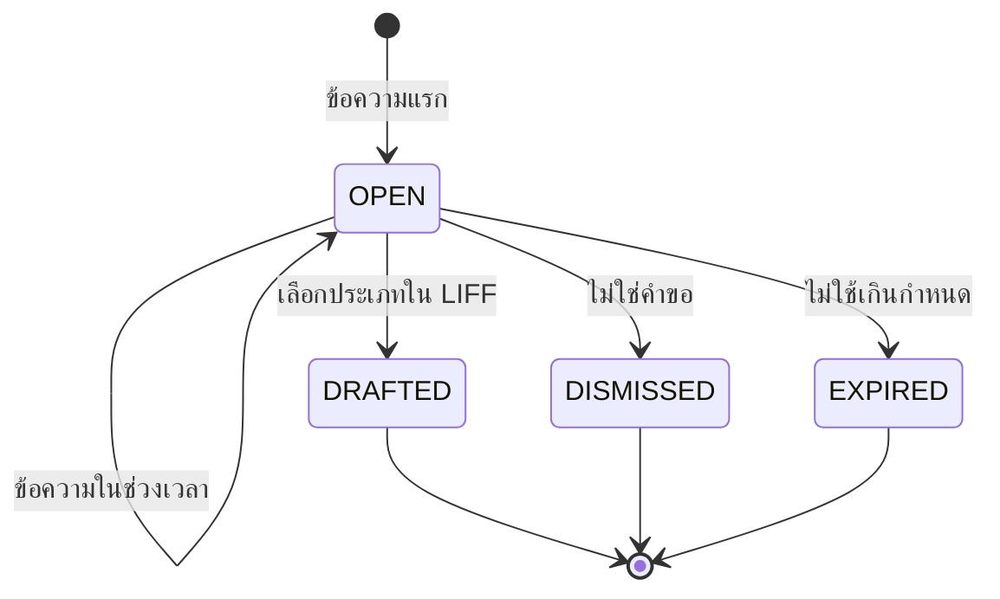

# S17 · LINE และแอป BCS Go — sub-spec

เอกสารนี้ขยาย §16.18 สำหรับการลงมือ · spec.md มีลำดับเหนือกว่าเสมอ ถ้าขัดกันให้ยึด spec แล้วแก้ไฟล์นี้

สถานะ: ร่าง P1-04 (2026-10-11) · รอตรวจ P1-05 และผู้ใช้อนุมัติ P1-06 · เลข BR GC INV event error และความสามารถในไฟล์นี้เป็นร่าง จะเพิ่มลง spec ในข้อที่สร้างโค้ดนั้น

## ขอบเขต

- FR: FR-LINE-301 (ขอผ่านแชท) · FR-LINE-302 (หน้าแรกใน LIFF) · FR-LINE-303 (rich menu ตามบทบาท) · FR-PLT-301 (แอป BCS Go: push biometric สแกน ตรวจรับออฟไลน์) · golden (ร่าง): `line-rich-menu` `chat-intake` `offline-queue` `offline-receiving` `notification-route` `step-up-methods`
- ข้อ: S17-01 ถึง S17-18 `[demo]` ทำในสาย 1 ต่อจาก S6 · S17-19 ถึง S17-21 `[go-live]`
- นอกขอบเขต: แอป iOS ในชั้น demo (PWA บน iOS ใช้ LINE แจ้งเตือนเหมือนเดิม) · web push ใน PWA (§9.7) · passkey เป็นวิธีเข้าระบบ (OQ-169) · สแกน barcode ของสินค้า (OQ-163) · แชทในกลุ่มและห้อง · ไฟล์ วิดีโอ เสียง ตำแหน่งในแชท · ถาม AI ในแชท (FR-AI-309 อยู่ใน ⌘K) · LINE ของลูกค้าและแอปบน store (`[go-live]`) · เปลี่ยนผลเงินของการตรวจรับ (ทางออฟไลน์ใช้ `gr.post` และ `receiveIncrement` เดิม)
- ขึ้นกับ: P1-07 (เปิดโมดูล `BCS_GO` ให้ SIMEC ใน seed · ค่าคงที่ชุดหลักฐาน step-up ที่ทุกสายใช้) · S6 เส้นชัย D (ขั้น `PARALLEL` และคณะกรรมการ · ใครเป็นผู้ตรวจคู่ขนาน · QR ของ FR-DOA-102 · ราคาอ้างอิงของ FR-DOA-101) · S13 เส้นชัย F (Intake Agent และ Document Agent · ค่าที่ AI เสนอและคำสั่งยืนยัน) · D-03 (channel LINE ของ BCS) · ผู้ใช้: Firebase project ของ BCS (S17-17) และยืนยัน dependency passkey (OQ-168) · โมดูล: `CORE` (LINE หน้าแรก เมนู) · `BCS_GO` (แอป push ออฟไลน์ สแกน) · `AI` (ไม่บังคับ)

## ชั้น demo และชั้นของจริงของ "เสร็จเมื่อ"

| เกณฑ์ต้นฉบับ §16.8 | ชั้น demo รอบนี้ (`[demo]`) | ชั้นของจริง (`[go-live]`) และของที่ต้องได้ |
| --- | --- | --- |
| ผู้อนุมัติได้ push ในแอปและตัดสินด้วย biometric | Android ติดตั้งเอง (APK จาก CI) + Firebase project ของ BCS + staging · passkey ใน WebView ของ Android · e2e ในเบราว์เซอร์ใช้ fake FCM และ virtual authenticator ของ Chromium | แอป Android และ iOS บน store ตาม OQ-167 · APNs key · release signing · assetlinks และ AASA ของโดเมน production (S17-20) |
| ผู้ตรวจรับสแกน barcode และบันทึกตรวจรับตอนออฟไลน์แล้วส่งครบไม่ซ้ำเมื่อกลับมาออนไลน์ | แอป Android สแกน QR บน PO (ML Kit) · PWA พิมพ์เลข PO · e2e ตัดเน็ตด้วย Playwright แล้วตรวจว่า GR เกิดครั้งเดียว | อุปกรณ์จริงที่หน้างานของลูกค้า สัญญาณจริง และผู้ใช้จริงฝ่ายละ 1 คน (P0-14 · S17-21) |
| ผู้ขอส่งคำขอผ่านแชท LINE ด้วยข้อความหรือรูปโดยยืนยันใน LIFF ก่อนส่ง | channel LINE ของ BCS (D-03) · e2e กับ fake LINE · เปิดและปิด AI (key ของ BCS P0-13 เมื่อวัดกับ Claude จริง) | LINE ของลูกค้า (P0-04 · OQ-15 OQ-16 · S17-19) |

## Demo ของขั้น

ผู้ใช้และยอดจากไฟล์ระยะ 1 (`scripts/inputs_p1/p1_org.py` `p1_history.py` `p1_suppliers.py`) · ฉากจริงกำหนดใน P1-08

1. เมนูตามบทบาท: `pm_p07` เห็น หน้าแรก ขอซื้อ ติดตามสถานะ ช่วยเหลือ · `dm_coni` (DM@CONI) เห็นเพิ่ม งานรออนุมัติ · `store_p07` (RECEIVER) เห็น ตรวจรับ · `proc_officer` เห็น งานจัดซื้อ · `dm_proc` (PROCUREMENT + DM@PROC PROC_MGR@HQ) เห็น 6 ปุ่ม · `admin` ให้ role RECEIVER แก่ `fm_p07` แล้วเมนูของ `fm_p07` เปลี่ยนภายใน 1 นาที
2. หน้าแรกใน LIFF: `dm_coni` แตะ หน้าแรก เห็นสิ่งที่ต้องทำ รอฉันอนุมัติ และที่ฉันติดตาม ตัวเลขเท่าหน้าแรกเว็บของตัวเอง
3. ขอผ่านแชท: `se_p01a` ส่งรูปใบเสนอราคา (ภาพถ่ายแบบ DOC-031: เหล็กข้ออ้อย DB25 SD40 1 ตัน ก่อน VAT 24,411.00 VAT 1,708.77 รวม 26,119.77) และพิมพ์ "ขอซื้อเหล็กข้ออ้อย DB25 1 ตัน ส่งไซต์พระราม 9" → ได้ปุ่ม "ตรวจและส่งคำขอ" → LIFF: เปิด AI = ประเภทและค่าที่ AI แนะนำมีป้ายให้ยืนยัน · ปิด AI = เลือกประเภทและกรอกเอง → กดส่ง → DOA ส่งไป `vp_ops` (รวม VAT เกิน 20,000 ไม่เกิน 100,000)
4. push และ biometric: `pm_p07` ส่งงานถนนแอสฟัลต์ 9,500 ตร.ม. 2,642,900.00 (แบบ H229) ผ่านผู้ตรวจคู่ขนานของ S6 → `ceo` ได้ push หัวเรื่อง "มีงานรออนุมัติ" เนื้อความ "PR-2569-xxxxx" (ไม่มียอด ชื่อ และชื่อเรื่อง) → แตะเปิดหน้าเอกสารในแอป → อนุมัติ → ยอดตั้งแต่ 100,000 จึงยืนยันด้วยลายนิ้วมือ (passkey) → ไทม์ไลน์แสดงช่องทาง "แอป BCS Go"
5. ตรวจรับออฟไลน์: `store_p07` เตรียม PO ของโครงการ P07 (เช่น PO ของ H042 คอนกรีตผสมเสร็จ 2 ลบ.ม. 2,780.00 ต่อหน่วย) → ปิดสัญญาณ → สแกน QR บน PO → บันทึกรับ 2 ลบ.ม. เลขใบส่งของ และรูป → เปิดสัญญาณ → ส่งเอง ได้ GR 1 ใบ PO เป็น RECEIVED · จำลองสัญญาณหลุดหลังส่ง → ส่งซ้ำได้ผลเดิม ไม่มี GR ใบที่สอง
6. ปิด AI (`AI_ENABLED=false`) แล้วเล่นฉาก 3 ซ้ำได้ครบ (EG-1)

## Entity และ migration

กติการ่วม §6.1: `id` uuid v7 · `organizationId` NOT NULL มี index · unique ทางธุรกิจรวม `organizationId` · FK คู่ `(organizationId, id)` ตาม ADR-039 (ตารางปลายทางต้องมี `@@unique([organizationId, id])` เพิ่มที่ตารางที่ยังไม่มี) · เวลา timestamptz · `createdAt` `updatedAt` ทุกตาราง · migration แบบเพิ่มอย่างเดียว (NFR-MNT-04) · ขั้นนี้ไม่มีคอลัมน์เงินใหม่

**ตารางใหม่**

| Entity | ฟิลด์ (ชนิด) | กฎและข้อจำกัด |
| --- | --- | --- |
| `ChatIntake` | memberId (uuid FK Member) · status (`ChatIntakeStatus`: `OPEN` `DRAFTED` `DISMISSED` `EXPIRED`) · text (text null) · textTruncated (bool) · messageCount (int) · imageCount (int) · openedAt · lastMessageAt · expiresAt (timestamptz) · requestTypeId (uuid null FK RequestType) · requestId (uuid null FK Request) · draftedAt · closedAt · purgedAt (null) · version (int) | CHECK `char_length(text) <= 2000` · CHECK `imageCount BETWEEN 0 AND 10` · unique (org, requestId) · index (org, memberId, status, lastMessageAt) · เห็นได้เฉพาะเจ้าของ (ไม่มี capability ให้ผู้อื่น) |
| `ChatIntakeItem` | intakeId (uuid FK ChatIntake) · seq (int) · kind (`ChatIntakeItemKind`: `TEXT` `IMAGE`) · lineMessageId (text) · fileId (uuid null FK FileObject) · fetchStatus (`ChatIntakeFetchStatus`: `NOT_NEEDED` `PENDING` `STORED` `FAILED`) · fetchError (text null รหัสเท่านั้น) · receivedAt | unique (org, intakeId, seq) · unique (org, lineMessageId) กันประมวลผลซ้ำ · ไม่เก็บข้อความต่อรายการ |
| `LineInboundMessage` | lineWebhookEventId (uuid FK LineWebhookEvent) · lineMessageId (text) · kind (`ChatIntakeItemKind`) · text (text null) · receivedAt · consumedAt (null) | unique (org, lineWebhookEventId) · ที่พักข้อความระหว่างรับ webhook กับประมวลผล · ลบแถวเมื่อประมวลผลแล้วหรืออายุเกิน 24 ชั่วโมง (ไม่ใช่เอกสารธุรกิจ) |
| `PushDevice` | memberId (uuid FK Member) · platform (`PushPlatform`: `ANDROID` `IOS`) · tokenEnc (text AES-256-GCM พร้อม key id) · tokenHash (text sha256 hex) · appVersion (text) · deviceLabel (text null ≤ 60) · registeredAt · lastSeenAt · revokedAt (null) · revokeReason (`PushDeviceRevokeReason` null: `LOGOUT` `USER` `DEACTIVATED` `UNREGISTERED` `REPLACED`) · version | unique (org, tokenHash) เฉพาะแถวที่ `revokedAt IS NULL` · index (org, memberId, revokedAt) · ไม่เกิน 5 เครื่องที่ใช้งานต่อ member (เกินแล้วเพิกถอนเครื่องเก่าสุดด้วย `REPLACED`) |
| `LineRichMenuVariant` | channelConfigId (uuid FK LineChannelConfig) · variantKey (text เช่น `LINKED:APPROVER`) · richMenuId (text) · madeAt | unique (org, variantKey) · `LineChannelConfig.richMenuUnlinkedId` ยังเป็นเมนูเริ่มต้น · `richMenuLinkedId` คงไว้เป็นชุด `LINKED` จนถึง migration ขั้น contract |

**ของเดิมที่เพิ่ม**

| ที่ | เพิ่ม | เหตุ |
| --- | --- | --- |
| `GoodsReceipt` | `offlineCapturedAt` timestamptz null | เวลาที่บันทึกในเครื่อง (OQ-171) · null = บันทึกออนไลน์ |
| enum `Channel` | `APP` | Event ของแอป BCS Go (BR-APP-02) |
| enum `NotificationChannel` | `PUSH` | `Notification.sentChannel` |
| enum `StepUpMethod` | `PASSKEY` | หลักฐาน step-up (BR-AUTH-11) |
| ตารางของ Better Auth | ตาราง passkey ตาม `auth generate` ของ `@better-auth/passkey` (global แบบตาราง auth อื่น §4.8) | หลัง OQ-168 เท่านั้น |
| `OrgSettingsSchema` (Zod ไม่ใช่ migration) | `chatIntake?: { enabled (ค่าเริ่มต้น false), windowMinutes 30, maxImages 10, maxTextChars 2000, hourlyLimit 20, expireHours 24, textRetentionDays 7 }` · `bcsGo?: { offlineRetentionDays 7, maxPreparedPos 50 }` | องค์กรเดิมไม่เปลี่ยนพฤติกรรม (ปิดเป็นค่าเริ่มต้น) · SIMEC เปิดผ่านชีต Settings |
| `Member.notificationPrefs` (Zod) | `appPush?: boolean` ค่าเริ่มต้น false | OQ-165 |
| env (ภาคผนวก B) | `PUSH_PROVIDER` (`fcm` `fake` `off`) · `FCM_PROJECT_ID` · `FCM_SERVICE_ACCOUNT_JSON_B64` · `FCM_API_BASE_URL` และ `FCM_TOKEN_URL` (local เท่านั้น) · `BCS_GO_ANDROID_PACKAGE` · `BCS_GO_ANDROID_CERT_SHA256` · `BCS_GO_IOS_APP_ID` | ADR-163 ADR-165 |

## State machine

ทุกตารางเขียนใน `src/core/state-machines/*.ts` แบบเดียวกับ §6.4 พร้อมเทสต์ที่วนทุกคู่ (สถานะ, command)

**ร่างจากแชท (`ChatIntake`)**



| จาก | คำสั่ง | ไป | ใครทำได้ | event |
| --- | --- | --- | --- | --- |
| — | `chat_intake.receive` (ข้อความแรก หรือหลังพ้นช่วงเวลา) | OPEN | member ที่ผูก LINE (ช่องทาง `LINE_CHAT` · idempotencyKey = webhookEventId) | `chat_intake.opened` |
| OPEN | `chat_intake.receive` (ภายในช่วงเวลา) | OPEN | เจ้าของ | `chat_intake.message_added` |
| OPEN DRAFTED | `chat_intake.store_image` (ดึงรูปจาก LINE สำเร็จหรือล้ม) | เดิม | SYSTEM (job) | `chat_intake.image_fetched` |
| OPEN | `chat_intake.draft` | DRAFTED | เจ้าของใน LIFF · ต้องมี `request.create` | `chat_intake.drafted` · `request.drafted` |
| OPEN | `chat_intake.dismiss` | DISMISSED | เจ้าของใน LIFF | `chat_intake.dismissed` |
| OPEN | `chat_intake.expire` | EXPIRED | SYSTEM (job ทุกชั่วโมง) | `chat_intake.expired` |
| DRAFTED DISMISSED EXPIRED | `chat_intake.purge` (สถานะคงเดิม ตั้ง `purgedAt`) | เดิม | SYSTEM | `chat_intake.purged` |

**อุปกรณ์รับ push (`PushDevice`)**

| จาก | คำสั่ง | ไป | ใครทำได้ | event |
| --- | --- | --- | --- | --- |
| — | `push_device.register` | ACTIVE (`revokedAt` null) | เจ้าของในแอป (`self.pushDevices` · โมดูล `BCS_GO`) | `push_device.registered` |
| ACTIVE | `push_device.revoke` | REVOKED | เจ้าของ (`USER` `LOGOUT`) · SYSTEM (`UNREGISTERED` `REPLACED`) · ปิดใช้งาน member (`DEACTIVATED` ในธุรกรรมเดียวกับ BR-AUTH-06) | `push_device.revoked` |

**รายการในคิวตรวจรับออฟไลน์ (ในเครื่อง ไม่ใช่ตารางในฐาน · `src/core/offline-queue`)**

| จาก | เหตุ | ไป |
| --- | --- | --- |
| — | ผู้ใช้กดบันทึกตอนออฟไลน์ | `QUEUED` (สร้าง idempotencyKey uuid v7 และ `capturedAt`) |
| `QUEUED` `RETRY` | ถึงคิวและออนไลน์และ session เป็นผู้บันทึก | `SENDING` (ตรึง input ตั้งแต่ครั้งแรก) |
| `SENDING` | ผลตาม BR-APP-07 | `SENT` (ลบจากเครื่อง) · `RETRY` · `WAIT_LOGIN` · `NEEDS_ATTENTION` |
| `SENDING` | แอปถูกปิดกลางทาง | `RETRY` (ผลไม่รู้ ส่งซ้ำด้วย key เดิม) |
| `QUEUED` (ยังไม่เคยส่ง) · `NEEDS_ATTENTION` | ผู้ใช้ทิ้ง | `DISCARDED` |
| `NEEDS_ATTENTION` | ผู้ใช้แก้แล้วส่งใหม่ | `DISCARDED` + รายการใหม่ key ใหม่ |
| `QUEUED` `RETRY` `WAIT_LOGIN` `NEEDS_ATTENTION` | `capturedAt` เก่ากว่า `offlineRetentionDays` | `EXPIRED` (แสดง ไม่ส่ง) |

## กฎ

**ขอผ่านแชทและหน้า LIFF (BR-LINE)**

| ID | กฎ |
| --- | --- |
| BR-LINE-10 | ข้อความชนิด text และ image จากแชท 1:1 ของ member ที่ผูกแล้ว ใน mode active ขององค์กรที่เปิด `chatIntake.enabled` เปิดหรือเติม `ChatIntake` ตาม golden `chat-intake`: เติมร่าง OPEN ล่าสุดเมื่อ `now − lastMessageAt < windowMinutes` ไม่เช่นนั้นเปิดร่างใหม่ · รูปเกิน `maxImages` ไม่เพิ่มและบอกให้แนบใน LIFF · ข้อความรวมเกิน `maxTextChars` ตัดเหลือเท่าเกณฑ์และตั้ง `textTruncated` · เกิน `hourlyLimit` ข้อความต่อชั่วโมงไม่ทำอะไรและแจ้งครั้งเดียวต่อชั่วโมง · ชนิดอื่นได้คำแนะนำ · ผู้ที่ยังไม่ผูกได้ข้อความชวนผูกบัญชี · กลุ่ม ห้อง และ mode standby ไม่ตอบ |
| BR-LINE-11 | ข้อความที่พิมพ์ไม่อยู่ใน `LineWebhookEvent` (คงกติกาเดิม) · เก็บใน `LineInboundMessage` จนประมวลผลแล้วลบ (ไม่เกิน 24 ชั่วโมง) · ใน `ChatIntake.text` เก็บไม่เกิน `textRetentionDays` แล้ว purge (OQ-162) · ห้าม log ข้อความ ชื่อไฟล์ และ LINE user id (NFR-SEC-09) |
| BR-LINE-12 | ร่างคำขอจากแชทเกิดเมื่อเจ้าของเลือกประเภทใน LIFF เท่านั้น (POST) ผ่านตรรกะของ `request.create_draft` เดิม: ชื่อเรื่องตั้งต้น = บรรทัดแรกที่ไม่ว่างไม่เกิน 120 grapheme · รูปแนบเป็น `OTHER` (ผู้ขอเปลี่ยนชนิดเอง กฎเอกสารแนบตรวจตอนส่งตามเดิม) · ข้อความแชทแสดงเป็นข้อมูลอ้างอิงจนถูก purge · ส่งได้ด้วย `request.submit` ใน LIFF โดยผู้ขอเท่านั้น ไม่มีทางส่งจากแชท |
| BR-LINE-13 | ปิดโมดูล `AI` ปิด agent หรือ AI ล้ม → BR-LINE-10 ถึง 12 ทำงานครบโดยไม่มีค่าที่ AI เสนอ · โค้ดของ S17 ไม่ import `src/integrations/ai` · AI ทำงานจาก event ของ `chat_intake` ที่ S13 ฟังเอง และค่าที่เสนออยู่ใน `AgentAction` ซึ่ง LIFF แสดงพร้อมป้ายและให้คนยืนยัน (BR-AI-02 · BR-AI-?S17a) |
| BR-LINE-14 | รูปดึงจาก LINE ใน job (ไม่ใช่ใน webhook) · ตรวจ magic bytes ว่าเป็น JPEG หรือ PNG และไม่เกิน 20 MB (NFR-SEC-08) · เก็บเป็น `FileObject` ผู้อัปโหลด = เจ้าของร่าง · ดึงไม่ได้ (เกินเวลาที่ LINE เก็บ หรือ 4xx) → `FAILED` และ LIFF แจ้งให้แนบใหม่ · ลองซ้ำเฉพาะ 5xx และเครือข่าย |
| BR-LINE-15 | ทุกข้อความที่รับตอบด้วย reply token (BR-LINE-07) ไม่ใช้ push · ข้อความตอบไม่มีข้อความที่ผู้ใช้พิมพ์ รายการ ราคา หรือชื่อผู้ขาย (BR-NOTI-01 BR-LINE-06) · ปุ่มเปิด LIFF `/liff/requests/new?intake=<id>` ผ่าน `liffLink` · การเปิดลิงก์ (GET) ไม่สร้างร่าง |
| BR-LINE-16 | rich menu ของผู้ผูกแล้วเลือกด้วย `selectRichMenu` (pure · golden `line-rich-menu`): ผู้อนุมัติ = ดำรงตำแหน่งที่ DOA ฉบับที่มีผลอ้างในข้อใดข้อหนึ่ง หรือผู้รักษาการที่ `ACTIVE` หรือผู้ตรวจคู่ขนานของ S6 (BR-WF-?S17a) · ผู้ตรวจรับ = role `RECEIVER` · จัดซื้อ = role `PROCUREMENT` · ไม่ใช้จำนวนงานค้าง · ปุ่มเรียง หน้าแรก ขอซื้อ [งานรออนุมัติ] [ตรวจรับ] [งานจัดซื้อ] ติดตามสถานะ ช่วยเหลือ ไม่เกิน 6 ปุ่ม (เกินให้ตัด ติดตามสถานะ) · 4 ปุ่ม = 2+2 แถว · 5 = 3+2 · 6 = 3+3 · ปุ่มหลักคือปุ่มบทบาทแรก ไม่มีให้เป็น ขอซื้อ · member ที่ไม่ ACTIVE หรือไม่ผูก = `UNLINKED` |
| BR-LINE-17 | job `line-rich-menu` เดิมสลับเมนูภายใน 1 นาทีเมื่อ `line.linked` `line.unlinked` `member.role_granted` `member.role_revoked` `position.assigned` `position.unassigned` `delegation.started` `delegation.ended` `delegation.revoked` และสลับทุกคนที่ผูกเมื่อ `doa_version.published` หรือ `doa_version.superseded` · อ่านสถานะล่าสุดทุกครั้ง (ไม่เชื่อข้อมูลใน event) · หลายคนพร้อมกันใช้ bulk link ของ LINE (ตรวจ API ตอนลงมือ) · เมนูไม่ใช่สิทธิ์: ทุกหน้าที่ปุ่มเปิดตรวจสิทธิ์เอง (BR-AUTH-05) |
| BR-LINE-18 | `/liff/home` ใช้ `homeTodo` `homeApprovals` `homeFollowing` ของ `src/server/services/home` ที่อ่าน `src/server/queries/home.ts` ชุดเดียวกับหน้าแรกเว็บ · render ฝั่งเซิร์ฟเวอร์ แต่ละส่วนโหลดและล้มแยกกัน · ลิงก์ไปหน้า LIFF ที่มี ไม่เช่นนั้นเปิดหน้าเว็บนอก LINE · ไม่โหลดไลบรารีหรือคอมโพเนนต์ของ Workspace (ADR-052) |

**การแจ้งเตือนและ token (BR-NOTI · BR-TOK)**

| ID | กฎ |
| --- | --- |
| BR-NOTI-05 | push เป็นช่องทางของ `IMMEDIATE` เฉพาะ template ในรายการเดียวกับ LINE (`LINE_TEMPLATES` ของ `src/server/notifications/deliver.ts`) ยกเว้น `digest.daily` · ส่งเมื่อองค์กรเปิด `BCS_GO` ผู้รับเปิด `appPush` และมีเครื่องที่ใช้งานอย่างน้อย 1 เครื่อง · ส่งแทน LINE ตาม OQ-165 ลำดับ PUSH → LINE → อีเมล (golden `notification-route`) · ผู้ที่ไม่เปิด `appPush` ได้ทางเดิมทุกประการ |
| BR-NOTI-06 | เนื้อหา push (ขึ้นหน้าจอล็อก): หัวเรื่องบอกชนิดของการแจ้ง (เช่น "มีงานรออนุมัติ") และเนื้อความเป็นเลขหรือรหัสของเอกสารเท่านั้น ไม่ใช้ชื่อเรื่อง ไม่มียอดเงิน ชื่อคน ผู้ขาย หรือรายการ (เข้มกว่า BR-NOTI-01 · OQ-166) · ข้อมูลแนบมีแค่ `notificationId` และ path ภายในแอป · ภาษาตาม locale ของผู้รับ (BR-NOTI-03) |
| BR-NOTI-07 | ผล push ต่อเครื่อง: `UNREGISTERED` หรือ token ผิดรูป → เพิกถอนเครื่องนั้น (`UNREGISTERED`) แล้วลองเครื่องอื่น ไม่เหลือ → LINE แล้วอีเมล · 401 403 ของ FCM (ปัญหาของ BCS ไม่ใช่ผู้รับ) → แจ้งเตือนผู้ดูแลแพลตฟอร์มและส่งทางถัดไปทันที · 429 5xx และเครือข่าย → ลองซ้ำแบบเดียวกับ LINE แล้วส่งทางถัดไปให้งานอนุมัติถึงภายใน 5 นาทีนับจากครั้งแรก (FR-LINE-007 AC3) |
| BR-NOTI-08 | ปิด `appPush` = กลับไปทางเดิม ไม่ใช่ไม่แจ้ง · งานอนุมัติและงานเกิน SLA ยังปิดไม่ได้ (BR-NOTI-04) · สรุปรายวันไม่ไปทาง push |
| BR-TOK-06 | push ข้อความตอบในแชท และลิงก์ของ S17 ไม่มี ActionToken หรือ secret ที่ตัดสินหรือเปลี่ยนสถานะได้ · การกระทำทุกอย่างผ่าน session และ `runCommand()` · GET อ่านอย่างเดียว |

**ตัวตนและ step-up (BR-AUTH)**

| ID | กฎ |
| --- | --- |
| BR-AUTH-11 | passkey เป็นหลักฐาน step-up ชนิด `PASSKEY` เมื่อ assertion ผ่านการตรวจลายเซ็น challenge ตรงกับที่ออกให้ session นี้ภายใน 5 นาที มี flag ยืนยันผู้ใช้ (UV) และ credential เป็นของ user ของ session · ได้ grant แบบเดียวกับ PIN (เอกสารเดียว 5 นาที ใช้ครั้งเดียว) แล้วเปลี่ยน session id (NFR-SEC-04) · คำสั่งตัดสินทุกตัวรับ `PIN` และ `PASSKEY` (OQ-169) |
| BR-AUTH-12 | เพิ่ม passkey ต้องพิสูจน์ตัวตนสดแบบเดียวกับตั้ง PIN (`proveIdentityForPin`: รหัสผ่านหรือ TOTP) · ลงทะเบียนด้วย `userVerification = required` · ลบของตัวเองได้ทุกเมื่อ · เพิ่มหรือลบแจ้งเจ้าของทางอีเมล (`security.notice`) และบันทึก event · ล้มซ้ำเกิน rate limit → `RATE_LIMITED` |
| BR-AUTH-13 | passkey ยังไม่ใช้แทนการเข้าระบบ (OQ-169) · `IDENTITY_RESET` (BR-AUTH-07) ลบ passkey ของผู้นั้นทั้งหมดในธุรกรรมเดียวกับการรีเซ็ต · member ที่ไม่ ACTIVE ใช้ passkey ทำ step-up ไม่ได้ |
| BR-AUTH-14 | ปิดใช้งาน member เพิกถอน `PushDevice` ทั้งหมดในธุรกรรมเดียวกับ BR-AUTH-06 · ออกจากระบบในแอปเพิกถอนเครื่องนั้น · token ที่ลงทะเบียนซ้ำโดย member อื่นย้ายมาและเพิกถอนของเดิม (`REPLACED`) |

**แอป BCS Go และตรวจรับออฟไลน์ (BR-APP)**

| ID | กฎ |
| --- | --- |
| BR-APP-01 | แอปไม่มีโค้ดธุรกิจ: Capacitor โหลดเว็บของ environment ด้วย `server.url` · `allowNavigation` เฉพาะ origin นั้น (ลิงก์อื่นเปิดเบราว์เซอร์ของเครื่อง) · ปลั๊กอินเฉพาะ push กล้อง และ barcode (§5.5) · JS ของปลั๊กอินโหลดแบบ dynamic เฉพาะเมื่ออยู่ในแอป และหน้า LIFF ห้าม import (ADR-052) |
| BR-APP-02 | ช่องทาง `APP` ของ ctx และ Event ตรวจจากเครื่องหมายใน user agent ของแอป ใช้เพื่อ audit และ KPI เท่านั้น ไม่ใช้ตัดสินสิทธิ์ |
| BR-APP-03 | ข้อมูลธุรกิจในเครื่องมีได้เฉพาะของ `/go/receive` ใน IndexedDB ของ origin (`idb-keyval`): สำเนา PO ที่เตรียมและคิวตรวจรับพร้อมรูป · service worker เก็บเฉพาะหน้า shell ของ `/go/receive` และไฟล์ static ที่มีแฮช ไม่เก็บ response ของข้อมูล · หน้าออฟไลน์เรียก route handler ที่ URL คงที่ ไม่ใช้ server action (shell ที่เก็บไว้อาจมาจาก build เก่า) |
| BR-APP-04 | เตรียมได้เฉพาะ PO ที่ผู้ใช้ตรวจรับได้ (ขอบเขตและ SoD ของ `gr.post`) สถานะ `SENT` หรือ `PARTIALLY_RECEIVED` ไม่เกิน `maxPreparedPos` ใบ · สำเนามี เลข PO ชื่อผู้ขาย สถานที่ส่ง บรรทัด (คำอธิบาย หน่วย จำนวนสั่ง จำนวนรับแล้ว) `version` และรหัส QR · ไม่มีราคา ยอดเงิน งบ เลขบัญชี หรือผู้ติดต่อ · สำเนาเก่ากว่า `offlineRetentionDays` ใช้เริ่มบันทึกใหม่ไม่ได้ |
| BR-APP-05 | รายการในคิวมี idempotencyKey ของตัวเอง (uuid v7 ตอนบันทึก) · input ถูกตรึงตั้งแต่ส่งครั้งแรก ส่งซ้ำด้วย key และ input เดิมเสมอ · แก้หรือทิ้งได้เฉพาะรายการที่ยังไม่เคยส่ง หรือ `NEEDS_ATTENTION` (แก้ = รายการใหม่ key ใหม่) · `SENDING` `RETRY` `WAIT_LOGIN` แก้และทิ้งไม่ได้เพราะผลยังไม่รู้ |
| BR-APP-06 | ลำดับ: เลือกรายการที่ `capturedAt` เก่าสุดที่ไม่มีรายการก่อนหน้าของ PO เดียวกันค้าง (`QUEUED` `SENDING` `RETRY` `WAIT_LOGIN` `NEEDS_ATTENTION`) · ส่งทีละรายการ · PO อื่นไม่ถูกบล็อก · `expectedPoVersion` = version ล่าสุดที่เครื่องรู้ของ PO นั้น (จากสำเนา แล้วจากผลของรายการที่ส่งสำเร็จ) · ลองซ้ำรอ `min(15 วินาที × 2^(n−1), 300 วินาที)` |
| BR-APP-07 | ผลจากเซิร์ฟเวอร์: 2xx → `SENT` · ไม่มีคำตอบ 5xx และ `RATE_LIMITED` → `RETRY` · `UNAUTHENTICATED` → `WAIT_LOGIN` · `CONFLICT_VERSION` `INVALID_STATE_TRANSITION` `IDEMPOTENCY_CONFLICT` `FORBIDDEN` `SOD_VIOLATION` `BUDGET_INSUFFICIENT` `VALIDATION_FAILED` `NOT_FOUND` → `NEEDS_ATTENTION` พร้อมเหตุที่อ่านง่าย · ไม่มีการส่งเกินหรือแก้เองอัตโนมัติ |
| BR-APP-08 | `gr.post` รับ `offline` ไม่บังคับ `{ capturedAt, capturedByMemberId, expectedPoVersion }` และตรวจตามลำดับ: ผู้ส่งต้องเป็น `capturedByMemberId` (`FORBIDDEN`) → สิทธิ์และ SoD เดิม → สถานะ PO เดิม (`INVALID_STATE_TRANSITION`) → `expectedPoVersion` ต้องเท่า version ปัจจุบัน (`CONFLICT_VERSION`) → `capturedAt` ต้องไม่ก่อน `sentAt` ของ PO ไม่เกิน `now` + 5 นาที และไม่เก่ากว่า `offlineRetentionDays` (`VALIDATION_FAILED` reason `CAPTURED_AT`) · ที่เหลือคำนวณด้วยตรรกะเดิมทุกประการ (`receiveIncrement` tolerance ถืองบ variance) · `receivedAt` = `offlineCapturedAt` = `capturedAt` ส่วน `postedAt` และ Event ใช้ `ctx.now` (OQ-171) · ผลคืน `poVersion` ใหม่ · ไม่มี `offline` = พฤติกรรมเดิม |
| BR-APP-09 | `SENT` ลบรายการและรูปจากเครื่องทันที · ออกจากระบบหรือเปลี่ยนผู้ใช้: เตือนถ้ามีรายการค้าง แล้วลบคิวและสำเนาของผู้ใช้เดิม · รายการของผู้ใช้อื่นไม่ถูกส่งด้วย session ปัจจุบัน (เครื่องกันก่อน เซิร์ฟเวอร์กันซ้ำด้วย BR-APP-08) |
| BR-APP-10 | (invariant) รายการคิว 1 รายการทำให้เกิด GR ไม่เกิน 1 ใบ: ใช้ INV-PLT-01 และ `CommandLog` ซึ่งเก็บ 90 วัน จึงต้องให้ `offlineRetentionDays` น้อยกว่า 90 เสมอ (schema ของ settings บังคับ ≤ 30) |
| BR-APP-11 | QR ที่สแกนรับเฉพาะลิงก์ตรวจสอบเอกสารของ BCS (FR-DOA-102 · BR-QR-?S17a) ที่ origin ตรงกับ environment · ค่าอื่นไม่เปิดและไม่ส่งไปไหน · ออฟไลน์จับคู่กับรหัสในสำเนา · ออนไลน์ resolve ที่เซิร์ฟเวอร์ด้วย GET อ่านอย่างเดียวที่ตรวจขอบเขตของ `gr.post` · ไม่พบ → "ไม่พบ PO นี้ในรายการที่ตรวจรับได้" · PWA พิมพ์เลข PO แทน |
| BR-APP-12 | push token เก็บแบบเข้ารหัส AES-256-GCM ด้วย `ENCRYPTION_KEY` พร้อม key id (NFR-SEC-07) และ sha256 สำหรับ unique · ห้าม log token (NFR-SEC-09) · ลงทะเบียนต้องอยู่ในแอปที่ login แล้ว |
| BR-APP-13 | โมดูล `BCS_GO`: ลงทะเบียน push เตรียมสำเนา resolve QR และหน้า `/go/*` เรียก `requireModule(ctx, 'BCS_GO')` · ปิดโมดูล → ไม่ส่ง push (กลับทางเดิม) และเตรียมใหม่ไม่ได้ · คิวที่ค้างในเครื่องยังส่งได้เพราะ `gr.post` อยู่ใน `CORE` (ไม่ให้ข้อมูลหาย) |

**invariant ที่ใช้ร่วม:** INV-PLT-01 (คิวออฟไลน์และ webhook ที่ส่งซ้ำ) · INV-TOK-01 (ไม่มี token ใหม่) · INV-EVT-02 (ทุกคำสั่งข้างบนเขียน Event) · INV-TEN-01 และ INV-TEN-02 (ตารางใหม่ทุกตาราง)

## ร่าง golden case

เวลาเป็น UTC · `now` ของเซิร์ฟเวอร์ 2026-11-02T03:00:00Z ถ้าไม่บอก · ค่าคำนวณซ้ำด้วย `scratch/p1-04/s17_golden.mjs` (BigInt ตาม `lineNet` และ `receiveIncrement` เดิม)

```yaml
# draft: tests/golden/line-rich-menu.yaml
suite: line-rich-menu
# selectRichMenu (src/core/line-menu · pure) · flags มาจาก service (ตำแหน่งที่ DOA ฉบับที่มีผลอ้าง รักษาการ ACTIVE ผู้ตรวจคู่ขนานของ S6)
cases:
  - { id: GC-LINE-01, title: ยังไม่ผูก, input: { linked: false }, expect: { variant: UNLINKED, buttons: [link, help], rows: [2], primary: link } }
  - { id: GC-LINE-02, title: ผู้ขออย่างเดียว (pm_p07), input: { linked: true, memberStatus: ACTIVE, roles: [], doaPositionHolder: false, activeDelegate: false, parallelReviewer: false }, expect: { variant: LINKED, buttons: [home, request, track, help], rows: [2, 2], primary: request } }
  - { id: GC-LINE-03, title: ผู้ดำรงตำแหน่งใน DOA (dm_coni), input: { linked: true, memberStatus: ACTIVE, roles: [], doaPositionHolder: true, activeDelegate: false, parallelReviewer: false }, expect: { variant: "LINKED:APPROVER", buttons: [home, request, tasks, track, help], rows: [3, 2], primary: tasks } }
  - { id: GC-LINE-04, title: ผู้ตรวจรับ (store_p07), input: { linked: true, memberStatus: ACTIVE, roles: [RECEIVER], doaPositionHolder: false, activeDelegate: false, parallelReviewer: false }, expect: { variant: "LINKED:RECEIVER", buttons: [home, request, receive, track, help], rows: [3, 2], primary: receive } }
  - { id: GC-LINE-05, title: จัดซื้อ (proc_officer), input: { linked: true, memberStatus: ACTIVE, roles: [PROCUREMENT], doaPositionHolder: false, activeDelegate: false, parallelReviewer: false }, expect: { variant: "LINKED:PROCUREMENT", buttons: [home, request, procurement, track, help], rows: [3, 2], primary: procurement } }
  - { id: GC-LINE-06, title: ผู้อนุมัติที่เป็นจัดซื้อ (dm_proc) 6 ปุ่มพอดี, input: { linked: true, memberStatus: ACTIVE, roles: [PROCUREMENT], doaPositionHolder: true, activeDelegate: false, parallelReviewer: false }, expect: { variant: "LINKED:APPROVER:PROCUREMENT", buttons: [home, request, tasks, procurement, track, help], rows: [3, 3], primary: tasks } }
  - { id: GC-LINE-07, title: ครบสามบทบาท ตัดติดตามสถานะ, input: { linked: true, memberStatus: ACTIVE, roles: [RECEIVER, PROCUREMENT], doaPositionHolder: true, activeDelegate: false, parallelReviewer: false }, expect: { variant: "LINKED:APPROVER:RECEIVER:PROCUREMENT", buttons: [home, request, tasks, receive, procurement, help], rows: [3, 3], primary: tasks } }
  - { id: GC-LINE-08, title: ผู้รักษาการที่ ACTIVE นับเป็นผู้อนุมัติ, input: { linked: true, memberStatus: ACTIVE, roles: [], doaPositionHolder: false, activeDelegate: true, parallelReviewer: false }, expect: { variant: "LINKED:APPROVER", buttons: [home, request, tasks, track, help], rows: [3, 2], primary: tasks } }
  - { id: GC-LINE-09, title: ผู้ตรวจคู่ขนานของ S6 นับเป็นผู้อนุมัติ, input: { linked: true, memberStatus: ACTIVE, roles: [], doaPositionHolder: false, activeDelegate: false, parallelReviewer: true }, expect: { variant: "LINKED:APPROVER", buttons: [home, request, tasks, track, help], rows: [3, 2], primary: tasks } }
  - { id: GC-LINE-10, title: ผู้ตรวจรับที่รักษาการด้วย, input: { linked: true, memberStatus: ACTIVE, roles: [RECEIVER], doaPositionHolder: false, activeDelegate: true, parallelReviewer: false }, expect: { variant: "LINKED:APPROVER:RECEIVER", buttons: [home, request, tasks, receive, track, help], rows: [3, 3], primary: tasks } }
  - { id: GC-LINE-11, title: role ที่ไม่มีปุ่มไม่เปลี่ยนเมนู (ceo มี EXECUTIVE), input: { linked: true, memberStatus: ACTIVE, roles: [EXECUTIVE], doaPositionHolder: true, activeDelegate: false, parallelReviewer: false }, expect: { variant: "LINKED:APPROVER", buttons: [home, request, tasks, track, help], rows: [3, 2], primary: tasks } }
  - { id: GC-LINE-12, title: member ที่ถูกปิดใช้งาน, input: { linked: true, memberStatus: DEACTIVATED, roles: [RECEIVER], doaPositionHolder: false, activeDelegate: false, parallelReviewer: false }, expect: { variant: UNLINKED, buttons: [link, help], rows: [2], primary: link } }
```

```yaml
# draft: tests/golden/chat-intake.yaml
suite: chat-intake
# routeChatMessage และ titleFromText (src/core/chat-intake · pure) · settings: windowMinutes 30 · maxImages 10 · maxTextChars 2000 · hourlyLimit 20 · expireHours 24
cases:
  - { id: GC-LINE-13, title: ข้อความแรกของผู้ที่ผูกแล้ว, input: { enabled: true, source: user, mode: active, sender: LINKED_ACTIVE, messageType: text, textChars: 40, openIntake: null, sentLastHour: 0 }, expect: { action: OPEN_NEW, reply: INTAKE_LINK } }
  - { id: GC-LINE-14, title: ภายใน 29 นาที 59 วินาทีเติมร่างเดิม, input: { enabled: true, source: user, mode: active, sender: LINKED_ACTIVE, messageType: image, now: "2026-11-02T03:00:00Z", openIntake: { lastMessageAt: "2026-11-02T02:30:01Z", images: 1, textChars: 40 }, sentLastHour: 1 }, expect: { action: APPEND, reply: INTAKE_LINK_SAME } }
  - { id: GC-LINE-15, title: ครบ 30 นาทีพอดีเปิดร่างใหม่, input: { enabled: true, source: user, mode: active, sender: LINKED_ACTIVE, messageType: text, textChars: 10, now: "2026-11-02T03:00:00Z", openIntake: { lastMessageAt: "2026-11-02T02:30:00Z", images: 1, textChars: 40 }, sentLastHour: 2 }, expect: { action: OPEN_NEW, reply: INTAKE_LINK } }
  - { id: GC-LINE-16, title: รูปที่ 11 ไม่เพิ่ม, input: { enabled: true, source: user, mode: active, sender: LINKED_ACTIVE, messageType: image, now: "2026-11-02T03:00:00Z", openIntake: { lastMessageAt: "2026-11-02T02:59:00Z", images: 10, textChars: 0 }, sentLastHour: 10 }, expect: { action: LIMIT_IMAGES, reply: ADD_IN_LIFF } }
  - { id: GC-LINE-17, title: ข้อความรวมเกิน 2000 ตัดเหลือ 2000, input: { enabled: true, source: user, mode: active, sender: LINKED_ACTIVE, messageType: text, textChars: 150, now: "2026-11-02T03:00:00Z", openIntake: { lastMessageAt: "2026-11-02T02:59:00Z", images: 0, textChars: 1900 }, sentLastHour: 3 }, expect: { action: APPEND, keptChars: 100, textTruncated: true, reply: INTAKE_LINK_SAME } }
  - { id: GC-LINE-18, title: สติกเกอร์ได้คำแนะนำ, input: { enabled: true, source: user, mode: active, sender: LINKED_ACTIVE, messageType: sticker, openIntake: null, sentLastHour: 0 }, expect: { action: UNSUPPORTED, reply: TEXT_OR_PHOTO_HINT } }
  - { id: GC-LINE-19, title: ยังไม่ผูกบัญชี, input: { enabled: true, source: user, mode: active, sender: UNLINKED, messageType: text, openIntake: null, sentLastHour: 0 }, expect: { action: LINK_PROMPT, reply: LINK_PROMPT } }
  - { id: GC-LINE-20, title: ข้อความในกลุ่มไม่ตอบ, input: { enabled: true, source: group, mode: active, sender: LINKED_ACTIVE, messageType: text, openIntake: null, sentLastHour: 0 }, expect: { action: IGNORE, reply: NONE } }
  - { id: GC-LINE-21, title: mode standby ไม่ตอบ, input: { enabled: true, source: user, mode: standby, sender: LINKED_ACTIVE, messageType: text, openIntake: null, sentLastHour: 0 }, expect: { action: IGNORE, reply: NONE } }
  - { id: GC-LINE-22, title: องค์กรไม่เปิดขอผ่านแชท (พฤติกรรมเดิม), input: { enabled: false, source: user, mode: active, sender: LINKED_ACTIVE, messageType: text, openIntake: null, sentLastHour: 0 }, expect: { action: IGNORE, reply: NONE } }
  - { id: GC-LINE-23, title: ข้อความที่ 21 ในชั่วโมงแจ้งครั้งเดียว, input: { enabled: true, source: user, mode: active, sender: LINKED_ACTIVE, messageType: text, openIntake: null, sentLastHour: 20, limitNoticeSentThisHour: false }, expect: { action: RATE_LIMITED, reply: RATE_LIMIT_NOTICE } }
  - { id: GC-LINE-24, title: ข้อความที่ 22 ในชั่วโมงเงียบ, input: { enabled: true, source: user, mode: active, sender: LINKED_ACTIVE, messageType: text, openIntake: null, sentLastHour: 21, limitNoticeSentThisHour: true }, expect: { action: RATE_LIMITED, reply: NONE } }
  - { id: GC-LINE-25, title: ชื่อเรื่องจากบรรทัดแรกที่ไม่ว่าง, input: { text: "  \nขอซื้อเหล็กข้ออ้อย DB25 1 ตัน\nส่งไซต์พระราม 9" }, expect: { title: "ขอซื้อเหล็กข้ออ้อย DB25 1 ตัน" } }
  - { id: GC-LINE-26, title: ตัดชื่อเรื่องที่ 120 grapheme ไม่ตัดกลางสระ, input: { text: { repeat: "ที่", times: 130 } }, expect: { title: { repeat: "ที่", times: 120 }, graphemes: 120, codeUnits: 360 } }
  - { id: GC-LINE-27, title: หมดอายุที่ 24 ชั่วโมงพอดี, input: { now: "2026-11-02T03:00:00Z", intakes: [ { id: a, status: OPEN, lastMessageAt: "2026-11-01T03:00:00Z" }, { id: b, status: OPEN, lastMessageAt: "2026-11-01T03:00:01Z" }, { id: c, status: DRAFTED, lastMessageAt: "2026-10-30T03:00:00Z" } ] }, expect: { expire: [a] } }
```

```yaml
# draft: tests/golden/offline-queue.yaml
suite: offline-queue
# คิวในเครื่อง (src/core/offline-queue · pure) · offlineRetentionDays 7 · ผู้ใช้ใน session = store_p07 ถ้าไม่บอก
cases:
  - id: GC-APP-01
    title: แปลงผลจากเซิร์ฟเวอร์เป็นสถานะ
    input: { results: [ { http: 201 }, { network: true }, { http: 500 }, { http: 503 }, { http: 429, code: RATE_LIMITED }, { http: 401, code: UNAUTHENTICATED }, { http: 409, code: CONFLICT_VERSION }, { http: 409, code: INVALID_STATE_TRANSITION }, { http: 409, code: IDEMPOTENCY_CONFLICT }, { http: 403, code: SOD_VIOLATION }, { http: 403, code: FORBIDDEN }, { http: 422, code: BUDGET_INSUFFICIENT }, { http: 400, code: VALIDATION_FAILED }, { http: 404, code: NOT_FOUND } ] }
    expect: { outcomes: [SENT, RETRY, RETRY, RETRY, RETRY, WAIT_LOGIN, NEEDS_ATTENTION, NEEDS_ATTENTION, NEEDS_ATTENTION, NEEDS_ATTENTION, NEEDS_ATTENTION, NEEDS_ATTENTION, NEEDS_ATTENTION, NEEDS_ATTENTION] }
  - id: GC-APP-02
    title: ส่งตามเวลาที่บันทึก ทีละรายการต่อ PO และต่อ version
    input: { now: "2026-11-02T03:00:00Z", online: true, items: [ { key: k1, po: PO-A, capturedAt: "2026-11-02T02:00:00Z", status: QUEUED }, { key: k2, po: PO-B, capturedAt: "2026-11-02T01:00:00Z", status: QUEUED }, { key: k3, po: PO-A, capturedAt: "2026-11-02T01:30:00Z", status: QUEUED } ], knownVersion: { PO-A: 4, PO-B: 2 }, serverAnswers: ALL_OK_VERSION_PLUS_1 }
    expect: { sendOrder: [ { key: k2, expectedPoVersion: 2 }, { key: k3, expectedPoVersion: 4 }, { key: k1, expectedPoVersion: 5 } ] }
  - id: GC-APP-03
    title: รายการที่ต้องดูบล็อกเฉพาะ PO เดียวกัน
    input: { now: "2026-11-02T03:00:00Z", online: true, items: [ { key: k1, po: PO-A, capturedAt: "2026-11-02T01:00:00Z", status: NEEDS_ATTENTION }, { key: k2, po: PO-A, capturedAt: "2026-11-02T01:10:00Z", status: QUEUED }, { key: k3, po: PO-B, capturedAt: "2026-11-02T01:20:00Z", status: QUEUED } ], knownVersion: { PO-A: 4, PO-B: 2 } }
    expect: { next: k3, waiting: { k2: PREVIOUS_NEEDS_ATTENTION } }
  - id: GC-APP-04
    title: ส่งซ้ำใช้ key และ input ที่ตรึงไว้
    input: { now: "2026-11-02T03:00:00Z", online: true, items: [ { key: k1, po: PO-A, capturedAt: "2026-11-02T01:00:00Z", status: RETRY, attempts: 1, nextTryAt: "2026-11-02T02:59:45Z", frozen: { expectedPoVersion: 4 } } ], knownVersion: { PO-A: 6 } }
    expect: { next: k1, key: k1, expectedPoVersion: 4 }
  - id: GC-APP-05
    title: เวลารอลองซ้ำ
    input: { failuresSoFar: [1, 2, 3, 4, 5, 6, 7] }
    expect: { waitSeconds: [15, 30, 60, 120, 240, 300, 300] }
  - id: GC-APP-06
    title: ยังไม่ถึงเวลาลองซ้ำ ข้ามไป PO อื่น
    input: { now: "2026-11-02T03:00:00Z", online: true, items: [ { key: k1, po: PO-A, capturedAt: "2026-11-02T01:00:00Z", status: RETRY, attempts: 2, nextTryAt: "2026-11-02T03:00:30Z" }, { key: k2, po: PO-B, capturedAt: "2026-11-02T02:00:00Z", status: QUEUED } ], knownVersion: { PO-A: 4, PO-B: 2 } }
    expect: { next: k2 }
  - id: GC-APP-07
    title: ออฟไลน์ไม่ส่ง
    input: { now: "2026-11-02T03:00:00Z", online: false, items: [ { key: k1, po: PO-A, capturedAt: "2026-11-02T01:00:00Z", status: QUEUED } ], knownVersion: { PO-A: 4 } }
    expect: { next: null }
  - id: GC-APP-08
    title: session เป็นคนอื่น รายการถูกพักไว้
    input: { now: "2026-11-02T03:00:00Z", online: true, session: store_p06, items: [ { key: k1, po: PO-A, by: store_p07, capturedAt: "2026-11-02T01:00:00Z", status: QUEUED } ], knownVersion: { PO-A: 4 } }
    expect: { next: null, held: { k1: OTHER_MEMBER } }
  - id: GC-APP-09
    title: ไม่มี session รอเข้าระบบ
    input: { now: "2026-11-02T03:00:00Z", online: true, session: null, items: [ { key: k1, po: PO-A, capturedAt: "2026-11-02T01:00:00Z", status: QUEUED } ], knownVersion: { PO-A: 4 } }
    expect: { next: null, waitLogin: true }
  - id: GC-APP-10
    title: เก็บได้ 7 วันพอดี เกิน 1 วินาทีหมดอายุ
    input: { now: "2026-11-09T03:00:00Z", online: true, items: [ { key: k1, po: PO-A, capturedAt: "2026-11-02T03:00:00Z", status: QUEUED }, { key: k2, po: PO-B, capturedAt: "2026-11-02T02:59:59Z", status: QUEUED } ], knownVersion: { PO-A: 4, PO-B: 2 } }
    expect: { next: k1, expired: [k2] }
  - id: GC-APP-11
    title: แก้และทิ้งได้เมื่อผลรู้แล้วเท่านั้น
    input: { items: [ { key: k1, status: QUEUED, attempts: 0 }, { key: k2, status: RETRY, attempts: 1 }, { key: k3, status: SENDING, attempts: 1 }, { key: k4, status: NEEDS_ATTENTION, attempts: 1 }, { key: k5, status: WAIT_LOGIN, attempts: 1 } ] }
    expect: { edit: { k1: EDIT_IN_PLACE, k2: LOCKED, k3: LOCKED, k4: RESUBMIT_NEW_KEY, k5: LOCKED }, discard: { k1: ALLOWED, k2: LOCKED, k3: LOCKED, k4: ALLOWED, k5: LOCKED } }
  - id: GC-APP-12
    title: แอปถูกปิดกลางการส่ง
    input: { restartAt: "2026-11-02T03:00:00Z", items: [ { key: k1, po: PO-A, status: SENDING, attempts: 1, frozen: { expectedPoVersion: 4 } } ] }
    expect: { items: [ { key: k1, status: RETRY, attempts: 1, nextTryAt: "2026-11-02T03:00:00Z", frozen: { expectedPoVersion: 4 } } ] }
  - id: GC-APP-13
    title: ส่งสำเร็จแล้วลบจากเครื่องและจำ version
    input: { items: [ { key: k1, po: PO-A, status: SENDING, photos: 2 } ], answer: { http: 201, poVersion: 5 }, knownVersion: { PO-A: 4 } }
    expect: { items: [], photosLeft: 0, knownVersion: { PO-A: 5 } }
```

```yaml
# draft: tests/golden/offline-receiving.yaml
suite: offline-receiving
# runner ใน tests/integration เล่นกับ Postgres จริงผ่าน gr.post เหมือนเครื่องส่ง (idempotencyKey = key)
# PO SENT เมื่อ 2026-10-30T02:00:00Z · บรรทัดเดียว · เงินเป็นบาท 2 ตำแหน่ง · commitDelta = ถืองบเพิ่มของ PO หลังส่งทุกรายการ
cases:
  - { id: GC-APP-14, title: ผลเงินเท่าตรวจรับออนไลน์ (เทียบ GC-GR-05), input: { po: { ordered: "100", unitPrice: "10.00", version: 3 }, tolerancePct: 5, items: [ { key: k1, received: "104", capturedAt: "2026-11-02T01:00:00Z", expectedPoVersion: 3 } ] }, expect: { results: [ { outcome: SENT, poVersion: 4 } ], grCount: 1, accepted: "104", commitDelta: "40.00", variances: [], poStatus: RECEIVED } }
  - { id: GC-APP-15, title: รับเกินเท่า tolerance พอดี, input: { po: { ordered: "100", unitPrice: "10.00", version: 3 }, tolerancePct: 5, items: [ { key: k1, received: "105", capturedAt: "2026-11-02T01:00:00Z", expectedPoVersion: 3 } ] }, expect: { results: [ { outcome: SENT, poVersion: 4 } ], grCount: 1, accepted: "105", commitDelta: "50.00", variances: [], poStatus: RECEIVED } }
  - { id: GC-APP-16, title: เกิน tolerance 1 หน่วยและคืนส่วนเกิน, input: { po: { ordered: "100", unitPrice: "10.00", version: 3 }, tolerancePct: 5, items: [ { key: k1, received: "106", excessDisposition: RETURN_EXCESS, capturedAt: "2026-11-02T01:00:00Z", expectedPoVersion: 3 } ] }, expect: { results: [ { outcome: SENT, poVersion: 4 } ], grCount: 1, accepted: "105", commitDelta: "50.00", variances: [ { type: OVER, quantity: "1", amount: "10.00", needsApproval: false } ], poStatus: RECEIVED } }
  - { id: GC-APP-17, title: ส่วนที่รับเกินปัดครึ่งขึ้นครั้งเดียว, input: { po: { ordered: "10", unitPrice: "333.33", version: 3 }, tolerancePct: 5, items: [ { key: k1, received: "10.5", capturedAt: "2026-11-02T01:00:00Z", expectedPoVersion: 3 } ] }, expect: { results: [ { outcome: SENT, poVersion: 4 } ], grCount: 1, accepted: "10.5", commitDelta: "166.67", variances: [], poStatus: RECEIVED } }
  - { id: GC-APP-18, title: สัญญาณหลุดหลังเซิร์ฟเวอร์บันทึกแล้วส่งซ้ำ, input: { po: { ordered: "100", unitPrice: "10.00", version: 3 }, tolerancePct: 0, items: [ { key: k1, received: "60", capturedAt: "2026-11-02T01:00:00Z", expectedPoVersion: 3 } ], steps: [ { send: k1, dropResponse: true }, { send: k1 } ] }, expect: { stepResults: [ { outcome: RETRY, committedOnServer: true }, { outcome: SENT, poVersion: 4, sameGrAsCommitted: true } ], grCount: 1, grPostedEvents: 1, accepted: "60", commitDelta: "0.00", poStatus: PARTIALLY_RECEIVED } }
  - { id: GC-APP-19, title: สองรายการของ PO เดียวกันตามลำดับ, input: { po: { ordered: "100", unitPrice: "10.00", version: 3 }, tolerancePct: 5, items: [ { key: k1, received: "60", capturedAt: "2026-11-02T01:00:00Z", expectedPoVersion: 3 }, { key: k2, received: "45", capturedAt: "2026-11-02T01:30:00Z", expectedPoVersion: 4 } ] }, expect: { results: [ { outcome: SENT, poVersion: 4 }, { outcome: SENT, poVersion: 5 } ], grCount: 2, accepted: "105", commitDelta: "50.00", variances: [], poStatus: RECEIVED } }
  - { id: GC-APP-20, title: มีคนตรวจรับ PO เดียวกันระหว่างออฟไลน์, input: { po: { ordered: "100", unitPrice: "10.00", version: 3 }, tolerancePct: 0, before: [ { onlineGrBy: OTHER_RECEIVER, received: "30" } ], items: [ { key: k1, received: "60", capturedAt: "2026-11-02T01:00:00Z", expectedPoVersion: 3 } ] }, expect: { results: [ { outcome: NEEDS_ATTENTION, code: CONFLICT_VERSION } ], grCount: 1, accepted: "30", commitDelta: "0.00", poStatus: PARTIALLY_RECEIVED } }
  - { id: GC-APP-21, title: PO ถูกยกเลิกระหว่างออฟไลน์, input: { po: { ordered: "100", unitPrice: "10.00", version: 3 }, tolerancePct: 0, before: [ { cancelPo: RETURN_TO_POOL } ], items: [ { key: k1, received: "60", capturedAt: "2026-11-02T01:00:00Z", expectedPoVersion: 3 } ] }, expect: { results: [ { outcome: NEEDS_ATTENTION, code: INVALID_STATE_TRANSITION } ], grCount: 0 } }
  - { id: GC-APP-22, title: งบไม่พอสำหรับส่วนเกินใน tolerance, input: { po: { ordered: "100", unitPrice: "10.00", version: 3 }, tolerancePct: 5, budgetAvailable: "30.00", items: [ { key: k1, received: "104", capturedAt: "2026-11-02T01:00:00Z", expectedPoVersion: 3 } ] }, expect: { results: [ { outcome: NEEDS_ATTENTION, code: BUDGET_INSUFFICIENT } ], grCount: 0, commitDelta: "0.00" } }
  - { id: GC-APP-23, title: ส่งด้วย session ของคนอื่น, input: { po: { ordered: "100", unitPrice: "10.00", version: 3 }, tolerancePct: 0, actor: store_p06, items: [ { key: k1, by: store_p07, received: "10", capturedAt: "2026-11-02T01:00:00Z", expectedPoVersion: 3 } ] }, expect: { results: [ { outcome: NEEDS_ATTENTION, code: FORBIDDEN } ], grCount: 0 } }
  - { id: GC-APP-24, title: ขอบของเวลาที่บันทึก (PO แยกต่อรายการ), input: { po: { ordered: "100", unitPrice: "10.00", version: 3 }, tolerancePct: 0, separatePos: true, items: [ { key: k1, poSentAt: "2026-10-20T00:00:00Z", received: "1", capturedAt: "2026-11-02T03:05:00Z" }, { key: k2, poSentAt: "2026-10-20T00:00:00Z", received: "1", capturedAt: "2026-11-02T03:05:01Z" }, { key: k3, poSentAt: "2026-10-20T00:00:00Z", received: "1", capturedAt: "2026-10-26T03:00:00Z" }, { key: k4, poSentAt: "2026-10-20T00:00:00Z", received: "1", capturedAt: "2026-10-26T02:59:59Z" }, { key: k5, poSentAt: "2026-11-01T00:00:00Z", received: "1", capturedAt: "2026-11-01T00:00:00Z" }, { key: k6, poSentAt: "2026-11-01T00:00:00Z", received: "1", capturedAt: "2026-10-31T23:59:59Z" } ] }, expect: { results: [ { key: k1, outcome: SENT, receivedAt: "2026-11-02T03:05:00Z", postedAt: "2026-11-02T03:00:00Z" }, { key: k2, outcome: NEEDS_ATTENTION, code: VALIDATION_FAILED, reason: CAPTURED_AT }, { key: k3, outcome: SENT, receivedAt: "2026-10-26T03:00:00Z", postedAt: "2026-11-02T03:00:00Z" }, { key: k4, outcome: NEEDS_ATTENTION, code: VALIDATION_FAILED, reason: CAPTURED_AT }, { key: k5, outcome: SENT, receivedAt: "2026-11-01T00:00:00Z", postedAt: "2026-11-02T03:00:00Z" }, { key: k6, outcome: NEEDS_ATTENTION, code: VALIDATION_FAILED, reason: CAPTURED_AT } ] } }
```

ขอบของ GC-APP-24: ช้ากว่า `now` ได้ไม่เกิน 5 นาทีรวมขอบ (k1 k2) · เก่าได้ไม่เกิน 7 วันรวมขอบ (k3 k4) · ไม่ก่อน `sentAt` ของ PO รวมขอบ (k5 k6)

```yaml
# draft: tests/golden/notification-route.yaml
suite: notification-route
# planDelivery (src/core/notification-route · pure) · IN_APP ส่งเสมอจึงไม่อยู่ในรายการ · ค่าที่ไม่บอก: lineActive true · lineReachable true · bcsGo true
cases:
  - { id: GC-APP-25, title: ไม่ได้เปิดแจ้งในแอป ทางเดิมไม่เปลี่ยน, input: { template: task.assigned, urgency: IMMEDIATE, lineLinked: true, appPush: false, activeDevices: 1 }, expect: { channels: [LINE, EMAIL] } }
  - { id: GC-APP-26, title: เปิดแจ้งในแอป, input: { template: task.assigned, urgency: IMMEDIATE, lineLinked: true, appPush: true, activeDevices: 1 }, expect: { channels: [PUSH, LINE, EMAIL] } }
  - { id: GC-APP-27, title: เปิดแต่ไม่มีเครื่อง, input: { template: task.assigned, urgency: IMMEDIATE, lineLinked: true, appPush: true, activeDevices: 0 }, expect: { channels: [LINE, EMAIL] } }
  - { id: GC-APP-28, title: องค์กรปิด BCS_GO, input: { template: task.assigned, urgency: IMMEDIATE, lineLinked: true, appPush: true, activeDevices: 1, bcsGo: false }, expect: { channels: [LINE, EMAIL] } }
  - { id: GC-APP-29, title: ไม่ได้ผูก LINE, input: { template: request.approved, urgency: IMMEDIATE, lineLinked: false, appPush: true, activeDevices: 2 }, expect: { channels: [PUSH, EMAIL] } }
  - { id: GC-APP-30, title: แม่แบบความปลอดภัยไปอีเมลเท่านั้น, input: { template: security.notice, urgency: IMMEDIATE, lineLinked: true, appPush: true, activeDevices: 1 }, expect: { channels: [EMAIL] } }
  - { id: GC-APP-31, title: DIGEST ไม่ส่งทันที, input: { template: gr.posted, urgency: DIGEST, lineLinked: true, appPush: true, activeDevices: 1 }, expect: { channels: [], digest: true } }
  - { id: GC-APP-32, title: ส่งต่อถึงผู้ดูแลเป็นอีเมล, input: { template: task.escalated, data: { role: ADMIN }, urgency: IMMEDIATE, lineLinked: true, appPush: true, activeDevices: 1 }, expect: { channels: [EMAIL] } }
  - { id: GC-APP-33, title: เนื้อหา push ไม่มียอด ชื่อ และชื่อเรื่อง, input: { template: task.assigned, locale: th, data: { taskId: t1, number: PR-2569-00031, title: "งานถนนแอสฟัลต์ 9,500 ตร.ม. · ถนนเลี่ยงเมืองราชบุรี", amount: "2642900.00", requesterName: สมชาย ศรีสุข } }, expect: { push: { title: มีงานรออนุมัติ, body: PR-2569-00031, data: { path: /tasks/t1 } }, absent: ["2642900", "2,642,900", สมชาย, งานถนน] } }
  - { id: GC-APP-34, title: ผล push ต่อเครื่อง, input: { answers: [ UNREGISTERED, INVALID_TOKEN, AUTH_401, AUTH_403, QUOTA_429, SERVER_503, NETWORK ] }, expect: { actions: [ REVOKE_DEVICE_TRY_NEXT, REVOKE_DEVICE_TRY_NEXT, ALERT_NEXT_CHANNEL, ALERT_NEXT_CHANNEL, RETRY, RETRY, RETRY ] } }
```

```yaml
# draft: tests/golden/step-up-methods.yaml
suite: step-up-methods
# stepUpMethodsFor และ passkeyAssertionVerdict (src/core/pin หรือโมดูลใหม่ · pure) · stepUpNeeded เดิมไม่เปลี่ยน
cases:
  - { id: GC-APP-35, title: ทุกเอกสารที่ตัดสินรับ PIN และ passkey, input: { subjects: [REQUEST, PURCHASE_ORDER, VARIANCE, DOA_VERSION, ORG_AUTHORITY_CHANGE] }, expect: { methods: [PIN, PASSKEY] } }
  - { id: GC-APP-36, title: passkey ที่ไม่มี UV ไม่นับ, input: { assertion: { signatureValid: true, challengeFresh: true, userVerified: false, credentialOwnedBySessionUser: true } }, expect: { verdict: REFUSED, reason: UV_REQUIRED } }
  - { id: GC-APP-37, title: passkey ของผู้อื่น, input: { assertion: { signatureValid: true, challengeFresh: true, userVerified: true, credentialOwnedBySessionUser: false } }, expect: { verdict: REFUSED, reason: NOT_OWNER } }
  - { id: GC-APP-38, title: challenge เก่าเกิน 5 นาที, input: { assertion: { signatureValid: true, challengeFresh: false, userVerified: true, credentialOwnedBySessionUser: true } }, expect: { verdict: REFUSED, reason: CHALLENGE_EXPIRED } }
  - { id: GC-APP-39, title: passkey ผ่าน ได้ grant แบบ PIN, input: { assertion: { signatureValid: true, challengeFresh: true, userVerified: true, credentialOwnedBySessionUser: true } }, expect: { verdict: GRANT, method: PASSKEY, ttlSeconds: 300, uses: 1, rotateSession: true } }
  - { id: GC-APP-40, title: ขอบของเกณฑ์ step-up ไม่เปลี่ยน, input: { stepUpThreshold: "100000.00", amounts: ["99999.99", "100000.00"] }, expect: { stepUpNeeded: [false, true] } }
```

## FR และ AC

### FR-LINE-301 ขอผ่านแชทด้วยการพิมพ์หรือถ่ายรูป
- AC1 ผู้ผูกแล้วส่งข้อความหรือรูปในแชท 1:1 ขององค์กรที่เปิดขอผ่านแชท → เปิดหรือเติมร่างจากแชท และตอบด้วย reply ภายในเวลาของ BR-LINE-05 พร้อมปุ่ม "ตรวจและส่งคำขอ" ที่เปิด LIFF · ข้อความตอบไม่มีข้อความที่พิมพ์ รายการ หรือราคา (BR-NOTI-01 BR-LINE-06)
- AC2 ช่วงเวลาเติมร่าง ขีดจำกัดรูปและข้อความ ชนิดที่ไม่รับ ผู้ที่ยังไม่ผูก กลุ่ม standby และส่งถี่เกินไป เป็นไปตาม golden `chat-intake` · webhook ที่ส่งซ้ำ (webhookEventId เดิม) ไม่เพิ่มรายการซ้ำ (BR-LINE-04 INV-PLT-01)
- AC3 รูปถูกดึงจาก LINE ใน job ตรวจ magic bytes และขนาด เก็บเป็นไฟล์ของผู้ส่ง · ดึงไม่ได้ → LIFF แจ้งให้แนบใหม่ ส่วนอื่นของร่างยังใช้ได้
- AC4 ใน LIFF เจ้าของเลือกประเภท → ได้ร่างคำขอ (ชื่อเรื่องจากบรรทัดแรก รูปแนบเป็น OTHER ข้อความแชทแสดงเป็นข้อมูลอ้างอิง) → ผู้ขอตรวจ แก้ และกดส่งใน LIFF เอง ผ่าน DOA งบ และกฎเอกสารแนบเดิม · ไม่มีทางส่งคำขอจากแชทโดยตรง (§8.12)
- AC5 เปิดโมดูล AI และ agent → ประเภทที่ Intake Agent แนะนำ และค่าที่ Intake Agent กับ Document Agent ของ S13 อ่านได้ แสดงพร้อมป้าย "เติมโดย AI โปรดตรวจ" ค่าความมั่นใจต่ำต้องยืนยันทีละช่อง (BR-AI-02) และผู้ขอยังต้องกดส่งเอง (§8.12)
- AC6 ปิดโมดูล AI ปิด agent หรือ AI ล้ม → AC1 ถึง AC4 ทำงานครบโดยไม่มีค่าที่ AI เติม (EG-1 NG-5 OQ-161) · โค้ดของ S17 ไม่ import `src/integrations/ai` (ด่าน lint)
- AC7 เจ้าของกด "ไม่ใช่คำขอ" หรือไม่ใช้เกิน 24 ชั่วโมง → ร่างปิด ข้อความแชทและรูปที่ไม่ได้ใช้ถูกลบตาม OQ-162 · ร่างจากแชทเห็นได้เฉพาะเจ้าของ (คนอื่นได้ `NOT_FOUND`) · log ไม่มีข้อความแชท (NFR-SEC-09)

ข้อที่เป็นเจ้าของ: S17-07 S17-08 S17-09

### FR-LINE-302 หน้าแรกใน LIFF
- AC1 ผู้ผูกแล้วแตะ "หน้าแรก" → `/liff/home` แสดงสิ่งที่ต้องทำ รอฉันอนุมัติ และที่ฉันติดตาม ด้วยตัวเลขและรายการเท่าหน้าแรกเว็บของผู้ใช้เดียวกันในเวลาเดียวกัน เพราะใช้ service และ query ชุดเดียวกับ `src/server/queries/home.ts` (§8.12)
- AC2 แถวและรายการเปิดหน้า LIFF ที่มี (`/liff/tasks/[id]` `/liff/requests/[id]` `/liff/gr/[poId]` `/liff/track`) ส่วนที่ไม่มีเปิดหน้าเว็บนอก LINE · หน้าไม่โหลดไลบรารีหรือคอมโพเนนต์ของ Workspace และ JavaScript เริ่มต้นอยู่ในงบของ ADR-052 (§8.12)
- AC3 ส่วนใดโหลดไม่สำเร็จ ส่วนอื่นยังแสดง และส่วนที่ล้มมีปุ่มลองใหม่
- AC4 ไม่มี session หรือยังไม่ผูก → ประตู LIFF เดิม · `/liff` พาผู้ผูกแล้วไป `/liff/home` · ผู้ไม่มีงานเห็นสถานะว่างพร้อมปุ่มขอซื้อ
- AC5 งานของผู้ตรวจคู่ขนานและคณะกรรมการ (S6) อยู่ใน "รอฉันอนุมัติ" และ `/liff/tasks/[id]` แสดงโหมดของขั้น องค์ประชุม และความคืบหน้าเฉพาะส่วนที่ผู้ดูมีสิทธิ์เห็น (BR-WF-?S17a) แล้วตัดสินด้วย service ของ S6 · ราคาอ้างอิงแสดงใน LIFF ตามที่ S6 ตัดสิน

ข้อที่เป็นเจ้าของ: S17-02 S17-03

### FR-LINE-303 rich menu ตามบทบาท
- AC1 เมนูของผู้ผูกแล้วเป็นไปตาม golden `line-rich-menu`: ทุกคนมี หน้าแรก ขอซื้อ ช่วยเหลือ · ผู้อนุมัติมี งานรออนุมัติ · RECEIVER มี ตรวจรับ · PROCUREMENT มี งานจัดซื้อ · ไม่เกิน 6 ปุ่ม
- AC2 ได้หรือเสีย role ตำแหน่งที่ DOA อ้าง รักษาการเริ่มหรือจบ หรือ DOA ฉบับใหม่มีผล → เมนูสลับภายใน 1 นาทีผ่าน job `line-rich-menu` เดิม (§8.12) และ LINE ล้มชั่วคราวลองซ้ำ
- AC3 ผู้ตรวจรับแตะ "ตรวจรับ" → `/liff/gr` แสดง PO ที่ตนตรวจรับได้ (ขอบเขตและ SoD ของ `gr.post`) → เลือกแล้วไป `/liff/gr/[poId]` เดิม (§8.12 ต่อจาก NEW-64)
- AC4 `pnpm line:richmenu` วาดและสร้างหรือแทนที่ทุกชุดและเก็บ id ต่อชุด · ปุ่มทดสอบการเชื่อมต่อ (FR-ADM-006 AC3) FAIL เมื่อชุดใดหาย · ทุกหน้าที่ปุ่มเปิดตรวจสิทธิ์เอง (BR-AUTH-05)
- AC5 (OQ-172) ส่ง PO แล้วผู้ตรวจรับที่ได้รับมอบหมายได้ข้อความทันทีทาง LINE หรือ push พร้อมลิงก์ `/liff/gr/<poId>` ส่วนผู้ขอยังเป็นสรุปรายวัน
- AC6 ยกเลิกผูกหรือปิดใช้งาน member → เมนู UNLINKED เหมือนเดิม (FR-LINE-004 AC3) · FR-LINE-004 AC1 แก้เป็นเมนูตามบทบาท

ข้อที่เป็นเจ้าของ: S17-04 S17-05 S17-06

### FR-PLT-301 BCS Go ด้วย Capacitor
- AC1 องค์กรเปิด `BCS_GO` · member เข้าแอปแล้วเปิด "รับแจ้งเตือนในแอป" → ลงทะเบียนเครื่อง (event และอีเมลแจ้งเจ้าของ) → งานอนุมัติใหม่มาเป็น push ตาม golden `notification-route` (ช่องทางที่สามของ §4.7 · §8.12) · แตะแล้วเปิดหน้าเอกสารในแอป · เนื้อหาตาม BR-NOTI-06
- AC2 push ส่งไม่ได้ถาวร → เพิกถอนเครื่องและส่ง LINE แล้วอีเมล · ชั่วคราว → งานอนุมัติถึงภายใน 5 นาที · ปิดใช้งาน member หรือออกจากระบบ → เครื่องถูกเพิกถอน
- AC3 ตัดสินในแอปงานที่ต้อง step-up → ยืนยันด้วย passkey (ลายนิ้วมือหรือใบหน้า) ได้ grant ชนิด `PASSKEY` → ตัดสินด้วย service เดิม Event มี channel `APP` และ DOA ฉบับกับข้อ · PIN ยังใช้ได้ · เครื่องที่ไม่มี passkey ใช้ PIN (§8.12 NEW-53 · golden `step-up-methods`)
- AC4 เพิ่ม passkey ต้องพิสูจน์ตัวตนสด (รหัสผ่านหรือ TOTP) และ UV required · ลบได้เอง · assertion ที่ไม่มี UV เป็นของผู้อื่น หรือ challenge หมดอายุ → ไม่มี grant
- AC5 ผู้ตรวจรับกด "เตรียมตรวจรับออฟไลน์" → สำเนา PO ตาม BR-APP-04 ถูกเก็บในเครื่อง (ไม่มีราคา) · ผู้ไม่มีสิทธิ์ `gr.post` ได้รายการว่าง
- AC6 แอปสแกน QR บน PO → เปิดฟอร์มตรวจรับของ PO นั้นจากสำเนา (ออฟไลน์) หรือจากเซิร์ฟเวอร์ (ออนไลน์) · ค่าที่ไม่ใช่ลิงก์ของ BCS ไม่ถูกเปิด · PWA พิมพ์เลข PO ได้ (OQ-163)
- AC7 ออฟไลน์บันทึกจำนวน เลขใบส่งของ และรูป → รายการเข้าคิวพร้อม idempotencyKey ต่อรายการ · หน้าแสดงจำนวนรอส่ง (§8.12)
- AC8 กลับมาออนไลน์ → ส่งเองตามลำดับของ golden `offline-queue` ผ่าน `gr.post` เดิม · ส่งซ้ำหลังสัญญาณหลุดได้ผลเดิมและ GR ใบเดียว · PO ที่เปลี่ยนระหว่างออฟไลน์ได้ `NEEDS_ATTENTION` พร้อมเหตุโดยไม่บันทึก · ผลเงินเท่าส่งออนไลน์ (golden `offline-receiving`)
- AC9 ส่งสำเร็จลบจากเครื่องทันที · ค้างเกิน 7 วันหมดอายุ · ออกจากระบบเตือนแล้วลบ · รายการของผู้อื่นไม่ถูกส่ง (OQ-170)
- AC10 ปิด `BCS_GO` → push หยุด (กลับทางเดิม) และหน้า `/go/*` ตอบ `MODULE_DISABLED` · โค้ดใน `mobile/bcs-go` ไม่มีตรรกะธุรกิจ (ตรวจด้วย lint ว่าไม่ import `src/server` หรือ `src/core`)

ข้อที่เป็นเจ้าของ: S17-10 S17-11 S17-12 S17-13 S17-14 S17-15

## สิทธิ์ event error และการแจ้งเตือน (ร่าง)

**ความสามารถสำหรับ §2.4**

| Capability | ได้ | ไม่ได้ (เทสต์ปฏิเสธ) |
| --- | --- | --- |
| `self.pushDevices` | ทุก member (OWN) · ต้องเปิด `BCS_GO` | ลงทะเบียนหรือเพิกถอนเครื่องของคนอื่น · ORG_ADMIN ก็ไม่ได้ (ปิดใช้งาน member เพิกถอนให้เอง) |
| `self.passkeys` | ทุก member (OWN) | เพิ่มหรือลบ passkey ของคนอื่น · ลบของผู้มีอำนาจทำผ่าน `IDENTITY_RESET` เท่านั้น |
| ร่างจากแชท | ใช้ `request.create` (OWN) ของเจ้าของร่าง | ทุกคนนอกจากเจ้าของ รวม ORG_ADMIN และ AUDITOR (`NOT_FOUND`) |
| เตรียมสำเนาและ resolve QR | ใช้ขอบเขตของ `gr.post` | ผู้ไม่มี `gr.post` ของ PO นั้น (รายการว่าง หรือ `NOT_FOUND`) |
| `/liff/procurement` | `procurement.pool.view` | member อื่น (หน้าแสดงไม่มีสิทธิ์) |

**event สำหรับ §10.2** (data เป็นรหัสและตัวเลขเท่านั้น ไม่มีข้อความแชท token หรือ LINE user id)

| Aggregate | Event | data |
| --- | --- | --- |
| chat_intake | `chat_intake.opened` | `{ kind }` |
| chat_intake | `chat_intake.message_added` | `{ seq, kind }` |
| chat_intake | `chat_intake.image_fetched` | `{ seq, status: STORED หรือ FAILED, fileId }` (fileId เมื่อ STORED) |
| chat_intake | `chat_intake.drafted` | `{ requestId, requestTypeCode, images }` |
| chat_intake | `chat_intake.dismissed` · `chat_intake.expired` | `{}` · `{ reason: IDLE }` |
| chat_intake | `chat_intake.purged` | `{ textRemoved, filesRemoved }` |
| push_device | `push_device.registered` · `push_device.revoked` | `{ platform, appVersion }` · `{ reason }` |
| ความปลอดภัย | `auth.passkey_added` · `auth.passkey_removed` | `{ passkeyId }` · `{ passkeyId, by }` (by = `SELF` หรือ `IDENTITY_RESET`) (บันทึกผ่าน `recordAuthEvent` แบบ `auth.pin_set`) |
| gr | `gr.posted` (schemaVersion 2) | เพิ่ม `offline?: { capturedAt }` |

**error สำหรับ §14.2:** ไม่มีรหัสใหม่ · ใช้ `CONFLICT_VERSION` (PO เปลี่ยนระหว่างออฟไลน์) `FORBIDDEN` (ผู้ส่งไม่ใช่ผู้บันทึก) `VALIDATION_FAILED` (reason `CAPTURED_AT` `UV_REQUIRED` `NOT_OWNER` `CHALLENGE_EXPIRED` `PUSH_TOKEN` `INTAKE_TYPE`) `INVALID_STATE_TRANSITION` (ร่างไม่ใช่ OPEN) `RATE_LIMITED` (แชทถี่ passkey ซ้ำ) `MODULE_DISABLED` (`BCS_GO`) `NOT_FOUND` (ร่างของผู้อื่น)

**การแจ้งเตือนสำหรับ §10.1** (ทุกแถวเคารพ BR-NOTI-01 และ BR-NOTI-06 เมื่อเป็น push)

| เหตุ | ผู้รับ | ช่องทาง | ความด่วน | แม่แบบ |
| --- | --- | --- | --- | --- |
| `po.sent` (OQ-172 · แทนแถวเดิมเฉพาะผู้ตรวจรับ) | ผู้ตรวจรับที่ได้รับมอบหมาย | PUSH → LINE → อีเมล | IMMEDIATE | `po.sent_receiver` |
| `auth.passkey_added` · `auth.passkey_removed` · `push_device.registered` | เจ้าของบัญชี | อีเมล | IMMEDIATE | `security.notice` |
| แถว IMMEDIATE เดิมใน `LINE_TEMPLATES` | ตามเดิม | เพิ่ม PUSH ก่อน LINE ตาม BR-NOTI-05 | ตามเดิม | ตามเดิม (ข้อความ push สั้นตาม BR-NOTI-06) |

ข้อความตอบในแชท (BR-LINE-15) ไม่ใช่ `Notification` จึงไม่อยู่ใน §10.1 แบบเดียวกับข้อความชวนผูกบัญชีของ S5

## การอ่านชีตของไฟล์ระยะ 1

ชีตที่ P1-02 อ่านแล้ว (Users Departments Positions History Budget) ห้ามอ่านซ้ำ S17 อ่านจากฐานที่ seed แล้ว

| ชีต · คอลัมน์ | ใช้ทำอะไร | แปลงเป็น | ข้อ |
| --- | --- | --- | --- |
| Users `roles` `positions` (seed แล้ว) | flags ของเมนูตามบทบาท | อ่าน `RoleAssignment` `PositionAssignment` `Delegation` ตอนสลับเมนู | S17-04 |
| Settings แถวใหม่ `chatIntake.enabled` (Y) `chatIntake.windowMinutes` `chatIntake.maxImages` `chatIntake.maxTextChars` `chatIntake.hourlyLimit` `chatIntake.expireHours` `chatIntake.textRetentionDays` `bcsGo.offlineRetentionDays` `bcsGo.maxPreparedPos` | ค่าตั้งต้นของ SIMEC | `Organization.settings.chatIntake` และ `bcsGo` · เพิ่มแถวใน `scripts/inputs_p1/p1_master.py` (SETTINGS) และให้ `validate_inputs.py --profile p1` ตรวจชนิดและช่วงด้วยกติกาเดียวกับ Zod · ไฟล์ demo ไม่มีแถวนี้จึงปิด | S17-01 |
| DocSamples (`QUOTATION` แบบ PHOTO เช่น DOC-031 DOC-047) | รูปที่ e2e และ demo ส่งในแชท | ไฟล์ภาพที่ S13 สร้างจากชีตนี้ | S17-09 S17-16 |
| Scenarios | ฉากของ S17 (เมนูตามบทบาท ขอผ่านแชท push biometric ออฟไลน์) | P1-08 เพิ่มในชีต Demo_Script_P1 | P1-08 |

## หน้าจอ

อ่าน §9.9 §9.10 ก่อนทุกข้อ · LIFF ใช้คอมโพเนนต์ชุดเบาใน `src/ui/liff` (ADR-052) · หน้าใหม่ของแอปใช้ shadcn/ui ตามตาราง §9.10 · screenshot 375 px (และ 1440 px สำหรับหน้า Workspace) และ axe

| Route | ผู้ใช้ | ทำอะไร | คอมโพเนนต์ |
| --- | --- | --- | --- |
| `/liff/home` | ผู้ผูกแล้ว | สิ่งที่ต้องทำ รอฉันอนุมัติ ที่ฉันติดตาม | ชุดเบา: frame content notice liff-link · ไม่มี JS ใหม่ฝั่ง client นอกจากปุ่มลองใหม่ |
| `/liff/gr` | ผู้ตรวจรับ | รายการ PO ที่ตรวจรับได้ | ชุดเบา |
| `/liff/procurement` | PROCUREMENT | จำนวนในกองรอจัดซื้อและ PO ตามสถานะ (ดูอย่างเดียว) พร้อมลิงก์เปิดเว็บ | ชุดเบา |
| `/liff/requests/new?intake=<id>` | เจ้าของร่าง | เลือกประเภท (ป้าย "แนะนำโดย AI" เมื่อมี) · "ไม่ใช่คำขอ" | ชุดเบา |
| `/liff/requests/[id]/edit` (เดิม) | ผู้ขอ | เพิ่มแผง "จากแชท" (ข้อความและรูป) และค่าที่ AI เสนอพร้อมปุ่มยืนยัน | ชุดเบา |
| `/liff/tasks/[id]` (เดิม) | ผู้รับงาน | ขั้นคู่ขนานและคณะกรรมการของ S6 | ชุดเบา |
| `/go/receive` | ผู้ตรวจรับในแอปหรือ PWA | เตรียม สแกน บันทึกออฟไลน์ คิวและรายการที่ต้องดู | Card · Item · Badge · Button · Field · Input · Textarea · Alert · Progress · Empty · Sheet (ผลสแกน) · Alert Dialog (ทิ้งรายการ ออกจากระบบ) |
| `/settings/notifications` (เดิม) | ตนเอง | สวิตช์ "รับแจ้งเตือนในแอป" และตารางเครื่อง | Switch · Table · Button |
| `/settings/pin` (เดิม) | ตนเอง | ส่วน passkey: เพิ่ม ลบ รายการ | Card · Table · Button · Alert Dialog |
| `/admin/line` (เดิม) | ORG_ADMIN | ผลทดสอบรายชุดเมนู | ตามเดิม |
| `/.well-known/assetlinks.json` · `/.well-known/apple-app-site-association` | ระบบ | ผูกโดเมนกับแอปเพื่อ passkey | route handler อ่าน env |
| `/api/go/receiving/prepare` (GET) · `/api/go/receiving/gr` (POST + `Idempotency-Key`) · `/api/go/resolve` (GET) | หน้า `/go/receive` | URL คงที่ (BR-APP-03) · POST ตรวจ same-origin และ `sec-fetch-site` (NFR-SEC-06) | — |

## เรื่องที่ผู้ใช้ต้องตัดสิน

| เรื่อง | ตัวเลือก | ค่าที่แนะนำ | เหตุผล | ผลถ้าเลือกทางอื่น | OQ |
| --- | --- | --- | --- | --- | --- |
| ขอผ่านแชท LINE เมื่อปิด AI และข้อความแบบไหนเริ่มร่าง | (ก) ทุกข้อความหรือรูปได้ลิงก์ LIFF ปิด AI ใช้ฟอร์มใน LIFF · (ข) ต้องพิมพ์คำสั่งก่อน · (ค) ปิดขอผ่านแชทเมื่อปิด AI | (ก) | ใช้ได้ทันทีโดยไม่ต้องจำคำสั่ง ทำงานครบเมื่อปิด AI ตาม EG-1 NG-5 · ตอบด้วย reply จึงไม่เสียโควตา | (ข) ผู้ใช้หน้างานจำคำสั่งยาก · (ค) ขัด EG-1 | OQ-161 |
| เก็บข้อความและรูปจากแชทนานเท่าไร | 24 ชม. · 7 วัน · 30 วัน | ข้อความไม่เกิน 7 วัน รูปที่ไม่ได้ใช้ 7 วัน รูปที่แนบเข้าคำขอตามอายุเอกสาร ข้อความที่ยังไม่ประมวลผล 24 ชม. | พอให้ผู้ขอกลับมาทำร่างต่อหลังวันหยุด และเก็บเท่าที่จำเป็น (NFR-PRIV-02) | สั้นกว่า ผู้ขอเสียข้อความก่อนทำเสร็จ · ยาวกว่า เพิ่มข้อมูลส่วนบุคคลที่ต้องดูแล | OQ-162 |
| barcode ที่ผู้ตรวจรับสแกน | QR บน PO · Code 128 เลข PO · barcode สินค้า | QR บน PO (ลิงก์ตรวจสอบของ FR-DOA-102) และพิมพ์เลข PO แทนได้ | ใช้ QR เดียวกับ S6 ไม่ต้องมีข้อมูลสินค้าเพิ่ม เปิดสำเนาออฟไลน์ได้ทันที | barcode สินค้าต้องมีรหัส EAN ในทะเบียนสินค้าและนับทีละชิ้น (งานใหม่) | OQ-163 |
| บริการส่ง push | FCM HTTP v1 · APNs ตรงกับ FCM · OneSignal หรือบริการกลาง | FCM HTTP v1 ทั้งสองระบบ ส่งด้วย fetch และ node:crypto ไม่เพิ่ม dependency · demo ใช้ Firebase project ของ BCS | ฟรี เอกสารครบ ใช้ทั้ง Android และ iOS (ผ่าน APNs key) ไม่เพิ่มไลบรารี auth หรือ crypto | APNs ตรงต้องดูแลสองระบบ · บริการกลางเพิ่ม sub-processor และค่าใช้จ่าย · `firebase-admin` เป็น dependency นอก §5.5 | OQ-164 |
| push แทนหรือเพิ่มจาก LINE | แทนเมื่อผู้ใช้เปิด · ส่งทั้งสองทาง · push เฉพาะงานอนุมัติ | แทน LINE เมื่อผู้ใช้เปิดในแอป (ปิดเป็นค่าเริ่มต้น) ส่งไม่ได้ย้อนไป LINE แล้วอีเมล | ไม่แจ้งซ้ำสองที่ ประหยัดโควตา LINE ผู้ใช้เดิมไม่เปลี่ยน | ส่งทั้งสองทาง ผู้อนุมัติได้ซ้ำทุกงานและโควตา LINE ลดไม่ได้ | OQ-165 |
| push บนหน้าจอล็อกแสดงอะไร | เหมือนการ์ด LINE (มียอดและชื่อผู้ขอ) · ชนิดงานและเลขเอกสาร · ข้อความกลางไม่มีเลข | ชนิดงานและเลขเอกสารเท่านั้น | หน้าจอล็อกคนอื่นเห็นได้ ยอดเงินและชื่อเป็นข้อมูลที่ไม่ควรโผล่ | มียอดและชื่อ ต้องให้ DPO ยอมรับความเสี่ยง · ข้อความกลางผู้อนุมัติไม่รู้ว่างานไหนด่วน | OQ-166 |
| บัญชี store และผู้เผยแพร่แอป | แอปเดียวของ BCS ทุกลูกค้า · แอปแยกใต้บัญชีลูกค้า | แอปเดียว "BCS Go" ใต้บัญชีผู้พัฒนาของ BCS · demo ใช้ APK ติดตั้งเองและ PWA · iOS เฉพาะ go-live | ดูแลรุ่นเดียว ลูกค้าไม่ต้องมีบัญชีผู้พัฒนา · white-label อยู่ใน S15 (FR-PLT-303) | แอปต่อลูกค้า ต้อง build และ review แยกทุกครั้ง ค่าใช้จ่ายและเวลาเพิ่ม | OQ-167 |
| ติดตั้ง `@better-auth/passkey` (dependency ด้าน auth) | ติดตั้ง · ไม่ติดตั้งและใช้ PIN | ติดตั้งใน S17-12 (และ `@simplewebauthn/server` ถ้าต้องตรวจ step-up โดยไม่สร้าง session ใหม่) | อนุมัติไว้ใน §5.5 แต่ต้องยืนยัน (§17.4) · ทำ NEW-53 ให้ครบ | ไม่ติดตั้ง แอปและเว็บใช้ PIN อย่างเดียว เกณฑ์ "ตัดสินด้วย biometric" ไม่ผ่าน | OQ-168 |
| biometric ในแอปกับ step-up เดิม | passkey แทน PIN ที่ต้อง step-up · ทุกการตัดสินในแอปต้อง biometric · passkey ใช้เข้าระบบด้วย | passkey แทน PIN ได้ทุกที่ที่ต้อง step-up (ยอด ≥ `stepUpThreshold` และงานเชิงนโยบาย) งานต่ำกว่าเกณฑ์เหมือนเว็บ ยังไม่ใช้เข้าระบบ | ไม่เปลี่ยนเกณฑ์อำนาจหรือ step-up (BR-TOK-05 OQ-07) passkey มี UV แข็งแรงเท่าหรือกว่า PIN | ทุกการตัดสินต้อง biometric ช้าลงและต่างจากเว็บ · ใช้เข้าระบบ ต้องแก้ FR-AUTH-002 และ NFR-SEC-03 | OQ-169 |
| คิวตรวจรับออฟไลน์ในเครื่อง | เข้ารหัสในแอปเพิ่ม · พึ่งการเข้ารหัสของเครื่อง · ระยะเก็บ | เก็บสำเนา PO ไม่มีราคา ไม่เกิน 50 ใบ คิวและรูป · ลบเมื่อส่งสำเร็จ · นานสุด 7 วัน · พึ่งการเข้ารหัสของเครื่อง · ออกจากระบบลบหลังเตือน | ข้อมูลน้อยและไม่มีเงิน กุญแจที่เก็บในเครื่องเดียวกันไม่เพิ่มความปลอดภัยจริง 7 วันน้อยกว่าอายุ CommandLog มาก | เข้ารหัสในแอปเพิ่มงานโดยไม่กันผู้ที่ปลดล็อกเครื่องได้ · เก็บนานขึ้นต้องไม่เกิน 30 วัน (BR-APP-10) | OQ-170 |
| วันที่ตรวจรับของรายการออฟไลน์ | เวลาที่บันทึกในเครื่อง · เวลาที่ถึงระบบ | `receivedAt` = เวลาในเครื่อง `postedAt` = เวลาที่ถึงระบบ รายงานรับของแล้วยังไม่มีใบกำกับและงบนับตาม post เหมือนเดิม | เอกสารตรงกับวันรับของจริง โดยไม่เปลี่ยนผลเงินและรายงานเดิม | ใช้เวลาที่ถึงระบบ วันในใบตรวจรับคลาดจากใบส่งของเมื่อหน้างานไม่มีสัญญาณข้ามวัน | OQ-171 |
| แจ้งผู้ตรวจรับทันทีเมื่อส่ง PO (NEW-64) | ทำใน S17 · คงสรุปรายวัน | ทำใน S17 เป็น IMMEDIATE ทาง LINE หรือ push พร้อมลิงก์หน้าตรวจรับ | §8.12 ของ FR-LINE-303 ต่อจาก NEW-64 · ผู้ตรวจรับหน้างานต้องรู้ก่อนของมา | คงสรุปรายวัน ผู้ตรวจรับต้องเปิดเมนูเอง ฉาก demo ยังต้องเปิดลิงก์ด้วยมือ | OQ-172 |
| FR-LINE-004 AC1 (เมนูผูกแล้ว 4 ปุ่มตายตัว) ขัดกับ FR-LINE-303 | แก้ AC1 เป็นเมนูตามบทบาท · คงเมนูเดิมให้คนที่ไม่มีบทบาท | แก้ AC1 และ §9.5 ใน S17-04 พร้อมเทสต์ | FR-LINE-303 อยู่ในขอบเขตที่อนุมัติ ผู้ขอทั่วไปไม่มีงานอนุมัติจึงไม่ต้องมีปุ่ม | คงเมนูเดิม ปุ่ม งานรออนุมัติ ของผู้ขอทั่วไปเปิดหน้าว่าง | — (อนุมัติพร้อม sub-spec ใน P1-06) |

## OQ และ ADR ของขั้น

| ID | คำถาม | ค่าเริ่มต้นระหว่างรอ | ผู้ตอบ | ต้องได้คำตอบก่อน |
| --- | --- | --- | --- | --- |
| OQ-161 | ขอผ่านแชท LINE: ข้อความหรือรูปแบบไหนเริ่มร่างคำขอ และเมื่อปิด AI ใช้ทางไหนแทน | ทุกข้อความหรือรูปจากผู้ที่ผูกบัญชีได้ปุ่มเปิด LIFF เพื่อเลือกประเภทและตรวจร่าง · ปิด AI ใช้ฟอร์มใน LIFF โดยข้อความเป็นชื่อเรื่องตั้งต้นและรูปเป็นไฟล์แนบ · ส่งใน LIFF เท่านั้น | ผู้ใช้ (P1-06) + ลูกค้า | S17-07 |
| OQ-162 | เก็บข้อความและรูปที่ส่งทางแชทเพื่อขอซื้อนานเท่าไร | ข้อความไม่เกิน 7 วัน · รูปที่ไม่ได้ใช้ 7 วัน · รูปที่แนบเข้าคำขอตามอายุเอกสาร (OQ-30) · ข้อความที่ยังไม่ประมวลผล 24 ชั่วโมง | ลูกค้า (DPO) | S17-07 |
| OQ-163 | ผู้ตรวจรับสแกนอะไรที่หน้างาน | QR บนใบสั่งซื้อ (ลิงก์ตรวจสอบเอกสารของ FR-DOA-102) และพิมพ์เลข PO แทนได้ · ไม่สแกน barcode สินค้า | ลูกค้า (หน้างาน จัดซื้อ) | S17-15 |
| OQ-164 | ส่ง push ผ่านบริการไหน | Firebase Cloud Messaging HTTP v1 ทั้ง Android และ iOS ส่งจากเซิร์ฟเวอร์ด้วย fetch และ node:crypto ไม่เพิ่ม dependency · demo ใช้ Firebase project ของ BCS · เพิ่ม Google ในรายการ sub-processor (NFR-PRIV-06) | ผู้ใช้ (BCS) | S17-11 |
| OQ-165 | push แทนหรือเพิ่มจาก LINE | แทน LINE เมื่อผู้ใช้เปิด "รับแจ้งเตือนในแอป" (ปิดเป็นค่าเริ่มต้น) · ส่งไม่ได้ย้อนไป LINE แล้วอีเมล · สรุปรายวันไม่ไปทาง push | ผู้ใช้ + ลูกค้า | S17-11 |
| OQ-166 | push บนหน้าจอล็อกแสดงอะไร | ชนิดงานและเลขเอกสารเท่านั้น ไม่มียอดเงิน ชื่อคน ผู้ขาย หรือรายการ | ลูกค้า (DPO) | S17-11 |
| OQ-167 | แอป BCS Go เผยแพร่ใต้บัญชี store ของใคร | แอปเดียวใต้บัญชีผู้พัฒนาของ BCS ใช้ได้ทุกลูกค้า · demo ใช้ Android ติดตั้งเอง (APK จาก CI) และ PWA · iOS เฉพาะ go-live | ผู้ใช้ (BCS) + ลูกค้า (IT) | S17-20 |
| OQ-168 | ยืนยันติดตั้ง `@better-auth/passkey` และ `@simplewebauthn/server` (ถ้าต้องตรวจ step-up โดยไม่สร้าง session ใหม่) ซึ่งเป็น dependency ด้าน auth | ยังไม่ติดตั้ง · เว็บ LIFF และแอปใช้ PIN อย่างเดียว · S17-12 รอ | ผู้ใช้ | S17-12 |
| OQ-169 | biometric (passkey) ใช้แทนอะไร | แทน PIN ได้ทุกที่ที่ต้อง step-up (ยอดตั้งแต่ `stepUpThreshold` และงานเชิงนโยบาย) บนเครื่องที่ลงทะเบียน · งานต่ำกว่าเกณฑ์เหมือนเว็บ · ยังไม่ใช้แทนการเข้าระบบด้วยรหัสผ่านและ TOTP | ลูกค้า (CFO ตรวจสอบภายใน) | S17-12 |
| OQ-170 | คิวตรวจรับออฟไลน์ในเครื่องเก็บอะไร นานเท่าไร และเข้ารหัสไหม | สำเนา PO ไม่มีราคาไม่เกิน 50 ใบ คิวและรูป · ลบเมื่อส่งสำเร็จ · นานสุด 7 วัน · พึ่งการเข้ารหัสของเครื่อง · ออกจากระบบแล้วลบหลังเตือน | ลูกค้า (DPO IT) | S17-13 |
| OQ-171 | ใบตรวจรับที่บันทึกตอนออฟไลน์ใช้วันที่ไหน | `receivedAt` = เวลาที่บันทึกในเครื่อง · `postedAt` = เวลาที่ถึงระบบ · งบและรายงานรับของแล้วยังไม่มีใบกำกับนับตามเวลาที่ถึงระบบเหมือนเดิม | ลูกค้า (บัญชี) | S17-13 |
| OQ-172 | แจ้งผู้ตรวจรับทันทีเมื่อส่ง PO (NEW-64) ไหม | แจ้งทันทีทาง LINE หรือ push พร้อมลิงก์หน้าตรวจรับ · ผู้ขอยังเป็นสรุปรายวัน | ผู้ใช้ + ลูกค้า (หน้างาน) | S17-06 |

| ID | การตัดสินใจและเหตุผลสั้น | สถานะ |
| --- | --- | --- |
| ADR-161 | rich menu ตามบทบาทเลือกด้วย pure function ใน `src/core/line-menu` จาก role ตำแหน่งที่ DOA ฉบับที่มีผลอ้าง รักษาการ และผู้ตรวจคู่ขนาน ไม่ใช้จำนวนงานค้าง (เมนูไม่กระพริบ) · สร้างทุกชุดล่วงหน้า (UNLINKED + LINKED 8 ชุด) ด้วย `pnpm line:richmenu` เก็บใน `LineRichMenuVariant` · job `line-rich-menu` เดิมรับ event ของ role ตำแหน่ง รักษาการ และ DOA เพิ่ม | ร่าง P1-04 รออนุมัติ P1-06 |
| ADR-162 | ขอผ่านแชท: ข้อความพักใน `LineInboundMessage` (ไม่เก็บใน `LineWebhookEvent`) แล้วเข้า `ChatIntake` · ตอบด้วย reply ที่มีปุ่มเปิด LIFF ไม่มี postback · ร่างและส่งใน LIFF ผ่านคำสั่งเดิม · AI ทำงานจาก event ที่ S13 ฟัง S17 จึงไม่ import AI และปิด AI แล้วทำงานครบ | ร่าง P1-04 รออนุมัติ P1-06 |
| ADR-163 | BCS Go: Capacitor 8 ใน `mobile/bcs-go/` โหลดเว็บจริงด้วย `server.url` ต่อ environment (ไม่ bundle หน้าเว็บ) · `allowNavigation` เฉพาะ origin · iOS เปิด App-Bound Domains ให้ service worker ทำงาน · JS ของปลั๊กอินอยู่ใน dependency ของเว็บแบบ dynamic import · APK สำหรับ demo สร้างใน CI ด้วย keystore ของ demo จาก secret · ช่องทาง `APP` ตรวจจาก user agent เพื่อ audit เท่านั้น | ร่าง P1-04 รออนุมัติ P1-06 |
| ADR-164 | ตรวจรับออฟไลน์: หน้า shell `/go/receive` ที่ service worker เดิม precache · ข้อมูลใน IndexedDB ผ่าน `idb-keyval` · ตรรกะคิวเป็น pure function ใน `src/core/offline-queue` · ส่งผ่าน `gr.post` เดิมด้วย route handler URL คงที่พร้อม idempotencyKey ต่อรายการและฟิลด์ `offline` (ผู้บันทึก เวลา version ที่เห็น) · ทีละรายการต่อ PO และต่อ version | ร่าง P1-04 รออนุมัติ P1-06 |
| ADR-165 | push: adapter `src/integrations/push` ส่ง FCM HTTP v1 ด้วย fetch และ OAuth JWT ที่เซ็นด้วย node:crypto (ไม่เพิ่ม dependency) มี fake ใน fake LINE server เดิม (path `/fcm/` ไม่เพิ่มพอร์ตของสาย) · token เข้ารหัส AES-256-GCM + sha256 · `NotificationChannel.PUSH` · `deliverNotification` เลือกช่องทางด้วย pure function ใน `src/core/notification-route` | ร่าง P1-04 รออนุมัติ P1-06 |
| ADR-166 | biometric = passkey ใน WebView ของแอป (WebAuthn ผ่าน androidx.webkit กับ Digital Asset Links บน Android · Associated Domains `webcredentials` บน iOS) ไม่ใช้ปลั๊กอิน passkey ของ Capacitor · หลักฐาน step-up ชนิด `PASSKEY` UV required · เครื่องที่ไม่รองรับใช้ PIN · เริ่มด้วย spike บน Android ถ้า WebView ใช้ไม่ได้ให้หยุดถามก่อนเพิ่มปลั๊กอิน | ร่าง P1-04 รออนุมัติ P1-06 |
| ADR-167 | หน้าแรกใน LIFF `/liff/home` เรียก service หน้าแรกเดิมและ render ฝั่งเซิร์ฟเวอร์ · `/liff` พาผู้ผูกแล้วไป `/liff/home` · ค่าคงที่ `LIFF_HOME_PATH` เดิม (กล่องงาน) คงความหมายเดิม เพิ่มค่าคงที่ใหม่สำหรับหน้าแรก | ร่าง P1-04 รออนุมัติ P1-06 |

## Checklist และ effort

**ทำทีละข้อ:** 1 ข้อต่อ 1 แชตในสาย 1 (`.worktrees/l1`) พิมพ์ `ทำข้อถัดไปของเส้นชัย G` แล้วตั้ง effort ตามตาราง (แชตที่ทำหลายข้อต่อเนื่องใช้ `high`) · โหลด skill `bcs-lane` และรวม main เข้าสายก่อนทุกข้อ · S17 เริ่มหลังข้อรีวิวของ S6 ส่งงานเข้า main แล้ว · ข้อที่ช่อง "ตรวจหลังเสร็จ" เป็น "ตรวจ" ในโหมดทีละข้อให้รันคำสั่งจากบรรทัด "ตรวจก่อน:" แล้วพิมพ์ `แก้ตามผลตรวจ` · ข้อที่รอคำตอบ OQ หรือรอสายอื่นข้ามไปข้อถัดไปและแจ้งในหัวข้อ "รอคุณ"

| ข้อ | งานหลัก | effort แนะนำ | เริ่มได้เมื่อ | ตรวจหลังเสร็จ |
| --- | --- | --- | --- | --- |
| S17-01 | migration และค่าตั้งต้นของขั้น | `high` | หลังเส้นชัย D (งานของ S6 อยู่ใน main) | ตรวจ |
| S17-02 | หน้าแรกใน LIFF | `medium` | หลัง S17-01 | — |
| S17-03 | ขั้นคู่ขนานและคณะกรรมการใน LIFF | `medium` | หลัง S17-02 | — |
| S17-04 | rich menu ตามบทบาท ส่วน core และ job | `high` | หลัง S17-01 | ตรวจ |
| S17-05 | ชุดเมนู หน้า `/liff/gr` และ `/liff/procurement` | `medium` | หลัง S17-04 | — |
| S17-06 | แจ้งผู้ตรวจรับทันทีเมื่อส่ง PO | `medium` | หลัง S17-05 และผู้ใช้ตอบ OQ-172 | — |
| S17-07 | ขอผ่านแชท ฝั่งแชทและ job | `high` | หลัง S17-01 | ตรวจ |
| S17-08 | ขอผ่านแชท ฝั่ง LIFF | `high` | หลัง S17-07 | ตรวจ |
| S17-09 | ขอผ่านแชท ส่วน AI | `high` | หลัง S17-08 และงาน FR-AI-302 FR-AI-303 ของ S13 อยู่ใน main | ตรวจ |
| S17-10 | โครงแอป Capacitor และ CI | `high` | หลัง S17-01 | ตรวจ |
| S17-11 | push | `high` | หลัง S17-10 | ตรวจ |
| S17-12 | biometric ด้วย passkey | `high` | หลัง S17-10 และผู้ใช้ยืนยัน OQ-168 | ตรวจ |
| S17-13 | ตรวจรับออฟไลน์ ส่วน core และเซิร์ฟเวอร์ | `high` | หลัง S17-01 | ตรวจ |
| S17-14 | หน้า `/go/receive` | `high` | หลัง S17-13 | ตรวจ |
| S17-15 | สแกน QR | `medium` | หลัง S17-14 และ QR ของ FR-DOA-102 อยู่ใน main | — |
| S17-16 | e2e ของ "เสร็จเมื่อ" ทั้งสามเรื่อง | `high` | หลัง S17-09 S17-12 S17-15 | — |
| S17-17 | ชุด demo บน Android จริง | `medium` | หลัง S17-16 และผู้ใช้สร้าง Firebase project | — |
| S17-18 | รีวิวทั้งขั้นแล้วส่งเข้า main | `high` | หลังทุกข้อ `[demo]` ข้างบน | อยู่ในข้อ |
| S17-19 | LINE ของลูกค้า | `high` | เส้นชัย C และ P0-04 | ตรวจ |
| S17-20 | แอปบน store | `high` | เส้นชัย C และ OQ-167 | ตรวจ |
| S17-21 | ทดสอบที่หน้างานจริง | `medium` | หลัง S17-20 และ P0-14 | — |

- [ ] **S17-01** `[demo]` migration และค่าตั้งต้นของขั้นตามหัวข้อ "Entity และ migration" ของ `docs/sub-specs/S17.md`: ตาราง `ChatIntake` `ChatIntakeItem` `LineInboundMessage` `PushDevice` `LineRichMenuVariant` · `GoodsReceipt.offlineCapturedAt` · ค่า enum `Channel.APP` `NotificationChannel.PUSH` `StepUpMethod.PASSKEY` · schema ของ `Organization.settings` (`chatIntake` `bcsGo`) และ `Member.notificationPrefs.appPush` · แถว Settings ใหม่ใน `scripts/inputs_p1/p1_master.py` พร้อมกติกาใน `validate_inputs.py --profile p1` · ตรวจว่า SIMEC เปิดโมดูล `BCS_GO` จาก P1-07 (ถ้ายังไม่มีให้ seed เปิดเฉพาะองค์กรระยะ 1)
  - เสร็จเมื่อ: migration แบบเพิ่มอย่างเดียว apply บนฐานของสายผ่าน · เทสต์ที่สร้างจาก DMMF ของ INV-TEN-01 และ INV-TEN-02 ครอบตารางใหม่และผ่าน · องค์กร demo เดิมมี `chatIntake.enabled` เป็น false และฉาก `@demo` ผ่าน · `pnpm inputs:check` ผ่าน · `pnpm verify` ผ่าน
  - แยกงาน: ทำเอง
- [ ] **S17-02** `[demo]` FR-LINE-302 หน้าแรกใน LIFF `/liff/home` ที่เรียก `homeTodo` `homeApprovals` `homeFollowing` เดิม render ฝั่งเซิร์ฟเวอร์ ลิงก์ไปหน้า LIFF ที่มี และให้ `/liff` พาผู้ผูกแล้วไปหน้านี้ (ADR-167) · ข้อความไทยและอังกฤษ
  - เสร็จเมื่อ: เทสต์ `[FR-LINE-302/AC1]` ถึง `[FR-LINE-302/AC4]` ผ่าน (AC1 เทียบตัวเลขกับหน้าแรกเว็บของผู้ใช้ seed หลายบทบาท) · e2e วัดงบ JavaScript ของ LIFF (`tests/e2e/liff-support.ts`) ผ่านที่หน้าใหม่ · screenshot 375 px และ axe ไม่มี serious หรือ critical · `pnpm test:e2e --grep @demo` ผ่าน · `pnpm verify` ผ่าน
  - แยกงาน: ทำเองได้
- [ ] **S17-03** `[demo]` FR-LINE-302 AC5: งานของผู้ตรวจคู่ขนานและคณะกรรมการของ S6 ใน "รอฉันอนุมัติ" และ `/liff/tasks/[id]` แสดงโหมดของขั้น องค์ประชุม และความคืบหน้าเฉพาะส่วนที่ผู้ดูมีสิทธิ์เห็น ตัดสินด้วย service ของ S6 และแสดงราคาอ้างอิงตามที่ S6 ตัดสินสำหรับ LIFF
  - เสร็จเมื่อ: เทสต์ `[FR-LINE-302/AC5]` ผ่านกับคำขอที่ต้องผ่านผู้ตรวจ 3 ฝ่ายพร้อมกัน (ผู้ตรวจแต่ละฝ่ายเห็นเฉพาะส่วนของตน) · งบ JavaScript ของ LIFF ยังผ่าน · `pnpm verify` ผ่าน
  - แยกงาน: ทำเองได้
- [ ] **S17-04** `[demo]` FR-LINE-303 ส่วน core และ job: `selectRichMenu` ใน `src/core/line-menu` พร้อม golden `line-rich-menu` · ตัวคำนวณ flags ใน service (ตำแหน่งที่ DOA ฉบับที่มีผลอ้าง รักษาการ ACTIVE ผู้ตรวจคู่ขนานของ S6) · job `line-rich-menu` รับ event ของ role ตำแหน่ง รักษาการ และ DOA ที่มีผล (ADR-161) · เพิ่ม golden ลง §7 แก้ §4.6 §9.5 และ FR-LINE-004 AC1 ตามที่ผู้ใช้อนุมัติ · เทสต์ก่อนหรือพร้อมโค้ด
  - เสร็จเมื่อ: golden `line-rich-menu` ผ่านทุกเคสและ branch coverage ของ `src/core/line-menu` 100% · เทสต์ `[FR-LINE-303/AC1]` `[FR-LINE-303/AC2]` `[FR-LINE-303/AC6]` ผ่านกับ fake LINE (ให้ role RECEIVER แล้วเมนูเปลี่ยน · รักษาการเริ่มแล้วได้ งานรออนุมัติ) · เทสต์เดิมของ FR-LINE-004 ปรับตาม AC ใหม่และผ่าน · `pnpm verify` ผ่าน
  - แยกงาน: ทำเองได้
- [ ] **S17-05** `[demo]` FR-LINE-303 ชุดเมนูและหน้า: `pnpm line:richmenu` วาดและสร้างหรือแทนที่ทุกชุดแล้วเก็บใน `LineRichMenuVariant` · ปุ่มทดสอบการเชื่อมต่อตรวจทุกชุด · หน้า `/liff/gr` (PO ที่ตรวจรับได้) และ `/liff/procurement` (ดูอย่างเดียว) · ข้อความไทยและอังกฤษ
  - เสร็จเมื่อ: เทสต์ `[FR-LINE-303/AC3]` `[FR-LINE-303/AC4]` ผ่าน · ภาพเมนูทุกชุดอยู่ใน `assets/line/` และปุ่มทุกปุ่มเปิดหน้าที่ถูกต้องกับ fake LINE · screenshot 375 px และ axe ผ่าน · งบ JavaScript ของ LIFF ผ่าน · `pnpm verify` ผ่าน
  - แยกงาน: ทำเองได้
- [ ] **S17-06** `[demo]` FR-LINE-303 AC5 (งานของ NEW-64 ตาม OQ-172): ส่ง PO แล้วผู้ตรวจรับที่ได้รับมอบหมายได้ข้อความทันทีทาง LINE หรือ push พร้อมลิงก์หน้าตรวจรับ · แก้แถว `po.sent` ใน §10.1 และ allowlist ของ LINE
  - เสร็จเมื่อ: เทสต์ `[FR-LINE-303/AC5]` ผ่าน (fake LINE ได้ข้อความพร้อมลิงก์ `/liff/gr/<poId>` และไม่มีราคา) · ผู้ขอยังได้แบบสรุปรายวัน · `pnpm verify` ผ่าน
  - แยกงาน: ทำเองได้
- [ ] **S17-07** `[demo]` FR-LINE-301 ฝั่งแชท: อ่าน message event ชนิดข้อความและรูป · `LineInboundMessage` · คำสั่ง `chat_intake.receive` `chat_intake.store_image` `chat_intake.expire` `chat_intake.purge` · ตอบด้วย reply พร้อมปุ่มเปิด LIFF · ดึงรูปจาก LINE ใน job · job รายชั่วโมงหมดอายุและลบข้อความ (ADR-162 · OQ-161 OQ-162) · fake LINE ส่งข้อความและรูปได้ · เพิ่ม event ลง §10.2 golden `chat-intake` ลง §7 และแถวงานใน §4.6 · ข้อความไทยและอังกฤษ
  - เสร็จเมื่อ: golden `chat-intake` ผ่านทุกเคส · เทสต์ `[FR-LINE-301/AC1]` `[FR-LINE-301/AC2]` `[FR-LINE-301/AC3]` `[FR-LINE-301/AC7]` ผ่าน (webhook ส่งซ้ำไม่เพิ่มรายการ · log ไม่มีข้อความแชท) · เทสต์ LINE เดิมผ่านเมื่อองค์กรไม่เปิดขอผ่านแชท · `pnpm verify` ผ่าน
  - แยกงาน: ทำเองได้
- [ ] **S17-08** `[demo]` FR-LINE-301 ฝั่ง LIFF: `/liff/requests/new?intake=<id>` เลือกประเภทแล้ว `chat_intake.draft` สร้างร่างด้วยตรรกะ `request.create_draft` เดิม แนบรูป แสดงข้อความแชทเป็นข้อมูลอ้างอิง · ปุ่ม "ไม่ใช่คำขอ" (`chat_intake.dismiss`) · ส่งด้วย `request.submit` ใน LIFF เท่านั้น · ทำงานครบเมื่อปิด AI · ข้อความไทยและอังกฤษ
  - เสร็จเมื่อ: เทสต์ `[FR-LINE-301/AC4]` `[FR-LINE-301/AC6]` ผ่าน (ปิด AI ส่งได้ครบ · ผู้อื่นเปิดร่างได้ `NOT_FOUND` · การเปิดลิงก์ไม่สร้างร่าง) · lint ยืนยันว่าโค้ดของ S17 ไม่ import `src/integrations/ai` · งบ JavaScript ของ LIFF ผ่าน · screenshot 375 px และ axe ผ่าน · `pnpm verify` ผ่าน
  - แยกงาน: ทำเองได้
- [ ] **S17-09** `[demo]` FR-LINE-301 ส่วน AI: LIFF แสดงประเภทที่ Intake Agent แนะนำ และค่าที่ Intake Agent กับ Document Agent ของ S13 เสนอ พร้อมป้าย "เติมโดย AI โปรดตรวจ" ยืนยันผ่านคำสั่งของ S13 · ไม่มีการเรียก AI จากโค้ดของ S17
  - เสร็จเมื่อ: เทสต์ `[FR-LINE-301/AC5]` ผ่านด้วย AI ที่จำลองตามแบบของ S13 (ค่าความมั่นใจต่ำต้องยืนยันทีละช่อง · ผู้ขอยังต้องกดส่งเอง) · เทสต์ AC6 ยังผ่าน · งบ JavaScript ของ LIFF ผ่าน · `pnpm verify` ผ่าน
  - แยกงาน: ทำเองได้
- [ ] **S17-10** `[demo]` FR-PLT-301 โครงแอป: Capacitor 8 ใน `mobile/bcs-go/` (`server.url` ต่อ environment · `allowNavigation` · App-Bound Domains) · workflow CI สร้าง APK สำหรับ demo จาก secret · ช่องทาง `APP` ใน ctx Event และไทม์ไลน์ (เพิ่มค่าในตาราง §4.5) · `/.well-known/assetlinks.json` และ `/.well-known/apple-app-site-association` จาก env · lint ห้าม `mobile/` import `src/server` และ `src/core` และห้ามหน้า LIFF import ปลั๊กอิน Capacitor (ADR-163)
  - เสร็จเมื่อ: เทสต์ `[FR-PLT-301/AC10]` ผ่าน · workflow สร้าง APK ได้บน GitHub Actions · เทสต์ที่ request พร้อม user agent ของแอปได้ Event channel `APP` · route `.well-known` ตอบตาม env และ 404 เมื่อไม่ตั้ง · `pnpm verify` ผ่าน
  - แยกงาน: ทำเองได้
- [ ] **S17-11** `[demo]` FR-PLT-301 push: `push_device.register` `push_device.revoke` · adapter `src/integrations/push` (FCM HTTP v1 และ fake ใน fake LINE server) · `src/core/notification-route` และ `deliverNotification` เพิ่มช่องทาง PUSH · สวิตช์ "รับแจ้งเตือนในแอป" · เพิกถอนเมื่อปิดใช้งาน member (ADR-165 · OQ-164 OQ-165 OQ-166) · เพิ่ม capability ลง §2.4 event ลง §10.2 แถวการแจ้งเตือนลง §10.1 golden `notification-route` ลง §7 และ env ลงภาคผนวก B · เทสต์ก่อนหรือพร้อมโค้ด
  - เสร็จเมื่อ: golden `notification-route` ผ่านทุกเคส · เทสต์ `[FR-PLT-301/AC1]` `[FR-PLT-301/AC2]` ผ่าน (fake FCM ได้ข้อความที่ไม่มียอดและชื่อ · token หมดอายุแล้วไป LINE · ปิดใช้งาน member แล้วเครื่องถูกเพิกถอนในธุรกรรมเดียว) · เทสต์ปฏิเสธลงทะเบียนเครื่องของคนอื่นผ่าน · log ไม่มี token · `pnpm verify` ผ่าน
  - แยกงาน: ทำเองได้
- [ ] **S17-12** `[demo]` FR-PLT-301 biometric (งานของ NEW-53): spike WebAuthn ใน WebView ของ Android ก่อน · ติดตั้ง dependency ตาม OQ-168 · passkey เป็นหลักฐาน step-up ชนิด `PASSKEY` · เพิ่มและลบ passkey ใน `/settings/pin` · คำสั่งตัดสินทุกตัวรับ PIN และ passkey (OQ-169 · ADR-166) · เพิ่ม capability event golden `step-up-methods` ลง spec และแก้ FR-AUTH-005 ตามผล
  - เสร็จเมื่อ: golden `step-up-methods` ผ่าน · เทสต์ `[FR-PLT-301/AC3]` `[FR-PLT-301/AC4]` ผ่านด้วย virtual authenticator ของ Chromium (passkey ไม่มี UV ไม่ได้ grant · PIN ยังใช้ได้ · เทสต์ของ FR-AUTH-005 เดิมผ่าน) · บันทึกผล spike บน Android ใน `docs/reports/s17-passkey-spike.md` · `pnpm verify` ผ่าน
  - แยกงาน: ทำเองได้
- [ ] **S17-13** `[demo]` FR-PLT-301 ตรวจรับออฟไลน์ ส่วน core และเซิร์ฟเวอร์: `src/core/offline-queue` พร้อม golden `offline-queue` · `gr.post` รับฟิลด์ `offline` ตามหัวข้อ "กฎ" ของ `docs/sub-specs/S17.md` โดยผลเงินไม่เปลี่ยน · runner ของ golden `offline-receiving` กับ Postgres จริง · route handler `/api/go/receiving/prepare` `/api/go/receiving/gr` `/api/go/resolve` (ADR-164 · OQ-170 OQ-171) · เพิ่ม golden ลง §7 และ schemaVersion ของ `gr.posted` ลง §10.2 · เทสต์ก่อนหรือพร้อมโค้ด
  - เสร็จเมื่อ: golden `offline-queue` และ `offline-receiving` ผ่านทุกเคส (ส่งซ้ำได้ GR ใบเดียว · ผลเงินเท่า GC-GR-05) และ receiving.yaml เดิมผ่าน · branch coverage ของ `src/core/offline-queue` 100% · เทสต์ `[FR-PLT-301/AC5]` ผ่าน (สำเนาไม่มีราคา · ผู้ไม่มีสิทธิ์ได้รายการว่าง) · `pnpm verify` ผ่าน
  - แยกงาน: แยก subagent เขียนเทสต์จาก golden โดยไม่เห็นโค้ดได้ แล้วตรวจหลักฐาน (ผลเทสต์ก่อนและหลัง)
- [ ] **S17-14** `[demo]` FR-PLT-301 หน้า `/go/receive`: เตรียมสำเนา บันทึกตอนออฟไลน์พร้อมรูป (ย่อฝั่งเครื่องแบบ LIFF) คิวใน IndexedDB ผ่าน `idb-keyval` ส่งเองเมื่อออนไลน์ แสดงจำนวนรอส่งและรายการที่ต้องดู ล้างเมื่อออกจากระบบ · service worker เก็บ shell และไฟล์ static ของหน้านี้ · แก้ §9.7 · ข้อความไทยและอังกฤษ
  - เสร็จเมื่อ: เทสต์ `[FR-PLT-301/AC7]` `[FR-PLT-301/AC8]` `[FR-PLT-301/AC9]` ผ่านด้วย Playwright ที่ตัดเน็ต (บันทึก 2 รายการ เปิดเน็ต ได้ GR 2 ใบ · จำลองคำตอบหาย ได้ GR ไม่ซ้ำ) · หน้าเปิดได้ตอนออฟไลน์หลังเคยเปิดครั้งเดียว · screenshot 375 px และ axe ผ่าน · `pnpm verify` ผ่าน
  - แยกงาน: ทำเองได้
- [ ] **S17-15** `[demo]` FR-PLT-301 สแกน: ML Kit ในแอป · พิมพ์เลข PO ใน PWA · resolve QR ของ FR-DOA-102 ทั้งกับเซิร์ฟเวอร์และกับสำเนาในเครื่อง (OQ-163)
  - เสร็จเมื่อ: เทสต์ `[FR-PLT-301/AC6]` ผ่าน (QR ของ PO ที่ตรวจรับได้เปิดฟอร์ม · QR ที่ไม่ใช่ลิงก์ของ BCS ไม่เปิด · PO นอกสิทธิ์ไม่พบ) · `pnpm verify` ผ่าน
  - แยกงาน: ทำเองได้
- [ ] **S17-16** `[demo]` e2e แท็ก `@s17` ของ "เสร็จเมื่อ" ทั้งสามเรื่องในเบราว์เซอร์: ผู้อนุมัติได้ push จาก fake FCM แล้วอนุมัติด้วย virtual authenticator · ผู้ตรวจรับบันทึกตอนตัดเน็ตแล้วส่งครบไม่ซ้ำ · ผู้ขอส่งข้อความและรูปผ่าน fake LINE แล้วยืนยันใน LIFF ทั้งตอนเปิดและปิด AI · ผู้ใช้และยอดตามหัวข้อ "Demo ของขั้น"
  - เสร็จเมื่อ: `pnpm test:e2e --grep @s17` ผ่าน 2 รอบติด · `pnpm test:e2e --grep @demo` ผ่าน · `pnpm verify` ผ่าน
  - แยกงาน: แยก subagent ต่อเรื่องได้ แล้วตรวจว่าแต่ละฉากใช้ผู้ใช้และยอดตามหัวข้อ "Demo ของขั้น"
- [ ] **S17-17** `[demo]` ชุด demo บนเครื่องจริง: runbook `docs/runbooks/bcs-go-demo.md` ทีละคลิก (สร้าง Firebase project ของ BCS ใส่ค่าใน `.env` และ secret ของ CI ติดตั้ง APK ลงทะเบียน passkey ใช้ channel LINE ของ D-03) · ตั้งค่า staging (ขออนุญาตผู้ใช้ก่อน deploy ทุกครั้ง)
  - เสร็จเมื่อ: ผู้ใช้ยืนยันในแชตว่าเครื่อง Android ได้ push อนุมัติด้วยลายนิ้วมือ และตรวจรับตอนปิดสัญญาณแล้วส่งครบไม่ซ้ำบน staging · `pnpm verify` ผ่าน
  - แยกงาน: ทำเองได้ (ผู้ใช้สร้าง Firebase project และติดตั้งแอปเอง)
- [ ] **S17-18** `[demo]` รีวิวทั้งขั้น: รวม main เข้าสาย แล้ว `/code-review high main...HEAD` แก้ข้อที่กระทบความถูกต้อง เงิน สิทธิ์ หรือ "เสร็จเมื่อ" บันทึก `docs/reports/p1-review-S17.md` แล้วส่งงานของขั้นเข้า main ตาม skill `bcs-lane` หัวข้อ 4 · ติ๊ก NEW-53 (และ NEW-64 ถ้าผู้ใช้ตอบ OQ-172 ว่าทำ) ด้วย commit ของ S17-12 และ S17-06
  - เสร็จเมื่อ: ไม่มีข้อที่กระทบความถูกต้องค้าง · `pnpm verify --strict --e2e` ผ่าน · `pnpm test:e2e --grep @demo` ผ่าน · งานของขั้นอยู่ใน main
  - แยกงาน: ใช้คำสั่งเดียวทั้งขั้น ไม่แตกเพิ่ม
- [ ] **S17-19** `[go-live]` LINE ของลูกค้า (P0-04 · OQ-15 OQ-16): ตั้ง channel ของลูกค้า สร้างเมนูทุกชุด เปิดขอผ่านแชทตามที่ลูกค้าตกลง และตรวจข้อความตอบกับ LINE MINI App จริง
  - เสร็จเมื่อ: ปุ่มทดสอบการเชื่อมต่อผ่านทุกข้อรวมทุกชุดเมนูด้วยค่าของลูกค้า · ผู้ใช้จริงส่งคำขอผ่านแชทและยืนยันใน LIFF ได้ · `pnpm verify` ผ่าน
  - แยกงาน: ทำเองได้หลังได้ P0-04
- [ ] **S17-20** `[go-live]` แอปบน store ตาม OQ-167: Android และ iOS · APNs key · release signing ใน secret · assetlinks และ AASA ของโดเมน production · ข้อมูลความเป็นส่วนตัวของ store (data safety และ privacy labels) · ตรวจ CSP และ `allowNavigation` ก่อนส่ง review
  - เสร็จเมื่อ: แอปผ่าน review ของทั้งสอง store · push และ passkey ใช้ได้บน iOS และ Android รุ่นที่ตกลง · `pnpm verify` ผ่าน
  - แยกงาน: ทำเองได้ (ผู้ใช้สมัครบัญชีผู้พัฒนาและอนุมัติการส่ง review)
- [ ] **S17-21** `[go-live]` ทดสอบที่หน้างานจริงกับผู้ใช้จริงฝ่ายละ 1 คน (P0-14): ตรวจรับตอนไม่มีสัญญาณ สแกน QR บน PO จริง push และ biometric แล้วปรับค่าตาม OQ-163 OQ-170 ถ้าผลต่าง
  - เสร็จเมื่อ: บันทึกผลใน `docs/reports/s17-field-test.md` พร้อม `verifiedBy` (§15.6) · ไม่มีรายการคิวที่ส่งซ้ำหรือหาย · `pnpm verify` ผ่าน
  - แยกงาน: ทำเองได้

## interface กับขั้นอื่นและความเสี่ยง

**ที่ S17 ให้**

| ชื่อ | ผู้ใช้ | สัญญา |
| --- | --- | --- |
| event `chat_intake.opened` `chat_intake.message_added` `chat_intake.drafted` (`bcs/` ใน Inngest) | S13 | data มีเฉพาะรหัส · S13 อ่านข้อความและไฟล์ผ่าน query `readChatIntakeForAgent(organizationId, intakeId)` ของ S17 ที่คืนค่าเฉพาะร่าง OPEN หรือ DRAFTED ที่ยังไม่ purge และเรียกได้เมื่อโมดูล `AI` เปิด · S13 เขียนผลลง `AgentAction` (subjectType `CHAT_INTAKE` สำหรับประเภท และ `REQUEST` สำหรับค่าฟอร์ม) |
| ช่องทาง `PUSH` ใน `deliverNotification` | ทุกขั้น | การแจ้งเตือน IMMEDIATE ใน `LINE_TEMPLATES` ได้ push อัตโนมัติ · ขั้นที่เพิ่ม template ใหม่ (S6 S8 S9) ใส่ในรายการเดียวกันถ้าต้องการ LINE และ push · ข้อความ push ต้องมีตัวสร้างแบบสั้นตาม BR-NOTI-06 |
| `StepUpMethod.PASSKEY` และค่าคงที่ชุดหลักฐานของคำสั่งตัดสิน | S6 S8 S9 (คำสั่งตัดสินของชนิดเอกสาร DOA ใหม่) | P1-07 สร้างค่าคงที่ร่วม (เช่น `DECISION_STEP_UP_METHODS = ['PIN']`) ให้ทุกคำสั่งตัดสินใช้แทน `PIN_ONLY` · S17-12 เปลี่ยนเป็น `['PIN', 'PASSKEY']` ที่เดียว |
| `Channel.APP` | ทุกขั้น | ป้ายไทม์ไลน์ "แอป BCS Go" และตัวกรองช่องทางใน KPI · ไม่ใช้ตัดสินสิทธิ์ |
| `gr.post` ฟิลด์ `offline` และ `GoodsReceipt.offlineCapturedAt` | S8 | `receivedAt` ของ GR ออฟไลน์อาจเก่ากว่า `postedAt` · การจับคู่ 3 ทางใช้จำนวนที่ยอมรับเหมือนเดิม |

**ที่ S17 ใช้ (สมมติฐาน)**

| ชื่อ | จาก | สมมติฐาน |
| --- | --- | --- |
| ขั้น `PARALLEL` คณะกรรมการ และการเห็นเฉพาะส่วนของตน | S6 (FR-WF-101 FR-WF-102 · BR-WF-?S17a) | `ApprovalStep.mode` และ `quorum` ใช้ตามตาราง §6.2 · S6 มี query สำหรับหน้าแสดงขั้นที่ LIFF เรียกได้ และ service ตัดสินเดิมรับงานคู่ขนาน |
| ผู้ตรวจคู่ขนานของใคร | S6 | S6 ให้ `isParallelReviewer(tx, memberId, at)` หรือแสดงผู้ตรวจด้วย role `REVIEWER_*` หรือตำแหน่ง ถ้าเป็น role ให้ `selectRichMenu` อ่าน role แทน flag |
| QR ตรวจสอบเอกสาร | S6 (FR-DOA-102 · BR-QR-?S17a) | QR บน PDF ของ PO เป็นลิงก์ของ origin ที่มีรหัสทึบ · S6 ให้ `resolveVerificationCode(ctx, code)` และรหัสของ PO ที่ใส่ในสำเนาได้ · ถ้า S6 ไม่ใส่ QR บน PO ให้ S17-15 ใส่ด้วยฟังก์ชันของ S6 |
| ราคาอ้างอิงบนหน้าอนุมัติ | S6 (FR-DOA-101) | แอปเห็นตามเว็บ · LIFF แสดงตามที่ S6 และผู้ใช้ตัดสินเรื่อง FR-DOA-101 กับ BR-NOTI-01 · push และการ์ดในแชทไม่แสดงราคาเสมอ |
| Intake Agent Document Agent และคำสั่งยืนยันค่าที่ AI เสนอ | S13 (FR-AI-302 FR-AI-303 · BR-AI-?S17a) | S13 ฟัง event ของ `chat_intake` เอง · มี query `listAgentSuggestions(ctx, subject)` ที่คืนรายการว่างเมื่อปิด AI และคำสั่งยืนยันค่าที่ใช้ทั้งขั้น 0 ของเว็บและ LIFF (บันทึกผลและเขียนลงร่างในธุรกรรมเดียว actor = ผู้ขอ) |
| โมดูล `BCS_GO` ของ SIMEC | P1-07 | seed ระยะ 1 เปิดให้ SIMEC · ถ้าไม่เปิด S17-01 เปิดเอง |
| channel LINE ของ BCS | D-03 (ผู้ใช้) | ใช้ทดสอบบนเครื่องจริงใน S17-17 · e2e ใช้ fake LINE |

**ความเสี่ยง**

| ความเสี่ยง | ควบคุม |
| --- | --- |
| WebAuthn ใน WebView ของ Android ต้องใช้ androidx.webkit รุ่นใหม่และ Digital Asset Links · ถ้าใช้ไม่ได้ เกณฑ์ biometric ไม่ผ่าน | spike เป็นงานแรกของ S17-12 · ทางสำรองคือปลั๊กอิน Credential Manager ซึ่งต้องหยุดถามก่อนเพิ่ม |
| `@better-auth/passkey` อาจตรวจ assertion พร้อมสร้าง session ใหม่เท่านั้น | ตรวจกับเอกสารของเวอร์ชันที่ติดตั้ง ถ้าทำ step-up โดยไม่สร้าง session ไม่ได้ให้ใช้ `@simplewebauthn/server` ตาม OQ-168 หรือหยุดถาม |
| shell ออฟไลน์จาก build เก่าเรียก server action ที่หายไปหลัง deploy | BR-APP-03: ใช้ route handler URL คงที่ · payload มีเวอร์ชัน · service worker อัปเดต shell เมื่อออนไลน์ |
| ส่งซ้ำแล้ว `IDEMPOTENCY_CONFLICT` เพราะ input เปลี่ยน | BR-APP-05 ตรึง input ตั้งแต่ส่งครั้งแรก · golden GC-APP-04 GC-APP-12 |
| ตรวจรับซ้ำเมื่อสองคนรับของชุดเดียวกัน (คนหนึ่งออนไลน์ อีกคนออฟไลน์) | `expectedPoVersion` → `CONFLICT_VERSION` ให้คนตรวจก่อนส่งใหม่ ไม่ถืองบเพิ่มเอง |
| งบ JavaScript ของ LIFF เกินเมื่อเพิ่มหน้าแรกและแผง AI | render ฝั่งเซิร์ฟเวอร์ · ห้าม import ปลั๊กอิน Capacitor และคอมโพเนนต์ Workspace · e2e วัดงบทุกหน้าใหม่ |
| ข้อความแชทมีข้อมูลส่วนบุคคล | BR-LINE-11 ระยะเก็บและการลบ · ไม่ log · เห็นเฉพาะเจ้าของ · OQ-162 |
| ฉาก demo บนมือถือต้องใช้ Firebase D-03 และ OQ-168 ที่ผู้ใช้ยังไม่ทำ | e2e ในเบราว์เซอร์ (S17-16) ครอบเกณฑ์ทั้งหมดก่อน · S17-17 แจ้งในหัวข้อ "รอคุณ" |
| เปลี่ยนเมนูเดิม (FR-LINE-004 AC1) และหน้าแรกของ LIFF ทำให้ e2e เดิมล้ม | ปรับ selector ได้ แต่ไม่เปลี่ยนผู้ใช้ ยอด และผลที่คาดของฉาก · `pnpm test:e2e --grep @demo` ทุกข้อที่แตะ LINE |
