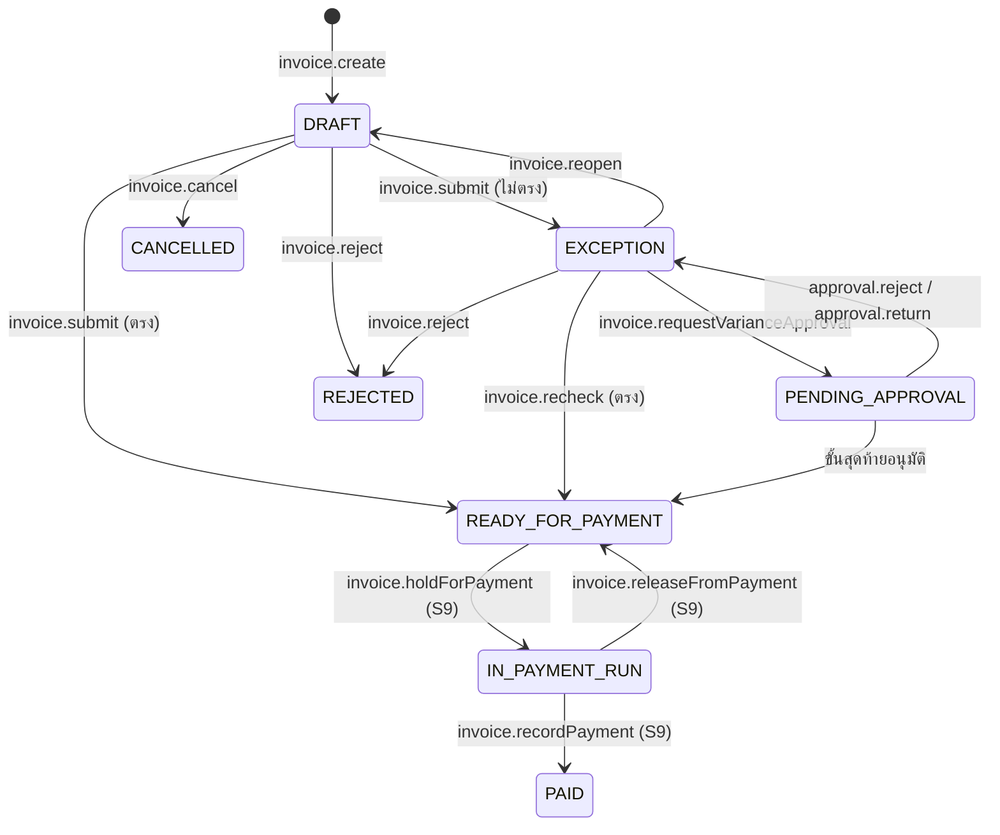

# S8 · ใบแจ้งหนี้และจับคู่ 3 ทาง — sub-spec

เอกสารนี้ขยาย §16.15 สำหรับการลงมือ · spec.md มีลำดับเหนือกว่าเสมอ ถ้าขัดกันให้ยึด spec แล้วแก้ไฟล์นี้

สถานะ: ร่าง P1-04 (2026-10-11) · รอตรวจ P1-05 และผู้ใช้อนุมัติ P1-06 · เลข BR GC INV event error และความสามารถในไฟล์นี้เป็นร่าง จะเพิ่มลง spec ในข้อที่สร้างโค้ดนั้น

## ขอบเขต

**FR:** FR-AP-101 ถึง FR-AP-108 (แถว S8 ใน §16.8) · เงื่อนไข §8.12 ของ FR-AP-101 FR-AP-103 และ FR-INTG-302 (ส่วนตัวอ่าน e-Tax) · ขยาย BR-MATCH-01 ถึง BR-MATCH-04 และ BR-WHT-01 BR-WHT-02 ของ §7.14

**ทำในขั้นนี้:** ใบแจ้งหนี้ชั้น 2 (`Invoice`) รับทางอัปโหลดและกล่องอีเมล · จับคู่ 3 ทาง (สินค้า) และ 2 ทางพร้อมยืนยันรับงาน (บริการ) · รายการไม่ตรงและอนุมัติส่วนต่างตาม DOA `INVOICE_EXCEPTION` · ตรวจใบซ้ำ · VAT ของใบเทียบที่คำนวณ · ภาษีหัก ณ ที่จ่าย 50 ทวิ ภ.ง.ด.3 ภ.ง.ด.53 · งวดงานและเงินประกันผลงาน · ใบแก้ไข PO ตาม DOA `PO_CHANGE` · เสนอรหัสบัญชีและ cost center จากประวัติ · แจ้งผู้ขายทางอีเมล · seed ของ SIMEC

**นอกขอบเขต (ระยะ 1):** พอร์ทัลผู้ขาย (S7 · ช่องทาง `PORTAL` สงวนไว้ใน enum) · ใบเดียวหลาย PO · ใบลดหนี้และใบเพิ่มหนี้ · บรรทัดที่ไม่มีใน PO (ค่าขนส่งแยก) · ยกเลิกใบที่พร้อมจ่ายแล้ว (ข้อ `[go-live]` ตาม OQ-129) · ผู้รับเงินต่างประเทศ (ภ.ง.ด.54) · อ่านบรรทัดจาก e-Tax XML (ข้อ `[go-live]` หลังได้ไฟล์จริง OQ-35) · รอบจ่าย ไฟล์ธนาคาร และบัญชีรับเงินของผู้ขาย (S9) · AI อ่านใบแจ้งหนี้ (S13 เรียกคำสั่งของขั้นนี้)

**ขึ้นกับ:** P1-07 (ชนิดเอกสาร DOA `INVOICE_EXCEPTION` `PO_CHANGE` ใน engine และ lint · โมดูล `PAY` เปิดให้ SIMEC · ข้อ DOA ของชีต DOA_P1_Draft ที่ผู้ใช้อนุมัติ) · P1-02 (seed SIMEC และการเล่นประวัติ) · โค้ดชั้น 1: `src/core/{money,vat,budget,invoice,wht,receiving}` `src/server/services/{invoices,purchase-orders,receiving,approvals,exports}` · สายอื่น: S9 ใช้สถานะใบและฟังก์ชันภาษี · S13 เรียกคำสั่งสร้างร่าง · S17 แสดงการ์ดอนุมัติ · S6 โอนงบใช้แก้ "งบขาด" (ไม่บังคับ)

## ชั้น demo และชั้นของจริงของ "เสร็จเมื่อ"

| เกณฑ์ต้นฉบับ (§16.8) | ชั้น demo รอบนี้ (`[demo]`) | ชั้นของจริง (`[go-live]`) และของที่ต้องได้ |
| --- | --- | --- |
| ชุดทดสอบ 3-way ผ่านทั้งกรณีตรง เกิน ขาด ซ้ำ และงานบริการ | golden `matching.yaml` `invoice-vat.yaml` + integration test กับ Postgres จริง + seed SIMEC ทุก `invoiceScenario` + e2e `@s8` | ทดสอบซ้ำกับใบแจ้งหนี้จริงที่ลบข้อมูลแล้ว (P0-02) · เกณฑ์ตามคำตอบ OQ-121 · อ่านบรรทัดจาก e-Tax จริง (OQ-35) |
| FR-AP-101 รับทางกล่องอีเมล | adapter โหมด `mailpit` บนเครื่อง · staging ใช้อีเมลที่ seed ไว้และการอัปโหลด | ที่อยู่และผู้ให้บริการขาเข้าของ production (OQ-124 ผูกกับ ADR-031) |
| FR-AP-104 50 ทวิ และ ภ.ง.ด. | PDF ที่มีช่องข้อมูลตามแบบของกรมสรรพากรพร้อมป้ายรอผู้ทำบัญชีตรวจ + ไฟล์สรุปแบบกลางที่ระบุว่าไม่ใช่รูปแบบยื่นของกรมสรรพากร · อัตราจากชีต WHT_Types | รูปแบบจริงหลังผู้ทำบัญชีให้ตัวอย่างและยืนยันอัตรา (OQ-122 OQ-123) |
| ส่งออก Express (FR-P2P-009 เดิม) ต้องรวมใบชั้น 2 | mapping เดิม (OQ-10) | ไฟล์ตัวอย่างของ Express (P0-10) |

## Demo ของขั้น

ผู้ใช้และยอดจากไฟล์ระยะ 1 (ฉากจริงกำหนดใน P1-08):

1. **ตรง 3 ทาง (อีเมล):** fin_ap1 เปิดกล่องอีเมล เห็นใบ e-Tax ของ PO คอนกรีต 9 ลบ.ม. × 2,863.00 (แบบ H009) → ร่างมีเลขที่ วันที่ ยอดจาก XML · ระบบเสนอผู้ขายและ PO · รหัสบัญชี 510101 จากประวัติ → ยืนยันแล้วส่ง → ตรงทุกบรรทัด → พร้อมจ่าย ยอด 27,570.69 · งบ P05-MAT ย้าย 25,767.00 จากถือเป็นตัดจริง
2. **ราคาเกินนอกเกณฑ์:** fin_ap2 อัปโหลดใบน้ำมันดีเซล 20,000 ลิตร × 33.48 ของ PO ราคา 32.50 (H001 · eqp_02) → ส่วนต่าง 19,600.00 → proc_officer กด "ขออนุมัติส่วนต่าง" → vp_ops อนุมัติ (ข้อ IE-02 เพราะส่วนต่างรวม VAT 20,972.00) → พร้อมจ่าย และงบ EQP-OPEX ถือเพิ่ม 19,600.00
3. **ใบซ้ำ:** ผู้ขายของ H023 ส่งใบ `บก.000583` มาอีกครั้งทางอีเมล → ร่างถูกติดป้าย `DUPLICATE_INVOICE` → fin_ap1 ทิ้งร่าง
4. **ขาด:** ใบคอนกรีต 24 ลบ.ม. × 2,150.00 ที่รับไว้ 22 (H162 · fm_p02 · ค้างใน seed) → รายการไม่ตรง `QTY_NOT_RECEIVED` 4,300.00 → fin_ap1 ปฏิเสธใบ → ผู้ขายได้อีเมลพร้อมเหตุผล · ตัวอย่างผู้ขาย หจก. ไม่จด VAT ที่เก็บ VAT (แบบ H041 · GC-VAT-09) ใช้เป็นฉากเสริม
5. **งานบริการ 2 ทาง:** ใบ รปภ. 24 คน-เดือน × 18,500.00 (H002 · ga_02) ยังไม่ยืนยันรับงาน → ga_02 ยืนยันรับงานในหน้าตรวจรับ → ระบบตรวจซ้ำเอง → พร้อมจ่าย · ภาษีหัก ณ ที่จ่ายคาดการณ์ 13,320.00 · ยอดที่ต้องจ่าย 475,080.00 ยอดโอนคาดการณ์ 461,760.00
6. **งานเหมาเป็นงวด:** งานถนน 9,500 ตร.ม. × 260.00 (H229 · pm_p07 หลังอนุมัติในฉากของ S6) → proc_sub1 แบ่ง 3 งวด 741,000.00 · 988,000.00 · 741,000.00 เงินประกัน 5% → store_p07 ตรวจรับงวด 1 → ใบงวด 1 → เงินประกัน 37,050.00 · ยอดที่ต้องจ่าย 755,820.00 · ภาษีคาดการณ์ 21,118.50 · ยอดโอนคาดการณ์ 734,701.50
7. **แก้ PO:** proc_mat1 ขึ้นราคา 10 หน่วยจาก 1,100.00 เป็น 1,150.00 บน PO ที่ยังไม่มีใบแจ้งหนี้ → coo อนุมัติ (PC-01) → ฉบับแก้ไขครั้งที่ 1 (ยอดรวม 12,305.00) ส่งอีเมลผู้ขาย
8. **บุคคลธรรมดา:** ใบค่าแรงช่าง 38,500.00 (H126 · se_p09a) → ภ.ง.ด.3 ภาษี 1,155.00 · 50 ทวิ ออกเมื่อ S9 บันทึกจ่าย

## Entity และ migration

กติกาทุกตาราง: §6.1 · `organizationId` ทุกตาราง · unique ทางธุรกิจรวม `organizationId` · FK ภายในองค์กรเป็นคู่ `(organizationId, id)` (ADR-039) · ทุกคอลัมน์ `*Satang` เป็น `BigInt` CHECK ≥ 0 · อัตรา `*Bp` เป็น `Int` · จำนวน `Decimal(18,4)` · aggregate ที่แก้พร้อมกันได้มี `version` · migration เพิ่มต่อท้ายเท่านั้น

**ตารางใหม่**

| ตาราง | ฟิลด์หลัก | กฎ |
| --- | --- | --- |
| `Invoice` | number (`AP-{BE}-{SEQ5}` ออกตอนส่ง · `numbering.AP`), poId, supplierId, channel (`EMAIL` `UPLOAD` `PORTAL`), prefill (`MANUAL` `ETAX_XML` `AI_READING`), fieldSources (jsonb: แหล่งและผู้ยืนยันต่อช่อง), agentActionId (uuid ไม่มี FK จนถึง S13), inboundEmailId, sourceFileId, supplierInvoiceNo, supplierInvoiceNoNormalized, invoiceDate (Date), priceIncludesVat, vatRateBp, discountSatang, netSatang, statedVatSatang, computedVatSatang, grossSatang, retentionBp, retentionSatang, payableSatang, expectedWhtSatang, dueDate (Date), isFinal, kind (`INVOICE` · `CREDIT_NOTE` เพิ่มใน S8-17 ตาม OQ-129), status, matchResult (`MATCHED` `EXCEPTION`), createdById, recordedById, submittedAt, readyAt, rejectedById, rejectedAt, rejectReason, cancelledAt, cancelReason, currentRouteId, exportedAt, exportJobId, version | unique (org, number) · partial unique (org, supplierId, supplierInvoiceNoNormalized) WHERE status NOT IN (`CANCELLED`,`REJECTED`) · index (org, status) (org, poId) (org, dueDate) · CHECK `payableSatang = grossSatang − retentionSatang` ≥ 0 และ `expectedWhtSatang ≤ payableSatang` · ยอดโอนคาดการณ์ = payable − expectedWht (ไม่เก็บ) · grossSatang = netSatang + statedVatSatang |
| `InvoiceLine` | invoiceId, lineNo, poLineId, description, quantity, uom, unitPriceSatang, amountSatang, discountSatang, netSatang, vatable, expectedNetSatang, overSatang, matchStatus (`PENDING` `MATCHED` `EXCEPTION`), flags (text[]), whtIncomeTypeCode, accountCode, costCenterId, codingSource (`HISTORY` `BUDGET_LINE` `MANUAL` `NONE`), costCenterReason, codingConfirmedById, codingConfirmedAt | unique (org, invoiceId, lineNo) และ (org, invoiceId, poLineId) · poLineId ต้องเป็นของ PO ของใบ |
| `InvoiceMatch` | invoiceId, runNo, ranAt, result, policy (jsonb เกณฑ์ที่ใช้), snapshot (jsonb ผลต่อบรรทัด), triggeredBy (`USER` `SYSTEM`) | ทุกการจับคู่หนึ่งแถว · unique (org, invoiceId, runNo) |
| `MatchException` | invoiceId, invoiceMatchId, invoiceLineId, type (`PRICE_OVER` `QTY_NOT_RECEIVED` `QTY_OVER_ORDERED` `ACCEPTANCE_PENDING` `VAT_MISMATCH` `VAT_SUPPLIER_NOT_REGISTERED` `POSSIBLE_DUPLICATE` `BUDGET_SHORT`), amountSatang, quantity, assigneeRole (`PROCUREMENT` `RECEIVER` `FINANCE`), status (`OPEN` `ACCEPT_REQUESTED` `APPROVED` `RESOLVED` `DISMISSED` `CLOSED`), resolvedById, resolvedAt, reason, version | index (org, status, assigneeRole) |
| `InboundEmail` | provider, messageId, fromAddress, toAddress, subject (ตัดที่ 300 ตัวอักษร), receivedAt, status (`RECEIVED` `PROCESSED` `IGNORED` `FAILED`), ignoreReason, attachmentCount, poRefsFound (text[]), processedAt | unique (org, messageId) · ไม่เก็บเนื้อความ · ไฟล์แนบเป็น `FileObject` + `FileLink` (subjectType `InboundEmail`) |
| `WhtIncomeType` | code, nameTh, nameEn, rateBp, form (`PND3_53` `PND53` `PND3`), legalRefTh, active, updatedById, confirmedById, confirmedAt | unique (org, code) · ผู้ยืนยัน ≠ ผู้แก้ล่าสุด |
| `AccountCode` | code, nameTh, type (`COST` `EXPENSE` `ASSET` `LIABILITY`), active | unique (org, code) · เป็นรายชื่อรหัสอ้างอิง ไม่ใช่ตารางบัญชีแยกประเภท (P-4) |
| `WithholdingTax` | invoiceId, retentionId, supplierId, payeeType, incomeTypeCode, form (`PND3` `PND53`), rateBp, baseSatang, taxSatang, paidOn (Date), certificateId, status (`RECORDED` `VOIDED`) | CHECK มีอย่างใดอย่างหนึ่งระหว่าง invoiceId กับ retentionId · S9 เพิ่ม FK ไปรายการในรอบจ่าย |
| `WhtCertificate` | number (`WHT_CERT` · `{BE}/{SEQ5}`), supplierId, form, paidOn, totalBaseSatang, totalTaxSatang, payeeSnapshot (jsonb · มีเลขบัตรประชาชนเมื่อเป็นบุคคลธรรมดา), payerSnapshot (jsonb), fileId, issuedAt, status (`ISSUED` `VOIDED`) | unique (org, number) · อ่านตาม `wht.view` และ BR-AUTH-04 |
| `Retention` | invoiceId, poId, supplierId, amountSatang, status (`HELD` `RELEASABLE` `IN_PAYMENT_RUN` `PAID`), releaseDueOn (Date), releasedById, releasedAt, paidAt, version | unique (org, invoiceId) · คือเงินประกันผลงาน ไม่เกี่ยวกับ `retention.documentYears` (ระยะเก็บข้อมูล OQ-30) |
| `PoChange` | poId, changeNo, status (`DRAFT` `PENDING_APPROVAL` `APPROVED` `REJECTED` `CANCELLED`), reason, oldNetSatang, oldVatSatang, oldGrossSatang, newNetSatang, newVatSatang, newGrossSatang, notesToSupplier, deliveryDate, quantityDisposition (`PoCancelDisposition` เดิม), submittedById, submittedAt, currentRouteId, decidedAt, appliedRevisionNo, pdfFileId, sentAt, version | unique (org, poId, changeNo) · partial unique (org, poId) WHERE status IN (`DRAFT`,`PENDING_APPROVAL`) |
| `PoChangeLine` | poChangeId, poLineId, oldQuantity, newQuantity, oldUnitPriceSatang, newUnitPriceSatang, oldNetSatang, newNetSatang, reservedSatang | unique (org, poChangeId, poLineId) |
| `SupplierNotice` | supplierId, templateKey, subjectType, subjectId, toEmail, locale, status (`PENDING` `SENT` `FAILED`), dedupeKey, attempts, sentAt, error | unique (org, dedupeKey) · ADR-126 |

**คอลัมน์และ enum ที่เพิ่มในของเดิม**

| ของเดิม | เพิ่ม | หมายเหตุ |
| --- | --- | --- |
| `PurchaseOrder` | invoiceTrack (`CONFIRMATION` `MATCHING` · null จนใบแรก), revisionNo (Int 0), retentionBp (Int 0), retentionHoldDays (Int?) | ADR-121 ADR-124 ADR-125 |
| `PoLine` | milestoneNo (Int?), milestoneShareBp (Int?) | งวดงาน ADR-124 |
| `Supplier` | payeeType (`JURISTIC` `INDIVIDUAL` `FOREIGN` · ค่าเริ่มต้น JURISTIC), defaultWhtIncomeTypeCode, paymentTermDays (Int?), eTaxIssuer (`NONE` `EMAIL` `FULL`) | จากชีต SupplierPayment · บัญชีธนาคารเป็นของ S9 |
| `RequestType` | defaultRetentionBp (Int 0), defaultRetentionHoldDays (Int?) | ข้อมูลขององค์กร ไม่อ้างรหัสประเภทในโค้ด |
| `ApprovalSubjectType` | `INVOICE` `PO_CHANGE` | ถ้า P1-07 ยังไม่เพิ่ม ให้ S8-01 เพิ่ม |
| `FileLinkKind` | `WHT_CERT` | PDF ฉบับแก้ไขของ PO ใช้ `PO_PDF` เดิมผูกกับ `PoChange` |
| `ExportKind` | `WHT_RETURN` | ไฟล์สรุป ภ.ง.ด. |
| `DocumentSequence` | ชนิด `INVOICE` (`numbering.AP`) และ `WHT_CERT` | รีเซ็ตตามปี พ.ศ. (OQ-11) |

`DoaDocumentType` `INVOICE_EXCEPTION` และ `PO_CHANGE` มาจาก P1-07

## State machine

ทุกตารางอยู่ใน `src/core/state-machines/index.ts` (ข้อมูล ไม่ใช่ if-else) และมีเทสต์วนทุกคู่ (§6.4)



**ใบแจ้งหนี้ (`Invoice`)**

| จาก | คำสั่ง | ไป | ใครทำได้ | event |
| --- | --- | --- | --- | --- |
| — | `invoice.create` (อัปโหลด · กล่องอีเมลโดย SYSTEM · `invoice.createDraftFromReading`) | DRAFT | FINANCE · SYSTEM (กล่องอีเมล) | `invoice.drafted` |
| DRAFT | `invoice.update` · `invoice.confirmCoding` | DRAFT | FINANCE | `invoice.updated` · `invoice.coding_confirmed` |
| DRAFT | `invoice.submit` ผลตรง | READY_FOR_PAYMENT | FINANCE | `invoice.submitted` `invoice.matched` `invoice.ready` + `budget.*` |
| DRAFT | `invoice.submit` ผลไม่ตรง | EXCEPTION | FINANCE | `invoice.submitted` `invoice.exception_raised` |
| EXCEPTION | `invoice.recheck` | READY_FOR_PAYMENT หรือ EXCEPTION | FINANCE · ผู้รับผิดชอบรายการไม่ตรง · SYSTEM (หลัง GR หรือใบแก้ไข PO) | `invoice.rechecked` + ผลแบบเดียวกับ submit |
| EXCEPTION | `invoice.requestVarianceApproval` (รายการเปิดทุกข้อเป็น `PRICE_OVER`) | PENDING_APPROVAL | PROCUREMENT | `invoice.variance_submitted` `approval_task.assigned` |
| PENDING_APPROVAL | ขั้นสุดท้ายอนุมัติ | READY_FOR_PAYMENT | ผู้อนุมัติตาม DOA `INVOICE_EXCEPTION` | `invoice.variance_approved` `invoice.ready` + `budget.*` |
| PENDING_APPROVAL | `approval.reject` · `approval.return` | EXCEPTION | ผู้อนุมัติตาม DOA | `invoice.variance_rejected` (data.decision) |
| EXCEPTION | `invoice.reopen` | DRAFT | FINANCE | `invoice.reopened` |
| DRAFT · EXCEPTION | `invoice.reject` (ต้องมีเหตุผล) | REJECTED | FINANCE · PROCUREMENT | `invoice.rejected` |
| DRAFT | `invoice.cancel` (ต้องมีเหตุผล) | CANCELLED | FINANCE | `invoice.cancelled` |
| READY_FOR_PAYMENT | `invoice.holdForPayment` | IN_PAYMENT_RUN | คำสั่งของ S9 เท่านั้น | `invoice.payment_held` |
| IN_PAYMENT_RUN | `invoice.releaseFromPayment` | READY_FOR_PAYMENT | คำสั่งของ S9 เท่านั้น | `invoice.payment_released` |
| IN_PAYMENT_RUN | `invoice.recordPayment` | PAID | คำสั่งของ S9 เท่านั้น | `invoice.paid` `withholding_tax.recorded` `wht_certificate.issued` |

**รายการไม่ตรง (`MatchException`)**: `OPEN → RESOLVED` (ตรวจซ้ำแล้วผ่าน) · `OPEN → DISMISSED` (`match_exception.dismiss` เฉพาะ `POSSIBLE_DUPLICATE` โดย FINANCE พร้อมเหตุผล) · `OPEN → ACCEPT_REQUESTED → APPROVED` หรือกลับ `OPEN` เมื่อไม่อนุมัติ · สถานะเปิดทุกแบบ → `CLOSED` เมื่อใบถูกปฏิเสธหรือเปิดแก้ · event `match_exception.dismissed`

**เงินประกันผลงาน (`Retention`)**: `HELD` (สร้างตอนใบพร้อมจ่าย) → `RELEASABLE` (`retention.release` FINANCE ตั้งแต่ releaseDueOn) → `IN_PAYMENT_RUN` ↔ `RELEASABLE` (S9) → `PAID` (S9) · event `retention.held` `retention.released` `retention.payment_held` `retention.payment_released` `retention.paid`

**ใบแก้ไข PO (`PoChange`)**

| จาก | คำสั่ง | ไป | ใครทำได้ | event |
| --- | --- | --- | --- | --- |
| — | `po_change.create` | DRAFT | PROCUREMENT | `po_change.drafted` |
| DRAFT | `po_change.submit` | PENDING_APPROVAL | PROCUREMENT | `po_change.submitted` `approval_task.assigned` + `budget.reserved` |
| PENDING_APPROVAL | ขั้นสุดท้ายอนุมัติ | APPROVED | ผู้อนุมัติตาม DOA `PO_CHANGE` | `po_change.approved` `po.revised` + `budget.*` |
| PENDING_APPROVAL | `approval.reject` | REJECTED | ผู้อนุมัติตาม DOA | `po_change.rejected` + คืนการจอง |
| PENDING_APPROVAL | `approval.return` | DRAFT | ผู้อนุมัติตาม DOA | `po_change.returned` + คืนการจอง |
| DRAFT · PENDING_APPROVAL | `po_change.cancel` | CANCELLED | ผู้เสนอ · PROCUREMENT | `po_change.cancelled` |

PO ที่แก้ได้: `APPROVED` `SENT` `PARTIALLY_RECEIVED` `RECEIVED` · สถานะของ PO ไม่เปลี่ยน · `po.sendRevision` (PROCUREMENT) ส่งอีเมล PDF ฉบับล่าสุด → `po.revision_sent`

**กล่องอีเมล (`InboundEmail`)**: `RECEIVED → PROCESSED | IGNORED | FAILED` · `FAILED` ลองใหม่โดย job · event `inbound_email.received` `inbound_email.processed` `inbound_email.ignored`

## กฎ

| ID | กฎ |
| --- | --- |
| BR-MATCH-05 | ใบแจ้งหนี้หนึ่งใบผูก PO เดียวของผู้ขายเดียวกัน · ทุกบรรทัดต้องอ้างบรรทัด PO ของ PO นั้น และบรรทัด PO หนึ่งบรรทัดปรากฏได้ครั้งเดียวต่อใบ (`VALIDATION_FAILED`) · PO ต้องอยู่ใน `SENT` `PARTIALLY_RECEIVED` `RECEIVED` หรือ `CLOSED` |
| BR-MATCH-06 | ยอดของบรรทัดใบ = `lineNet(จำนวน, ราคาต่อหน่วยในใบ)` (ใบที่ราคารวม VAT ใช้ `lineNetsBeforeVat` ของ ADR-038) แล้วหักส่วนลดท้ายบิลที่ปันลงบรรทัดด้วย largest remainder ตามยอด (BR-MONEY-02 ข้อ 4 · เสมอกันให้บรรทัดแรกก่อน) · ยอดที่คาด = `lineNet(จำนวนในใบ, ราคาต่อหน่วยของ PO)` · ส่วนเกิน = max(ยอดใบ − ยอดที่คาด, 0) · เทียบเป็นยอดก่อน VAT ต่อบรรทัด |
| BR-MATCH-07 | เกณฑ์ราคา (`settings.matching`: `priceTolBp` `priceTolAmountSatang` · ค่าเริ่มต้น OQ-121 = 100 bp และ 100000): ในเกณฑ์เมื่อ ส่วนเกิน × 10000 ≤ ยอดที่คาด × priceTolBp **และ** ส่วนเกิน ≤ priceTolAmountSatang · เท่าเกณฑ์พอดีถือว่าในเกณฑ์ · นอกเกณฑ์ → `PRICE_OVER` จำนวนเงิน = ส่วนเกิน · ราคาต่ำกว่า PO ผ่านพร้อมป้าย `PRICE_UNDER` · ห้ามมีตัวเลขเกณฑ์ในโค้ด |
| BR-MATCH-08 | จำนวน (นับจำนวนในใบอื่นที่ `PENDING_APPROVAL` ขึ้นไปเป็น "แจ้งหนี้แล้ว"): สินค้า จำนวนในใบ ≤ (รับแล้วจาก GR ที่ POSTED รวมส่วนเกินที่รับไว้ − แจ้งหนี้แล้ว) × (10000 + qtyTolBp) ÷ 10000 ไม่เช่นนั้น `QTY_NOT_RECEIVED` · บริการ จำนวนในใบ ≤ สั่ง − แจ้งหนี้แล้ว ไม่เช่นนั้น `QTY_OVER_ORDERED` และ ≤ ยืนยันรับงานแล้ว − แจ้งหนี้แล้ว ไม่เช่นนั้น `ACCEPTANCE_PENDING` · จำนวนเงินของรายการ = `lineNet(จำนวนที่เกิน, ราคา PO)` · qtyTolBp ค่าเริ่มต้น 0 · OQ-20 ใช้กับการรับเกินที่ GR เท่านั้น |
| BR-MATCH-09 | ส่งรายการไม่ตรงตามชนิด: `PRICE_OVER` `QTY_OVER_ORDERED` → PROCUREMENT · `QTY_NOT_RECEIVED` `ACCEPTANCE_PENDING` → ผู้ที่ `gr.post` ของ PO นั้นได้ (ผู้ตรวจรับและผู้ขอตาม OQ-04) · `VAT_*` `POSSIBLE_DUPLICATE` `BUDGET_SHORT` → FINANCE |
| BR-MATCH-10 | ทางแก้: ตรวจซ้ำ (หลัง GR ใบแก้ไข PO หรือโอนงบ · ระบบตรวจซ้ำเองเมื่อมี `gr.posted` หรือ `po_change.approved` ของ PO นั้น) · ขออนุมัติส่วนต่างได้เฉพาะเมื่อรายการเปิดทุกข้อเป็น `PRICE_OVER` ไม่เช่นนั้น `VARIANCE_NOT_ACCEPTABLE` · ปัดตกได้เฉพาะ `POSSIBLE_DUPLICATE` · เปิดแก้ (กลับ DRAFT) · ปฏิเสธใบ |
| BR-MATCH-11 | ผลต่องบเมื่อใบพร้อมจ่าย (BR-MATCH-04): ต่อบรรทัด ถ้ายอดใบ > ยอดถือที่เหลือของบรรทัด PO ให้ถือเพิ่มส่วนขาด (AVAILABLE → COMMITTED) แล้วตัดยอดใบ (COMMITTED → ACTUAL) · งบว่างไม่พอส่วนขาดในเกณฑ์ → `BUDGET_SHORT` (ไม่มีเงินขยับ) · ตอนอนุมัติส่วนต่าง งบไม่พอ → ปฏิเสธการตัดสินด้วย `BUDGET_INSUFFICIENT` งานยังเปิด · ใบสุดท้าย (`isFinal`) ของ PO ที่ปิดแล้วคืนถือที่เหลือทุกบรรทัด (BR-BUD-06) · ราคาต่ำกว่า PO ไม่คืนจนใบสุดท้ายหรือปิด PO |
| BR-MATCH-12 | ใบซ้ำ (ขยาย BR-MATCH-03): ซ้ำแน่ = ผู้ขายเดียวกันและเลขหลัง normalize (BR-IVC-03) ตรงกับ `Invoice` ที่ไม่ใช่ `CANCELLED` `REJECTED` หรือกับ `InvoiceConfirmation` → `DUPLICATE_INVOICE` ตอนส่งและติดป้ายตั้งแต่ร่าง · น่าจะซ้ำ = เลขผู้เสียภาษีเดียวกัน (ทุกสาขา) ยอดรวม VAT เท่ากันทุกสตางค์ และวันที่ใบห่างกันไม่เกิน 3 วัน แต่เลขต่างกัน → `POSSIBLE_DUPLICATE` |
| BR-MATCH-13 | เกณฑ์ใน `settings.matching` แก้ได้โดย ORG_ADMIN ผ่าน `OrgSettingsSchema` · มี event `organization.settings_updated` และแจ้ง AUDITOR (แม่แบบ `audit.policy_changed`) · การจับคู่บันทึกเกณฑ์ที่ใช้ใน `InvoiceMatch.policy` |
| BR-VAT-05 | VAT ที่คำนวณของใบ = VAT ระดับเอกสารจากบรรทัด `vatable` หลังหักส่วนลด (BR-VAT-02 BR-VAT-03) ด้วยอัตรา ณ วันที่ใบตามเวลาไทย (BR-VAT-01) · ผู้ขายที่ไม่จด VAT ใช้อัตรา 0 (BR-VAT-04) · VAT ในใบต่างจากที่คำนวณเกิน `settings.matching.vatTolAmountSatang` (ค่าเริ่มต้น 100 = 1.00 บาท เท่ากับ BR-IVC-01) → `VAT_MISMATCH` (OQ-121) |
| BR-VAT-06 | VAT ในใบ > 0 ขณะผู้ขาย `isVatRegistered = false` หรือผลตรวจทะเบียนล่าสุดเป็น `VAT_CANCELLED` หรือ `CEASED` (BR-SUP-04) → `VAT_SUPPLIER_NOT_REGISTERED` · ขออนุมัติไม่ได้ ต้องปฏิเสธหรือเปิดแก้ |
| BR-VAT-07 | ยอดที่จ่ายใช้ VAT ในใบเมื่อผ่าน BR-VAT-05 · งบไม่รวม VAT เสมอ (BR-BUD-03) |
| BR-IVC-06 | ทางของใบต่อ PO (ADR-121): ใบแรกกำหนด `invoiceTrack` · `PAY` เปิด → `MATCHING` · ปิด → `CONFIRMATION` · ทางไม่ตรง → `INVOICE_TRACK_MISMATCH` · ปิด `PAY` ขณะมีใบที่ยังไม่ `PAID` `REJECTED` `CANCELLED` → `MODULE_IN_USE` (OQ-33) |
| BR-IVC-07 | ไฟล์ e-Tax ทั้งจากอัปโหลดและกล่องอีเมลอ่านด้วยฟังก์ชันเดียวกับ BR-IVC-05 (`readEtaxContent`) เติมเฉพาะค่าหัวเอกสาร · บรรทัดเติมจากบรรทัด PO ที่ยังแจ้งหนี้ได้ให้คนแก้ · ตอนส่ง แหล่งค่าตัดสินจากไฟล์ที่เก็บแล้วแบบ `source.ts` เดิม · เลขผู้เสียภาษีในไฟล์ไม่ตรงผู้ขายของ PO → ไม่ติดป้าย `ETAX_XML` |
| BR-AP-01 | ช่องทางระยะ 1: `UPLOAD` (PDF XML JPEG PNG ไม่เกิน `MAX_UPLOAD_BYTES`) และ `EMAIL` · `PORTAL` สงวนให้ S7 · engine จับคู่ไม่รับช่องทางเป็น input |
| BR-AP-02 | กล่องอีเมล (ADR-123): หนึ่งร่างต่อไฟล์แนบที่รับ (สูงสุด 10 ไฟล์ต่ออีเมล) · เสนอผู้ขายจากเลขผู้เสียภาษีและสาขาใน e-Tax ก่อน แล้วจากอีเมลผู้ส่งที่ตรง `Supplier.email` · เสนอ PO จากเลข PO ตามรูปแบบ `numbering.PO` ในหัวเรื่องหรือชื่อไฟล์ · ค่าที่เสนอต้องให้ FINANCE ยืนยัน · ไม่ส่งจับคู่เอง · Message-ID เดิม → ไม่สร้างซ้ำ · ไฟล์ชนิดอื่นถูกข้ามพร้อมเหตุผล |
| BR-AP-03 | `invoice.createDraftFromReading` (ให้ S13): ผู้กระทำเป็น member ที่ยอมรับผลของ AI (ไม่ใช่ agent · BR-AI-01) · ทุกช่องที่มาจาก AI มีแหล่ง `AI_READING` จนคนยืนยันทีละช่อง · ส่งไม่ได้ถ้ายังมีช่องที่ยังไม่ยืนยัน (`VALIDATION_FAILED` reason `AI_FIELD_UNCONFIRMED`) |
| BR-AP-04 | ส่งได้เมื่อ: ผู้ขายและ PO ตรงกัน (BR-MATCH-05) · วันที่ใบไม่เกินวันนี้ตามเวลาองค์กร · มีอัตรา VAT (`TAX_RATE_NOT_CONFIGURED`) · ทุกบรรทัดยืนยันรหัสบัญชีแล้ว (`CODING_NOT_CONFIRMED`) · ไม่ซ้ำแน่ (BR-MATCH-12) · ออกเลขตอนส่ง |
| BR-AP-05 | แบ่งแยกหน้าที่ (OQ-127): ผู้ส่งใบ (`recordedById`) ห้ามเป็นผู้สร้าง PO หรือผู้บันทึก GR ของ PO นั้น · ผู้อนุมัติ `INVOICE_EXCEPTION` ห้ามเป็นผู้ส่งใบหรือผู้ขออนุมัติส่วนต่าง (ส่งเป็น `conflictMemberIds`) · ขัด → `SOD_VIOLATION` |
| BR-AP-06 | DOA ของส่วนต่าง (OQ-127): ยอด = { net: ผลรวมส่วนเกินของบรรทัด `PRICE_OVER`, vat: VAT ของ net นั้นด้วยอัตราของใบแบบ VAT ระดับเอกสาร } แล้ว engine ใช้ฐานของฉบับ (BR-DOA-11) · แผนกเจ้าของงบ = แผนกของบรรทัดงบของบรรทัดที่ส่วนเกินมากที่สุด (เท่ากันใช้เลขบรรทัดน้อย) · step-up ตาม OQ-07 จากยอดนี้ |
| BR-AP-07 | วันครบกำหนด = วันที่ใบ + `PurchaseOrder.paymentTermDays` (ไม่มีใช้ `Supplier.paymentTermDays` แล้ว `settings.ap.defaultTermDays` = 30) เป็นวันปฏิทิน · ตั้งตอนใบพร้อมจ่าย (OQ-129) |
| BR-AP-08 | อีเมลถึงผู้ขาย (FR-AP-103 · §8.12): เมื่อส่งใบ (รับแล้ว พร้อมเลข BCS) · ปฏิเสธ (พร้อมเหตุผล) · พร้อมจ่าย (วันครบกำหนด ยอดที่ต้องจ่าย และภาษีหักคาดการณ์) ถึง `Supplier.email` ผ่าน `SupplierNotice` · ไม่มีชื่อผู้อนุมัติภายใน · ไม่ส่ง LINE ถึงผู้ขาย · ไม่มีอีเมลผู้ขาย → ไม่ส่งและแจ้ง FINANCE ในระบบ |
| BR-AP-09 | ข้อความ LINE ของรายการไม่ตรงและการ์ดอนุมัติ (BR-NOTI-01): เลขใบ BCS เลข PO ชนิดรายการ และยอดส่วนต่างรวม · ไม่มีรายการสินค้า ราคาต่อหน่วย ไฟล์ · ชื่อผู้ขายแสดงเฉพาะ `payeeType = JURISTIC` |
| BR-AP-10 | เสนอรหัสบัญชี (FR-AP-108 · OQ-128 · ไม่ใช้ AI): ประวัติ = บรรทัดของใบที่ `READY_FOR_PAYMENT` ขึ้นไปที่ยืนยันแล้ว ของผู้ขายเลขผู้เสียภาษีเดียวกันและ `categoryCode` ของบรรทัด PO เดียวกัน วันที่ใบภายใน 365 วันก่อนวันที่ใบนี้ (วันที่ 365 นับ) · เลือกรหัสที่ใช้บ่อยสุด เท่ากันใช้ครั้งล่าสุด · ไม่มี → รหัสของบรรทัดงบ · ไม่มี → ว่างให้กรอก · cost center = ของบรรทัดงบ แก้ได้พร้อมเหตุผล (งบไม่เปลี่ยน) · คนต้องยืนยันทุกบรรทัด |
| BR-AP-11 | สิ่งที่อ่านใบแจ้งหนี้ชั้น 2 ต้องนับเหมือนใบกำกับชั้น 1: ปิด PO และใบสุดท้าย (BR-BUD-06 · `purchase-orders/close.ts`) · กลับรายการ GR ห้ามเมื่อมีใบของ PO ที่ `PENDING_APPROVAL` ขึ้นไป · ส่งออก Express (BR-EXP-02 ถึง BR-EXP-04 ใช้รหัสบัญชีที่ยืนยัน) · หน้าเอกสารและหน้าแรก |
| BR-AP-12 | สถานะ `IN_PAYMENT_RUN` และ `PAID` เปลี่ยนได้เฉพาะฟังก์ชันที่ S9 เรียกในธุรกรรมของคำสั่ง S9 · คำสั่งของ S8 กับใบสองสถานะนี้ → `INVALID_STATE_TRANSITION` |
| BR-WHT-03 | ประเภทเงินได้ต่อบรรทัด: ค่าเริ่มต้น = `Supplier.defaultWhtIncomeTypeCode` เมื่อ PO เป็น `SERVICE` · `GOODS` = ไม่หัก · FINANCE แก้ได้พร้อมการยืนยันรหัสบัญชี · อัตราและแบบจาก `WhtIncomeType` ขององค์กร ไม่มีหรือไม่ active → `WHT_TYPE_NOT_CONFIGURED` · อัตราที่ยังไม่ยืนยันใช้ได้ใน demo พร้อมป้ายเตือน |
| BR-WHT-04 | แบบ: ผู้รับเงิน `INDIVIDUAL` → ภ.ง.ด.3 · `JURISTIC` → ภ.ง.ด.53 · ประเภทที่แบบเป็น `PND53` จ่ายให้บุคคลธรรมดา หรือ `PND3` จ่ายให้นิติบุคคล → `WHT_FORM_PAYEE_MISMATCH` · `FOREIGN` → `VALIDATION_FAILED` reason `FOREIGN_PAYEE` (นอกขอบเขต) |
| BR-WHT-05 | ฐานและจังหวะ (OQ-122 ค่าเริ่มต้นหักตอนจ่าย): ฐานต่อบรรทัด = ยอดก่อน VAT ของบรรทัด − เงินประกันที่ปันลงบรรทัด (largest remainder) · `whtBases()` ของใบ = ผลรวมฐานต่อ (ประเภท, อัตรา) หลังเกณฑ์ขั้นต่ำ (BR-WHT-06) · `expectedWhtSatang` ของใบ = `paymentWithholding(whtBases())` ของใบเดียว (ค่าคาดการณ์) · ภาษีจริงคิดตอนจ่ายตาม BR-WHT-10 จึงอาจต่างจากผลรวมค่าคาดการณ์ได้ไม่เกิน 1 สตางค์ต่อใบ · คืนเงินประกันมีฐาน = ยอดเงินประกัน ประเภทเดียวกับใบ |
| BR-WHT-06 | เกณฑ์ขั้นต่ำ (OQ-122): ไม่หักเมื่อยอดก่อน VAT รวมของ PO (สัญญาเดียวกัน) < `settings.wht.minimumBaseSatang` (ค่าเริ่มต้น 100000) · เท่าเกณฑ์พอดีหัก · ถ้าถึงเกณฑ์ หักทุกการจ่ายของ PO นั้นแม้จ่ายครั้งละน้อย |
| BR-WHT-07 | 50 ทวิ (OQ-123): หนึ่งฉบับต่อผู้ขายต่อการจ่ายหนึ่งรายการของ S9 · แสดงผู้จ่าย (Organization) ผู้รับ (ชื่อ เลขผู้เสียภาษี สาขา ที่อยู่) ประเภทเงินได้ วันที่จ่าย ยอดที่จ่าย ภาษีที่หัก เงื่อนไข "หัก ณ ที่จ่าย" และลำดับในแบบ · เลข `WHT_CERT` · PDF ผ่านตัวสร้าง PDF เดิม · ชั้น demo มีป้าย "รูปแบบรอผู้ทำบัญชีตรวจ" |
| BR-WHT-08 | สรุป ภ.ง.ด.3 และ ภ.ง.ด.53 รายเดือนตามวันที่จ่าย (`ExportJob` ชนิด `WHT_RETURN`): ไฟล์ CSV แบบกลางที่บรรทัดแรกระบุว่า "ไม่ใช่รูปแบบยื่นของกรมสรรพากร" · มีจำนวนแถว ยอดรวม และ sha256 (BR-EXP-03) · ยอดรวมในไฟล์เท่าผลรวมรายการ (เทสต์) · รูปแบบยื่นจริงรอ OQ-123 |
| BR-WHT-09 | เลขบัตรประชาชนของผู้รับเงินบุคคลธรรมดาใน 50 ทวิ และไฟล์ ภ.ง.ด.3 เห็นเต็มเฉพาะผู้มี `wht.view` ที่ได้สิทธิ์ดูข้อมูลอ่อนไหว (BR-AUTH-04) · ทุกการเปิดบันทึก `SensitiveAccessLog` (NFR-PRIV-03) · ที่อื่น mask · ห้ามอยู่ใน log (NFR-SEC-09) LINE และอีเมล |
| BR-WHT-10 | `paymentWithholding(lines)` (pure · `src/core/wht`): รวมฐานของทุกใบและเงินประกันในรายการจ่ายเดียวต่อ (ประเภทเงินได้, อัตรา) แล้วปัด half-up ครั้งเดียวต่อกลุ่ม (BR-MONEY-02 ข้อ 3) · ฐานของกลุ่มติดลบ → `VALIDATION_FAILED` · `WithholdingTax` หนึ่งแถวต่อกลุ่มต่อใบที่ปันจากภาษีของกลุ่มด้วย largest remainder ตามฐาน เพื่อให้ผลรวมตรง 50 ทวิ |
| BR-RET-01 | งวดงาน (ADR-124): `po.setMilestones` ขณะ PO เป็น DRAFT กับบรรทัดของ PO `SERVICE` ที่มีคำขอต้นทางบรรทัดเดียว · sharesBp 2–12 ค่า แต่ละค่า > 0 รวม 10000 · จำนวนต่องวด = ปันจำนวน (หน่วย 0.0001) ด้วย largest remainder · ยอดต่องวด = `lineNet(จำนวนงวด, ราคาเดิม)` · ทุกงวดคงบรรทัดงบและมี `PoLineSource` ตามจำนวนของตน · คำอธิบายต่อท้าย "งวดที่ n (x%)" |
| BR-RET-02 | ตรวจรับงวด = GR ของบรรทัดงวดนั้นด้วย `gr.post` เดิม (BR-GR-05 BR-SOD-02 BR-SOD-07) · ใบของงวดจับคู่แบบบริการ (BR-MATCH-08) |
| BR-RET-03 | เงินประกันต่อใบ = ส่วนแรกของ `allocateLargestRemainder(ยอดก่อน VAT ของใบ, [retentionBp, 10000 − retentionBp])` (เท่ากับ half-up · ไม่เพิ่มจุดปัด) · `retentionBp` ของ PO ตั้งจาก `RequestType.defaultRetentionBp` แก้ได้ตอน DRAFT · ฐานเป็นยอดก่อน VAT (OQ-125) · ยอดที่ต้องจ่าย = ยอดรวม VAT − เงินประกัน · ยอดโอนคาดการณ์ = ยอดที่ต้องจ่าย − ภาษีคาดการณ์ |
| BR-RET-04 | `Retention` สร้าง `HELD` ตอนใบพร้อมจ่าย · releaseDueOn = วันตรวจรับงวดสุดท้ายของ PO + `retentionHoldDays` (ค่าเริ่มต้นจากประเภทคำขอ OQ-125 = 365) ตั้งเมื่อรับครบ · คืนก่อนวัน → `RETENTION_NOT_DUE` · เงินประกันไม่ขยับงบ (ตัดเต็มยอดไปกับใบแล้ว) · job รายวันแจ้ง FINANCE เมื่อถึงวัน |
| BR-POC-01 | แก้ได้ (OQ-126): ราคาของบรรทัดที่ยังไม่มีจำนวนแจ้งหนี้ · จำนวน (≥ max(รับแล้ว, แจ้งหนี้แล้ว) และไม่เกินจำนวนที่ยังไม่สั่งของคำขอต้นทาง + จำนวนเดิม) · วันส่ง · หมายเหตุถึงผู้ขาย · เพิ่มหรือลบบรรทัดไม่ได้ · บรรทัดที่รวมหลายคำขอแก้จำนวนไม่ได้ (เหมือน `MERGED_LINE` เดิม) · ผิด → `PO_CHANGE_BELOW_PROGRESS` (reason `RECEIVED` `INVOICED` `LINE_INVOICED`) หรือ `PO_CHANGE_EXCEEDS_REQUEST` · ใบเปิดซ้อน → `PO_CHANGE_OPEN` |
| BR-POC-02 | ยอดใหม่คำนวณด้วย `documentTotals` ที่อัตราของ PO · DOA `PO_CHANGE` ยอด = ยอดรวมใหม่ทั้ง PO {net, vat} · แผนกและผู้ขัดแย้งแบบเดียวกับ `po.submit` (BR-SOD-01 BR-SOD-03) และเพิ่มผู้เสนอ · ทุกการแก้ราคาหรือจำนวนต้องอนุมัติ การแก้เฉพาะวันส่งหรือหมายเหตุไม่ต้อง (event `po.updated`) |
| BR-POC-03 | งบ (ADR-125): ต่อบรรทัด Δ = ยอดใหม่ − ยอดเดิม · ตอนส่ง จอง max(Δ − releasable ของจำนวนที่เพิ่ม, 0) ในนามบรรทัด PO (AVAILABLE → RESERVED) ไม่พอ → `BUDGET_INSUFFICIENT` · ตอนอนุมัติ คืนการจองของใบแก้ไขและ releasable ของจำนวนที่เพิ่มจากคำขอ แล้วถือ Δ · Δ < 0 คืนถือ |Δ| และจำนวนที่ลดใช้ disposition: `RETURN_TO_POOL` จอง releasable คืนให้คำขอ หรือ `CANCEL_REQUEST_LINES` · ไม่อนุมัติหรือยกเลิก คืนการจองของใบแก้ไข |
| BR-POC-04 | อนุมัติแล้ว: แก้ `PoLine` `PoLineSource` และยอดของ PO ในธุรกรรมเดียว · `revisionNo` + 1 · PDF ฉบับใหม่ "แก้ไขครั้งที่ n" (ฉบับเดิมคงอยู่) · ตรวจซ้ำใบที่ `EXCEPTION` ของ PO นั้น |

**Invariant**

| ID | Invariant | ทดสอบด้วย |
| --- | --- | --- |
| INV-AP-01 | ต่อบรรทัด PO: ผลรวมจำนวนในบรรทัดใบที่ `PENDING_APPROVAL` ขึ้นไป ≤ รับแล้ว (สินค้า) หรือ ≤ min(สั่ง, ยืนยันรับงาน) (บริการ) | property test + ส่ง 2 ใบพร้อมกัน (ล็อก PO ด้วย `SELECT … FOR UPDATE`) |
| INV-AP-02 | ใบที่ `READY_FOR_PAYMENT` ขึ้นไป: ผลรวม ledger COMMITTED → ACTUAL ของใบ = `Invoice.netSatang` และถือเพิ่ม = ผลรวมส่วนขาดตาม BR-MATCH-11 | integration test ต่อ golden |
| INV-AP-03 | ใบที่ `READY_FOR_PAYMENT` ขึ้นไปไม่มี `MatchException` สถานะ `OPEN` หรือ `ACCEPT_REQUESTED` | เทสต์ state machine |
| INV-AP-04 | `payableSatang = grossSatang − retentionSatang ≥ 0` และ `expectedWhtSatang ≤ payableSatang` | CHECK ในฐานข้อมูล |
| INV-AP-05 | ไม่มี PO ที่มีทั้ง `InvoiceConfirmation` และ `Invoice` ที่ไม่ใช่ `CANCELLED` | เทสต์ BR-IVC-06 |
| INV-AP-06 | (ผู้ขาย, เลขหลัง normalize) ไม่ซ้ำใน `Invoice` ที่มีผลและ `InvoiceConfirmation` รวมกัน | partial unique + เทสต์ข้ามตาราง |

## ร่าง golden case

เงินเป็นสตริงบาท 2 ตำแหน่ง · อัตราเป็น Bp · ทุกยอดคำนวณซ้ำด้วยสคริปต์อ้างอิงจำนวนเต็ม (`scratch/p1-04/s8_ref.py`) · runner ค้นและนับเคสเอง (§7.0) · ข้อที่สร้าง engine คัดบล็อกลง §7.14 ในข้อนั้น

```yaml
# draft: tests/golden/matching.yaml
suite: matching
# fn: match (ค่าเริ่มต้น) | duplicates | approveVariance
# policy ทุกเคส = ค่าเริ่มต้นของ OQ-121 เว้นแต่เคสระบุเอง · vatRateBp ใช้คิด VAT ของส่วนต่างใน doaAmount
policy: { priceTolBp: 100, priceTolAmount: "1000.00", qtyTolBp: 0, vatRateBp: 700 }
# poLines: accepted = จำนวนที่ GR POSTED ยอมรับ (บริการ = ยืนยันรับงาน) · invoiced = จำนวนในใบอื่นที่ PENDING_APPROVAL ขึ้นไป
#          held = ยอดถือที่เหลือของบรรทัด PO · available = AVAILABLE ของบรรทัดงบ
# budget: holdMore = AVAILABLE → COMMITTED · actual = COMMITTED → ACTUAL · release = COMMITTED → AVAILABLE
cases:
  - id: GC-MATCH-01
    title: สินค้าตรง 3 ทาง (แบบ H009)
    input: { kind: GOODS, poLines: [{ line: 1, ordered: "9", unitPrice: "2863.00", accepted: "9", invoiced: "0", held: "25767.00", budgetLine: P05-MAT }], available: { P05-MAT: "0.00" }, invoice: { lines: [{ poLine: 1, qty: "9", unitPrice: "2863.00" }] } }
    expect: { result: MATCHED, lines: [{ line: 1, net: "25767.00", expected: "25767.00", over: "0.00", flags: [] }], exceptions: [], budget: [{ budgetLine: P05-MAT, holdMore: "0.00", actual: "25767.00", release: "0.00" }] }
  - id: GC-MATCH-02
    title: ราคาเกินในเกณฑ์ 0.5% ถือเพิ่มส่วนขาด (แบบ H011)
    input: { kind: GOODS, poLines: [{ line: 1, ordered: "1", unitPrice: "23500.00", accepted: "1", invoiced: "0", held: "23500.00", budgetLine: P06-MAT }], available: { P06-MAT: "500000.00" }, invoice: { lines: [{ poLine: 1, qty: "1", unitPrice: "23617.50" }] } }
    expect: { result: MATCHED, lines: [{ line: 1, net: "23617.50", expected: "23500.00", over: "117.50", flags: [PRICE_OVER_WITHIN] }], exceptions: [], budget: [{ budgetLine: P06-MAT, holdMore: "117.50", actual: "23617.50", release: "0.00" }] }
  - id: GC-MATCH-03
    title: เกินพอดี 1% ถือว่าในเกณฑ์
    input: { kind: GOODS, poLines: [{ line: 1, ordered: "10", unitPrice: "100.00", accepted: "10", invoiced: "0", held: "1000.00", budgetLine: BL-A }], available: { BL-A: "1000.00" }, invoice: { lines: [{ poLine: 1, qty: "10", unitPrice: "101.00" }] } }
    expect: { result: MATCHED, lines: [{ line: 1, net: "1010.00", expected: "1000.00", over: "10.00", flags: [PRICE_OVER_WITHIN] }], exceptions: [], budget: [{ budgetLine: BL-A, holdMore: "10.00", actual: "1010.00", release: "0.00" }] }
  - id: GC-MATCH-04
    title: เกิน 1% ไป 1 สตางค์
    input: { kind: GOODS, poLines: [{ line: 1, ordered: "1", unitPrice: "1000.00", accepted: "1", invoiced: "0", held: "1000.00", budgetLine: BL-A }], available: { BL-A: "1000.00" }, invoice: { lines: [{ poLine: 1, qty: "1", unitPrice: "1010.01" }] } }
    expect: { result: EXCEPTION, lines: [{ line: 1, net: "1010.01", expected: "1000.00", over: "10.01", flags: [] }], exceptions: [{ type: PRICE_OVER, line: 1, amount: "10.01" }], doaAmount: { net: "10.01", vat: "0.70" } }
  - id: GC-MATCH-05
    title: เพดานจำนวนเงินพอดี 1,000.00 (0.5%)
    input: { kind: GOODS, poLines: [{ line: 1, ordered: "1", unitPrice: "200000.00", accepted: "1", invoiced: "0", held: "200000.00", budgetLine: BL-A }], available: { BL-A: "5000.00" }, invoice: { lines: [{ poLine: 1, qty: "1", unitPrice: "201000.00" }] } }
    expect: { result: MATCHED, lines: [{ line: 1, net: "201000.00", expected: "200000.00", over: "1000.00", flags: [PRICE_OVER_WITHIN] }], exceptions: [], budget: [{ budgetLine: BL-A, holdMore: "1000.00", actual: "201000.00", release: "0.00" }] }
  - id: GC-MATCH-06
    title: อยู่ใน 1% แต่เกินเพดาน 1 สตางค์ (เกณฑ์ที่เข้มกว่าชนะ)
    input: { kind: GOODS, poLines: [{ line: 1, ordered: "1", unitPrice: "200000.00", accepted: "1", invoiced: "0", held: "200000.00", budgetLine: BL-A }], available: { BL-A: "5000.00" }, invoice: { lines: [{ poLine: 1, qty: "1", unitPrice: "201000.01" }] } }
    expect: { result: EXCEPTION, lines: [{ line: 1, net: "201000.01", expected: "200000.00", over: "1000.01", flags: [] }], exceptions: [{ type: PRICE_OVER, line: 1, amount: "1000.01" }], doaAmount: { net: "1000.01", vat: "70.00" } }
  - id: GC-MATCH-07
    title: ราคาเกินนอกเกณฑ์ 3% (H001 น้ำมันดีเซล 32.50 → 33.48)
    input: { kind: GOODS, poLines: [{ line: 1, ordered: "20000", unitPrice: "32.50", accepted: "20000", invoiced: "0", held: "650000.00", budgetLine: EQP-OPEX }], available: { EQP-OPEX: "900000.00" }, invoice: { lines: [{ poLine: 1, qty: "20000", unitPrice: "33.48" }] } }
    expect: { result: EXCEPTION, lines: [{ line: 1, net: "669600.00", expected: "650000.00", over: "19600.00", flags: [] }], exceptions: [{ type: PRICE_OVER, line: 1, amount: "19600.00" }], doaAmount: { net: "19600.00", vat: "1372.00" } }
  - id: GC-MATCH-08
    title: แจ้งหนี้เต็มจำนวนแต่รับแล้ว 90 จาก 100 (แบบ H041)
    input: { kind: GOODS, poLines: [{ line: 1, ordered: "100", unitPrice: "240.00", accepted: "90", invoiced: "0", held: "21600.00", budgetLine: QSE-OPEX }], available: { QSE-OPEX: "0.00" }, invoice: { lines: [{ poLine: 1, qty: "100", unitPrice: "240.00" }] } }
    expect: { result: EXCEPTION, lines: [{ line: 1, net: "24000.00", expected: "24000.00", over: "0.00", flags: [] }], exceptions: [{ type: QTY_NOT_RECEIVED, line: 1, qty: "10", amount: "2400.00" }] }
  - id: GC-MATCH-09
    title: รับบางส่วนแล้วแจ้งหนี้ตามที่รับ
    input: { kind: GOODS, poLines: [{ line: 1, ordered: "10", unitPrice: "1100.00", accepted: "6", invoiced: "0", held: "11000.00", budgetLine: CC-CON }], available: { CC-CON: "0.00" }, invoice: { lines: [{ poLine: 1, qty: "6", unitPrice: "1100.00" }] } }
    expect: { result: MATCHED, lines: [{ line: 1, net: "6600.00", expected: "6600.00", over: "0.00", flags: [] }], exceptions: [], budget: [{ budgetLine: CC-CON, holdMore: "0.00", actual: "6600.00", release: "0.00" }] }
  - id: GC-MATCH-10
    title: ใบที่สองเกินที่รับลบที่แจ้งหนี้แล้ว 1 หน่วย
    input: { kind: GOODS, poLines: [{ line: 1, ordered: "10", unitPrice: "1100.00", accepted: "10", invoiced: "6", held: "4400.00", budgetLine: CC-CON }], available: { CC-CON: "0.00" }, invoice: { lines: [{ poLine: 1, qty: "5", unitPrice: "1100.00" }] } }
    expect: { result: EXCEPTION, lines: [{ line: 1, net: "5500.00", expected: "5500.00", over: "0.00", flags: [] }], exceptions: [{ type: QTY_NOT_RECEIVED, line: 1, qty: "1", amount: "1100.00" }] }
  - id: GC-MATCH-11
    title: รับเกินในเกณฑ์ OQ-20 (104 จาก 100) แล้วแจ้งหนี้ 104
    input: { kind: GOODS, poLines: [{ line: 1, ordered: "100", unitPrice: "10.00", accepted: "104", invoiced: "0", held: "1040.00", budgetLine: BL-A }], available: { BL-A: "0.00" }, invoice: { lines: [{ poLine: 1, qty: "104", unitPrice: "10.00" }] } }
    expect: { result: MATCHED, lines: [{ line: 1, net: "1040.00", expected: "1040.00", over: "0.00", flags: [] }], exceptions: [], budget: [{ budgetLine: BL-A, holdMore: "0.00", actual: "1040.00", release: "0.00" }] }
  - id: GC-MATCH-12
    title: งานบริการ 2 ทาง ยืนยันรับงานแล้ว (H002 รปภ.)
    input: { kind: SERVICE, poLines: [{ line: 1, ordered: "24", unitPrice: "18500.00", accepted: "24", invoiced: "0", held: "444000.00", budgetLine: HRA-GA-OPEX }], available: { HRA-GA-OPEX: "0.00" }, invoice: { lines: [{ poLine: 1, qty: "24", unitPrice: "18500.00" }] } }
    expect: { result: MATCHED, lines: [{ line: 1, net: "444000.00", expected: "444000.00", over: "0.00", flags: [] }], exceptions: [], budget: [{ budgetLine: HRA-GA-OPEX, holdMore: "0.00", actual: "444000.00", release: "0.00" }] }
  - id: GC-MATCH-13
    title: งานบริการยังไม่ยืนยันรับงาน (แบบ H012)
    input: { kind: SERVICE, poLines: [{ line: 1, ordered: "1", unitPrice: "420000.00", accepted: "0", invoiced: "0", held: "420000.00", budgetLine: MKT-OPEX }], available: { MKT-OPEX: "0.00" }, invoice: { lines: [{ poLine: 1, qty: "1", unitPrice: "420000.00" }] } }
    expect: { result: EXCEPTION, lines: [{ line: 1, net: "420000.00", expected: "420000.00", over: "0.00", flags: [] }], exceptions: [{ type: ACCEPTANCE_PENDING, line: 1, qty: "1", amount: "420000.00" }] }
  - id: GC-MATCH-14
    title: งานบริการแจ้งหนี้เกินที่สั่ง
    input: { kind: SERVICE, poLines: [{ line: 1, ordered: "8", unitPrice: "2744.00", accepted: "8", invoiced: "0", held: "21952.00", budgetLine: P01-RENT }], available: { P01-RENT: "0.00" }, invoice: { lines: [{ poLine: 1, qty: "9", unitPrice: "2744.00" }] } }
    expect: { result: EXCEPTION, lines: [{ line: 1, net: "24696.00", expected: "24696.00", over: "0.00", flags: [] }], exceptions: [{ type: QTY_OVER_ORDERED, line: 1, qty: "1", amount: "2744.00" }] }
  - id: GC-MATCH-15
    title: ส่วนลดท้ายบิล 100.00 ปันลงสองบรรทัดงบด้วย largest remainder
    input: { kind: GOODS, poLines: [{ line: 1, ordered: "1", unitPrice: "3333.33", accepted: "1", invoiced: "0", held: "3333.33", budgetLine: BL-A }, { line: 2, ordered: "1", unitPrice: "6666.67", accepted: "1", invoiced: "0", held: "6666.67", budgetLine: BL-B }], available: { BL-A: "0.00", BL-B: "0.00" }, invoice: { discount: "100.00", lines: [{ poLine: 1, qty: "1", unitPrice: "3333.33" }, { poLine: 2, qty: "1", unitPrice: "6666.67" }] } }
    expect: { result: MATCHED, lines: [{ line: 1, discount: "33.33", net: "3300.00", expected: "3333.33", over: "0.00", flags: [PRICE_UNDER] }, { line: 2, discount: "66.67", net: "6600.00", expected: "6666.67", over: "0.00", flags: [PRICE_UNDER] }], exceptions: [], budget: [{ budgetLine: BL-A, holdMore: "0.00", actual: "3300.00", release: "0.00" }, { budgetLine: BL-B, holdMore: "0.00", actual: "6600.00", release: "0.00" }] }
  - id: GC-MATCH-16
    title: ราคาต่ำกว่า PO ในใบสุดท้ายของ PO ที่ปิดแล้ว คืนถือที่เหลือ
    input: { kind: GOODS, poClosed: true, poLines: [{ line: 1, ordered: "10", unitPrice: "100.00", accepted: "10", invoiced: "0", held: "1000.00", budgetLine: BL-A }], available: { BL-A: "0.00" }, invoice: { isFinal: true, lines: [{ poLine: 1, qty: "10", unitPrice: "98.00" }] } }
    expect: { result: MATCHED, lines: [{ line: 1, net: "980.00", expected: "1000.00", over: "0.00", flags: [PRICE_UNDER] }], exceptions: [], budget: [{ budgetLine: BL-A, holdMore: "0.00", actual: "980.00", release: "20.00" }] }
  - id: GC-MATCH-17
    title: เกินในเกณฑ์แต่งบว่างไม่พอส่วนขาด
    input: { kind: GOODS, poLines: [{ line: 1, ordered: "1", unitPrice: "23500.00", accepted: "1", invoiced: "0", held: "23500.00", budgetLine: P06-MAT }], available: { P06-MAT: "100.00" }, invoice: { lines: [{ poLine: 1, qty: "1", unitPrice: "23617.50" }] } }
    expect: { result: EXCEPTION, lines: [{ line: 1, net: "23617.50", expected: "23500.00", over: "117.50", flags: [PRICE_OVER_WITHIN] }], exceptions: [{ type: BUDGET_SHORT, budgetLine: P06-MAT, amount: "17.50" }] }
  - id: GC-MATCH-18
    title: สองบรรทัดสองบรรทัดงบ บรรทัดแรกเกินในเกณฑ์
    input: { kind: GOODS, poLines: [{ line: 1, ordered: "10", unitPrice: "1100.00", accepted: "10", invoiced: "0", held: "11000.00", budgetLine: BL-A }, { line: 2, ordered: "5", unitPrice: "2000.00", accepted: "5", invoiced: "0", held: "10000.00", budgetLine: BL-B }], available: { BL-A: "100.00", BL-B: "0.00" }, invoice: { lines: [{ poLine: 1, qty: "10", unitPrice: "1105.00" }, { poLine: 2, qty: "5", unitPrice: "2000.00" }] } }
    expect: { result: MATCHED, lines: [{ line: 1, net: "11050.00", expected: "11000.00", over: "50.00", flags: [PRICE_OVER_WITHIN] }, { line: 2, net: "10000.00", expected: "10000.00", over: "0.00", flags: [] }], exceptions: [], budget: [{ budgetLine: BL-A, holdMore: "50.00", actual: "11050.00", release: "0.00" }, { budgetLine: BL-B, holdMore: "0.00", actual: "10000.00", release: "0.00" }] }
  - { id: GC-MATCH-19, fn: duplicates, title: เลขซ้ำหลัง normalize, input: { candidate: { supplier: SP-A, taxId: TAX-A, invoiceNo: " iv 000496", invoiceDate: "2026-10-05", gross: "27570.69" }, existing: [{ supplier: SP-A, taxId: TAX-A, invoiceNo: "IV000496", invoiceDate: "2026-09-01", gross: "27570.69", table: INVOICE, status: READY_FOR_PAYMENT }] }, expect: { hard: DUPLICATE_INVOICE, soft: [] } }
  - { id: GC-MATCH-20, fn: duplicates, title: ซ้ำกับใบกำกับชั้น 1, input: { candidate: { supplier: SP-A, taxId: TAX-A, invoiceNo: "IV000497", invoiceDate: "2026-10-05", gross: "1070.00" }, existing: [{ supplier: SP-A, taxId: TAX-A, invoiceNo: "IV000497", invoiceDate: "2026-09-20", gross: "2140.00", table: CONFIRMATION, status: RECORDED }] }, expect: { hard: DUPLICATE_INVOICE, soft: [] } }
  - { id: GC-MATCH-21, fn: duplicates, title: เลขเดียวกันต่างผู้ขาย ไม่ซ้ำ, input: { candidate: { supplier: SP-B, taxId: TAX-B, invoiceNo: "INV-00140", invoiceDate: "2026-10-05", gross: "500.00" }, existing: [{ supplier: SP-A, taxId: TAX-A, invoiceNo: "INV-00140", invoiceDate: "2026-10-05", gross: "500.00", table: INVOICE, status: PAID }] }, expect: { hard: null, soft: [] } }
  - { id: GC-MATCH-22, fn: duplicates, title: เลขเดียวกับใบที่ถูกปฏิเสธ ไม่ซ้ำ, input: { candidate: { supplier: SP-A, taxId: TAX-A, invoiceNo: "TX0000755", invoiceDate: "2026-10-05", gross: "398572.86" }, existing: [{ supplier: SP-A, taxId: TAX-A, invoiceNo: "TX0000755", invoiceDate: "2026-10-01", gross: "398572.86", table: INVOICE, status: REJECTED }] }, expect: { hard: null, soft: [] } }
  - { id: GC-MATCH-23, fn: duplicates, title: น่าจะซ้ำ ต่างสาขา ยอดเท่ากัน ห่าง 3 วัน, input: { candidate: { supplier: SP-BR, taxId: TAX-C, invoiceNo: "INV-00140", invoiceDate: "2026-10-05", gross: "61099.14" }, existing: [{ supplier: SP-HQ, taxId: TAX-C, invoiceNo: "INV-00139", invoiceDate: "2026-10-02", gross: "61099.14", table: INVOICE, status: READY_FOR_PAYMENT }] }, expect: { hard: null, soft: [{ invoiceNo: "INV-00139", days: 3 }] } }
  - { id: GC-MATCH-24, fn: duplicates, title: ห่าง 4 วัน ไม่เตือน, input: { candidate: { supplier: SP-BR, taxId: TAX-C, invoiceNo: "INV-00140", invoiceDate: "2026-10-06", gross: "61099.14" }, existing: [{ supplier: SP-HQ, taxId: TAX-C, invoiceNo: "INV-00139", invoiceDate: "2026-10-02", gross: "61099.14", table: INVOICE, status: READY_FOR_PAYMENT }] }, expect: { hard: null, soft: [] } }
  - { id: GC-MATCH-25, fn: duplicates, title: ยอดต่าง 0.01 ไม่เตือน, input: { candidate: { supplier: SP-A, taxId: TAX-A, invoiceNo: "IV000500", invoiceDate: "2026-10-02", gross: "61099.15" }, existing: [{ supplier: SP-A, taxId: TAX-A, invoiceNo: "IV000499", invoiceDate: "2026-10-02", gross: "61099.14", table: INVOICE, status: READY_FOR_PAYMENT }] }, expect: { hard: null, soft: [] } }
  - { id: GC-MATCH-26, fn: approveVariance, title: อนุมัติส่วนต่างของ GC-MATCH-07, input: { poLines: [{ line: 1, held: "650000.00", budgetLine: EQP-OPEX }], available: { EQP-OPEX: "900000.00" }, invoice: { lines: [{ poLine: 1, qty: "20000", unitPrice: "33.48" }] } }, expect: { budget: [{ budgetLine: EQP-OPEX, holdMore: "19600.00", actual: "669600.00", release: "0.00" }] } }
  - { id: GC-MATCH-27, fn: approveVariance, title: อนุมัติส่วนต่างแต่งบขาด 0.01, input: { poLines: [{ line: 1, held: "650000.00", budgetLine: EQP-OPEX }], available: { EQP-OPEX: "19599.99" }, invoice: { lines: [{ poLine: 1, qty: "20000", unitPrice: "33.48" }] } }, expect: { error: BUDGET_INSUFFICIENT, shortfall: "0.01" } }
  - { id: GC-MATCH-28, fn: approveVariance, title: อนุมัติส่วนต่างงบพอดี, input: { poLines: [{ line: 1, held: "650000.00", budgetLine: EQP-OPEX }], available: { EQP-OPEX: "19600.00" }, invoice: { lines: [{ poLine: 1, qty: "20000", unitPrice: "33.48" }] } }, expect: { budget: [{ budgetLine: EQP-OPEX, holdMore: "19600.00", actual: "669600.00", release: "0.00" }] } }
```

```yaml
# draft: tests/golden/invoice-vat.yaml
suite: invoice-vat
# fn: checkInvoiceVat · vatTolAmount "1.00" (OQ-121) · rateBp = อัตรา ณ วันที่ใบ (BR-VAT-01)
# supplierVat: REGISTERED | NOT_REGISTERED | REGISTRY_VAT_CANCELLED (ทะเบียนยังเป็น Y แต่ผลตรวจล่าสุดออกจาก VAT)
cases:
  - { id: GC-VAT-05, title: VAT ตรงที่คำนวณ, input: { rateBp: 700, supplierVat: REGISTERED, lines: [{ qty: "9", unitPrice: "2863.00" }], statedVat: "1803.69" }, expect: { rateBp: 700, net: "25767.00", vat: "1803.69", gross: "27570.69", diff: "0.00", status: OK } }
  - { id: GC-VAT-06, title: ต่าง 1.00 พอดี ผ่าน, input: { rateBp: 700, supplierVat: REGISTERED, lines: [{ qty: "9", unitPrice: "2863.00" }], statedVat: "1804.69" }, expect: { rateBp: 700, net: "25767.00", vat: "1803.69", gross: "27570.69", diff: "1.00", status: OK } }
  - { id: GC-VAT-07, title: สูงกว่า 1.01, input: { rateBp: 700, supplierVat: REGISTERED, lines: [{ qty: "9", unitPrice: "2863.00" }], statedVat: "1804.70" }, expect: { rateBp: 700, net: "25767.00", vat: "1803.69", gross: "27570.69", diff: "1.01", status: VAT_MISMATCH } }
  - { id: GC-VAT-08, title: ต่ำกว่า 1.01, input: { rateBp: 700, supplierVat: REGISTERED, lines: [{ qty: "9", unitPrice: "2863.00" }], statedVat: "1802.68" }, expect: { rateBp: 700, net: "25767.00", vat: "1803.69", gross: "27570.69", diff: "-1.01", status: VAT_MISMATCH } }
  - { id: GC-VAT-09, title: ผู้ขายไม่จด VAT แต่เก็บ VAT (แบบ H041), input: { rateBp: 700, supplierVat: NOT_REGISTERED, lines: [{ qty: "100", unitPrice: "240.00" }], statedVat: "1680.00" }, expect: { rateBp: 0, net: "24000.00", vat: "0.00", gross: "24000.00", diff: "1680.00", status: VAT_SUPPLIER_NOT_REGISTERED } }
  - { id: GC-VAT-10, title: ผู้ขายไม่จด VAT ใบไม่มี VAT, input: { rateBp: 700, supplierVat: NOT_REGISTERED, lines: [{ qty: "100", unitPrice: "240.00" }], statedVat: "0.00" }, expect: { rateBp: 0, net: "24000.00", vat: "0.00", gross: "24000.00", diff: "0.00", status: OK } }
  - { id: GC-VAT-11, title: ใบราคารวม VAT, input: { rateBp: 700, supplierVat: REGISTERED, priceIncludesVat: true, lines: [{ qty: "3", unitPrice: "107.00" }], statedVat: "21.00" }, expect: { rateBp: 700, net: "300.00", vat: "21.00", gross: "321.00", diff: "0.00", status: OK } }
  - { id: GC-VAT-12, title: บรรทัดที่ไม่มี VAT ไม่อยู่ในฐาน, input: { rateBp: 700, supplierVat: REGISTERED, lines: [{ qty: "1", unitPrice: "1000.00" }, { qty: "1", unitPrice: "500.00", vatable: false }], statedVat: "70.00" }, expect: { rateBp: 700, net: "1500.00", vat: "70.00", gross: "1570.00", diff: "0.00", status: OK } }
  - { id: GC-VAT-13, title: ทะเบียนเก่ายังเป็น Y แต่ผลตรวจออกจาก VAT แล้ว, input: { rateBp: 700, supplierVat: REGISTRY_VAT_CANCELLED, lines: [{ qty: "307", unitPrice: "186.00" }], statedVat: "3997.14" }, expect: { rateBp: 0, net: "57102.00", vat: "0.00", gross: "57102.00", diff: "3997.14", status: VAT_SUPPLIER_NOT_REGISTERED } }
  - { id: GC-VAT-14, title: VAT หลังหักส่วนลดท้ายบิล, input: { rateBp: 700, supplierVat: REGISTERED, discount: "100.00", lines: [{ qty: "1", unitPrice: "3333.33" }, { qty: "1", unitPrice: "6666.67" }], statedVat: "693.00" }, expect: { rateBp: 700, net: "9900.00", vat: "693.00", gross: "10593.00", diff: "0.00", status: OK } }
```

ไฟล์ `wht.yaml` ฉบับใหม่ (GC-WHT-01 ไม่เปลี่ยนทุกไบต์ · ข้อ S8-07 ลบบรรทัด `status: preview-T2` และเอาออกจาก `GOLDEN_STRICT_OPTIONAL`):

```yaml
# draft: tests/golden/wht.yaml
suite: wht
cases:
  - { id: GC-WHT-01, title: ค่าบริการ 10,000 VAT 7% หัก 3%, input: { net: "10000.00", vatRateBp: 700, whtRateBp: 300 }, expect: { vat: "700.00", wht: "300.00", payable: "10400.00" } }
  # fn: whtForPayment · rateBp และ typeForm มาจาก WhtIncomeType · poNet = ยอดก่อน VAT ของ PO ใช้กับเกณฑ์ขั้นต่ำ (BR-WHT-06 · minimumBase "1000.00")
  - { id: GC-WHT-02, fn: whtForPayment, title: ค่าบริการ นิติบุคคล (H002), input: { payeeType: JURISTIC, incomeType: SERVICE, rateBp: 300, typeForm: PND3_53, poNet: "444000.00", base: "444000.00" }, expect: { form: PND53, wht: "13320.00" } }
  - { id: GC-WHT-03, fn: whtForPayment, title: ค่าจ้างทำของ บุคคลธรรมดา (H126), input: { payeeType: INDIVIDUAL, incomeType: CONTRACT, rateBp: 300, typeForm: PND3_53, poNet: "38500.00", base: "38500.00" }, expect: { form: PND3, wht: "1155.00" } }
  - { id: GC-WHT-04, fn: whtForPayment, title: ค่าเช่า 5% หจก. ไม่จด VAT (H046), input: { payeeType: JURISTIC, incomeType: RENT, rateBp: 500, typeForm: PND3_53, poNet: "21952.00", base: "21952.00" }, expect: { form: PND53, wht: "1097.60" } }
  - { id: GC-WHT-05, fn: whtForPayment, title: ค่าขนส่ง 1% (H133), input: { payeeType: JURISTIC, incomeType: TRANSPORT, rateBp: 100, typeForm: PND3_53, poNet: "173160.00", base: "173160.00" }, expect: { form: PND53, wht: "1731.60" } }
  - { id: GC-WHT-06, fn: whtForPayment, title: ค่าโฆษณา 2% (H012), input: { payeeType: JURISTIC, incomeType: ADVERTISING, rateBp: 200, typeForm: PND3_53, poNet: "420000.00", base: "420000.00" }, expect: { form: PND53, wht: "8400.00" } }
  - { id: GC-WHT-07, fn: whtForPayment, title: ค่าวิชาชีพ 30.015 ปัดขึ้น, input: { payeeType: JURISTIC, incomeType: PROFESSIONAL, rateBp: 300, typeForm: PND3_53, poNet: "1000.50", base: "1000.50" }, expect: { form: PND53, wht: "30.02" } }
  - { id: GC-WHT-08, fn: whtForPayment, title: เบี้ยประกันวินาศภัย 1%, input: { payeeType: JURISTIC, incomeType: INSURANCE, rateBp: 100, typeForm: PND53, poNet: "420000.00", base: "420000.00" }, expect: { form: PND53, wht: "4200.00" } }
  - { id: GC-WHT-09, fn: whtForPayment, title: เบี้ยประกันจ่ายให้บุคคลธรรมดา, input: { payeeType: INDIVIDUAL, incomeType: INSURANCE, rateBp: 100, typeForm: PND53, poNet: "5000.00", base: "5000.00" }, expect: { error: WHT_FORM_PAYEE_MISMATCH } }
  - { id: GC-WHT-10, fn: whtForPayment, title: ครึ่งสตางค์พอดี 0.505 ปัดขึ้น, input: { payeeType: JURISTIC, incomeType: RENT, rateBp: 500, typeForm: PND3_53, poNet: "5000.00", base: "10.10" }, expect: { form: PND53, wht: "0.51" } }
  - { id: GC-WHT-11, fn: whtForPayment, title: 10.0049 ปัดลง, input: { payeeType: JURISTIC, incomeType: TRANSPORT, rateBp: 100, typeForm: PND3_53, poNet: "1000.49", base: "1000.49" }, expect: { form: PND53, wht: "10.00" } }
  - { id: GC-WHT-12, fn: whtForPayment, title: PO ต่ำกว่าเกณฑ์ 1 สตางค์ ไม่หัก, input: { payeeType: JURISTIC, incomeType: SERVICE, rateBp: 300, typeForm: PND3_53, poNet: "999.99", base: "999.99" }, expect: { form: PND53, wht: "0.00", reason: BELOW_MINIMUM } }
  - { id: GC-WHT-13, fn: whtForPayment, title: PO เท่าเกณฑ์พอดี หัก, input: { payeeType: JURISTIC, incomeType: SERVICE, rateBp: 300, typeForm: PND3_53, poNet: "1000.00", base: "1000.00" }, expect: { form: PND53, wht: "30.00" } }
  - { id: GC-WHT-14, fn: whtForPayment, title: "จ่ายครั้งละ 500 ของ PO 5,000 ยังหัก", input: { payeeType: JURISTIC, incomeType: SERVICE, rateBp: 300, typeForm: PND3_53, poNet: "5000.00", base: "500.00" }, expect: { form: PND53, wht: "15.00" } }
  - { id: GC-WHT-15, fn: whtForPayment, title: สินค้าไม่มีประเภทเงินได้, input: { payeeType: JURISTIC, incomeType: null, rateBp: 0, typeForm: null, poNet: "25767.00", base: "25767.00" }, expect: { form: null, wht: "0.00", reason: NOT_APPLICABLE } }
  - { id: GC-WHT-16, fn: whtForPayment, title: "ฐานหลังหักเงินประกัน 5% ของงวด 741,000", input: { payeeType: JURISTIC, incomeType: CONTRACT, rateBp: 300, typeForm: PND3_53, poNet: "2470000.00", base: "703950.00" }, expect: { form: PND53, wht: "21118.50" } }
  - { id: GC-WHT-17, title: ผู้ขายไม่จด VAT (H003 ค่าจ้างทำของ), input: { net: "277500.00", vatRateBp: 0, whtRateBp: 300 }, expect: { vat: "0.00", wht: "8325.00", payable: "269175.00" } }
  - { id: GC-WHT-18, fn: whtForPayment, title: ผู้รับเงินต่างประเทศอยู่นอกขอบเขต, input: { payeeType: FOREIGN, incomeType: SERVICE, rateBp: 300, typeForm: PND3_53, poNet: "5000.00", base: "5000.00" }, expect: { error: VALIDATION_FAILED, reason: FOREIGN_PAYEE } }
  # fn: paymentWithholding (BR-WHT-10) · รวมฐานของทุกใบในรายการจ่ายเดียวต่อ (ประเภท, อัตรา) แล้วปัดครั้งเดียวต่อกลุ่ม
  - { id: GC-WHT-19, fn: paymentWithholding, title: สองใบประเภทเดียวกันปัดครั้งเดียว (ปัดต่อใบจะได้ 60.04), input: { lines: [{ incomeType: PROFESSIONAL, rateBp: 300, base: "1000.50" }, { incomeType: PROFESSIONAL, rateBp: 300, base: "1000.50" }] }, expect: { groups: [{ incomeType: PROFESSIONAL, rateBp: 300, base: "2001.00", wht: "60.03" }], wht: "60.03" } }
  - { id: GC-WHT-20, fn: paymentWithholding, title: หลายประเภทในรายการเดียว, input: { lines: [{ incomeType: SERVICE, rateBp: 300, base: "444000.00" }, { incomeType: RENT, rateBp: 500, base: "21952.00" }, { incomeType: SERVICE, rateBp: 300, base: "10.10" }] }, expect: { groups: [{ incomeType: SERVICE, rateBp: 300, base: "444010.10", wht: "13320.30" }, { incomeType: RENT, rateBp: 500, base: "21952.00", wht: "1097.60" }], wht: "14417.90" } }
  - { id: GC-WHT-21, fn: paymentWithholding, title: ใบงวดกับคืนเงินประกันในรายการเดียว, input: { lines: [{ incomeType: CONTRACT, rateBp: 300, base: "703950.00" }, { incomeType: CONTRACT, rateBp: 300, base: "37050.00" }] }, expect: { groups: [{ incomeType: CONTRACT, rateBp: 300, base: "741000.00", wht: "22230.00" }], wht: "22230.00" } }
  - { id: GC-WHT-22, fn: paymentWithholding, title: ฐานของกลุ่มติดลบ, input: { lines: [{ incomeType: SERVICE, rateBp: 300, base: "-10.00" }] }, expect: { error: VALIDATION_FAILED, reason: WHT_BASE_NEGATIVE } }
```

```yaml
# draft: tests/golden/retention.yaml
suite: retention
# fn: splitMilestones | invoicePayment | retentionRelease · ภาษีหักตอนจ่ายตามค่าเริ่มต้น OQ-122 · เงินประกันด้วย largest remainder สองส่วน (ADR-124)
# payable = ยอดรวม VAT − เงินประกัน (ยอดที่ต้องจ่ายของใบ) · transfer = payable − wht (ยอดโอนเมื่อใบนี้จ่ายลำพัง)
cases:
  - { id: GC-RET-01, fn: splitMilestones, title: "งานถนน 9,500 ตร.ม. × 260 แบ่ง 30/40/30 (H229)", input: { qty: "9500", unitPrice: "260.00", sharesBp: [3000, 4000, 3000] }, expect: { lines: [{ qty: "2850", net: "741000.00" }, { qty: "3800", net: "988000.00" }, { qty: "2850", net: "741000.00" }], total: "2470000.00", driftFromSingleLine: "0.00" } }
  - { id: GC-RET-02, fn: splitMilestones, title: 1 งาน แบ่ง 33.33/33.34/33.33, input: { qty: "1", unitPrice: "871700.00", sharesBp: [3333, 3334, 3333] }, expect: { lines: [{ qty: "0.3333", net: "290537.61" }, { qty: "0.3334", net: "290624.78" }, { qty: "0.3333", net: "290537.61" }], total: "871700.00", driftFromSingleLine: "0.00" } }
  - { id: GC-RET-03, fn: splitMilestones, title: ยอดรวมงวดต่างจากบรรทัดเดิม 1 สตางค์จากการปัดต่อบรรทัด, input: { qty: "1", unitPrice: "100.01", sharesBp: [3333, 3334, 3333] }, expect: { lines: [{ qty: "0.3333", net: "33.33" }, { qty: "0.3334", net: "33.34" }, { qty: "0.3333", net: "33.33" }], total: "100.00", driftFromSingleLine: "-0.01" } }
  - { id: GC-RET-04, fn: splitMilestones, title: สัดส่วนรวมไม่ถึง 10000, input: { qty: "1", unitPrice: "1000.00", sharesBp: [5000, 4999] }, expect: { error: VALIDATION_FAILED } }
  - { id: GC-RET-05, fn: invoicePayment, title: งวด 1 ของงานถนน VAT 7% ประกัน 5% ภาษี 3%, input: { net: "741000.00", vatRateBp: 700, retentionBp: 500, whtRateBp: 300 }, expect: { vat: "51870.00", gross: "792870.00", retention: "37050.00", payable: "755820.00", whtBase: "703950.00", wht: "21118.50", transfer: "734701.50" } }
  - { id: GC-RET-06, fn: invoicePayment, title: เงินประกัน 0.505 ปัดขึ้น, input: { net: "10.10", vatRateBp: 0, retentionBp: 500, whtRateBp: 0 }, expect: { vat: "0.00", gross: "10.10", retention: "0.51", payable: "9.59", whtBase: "9.59", wht: "0.00", transfer: "9.59" } }
  - { id: GC-RET-07, fn: invoicePayment, title: เงินประกัน 0.5045 ปัดลง, input: { net: "10.09", vatRateBp: 0, retentionBp: 500, whtRateBp: 0 }, expect: { vat: "0.00", gross: "10.09", retention: "0.50", payable: "9.59", whtBase: "9.59", wht: "0.00", transfer: "9.59" } }
  - { id: GC-RET-08, fn: invoicePayment, title: ผู้รับเหมาไม่จด VAT (H003), input: { net: "277500.00", vatRateBp: 0, retentionBp: 500, whtRateBp: 300 }, expect: { vat: "0.00", gross: "277500.00", retention: "13875.00", payable: "263625.00", whtBase: "263625.00", wht: "7908.75", transfer: "255716.25" } }
  - { id: GC-RET-09, fn: retentionRelease, title: คืนเงินประกันงวด 1 หักภาษีส่วนประกัน, input: { retention: "37050.00", whtRateBp: 300 }, expect: { payable: "37050.00", wht: "1111.50", transfer: "35938.50" } }
  - { id: GC-RET-10, fn: invoicePayment, title: ไม่มีเงินประกัน (ค่าเช่า 5%), input: { net: "21952.00", vatRateBp: 700, retentionBp: 0, whtRateBp: 500 }, expect: { vat: "1536.64", gross: "23488.64", retention: "0.00", payable: "23488.64", whtBase: "21952.00", wht: "1097.60", transfer: "22391.04" } }
```

```yaml
# draft: tests/golden/po-change.yaml
suite: po-change
# เคสแบบ steps ใช้บรรทัดงบเดียวและ op ของ budget.yaml เพิ่ม submitChange approveChange rejectChange
# submitChange: newNet = ยอดใหม่ของบรรทัด PO · addedReleasable = releasable ของจำนวนที่เพิ่มจากคำขอ (BR-BUD-05)
# approveChange: disposition ใช้เมื่อจำนวนลด · removedReleasable = releasable ของจำนวนที่ลด
# fn: changeTotals = ยอดใหม่ ยอดสำหรับ DOA และการตรวจ BR-POC-01 (เส้นทาง DOA อยู่ใน golden ของฐานร่วม)
cases:
  - id: GC-POC-01
    title: ขึ้นราคา 1,100 → 1,150 จองส่วนเพิ่มตอนส่ง ถือตอนอนุมัติ
    steps:
      - { op: fund, amount: "100000.00" }
      - { op: reserve, source: PR-1, amount: "10000.00" }
      - { op: submitPo, po: PO-1, need: "11000.00", sources: [{ source: PR-1, releasable: "10000.00" }] }
      - { op: approvePo, po: PO-1, expect: { available: "89000.00", reserved: "0.00", committed: "11000.00", actual: "0.00" } }
      - { op: submitChange, po: PO-1, newNet: "11500.00", addedReleasable: "0.00", expect: { available: "88500.00", reserved: "500.00", committed: "11000.00", actual: "0.00" } }
      - { op: approveChange, po: PO-1, expect: { available: "88500.00", reserved: "0.00", committed: "11500.00", actual: "0.00" } }
  - id: GC-POC-02
    title: ใบแก้ไขไม่อนุมัติ คืนการจอง
    steps:
      - { op: fund, amount: "100000.00" }
      - { op: reserve, source: PR-2, amount: "10000.00" }
      - { op: submitPo, po: PO-2, need: "11000.00", sources: [{ source: PR-2, releasable: "10000.00" }] }
      - { op: approvePo, po: PO-2 }
      - { op: submitChange, po: PO-2, newNet: "11500.00", addedReleasable: "0.00" }
      - { op: rejectChange, po: PO-2, expect: { available: "89000.00", reserved: "0.00", committed: "11000.00", actual: "0.00" } }
  - id: GC-POC-03
    title: ลดจำนวน 10 → 8 แบบยกเลิกในคำขอ
    steps:
      - { op: fund, amount: "100000.00" }
      - { op: reserve, source: PR-3, amount: "10000.00" }
      - { op: submitPo, po: PO-3, need: "11000.00", sources: [{ source: PR-3, releasable: "10000.00" }] }
      - { op: approvePo, po: PO-3 }
      - { op: submitChange, po: PO-3, newNet: "8800.00", addedReleasable: "0.00", expect: { available: "89000.00", reserved: "0.00", committed: "11000.00", actual: "0.00" } }
      - { op: approveChange, po: PO-3, disposition: CANCEL_REQUEST_LINES, removedReleasable: "2000.00", expect: { available: "91200.00", reserved: "0.00", committed: "8800.00", actual: "0.00" } }
  - id: GC-POC-04
    title: ลดจำนวน 10 → 8 แบบคืนเข้ากอง
    steps:
      - { op: fund, amount: "100000.00" }
      - { op: reserve, source: PR-4, amount: "10000.00" }
      - { op: submitPo, po: PO-4, need: "11000.00", sources: [{ source: PR-4, releasable: "10000.00" }] }
      - { op: approvePo, po: PO-4 }
      - { op: submitChange, po: PO-4, newNet: "8800.00", addedReleasable: "0.00" }
      - { op: approveChange, po: PO-4, disposition: RETURN_TO_POOL, removedReleasable: "2000.00", expect: { available: "89200.00", reserved: "2000.00", committed: "8800.00", actual: "0.00" } }
  - id: GC-POC-05
    title: เพิ่มจำนวน 10 → 12 จากส่วนที่ยังไม่สั่งของคำขอ
    steps:
      - { op: fund, amount: "100000.00" }
      - { op: reserve, source: PR-5, amount: "12000.00" }
      - { op: submitPo, po: PO-5, need: "11000.00", sources: [{ source: PR-5, releasable: "10000.00" }], expect: { available: "87000.00", reserved: "13000.00", committed: "0.00", actual: "0.00" } }
      - { op: approvePo, po: PO-5, expect: { available: "87000.00", reserved: "2000.00", committed: "11000.00", actual: "0.00" } }
      - { op: submitChange, po: PO-5, newNet: "13200.00", addedReleasable: "2000.00", expect: { available: "86800.00", reserved: "2200.00", committed: "11000.00", actual: "0.00" } }
      - { op: approveChange, po: PO-5, expect: { available: "86800.00", reserved: "0.00", committed: "13200.00", actual: "0.00" } }
  - id: GC-POC-06
    title: ขึ้นราคาแต่งบว่างไม่พอ ปฏิเสธตอนส่ง
    steps:
      - { op: fund, amount: "11200.00" }
      - { op: reserve, source: PR-6, amount: "10000.00" }
      - { op: submitPo, po: PO-6, need: "11000.00", sources: [{ source: PR-6, releasable: "10000.00" }] }
      - { op: approvePo, po: PO-6, expect: { available: "200.00", reserved: "0.00", committed: "11000.00", actual: "0.00" } }
      - { op: submitChange, po: PO-6, newNet: "11500.00", addedReleasable: "0.00", expectError: BUDGET_INSUFFICIENT, expect: { available: "200.00", reserved: "0.00", committed: "11000.00", actual: "0.00" } }
  - { id: GC-POC-07, fn: changeTotals, title: ยอดใหม่และยอดสำหรับ DOA, input: { vatRateBp: 700, line: { ordered: "10", received: "0", invoiced: "0", requestLeft: "0" }, change: { newQty: "10", newUnitPrice: "1150.00" } }, expect: { net: "11500.00", vat: "805.00", gross: "12305.00", doaAmount: { net: "11500.00", vat: "805.00" } } }
  - { id: GC-POC-08, fn: changeTotals, title: "ขอบวงเงิน PC-01 รวม VAT 1,000,000.00 พอดี", input: { vatRateBp: 700, line: { ordered: "1", received: "0", invoiced: "0", requestLeft: "0" }, change: { newQty: "1", newUnitPrice: "934579.44" } }, expect: { net: "934579.44", vat: "65420.56", gross: "1000000.00", doaAmount: { net: "934579.44", vat: "65420.56" } } }
  - { id: GC-POC-09, fn: changeTotals, title: เกินขอบ 0.01, input: { vatRateBp: 700, line: { ordered: "1", received: "0", invoiced: "0", requestLeft: "0" }, change: { newQty: "1", newUnitPrice: "934579.45" } }, expect: { net: "934579.45", vat: "65420.56", gross: "1000000.01", doaAmount: { net: "934579.45", vat: "65420.56" } } }
  - { id: GC-POC-10, fn: changeTotals, title: ลดต่ำกว่าที่รับแล้ว, input: { vatRateBp: 700, line: { ordered: "10", received: "6", invoiced: "0", requestLeft: "0" }, change: { newQty: "5" } }, expect: { error: PO_CHANGE_BELOW_PROGRESS, reason: RECEIVED } }
  - { id: GC-POC-11, fn: changeTotals, title: แก้ราคาบรรทัดที่มีใบแจ้งหนี้แล้ว, input: { vatRateBp: 700, line: { ordered: "10", received: "6", invoiced: "6", requestLeft: "0" }, change: { newUnitPrice: "1000.00" } }, expect: { error: PO_CHANGE_BELOW_PROGRESS, reason: LINE_INVOICED } }
  - { id: GC-POC-12, fn: changeTotals, title: เพิ่มเกินที่เหลือในคำขอ, input: { vatRateBp: 700, line: { ordered: "10", received: "0", invoiced: "0", requestLeft: "0" }, change: { newQty: "12" } }, expect: { error: PO_CHANGE_EXCEEDS_REQUEST, left: "0" } }
  - { id: GC-POC-13, fn: changeTotals, title: ผู้ขายไม่จด VAT, input: { vatRateBp: 0, line: { ordered: "10", received: "0", invoiced: "0", requestLeft: "0" }, change: { newQty: "10", newUnitPrice: "1210.00" } }, expect: { net: "12100.00", vat: "0.00", gross: "12100.00", doaAmount: { net: "12100.00", vat: "0.00" } } }
```

```yaml
# draft: tests/golden/ap.yaml
suite: ap
# fn: suggestCoding (BR-AP-10 · OQ-128) | dueDate (BR-AP-07 · OQ-129)
# history = บรรทัดที่ยืนยันแล้วของใบ READY_FOR_PAYMENT ขึ้นไป { taxId, categoryCode, accountCode, invoiceDate }
cases:
  - { id: GC-AP-01, fn: suggestCoding, title: ใช้รหัสที่ใช้บ่อยสุดในประวัติ, input: { invoiceDate: "2026-10-11", taxId: TAX-A, categoryCode: SAFETY, budgetLine: { accountCode: "530101", costCenter: CC-QSE }, history: [{ taxId: TAX-A, categoryCode: SAFETY, accountCode: "530601", invoiceDate: "2026-09-01" }, { taxId: TAX-A, categoryCode: SAFETY, accountCode: "530601", invoiceDate: "2026-08-01" }, { taxId: TAX-A, categoryCode: SAFETY, accountCode: "530601", invoiceDate: "2026-07-01" }, { taxId: TAX-A, categoryCode: SAFETY, accountCode: "530101", invoiceDate: "2026-10-01" }] }, expect: { accountCode: "530601", source: HISTORY, count: 3, costCenter: CC-QSE } }
  - { id: GC-AP-02, fn: suggestCoding, title: เท่ากันใช้ครั้งล่าสุด, input: { invoiceDate: "2026-10-11", taxId: TAX-A, categoryCode: SAFETY, budgetLine: { accountCode: "530101", costCenter: CC-QSE }, history: [{ taxId: TAX-A, categoryCode: SAFETY, accountCode: "530101", invoiceDate: "2026-06-01" }, { taxId: TAX-A, categoryCode: SAFETY, accountCode: "530101", invoiceDate: "2026-03-01" }, { taxId: TAX-A, categoryCode: SAFETY, accountCode: "530201", invoiceDate: "2026-09-20" }, { taxId: TAX-A, categoryCode: SAFETY, accountCode: "530201", invoiceDate: "2025-12-20" }] }, expect: { accountCode: "530201", source: HISTORY, count: 2, costCenter: CC-QSE } }
  - { id: GC-AP-03, fn: suggestCoding, title: ย้อนหลัง 365 วันพอดียังนับ, input: { invoiceDate: "2026-10-11", taxId: TAX-A, categoryCode: LAB, budgetLine: { accountCode: "510101", costCenter: CC-P05 }, history: [{ taxId: TAX-A, categoryCode: LAB, accountCode: "530301", invoiceDate: "2025-10-11" }] }, expect: { accountCode: "530301", source: HISTORY, count: 1, costCenter: CC-P05 } }
  - { id: GC-AP-04, fn: suggestCoding, title: 366 วันไม่นับ ใช้รหัสของบรรทัดงบ, input: { invoiceDate: "2026-10-11", taxId: TAX-A, categoryCode: LAB, budgetLine: { accountCode: "510101", costCenter: CC-P05 }, history: [{ taxId: TAX-A, categoryCode: LAB, accountCode: "530301", invoiceDate: "2025-10-10" }] }, expect: { accountCode: "510101", source: BUDGET_LINE, count: 0, costCenter: CC-P05 } }
  - { id: GC-AP-05, fn: suggestCoding, title: ผู้ขายอื่นหรือหมวดอื่นไม่นับ, input: { invoiceDate: "2026-10-11", taxId: TAX-A, categoryCode: MAT, budgetLine: { accountCode: "510101", costCenter: CC-P01 }, history: [{ taxId: TAX-B, categoryCode: MAT, accountCode: "530201", invoiceDate: "2026-10-01" }, { taxId: TAX-A, categoryCode: STEEL, accountCode: "530201", invoiceDate: "2026-10-01" }] }, expect: { accountCode: "510101", source: BUDGET_LINE, count: 0, costCenter: CC-P01 } }
  - { id: GC-AP-06, fn: suggestCoding, title: ไม่มีประวัติและบรรทัดงบไม่มีรหัส, input: { invoiceDate: "2026-10-11", taxId: TAX-A, categoryCode: MAT, budgetLine: { accountCode: null, costCenter: CC-P01 }, history: [] }, expect: { accountCode: null, source: NONE, count: 0, costCenter: CC-P01 } }
  - { id: GC-AP-07, fn: dueDate, title: เครดิตของ PO 30 วัน, input: { invoiceDate: "2026-10-30", poTermDays: 30, supplierTermDays: 45, defaultTermDays: 30 }, expect: { dueDate: "2026-11-29" } }
  - { id: GC-AP-08, fn: dueDate, title: ข้ามปีและเดือนกุมภาพันธ์, input: { invoiceDate: "2026-12-31", poTermDays: 60, supplierTermDays: null, defaultTermDays: 30 }, expect: { dueDate: "2027-03-01" } }
  - { id: GC-AP-09, fn: dueDate, title: PO ไม่มีเครดิต ใช้ของผู้ขาย, input: { invoiceDate: "2026-10-30", poTermDays: null, supplierTermDays: 15, defaultTermDays: 30 }, expect: { dueDate: "2026-11-14" } }
  - { id: GC-AP-10, fn: dueDate, title: ไม่มีทั้งสองใช้ค่าตั้งต้น, input: { invoiceDate: "2027-01-30", poTermDays: null, supplierTermDays: null, defaultTermDays: 30 }, expect: { dueDate: "2027-03-01" } }
  - { id: GC-AP-11, fn: dueDate, title: เครดิต 0 วัน, input: { invoiceDate: "2026-10-30", poTermDays: 0, supplierTermDays: 30, defaultTermDays: 30 }, expect: { dueDate: "2026-10-30" } }
```

**ข้อเสนอ golden ของ DOA ให้ฐานร่วม (P1-07 · ตระกูล GC-DOA ของฐานร่วม จึงใช้ตัวยึด):** ฐาน GROSS ตามร่าง DOA_P1_Draft · `GC-DOA-?S8a` INVOICE_EXCEPTION ยอด 20,000.00 → IE-01 DM ของแผนกเจ้าของงบ · `GC-DOA-?S8b` 20,000.01 → IE-02 VP ของสายงาน · `GC-DOA-?S8c` 200,000.01 → IE-03 CFO · `GC-DOA-?S8d` PO_CHANGE 1,000,000.00 → PC-01 COO · `GC-DOA-?S8e` 1,000,000.01 → PC-02 CEO · `GC-DOA-?S8f` ผู้อนุมัติ IE-01 เป็นผู้ส่งใบ → ยกไป IE-02 (BR-DOA-06)

## FR และ AC

### FR-AP-101 รับใบแจ้งหนี้หลายช่องทาง
- AC1 FINANCE อัปโหลดไฟล์ PDF XML JPEG หรือ PNG ที่ `/finance/invoices/new` → ได้ร่าง · ไฟล์ e-Tax เติมเลขที่ วันที่ เลขผู้เสียภาษี สาขา ยอดก่อน VAT VAT และยอดรวมด้วยตัวอ่านของ BR-IVC-05 · ไฟล์อื่นกรอกเอง
- AC2 อีเมลถึงที่อยู่กล่องรับขององค์กร → job ดึงภายใน 5 นาทีหรือกด "ดึงอีเมลตอนนี้" → หนึ่งร่างต่อไฟล์แนบที่รับ พร้อมผู้ขายและ PO ที่เสนอ (BR-AP-02) · อีเมลเดิมส่งซ้ำ (Message-ID เดิม) ไม่สร้างร่างซ้ำ · ไฟล์ที่ไม่รับถูกบันทึกเหตุผล
- AC3 (§8.12) ระยะ 1 รับเฉพาะกล่องอีเมลและอัปโหลด ไม่มี endpoint ของพอร์ทัล · ช่องทาง `PORTAL` มีใน enum และ engine จับคู่ไม่รับช่องทางเป็น input (เทสต์: ใบเดียวกันจากสองช่องทางได้ผลจับคู่เดียวกัน) · S7 เพิ่มพอร์ทัลโดยไม่แก้ engine
- AC4 (§8.12 FR-INTG-302) ไฟล์ e-Tax จากกล่องอีเมลใช้ตัวอ่านเดียวกับ BR-IVC-05 · ไฟล์เดียวกันผ่านอัปโหลดและอีเมลได้ค่าเดียวกัน
- AC5 `invoice.createDraftFromReading` สร้างร่างจากค่าที่ S13 อ่านได้ ทุกช่องมีป้ายแหล่งที่มาและต้องยืนยันก่อนส่ง (BR-AP-03) · ปิดโมดูล AI แล้วอัปโหลดและกล่องอีเมลทำงานครบ (EG-1)
- AC6 ร่างไม่มีผลต่องบ · ทิ้งร่างได้พร้อมเหตุผล (`invoice.cancel`) · ผู้ที่ไม่มี `invoice.record` สร้างหรือแก้ร่างไม่ได้ (`FORBIDDEN`)

ข้อที่เป็นเจ้าของ: S8-03 (อัปโหลด ร่างจากค่าที่อ่านได้) · S8-06 (กล่องอีเมล)

### FR-AP-102 จับคู่ 3 ทางและ 2 ทางพร้อมเกณฑ์ความคลาดเคลื่อน
- AC1 ผลตรง GC-MATCH-01 ถึง GC-MATCH-18 และ GC-MATCH-26 ถึง GC-MATCH-28
- AC2 เกณฑ์อ่านจาก `settings.matching` (OQ-121) ไม่มีตัวเลขในโค้ด · ทุกการจับคู่บันทึก `InvoiceMatch` พร้อมเกณฑ์ที่ใช้
- AC3 ตรงทุกบรรทัด → `READY_FOR_PAYMENT` พร้อม ledger ต่อบรรทัดงบตาม BR-MATCH-11 และ event `budget.*` ในธุรกรรมเดียวกัน
- AC4 งานบริการต้องยืนยันรับงาน (GR ของ PO บริการ) ก่อนพร้อมจ่าย · ยืนยันรับงานแล้วระบบตรวจซ้ำเอง
- AC5 ส่ง 2 ใบพร้อมกันบนบรรทัด PO เดียวกันที่รับไว้พอแค่ใบเดียว → ผ่านใบเดียว อีกใบเป็น `QTY_NOT_RECEIVED` (INV-AP-01)
- AC6 องค์กรที่ปิด `PAY` → `MODULE_DISABLED` · PO ที่ใช้ใบกำกับชั้น 1 แล้ว → `INVOICE_TRACK_MISMATCH` (BR-IVC-06)

ข้อที่เป็นเจ้าของ: S8-02 (engine) · S8-03 (service)

### FR-AP-103 จัดการรายการที่ไม่ตรงกัน และผู้ขายเห็นสถานะ
- AC1 รายการไม่ตรงแต่ละชนิดไปถึงผู้รับผิดชอบตาม BR-MATCH-09 ทั้งในระบบและ LINE → อีเมล · ข้อความ LINE ตาม BR-AP-09 (เทสต์: ไม่มีราคาต่อหน่วยหรือรายการ)
- AC2 ทางแก้ตาม BR-MATCH-10: ตรวจซ้ำ · ขออนุมัติส่วนต่าง (`PRICE_OVER` เท่านั้น ชนิดอื่น → `VARIANCE_NOT_ACCEPTABLE`) · ปัดตก `POSSIBLE_DUPLICATE` พร้อมเหตุผล · เปิดแก้ · ปฏิเสธใบพร้อมเหตุผล
- AC3 (§8.12) ระยะ 1 แจ้งผู้ขายทางอีเมลเมื่อรับใบ ปฏิเสธ (พร้อมเหตุผล) และพร้อมจ่าย (วันครบกำหนดและยอดที่ต้องจ่าย) ตาม BR-AP-08 · ส่งซ้ำไม่ได้อีเมลซ้ำ (dedupeKey) · ผู้ขายดูสถานะในพอร์ทัลได้เมื่อมี S7 โดยใช้ event ชุดเดียวกัน
- AC4 GR ที่ post หรือใบแก้ไข PO ที่อนุมัติ ทำให้ใบ `EXCEPTION` ของ PO นั้นถูกตรวจซ้ำโดย SYSTEM (idempotencyKey ต่อใบต่อ event)

ข้อที่เป็นเจ้าของ: S8-05

### FR-AP-104 ภาษีหัก ณ ที่จ่าย VAT 50 ทวิ ภ.ง.ด.3 และ ภ.ง.ด.53
- AC1 ผลตรง GC-WHT-01 ถึง GC-WHT-22 และ GC-VAT-05 ถึง GC-VAT-14
- AC2 ใบพร้อมจ่ายแสดงบรรทัดฐานภาษี ภาษีคาดการณ์ และยอดโอนคาดการณ์ (BR-WHT-05) · ภาษีจริงตอนจ่ายรวมต่อกลุ่มในรายการจ่าย (BR-WHT-10 · GC-WHT-19 ถึง GC-WHT-21) · อัตราและแบบอ่านจาก `WhtIncomeType` ไม่มีตัวเลขอัตราในโค้ด · อัตราที่ยังไม่ยืนยันมีป้ายเตือน · ผู้ยืนยัน ≠ ผู้แก้ล่าสุด
- AC3 ฟังก์ชันบันทึกภาษีตอนจ่าย (ให้ S9) สร้าง `WithholdingTax` และ `WhtCertificate` หนึ่งฉบับต่อผู้ขายต่อการจ่าย พร้อม PDF และเลข `WHT_CERT` ในธุรกรรมของ S9 (ADR-127)
- AC4 ไฟล์สรุป ภ.ง.ด.3 และ ภ.ง.ด.53 รายเดือนมีบรรทัดแรกว่าไม่ใช่รูปแบบยื่นของกรมสรรพากร มีจำนวนแถว ยอดรวม และ sha256 · ยอดรวมเท่าผลรวมรายการ (BR-WHT-08)
- AC5 เลขบัตรประชาชนเต็มเห็นเฉพาะผู้มีสิทธิ์ (BR-WHT-09) และบันทึก `SensitiveAccessLog` · ผู้ไม่มีสิทธิ์เห็นแบบ mask · ไม่อยู่ใน log

ข้อที่เป็นเจ้าของ: S8-07 (ภาษีหัก ณ ที่จ่าย) · S8-02 (VAT ของใบ)

### FR-AP-105 ตรวจใบแจ้งหนี้ซ้ำและราคาผิดปกติ และอนุมัติใบแจ้งหนี้ตาม DOA
- AC1 ผลตรง GC-MATCH-19 ถึง GC-MATCH-25 · ซ้ำแน่ตรวจข้าม `Invoice` และ `InvoiceConfirmation` (INV-AP-06)
- AC2 ราคาผิดปกติ = ราคาเกินนอกเกณฑ์ (`PRICE_OVER`) · ขออนุมัติแล้วเส้นทางตาม DOA `INVOICE_EXCEPTION` ด้วยยอดและแผนกตาม BR-AP-06 · ใบที่ตรงทุกบรรทัดไม่ต้องอนุมัติ
- AC3 อนุมัติขั้นสุดท้าย → พร้อมจ่าย พร้อมถืองบส่วนเกินและตัดจริง (GC-MATCH-26) · งบไม่พอ → `BUDGET_INSUFFICIENT` และงานยังเปิด (GC-MATCH-27)
- AC4 ไม่อนุมัติหรือตีกลับ → ใบกลับ `EXCEPTION` และผู้ขออนุมัติได้แจ้ง · ขออนุมัติใหม่ได้เป็น route ใหม่
- AC5 SoD ตาม BR-AP-05: ผู้ส่งใบหรือผู้ขออนุมัติกดอนุมัติเอง → `SOD_VIOLATION` · ผู้สร้าง PO หรือผู้บันทึก GR ของ PO ส่งใบไม่ได้

ข้อที่เป็นเจ้าของ: S8-03 (ตรวจซ้ำ) · S8-05 (อนุมัติตาม DOA)

### FR-AP-106 ตรวจรับงานจ้างเป็นงวดและเงินประกันผลงาน
- AC1 PROCUREMENT แบ่งบรรทัดบริการของ PO ที่ยัง DRAFT เป็นงวดตามสัดส่วน ผลตรง GC-RET-01 ถึง GC-RET-04 · บรรทัดที่รวมหลายคำขอแบ่งไม่ได้
- AC2 ผู้ตรวจรับหรือผู้ขอ (OQ-04) ตรวจรับงวดด้วยหน้าตรวจรับเดิมบนเว็บและ LIFF · SoD ตาม BR-SOD-02 · ใบของงวดจับคู่แบบบริการ
- AC3 เงินประกัน ยอดที่ต้องจ่าย และยอดโอนคาดการณ์ตรง GC-RET-05 ถึง GC-RET-10 · `retentionBp` เริ่มจากประเภทคำขอ (ไม่อ้างรหัสประเภทในโค้ด)
- AC4 FINANCE คืนเงินประกันได้ตั้งแต่วันครบ → `RELEASABLE` ให้ S9 จ่าย · ก่อนวัน → `RETENTION_NOT_DUE` · job แจ้ง FINANCE เมื่อถึงวัน

ข้อที่เป็นเจ้าของ: S8-08

### FR-AP-107 ใบแก้ไข PO ตาม DOA พร้อมเวอร์ชัน
- AC1 ผลตรง GC-POC-01 ถึง GC-POC-13 · INV-BUD-01 ถึง INV-BUD-03 ยังจริงหลังทุกการแก้ (property test)
- AC2 ส่งใบแก้ไข → เส้นทางตาม DOA `PO_CHANGE` ด้วยยอดรวมใหม่ (BR-POC-02) · ผู้สร้าง PO ผู้เสนอ หรือผู้ขอของคำขอต้นทางอนุมัติ → `SOD_VIOLATION`
- AC3 อนุมัติแล้ว PO มี `revisionNo` ใหม่ PDF ฉบับแก้ไข และดูฉบับก่อนหน้าได้ · `po.sendRevision` ส่งอีเมลถึงผู้ขายพร้อม PDF ฉบับล่าสุด
- AC4 มีใบแก้ไขเปิดอยู่แล้ว → `PO_CHANGE_OPEN` · การจับคู่หลังอนุมัติใช้ราคาใหม่ และใบ `EXCEPTION` ของ PO ถูกตรวจซ้ำ

ข้อที่เป็นเจ้าของ: S8-09

### FR-AP-108 เสนอรหัสบัญชีและ cost center จากประวัติให้คนยืนยัน
- AC1 ผลตรง GC-AP-01 ถึง GC-AP-06 · แสดงแหล่ง (ประวัติกี่ครั้ง หรือบรรทัดงบ) ข้างค่าที่เสนอ
- AC2 ส่งใบที่ยังมีบรรทัดไม่ยืนยันรหัส → `CODING_NOT_CONFIRMED` · เปลี่ยน cost center ต้องมีเหตุผลและงบไม่เปลี่ยน
- AC3 ไม่เรียก AI · ทำงานครบเมื่อปิดโมดูล AI (EG-1 NG-5)
- AC4 รหัสที่ยืนยันใช้ในไฟล์ส่งออก Express ตาม mapping ขององค์กร (OQ-10) และไฟล์รวมใบชั้น 1 และชั้น 2 ยอดรวมตรงผลรวมรายการ (BR-EXP-03)

ข้อที่เป็นเจ้าของ: S8-10

## สิทธิ์ event error และการแจ้งเตือน

**ความสามารถ (ร่างสำหรับ §2.4)**

| Capability | ผู้ได้รับ (scope) | ไม่ได้ (เทสต์ปฏิเสธ) |
| --- | --- | --- |
| `invoice.view` | FINANCE PROCUREMENT AUDITOR (ORG) · ผู้รับผิดชอบรายการไม่ตรงและผู้อนุมัติของใบนั้น (ASSIGNED) · ผู้ขอของคำขอต้นทางเห็นสถานะบนหน้า PO (OWN ไม่เห็นไฟล์) | RECEIVER ที่ไม่ได้รับมอบหมาย · EXECUTIVE · ORG_ADMIN |
| `invoice.record` | FINANCE (ORG): สร้าง แก้ ยืนยันรหัสบัญชี ส่ง ตรวจซ้ำ เปิดแก้ ทิ้งร่าง | PROCUREMENT RECEIVER REQUESTER |
| `invoice.reject` | FINANCE PROCUREMENT (ORG) ต้องมีเหตุผล | อื่น ๆ |
| `invoice.inbox.manage` | FINANCE (ORG): ดูกล่อง ดึงตอนนี้ ข้ามอีเมล | อื่น ๆ |
| `invoice.exception.resolve` | ตามชนิด (BR-MATCH-09): ตรวจซ้ำและปัดตก | ผู้ที่ไม่ใช่ผู้รับผิดชอบของชนิดนั้น |
| `invoice.variance.request` | PROCUREMENT (ORG) เฉพาะ `PRICE_OVER` | FINANCE |
| `po.change` | PROCUREMENT (ORG): ร่าง ส่ง ยกเลิก ส่งฉบับแก้ไขถึงผู้ขาย | FINANCE REQUESTER |
| `retention.release` | FINANCE (ORG) | PROCUREMENT |
| `wht.view` | FINANCE AUDITOR (ORG) · เลขบัตรเต็มตาม BR-WHT-09 | PROCUREMENT REQUESTER |
| `wht.export` | FINANCE (ORG) | AUDITOR (อ่านอย่างเดียว) |
| `wht.configure` | FINANCE (ORG) แก้และยืนยันอัตรา (ผู้ยืนยัน ≠ ผู้แก้) | ORG_ADMIN PLATFORM_ADMIN |
| `supplier.taxProfile.manage` | FINANCE (ORG): ประเภทผู้รับเงินและประเภทเงินได้ตั้งต้น | PROCUREMENT (แก้เครดิตและ e-Tax ผ่าน `supplier.manage` เดิม) |
| `accountCode.manage` | FINANCE (ORG) | อื่น ๆ |
| อนุมัติ `INVOICE_EXCEPTION` `PO_CHANGE` | `approval.decide` ตาม DOA เท่านั้น | ทุก role |

**Event (ร่างสำหรับ §10.2)**

| Aggregate | Event types |
| --- | --- |
| invoice | `invoice.drafted` `invoice.updated` `invoice.coding_confirmed` `invoice.submitted` `invoice.matched` `invoice.exception_raised` `invoice.rechecked` `invoice.reopened` `invoice.variance_submitted` `invoice.variance_approved` `invoice.variance_rejected` `invoice.ready` `invoice.rejected` `invoice.cancelled` `invoice.payment_held` `invoice.payment_released` `invoice.paid` (สามตัวท้ายส่งโดยคำสั่งของ S9) |
| match_exception | `match_exception.dismissed` |
| inbound_email | `inbound_email.received` `inbound_email.processed` `inbound_email.ignored` |
| retention | `retention.held` `retention.released` `retention.release_due` `retention.payment_held` `retention.payment_released` `retention.paid` |
| po_change · po | `po_change.drafted` `po_change.submitted` `po_change.approved` `po_change.rejected` `po_change.returned` `po_change.cancelled` `po.revised` `po.revision_sent` `po.milestones_set` |
| ภาษี | `withholding_tax.recorded` `wht_certificate.issued` `wht_income_type.updated` `wht_income_type.confirmed` |
| ผู้ขายและรหัสบัญชี | `supplier.tax_profile_updated` `account_code.updated` `supplier_notice.sent` `supplier_notice.failed` |
| การส่งออก | `export.generated` เดิม (ชนิด `WHT_RETURN`) |

**รหัส error (ร่างสำหรับ §14.2)** · ใช้ของเดิม: `DUPLICATE_INVOICE` `BUDGET_INSUFFICIENT` `TAX_RATE_NOT_CONFIGURED` `MODULE_DISABLED` `MODULE_IN_USE` `SOD_VIOLATION` `VALIDATION_FAILED`

| Code | HTTP | ข้อความภาษาไทย (แม่แบบ) |
| --- | --- | --- |
| `INVOICE_TRACK_MISMATCH` | 409 | PO นี้บันทึกใบกำกับแบบ {track} อยู่แล้ว |
| `CODING_NOT_CONFIRMED` | 422 | ยังไม่ได้ยืนยันรหัสบัญชีของบรรทัด {lines} |
| `VARIANCE_NOT_ACCEPTABLE` | 422 | รายการไม่ตรงชนิด {type} ขออนุมัติไม่ได้ ต้องแก้ที่ต้นเหตุหรือปฏิเสธใบ |
| `PO_CHANGE_OPEN` | 409 | PO นี้มีใบแก้ไขที่ยังไม่เสร็จ |
| `PO_CHANGE_BELOW_PROGRESS` | 422 | แก้ไม่ได้เพราะต่ำกว่าที่รับหรือแจ้งหนี้แล้ว ({reason}) |
| `PO_CHANGE_EXCEEDS_REQUEST` | 422 | จำนวนเกินที่เหลือในคำขอต้นทาง (เหลือ {left}) |
| `WHT_TYPE_NOT_CONFIGURED` | 422 | ยังไม่ได้ตั้งประเภทเงินได้ {code} หรืออัตรา |
| `WHT_FORM_PAYEE_MISMATCH` | 422 | ประเภทเงินได้ {code} ใช้กับผู้รับเงินแบบ {payeeType} ไม่ได้ |
| `RETENTION_NOT_DUE` | 422 | คืนเงินประกันผลงานได้ตั้งแต่ {date} |

**การแจ้งเตือน (ร่างสำหรับ §10.1 · เนื้อหา LINE ตาม BR-NOTI-01 และ BR-AP-09)**

| เหตุ | ผู้รับ | ช่องทาง | ความด่วน | แม่แบบ |
| --- | --- | --- | --- | --- |
| `invoice.exception_raised` | ผู้รับผิดชอบตาม BR-MATCH-09 | LINE → อีเมล | IMMEDIATE | `invoice.exception` |
| `approval_task.assigned` ของ `INVOICE` `PO_CHANGE` | ผู้อนุมัติ | การ์ด LINE → อีเมล | IMMEDIATE | `task.assigned` เดิม (การ์ดตาม BR-AP-09) |
| `invoice.variance_approved` · `invoice.variance_rejected` | ผู้ขออนุมัติส่วนต่าง · ผู้ส่งใบ | ในระบบ · LINE | IMMEDIATE | `invoice.variance_decided` |
| `po_change.approved` · `po_change.rejected` · `po_change.returned` | ผู้เสนอ | ในระบบ · LINE | IMMEDIATE | `po_change.decided` |
| ร่างจากกล่องอีเมลที่ยังไม่มีคนเปิด | FINANCE | ในระบบ | DIGEST | `invoice.inbox_digest` |
| `retention.release_due` | FINANCE | ในระบบ | DIGEST | `retention.due` |
| ผู้ขาย: ส่งใบ · ปฏิเสธ · พร้อมจ่าย | `Supplier.email` (ไม่ใช่ Member · `SupplierNotice`) | อีเมล | ทันที | `supplier.invoice_received` `supplier.invoice_rejected` `supplier.invoice_ready` |

งาน Inngest: `invoice-inbox-poll` (ทุก 5 นาทีบนแอปพอร์ต 3000 · เทสต์เรียกฟังก์ชันตรง) · `invoice-auto-recheck` (จาก `gr.posted` `po_change.approved`) · `supplier-notice-send` (จาก outbox) · `retention-due` (วันละครั้ง 08:00)

## การอ่านชีตของไฟล์ระยะ 1

P1-02 อ่านแล้ว (ไม่อ่านซ้ำ): Org Departments Positions Users DOA DOA_Policy Budget CostCenters Sites RequestTypes Holidays Settings Suppliers History (ส่วนคำขอ) · ข้อ S8-12 อ่าน:

| ชีต · คอลัมน์ | แปลงเป็น | หมายเหตุ |
| --- | --- | --- |
| SupplierPayment · payeeType whtIncomeType paymentTermDays eTaxIssuer registryStatus note | `Supplier.payeeType` `defaultWhtIncomeTypeCode` `paymentTermDays` `eTaxIssuer` `registryStatus` | คอลัมน์ธนาคาร (bankCode bankBranchTh accountNo accountName) เป็นของ S9 · `VAT_CANCELLED` ใช้กับ BR-VAT-06 |
| WHT_Types · ทุกคอลัมน์ | `WhtIncomeType` (ยังไม่ยืนยัน) | `PND3_53` เลือกแบบตามผู้รับเงิน · `PND53` เฉพาะนิติบุคคล |
| GL_Accounts · code nameTh type | `AccountCode` | ไม่ใช่ตารางบัญชีแยกประเภท (P-4) |
| History · invoiceScenario invoiceNo invoiceDaysAfterGr whtIncomeType · Items.accountCode ผ่าน itemCode | ใบแจ้งหนี้ของแถว COMPLETED ผ่านคำสั่งจริง · รหัสบัญชีของบรรทัดที่ seed | `paymentStatus` เป็นของ S9 (S8 ทิ้งใบไว้ `READY_FOR_PAYMENT`) |
| DOA_P1_Draft · IE-01 ถึง IE-03 PC-01 PC-02 | ข้อ DOA (ถ้า P1-07 ยังไม่ seed) | ตามที่ผู้ใช้อนุมัติใน P1-06 |
| RequestTypes · เพิ่มคอลัมน์ defaultRetentionBp defaultRetentionHoldDays | `RequestType` | S8-12 เพิ่มใน `scripts/inputs_p1/p1_master.py` และ validate (งานจ้างเหมา 500 · 365) |
| Settings · เพิ่ม matching.priceTolBp matching.priceTolAmount matching.qtyTolBp matching.vatTolAmount wht.minimumBase wht.timing ap.defaultTermDays ap.inboxAddress numbering.AP numbering.WHT_CERT | `Organization.settings` | ค่าเริ่มต้นของ OQ-121 OQ-122 OQ-124 OQ-129 · OQ-12 สำหรับเลขเอกสาร |

การเล่นสถานการณ์ของ History ใน seed: `MATCH` `PRICE_WITHIN_TOL` `SERVICE_2WAY` → ส่งและพร้อมจ่าย · `PRICE_OVER` → แถวที่ `paymentStatus = PAID` (H001 H005 H020 H044 H050) ส่วนต่างอนุมัติโดยผู้อนุมัติตาม DOA แล้วพร้อมจ่าย · แถวอื่น (H167 H195) คงไว้ `EXCEPTION` ให้ demo · `QTY_OVER` → GR แรกรับขาด floor(10%) อย่างน้อย 1 หน่วย แล้วใบเต็มจำนวนมาถึงจึงเป็น `QTY_NOT_RECEIVED` · แถว `PAID` (H041) ส่วนที่ขาดมาส่งภายหลังแล้วระบบตรวจซ้ำเองจนพร้อมจ่าย · แถวอื่น (H162 H201) ปิด PO ด้วย `CLOSE_SHORT` และคงใบไว้ `EXCEPTION` (คำขอยังเป็น COMPLETED ตามชีต) · `DUPLICATE` → ใบแรกพร้อมจ่าย และอีเมลฉบับที่สองในกล่องถูกติด `DUPLICATE_INVOICE` · `MISSING` → ไม่มีใบ (ถือส่วนที่รับไว้ตาม BR-BUD-06) · ใบของผู้ขายที่ไม่จด VAT ใช้อัตรา 0 แม้คอลัมน์ `vat` ของ History เป็นค่าประมาณของคำขอ (BR-VAT-04) · อีเมลตัวอย่างในกล่องสร้าง XML สังเคราะห์จากแถวที่ `eTaxIssuer` ไม่ใช่ `NONE` (ไม่ใช่ไฟล์ของผู้ขายจริง)

## หน้าจอ

อ่าน §9.9 §9.10 ก่อน · ใช้คอมโพเนนต์ shadcn/ui ตามตาราง §9.10 · ข้อความไทยและอังกฤษ · screenshot 375 และ 1440 px และ axe

| Route | ใคร | เนื้อหา · คอมโพเนนต์ |
| --- | --- | --- |
| `/finance/invoices` (เปิด `PAY`) | FINANCE | Tabs: ร่าง · ไม่ตรง · รออนุมัติ · พร้อมจ่าย · ทั้งหมด · Table ตัวกรองใน URL · Badge สถานะ · ปิด `PAY` = หน้าชั้น 1 เดิมไม่เปลี่ยน |
| `/finance/invoices/inbox` | FINANCE | Table ของ `InboundEmail` · ปุ่ม "ดึงอีเมลตอนนี้" (POST) · ข้ามอีเมลพร้อมเหตุผล (AlertDialog + Textarea) |
| `/finance/invoices/new` | FINANCE | อัปโหลดไฟล์ (Input file ใน Card) → ไปหน้าร่าง |
| `/finance/invoices/[id]` | ตาม `invoice.view` | หัวเอกสาร (Form Input Calendar ใน Popover Combobox ผู้ขายและ PO) · Table บรรทัดพร้อมผลจับคู่และป้าย (Badge) · รหัสบัญชีและ cost center (Combobox พร้อมป้ายแหล่ง) · Alert ของรายการไม่ตรงพร้อมปุ่มทางแก้ตามสิทธิ์ · ป้าย "เติมโดย AI โปรดตรวจ" ต่อช่อง · ไฟล์ต้นฉบับ (ปุ่มไฟล์เดิม) · ไทม์ไลน์ |
| `/purchase-orders/[id]` แท็บใหม่ | ตาม `po.view` | แท็บ "ใบแจ้งหนี้" (สถานะ) · "ใบแก้ไข" (Table เทียบก่อนหลัง) · ปุ่ม "แก้ไข PO" · ตอน DRAFT: Dialog "แบ่งงวด" และช่องเงินประกัน |
| `/purchase-orders/[id]/change` | PROCUREMENT | ฟอร์มใบแก้ไขต่อบรรทัด (Input) แสดงยอดใหม่จาก server · RadioGroup disposition เมื่อลดจำนวน |
| `/procurement/invoice-exceptions` | PROCUREMENT | Table รายการ `PRICE_OVER` `QTY_OVER_ORDERED` · ปุ่ม "ขออนุมัติส่วนต่าง" (Dialog + เหตุผล) |
| `/finance/retentions` | FINANCE | Table เงินประกันตามสถานะและวันครบ · ปุ่มคืน |
| `/finance/wht` · `/finance/wht/types` | FINANCE AUDITOR | 50 ทวิ (Table + ดาวน์โหลด) · ส่งออกรายเดือน · ประเภทเงินได้และการยืนยันอัตรา |
| `/tasks/[id]` เดิม | ผู้อนุมัติ | renderer ของ subject `INVOICE` (ส่วนต่างต่อบรรทัดบนเว็บ) และ `PO_CHANGE` (ก่อนหลัง) |
| LIFF หน้าตัดสินเดิม | ผู้อนุมัติ | สรุปแบบเบา (ADR-052): เลขใบ เลข PO ยอดส่วนต่างรวม ยอดใหม่ · ไม่ใช้คอมโพเนนต์ของ Workspace |

หน้าตรวจรับเดิมบนเว็บและ LIFF ใช้ยืนยันรับงานและตรวจรับงวด (เปลี่ยนแค่ป้ายเป็น "ยืนยันรับงาน" เมื่อ PO เป็น SERVICE)

## เรื่องที่ผู้ใช้ต้องตัดสิน

| เรื่อง | ตัวเลือก | ค่าที่แนะนำ | เหตุผล | ผลถ้าเลือกทางอื่น | OQ |
| --- | --- | --- | --- | --- | --- |
| เกณฑ์ราคาและจำนวนของการจับคู่ | ราคา: ต้องผ่านทั้ง % และบาท (เข้ม) · ผ่านอย่างใดอย่างหนึ่ง (หลวม) · จำนวน 0% หรือมากกว่า | 1% และไม่เกิน 1,000.00 บาทต่อบรรทัด ต้องผ่านทั้งคู่ · จำนวน 0% · OQ-20 ใช้กับรับเกินที่ GR | คำถามเดิมเขียน "1% หรือ 1,000 บาท" ไม่ชัด · แบบหลวมทำให้ PO ใหญ่ผ่านส่วนต่างหลักหมื่นโดยไม่มีใครอนุมัติ (1% ของงานเหมา 2.47 ล้าน = 24,700) | แบบหลวม: exception น้อยลงแต่เสี่ยงจ่ายเกิน · จำนวน > 0 จ่ายของที่ยังไม่ได้รับ | OQ-121 |
| VAT ในใบไม่ตรงที่คำนวณ และผู้ขายไม่จด VAT เก็บ VAT | เตือนแบบชั้น 1 · หยุดเป็นรายการไม่ตรง | หยุด (ต่างเกิน 1.00 บาท) และผู้ขายไม่จด VAT ขออนุมัติไม่ได้ | ภาษีซื้อที่ขอคืนไม่ได้กลายเป็นต้นทุน และผู้ขายที่ไม่จดเก็บ VAT ไม่ได้ตามกฎหมาย | เตือนอย่างเดียว: จ่าย VAT ที่ขอคืนไม่ได้ | OQ-121 |
| หักภาษี ณ ที่จ่ายเมื่อไร ฐาน และการปัด | ตอนจ่าย · ตอนตั้งหนี้ · ปัดต่อใบหรือต่อการจ่าย | ตอนจ่าย · ฐาน = ยอดก่อน VAT ของส่วนที่จ่าย (หักเงินประกันออก แล้วหักส่วนประกันตอนคืน) · ปัดครั้งเดียวต่อ (ประเภท, อัตรา) ในแต่ละรายการจ่าย · ใบแสดงค่าคาดการณ์ | ภาระหักเกิดเมื่อจ่ายเงินได้ · 50 ทวิ ออกต่อการจ่ายจึงปัดต่อการจ่าย (ตรงกับร่าง S9) | ตอนตั้งหนี้: 50 ทวิ ออกก่อนจ่ายจริง · ปัดต่อใบ: ภาษีรวมต่างได้ 1 สตางค์ต่อใบ (GC-WHT-19) · golden GC-WHT-16 และ GC-RET-05 ถึง GC-RET-09 ต้องเปลี่ยน | OQ-122 |
| เกณฑ์ขั้นต่ำ 1,000 บาท | นับต่อการจ่าย · นับต่อสัญญา (PO) | นับยอดก่อน VAT ทั้ง PO · เท่าเกณฑ์หัก | ตามแนวคำสั่ง ท.ป. 4/2528 ที่ต้องให้ผู้ทำบัญชียืนยัน · กันการแบ่งจ่ายเลี่ยง | นับต่อการจ่าย: งวดเล็กของงานใหญ่ไม่ถูกหัก | OQ-122 |
| รูปแบบ 50 ทวิ ภ.ง.ด.3 ภ.ง.ด.53 | แบบกรมสรรพากร · ไฟล์โปรแกรมยื่นแบบ · ไฟล์ของสำนักงานบัญชี | demo: PDF ช่องตามแบบพร้อมป้ายรอตรวจ + CSV แบบกลางที่ระบุว่าไม่ใช่รูปแบบยื่น · รูปแบบจริงหลังได้ตัวอย่าง | §17.3 ห้ามเดารูปแบบไฟล์ยื่น | ทำรูปแบบยื่นตอนนี้: เสี่ยงยื่นผิดและต้องทำใหม่ | OQ-123 |
| ใครเห็นเลขบัตรประชาชนของผู้รับเหมาบุคคลธรรมดา | ทุก FINANCE · เฉพาะผู้ได้สิทธิ์เพิ่ม | FINANCE และ AUDITOR ที่ได้สิทธิ์ดูข้อมูลอ่อนไหว บันทึกทุกการเปิด | PDPA และ BR-AUTH-04 · 50 ทวิ ต้องมีเลขตามกฎหมาย | เปิดกว้าง: เสี่ยงข้อมูลส่วนบุคคลรั่ว | OQ-123 |
| ช่องทางรับใบแจ้งหนี้ทางอีเมล | ที่อยู่ของ BCS + forward · BCS อ่านกล่องของลูกค้า (IMAP) | ที่อยู่เฉพาะต่อองค์กร + forward จากกล่องเดิม · demo ใช้ Mailpit · ผู้ให้บริการเลือกพร้อม ADR-031 | ไม่ต้องเก็บรหัสผ่านกล่องอีเมลของลูกค้า · ADR-031 ครอบคลุมแค่ขาออก | IMAP: ต้องเก็บ credential ของลูกค้าและสิทธิ์อ่านทั้งกล่อง | OQ-124 |
| FR-INTG-302 ใน S14 ซ้อนกับ FR-AP-101 | ย้ายทั้งข้อมา S8 · คงไว้ S14 ทั้งหมด · แบ่ง | S8 ทำกล่องรับและอ่าน e-Tax ด้วยตัวอ่าน BR-IVC-05 · S14 เหลือยืนยันอัตโนมัติเมื่อตรงทุกค่า | กล่องอีเมลจำเป็นในระยะ 1 (§8.12) แต่การยืนยันโดยไม่มีคนตัดสินเป็นเรื่องใหญ่กว่า | คงทั้งหมดใน S14: ระยะ 1 ไม่มีกล่องอีเมล ขัด §8.12 | OQ-124 |
| เงินประกันผลงานและงวดงาน | % · ฐานก่อนหรือรวม VAT · เวลาคืน · งวดเป็นบรรทัดหรือเป็นยอด | 5% ของยอดก่อน VAT ต่อใบ (ตั้งต่อประเภทคำขอ) · คืนหลัง 365 วันนับจากรับงวดสุดท้าย · งวดเป็นบรรทัด PO ตามสัดส่วนจำนวน | ตามค่าที่เสนอในชีต Questions · ใช้ GR งบ และตรวจรับออฟไลน์ของ S17 เดิมได้ทั้งหมด | งวดเป็นยอด: ยอดรวมตรงทุกสตางค์ แต่ต้องแก้โครง PO line และ source · ยอดรวมงวดแบบที่แนะนำอาจต่างจากบรรทัดเดิม ≤ 1 สตางค์ต่องวด (GC-RET-03) | OQ-125 |
| แก้ PO หลังส่ง (PO_CHANGE) | ทุกการแก้เงินต้องอนุมัติ · เฉพาะเพิ่มยอด · เพิ่มบรรทัดได้ | ทุกการแก้ราคาหรือจำนวนต้องอนุมัติด้วยยอดรวมใหม่ (PC-01 PC-02) · ไม่เพิ่มบรรทัด · ราคาของบรรทัดที่มีใบแจ้งหนี้แล้วแก้ไม่ได้ · มีเลขครั้งที่ | ตรวจสอบง่ายที่สุด · OQ-24 ห้าม PO ไม่มีคำขอ | เฉพาะเพิ่มยอด: เร็วขึ้นแต่ลดราคาแล้วเพิ่มจำนวนเลี่ยงได้ | OQ-126 |
| วงเงินและยอดของ INVOICE_EXCEPTION | วงเงินตามร่าง IE · นับก่อนหรือรวม VAT · หน่วยงาน | ตามร่าง IE-01 ถึง IE-03 · ส่วนต่างตามฐานของฉบับ DOA (SIMEC รวม VAT) · เจ้าของงบของบรรทัดที่ส่วนต่างมากสุด · ถืองบเพิ่มตอนอนุมัติ | ฐานเดียวกับเอกสารอื่นในฉบับ (BR-DOA-11) · ส่วนเกินเป็นการใช้งบเพิ่ม | นับก่อน VAT: ต้องแยกฐานต่อชนิดเอกสารใน engine | OQ-127 |
| แบ่งแยกหน้าที่ของใบแจ้งหนี้ | ใช้ · ไม่ใช้ | ผู้ส่งใบ ≠ ผู้สร้าง PO และผู้บันทึก GR · ผู้อนุมัติส่วนต่าง ≠ ผู้ส่งใบและผู้ขออนุมัติ | หลักแยกจัดซื้อ ตรวจรับ เจ้าหนี้ ที่ผู้ตรวจสอบภายในถาม | ไม่ใช้: คนเดียวสั่ง รับ และตั้งหนี้ได้ | OQ-127 |
| เสนอรหัสบัญชีและ cost center (FR-AP-108) | แหล่ง ช่วงเวลา บังคับยืนยัน | ประวัติ 365 วัน (ผู้ขายและหมวดเดียวกัน) แล้วรหัสของบรรทัดงบ · cost center ตามบรรทัดงบ แก้ได้พร้อมเหตุผล · ยืนยันทุกบรรทัด · ไม่ใช้ AI | FR บอก "ให้คนยืนยัน" · AI อยู่นอกขอบเขตของ S8 (NG-5) | ไม่บังคับยืนยัน: รหัสผิดเข้า Express เงียบ ๆ | OQ-128 |
| ขอบเขตใบแจ้งหนี้และวันครบกำหนด | ใบหลาย PO · ใบลดหนี้ · ยกเลิกใบพร้อมจ่าย · นับเครดิตจากวันใบหรือวันวางบิล | หนึ่งใบต่อหนึ่ง PO · ไม่รับใบลดหนี้ในระยะ 1 · ยกเลิกใบพร้อมจ่ายเป็นข้อ go-live (ต้องเพิ่มการย้าย ACTUAL → COMMITTED ใน §7.7) · นับจากวันที่ใบ | ลดขอบเขตให้ demo ระยะ 1 ถูกต้องก่อน · §7.7 ยังไม่มีการย้อนตัดงบ | รองรับหลาย PO ตอนนี้: เพิ่มงานราว 2 ข้อ · วันวางบิล: ต้องเพิ่มเอกสารวางบิล | OQ-129 |
| ความสัมพันธ์กับ InvoiceConfirmation ชั้น 1 | แทนที่ · อยู่คู่กันต่อ PO | อยู่คู่กัน: ทางต่อ PO ตัดสินตอนใบแรก · องค์กร demo ไม่เปิด `PAY` · ตรวจเลขซ้ำข้ามสองตาราง | ฉาก `@demo` ต้องผ่าน และ §16.13 ห้ามเปลี่ยนผลของ service เงินเดิม | แทนที่: ต้องย้ายข้อมูลและแก้ฉาก demo เดิม | ADR-121 (เทคนิค ไม่เปิด OQ) |

## OQ และ ADR ของขั้น

| ID | คำถาม | ค่าเริ่มต้นระหว่างรอ | ผู้ตอบ | ต้องได้คำตอบก่อน |
| --- | --- | --- | --- | --- |
| OQ-121 | เกณฑ์ความคลาดเคลื่อนของการจับคู่ใบแจ้งหนี้: ราคาต่อบรรทัดเป็น % และจำนวนเงินต้องผ่านทั้งคู่หรืออย่างใดอย่างหนึ่ง · จำนวนเกินที่รับได้กี่ % · VAT ในใบต่างจากที่คำนวณเท่าไรจึงหยุด และผู้ขายไม่จด VAT แต่เก็บ VAT ให้ทำอย่างไร | ราคาเกิน PO ได้ไม่เกิน 1% ของยอดบรรทัดและไม่เกิน 1,000.00 บาท ต้องผ่านทั้งคู่ · จำนวน 0% (OQ-20 ใช้กับรับเกินที่ GR) · VAT ต่างเกิน 1.00 บาท หรือผู้ขายไม่จด VAT เก็บ VAT → รายการไม่ตรงที่ต้องแก้หรือปฏิเสธใบ | ลูกค้า (บัญชี) | go-live |
| OQ-122 | หักภาษี ณ ที่จ่ายเมื่อไรและจากฐานใด (ตอนตั้งหนี้หรือตอนจ่าย · ฐานเมื่อมีเงินประกันผลงาน · ปัดต่อใบหรือต่อการจ่าย) · เกณฑ์ไม่หักเมื่อต่ำกว่า 1,000 บาทนับต่อการจ่ายหรือต่อสัญญา · ใช้อัตราตามชีต WHT_Types ได้ไหม | หักตอนจ่าย · ฐาน = ยอดก่อน VAT ของส่วนที่จ่ายครั้งนั้น (หักเงินประกันออก แล้วหักภาษีส่วนประกันตอนคืน) · ปัด half-up ครั้งเดียวต่อ (ประเภท, อัตรา) ในแต่ละรายการจ่าย ใบแสดงค่าคาดการณ์ · ไม่หักเมื่อยอดก่อน VAT ของ PO ต่ำกว่า 1,000.00 บาท · อัตราตามชีต WHT_Types และ FINANCE ยืนยันในระบบ | ลูกค้า (บัญชีและผู้ทำบัญชี) | go-live |
| OQ-123 | หนังสือรับรอง 50 ทวิ และไฟล์ยื่น ภ.ง.ด.3 ภ.ง.ด.53 ใช้รูปแบบใด และใครเห็นเลขบัตรประชาชนเต็มของผู้รับเงินบุคคลธรรมดา | demo: PDF 50 ทวิ ที่มีช่องข้อมูลตามแบบของกรมสรรพากรพร้อมป้ายรอผู้ทำบัญชีตรวจ และไฟล์สรุปแบบกลาง (CSV) ที่ระบุว่าไม่ใช่รูปแบบยื่นของกรมสรรพากร · เลขเต็มเห็นเฉพาะ FINANCE และ AUDITOR ที่ได้สิทธิ์ดูข้อมูลอ่อนไหว บันทึก `SensitiveAccessLog` ทุกครั้ง | ลูกค้า (บัญชี + DPO) | go-live |
| OQ-124 | รับใบแจ้งหนี้ทางอีเมลใน production อย่างไร (ที่อยู่ของ BCS ต่อองค์กรแล้ว forward หรือ BCS อ่านกล่องของลูกค้า · ผู้ให้บริการขาเข้า) และ FR-INTG-302 ใน S14 เหลืออะไร | ที่อยู่เฉพาะต่อองค์กรของ BCS + forward จากกล่องเดิม · ผู้ให้บริการเลือกพร้อม ADR-031 · demo ใช้ Mailpit · S8 ทำกล่องรับและอ่าน e-Tax ด้วยตัวอ่านของ BR-IVC-05 · S14 เหลือยืนยันอัตโนมัติเมื่อตรงทุกค่า | ลูกค้า (บัญชี IT) + BCS | go-live |
| OQ-125 | งานจ้างเหมาหักเงินประกันผลงานกี่ % จากฐานใด คืนเมื่อไร และแบ่งงวดอย่างไร | 5% ของยอดก่อน VAT ต่อใบ (ตั้งต่อประเภทคำขอ งานจ้างเหมา 5% อื่น 0%) · คืนเมื่อพ้น 365 วันนับจากตรวจรับงวดสุดท้าย โดย FINANCE กดคืนแล้วเข้ารอบจ่าย · งวดเป็นบรรทัด PO ตามสัดส่วนจำนวน | ลูกค้า (จัดซื้อ บัญชี) | go-live |
| OQ-126 | แก้ PO หลังอนุมัติแล้วแก้อะไรได้ ใครอนุมัติ และลดยอดต้องอนุมัติไหม | แก้ราคา (บรรทัดที่ยังไม่มีใบแจ้งหนี้) จำนวน (ไม่ต่ำกว่าที่รับหรือแจ้งหนี้ และไม่เกินที่เหลือในคำขอ) วันส่ง หมายเหตุ · เพิ่มบรรทัดไม่ได้ · ทุกการแก้ราคาหรือจำนวนอนุมัติตาม DOA `PO_CHANGE` ด้วยยอดรวมใหม่ (ร่าง PC-01 PC-02) · ลดจำนวนเลือก `RETURN_TO_POOL` หรือ `CANCEL_REQUEST_LINES` · ฉบับแก้ไขมีเลขครั้งที่และ PDF ใหม่ | ลูกค้า (จัดซื้อ CFO) | go-live |
| OQ-127 | ใบแจ้งหนี้ราคาเกินเกณฑ์: ใครอนุมัติส่วนต่าง วงเงินเท่าไร นับอย่างไร และการแบ่งแยกหน้าที่ของผู้บันทึกใบ | ตามร่าง IE-01 ถึง IE-03 · ยอด = ส่วนต่างราคานอกเกณฑ์ทั้งใบ ก่อน VAT บวก VAT ของส่วนต่างตามฐานของฉบับ DOA · แผนก = เจ้าของงบของบรรทัดที่ส่วนต่างมากสุด · อนุมัติได้เฉพาะราคาเกิน · ถืองบส่วนเกินตอนอนุมัติ ไม่พอ → `BUDGET_INSUFFICIENT` · ผู้ส่งใบ ≠ ผู้สร้าง PO และผู้บันทึก GR · ผู้อนุมัติ ≠ ผู้ส่งใบและผู้ขออนุมัติ | ลูกค้า (CFO ตรวจสอบภายใน) | go-live |
| OQ-128 | เสนอรหัสบัญชีและ cost center ตอนบันทึกใบแจ้งหนี้จากอะไร และต้องยืนยันทุกบรรทัดไหม | ประวัติของผู้ขาย (เลขผู้เสียภาษีเดียวกัน) และหมวดเดียวกันใน 365 วัน (บ่อยสุด เท่ากันใช้ล่าสุด) แล้วรหัสของบรรทัดงบ · cost center ตามบรรทัดงบ แก้ได้พร้อมเหตุผลโดยงบไม่เปลี่ยน · ไม่ใช้ AI · ยืนยันทุกบรรทัดก่อนส่ง | ลูกค้า (บัญชี) | go-live |
| OQ-129 | ขอบเขตใบแจ้งหนี้ระยะ 1: ใบเดียวหลาย PO · ใบลดหนี้และใบเพิ่มหนี้ · ยกเลิกใบที่พร้อมจ่ายแล้ว · นับเครดิตจากวันใด | หนึ่งใบต่อหนึ่ง PO · ไม่รับใบลดหนี้และใบเพิ่มหนี้ (ปฏิเสธแล้วขอใบใหม่) · ยกเลิกใบพร้อมจ่ายเป็นข้อ go-live ที่ต้องเพิ่มการย้าย ACTUAL → COMMITTED ใน §7.7 · ครบกำหนด = วันที่ใบ + เครดิตของ PO (ไม่มีใช้ของผู้ขาย แล้ว 30 วัน) | ลูกค้า (บัญชี การเงิน) | go-live |

| ID | การตัดสินใจ | สถานะ |
| --- | --- | --- |
| ADR-121 | ใบแจ้งหนี้ชั้น 2 (`Invoice`) อยู่คู่กับ `InvoiceConfirmation` ไม่แทนที่: แต่ละ PO ใช้ทางเดียว (`PurchaseOrder.invoiceTrack`) ตัดสินตอนใบแรก · เปิด `PAY` ใช้การจับคู่ ปิดใช้ชั้น 1 · ตรวจเลขซ้ำข้ามสองตาราง · องค์กร demo ไม่เปิด `PAY` ฉาก `@demo` จึงไม่เปลี่ยน | ร่าง P1-04 รออนุมัติ P1-06 |
| ADR-122 | engine จับคู่เป็น pure function ใน `src/core/matching`: เทียบยอดก่อน VAT ต่อบรรทัด (ไม่ใช่ราคาต่อหน่วย) หลังปันส่วนลดท้ายบิลด้วย largest remainder · คืนผลต่อบรรทัด รายการไม่ตรง และแผนงบ (ถือเพิ่ม ตัด คืน) ให้ service ทำตาม · branch coverage 100% | ร่าง P1-04 รออนุมัติ P1-06 |
| ADR-123 | กล่องอีเมลขาเข้าผ่าน adapter `src/integrations/email-inbound` โหมด `mailpit` (บนเครื่อง เทสต์ demo · อ่าน REST API ของ Mailpit กรองตามที่อยู่ขององค์กร) และ `disabled` · production ตาม OQ-124 · กันซ้ำด้วย Message-ID · ไม่เก็บเนื้อความ · รับเฉพาะ PDF XML JPEG PNG เข้าที่เก็บ private · ไม่ส่งจับคู่เอง | ร่าง P1-04 รออนุมัติ P1-06 |
| ADR-124 | งวดงานคือบรรทัด PO ที่แบ่งจากบรรทัดบริการเดียวตอน DRAFT (จำนวนแบ่งด้วย largest remainder ทีละ 0.0001 · ยอดต่อบรรทัดตาม BR-MONEY-02 ข้อ 1) และตรวจรับงวดด้วย GR เดิม · เงินประกันผลงานคิดด้วยการปันสองส่วนแบบ largest remainder (เท่ากับ half-up) จึงไม่เพิ่มจุดปัดใน BR-MONEY-02 | ร่าง P1-04 รออนุมัติ P1-06 |
| ADR-125 | ใบแก้ไข PO (`PoChange`) เก็บค่าก่อนและหลังต่อบรรทัด · จองส่วนเพิ่มตอนส่งแบบ BR-BUD-05 และมีผลตอนอนุมัติ · `PurchaseOrder.revisionNo` เพิ่มทีละ 1 พร้อม PDF ฉบับแก้ไขใหม่โดยเก็บฉบับเดิม · เปิดได้ครั้งละหนึ่งใบต่อ PO | ร่าง P1-04 รออนุมัติ P1-06 |
| ADR-126 | อีเมลถึงผู้ขายใช้ตาราง `SupplierNotice` และงานส่งจาก outbox แยกจาก `Notification` (ซึ่งอ้าง Member) · กันส่งซ้ำด้วย dedupeKey · S9 ใช้ต่อสำหรับแจ้งผลการจ่าย · ไม่ส่ง LINE ถึงผู้ขาย | ร่าง P1-04 รออนุมัติ P1-06 |
| ADR-127 | ภาษีหัก ณ ที่จ่าย: ประเภทเงินได้และอัตราเป็นข้อมูลต่อองค์กร (`WhtIncomeType`) · ใบแจ้งหนี้เก็บค่าคาดการณ์ · บันทึกจริง (`WithholdingTax` `WhtCertificate`) ด้วยฟังก์ชันของ S8 ที่ S9 เรียกในธุรกรรมเดียวกับการบันทึกจ่าย · เลข 50 ทวิ ใช้ `DocumentSequence` ชนิด `WHT_CERT` รีเซ็ตตามปี | ร่าง P1-04 รออนุมัติ P1-06 |

## Checklist และ effort

สำเนาเดียวกับหัวข้อ "checklist" ใน `scratch/p1-04/S8-fragments.md` (agent หลักวางลง §16.15)

**ทำทีละข้อ:** ทำในสาย 2 ตามลำดับข้อ · แชตที่ทำหลายข้อต่อเนื่องใช้ `high` · รวม main เข้าสายก่อนเริ่มทุกข้อ (skill `bcs-lane`) · ข้อที่ "ตรวจหลังเสร็จ" เป็น "ตรวจ" ในโหมดทีละข้อให้รัน `/code-review high <ฐาน>...HEAD` แล้ว `แก้ตามผลตรวจ` · S8-04 ส่ง entity ใบแจ้งหนี้เข้า main ก่อนเพื่อให้สาย 3 ทำส่วนอ่านใบแจ้งหนี้ของ S13 · ข้อ `[go-live]` อยู่หลังรีวิวท้ายขั้นและไม่ทำในรอบ P1

| ข้อ | งานหลัก | effort แนะนำ | เริ่มได้เมื่อ | ตรวจหลังเสร็จ |
| --- | --- | --- | --- | --- |
| S8-01 | migration และ state machine ของขั้น | `high` | หลัง P1-07 (สาย 2 สร้างแล้ว) | ตรวจ |
| S8-02 | engine จับคู่และ VAT ของใบ + golden | `high` | หลัง S8-01 | ตรวจ |
| S8-03 | service ใบแจ้งหนี้: ร่าง ส่ง จับคู่ พร้อมจ่าย | `high` | หลัง S8-02 | ตรวจ |
| S8-04 | ส่ง entity ใบแจ้งหนี้เข้า main ก่อน | `high` | หลัง S8-03 | อยู่ในข้อ |
| S8-05 | รายการไม่ตรง อนุมัติส่วนต่าง แจ้งผู้ขาย | `high` | หลัง S8-04 | ตรวจ |
| S8-06 | กล่องอีเมลขาเข้า | `high` | หลัง S8-04 | ตรวจ |
| S8-07 | ภาษีหัก ณ ที่จ่าย 50 ทวิ ภ.ง.ด. | `high` | หลัง S8-04 | ตรวจ |
| S8-08 | งวดงานและเงินประกันผลงาน | `high` | หลัง S8-07 | ตรวจ |
| S8-09 | ใบแก้ไข PO | `high` | หลัง S8-05 | ตรวจ |
| S8-10 | เสนอรหัสบัญชีและส่งออก Express | `high` | หลัง S8-03 | ตรวจ |
| S8-11 | หน้าจอของขั้น | `medium` | หลัง S8-05 ถึง S8-10 | — |
| S8-12 | seed ของ SIMEC | `high` | หลัง S8-11 | ตรวจ |
| S8-13 | รีวิวทั้งขั้นและส่งเข้า main | `high` | หลัง S8-12 | อยู่ในข้อ |
| S8-14 | กล่องรับอีเมลของ production `[go-live]` | `high` | หลังคำตอบ OQ-124 และ ADR-031 | ตรวจ |
| S8-15 | รูปแบบจริงของ 50 ทวิ และไฟล์ ภ.ง.ด. `[go-live]` | `high` | หลังคำตอบ OQ-122 OQ-123 | ตรวจ |
| S8-16 | ทดสอบกับใบแจ้งหนี้จริงและอ่านบรรทัด e-Tax `[go-live]` | `high` | หลังได้ P0-02 และคำตอบ OQ-35 | ตรวจ |
| S8-17 | ยกเลิกใบพร้อมจ่าย ใบลดหนี้และเพิ่มหนี้ `[go-live]` | `high` | หลังคำตอบ OQ-129 | ตรวจ |
| S8-18 | GRNI อ่านใบชั้น 2 `[go-live]` | `high` | พร้อม S4-18 | ตรวจ |

- [ ] **S8-01** `[demo]` migration ของขั้นตามหัวข้อ "Entity และ migration" ของ `docs/sub-specs/S8.md`: ตาราง `Invoice` `InvoiceLine` `InvoiceMatch` `MatchException` `InboundEmail` `WhtIncomeType` `AccountCode` `WithholdingTax` `WhtCertificate` `Retention` `PoChange` `PoChangeLine` `SupplierNotice` · คอลัมน์ใหม่ของ `PurchaseOrder` `PoLine` `Supplier` `RequestType` · enum ใหม่ (รวม `ApprovalSubjectType` ถ้า P1-07 ยังไม่เพิ่ม) · CHECK ≥ 0 ทุก `*Satang` · FK คู่ (organizationId, id) ตาม ADR-039 · partial unique ของเลขใบแจ้งหนี้และใบแก้ไขที่เปิดอยู่ · ตาราง state machine ของ Invoice MatchException Retention PoChange ใน `src/core/state-machines` · `requireModule(ctx, 'PAY')` · เพิ่มแถว Entity ใน §6.5
  - เสร็จเมื่อ: `pnpm db:reset` ของสายผ่าน · เทสต์วนทุกคู่ (สถานะ, คำสั่ง) ของ 4 ตารางใหม่ผ่าน · เทสต์ FK ข้ามองค์กรถูกปฏิเสธ · CHECK ปฏิเสธเงินติดลบและ payable ที่ไม่เท่าสูตร · `pnpm verify` ผ่าน
  - แยกงาน: ทำเอง เพราะเป็นฐานของทุกข้อในขั้น
- [ ] **S8-02** `[demo]` engine จับคู่ (ADR-122) และ VAT ของใบใน `src/core/matching` แบบ pure พร้อม `tests/golden/matching.yaml` และ `tests/golden/invoice-vat.yaml` ตามหัวข้อ "ร่าง golden case" ของ `docs/sub-specs/S8.md` (เขียนเทสต์ก่อนโค้ด) · BR-MATCH-01 ถึง BR-MATCH-04 · เกณฑ์ค่าเริ่มต้นของ OQ-121 · เพิ่ม `matching` ในรายการ branch coverage 100% ของ §7.0 ข้อ 4 · คัดบล็อก golden และกฎของข้อนี้ลง §7.14 · FR-AP-102 FR-AP-104 (ส่วน VAT) FR-AP-105 (ส่วนตรวจซ้ำ)
  - เสร็จเมื่อ: golden ทั้งสองไฟล์ผ่านทุกเคส · property test สุ่มหลายพันใบ: ผลรวมตัดจริงเท่ายอดก่อน VAT ของใบที่ตรง และส่วนลดที่ปันรวมเท่าส่วนลดท้ายบิล · coverage 100% · ด่าน golden-drift ผ่าน · `pnpm verify` ผ่าน
  - แยกงาน: subagent เขียนเทสต์จาก golden โดยไม่เห็นโค้ด แล้วตรวจหลักฐาน (ผลรัน) ก่อนรับ
- [ ] **S8-03** `[demo]` service ใบแจ้งหนี้ผ่าน `runCommand()`: ร่างจากอัปโหลด (ตัวอ่านของ BR-IVC-05) และ `invoice.createDraftFromReading` สำหรับ S13 · แก้ร่าง ยืนยันช่องที่มาจาก AI · ส่ง (เลข `numbering.AP` · ตรวจซ้ำข้ามใบกำกับชั้น 1 ตาม BR-IVC-03 · ทางของ PO ตาม ADR-121) · จับคู่ด้วย engine ของ S8-02 แล้วพร้อมจ่ายพร้อม ledger (BR-MATCH-04 BR-BUD-06) · `purchase-orders/close.ts` และการกลับรายการ GR อ่านใบชั้น 2 · ล็อก PO ตอนจับคู่ · เพิ่มแถว §2.4 §10.2 §14.2 ของข้อนี้ · FR-AP-101 FR-AP-102 FR-AP-105
  - เสร็จเมื่อ: integration test กับ Postgres จริงครบกรณีตรง เกินในเกณฑ์ เกินนอกเกณฑ์ ขาด ซ้ำ และงานบริการ (แท็ก `[FR-AP-102/ACn]`) · ส่ง 2 ใบพร้อมกันบนบรรทัด PO เดียวได้ผ่านใบเดียว · ใบสุดท้ายของ PO ที่ปิดคืนถือที่เหลือ · เทสต์สิทธิ์ปฏิเสธทุกคำสั่ง · ปิด `PAY` แล้ว `invoice_confirmation.record` ทำงานเหมือนเดิม และ `pnpm test:e2e --grep @demo` ผ่าน · `pnpm verify` ผ่าน
  - แยกงาน: ทำเอง (ธุรกรรมเงินต่อเนื่องกันทั้งข้อ)
- [ ] **S8-04** `[demo]` ส่ง entity ใบแจ้งหนี้เข้า main ก่อนจบขั้นเพื่อให้สาย 3 อ่านใบแจ้งหนี้ (§16.15): รวม main เข้าสาย แล้วเรียก `/code-review high main...HEAD` (งานของ S8-01 ถึง S8-03) แก้ข้อที่กระทบความถูกต้อง เงิน หรือสิทธิ์ แล้วส่งเข้า main ตาม skill `bcs-lane` หัวข้อ 4
  - เสร็จเมื่อ: ไม่มีข้อที่กระทบความถูกต้องค้าง · `pnpm verify --strict --e2e` ผ่าน · `pnpm test:e2e --grep @demo` ผ่าน · commit ของ S8-01 ถึง S8-03 อยู่ใน main
  - แยกงาน: ใช้คำสั่งรีวิวเดียว ไม่แตกเพิ่ม
- [ ] **S8-05** `[demo]` รายการไม่ตรงและอนุมัติส่วนต่าง: ส่งตามชนิด ตรวจซ้ำ (รวมตรวจซ้ำเองหลัง `gr.posted`) เปิดแก้ ปฏิเสธ ปัดตกคำเตือนซ้ำ · ขออนุมัติส่วนต่างตาม DOA `INVOICE_EXCEPTION` (subject `INVOICE`) พร้อม SoD และถืองบเพิ่มตอนอนุมัติ ตามค่าเริ่มต้นของ OQ-127 · การแจ้งเตือนในระบบและ LINE ตาม BR-NOTI-01 · อีเมลถึงผู้ขายผ่าน `SupplierNotice` (ADR-126) · renderer ของงานอนุมัติบนเว็บและ LIFF · เพิ่มแถว §2.4 §10 §14.2 ของข้อนี้ · FR-AP-103 FR-AP-105
  - เสร็จเมื่อ: เทสต์ AC ของ FR-AP-103 และ FR-AP-105 ผ่าน · อนุมัติส่วนต่างที่งบขาด 0.01 ถูกปฏิเสธด้วย `BUDGET_INSUFFICIENT` และงานยังเปิด · ข้อความ LINE ไม่มีรายการหรือราคาต่อหน่วย (เทสต์) · อีเมลถึงผู้ขายเข้า Mailpit ครั้งเดียวแม้คำสั่งถูกส่งซ้ำ · ผู้ส่งใบกดอนุมัติเองได้ `SOD_VIOLATION` · `pnpm verify` ผ่าน
  - แยกงาน: ทำเอง
- [ ] **S8-06** `[demo]` กล่องอีเมลขาเข้า (ADR-123): adapter โหมด `mailpit` และ `disabled` · `InboundEmail` · job `invoice-inbox-poll` และปุ่มดึงตอนนี้ · ร่างต่อไฟล์แนบ เสนอผู้ขายและ PO · ไฟล์ e-Tax อ่านด้วยตัวอ่านเดียวกับ BR-IVC-05 (เงื่อนไข FR-INTG-302 ใน §8.12) · กันซ้ำด้วย Message-ID · ไม่เก็บเนื้อความ · ค่าเริ่มต้นของ OQ-124 · เพิ่มแถว §2.4 §10 ของข้อนี้ · FR-AP-101
  - เสร็จเมื่อ: integration test ส่งอีเมลเข้า Mailpit ด้วยที่อยู่สุ่มต่อเทสต์ (กันชนกับสายอื่น) แล้วได้ร่างพร้อมผู้ขายและ PO ที่เสนอ · อีเมลเดิมสองครั้งได้ร่างเดียว · ไฟล์ชนิดอื่นถูกข้ามพร้อมเหตุผล · ไฟล์ e-Tax เดียวกันผ่านอัปโหลดและอีเมลได้ค่าเดียวกัน · ปิดโมดูล AI แล้วยังทำงาน · `pnpm verify` ผ่าน
  - แยกงาน: ทำเองได้
- [ ] **S8-07** `[demo]` ภาษีหัก ณ ที่จ่าย (ADR-127): `WhtIncomeType` พร้อมการยืนยันอัตราโดย FINANCE · บรรทัดฐานภาษีและค่าคาดการณ์บนใบพร้อมจ่าย · `paymentWithholding` ใน `src/core/wht` และฟังก์ชันบันทึกภาษีและ 50 ทวิ ตอนจ่ายให้ S9 เรียก · 50 ทวิ PDF และไฟล์สรุป ภ.ง.ด.3 ภ.ง.ด.53 แบบกลางที่ระบุว่าไม่ใช่รูปแบบของกรมสรรพากร · เพิ่มเคสใน `tests/golden/wht.yaml` ตามหัวข้อ "ร่าง golden case" (GC-WHT-01 ไม่เปลี่ยน) และเอา `wht.yaml` ออกจาก `GOLDEN_STRICT_OPTIONAL` · เพิ่ม `wht` ในรายการ coverage 100% · BR-WHT-01 BR-WHT-02 · ค่าเริ่มต้นของ OQ-122 OQ-123 · เพิ่มแถว §2.4 §10 §14.2 และกฎลง §7.14 · FR-AP-104
  - เสร็จเมื่อ: golden `wht.yaml` ผ่านทุกเคส · เลขบัตรประชาชนเต็มเห็นเฉพาะผู้มีสิทธิ์และบันทึก `SensitiveAccessLog` ผู้อื่นเห็นแบบ mask (เทสต์) · ไฟล์สรุปมี checksum และยอดรวมเท่าผลรวมรายการ (เทสต์) · เทสต์ logger ไม่มีเลขบัตร (NFR-SEC-09) · `pnpm verify` ผ่าน
  - แยกงาน: subagent เขียนเทสต์จาก golden โดยไม่เห็นโค้ด แล้วตรวจหลักฐาน
- [ ] **S8-08** `[demo]` งวดงานและเงินประกันผลงาน (ADR-124): `po.setMilestones` · ตรวจรับงวดด้วย GR เดิม · เงินประกันต่อใบ · `Retention` และ `retention.release` · job แจ้งวันครบ · golden `tests/golden/retention.yaml` ตามหัวข้อ "ร่าง golden case" · ค่าเริ่มต้นของ OQ-125 · เพิ่มแถว §2.4 §10 §14.2 และ golden ลง §7.14 · FR-AP-106
  - เสร็จเมื่อ: golden `retention.yaml` ผ่าน · integration test งานเหมา 3 งวดตั้งแต่แบ่งงวดถึงใบงวดพร้อมจ่ายพร้อมเงินประกัน ยอดที่ต้องจ่ายและยอดโอนคาดการณ์ตรง golden · คืนก่อนวันได้ `RETENTION_NOT_DUE` · `pnpm verify` ผ่าน
  - แยกงาน: ทำเอง
- [ ] **S8-09** `[demo]` ใบแก้ไข PO (ADR-125) ตาม DOA `PO_CHANGE`: ร่าง ส่ง (จองส่วนเพิ่ม) อนุมัติ (แก้ PO ถืองบ revision และ PDF ใหม่) ไม่อนุมัติ ยกเลิก · `po.sendRevision` · ตรวจซ้ำใบ `EXCEPTION` ของ PO หลังอนุมัติ · golden `tests/golden/po-change.yaml` ตามหัวข้อ "ร่าง golden case" · ค่าเริ่มต้นของ OQ-126 · เพิ่มแถว §2.4 §10 §14.2 และ golden ลง §7.14 · FR-AP-107
  - เสร็จเมื่อ: golden `po-change.yaml` ผ่าน · property test ของงบที่รวมการแก้ PO ยังรักษา INV-BUD-01 ถึง INV-BUD-03 · ผู้สร้าง PO อนุมัติใบแก้ไขได้ `SOD_VIOLATION` · อีเมลฉบับแก้ไขถึงผู้ขายเข้า Mailpit พร้อม PDF ใหม่ · `pnpm verify` ผ่าน
  - แยกงาน: ทำเอง
- [ ] **S8-10** `[demo]` เสนอรหัสบัญชีและ cost center จากประวัติโดยไม่ใช้ AI (`AccountCode` · ยืนยันทุกบรรทัด) และส่งออก Express รวมใบชั้น 2 ด้วยรหัสที่ยืนยันตาม mapping เดิม (OQ-10 · BR-EXP-02 ถึง BR-EXP-04) · golden `tests/golden/ap.yaml` ตามหัวข้อ "ร่าง golden case" (รวมวันครบกำหนด) · ค่าเริ่มต้นของ OQ-128 OQ-129 · เพิ่มแถว §2.4 §10 §14.2 และ golden ลง §7.14 · FR-AP-108
  - เสร็จเมื่อ: golden `ap.yaml` ผ่าน · ส่งใบที่ยังไม่ยืนยันรหัสได้ `CODING_NOT_CONFIRMED` · ไฟล์ Express ที่มีทั้งใบชั้น 1 และชั้น 2 ยอดรวมเท่าผลรวมรายการ (BR-EXP-03) · ทำงานเมื่อปิดโมดูล AI · `pnpm verify` ผ่าน
  - แยกงาน: ทำเองได้
- [ ] **S8-11** `[demo]` หน้าจอของขั้นตามหัวข้อ "หน้าจอ" ของ `docs/sub-specs/S8.md` (§9.9 §9.10 · LIFF ชุดเบาตาม ADR-052) และ e2e `@s8`
  - เสร็จเมื่อ: e2e `@s8` ผ่าน: fin_ap1 รับใบจากกล่องอีเมลแล้วส่งจนพร้อมจ่าย · ใบราคาเกินไปถึงผู้อนุมัติและอนุมัติแล้วพร้อมจ่าย · ปฏิเสธใบแล้วอีเมลถึงผู้ขาย · screenshot 375 และ 1440 px · axe ไม่มี violation ระดับ serious หรือ critical · ข้อความไทยและอังกฤษครบ · `pnpm test:e2e --grep @demo` ผ่าน · `pnpm verify` ผ่าน
  - แยกงาน: แยก subagent ต่อกลุ่มหน้า (กล่องและรายการ · หน้าใบ · PO และใบแก้ไข · ภาษีและเงินประกัน) แล้วตรวจภาพเองก่อนรับ
- [ ] **S8-12** `[demo]` seed ของ SIMEC ตามหัวข้อ "การอ่านชีตของไฟล์ระยะ 1" ของ `docs/sub-specs/S8.md`: อ่าน SupplierPayment (คอลัมน์ของ S8) WHT_Types GL_Accounts และคอลัมน์ใบแจ้งหนี้ของ History · สร้างใบตาม `invoiceScenario` ผ่านคำสั่งจริง · คงรายการไม่ตรงที่เปิดอยู่ให้ demo · อีเมลตัวอย่างในกล่อง · เพิ่มคอลัมน์และค่าตั้งต้นใน `scripts/inputs_p1/` และด่านใน `validate_inputs.py --profile p1`
  - เสร็จเมื่อ: seed ด้วยไฟล์ระยะ 1 ได้ใบแจ้งหนี้ต่อสถานการณ์เท่าจำนวนแถวในชีต (เทสต์นับเอง) · ทุกบรรทัดงบผ่าน INV-BUD-01 · `pnpm inputs:check` ผ่าน · รัน `make.py` ซ้ำได้ไฟล์เดิมทุกไบต์ · `pnpm db:reset` แบบเดิม (ไฟล์ demo) และ `pnpm test:e2e --grep @demo` ผ่าน · `pnpm verify` ผ่าน
  - แยกงาน: ทำเอง
- [ ] **S8-13** `[demo]` รีวิวทั้งขั้น S8: รวม main เข้าสาย แล้วเรียก `/code-review high main...HEAD` แก้ข้อที่กระทบความถูกต้อง เงิน สิทธิ์ หรือ "เสร็จเมื่อ" บันทึกผลใน `docs/reports/p1-review-S8.md` แล้วส่งงานของขั้นเข้า main ตาม skill `bcs-lane` หัวข้อ 4
  - เสร็จเมื่อ: ไม่มีข้อที่กระทบความถูกต้องค้าง · `pnpm verify --strict --e2e` ผ่าน · `pnpm test:e2e --grep @demo` ผ่าน · งานของขั้นอยู่ใน main
  - แยกงาน: ใช้คำสั่งรีวิวเดียวทั้งขั้น ไม่แตกเพิ่ม
- [ ] **S8-14** `[go-live]` กล่องรับใบแจ้งหนี้ของ production ตามคำตอบ OQ-124 (ผู้ให้บริการขาเข้าพร้อม ADR-031 · ตรวจลายเซ็นของ webhook · ที่อยู่ต่อองค์กร)
  - เสร็จเมื่อ: อีเมลจริงจากกล่องทดสอบของลูกค้าเข้าเป็นร่างบน staging · อีเมลซ้ำไม่สร้างซ้ำ · `pnpm verify` ผ่าน
  - แยกงาน: ทำเองได้
- [ ] **S8-15** `[go-live]` 50 ทวิ และไฟล์ยื่น ภ.ง.ด.3 ภ.ง.ด.53 ตามรูปแบบที่ผู้ทำบัญชียืนยัน และอัตราที่ยืนยันแล้ว (OQ-122 OQ-123)
  - เสร็จเมื่อ: golden ของไฟล์ยื่นแบบ byte-exact กับตัวอย่างที่ผู้ทำบัญชีให้ผ่าน · ทุกประเภทเงินได้ยืนยันแล้ว · `pnpm verify` ผ่าน
  - แยกงาน: ทำเองได้
- [ ] **S8-16** `[go-live]` ทดสอบชุด 3 ทางกับใบแจ้งหนี้จริงที่ลบข้อมูลแล้ว (P0-02) และอ่านบรรทัดจาก e-Tax XML ของผู้ขายจริง (OQ-35) ตามเกณฑ์ที่ตอบใน OQ-121
  - เสร็จเมื่อ: ใบจริงทุกฉบับในชุดได้ผลจับคู่ตามที่ฝ่ายบัญชีของลูกค้าตรวจ · `pnpm verify` ผ่าน
  - แยกงาน: แยก subagent ต่อกลุ่มเอกสารได้ แล้วตรวจหลักฐาน
- [ ] **S8-17** `[go-live]` ยกเลิกใบที่พร้อมจ่ายก่อนเข้ารอบจ่าย และใบลดหนี้หรือใบเพิ่มหนี้ ตามคำตอบ OQ-129 (ต้องให้ผู้ใช้อนุมัติการย้าย ACTUAL → COMMITTED ใน §7.7 ก่อนเขียนโค้ด)
  - เสร็จเมื่อ: golden ของการย้อนตัดงบผ่าน · INV-BUD-01 ถึง INV-BUD-06 ยังจริง · `pnpm verify` ผ่าน
  - แยกงาน: ทำเอง
- [ ] **S8-18** `[go-live]` รายงานรับของแล้วยังไม่มีใบกำกับ (S4-18) อ่านใบชั้น 2 และบรรทัดงวดงาน
  - เสร็จเมื่อ: เคสของ `grni.yaml` ผ่าน และเทสต์ที่มีใบชั้น 1 และชั้น 2 ปนกันได้ยอดตรงต่อ cost center · `pnpm verify` ผ่าน
  - แยกงาน: ทำเองได้

## interface กับขั้นอื่นและความเสี่ยง

**ที่ S8 ให้**

| ชื่อ | ผู้ใช้ | สัญญา |
| --- | --- | --- |
| `Invoice` + `InvoiceStatus` | S9 S13 S17 | สถานะตาม state machine · S9 เปลี่ยน `READY_FOR_PAYMENT` ↔ `IN_PAYMENT_RUN` → `PAID` ผ่านฟังก์ชัน service ของ S8 ที่รับ `tx` ในธุรกรรมของคำสั่ง S9: `holdInvoicesForPayment(tx, ctx, { invoiceIds, paymentRunId })` · `releaseInvoicesFromPayment(tx, ctx, { invoiceIds, reason })` · `recordInvoicePayment(tx, ctx, { invoiceIds, paymentRunItemId, paidOn, whtLines })` (event `invoice.payment_held` `invoice.payment_released` `invoice.paid`) · ฟิลด์ `kind` `dueDate` `payableSatang` (รวม VAT หลังหักเงินประกัน ก่อนหักภาษี) `expectedWhtSatang` `whtBases()` (บรรทัด `{ incomeType, rateBp, baseSatang }` หลังเกณฑ์ขั้นต่ำ) `createdById` `recordedById` (ผู้บันทึกสำหรับ BR-SOD-04) |
| `invoice.createDraftFromReading` | S13 (FR-AI-303) | input: fileId · supplierId? · poId? · ค่าหัวเอกสาร · บรรทัด? · agentActionId · ผู้กระทำเป็น member ที่ยอมรับผลของ AI · ได้ร่าง `prefill = AI_READING` ทุกช่องต้องยืนยัน (BR-AP-03) |
| `paymentWithholding(lines)` ใน `src/core/wht` · การออก 50 ทวิ ใน `recordInvoicePayment` | S9 | รวมฐานต่อ (ประเภท, อัตรา) ของทุกใบและเงินประกันในรายการจ่ายเดียว แล้วปัด half-up ครั้งเดียวต่อกลุ่ม (BR-WHT-10 · ตัวยึด BR-WHT-10 (ตัวยึดเดิมของ S9) ของร่าง S9) · `recordInvoicePayment` สร้าง `WithholdingTax` ต่อกลุ่ม + `WhtCertificate` หนึ่งฉบับต่อรายการจ่าย + PDF เมื่อ `wht.timing = AT_PAYMENT` |
| `Retention` สถานะ `RELEASABLE` | S9 | S9 จ่ายแบบเดียวกับใบผ่าน `holdRetentionsForPayment` `releaseRetentionsFromPayment` `recordRetentionPayment` · ร่าง S9 ยังไม่มีการจ่ายเงินประกัน ต้องเพิ่มใน P1-05 |
| `SupplierNotice` + งานส่ง | S9 (FR-PAY-103) | แม่แบบใหม่เพิ่มโดยขั้นที่ใช้ · dedupeKey ต่อเหตุ |
| `Supplier.payeeType` `defaultWhtIncomeTypeCode` `paymentTermDays` `eTaxIssuer` | S9 S13 | S9 อ่านผู้รับเงินในไฟล์ธนาคาร · บัญชีธนาคารเป็นของ S9 |
| subject `INVOICE` `PO_CHANGE` + renderer ของการ์ด | S17 | การ์ดในแอปและ LINE แสดงตาม BR-AP-09 |
| ตรวจรับงวดด้วย `gr.post` เดิม | S17 | ตรวจรับออฟไลน์ของแอปใช้กับงวดงานได้โดยไม่แก้ |

**ที่ S8 ใช้**

| ชื่อ | จาก | สมมติฐาน |
| --- | --- | --- |
| `DoaDocumentType` `INVOICE_EXCEPTION` `PO_CHANGE` ใน engine lint และ golden | P1-07 | `resolveRoute` รับ amount และ chargedDepartmentId แบบเดียวกับ `PURCHASE_ORDER` · S8 กำหนดความหมายของยอดและแผนก (BR-AP-06 BR-POC-02) · ข้อ DOA ของ SIMEC seed จากชีต DOA_P1_Draft ตามที่อนุมัติ |
| `ApprovalSubjectType` `INVOICE` `PO_CHANGE` | P1-07 (ไม่มี → S8-01) | เพิ่มต่อท้าย enum |
| โมดูล `PAY` เปิดให้ SIMEC และปิดในองค์กร demo | P1-07 | seed เลือกตามไฟล์ |
| seed SIMEC และการเล่นประวัติ | P1-02 | ขั้นใบกำกับของการเล่นประวัติเปลี่ยนเป็นของ S8 ได้เมื่อ `PAY` เปิด |
| `readEtaxContent` `source.ts` | ชั้น 1 (S4) | ใช้ซ้ำโดยไม่แก้ผล |
| `holdMore` `releaseHold` `actualize` `closePo` ใน `src/core/budget` | ชั้น 1 | ไม่เปลี่ยนผลของฟังก์ชันเดิม |
| `BUDGET_TRANSFER` | S6 | ทางหนึ่งของการแก้ `BUDGET_SHORT` · ไม่บังคับ |
| `AgentAction.id` | S13 | `Invoice.agentActionId` เป็น uuid ไม่มี FK จน S13 เพิ่ม |
| PaymentRun และรายการจ่าย | S9 | S9 เพิ่ม FK ไป `Invoice` `Retention` `WithholdingTax` ใน migration ของ S9 |

**ความเสี่ยง**

- ใบกำกับชั้น 1 ถูกอ่านหลายที่ (`close.ts` ส่งออก Express GRNI หน้าแรก หน้าเอกสาร งบรายเอกสาร) · ถ้าลืมที่ใดที่หนึ่ง การคืนถือของ PO จะผิด → S8-03 มีเทสต์ปิด PO กับใบชั้น 2 และ BR-AP-11 เป็นรายการตรวจในรีวิว
- Mailpit ใช้ร่วมทุกสาย → เทสต์ใช้ที่อยู่สุ่มต่อเทสต์และกรองตามที่อยู่
- enum ที่หลายสายเพิ่ม (`ApprovalSubjectType`) ชนกันใน `schema.prisma` → ให้ P1-07 เพิ่มให้ครบ
- คอลัมน์ `vat` ของ History สำหรับผู้ขายไม่จด VAT เป็นค่าประมาณของคำขอ (BR-VAT-04) · seed ต้องใช้อัตรา 0 บน PO และใบ ไม่เช่นนั้นจะเกิด `VAT_SUPPLIER_NOT_REGISTERED` ทั้งที่ข้อมูลไม่ได้ตั้งใจ
- เลขบัตรประชาชนของผู้รับเหมาบุคคลธรรมดาใน 50 ทวิ (PDPA) → BR-WHT-09 และ OQ-123
- seed 240 แถวช้าขึ้นเพราะใบแจ้งหนี้ผ่านคำสั่งจริง → วัดเวลาใน S8-12 แบบเดียวกับ P1-02
- ถ้าผู้ใช้เลือกหักภาษีตอนตั้งหนี้ (OQ-122) golden GC-WHT-16 และ GC-RET-05 ถึง GC-RET-09 ต้องเขียนใหม่ก่อนเขียนโค้ด S8-07 S8-08
- ร่าง S9 (ร่างขนานกัน) คาดใบลดหนี้ `kind = CREDIT_NOTE` จาก S8 แต่ S8 เลื่อนใบลดหนี้เป็นข้อ `[go-live]` (OQ-129) และร่าง S9 ยังไม่มีการจ่ายเงินประกันผลงานที่คืนแล้ว → P1-05 ต้องตรวจไขว้สองเรื่องนี้ · ชื่อสถานะ `READY_FOR_PAYMENT` ความหมายของ `payableSatang` (ก่อนหักภาษี) ชื่อฟังก์ชัน `holdInvoicesForPayment` `releaseInvoicesFromPayment` `recordInvoicePayment` และการปัดภาษีต่อกลุ่มในรายการจ่าย ปรับให้ตรงกับร่าง S9 แล้ว
