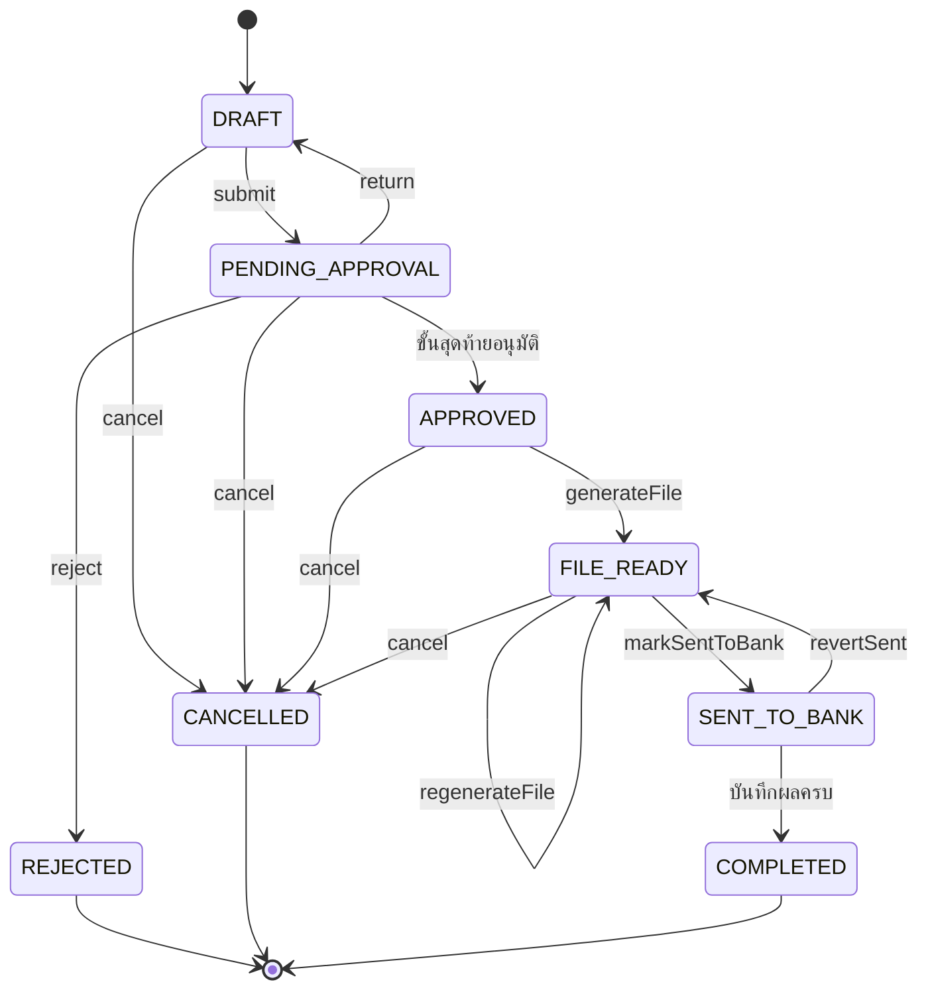

# S9 · รอบจ่ายเงินและไฟล์ธนาคาร — sub-spec

เอกสารนี้ขยาย §16.16 สำหรับการลงมือ · spec.md มีลำดับเหนือกว่าเสมอ ถ้าขัดกันให้ยึด spec แล้วแก้ไฟล์นี้

สถานะ: ร่าง P1-04 (2026-10-11) · รอตรวจ P1-05 และผู้ใช้อนุมัติ P1-06 · เลข BR GC INV event error และความสามารถในไฟล์นี้เป็นร่าง จะเพิ่มลง spec ในข้อที่สร้างโค้ดนั้น

เลข OQ และ ADR ในไฟล์นี้ออกแล้วต่อจาก S8 (OQ-130 ถึง OQ-135 · ADR-128 ถึง ADR-134 · เดิมเป็นตัวยึด) agent หลักออกเลขจริงในช่วง 121–139 ต่อจาก S8 · กฎในตระกูลของขั้นอื่นใช้ตัวยึด `?S9x`

## ขอบเขต

| เรื่อง | อยู่ใน S9 |
| --- | --- |
| FR | FR-PAY-101 รอบจ่ายเงิน รวมยอดผู้ขาย อนุมัติตาม DOA · FR-PAY-102 ไฟล์ Batch Payment 1–2 ธนาคาร พร้อมตรวจก่อนส่งออก · FR-PAY-103 บันทึกผลการจ่ายและแจ้งผู้ขาย |
| งานที่ไม่มี FR แต่ S9 เป็นเจ้าของ | บัญชีรับเงินของผู้ขายและบัญชีผู้จ่ายขององค์กร (`BankAccount` `BankAccountChange`) เพราะระยะ 1 เปิด `PAY` โดยไม่มี `SUPPLIER` (§4.11 ย่อหน้าท้าย · BR-SOD-05) · FR-SUP-103 ของ S7 จะใช้ entity ชุดนี้ต่อผ่านพอร์ทัล |
| นอกขอบเขต | โอนเงินเองหรือเชื่อม API ธนาคาร (NG-2) · ลงบัญชีและส่งผลการจ่ายเข้า Express (NG-1 · OQ-10) · รูปแบบไฟล์ของธนาคารจริงและไฟล์ผลการโอน (รอ P0-03 · ข้อ `[go-live]`) · พอร์ทัลผู้ขาย (S7) · การอนุมัติข้ามด้านความเสี่ยง (S11) · กฎภาษีหัก ณ ที่จ่าย 50 ทวิ และ ภ.ง.ด. (S8 · FR-AP-104) · การตัดงบ (เกิดตอนจับคู่ BR-MATCH-04 ใน S8) |
| ขึ้นกับ | **S8** (สาย 2 ทำก่อน): `Invoice` สถานะพร้อมจ่าย ยอด วันครบกำหนด ภาษีหัก และฟังก์ชันถือ ปล่อย จ่าย (หัวข้อ "interface") · **P1-07**: ชนิดเอกสาร DOA `PAYMENT_RUN` `BANK_ACCOUNT_CHANGE` ใน engine lint และ seed ของ SIMEC · โมดูล `PAY` · **โค้ดเดิม**: `core/sla` (ปฏิทิน) `core/numbering` `core/sod` `core/pin` (`ALWAYS_STEP_UP_SUBJECTS`) approvals `SensitiveAccessLog` storage email-provider `lib/encoding` |
| ของเดิมที่แตะ | เพิ่มคอลัมน์ `Supplier.registryFlag` · เพิ่มค่า enum (`FileLinkKind.BANK_PROOF` · `ApprovalSubjectType` ถ้า P1-07 ยังไม่เพิ่ม) · เพิ่มกรณีใน `checkSod` · ไม่เปลี่ยนผลการคำนวณของ `src/core` และ service เงินเดิม (§16.13) |

## ชั้น demo และชั้นของจริงของ "เสร็จเมื่อ"

| เกณฑ์ต้นฉบับ (§16.8) | ชั้น demo รอบนี้ (`[demo]`) | ชั้นของจริง (`[go-live]`) และของที่ต้องได้ |
| --- | --- | --- |
| การเงินอัปโหลดไฟล์ทดสอบกับธนาคารได้ | `fin_tre1` สร้างและดาวน์โหลดไฟล์แม่แบบกลาง `BCS-NEUTRAL-1` ที่บอกชัดในแถว H ชื่อไฟล์ และหน้าจอว่า "ไม่ใช่รูปแบบของธนาคาร ธนาคารจะไม่รับ" · golden byte-exact + sha256 ของแม่แบบกลาง (GC-BANK-12 ถึง GC-BANK-14) · ไม่มีการอัปโหลดจริง | S9-11: ตัวสร้างไฟล์ต่อธนาคาร 1–2 แห่ง golden byte-exact + sha256 เทียบไฟล์ตัวอย่างที่ผ่านระบบทดสอบของธนาคาร (BR-BANK-01) แล้วการเงินของลูกค้าอัปโหลดไฟล์ที่ระบบสร้างเข้าระบบทดสอบของธนาคารผ่าน · ต้องได้: สเปกไฟล์ ไฟล์ตัวอย่างที่ผ่าน และค่าที่ธนาคารให้ (เช่น รหัสบริษัท) จาก P0-03 |
| ยอดรวมตรงกับรอบจ่าย | trailer ของไฟล์ = Σ รายการ = `totalTransferSatang` ของรอบ (golden + property test INV-PAY-02 + อ่านไฟล์กลับหลังสร้าง) | ยอดในไฟล์ของธนาคารจริงและรายงานผลจากธนาคารตรงรอบจ่าย |
| (FR-PAY-103) บันทึกผล | บันทึกด้วยมือต่อรายการ | S9-12: นำเข้าไฟล์ผลการโอนเมื่อได้รูปแบบ (OQ-135) |
| (§8.12) แจ้งผู้ขายทางอีเมล | อีเมลไป Mailpit (ผู้ขายสังเคราะห์ `@supplier.simec.local`) | อีเมลจริงจากโดเมนที่ตั้งตาม OQ-22 |
| (§8.12) ธงสถานะทะเบียน | `Supplier.registryFlag` จาก seed (ชีต SupplierPayment) | S9-13: job `supplier-registry-recheck` ของ S4-16 ตั้งธงจากบริการจริง |

## Demo ของขั้น

ยอดด้านล่างคำนวณจากชีต History ของไฟล์ระยะ 1 โดยสมมติว่า S8 ตั้งยอดใบแจ้งหนี้ตามยอดคำขอ (กรณี MATCH และ SERVICE_2WAY) และหักภาษีตอนจ่าย (ค่าเริ่มต้นของคำถาม BR-WHT-01) · P1-08 กำหนดฉากจริง

1. `fin_tre1` (แผนกการเงิน · FINANCE) เปิด "เตรียมรอบจ่าย" ระบบเสนอวันจ่ายเป็นศุกร์ถัดไป (OQ-130) บัญชีผู้จ่าย `CB-01` (ธนาคาร 004 · ••••••0016) และใบแจ้งหนี้พร้อมจ่ายที่ครบกำหนดไม่เกินวันจ่าย (แถว DUE และ OVERDUE · ใบที่ S8 ยังติด exception เช่น H162 QTY_OVER และ H167 PRICE_OVER ไม่อยู่ในรายการ)
2. `fin_tre1` ย้ายงานจ้างเหมา 4 ใบ (H076 H085 H103 H146) ไปรอบที่ 2 · รอบที่ 1 เหลือ 20 ผู้ขาย 21 ใบ ยอดที่ต้องจ่าย 1,987,364.50 ภาษีหัก 14,416.85 ยอดโอน 1,972,947.65 · `SP0171` มี 2 ใบ (H060 เลยกำหนด + H158 ถึงกำหนด) รวมเป็นรายการเดียว 37,152.54 · `SP0076` ค่าเช่า 5% หัก 5,359.25 · `SP0111` ผู้รับเหมาบุคคลธรรมดา หัก 3% เป็น 1,497.60
3. `fin_ap1` บันทึกใบแจ้งหนี้ที่มาช้าของ H065 (`SP0031` เลิกกิจการ · 52,430.00) ใน S8 · `fin_tre1` เพิ่มเข้ารอบ ระบบติดธง "สถานะทะเบียนเปลี่ยน" และส่งไม่ได้จนใส่เหตุผล → รอบที่ 1: 21 ผู้ขาย 22 ใบ ยอดที่ต้องจ่าย 2,039,794.50 ภาษีหัก 14,416.85 ยอดโอน 2,025,377.65
4. `fin_tre1` ส่งขออนุมัติ → เลข `PAY-{BE}-nnnnn` · DOA ข้อ PAY-01 (ไม่เกิน 5,000,000.00) → `cfo` · การ์ด LINE ไม่มีปุ่มอนุมัติในแชท (ยอดถึงเกณฑ์ PIN และมีธง) จึงเปิด LIFF · `cfo` เห็นรายการที่มีธงก่อน ติ๊กรับทราบ ใส่ PIN แล้วอนุมัติ
5. `fin_tre1` สร้างไฟล์ → `BCS-NEUTRAL-1_PAY-…_v1.csv` แถว T มี 21 รายการ (หนึ่งรายการต่อผู้ขาย) ยอด 2,025,377.65 · หน้าจอมีป้าย "แม่แบบกลางสำหรับทดสอบ ไม่ใช่รูปแบบของธนาคาร" · ดาวน์โหลดแล้วกด "ส่งธนาคารแล้ว"
6. `fin_tre1` บันทึกผล "สำเร็จทั้งรอบ" ยกเว้น `SP0056` (ไม่สำเร็จ · บัญชีปิด) → ใบ H163 กลับพร้อมจ่าย · 20 ผู้ขายได้อีเมลแจ้งการชำระใน Mailpit (`SP0111` แนบ 50 ทวิ ภ.ง.ด.3 จาก S8) · รอบเป็น COMPLETED
7. `fin_ap1` เสนอเปลี่ยนบัญชีของ `SP0056` พร้อมหนังสือจากผู้ขายและบันทึกการโทรยืนยัน → `cfo` อนุมัติด้วย PIN บนเว็บ → `SP0056` ได้อีเมลแจ้งเปลี่ยนบัญชีที่อีเมลในทะเบียน · รอบถัดไป `SP0056` มีธง "บัญชีเพิ่งเปลี่ยน" และ `fin_ap1` เตรียมรอบที่มี `SP0056` ไม่ได้ภายใน 30 วัน (BR-SOD-10)
8. รอบที่ 2 งานจ้างเหมา 4 ราย ยอดโอนราว 10.7 ล้าน (ก่อนหักเงินประกันผลงานของ S8) → DOA ข้อ PAY-02 → `ceo` · ถ้า `cfo` เตรียมรอบที่ 1 เอง ระบบยกไป `ceo` พร้อมคำอธิบาย (BR-DOA-06)
9. `auditor` เปิดรอบจ่ายเห็นเลขบัญชีแบบ mask (BR-AUTH-04)

## Entity และ migration

กติการ่วม: ทุกตารางมี `organizationId` (INV-TEN-02) · `@@unique([organizationId, id])` และ FK คู่ `(organizationId, <ref>Id)` (ADR-039) · เงินเป็น `BigInt` ลงท้าย `Satang` CHECK ≥ 0 · อัตราเป็น `Int` ลงท้าย `Bp` · วันที่ล้วนใช้ `@db.Date` · unique ทางธุรกิจรวม `organizationId` · ทุกการเปลี่ยนสถานะผ่าน `runCommand()` และมี Event

**`BankAccount`** (บัญชีรับเงินของผู้ขาย และบัญชีผู้จ่ายขององค์กร · ADR-128)

| ฟิลด์ | ชนิด | กฎ |
| --- | --- | --- |
| ownerKind | enum `BankAccountOwner` (`SUPPLIER` `ORGANIZATION`) | CHECK `(ownerKind = 'SUPPLIER') = (supplierId IS NOT NULL)` |
| supplierId | uuid? | FK `(organizationId, supplierId)` → Supplier |
| code | text? | บัญชีองค์กร เช่น `CB-01` · unique `(organizationId, code)` |
| bankCode | text | อยู่ในรายการรหัสธนาคาร (ADR-131) |
| accountNo | text | ตัวเลขล้วน CHECK `"accountNo" ~ '^[0-9]{10,12}$'` (BR-SUP-07) |
| accountName | text | 1–200 ตัวอักษร ไม่มีอักขระควบคุม |
| branchName | text? | |
| accountType | enum `BankAccountType`? (`CURRENT` `SAVINGS`) | บังคับเมื่อ ORGANIZATION |
| status | enum `BankAccountStatus` (`ACTIVE` `SUPERSEDED` `CLOSED`) | partial unique `(organizationId, supplierId) WHERE status = 'ACTIVE' AND "ownerKind" = 'SUPPLIER'` (INV-PAY-04) |
| fileTemplateCode | text? | เฉพาะ ORGANIZATION · ค่าเริ่มต้น `BCS-NEUTRAL-1` (ADR-129) |
| fileParams | jsonb? | ค่าที่ธนาคารให้ ตรวจด้วย Zod ของแม่แบบ · แม่แบบกลางไม่มี |
| sourceChangeId | uuid? | FK → BankAccountChange ที่ทำให้มีผล · null = seed |
| activatedAt · supersededAt · closedAt | timestamptz | |
| version | int | optimistic lock |

index `(organizationId, bankCode, accountNo)` ใช้หาบัญชีที่ผู้ขายหลายรายใช้ร่วม (ธง SHARED_BANK_ACCOUNT)

**`BankAccountChange`**

| ฟิลด์ | ชนิด | กฎ |
| --- | --- | --- |
| number | text? | `BAC-{BE}-{SEQ5}` ออกตอนส่ง (OQ-12 · BR-NUM-01) · unique `(organizationId, number)` |
| kind | enum (`ADD` `REPLACE` `CLOSE`) | REPLACE CLOSE ต้องมี `targetBankAccountId` ที่ ACTIVE |
| ownerKind · supplierId · targetBankAccountId | เหมือน BankAccount | partial unique `(organizationId, supplierId) WHERE status IN ('DRAFT','PENDING_APPROVAL')` (คำขอค้างได้ทีละใบต่อผู้ขาย) |
| bankCode · accountNo · accountName · branchName · accountType · fileTemplateCode · fileParams | ค่าที่เสนอ | บังคับเมื่อ ADD REPLACE · ผ่าน BR-SUP-07 |
| reason | text | บังคับ |
| callVerifiedAt · callVerificationNote | timestamptz? · text? | บังคับเมื่อ REPLACE ของผู้ขาย (OQ-133) · note ห้ามมีเลขบัญชี |
| source | enum (`INTERNAL` `PORTAL`) | ระยะ 1 = INTERNAL · S7 ใช้ PORTAL |
| status | enum (`DRAFT` `PENDING_APPROVAL` `APPROVED` `REJECTED` `CANCELLED`) | |
| submittedById | uuid | FK Member |
| submittedAt · decidedAt | timestamptz? | |
| currentRouteId | uuid? | FK ApprovalRoute |
| appliedBankAccountId | uuid? | บัญชีที่สร้างตอนอนุมัติ |
| version | int | |

หลักฐานแนบเป็น `FileLink` kind ใหม่ `BANK_PROOF` (หนังสือจากผู้ขาย หน้าสมุดบัญชี)

**`PaymentRun`**

| ฟิลด์ | ชนิด | กฎ |
| --- | --- | --- |
| number | text? | `PAY-{BE}-{SEQ5}` ออกตอนส่งครั้งแรก · unique `(organizationId, number)` |
| status | enum `PaymentRunStatus` (`DRAFT` `PENDING_APPROVAL` `APPROVED` `FILE_READY` `SENT_TO_BANK` `COMPLETED` `REJECTED` `CANCELLED`) | |
| payDate | date | BR-PAY-02 |
| payerBankAccountId | uuid | FK BankAccount ที่ ownerKind = ORGANIZATION |
| fileTemplateCode | text | snapshot จากบัญชีผู้จ่ายตอนส่ง |
| whtTiming | enum (`AT_PAYMENT` `AT_INVOICE`) | snapshot จากค่าของ S8 ตอนส่ง |
| preparedById | uuid | FK Member · ผู้แก้ร่างได้คนเดียว (BR-PAY-09) |
| totalPayableSatang · totalWhtSatang · totalTransferSatang | bigint | CHECK ≥ 0 · CHECK `"totalTransferSatang" = "totalPayableSatang" - "totalWhtSatang"` |
| itemCount · invoiceCount | int | |
| flagsFingerprint | text? | sha256 ของธงตอนส่ง (BR-PAY-07) |
| currentRouteId | uuid? | FK ApprovalRoute |
| submittedAt · approvedAt · sentToBankAt · completedAt · cancelledAt | timestamptz? | |
| cancelReason | text? | |
| version | int | |

**`PaymentRunItem`** (หนึ่งรายการต่อผู้ขายต่อรอบ)

| ฟิลด์ | ชนิด | กฎ |
| --- | --- | --- |
| paymentRunId · supplierId | uuid | unique `(organizationId, paymentRunId, supplierId)` |
| seq | int? | ออกตอนส่ง เรียงตามรหัสผู้ขาย · unique `(organizationId, paymentRunId, seq)` |
| bankAccountId · payeeBankCode · payeeAccountNo · payeeAccountName | snapshot ตอนส่ง | ADR-133 |
| payableSatang · creditSatang · whtSatang · transferSatang | bigint | CHECK ≥ 0 · CHECK `"transferSatang" = "payableSatang" - "whtSatang"` · service บังคับ transfer > 0 ตอนส่ง |
| flags | enum `PaymentFlag[]` | BR-PAY-06 |
| flagReason | text? | บังคับเมื่อมีธงที่ต้องมีเหตุผล |
| status | enum (`INCLUDED` `PAID` `FAILED`) | |
| paidOn · bankReference · failureReason | date? · text? · text? | BR-PAY-12 |
| resultRecordedById · resultRecordedAt | uuid? · timestamptz? | |
| adviceStatus · adviceSentAt | enum (`NOT_SENT` `SENT` `BOUNCED` `NO_EMAIL`) · timestamptz? | BR-PAY-13 |

**`PaymentRunItemWht`** (บรรทัดภาษีหักต่อรายการ เมื่อ AT_PAYMENT): paymentRunItemId · incomeType · rateBp · baseSatang · whtSatang (CHECK ≥ 0) · unique `(organizationId, paymentRunItemId, incomeType, rateBp)`

**`PaymentRunInvoice`** (ลิงก์ใบแจ้งหนี้กับรายการ): paymentRunId · paymentRunItemId · invoiceId (FK → `Invoice` ของ S8) · kind (`INVOICE` `CREDIT_NOTE`) · payableSatang (snapshot) · status (`HELD` `PAID` `RELEASED`) · releaseReason · partial unique `(organizationId, invoiceId) WHERE status IN ('HELD','PAID')` (INV-PAY-01)

**`PaymentFile`**: paymentRunId · version (unique `(organizationId, paymentRunId, version)`) · templateCode · fileId (FK FileObject · bucket private) · fileName · sha256 · byteSize · itemCount · totalSatang (CHECK ≥ 0) · reason (CHECK `version = 1 OR reason IS NOT NULL`) · status (`CURRENT` `SUPERSEDED` · partial unique ต่อรอบ WHERE CURRENT) · generatedById · generatedAt · trigger ตาม §6.3: ห้าม DELETE และ UPDATE ได้เฉพาะ `status` จาก CURRENT เป็น SUPERSEDED (BR-BANK-03)

**ของเดิมที่เพิ่ม**: `Supplier.registryFlag` enum `RegistryFlag` (`NONE` `CEASED` `VAT_CANCELLED` `NOT_FOUND`) ค่าเริ่มต้น NONE + `registryFlaggedAt` (ADR-132) · `FileLinkKind.BANK_PROOF` · `ApprovalSubjectType` เพิ่ม `PAYMENT_RUN` `BANK_ACCOUNT_CHANGE` ถ้า P1-07 ยังไม่เพิ่ม · `DocumentSequence` ประเภท `PAY` `BAC` · `OrgSettingsSchema.payment` = `{ runWeekdays: Weekday[] (FRI), holidayShift: 'PREVIOUS' | 'NEXT' (PREVIOUS), recentBankChangeDays: 0–365 (30), adviceEmail: boolean (true) }` · ไม่มีตาราง `BankFileTemplate` (ADR-129) และไม่มีตารางธนาคารแบบ global (ADR-131)

## State machine

**PaymentRun**



| จาก | คำสั่ง | ไป | ใครทำได้ | เงื่อนไขและผลข้างเคียง | event |
| --- | --- | --- | --- | --- | --- |
| — | `paymentRun.create` | DRAFT | FINANCE (`paymentRun.prepare`) | บัญชีผู้จ่าย ACTIVE มีแม่แบบ · วันจ่ายผ่าน BR-PAY-02 | `payment_run.drafted` |
| DRAFT | `paymentRun.addInvoices` · `paymentRun.removeInvoices` · `paymentRun.update` (วันจ่าย บัญชีผู้จ่าย) · `paymentRun.setFlagReason` | DRAFT | ผู้เตรียม | BR-PAY-03 · ถือหรือปล่อยใบผ่าน S8 ในธุรกรรมเดียวกัน · BR-SOD-10 ตอนเพิ่ม | `payment_run.invoices_added` · `payment_run.invoices_removed` · `payment_run.updated` |
| DRAFT | `paymentRun.submit` | PENDING_APPROVAL | ผู้เตรียม | ≥ 1 รายการ · ทุกยอดโอน > 0 · ทุกผู้ขายมีบัญชี ACTIVE · ธงที่บังคับมีเหตุผล · วันจ่ายผ่าน · หาผู้อนุมัติได้ → ออกเลข (ครั้งแรก) · seq · snapshot บัญชี · fingerprint · route | `payment_run.submitted` (ครั้งแรก) หรือ `payment_run.resubmitted` · `approval_task.assigned` |
| PENDING_APPROVAL | `approval.approve` ขั้นสุดท้าย | APPROVED | ผู้อนุมัติตาม DOA `PAYMENT_RUN` | fingerprint ตรง · SoD · step-up · วันจ่ายยังไม่ผ่าน | `approval_task.decided` · `payment_run.approved` |
| PENDING_APPROVAL | `approval.reject` | REJECTED | ผู้อนุมัติ | เหตุผล · ปล่อยทุกใบ (S8 กลับพร้อมจ่าย) | `payment_run.rejected` |
| PENDING_APPROVAL | `approval.return` | DRAFT | ผู้อนุมัติ | เหตุผล · route CANCELLED · คงการถือใบ | `payment_run.returned` |
| DRAFT · PENDING_APPROVAL | `paymentRun.cancel` | CANCELLED | ผู้เตรียม | ยกเลิกงานค้าง · ปล่อยทุกใบ | `payment_run.cancelled` |
| APPROVED · FILE_READY | `paymentRun.cancel` | CANCELLED | FINANCE | เหตุผล · ปล่อยทุกใบ · ไฟล์ทุกเวอร์ชัน SUPERSEDED · แจ้งผู้อนุมัติ | `payment_run.cancelled` |
| APPROVED | `paymentRun.generateFile` | FILE_READY | FINANCE (`paymentRun.file`) | ตรวจก่อนส่งออกผ่าน (BR-BANK-06) → PaymentFile v1 | `payment_run.file_generated` |
| FILE_READY | `paymentRun.regenerateFile` | FILE_READY | FINANCE | เหตุผล · ตรวจผ่าน → v n+1 · เดิม SUPERSEDED | `payment_run.file_generated` |
| FILE_READY | `paymentRun.markSentToBank` | SENT_TO_BANK | FINANCE | — | `payment_run.sent_to_bank` |
| SENT_TO_BANK | `paymentRun.revertSent` | FILE_READY | FINANCE | เหตุผล · ยังไม่มีผลรายการใด | `payment_run.sent_reverted` |
| SENT_TO_BANK | `paymentRun.recordResults` | SENT_TO_BANK หรือ COMPLETED | FINANCE (`paymentRun.recordResult`) | รายการที่ยังไม่มีผล · ครบทุกรายการ → COMPLETED | `payment_run_item.paid` · `payment_run_item.failed` · `payment_run.completed` |

**PaymentRunItem**: `INCLUDED → PAID | FAILED` (เฉพาะ SENT_TO_BANK · บันทึกแล้วแก้ไม่ได้) · **PaymentRunInvoice**: `HELD → PAID | RELEASED` · **PaymentFile**: `CURRENT → SUPERSEDED`

**BankAccountChange**

| จาก | คำสั่ง | ไป | ใครทำได้ | เงื่อนไขและผลข้างเคียง | event |
| --- | --- | --- | --- | --- | --- |
| — | `bankAccountChange.create` | DRAFT | FINANCE (`bankAccountChange.propose` · OQ-133) | BR-SUP-06 BR-SUP-07 · เตือนเมื่อบัญชีซ้ำกับผู้ขายเลขผู้เสียภาษีอื่น | `bank_account_change.drafted` |
| DRAFT | `bankAccountChange.update` | DRAFT | ผู้เสนอ | — | `bank_account_change.updated` |
| DRAFT | `bankAccountChange.submit` | PENDING_APPROVAL | ผู้เสนอ | หลักฐาน ≥ 1 ไฟล์ (ADD REPLACE) · บันทึกโทรยืนยัน (REPLACE ของผู้ขาย) · หาผู้อนุมัติได้ → ออกเลข · route | `bank_account_change.submitted` · `approval_task.assigned` |
| PENDING_APPROVAL | `approval.approve` ขั้นสุดท้าย | APPROVED | ผู้อนุมัติตาม DOA `BANK_ACCOUNT_CHANGE` | SoD BR-SOD-05 · step-up ทุกครั้ง (BR-SUP-08) → บัญชีใหม่ ACTIVE เดิม SUPERSEDED หรือ CLOSED · แจ้งผู้ขาย | `bank_account_change.approved` · `bank_account.activated` · `bank_account.superseded` · `bank_account.closed` |
| PENDING_APPROVAL | `approval.reject` · `approval.return` | REJECTED · DRAFT | ผู้อนุมัติ | เหตุผล | `bank_account_change.rejected` · `bank_account_change.returned` |
| DRAFT · PENDING_APPROVAL | `bankAccountChange.cancel` | CANCELLED | ผู้เสนอ | ยกเลิกงานค้าง | `bank_account_change.cancelled` |

ตารางทั้งสามอยู่ใน `src/core/state-machines` และเทสต์วนทุกคู่ (สถานะ, คำสั่ง) ว่าคู่ที่ไม่มีได้ `INVALID_STATE_TRANSITION` (§6.4) · งานอนุมัติของรอบจ่ายและการเปลี่ยนบัญชีไม่รับ `approval.requestInfo` (ใช้ตีกลับแทน)

## กฎ

| ID | กฎ |
| --- | --- |
| BR-PAY-01 | ทุกคำสั่งของขั้นเรียก `requireModule(ctx, 'PAY')` · รอบหนึ่งใช้บัญชีผู้จ่ายขององค์กรหนึ่งบัญชีที่ ACTIVE และแม่แบบไฟล์ของบัญชีนั้น · องค์กรมีบัญชีผู้จ่ายได้หลายบัญชี (ไฟล์ 1–2 ธนาคาร) · สกุลเงิน THB เท่านั้น (NG-9) |
| BR-PAY-02 | วันจ่ายต้องเป็นวันทำการตามปฏิทินขององค์กร (BR-SLA-01 · ตาราง Holiday) และไม่ก่อนวันนี้ตามเวลาไทย ตรวจตอนสร้าง แก้ ส่ง และอนุมัติ ไม่ผ่าน → `PAYMENT_DATE_INVALID` (reason `NOT_BUSINESS_DAY` หรือ `PAST`) · ระบบเสนอวันจ่ายถัดไปจาก `payment.runWeekdays`: วันแรกตั้งแต่วันนี้ที่ตรงวันในรายการ ถ้าเป็นวันหยุดเลื่อนตาม `holidayShift` (PREVIOUS = วันทำการก่อนหน้า) และถ้าเลื่อนแล้วก่อนวันนี้ ให้ใช้รอบถัดไป · เป็นข้อเสนอ ผู้เตรียมเลือกวันทำการอื่นได้ (OQ-130) |
| BR-PAY-03 | ใบที่เข้ารอบได้: `Invoice` ของ S8 สถานะ `READY_FOR_PAYMENT` (รวมใบลดหนี้ kind `CREDIT_NOTE` ของผู้ขายเดียวกัน) · ระบบเสนอใบที่ `dueDate ≤ payDate` · เพิ่มใบที่ยังไม่ถึงกำหนดได้และติดป้าย "จ่ายก่อนกำหนด" · เพิ่มแล้วใบถูกถือ (ลิงก์ `HELD` · S8 เปลี่ยนเป็น `IN_PAYMENT_RUN`) ในธุรกรรมเดียวกัน ล็อกแถวเรียงตาม id · ใบที่ไม่พร้อมจ่ายหรือถูกถือโดยรอบอื่น → `INVOICE_NOT_PAYABLE` (INV-PAY-01) |
| BR-PAY-04 | ยอดต่อรายการ (หนึ่งรายการต่อผู้ขาย): `payable` = Σ ยอดที่ต้องจ่ายของใบแจ้งหนี้ − Σ ของใบลดหนี้ (ค่าที่ S8 คำนวณรวม VAT และหักเงินประกันผลงานแล้ว · S9 ไม่คำนวณ VAT ใหม่) · `wht` ตาม `whtTiming` ของ S8: `AT_PAYMENT` = เรียก `paymentWithholding()` ของ S8 กับบรรทัดฐานภาษีของทุกใบในรายการ (ใบลดหนี้เป็นฐานติดลบ) ซึ่งรวมต่อ (ประเภทเงินได้, อัตรา) แล้วปัด half-up ครั้งเดียวต่อกลุ่ม (BR-MONEY-02 (3) · ตัวยึด BR-WHT-10 ของ S8) · `AT_INVOICE` = Σ ภาษีหักที่ S8 คำนวณต่อใบ · `transfer` = `payable` − `wht` ต้อง > 0 ไม่เช่นนั้น `PAYMENT_ITEM_NOT_POSITIVE` · ฐานภาษีของกลุ่มติดลบ → `VALIDATION_FAILED` reason `WHT_BASE_NEGATIVE` · คำนวณใหม่และตรวจทุกครั้งที่เพิ่มหรือเอาใบออก (ปฏิเสธทั้งคำสั่ง ใบลดหนี้จึงต้องเพิ่มพร้อมหรือหลังใบแจ้งหนี้ของผู้ขายนั้น) และตอนส่ง |
| BR-PAY-05 | ยอดของรอบ = Σ ของรายการ (payable wht transfer) บันทึกพร้อมรายการในธุรกรรมเดียว · ตอนส่ง ออก `seq` เรียงตามรหัสผู้ขาย และ snapshot บัญชีผู้รับจากบัญชี ACTIVE ของผู้ขาย ณ เวลาส่ง · ผู้ขายที่ไม่มีบัญชี ACTIVE → `BANK_ACCOUNT_NOT_APPROVED` |
| BR-PAY-06 | ธงของรายการ คำนวณตอนเพิ่มใบ ตอนส่ง และตอนอนุมัติ เรียงตามลำดับนี้: `REGISTRY_CHANGED` (`Supplier.registryFlag` ≠ NONE · BR-SUP-04) · `SUPPLIER_INACTIVE` · `RISK_OVERRIDE_EXPIRED` (การอนุมัติข้ามของ S11 ที่ `expiresOn` < payDate · ระยะ 1 ไม่มีแหล่งข้อมูล จึงไม่เกิด) · `BANK_ACCOUNT_RECENTLY_CHANGED` (วันมีผลของบัญชีตามเวลาไทย ≥ payDate − `recentBankChangeDays` วัน · บัญชีจาก seed ไม่นับ) · `BANK_CHANGE_PENDING` (มีคำขอเปลี่ยนค้าง) · `SHARED_BANK_ACCOUNT` (บัญชีเดียวกันเป็นบัญชี ACTIVE ของผู้ขายที่เลขผู้เสียภาษีต่างกัน · สาขาของเลขเดียวกันไม่นับ) · สามธงแรกต้องมี `flagReason` จากผู้เตรียมก่อนส่ง → `PAYMENT_FLAG_REASON_REQUIRED` · ธงไม่บล็อกการจ่าย (OQ-132) |
| BR-PAY-07 | ผู้อนุมัติเห็นธงก่อนอนุมัติ: หน้าอนุมัติบนเว็บและ LIFF แสดงรายการที่มีธงก่อนรายการอื่นพร้อมเหตุผล · `fingerprint` = sha256 (hex) ของข้อความ `<รหัสผู้ขาย>:<ธง>+<ธง>` ของรายการที่มีธง เรียงตามรหัสผู้ขาย คั่นด้วย `;` (ไม่มีธง = sha256 ของข้อความว่าง) · คำสั่งอนุมัติต้องส่ง fingerprint ที่หน้าจอแสดง ถ้าไม่ตรงกับที่คำนวณ ณ ตอนตัดสิน → `PAYMENT_FLAGS_CHANGED` · ตีกลับและไม่อนุมัติไม่ต้องส่ง · การ์ด LINE ของรอบที่มีธงไม่มีปุ่มอนุมัติในแชท เปิด LIFF แทน |
| BR-PAY-08 | เส้นทาง DOA ชนิด `PAYMENT_RUN`: ยอด = `totalTransferSatang` ส่งเป็น `{ netSatang: ยอดโอน, vatSatang: 0 }` จึงเท่ากันทั้งฐาน GROSS และ NET (OQ-131) · หน่วยงาน = แผนกราก · `conflictMemberIds` = ผู้เตรียม + ผู้บันทึกใบแจ้งหนี้ทุกใบในรอบ · ชนิด `BANK_ACCOUNT_CHANGE`: ไม่มียอด หน่วยงาน = แผนกราก conflict = ผู้เสนอ · step-up ของรอบจ่ายตาม BR-TOK-05 (ยอดตั้งแต่ `stepUpThreshold`) · ไม่มีลิงก์ตัดสินทางอีเมลสำหรับสองชนิดนี้ (§9.1) |
| BR-PAY-09 | แก้รอบได้เฉพาะ DRAFT และเฉพาะผู้เตรียม (คนอื่นดูได้ ส่งต่องานด้วยการยกเลิกแล้วเตรียมใหม่) · ตีกลับเป็น DRAFT คงการถือใบ · ส่งซ้ำคำนวณยอด ธง snapshot และเส้นทางใหม่ทั้งหมดตาม DOA ณ เวลาส่งซ้ำ (BR-DOA-09) |
| BR-PAY-10 | ยกเลิก: DRAFT และ PENDING_APPROVAL โดยผู้เตรียม · APPROVED และ FILE_READY โดย FINANCE พร้อมเหตุผลและแจ้งผู้อนุมัติ · ทุกกรณีปล่อยใบที่ถือ (ลิงก์ `RELEASED` · S8 กลับ `READY_FOR_PAYMENT`) · หลัง SENT_TO_BANK ยกเลิกไม่ได้ ใช้ถอนการส่งหรือบันทึกผลไม่สำเร็จ |
| BR-PAY-11 | `markSentToBank` บันทึกว่าการเงินส่งไฟล์ CURRENT ให้ธนาคารแล้ว (ระบบไม่ส่งเอง NG-2) · `revertSent` ทำได้เมื่อยังไม่มีผลรายการใด พร้อมเหตุผล เช่น ธนาคารปฏิเสธไฟล์ |
| BR-PAY-12 | บันทึกผลต่อรายการ: `PAID` พร้อม `paidOn` (payDate ≤ paidOn ≤ วันนี้ตามเวลาไทย) และเลขอ้างอิงธนาคารถ้ามี หรือ `FAILED` พร้อมเหตุผล · มีคำสั่ง "สำเร็จทั้งรอบ ยกเว้นรายการที่เลือก" · บันทึกแล้วแก้ไม่ได้ · `PAID` → เรียก `recordInvoicePayment()` ของ S8 ในธุรกรรมเดียวกัน (ใบเป็น PAID · ถ้า AT_PAYMENT ส่งบรรทัด `PaymentRunItemWht` ให้ S8 ออก 50 ทวิ) · `FAILED` → ลิงก์ RELEASED และใบกลับพร้อมจ่าย · ครบทุกรายการ → COMPLETED |
| BR-PAY-13 | แจ้งผู้ขายทางอีเมล (§8.12 · OQ-134): job `payment-advice-send` จาก `payment_run_item.paid` ส่ง 1 ฉบับต่อรายการไป `Supplier.email` (เลขรอบ วันที่โอน ยอดโอน เลขใบแจ้งหนี้ ภาษีหักต่อประเภท แนบ 50 ทวิ ถ้ามี · เลขบัญชีแสดงเฉพาะ 4 ตัวท้าย) ภาษาไทยและอังกฤษในฉบับเดียว · idempotency `<functionId>:<stepId>:<itemId>` · ไม่มีอีเมล → `NO_EMAIL` · ผู้ให้บริการปฏิเสธ → `BOUNCED` แจ้งผู้เตรียม · ส่งซ้ำได้ด้วยเหตุผล · ปิดได้ด้วย `payment.adviceEmail = false` |
| BR-PAY-14 | รอบจ่ายไม่เขียน ledger งบ (ตัดงบจริงเกิดตอนจับคู่ BR-MATCH-04) ไม่ลงบัญชี (NG-1) และไม่โอนเงินเอง (NG-2) |
| BR-BANK-04 | แม่แบบไฟล์เป็นโค้ด (ADR-129): ตัวสร้างต่อแม่แบบเป็น pure function ใน `src/core/bankfile/<template>.ts` รับ `{ run, items }` คืน `{ fileName, text }` · service เข้ารหัสตามแม่แบบด้วย `src/lib/encoding` คำนวณ sha256 ของ bytes เก็บใน PaymentFile แล้วอ่านไฟล์กลับเพื่อตรวจว่า Σ แถว D = แถว T = `totalTransferSatang` · ไม่มีเวลาที่สร้างในเนื้อไฟล์ จึงสร้างซ้ำได้ไฟล์เดิมทุกไบต์ |
| BR-BANK-05 | แม่แบบกลาง `BCS-NEUTRAL-1` (ชั้น demo · ADR-130): CSV UTF-8 มี BOM ทุกบรรทัดจบด้วย CRLF · แถว `H,BCS-NEUTRAL-1,NOT-A-BANK-FORMAT,<เลขรอบ>,<เวอร์ชัน>,<วันจ่าย YYYY-MM-DD ค.ศ.>,<รหัสธนาคารผู้จ่าย>,<เลขบัญชีผู้จ่าย>,<จำนวนรายการ>,<ยอดรวม>` · แถว `D,<seq>,<รหัสธนาคาร>,<เลขบัญชี>,<ชื่อบัญชี>,<ยอดโอน>,<รหัสผู้ขาย>,<เลขรอบ>-<seq เติมศูนย์ 3 หลัก>` · แถว `T,<จำนวนรายการ>,<ยอดรวม>` · เงินเป็นบาทจุดสตางค์ 2 ตำแหน่ง ไม่มีตัวคั่น · ช่องที่มี `,` `"` CR LF ใส่ในอัญประกาศและ `"` เป็น `""` · ชื่อไฟล์ `BCS-NEUTRAL-1_<เลขรอบ>_v<เวอร์ชัน>.csv` · หน้าจอแสดง Alert "แม่แบบกลางสำหรับทดสอบ ไม่ใช่รูปแบบของธนาคารใด ธนาคารจะไม่รับไฟล์นี้" ทุกที่ที่สร้างหรือดาวน์โหลด |
| BR-BANK-06 | ตรวจก่อนสร้างไฟล์ทุกเวอร์ชัน (ขยาย BR-BANK-02) เรียงผลตามนี้: ระดับรอบ `PAYER_ACCOUNT_INVALID` (บัญชีผู้จ่ายไม่ ACTIVE หรือแม่แบบไม่ตรง snapshot) → `TOTAL_MISMATCH` (Σ transfer ของรายการ ≠ ยอดของรอบ) → `COUNT_MISMATCH` · แล้วรายต่อรายการตาม seq: `ACCOUNT_NOT_ACTIVE` → `ACCOUNT_MISMATCH` (field bankCode accountNo accountName ของ snapshot ≠ บัญชี ACTIVE ในทะเบียน) → `DUPLICATE_SUPPLIER` → `DUPLICATE_INVOICE_IN_RUN` → `INVOICE_NOT_HELD` (ลิงก์ไม่ใช่ HELD ของรอบนี้ เช่น จ่ายแล้วหรือถูกปล่อย) · มีข้อใด → `BANK_FILE_CHECK_FAILED` พร้อมรายการ และไม่มีไฟล์ถูกสร้าง |
| BR-BANK-07 | สร้างใหม่ (BR-BANK-03): เฉพาะ FILE_READY · ต้องมีเหตุผล · ได้ `version + 1` · เวอร์ชันเดิมเป็น SUPERSEDED แต่ยังดาวน์โหลดได้พร้อมป้าย "ไฟล์เก่า" เพื่อ audit · ทุกครั้งมี event พร้อม sha256 จำนวนรายการ และยอด |
| BR-BANK-08 | ไฟล์จ่ายเงินเป็นข้อมูลอ่อนไหว: bucket private ดาวน์โหลดผ่าน presigned ≤ 5 นาที (NFR-SEC-08) เฉพาะผู้มี `paymentRun.file` · ทุกการดาวน์โหลดบันทึก `file.downloaded` · เลขบัญชีเต็มห้ามอยู่ใน log, `Event.data`, Notification, การ์ด LINE (NFR-SEC-09 · BR-NOTI-01) · event ใช้ `bankAccountId` และ 4 ตัวท้าย |
| BR-SOD-09 | ผู้เตรียมรอบจ่ายห้ามเป็นผู้อนุมัติรอบนั้น · ป้องกัน 2 ชั้นแบบ BR-SOD-01: ตอนคำนวณเส้นทาง (BR-DOA-06) และตอนกดตัดสิน |
| BR-SOD-10 | ผู้เสนอการเปลี่ยนบัญชีรับเงินที่มีผลภายใน `payment.recentBankChangeDays` วันก่อนวันจ่าย ห้ามเป็นผู้เตรียมรอบที่จ่ายเข้าบัญชีนั้น · ตรวจตอนเพิ่มใบและตอนส่ง (OQ-133) |
| BR-SUP-06 | บัญชีรับเงินของผู้ขายและบัญชีผู้จ่ายขององค์กร เพิ่ม เปลี่ยน หรือปิดผ่าน `BankAccountChange` ที่อนุมัติตาม DOA ชนิด `BANK_ACCOUNT_CHANGE` เท่านั้น (§4.11) · บัญชีมีผลเมื่ออนุมัติ (BR-SOD-05) · ผู้ขายมีบัญชี ACTIVE ได้หนึ่งบัญชี · ผู้เสนอ = FINANCE (OQ-133) · แนบหลักฐาน `BANK_PROOF` · เปลี่ยนบัญชีเดิมของผู้ขายต้องบันทึกการโทรยืนยันที่เบอร์ในทะเบียน · เมื่อมีผล job `bank-account-notice` ส่งอีเมลแจ้งผู้ขายที่อีเมลในทะเบียน (4 ตัวท้ายของบัญชีใหม่ และช่องทางติดต่อถ้าไม่ได้ขอ) · ปิดบัญชีเดียวของผู้ขายได้ แต่ผู้ขายจะเข้ารอบไม่ได้จนมีบัญชีใหม่ |
| BR-SUP-07 | เลขบัญชีรับได้ทั้งแบบมีขีดและเว้นวรรค เก็บเป็นตัวเลขล้วน 10–12 หลัก (`ACCOUNT_NO_LENGTH` · `ACCOUNT_NO_FORMAT`) · รหัสธนาคารต้องอยู่ในรายการ (`BANK_CODE_UNKNOWN`) · ชื่อบัญชีห้ามมีอักขระควบคุม (`ACCOUNT_NAME_FORMAT`) · ทั้งหมดเป็น `VALIDATION_FAILED` พร้อม reason · แสดงแบบ mask `•` แทนทุกหลักยกเว้น 4 ตัวท้าย · เลขเต็มเปิดได้เฉพาะ FINANCE และผู้อนุมัติของคำขอนั้น พร้อมบันทึก `SensitiveAccessLog` (NFR-PRIV-03 · BR-AUTH-04) · การตรวจรูปแบบรายธนาคารเพิ่มกับแม่แบบจริง |
| BR-SUP-08 | งานอนุมัติ `BANK_ACCOUNT_CHANGE` ต้อง step-up ทุกครั้งไม่ขึ้นกับยอด ทำได้บนเว็บหรือ LIFF เท่านั้น ไม่มีปุ่มในแชทและลิงก์อีเมล ตามกฎของฐานร่วม (ตัวยึด BR-DOA-?S9b · ร่างฐานร่วมใช้ BR-DOA-27 และ OQ-BASE-4) · S9 ทำส่วนของขั้น: เพิ่ม subject ใน `ALWAYS_STEP_UP_SUBJECTS` และชุด workspace-only ถ้าฐานร่วมยังไม่เพิ่ม · การ์ด LINE ไม่มีชื่อบัญชีหรือเลขบัญชี |
| BR-SUP-09 | `Supplier.registryFlag` (`NONE` `CEASED` `VAT_CANCELLED` `NOT_FOUND`) เป็นค่าที่ระบบอ่านได้ของ BR-SUP-04 แยกจาก `registryStatus` ที่เป็นข้อความจากทะเบียน · ระยะ 1 ตั้งจาก seed · job ของ S4-16 ตั้งเมื่อใช้โหมด live พร้อม event `supplier.registry_status_changed` เดิม (ADR-132) |

| ID | Invariant | ทดสอบด้วย |
| --- | --- | --- |
| INV-PAY-01 | ใบแจ้งหนี้หนึ่งใบมีลิงก์สถานะ HELD หรือ PAID ไม่เกิน 1 แถว และสถานะของ S8 ตรงลิงก์ (HELD ↔ `IN_PAYMENT_RUN` · PAID ↔ `PAID` · ไม่มีลิงก์ ↔ ไม่อยู่ในรอบ) จึงจ่ายซ้ำไม่ได้ | partial unique · property test ลำดับคำสั่งสุ่ม (เพิ่ม เอาออก ยกเลิก ตีกลับ ไม่สำเร็จ จ่าย) · concurrency test เพิ่มใบเดียวกันเข้า 2 รอบพร้อมกัน |
| INV-PAY-02 | ทุกรายการ transfer = payable − wht · ทุกรอบ ยอด = Σ รายการ · ทุกไฟล์ แถว T = Σ แถว D = `totalTransferSatang` และจำนวนรายการตรง | CHECK · property test · อ่านไฟล์กลับ |
| INV-PAY-03 | หลังส่งอนุมัติ ยอด รายการ snapshot บัญชี และลิงก์ของรอบไม่เปลี่ยน (ยกเว้นตีกลับเป็น DRAFT และช่องผลของรายการ) · ไฟล์ที่สร้างแล้วแก้ไม่ได้ | service guard + เทสต์ · trigger บน PaymentFile |
| INV-PAY-04 | ผู้ขายมีบัญชี ACTIVE ไม่เกิน 1 บัญชี และบัญชี ACTIVE ทุกบัญชีมาจาก `BankAccountChange` ที่ APPROVED หรือจาก seed | partial unique · เทสต์ |

## ร่าง golden case

ตัวเลขทุกเคสคำนวณซ้ำด้วยสคริปต์อ้างอิง (Python BigInt แบบ `spec_check.py` และ Node `crypto` สำหรับ sha256) · เงินเป็นสตริงบาท อัตราเป็น Bp · ฐานภาษีหักของใบลดหนี้ให้เป็นค่าบวก engine ใส่เครื่องหมายลบเอง

```yaml
# draft: tests/golden/payment-run.yaml
suite: payment-run
calendar: { timezone: Asia/Bangkok, workdays: [MON, TUE, WED, THU, FRI], holidays: ["2026-10-13", "2026-10-23"] }
policy: { whtTiming: AT_PAYMENT, runWeekdays: [FRI], holidayShift: PREVIOUS, recentBankChangeDays: 30 }
cases:
  # ---- ยอดต่อรายการ (BR-PAY-04) ----
  - { id: GC-PAY-01, title: ใบเดียวไม่มีภาษีหัก, fn: buildItem, input: { docs: [{ kind: INVOICE, payable: "107000.00" }] }, expect: { payable: "107000.00", credit: "0.00", whtLines: [], wht: "0.00", transfer: "107000.00" } }
  - { id: GC-PAY-02, title: "ค่าบริการ 10,000 VAT 7% หัก 3% ตรง GC-WHT-01", fn: buildItem, input: { docs: [{ kind: INVOICE, payable: "10700.00", whtLines: [{ incomeType: SERVICE, rateBp: 300, base: "10000.00" }] }] }, expect: { payable: "10700.00", credit: "0.00", whtLines: [{ incomeType: SERVICE, rateBp: 300, base: "10000.00", wht: "300.00" }], wht: "300.00", transfer: "10400.00" } }
  - id: GC-PAY-03
    title: สองใบประเภทเดียวกัน ปัดครั้งเดียวต่อกลุ่ม (21.01 ไม่ใช่ 10.51 + 10.51)
    fn: buildItem
    input:
      docs:
        - { kind: INVOICE, payable: "1124.04", whtLines: [{ incomeType: TRANSPORT, rateBp: 100, base: "1050.50" }] }
        - { kind: INVOICE, payable: "1124.04", whtLines: [{ incomeType: TRANSPORT, rateBp: 100, base: "1050.50" }] }
    expect: { payable: "2248.08", credit: "0.00", whtLines: [{ incomeType: TRANSPORT, rateBp: 100, base: "2101.00", wht: "21.01" }], wht: "21.01", transfer: "2227.07" }
  - id: GC-PAY-04
    title: หักตอนตั้งหนี้ รวมค่าที่ S8 คำนวณต่อใบ
    fn: buildItem
    policy: { whtTiming: AT_INVOICE }
    input:
      docs:
        - { kind: INVOICE, payable: "1124.04", wht: "10.51" }
        - { kind: INVOICE, payable: "1124.04", wht: "10.51" }
    expect: { payable: "2248.08", credit: "0.00", whtLines: [], wht: "21.02", transfer: "2227.06" }
  - id: GC-PAY-05
    title: สองประเภทเงินได้ในผู้ขายเดียว ปัดแยกกลุ่ม เรียงตามรหัสประเภท
    fn: buildItem
    input:
      docs:
        - { kind: INVOICE, payable: "103683.00", whtLines: [{ incomeType: RENT, rateBp: 500, base: "96900.00" }] }
        - { kind: INVOICE, payable: "4815.00", whtLines: [{ incomeType: TRANSPORT, rateBp: 100, base: "4500.00" }] }
    expect: { payable: "108498.00", credit: "0.00", whtLines: [{ incomeType: RENT, rateBp: 500, base: "96900.00", wht: "4845.00" }, { incomeType: TRANSPORT, rateBp: 100, base: "4500.00", wht: "45.00" }], wht: "4890.00", transfer: "103608.00" }
  - id: GC-PAY-06
    title: ใบลดหนี้ลดทั้งยอดที่ต้องจ่ายและฐานภาษีหัก
    fn: buildItem
    input:
      docs:
        - { kind: INVOICE, payable: "53500.00", whtLines: [{ incomeType: SERVICE, rateBp: 300, base: "50000.00" }] }
        - { kind: CREDIT_NOTE, payable: "5350.00", whtLines: [{ incomeType: SERVICE, rateBp: 300, base: "5000.00" }] }
    expect: { payable: "48150.00", credit: "5350.00", whtLines: [{ incomeType: SERVICE, rateBp: 300, base: "45000.00", wht: "1350.00" }], wht: "1350.00", transfer: "46800.00" }
  - { id: GC-PAY-07, title: ใบลดหนี้เท่ายอดพอดี, fn: buildItem, input: { docs: [{ kind: INVOICE, payable: "1070.00" }, { kind: CREDIT_NOTE, payable: "1070.00" }] }, expect: { error: PAYMENT_ITEM_NOT_POSITIVE, transfer: "0.00" } }
  - { id: GC-PAY-08, title: ใบลดหนี้น้อยกว่ายอด 1 สตางค์, fn: buildItem, input: { docs: [{ kind: INVOICE, payable: "1000.00" }, { kind: CREDIT_NOTE, payable: "999.99" }] }, expect: { payable: "0.01", credit: "999.99", whtLines: [], wht: "0.00", transfer: "0.01" } }
  - { id: GC-PAY-09, title: ภาษีหัก 0.5 สตางค์ ปัดขึ้น, fn: buildItem, input: { docs: [{ kind: INVOICE, payable: "0.54", whtLines: [{ incomeType: TRANSPORT, rateBp: 100, base: "0.50" }] }] }, expect: { payable: "0.54", credit: "0.00", whtLines: [{ incomeType: TRANSPORT, rateBp: 100, base: "0.50", wht: "0.01" }], wht: "0.01", transfer: "0.53" } }
  - { id: GC-PAY-10, title: ภาษีหัก 0.49 สตางค์ ปัดลง, fn: buildItem, input: { docs: [{ kind: INVOICE, payable: "0.52", whtLines: [{ incomeType: TRANSPORT, rateBp: 100, base: "0.49" }] }] }, expect: { payable: "0.52", credit: "0.00", whtLines: [{ incomeType: TRANSPORT, rateBp: 100, base: "0.49", wht: "0.00" }], wht: "0.00", transfer: "0.52" } }
  - id: GC-PAY-11
    title: ภาษีหักมากกว่ายอดหลังหักใบลดหนี้ที่ไม่มีภาษีหัก
    fn: buildItem
    input:
      docs:
        - { kind: INVOICE, payable: "107.00", whtLines: [{ incomeType: SERVICE, rateBp: 300, base: "100.00" }] }
        - { kind: CREDIT_NOTE, payable: "106.00" }
    expect: { error: PAYMENT_ITEM_NOT_POSITIVE, transfer: "-2.00" }
  - id: GC-PAY-12
    title: ฐานภาษีของกลุ่มติดลบ
    fn: buildItem
    input:
      docs:
        - { kind: INVOICE, payable: "10700.00", whtLines: [{ incomeType: RENT, rateBp: 500, base: "10000.00" }] }
        - { kind: CREDIT_NOTE, payable: "1070.00", whtLines: [{ incomeType: SERVICE, rateBp: 300, base: "1000.00" }] }
    expect: { error: VALIDATION_FAILED, reason: WHT_BASE_NEGATIVE, incomeType: SERVICE }
  # ---- ยอดของรอบและลำดับ (BR-PAY-05) ----
  - id: GC-PAY-13
    title: หลายผู้ขาย seq ตามรหัสผู้ขาย และยอดรวมของรอบ
    fn: buildRun
    input:
      suppliers:
        - { code: SP0171, docs: [{ kind: INVOICE, payable: "17616.48" }, { kind: INVOICE, payable: "19536.06" }] }
        - { code: SP0076, docs: [{ kind: INVOICE, payable: "114687.95", whtLines: [{ incomeType: RENT, rateBp: 500, base: "107185.00" }] }] }
        - { code: SP0135, docs: [{ kind: INVOICE, payable: "17655.00", whtLines: [{ incomeType: SERVICE, rateBp: 300, base: "16500.00" }] }] }
    expect:
      items:
        - { seq: 1, code: SP0076, payable: "114687.95", wht: "5359.25", transfer: "109328.70" }
        - { seq: 2, code: SP0135, payable: "17655.00", wht: "495.00", transfer: "17160.00" }
        - { seq: 3, code: SP0171, payable: "37152.54", wht: "0.00", transfer: "37152.54" }
      totals: { payable: "169495.49", wht: "5854.25", transfer: "163641.24", itemCount: 3, invoiceCount: 4 }
  # ---- วันจ่าย (BR-PAY-02 · ปฏิทินของ suite) ----
  - { id: GC-PAY-14, title: จันทร์ → ศุกร์ถัดไป, fn: nextRunDate, input: { today: "2026-10-12" }, expect: "2026-10-16" }
  - { id: GC-PAY-15, title: ศุกร์เป็นวันหยุด เลื่อนเป็นพฤหัสบดี, fn: nextRunDate, input: { today: "2026-10-19" }, expect: "2026-10-22" }
  - { id: GC-PAY-16, title: วันนี้เป็นวันรอบ, fn: nextRunDate, input: { today: "2026-10-16" }, expect: "2026-10-16" }
  - { id: GC-PAY-17, title: วันนี้เป็นวันหยุดที่เลื่อนแล้วผ่านไปแล้ว ใช้รอบถัดไป, fn: nextRunDate, input: { today: "2026-10-23" }, expect: "2026-10-30" }
  - { id: GC-PAY-18, title: วันจ่ายเป็นวันหยุด, fn: checkPayDate, input: { payDate: "2026-10-13", at: "2026-10-12T03:00:00Z" }, expect: { error: PAYMENT_DATE_INVALID, reason: NOT_BUSINESS_DAY } }
  - { id: GC-PAY-19, title: เลยเที่ยงคืนเวลาไทยแล้ว วันจ่ายเมื่อวาน, fn: checkPayDate, input: { payDate: "2026-10-15", at: "2026-10-15T17:30:00Z" }, expect: { error: PAYMENT_DATE_INVALID, reason: PAST } }
  - { id: GC-PAY-20, title: วันจ่ายเป็นวันนี้ตามเวลาไทย, fn: checkPayDate, input: { payDate: "2026-10-16", at: "2026-10-15T17:30:00Z" }, expect: { ok: true } }
  - { id: GC-PAY-21, title: เสนอใบที่ครบกำหนดไม่เกินวันจ่าย, fn: proposeInvoices, input: { payDate: "2026-10-16", invoices: [{ id: I1, dueDate: "2026-10-15" }, { id: I2, dueDate: "2026-10-16" }, { id: I3, dueDate: "2026-10-17" }] }, expect: { proposed: [I1, I2] } }
  # ---- ธง (BR-PAY-06 · payDate 2026-10-16) ----
  - { id: GC-PAY-22, title: ผู้ขายเลิกกิจการ, fn: itemFlags, input: { payDate: "2026-10-16", supplier: { registryFlag: CEASED, status: ACTIVE, taxId: "0999998010311" }, account: { activatedOn: "2026-01-05", fromSeed: false } }, expect: { flags: [REGISTRY_CHANGED], requiresReason: true } }
  - { id: GC-PAY-23, title: ผู้ขายออกจากระบบ VAT, fn: itemFlags, input: { payDate: "2026-10-16", supplier: { registryFlag: VAT_CANCELLED, status: ACTIVE, taxId: "0999998010110" }, account: { activatedOn: "2026-01-05", fromSeed: false } }, expect: { flags: [REGISTRY_CHANGED], requiresReason: true } }
  - { id: GC-PAY-24, title: บัญชีมีผล 30 วันก่อนวันจ่ายพอดี, fn: itemFlags, input: { payDate: "2026-10-16", supplier: { registryFlag: NONE, status: ACTIVE, taxId: "0999998010560" }, account: { activatedOn: "2026-09-16", fromSeed: false } }, expect: { flags: [BANK_ACCOUNT_RECENTLY_CHANGED], requiresReason: false } }
  - { id: GC-PAY-25, title: บัญชีมีผล 31 วันก่อนวันจ่าย, fn: itemFlags, input: { payDate: "2026-10-16", supplier: { registryFlag: NONE, status: ACTIVE, taxId: "0999998010560" }, account: { activatedOn: "2026-09-15", fromSeed: false } }, expect: { flags: [], requiresReason: false } }
  - { id: GC-PAY-26, title: ผู้ขายไม่ใช้งานและมีคำขอเปลี่ยนบัญชีค้าง, fn: itemFlags, input: { payDate: "2026-10-16", supplier: { registryFlag: NONE, status: INACTIVE, taxId: "0999998010560" }, account: { activatedOn: "2026-01-05", fromSeed: true }, pendingChange: true }, expect: { flags: [SUPPLIER_INACTIVE, BANK_CHANGE_PENDING], requiresReason: true } }
  - { id: GC-PAY-27, title: บัญชีเดียวกับผู้ขายเลขผู้เสียภาษีอื่น, fn: itemFlags, input: { payDate: "2026-10-16", supplier: { registryFlag: NONE, status: ACTIVE, taxId: "0999998010560" }, account: { activatedOn: "2026-01-05", fromSeed: true }, sameAccountTaxIds: ["0999998011008"] }, expect: { flags: [SHARED_BANK_ACCOUNT], requiresReason: false } }
  - { id: GC-PAY-28, title: บัญชีเดียวกับสาขาของเลขผู้เสียภาษีเดียวกัน, fn: itemFlags, input: { payDate: "2026-10-16", supplier: { registryFlag: NONE, status: ACTIVE, taxId: "0999998010560" }, account: { activatedOn: "2026-01-05", fromSeed: true }, sameAccountTaxIds: ["0999998010560"] }, expect: { flags: [], requiresReason: false } }
  - { id: GC-PAY-29, title: การอนุมัติข้ามหมดอายุก่อนวันจ่าย (input จาก S11), fn: itemFlags, input: { payDate: "2026-10-16", supplier: { registryFlag: NONE, status: ACTIVE, taxId: "0999998010560" }, account: { activatedOn: "2026-01-05", fromSeed: true }, riskOverrides: [{ expiresOn: "2026-10-15" }] }, expect: { flags: [RISK_OVERRIDE_EXPIRED], requiresReason: true } }
  - { id: GC-PAY-30, title: การอนุมัติข้ามหมดวันจ่ายพอดียังไม่หมด, fn: itemFlags, input: { payDate: "2026-10-16", supplier: { registryFlag: NONE, status: ACTIVE, taxId: "0999998010560" }, account: { activatedOn: "2026-01-05", fromSeed: true }, riskOverrides: [{ expiresOn: "2026-10-16" }] }, expect: { flags: [], requiresReason: false } }
```

```yaml
# draft: tests/golden/bank-precheck.yaml
suite: bank-precheck
# ทุกเคสเริ่มจาก base แล้วเปลี่ยนตาม change (path แบบ items.<index เริ่ม 0>.<field>) · 109328.70 + 17160.00 = 126488.70
base:
  run: { totalTransfer: "126488.70", itemCount: 2, payerStatus: ACTIVE, payerTemplate: BCS-NEUTRAL-1, runTemplate: BCS-NEUTRAL-1 }
  items:
    - { seq: 1, supplier: SP0076, transfer: "109328.70", snapshot: { bankCode: "006", accountNo: "9123456780", accountName: "บริษัท ตัวอย่างเช่าเครื่องจักร จำกัด" }, register: { status: ACTIVE, bankCode: "006", accountNo: "9123456780", accountName: "บริษัท ตัวอย่างเช่าเครื่องจักร จำกัด" }, invoices: [{ id: INV-A, link: HELD_BY_THIS_RUN }] }
    - { seq: 2, supplier: SP0135, transfer: "17160.00", snapshot: { bankCode: "014", accountNo: "9234567801", accountName: "บริษัท ตัวอย่างทดสอบวัสดุ จำกัด" }, register: { status: ACTIVE, bankCode: "014", accountNo: "9234567801", accountName: "บริษัท ตัวอย่างทดสอบวัสดุ จำกัด" }, invoices: [{ id: INV-B, link: HELD_BY_THIS_RUN }] }
cases:
  - { id: GC-BANK-01, title: ผ่านทุกข้อ, change: {}, expect: { ok: true, failures: [] } }
  - { id: GC-BANK-02, title: เลขบัญชีในทะเบียนเปลี่ยนหลังอนุมัติ, change: { items.1.register.accountNo: "9234567899" }, expect: { ok: false, failures: [{ seq: 2, check: ACCOUNT_MISMATCH, field: accountNo }] } }
  - { id: GC-BANK-03, title: ชื่อบัญชีไม่ตรงทะเบียน, change: { items.0.register.accountName: "บริษัท ตัวอย่างเช่าเครื่องจักร (ประเทศไทย) จำกัด" }, expect: { ok: false, failures: [{ seq: 1, check: ACCOUNT_MISMATCH, field: accountName }] } }
  - { id: GC-BANK-04, title: บัญชีในทะเบียนถูกแทนแล้ว, change: { items.0.register.status: SUPERSEDED }, expect: { ok: false, failures: [{ seq: 1, check: ACCOUNT_NOT_ACTIVE }] } }
  - { id: GC-BANK-05, title: ยอดของรอบต่างจากผลรวม 1 สตางค์, change: { run.totalTransfer: "126488.71" }, expect: { ok: false, failures: [{ check: TOTAL_MISMATCH, expected: "126488.71", actual: "126488.70" }] } }
  - { id: GC-BANK-06, title: จำนวนรายการไม่ตรง, change: { run.itemCount: 3 }, expect: { ok: false, failures: [{ check: COUNT_MISMATCH, expected: 3, actual: 2 }] } }
  - { id: GC-BANK-07, title: ผู้ขายซ้ำสองรายการ, change: { items.1.supplier: SP0076 }, expect: { ok: false, failures: [{ seq: 2, check: DUPLICATE_SUPPLIER }] } }
  - { id: GC-BANK-08, title: ใบแจ้งหนี้เดียวกันในสองรายการ, change: { items.1.invoices.0.id: INV-A }, expect: { ok: false, failures: [{ seq: 2, check: DUPLICATE_INVOICE_IN_RUN, invoice: INV-A }] } }
  - { id: GC-BANK-09, title: ใบแจ้งหนี้จ่ายแล้ว, change: { items.0.invoices.0.link: PAID }, expect: { ok: false, failures: [{ seq: 1, check: INVOICE_NOT_HELD, invoice: INV-A }] } }
  - { id: GC-BANK-10, title: บัญชีผู้จ่ายถูกแทนแล้ว, change: { run.payerStatus: SUPERSEDED }, expect: { ok: false, failures: [{ check: PAYER_ACCOUNT_INVALID }] } }
  - { id: GC-BANK-11, title: หลายข้อพร้อมกัน เรียงระดับรอบก่อนแล้วตาม seq, change: { run.totalTransfer: "126488.71", items.1.register.accountNo: "9234567899" }, expect: { ok: false, failures: [{ check: TOTAL_MISMATCH, expected: "126488.71", actual: "126488.70" }, { seq: 2, check: ACCOUNT_MISMATCH, field: accountNo }] } }
```

```yaml
# draft: tests/golden/bankfile-neutral.yaml
suite: bankfile-neutral
template: BCS-NEUTRAL-1
# bytes = BOM (EF BB BF) + UTF-8 ของ lines ที่ต่อด้วย CRLF และมี CRLF ท้ายบรรทัดสุดท้าย · sha256 คำนวณจาก bytes ทั้งหมด
cases:
  - id: GC-BANK-12
    title: 3 รายการ ต่างธนาคาร ชื่อภาษาไทย
    input:
      run: { number: PAY-2569-00001, fileVersion: 1, valueDate: "2026-10-16", payer: { bankCode: "004", accountNo: "9991000016" } }
      items:
        - { seq: 1, bankCode: "006", accountNo: "9123456780", accountName: "บริษัท ตัวอย่างเช่าเครื่องจักร จำกัด", amount: "109328.70", supplierCode: SP0076 }
        - { seq: 2, bankCode: "014", accountNo: "9234567801", accountName: "บริษัท ตัวอย่างทดสอบวัสดุ จำกัด", amount: "17160.00", supplierCode: SP0135 }
        - { seq: 3, bankCode: "025", accountNo: "9345678012", accountName: "บริษัท ตัวอย่างอุปกรณ์นิรภัย จำกัด", amount: "37152.54", supplierCode: SP0171 }
    expect:
      fileName: BCS-NEUTRAL-1_PAY-2569-00001_v1.csv
      lines:
        - "H,BCS-NEUTRAL-1,NOT-A-BANK-FORMAT,PAY-2569-00001,1,2026-10-16,004,9991000016,3,163641.24"
        - "D,1,006,9123456780,บริษัท ตัวอย่างเช่าเครื่องจักร จำกัด,109328.70,SP0076,PAY-2569-00001-001"
        - "D,2,014,9234567801,บริษัท ตัวอย่างทดสอบวัสดุ จำกัด,17160.00,SP0135,PAY-2569-00001-002"
        - "D,3,025,9345678012,บริษัท ตัวอย่างอุปกรณ์นิรภัย จำกัด,37152.54,SP0171,PAY-2569-00001-003"
        - "T,3,163641.24"
      itemCount: 3
      total: "163641.24"
      bytes: 568
      sha256: 45530b3ee4c6e018cee14048176aedae9f82846ec4f6b8d7e18df86db64caecd
  - id: GC-BANK-13
    title: ชื่อบัญชีมีจุลภาคและอัญประกาศ ยอดต่ำสุดและหลักล้าน
    input:
      run: { number: PAY-2569-00002, fileVersion: 1, valueDate: "2026-10-16", payer: { bankCode: "004", accountNo: "9991000016" } }
      items:
        - { seq: 1, bankCode: "002", accountNo: "9456780123", accountName: "ห้างหุ้นส่วนจำกัด ช่าง \"เอ\" การโยธา, สาขา 2", amount: "0.01", supplierCode: SP0120 }
        - { seq: 2, bankCode: "004", accountNo: "9567801234", accountName: "นายสมปอง ทองขาว", amount: "1000000.00", supplierCode: SP0187 }
    expect:
      fileName: BCS-NEUTRAL-1_PAY-2569-00002_v1.csv
      lines:
        - "H,BCS-NEUTRAL-1,NOT-A-BANK-FORMAT,PAY-2569-00002,1,2026-10-16,004,9991000016,2,1000000.01"
        - "D,1,002,9456780123,\"ห้างหุ้นส่วนจำกัด ช่าง \"\"เอ\"\" การโยธา, สาขา 2\",0.01,SP0120,PAY-2569-00002-001"
        - "D,2,004,9567801234,นายสมปอง ทองขาว,1000000.00,SP0187,PAY-2569-00002-002"
        - "T,2,1000000.01"
      itemCount: 2
      total: "1000000.01"
      bytes: 378
      sha256: 42a098fd395a4346a0163b9b88d9bf10aa727a9de8f9fb88edaf6c18b22c3308
  - id: GC-BANK-14
    title: สร้างใหม่เป็นเวอร์ชัน 2 ต่างแค่ช่องเวอร์ชันในแถว H
    input: { sameAs: GC-BANK-12, run: { fileVersion: 2 } }
    expect:
      fileName: BCS-NEUTRAL-1_PAY-2569-00001_v2.csv
      lines:
        - "H,BCS-NEUTRAL-1,NOT-A-BANK-FORMAT,PAY-2569-00001,2,2026-10-16,004,9991000016,3,163641.24"
        - "D,1,006,9123456780,บริษัท ตัวอย่างเช่าเครื่องจักร จำกัด,109328.70,SP0076,PAY-2569-00001-001"
        - "D,2,014,9234567801,บริษัท ตัวอย่างทดสอบวัสดุ จำกัด,17160.00,SP0135,PAY-2569-00001-002"
        - "D,3,025,9345678012,บริษัท ตัวอย่างอุปกรณ์นิรภัย จำกัด,37152.54,SP0171,PAY-2569-00001-003"
        - "T,3,163641.24"
      itemCount: 3
      total: "163641.24"
      bytes: 568
      sha256: f8795132b27a8dcd193116c20507075687e82b708d9dd04d831b1e1ffbc4ca93
```

```yaml
# draft: tests/golden/bank-account.yaml
suite: bank-account
banks: ["002", "004", "006", "011", "014", "022", "024", "025", "030", "069", "073"]
cases:
  - { id: GC-SUP-01, title: เลขมีขีดตามสมุดบัญชี, fn: normalizeAccount, input: { bankCode: "004", accountNo: "999-1-00001-6", accountName: "บริษัท ตัวอย่างวิศวกรรมและก่อสร้าง จำกัด" }, expect: { accountNo: "9991000016", masked: "••••••0016" } }
  - { id: GC-SUP-02, title: 10 หลักพอดี, fn: normalizeAccount, input: { bankCode: "014", accountNo: "9234567801" }, expect: { accountNo: "9234567801", masked: "••••••7801" } }
  - { id: GC-SUP-03, title: 9 หลัก, fn: normalizeAccount, input: { bankCode: "014", accountNo: "923456780" }, expect: { error: VALIDATION_FAILED, reason: ACCOUNT_NO_LENGTH } }
  - { id: GC-SUP-04, title: 12 หลักพอดีแบบเว้นวรรค, fn: normalizeAccount, input: { bankCode: "030", accountNo: "9201 2345 6789" }, expect: { accountNo: "920123456789", masked: "••••••••6789" } }
  - { id: GC-SUP-05, title: 13 หลัก, fn: normalizeAccount, input: { bankCode: "030", accountNo: "9201234567890" }, expect: { error: VALIDATION_FAILED, reason: ACCOUNT_NO_LENGTH } }
  - { id: GC-SUP-06, title: มีตัวอักษร, fn: normalizeAccount, input: { bankCode: "004", accountNo: "99910000A6" }, expect: { error: VALIDATION_FAILED, reason: ACCOUNT_NO_FORMAT } }
  - { id: GC-SUP-07, title: รหัสธนาคารไม่อยู่ในรายการ, fn: normalizeAccount, input: { bankCode: "999", accountNo: "9991000016" }, expect: { error: VALIDATION_FAILED, reason: BANK_CODE_UNKNOWN } }
  - { id: GC-SUP-08, title: ชื่อบัญชีขึ้นบรรทัดใหม่, fn: normalizeAccount, input: { bankCode: "004", accountNo: "9991000016", accountName: "บริษัท ก\nจำกัด" }, expect: { error: VALIDATION_FAILED, reason: ACCOUNT_NAME_FORMAT } }
```

```yaml
# draft: tests/golden/sod.yaml (เพิ่มเคสต่อท้าย · sodPolicy เดิม)
cases:
  - { id: GC-SOD-10, title: ผู้เตรียมรอบจ่ายอนุมัติเอง, input: { action: DECIDE_APPROVAL, subject: PAYMENT_RUN, actor: fin_tre1, requester: fin_tre1, invoiceRecorders: [fin_ap1] }, expect: { error: SOD_VIOLATION, rule: BR-SOD-09 } }
  - { id: GC-SOD-11, title: ผู้บันทึกใบแจ้งหนี้ในรอบอนุมัติรอบ, input: { action: DECIDE_APPROVAL, subject: PAYMENT_RUN, actor: fin_ap2, requester: fin_tre1, invoiceRecorders: [fin_ap1, fin_ap2] }, expect: { error: SOD_VIOLATION, rule: BR-SOD-04 } }
  - { id: GC-SOD-12, title: CFO อนุมัติรอบที่ผู้อื่นเตรียม, input: { action: DECIDE_APPROVAL, subject: PAYMENT_RUN, actor: cfo, requester: fin_tre1, invoiceRecorders: [fin_ap1] }, expect: { ok: true } }
  - { id: GC-SOD-13, title: ผู้เสนอเปลี่ยนบัญชีอนุมัติเอง, input: { action: DECIDE_APPROVAL, subject: BANK_ACCOUNT_CHANGE, actor: fin_ap1, requester: fin_ap1 }, expect: { error: SOD_VIOLATION, rule: BR-SOD-05 } }
  - { id: GC-SOD-14, title: ผู้เสนอเปลี่ยนบัญชีเตรียมรอบที่จ่ายเข้าบัญชีนั้นภายใน 30 วัน, input: { action: PREPARE_PAYMENT, actor: fin_ap1, payDate: "2026-10-16", recentBankChangeDays: 30, bankChanges: [{ proposer: fin_ap1, effectiveOn: "2026-09-16" }] }, expect: { error: SOD_VIOLATION, rule: BR-SOD-10 } }
  - { id: GC-SOD-15, title: การเปลี่ยนบัญชีเกิน 30 วันแล้ว, input: { action: PREPARE_PAYMENT, actor: fin_ap1, payDate: "2026-10-16", recentBankChangeDays: 30, bankChanges: [{ proposer: fin_ap1, effectiveOn: "2026-09-15" }] }, expect: { ok: true } }
```

ความหมายที่ S9 ต้องการจากเคส DOA ของชนิดเอกสารใหม่ (ฐานร่วม P1-07 เป็นเจ้าของตระกูล GC-DOA · ร่างฐานร่วมใน `docs/sub-specs/P1.md` รอบเดียวกันมี GC-DOA-48 ถึง GC-DOA-55 กับ fixture `org-p1` ที่ครอบเคสเหล่านี้แล้ว จึงใช้ชุดนั้นไม่ต้องเพิ่มซ้ำ · ถ้าฐานร่วมเปลี่ยน ให้ยึดความหมายของเคสด้านล่าง):

```yaml
# draft: ส่วนเพิ่มของ tests/golden/doa.yaml โดย P1-07 (เลขจริงในตระกูล GC-DOA ของฐานร่วม)
cases:
  - { id: "GC-DOA-?S9a", title: "รอบจ่ายเท่าขอบ 5,000,000.00", input: { documentType: PAYMENT_RUN, amount: "5000000.00", requester: fin_tre1, department: HQ }, expect: { rule: PAY-01, approvers: [cfo] } }
  - { id: "GC-DOA-?S9b", title: รอบจ่ายเกินขอบ 1 สตางค์, input: { documentType: PAYMENT_RUN, amount: "5000000.01", requester: fin_tre1, department: HQ }, expect: { rule: PAY-02, approvers: [ceo] } }
  - { id: "GC-DOA-?S9c", title: CFO เตรียมรอบเอง ยกไป CEO, input: { documentType: PAYMENT_RUN, amount: "2025377.65", requester: cfo, department: HQ }, expect: { rule: PAY-01, escalatedTo: PAY-02, approvers: [ceo] } }
  - { id: "GC-DOA-?S9d", title: เปลี่ยนบัญชีผู้ขาย ไม่มียอด, input: { documentType: BANK_ACCOUNT_CHANGE, requester: fin_ap1, department: HQ }, expect: { rule: BA-01, approvers: [cfo] } }
  - { id: "GC-DOA-?S9e", title: CFO เสนอเปลี่ยนบัญชีเอง ไม่มีช่วงที่สูงกว่า, input: { documentType: BANK_ACCOUNT_CHANGE, requester: cfo, department: HQ }, expect: { error: NO_HIGHER_AUTHORITY } }
```

## FR และ AC

### FR-PAY-101 รอบจ่ายเงิน รวมยอดผู้ขาย อนุมัติตาม DOA

- AC1 FINANCE สร้างรอบ → ระบบเสนอวันจ่ายตาม `payment.runWeekdays` และวันหยุด และเสนอใบ `READY_FOR_PAYMENT` ที่ครบกำหนดไม่เกินวันจ่าย · วันจ่ายที่ไม่ใช่วันทำการหรือผ่านมาแล้ว → `PAYMENT_DATE_INVALID` (GC-PAY-14 ถึง GC-PAY-21)
- AC2 รวมยอดต่อผู้ขาย: หนึ่งรายการต่อผู้ขาย ยอดที่ต้องจ่าย ใบลดหนี้ ภาษีหักตามจังหวะของ S8 และยอดโอนตรง GC-PAY-01 ถึง GC-PAY-13 · ยอดโอนไม่เป็นบวก → `PAYMENT_ITEM_NOT_POSITIVE`
- AC3 ใบหนึ่งอยู่ได้ในรอบเดียวที่ยังไม่จบและจ่ายได้ครั้งเดียว: เพิ่มใบที่ไม่พร้อมจ่ายหรือถูกถือโดยรอบอื่น → `INVOICE_NOT_PAYABLE` · ยิงเพิ่มใบเดียวกันเข้า 2 รอบพร้อมกันสำเร็จรอบเดียว (INV-PAY-01)
- AC4 (§8.12) ผู้ขายที่สถานะทะเบียนเปลี่ยน (`registryFlag` ≠ NONE ตาม BR-SUP-04) หรือไม่ใช้งาน ถูกติดธงในรอบ (GC-PAY-22 ถึง GC-PAY-28) · ส่งโดยไม่ใส่เหตุผลของธงที่บังคับ → `PAYMENT_FLAG_REASON_REQUIRED`
- AC5 (§8.12) ผู้อนุมัติเห็นธงก่อนอนุมัติ: หน้าอนุมัติบนเว็บและ LIFF แสดงรายการที่มีธงก่อนพร้อมเหตุผล · อนุมัติด้วย fingerprint ที่ไม่ตรง (ธงเปลี่ยนหลังเปิดหน้า) → `PAYMENT_FLAGS_CHANGED` · การ์ด LINE ของรอบที่มีธงไม่มีปุ่มอนุมัติในแชท
- AC6 (§8.12) การอนุมัติข้ามหมดอายุ: ระยะ 1 ยังไม่มีการอนุมัติข้าม (S11 อยู่ระยะ 2) service จึงส่งรายการว่างและไม่เกิดธงนี้ · engine รับรายการการอนุมัติข้ามเป็น input และให้ธง `RISK_OVERRIDE_EXPIRED` ที่ต้องมีเหตุผล (GC-PAY-29 GC-PAY-30) · S11 เพิ่มแหล่งข้อมูลโดยไม่แก้ engine
- AC7 ส่งอนุมัติ → เส้นทาง DOA ชนิด `PAYMENT_RUN` ด้วยยอดโอนรวมและแผนกราก (ขอบตามเคส GC-DOA ของฐานร่วม) · ผู้อนุมัติที่หาได้เป็นผู้เตรียมหรือผู้บันทึกใบแจ้งหนี้ในรอบ → ยกช่วงถัดไป (BR-DOA-06)
- AC8 SoD ตอนตัดสิน: ผู้เตรียม → `SOD_VIOLATION` (BR-SOD-09) · ผู้บันทึกใบแจ้งหนี้ในรอบ → `SOD_VIOLATION` (BR-SOD-04) · ผู้เสนอเปลี่ยนบัญชีที่มีผลภายใน N วันเตรียมรอบที่จ่ายเข้าบัญชีนั้น → `SOD_VIOLATION` (BR-SOD-10) · ทุกครั้งมี `security.sod_blocked` (GC-SOD-10 ถึง GC-SOD-12 GC-SOD-14 GC-SOD-15)
- AC9 ยอดตั้งแต่ `stepUpThreshold` ต้องยืนยัน PIN (BR-TOK-05) · ตีกลับ → DRAFT คงการถือใบ ส่งซ้ำได้เส้นทางใหม่ · ไม่อนุมัติ → ใบกลับพร้อมจ่าย · แจ้งผู้เตรียมทุกการตัดสิน · ทุกการเปลี่ยนสถานะมี event
- AC10 ผู้ไม่มี `paymentRun.prepare` สร้างหรือแก้รอบ และคนที่ไม่ใช่ผู้เตรียมแก้ร่าง → `FORBIDDEN` · ปิดโมดูล `PAY` → `MODULE_DISABLED` · ปิด `PAY` ขณะมีรอบหรือคำขอเปลี่ยนบัญชีที่ยังไม่จบ → `MODULE_IN_USE` พร้อมรายการ (OQ-33)

ข้อที่เป็นเจ้าของ: S9-02 S9-04 S9-05

### FR-PAY-102 ไฟล์ Batch Payment 1–2 ธนาคาร พร้อมตรวจก่อนส่งออก

- AC1 รอบที่ APPROVED สร้างไฟล์ตามแม่แบบของบัญชีผู้จ่าย · ชั้น demo ใช้แม่แบบกลาง `BCS-NEUTRAL-1` ได้ไฟล์ byte-exact และ sha256 ตรง GC-BANK-12 ถึง GC-BANK-14 · แถว H ชื่อไฟล์ และหน้าจอบอกว่าไม่ใช่รูปแบบของธนาคาร
- AC2 ตรวจก่อนส่งออก (BR-BANK-02): บัญชีไม่ตรงทะเบียนหรือไม่ ACTIVE ยอดหรือจำนวนไม่ตรง ผู้ขายหรือใบซ้ำ ใบที่ไม่ได้ถืออยู่ บัญชีผู้จ่ายไม่ใช้งาน → `BANK_FILE_CHECK_FAILED` พร้อมรายการตามลำดับใน GC-BANK-01 ถึง GC-BANK-11 และไม่มีไฟล์หรือ PaymentFile ถูกสร้าง
- AC3 ไฟล์ที่สร้างอ่านกลับแล้ว แถว T = Σ แถว D = ยอดโอนรวมของรอบ และจำนวนตรง (INV-PAY-02)
- AC4 (BR-BANK-03) ไฟล์ที่สร้างแล้วแก้ไม่ได้ (trigger ปฏิเสธ UPDATE อื่นนอกจากสถานะ และ DELETE) · สร้างใหม่ต้องมีเหตุผล ได้เวอร์ชันใหม่ เวอร์ชันเดิม SUPERSEDED · ทุกครั้งมี event พร้อม sha256 จำนวน และยอด
- AC5 1–2 ธนาคาร: องค์กรมีบัญชีผู้จ่ายหลายบัญชี แต่ละบัญชีมีแม่แบบของตน · รอบหนึ่งใช้บัญชีเดียว · seed ระยะ 1 มีบัญชี `CB-01` `CB-02` ตามชีต CompanyBankAccounts
- AC6 ดาวน์โหลดได้เฉพาะผู้มี `paymentRun.file` ผ่าน presigned ไม่เกิน 5 นาทีพร้อม `file.downloaded` · ผู้ไม่มีสิทธิ์ → `FORBIDDEN` · log Event และ Notification ไม่มีเลขบัญชีเต็ม (เทสต์ redaction · NFR-SEC-09)
- AC7 (§4.11 · BR-SOD-05) บัญชีรับเงินของผู้ขายเพิ่ม เปลี่ยน หรือปิดผ่าน `BankAccountChange` ที่อนุมัติตาม DOA ชนิด `BANK_ACCOUNT_CHANGE` เท่านั้น · ผู้เสนออนุมัติเอง → `SOD_VIOLATION` (GC-SOD-13) · บัญชีใหม่ใช้ในรอบจ่ายไม่ได้จนอนุมัติ · ส่งโดยไม่มีหลักฐานหรือบันทึกการโทรเมื่อเปลี่ยนบัญชีเดิม → `VALIDATION_FAILED` · การอนุมัติต้อง PIN ทุกครั้งและทำไม่ได้จากปุ่มในแชทหรือลิงก์อีเมล · เมื่อมีผลผู้ขายได้อีเมลแจ้งที่อีเมลในทะเบียน
- AC8 เลขบัญชีตรวจและเก็บตาม GC-SUP-01 ถึง GC-SUP-08 · แสดงแบบ mask โดยค่าเริ่มต้นทุกหน้า (AUDITOR ด้วย · BR-AUTH-04) · เปิดเลขเต็มได้เฉพาะ FINANCE และผู้อนุมัติของคำขอนั้น และทุกครั้งมีแถว `SensitiveAccessLog` (NFR-PRIV-03)
- AC9 (`[go-live]`) แม่แบบของธนาคารจริง: golden byte-exact + sha256 เทียบไฟล์ตัวอย่างที่ผ่านระบบทดสอบของธนาคาร (BR-BANK-01 · P0-03) และการเงินของลูกค้าอัปโหลดไฟล์ทดสอบผ่าน โดยยอดรวมตรงรอบจ่าย

ข้อที่เป็นเจ้าของ: S9-02 S9-03 S9-06 S9-11

### FR-PAY-103 บันทึกผลการจ่ายและแจ้งผู้ขาย

- AC1 FINANCE บันทึกผลต่อรายการ (สำเร็จพร้อมวันที่โอนในช่วงที่กฎกำหนด หรือไม่สำเร็จพร้อมเหตุผล) หรือ "สำเร็จทั้งรอบ ยกเว้นรายการที่เลือก" · บันทึกแล้วแก้ไม่ได้ · ครบทุกรายการ → COMPLETED
- AC2 สำเร็จ → ใบของรายการเป็น `PAID` ผ่าน S8 ในธุรกรรมเดียวกัน และเมื่อหักตอนจ่าย S8 ออก 50 ทวิ ตามบรรทัดภาษีของรายการ · ไม่สำเร็จ → ใบกลับ `READY_FOR_PAYMENT` และเข้ารอบถัดไปได้ · ธุรกรรมล้ม = ไม่มีอะไรเปลี่ยนทั้งสองฝั่ง
- AC3 (§8.12) ระยะ 1 แจ้งผู้ขายทางอีเมล: หลังบันทึกสำเร็จ job ส่งอีเมลแจ้งการชำระ 1 ฉบับต่อรายการไปอีเมลในทะเบียน (ไทยและอังกฤษ · เลขรอบ วันที่โอน ยอดโอน เลขใบแจ้งหนี้ ภาษีหัก แนบ 50 ทวิ ถ้ามี · เลขบัญชี 4 ตัวท้าย) · job รันซ้ำไม่ส่งซ้ำ · ไม่มีอีเมล → `NO_EMAIL` · ปฏิเสธ → `BOUNCED` และแจ้งผู้เตรียม · ผู้ขายดูสถานะในพอร์ทัลได้เมื่อมี S7 (ระยะ 2) โดยอ่านจาก `PaymentRunItem` ชุดเดียวกัน
- AC4 ระยะ 1 บันทึกผลด้วยมือเพราะยังไม่รู้รูปแบบไฟล์ผลของธนาคาร (OQ-135) · การนำเข้าไฟล์ผลเป็นข้อ `[go-live]`
- AC5 ถอนการส่ง (SENT_TO_BANK → FILE_READY) ได้เมื่อยังไม่มีผลรายการใด พร้อมเหตุผล · มีผลแล้ว → `INVALID_STATE_TRANSITION`
- AC6 ผู้ไม่มี `paymentRun.recordResult` → `FORBIDDEN` · รอบจ่ายไม่สร้าง `BudgetLedgerEntry` ใด ๆ (BR-PAY-14)

ข้อที่เป็นเจ้าของ: S9-06 S9-07 S9-12

## สิทธิ์ event error และการแจ้งเตือน

**ความสามารถ (ร่างแถว §2.4)**

| Capability | ผู้ได้รับ (scope) | ไม่ได้ |
| --- | --- | --- |
| `paymentRun.view` | FINANCE AUDITOR (ORG · AUDITOR เห็นเลขบัญชีแบบ mask) · ผู้ได้รับงานอนุมัติของรอบ (ASSIGNED) | role อื่น |
| `paymentRun.prepare` | FINANCE (ORG) · แก้ร่างได้เฉพาะผู้เตรียม (OWN) | PROCUREMENT EXECUTIVE ORG_ADMIN |
| `paymentRun.file` · `paymentRun.cancel` (หลังอนุมัติ) · `paymentRun.recordResult` · `paymentAdvice.resend` | FINANCE (ORG) | AUDITOR (อ่านอย่างเดียว) |
| `approval.decide` ของ `PAYMENT_RUN` `BANK_ACCOUNT_CHANGE` | ตาม DOA เท่านั้น | ไม่มี role ใดได้ |
| `bankAccount.view` | FINANCE PROCUREMENT AUDITOR (ORG · mask) | |
| `bankAccount.reveal` | FINANCE (ORG) · ผู้ได้รับงานอนุมัติของคำขอนั้น (ASSIGNED) · บันทึก `SensitiveAccessLog` | AUDITOR (เว้นแต่ได้สิทธิ์แยก BR-AUTH-04) |
| `bankAccountChange.propose` | FINANCE (ORG · OQ-133) · ยกเลิกได้เฉพาะผู้เสนอ (OWN) | PROCUREMENT ORG_ADMIN PLATFORM_ADMIN |

**Event (ร่างแถว §10.2)**: `payment_run.drafted` `payment_run.updated` `payment_run.invoices_added` `payment_run.invoices_removed` `payment_run.submitted` `payment_run.resubmitted` `payment_run.approved` `payment_run.rejected` `payment_run.returned` `payment_run.cancelled` `payment_run.file_generated` `payment_run.sent_to_bank` `payment_run.sent_reverted` `payment_run.completed` · `payment_run_item.paid` `payment_run_item.failed` `payment_run_item.flag_reason_set` `payment_run_item.advice_sent` `payment_run_item.advice_bounced` · `bank_account_change.drafted` `bank_account_change.updated` `bank_account_change.submitted` `bank_account_change.approved` `bank_account_change.rejected` `bank_account_change.returned` `bank_account_change.cancelled` · `bank_account.activated` `bank_account.superseded` `bank_account.closed` · ข้อมูลใน event มี `bankAccountId` และ `accountLast4` เท่านั้น

**รหัส error (ร่างแถว §14.2)**

| Code | HTTP | ข้อความภาษาไทย (แม่แบบ) |
| --- | --- | --- |
| `PAYMENT_DATE_INVALID` | 422 | วันจ่าย {date} ใช้ไม่ได้: {reason} |
| `INVOICE_NOT_PAYABLE` | 409 | ใบแจ้งหนี้ {number} ยังไม่พร้อมจ่ายหรืออยู่ในรอบจ่ายอื่น |
| `PAYMENT_ITEM_NOT_POSITIVE` | 422 | ยอดโอนของผู้ขาย {supplier} ต้องมากกว่าศูนย์ (ตอนนี้ {transfer} บาท) |
| `BANK_ACCOUNT_NOT_APPROVED` | 422 | ผู้ขาย {supplier} ยังไม่มีบัญชีรับเงินที่อนุมัติแล้ว |
| `PAYMENT_FLAG_REASON_REQUIRED` | 422 | รายการของ {supplier} มีธง {flag} กรุณาระบุเหตุผลก่อนส่ง |
| `PAYMENT_FLAGS_CHANGED` | 409 | ธงของรอบจ่ายเปลี่ยนตั้งแต่คุณเปิดหน้า กรุณาโหลดใหม่และตรวจอีกครั้ง |
| `BANK_FILE_CHECK_FAILED` | 422 | ตรวจก่อนสร้างไฟล์ไม่ผ่าน: {checks} |

**การแจ้งเตือน (ร่างแถว §10.1 · ข้อความ LINE ตาม BR-NOTI-01 · ไม่มีชื่อผู้ขาย รายการใบแจ้งหนี้ หรือเลขบัญชี)**

| เหตุ | ผู้รับ | ช่องทาง | ความด่วน | แม่แบบ |
| --- | --- | --- | --- | --- |
| `approval_task.assigned` ของรอบจ่าย | ผู้อนุมัติ | การ์ด LINE → อีเมล (ลิงก์เข้าเว็บ ไม่มีลิงก์ตัดสิน) | IMMEDIATE | `task.assigned` (เลขรอบ วันจ่าย ยอดโอนรวม จำนวนผู้ขาย จำนวนธง DOA ref) |
| `approval_task.assigned` ของการเปลี่ยนบัญชี | ผู้อนุมัติ | การ์ด LINE (ปุ่มเปิด LIFF เท่านั้น) → อีเมล | IMMEDIATE | `task.assigned` (เลขคำขอ รหัสผู้ขาย ชนิดการเปลี่ยน) |
| `payment_run.approved` · `payment_run.rejected` · `payment_run.returned` | ผู้เตรียม | LINE → อีเมล | IMMEDIATE | `payment_run.decided` |
| `payment_run.cancelled` หลังอนุมัติ | ผู้อนุมัติ · ผู้เตรียม | ในระบบ · อีเมล | IMMEDIATE | `payment_run.cancelled` |
| `payment_run_item.advice_bounced` | ผู้เตรียม | ในระบบ · อีเมล | IMMEDIATE | `payment_run.advice_bounced` |
| `bank_account_change.approved` · `.rejected` · `.returned` | ผู้เสนอ | LINE → อีเมล | IMMEDIATE | `bank_account_change.decided` |
| `bank_account.activated` ของผู้ขายที่อยู่ในร่างรอบจ่าย | ผู้เตรียมของร่างนั้น | ในระบบ | DIGEST | `payment_run.account_changed` |

อีเมลถึงผู้ขาย (ไม่ใช่ Notification เพราะผู้ขายไม่ใช่ Member): `payment.advice` (BR-PAY-13) และ `bank_account.notice` (BR-SUP-06) อยู่ใน `src/channels/email/templates` ทั้งไทยและอังกฤษ · ส่งจาก job ร่างแถว §4.6: `payment-advice-send` (trigger `bcs/payment_run_item.paid`) และ `bank-account-notice` (trigger `bcs/bank_account.activated` เมื่อ ownerKind = SUPPLIER)

## การอ่านชีตของไฟล์ระยะ 1

| ชีต · คอลัมน์ | แปลงเป็น | ข้อ |
| --- | --- | --- |
| Banks: code shortName nameTh | รายการรหัสธนาคารในโค้ด `src/core/bankfile/banks.ts` + เทสต์ว่าตรงชีตทุกแถว (ADR-131) · ไม่ seed ลงฐาน | S9-01 |
| CompanyBankAccounts: code bankCode branchTh accountType accountNo · purposeTh | `BankAccount` ORGANIZATION ACTIVE · accountNo ตัวเลขล้วน · `fileTemplateCode = BCS-NEUTRAL-1` เพราะคอลัมน์ fileFormat บอก "รอสเปกไฟล์จากธนาคาร (P0-03)" · event `bank_account.activated` แบบ SEED | S9-01 |
| SupplierPayment: bankCode bankBranchTh accountNo accountName | `BankAccount` SUPPLIER ACTIVE หนึ่งบัญชีต่อผู้ขาย (196) · `sourceChangeId = null` · สาขา `SP0197` ใช้บัญชีเดียวกับสำนักงานใหญ่โดยไม่ติดธงเพราะเลขผู้เสียภาษีเดียวกัน | S9-01 |
| SupplierPayment: registryStatus · note | `Supplier.registryFlag` (ACTIVE → NONE · CEASED · VAT_CANCELLED) `SP0011` `SP0031` `SP0096` | S9-01 |
| SupplierPayment: payeeType whtIncomeType paymentTermDays eTaxIssuer | ของ S8 (ไม่อ่านซ้ำ) | — |
| Settings (เพิ่มใน `p1_master.py`): `payment.runWeekdays` FRI (OQ-130) · `payment.holidayShift` PREVIOUS · `payment.recentBankChangeDays` 30 (OQ-132) · `payment.adviceEmail` Y (OQ-134) · `numbering.PAY` `PAY-{BE}-{SEQ5}` · `numbering.BAC` `BAC-{BE}-{SEQ5}` (OQ-12) | `OrgSettingsSchema.payment` และ `DocumentSequence` · `validate_inputs.py --profile p1` ตรวจคีย์ใหม่ | S9-01 |
| History: paymentStatus = PAID | รอบจ่ายย้อนหลังผ่านคำสั่งของขั้น (นาฬิกาที่กำหนด · ศุกร์แรกตั้งแต่วันครบกำหนด · `fin_tre1` หรือ `fin_tre2` เตรียม · ผู้อนุมัติตาม DOA) | S9-09 |
| History: paymentStatus = DUE OVERDUE NOT_DUE | คงเป็น `READY_FOR_PAYMENT` ที่ S8 seed ไว้ | — |
| DOA_P1_Draft: PAY-01 PAY-02 BA-01 | P1-07 seed เข้า DOA ของ SIMEC หลังผู้ใช้อนุมัติ (ไม่อ่านซ้ำ) | P1-07 |
| Users Departments Positions Suppliers | P1-02 อ่านแล้ว (`fin_tre1` `fin_tre2` `fin_ap1`–`fin_ap3` `cfo` `ceo` `auditor`) | — |

## หน้าจอ

ตาม §9.9 §9.10 · คอมโพเนนต์ shadcn/ui · ข้อความใน `messages/th.json` และ `messages/en.json` · ตัวเลขเงินชิดขวา `tabular-nums` · วันที่ พ.ศ. ผ่าน `src/core/thai` · เมนู "รอบจ่าย" และ "บัญชีธนาคาร" ใต้การเงินเมื่อเปิด `PAY` และมีสิทธิ์

| Route | ทำอะไร | คอมโพเนนต์ |
| --- | --- | --- |
| `/finance/payments` | รายการรอบ แท็บตามสถานะ (ร่าง รออนุมัติ รอส่งธนาคาร ส่งแล้ว เสร็จ ยกเลิก) · ป้ายสถานะ · จำนวนธง · หน้าว่าง "ยังไม่มีรอบจ่าย" พร้อมปุ่ม "เตรียมรอบจ่าย" | Tabs · Data Table · Badge · Pagination |
| `/finance/payments/new` | เลือกบัญชีผู้จ่ายและวันจ่าย (เสนอค่าให้) แล้วสร้างร่างและไปหน้ารอบ | Field · Select · Calendar ใน Popover |
| `/finance/payments/[id]` | หัว: เลข สถานะ วันจ่าย บัญชีผู้จ่าย (mask) · แถวสรุป ยอดที่ต้องจ่าย ภาษีหัก ยอดโอน ผู้ขาย · Alert แม่แบบกลาง · แท็บ รายการ (รายการที่มีธงอยู่บนสุด · เพิ่มใบผ่าน Sheet ที่จัดกลุ่มตามผู้ขายพร้อม Checkbox · ช่องเหตุผลของธง) · ไฟล์ (เวอร์ชัน สร้าง สร้างใหม่พร้อมเหตุผล ดาวน์โหลด ส่งธนาคารแล้ว ถอนการส่ง) · ผลการจ่าย (Radio Group ต่อรายการ วันที่ เลขอ้างอิง เหตุผล · "สำเร็จทั้งรอบ") · ประวัติ · แถบตัดสินของผู้อนุมัติ: Checkbox "ตรวจรายการที่มีธง {n} รายการแล้ว" + PIN ด้วย Input OTP | Tabs · Data Table · Sheet · Checkbox · Radio Group · Textarea · Alert · Alert Dialog (ยกเลิก สร้างใหม่ บันทึกผล ถอนการส่ง) · Input OTP · Sonner |
| `/finance/bank-accounts` | บัญชีผู้จ่ายขององค์กร · คำขอเปลี่ยนบัญชี (ค้าง ทั้งหมด) | Tabs · Data Table · Badge |
| `/finance/bank-accounts/changes/new` · `/finance/bank-accounts/changes/[id]` | ฟอร์มเสนอ (ธนาคาร เลข ชื่อ สาขา หลักฐาน การโทรยืนยัน) · หน้าคำขอแสดงบัญชีเดิมกับใหม่คู่กัน (mask · ปุ่ม "ดูเลขเต็ม" ตามสิทธิ์) · แถบตัดสินพร้อม PIN | Field · Native Select (มือถือ) · Input · ไฟล์แนบเดิม (react-dropzone) · Checkbox · Alert Dialog |
| `/suppliers/[id]` (ส่วนเพิ่ม) | การ์ด "บัญชีรับเงิน": ธนาคาร เลข mask ชื่อ วันมีผล · "ดูเลขเต็ม" (FINANCE) · "เสนอเปลี่ยนบัญชี" | Card · Button |
| `/liff/tasks/[id]` (subject ใหม่) | รอบจ่าย: ยอดโอนรวม จำนวนผู้ขาย รายการที่มีธงพร้อมเหตุผล การรับทราบ และ PIN · การเปลี่ยนบัญชี: เดิมกับใหม่แบบ mask ลิงก์หลักฐาน และ PIN · ชุดเบาของ LIFF (ADR-052) | คอมโพเนนต์ LIFF เดิม |

## เรื่องที่ผู้ใช้ต้องตัดสิน

| เรื่อง | ตัวเลือก | ค่าที่แนะนำ | เหตุผล | ผลถ้าเลือกทางอื่น | OQ |
| --- | --- | --- | --- | --- | --- |
| รอบจ่ายวันไหน และวันหยุด | (ก) ทุกวันศุกร์ (ข) วันที่ 15 และสิ้นเดือน (ค) ตามที่การเงินกำหนดเอง | (ก) ทุกวันศุกร์ ตรงวันหยุดเลื่อนเป็นวันทำการก่อนหน้า ระบบแค่เสนอวัน ทำรอบพิเศษได้ | ค่าเริ่มต้นในชีต Questions · จ่ายก่อนไม่ทำให้ผู้ขายรอ · ไม่บังคับวันจึงรองรับรอบเร่งด่วน | (ข) เปลี่ยนแค่ค่าตั้ง `runWeekdays` เป็นวันที่ของเดือน ต้องเพิ่มชนิดค่าตั้ง · บังคับวันจะทำให้จ่ายด่วนไม่ได้ | OQ-130 |
| ใครเตรียม ใครอนุมัติ และวงเงิน PAYMENT_RUN | ตามร่าง DOA_P1_Draft หรือปรับวงเงิน · ฐานยอดโอนหรือยอดก่อนหักภาษี | FINANCE (แผนกการเงิน) เตรียม · PAY-01 CFO ไม่เกิน 5,000,000.00 · PAY-02 CEO เกินนั้น · นับยอดโอนรวม · ผู้เตรียมและผู้บันทึกใบแจ้งหนี้ในรอบห้ามอนุมัติ (BR-SOD-04 + ใหม่ BR-SOD-09) | ยอดโอนคือเงินที่ออกจากบัญชีจริง · แยกคนเตรียมกับคนอนุมัติตามหลัก 4 ตา | ฐานก่อนหักภาษีทำให้ยกไป CEO เร็วขึ้นเล็กน้อย · ให้ผู้เตรียมอนุมัติได้เปิดช่องโอนเงินคนเดียว | OQ-131 · วงเงิน OQ-BASE-1 |
| อนุมัติรอบจ่ายจากปุ่มในแชท LINE | (ก) ตาม §9.1 และ BR-TOK-05 (ข) ห้ามเสมอ | (ก) ปุ่มในแชทใช้ได้เมื่อยอดต่ำกว่า `stepUpThreshold` และไม่มีธง นอกนั้นเปิด LIFF พร้อม PIN | §9.1 ให้อนุมัติในแชทได้ แต่ §8.12 ต้องให้เห็นธงก่อน | (ข) ปลอดภัยกว่าแต่ช้ากว่า และต้องแก้ §9.1 | OQ-131 |
| ผู้ขายที่สถานะทะเบียนเปลี่ยนในรอบจ่าย | (ก) เตือน (ข) บล็อก | (ก) ติดธง ผู้เตรียมต้องใส่เหตุผล ผู้อนุมัติเห็นก่อนอนุมัติ · ธงบัญชีเพิ่งเปลี่ยน 30 วัน | สอดคล้อง BR-SUP-04 ชั้น 1 (เตือนพร้อมเหตุผล) · หนี้ของผู้ขายที่เลิกกิจการอาจยังต้องจ่ายให้ผู้ชำระบัญชี | (ข) ต้องมีทางปลดบล็อกและผู้อนุมัติข้าม ซึ่งเป็นงานของ S11 | OQ-132 |
| แม่แบบไฟล์ธนาคารกลางของชั้น demo และ golden | (ก) CSV กลาง `BCS-NEUTRAL-1` (ข) เลียนรูปแบบธนาคารที่หาได้ | (ก) ตาม BR-BANK-05 golden byte-exact + sha256 GC-BANK-12 ถึง GC-BANK-14 | §17.3 ห้ามเดารูปแบบที่ติด P0-03 · ป้ายในไฟล์และหน้าจอกันคนเข้าใจผิด | (ข) อาจทำให้ลูกค้าคิดว่าใช้กับธนาคารได้แล้ว และต้องรื้อเมื่อได้สเปกจริง | — (ADR-130) |
| ใครเพิ่มและอนุมัติบัญชีธนาคารของผู้ขายในระยะ 1 | ผู้เสนอ FINANCE หรือ PROCUREMENT · หลักฐาน · โทรยืนยัน · ผู้อนุมัติ | FINANCE เสนอพร้อมหนังสือจากผู้ขายและหน้าสมุดบัญชี · เปลี่ยนบัญชีเดิมต้องบันทึกการโทรที่เบอร์ในทะเบียน · BA-01 CFO อนุมัติด้วย PIN บนเว็บหรือ LIFF · แจ้งผู้ขายที่อีเมลในทะเบียน · ผู้เสนอห้ามเตรียมรอบที่จ่ายเข้าบัญชีนั้นใน 30 วัน (BR-SOD-10) | การเงินถือเอกสารการจ่าย · กันการหลอกเปลี่ยนเลขบัญชีทางอีเมล | PROCUREMENT เสนอได้ถ้าลูกค้าให้จัดซื้อดูแลทะเบียน (เปลี่ยนแค่ตารางสิทธิ์) · ไม่โทรยืนยันเพิ่มความเสี่ยงโอนผิดบัญชี | OQ-133 · ผู้อนุมัติ OQ-BASE-2 · PIN OQ-BASE-4 |
| วงเงิน PAYMENT_RUN และ BANK_ACCOUNT_CHANGE ในร่าง DOA | ตามชีตหรือปรับ | PAY-01 ≤ 5,000,000.00 CFO · PAY-02 CEO · BA-01 ไม่มียอด CFO | ชีต DOA_P1_Draft · ลูกค้าต้องยืนยัน (P0-01) | ถ้า CFO เสนอเปลี่ยนบัญชีเอง BA-01 ไม่มีช่วงที่สูงกว่า → `NO_HIGHER_AUTHORITY` (ต้องเพิ่มข้อ BA-02 ถ้าต้องการ) | OQ-BASE-1 OQ-BASE-2 (ฐานร่วม) |
| แจ้งผลการจ่ายทางอีเมล | ส่ง · ไม่ส่ง · ส่งพร้อม 50 ทวิ | ส่ง 1 ฉบับต่อรายการที่สำเร็จ แนบ 50 ทวิ ถ้ามี เลขบัญชี 4 ตัวท้าย | §8.12 · ลดการโทรถามของผู้ขาย | ไม่ส่ง: ปิดด้วย `payment.adviceEmail` ได้ทันที | OQ-134 |
| บันทึกผลการจ่าย | มือ · ไฟล์ผลจากธนาคาร | มือต่อรายการพร้อม "สำเร็จทั้งรอบ" จนกว่าได้สเปกไฟล์ผล | ยังไม่รู้รูปแบบไฟล์ผล (P0-03) | นำเข้าไฟล์ต้องรอสเปก (S9-12) | OQ-135 |
| จังหวะหักภาษี ณ ที่จ่ายและการปัด | ตอนจ่าย (ปัดครั้งเดียวต่อกลุ่มในรายการ) · ตอนตั้งหนี้ (ปัดต่อใบ) | ตอนจ่าย ตามค่าเริ่มต้นของคำถาม BR-WHT-01 · ตรงกับ 50 ทวิ ที่ออกต่อการจ่าย | ผลต่างได้ 1 สตางค์ต่อใบ (GC-PAY-03 กับ GC-PAY-04) | S8 เป็นเจ้าของกฎ · S9 รองรับทั้งสองแบบ | OQ ของ S8 (ตัวยึด OQ-122) |
| การเก็บเลขบัญชีของผู้ขาย (บุคคลธรรมดาเป็นข้อมูลส่วนบุคคล) | ตัวเลขล้วนพร้อม mask และ log การเปิดดู · เข้ารหัสระดับคอลัมน์ | ตัวเลขล้วน mask และบันทึกการเปิดดู ห้าม log (NFR-PRIV-03 NFR-SEC-09) | แบบเดียวกับเลขผู้เสียภาษีบุคคลธรรมดาที่เก็บอยู่ · ต้องเทียบเลขตอนสร้างไฟล์ | เข้ารหัสคอลัมน์ต้องจัดการ key และใช้ HMAC เพื่อเทียบบัญชีซ้ำ | — (ADR-128) |

## OQ และ ADR ของขั้น

| ID | คำถาม | ค่าเริ่มต้นระหว่างรอ | ผู้ตอบ | ต้องได้คำตอบก่อน |
| --- | --- | --- | --- | --- |
| OQ-130 | รอบจ่ายเงินผู้ขายวันไหน ถ้าตรงวันหยุดเลื่อนไปวันไหน และทำรอบพิเศษนอกวันได้ไหม | ทุกวันศุกร์ (`payment.runWeekdays` = FRI) · ตรงวันหยุดเลื่อนเป็นวันทำการก่อนหน้า · ระบบแค่เสนอวัน ทำรอบพิเศษได้ | ลูกค้า (การเงิน) | go-live |
| OQ-131 | ใครเตรียมรอบจ่าย วงเงินของรอบนับจากยอดไหน และอนุมัติรอบจ่ายจากปุ่มในแชท LINE ได้ไหม (วงเงินและผู้อนุมัติของข้อ PAY-01 PAY-02 อยู่ใน OQ-BASE-1 ของฐานร่วม) | การเงิน (FINANCE) เตรียม · นับยอดโอนรวมหลังหักภาษี ณ ที่จ่าย · ผู้เตรียมและผู้บันทึกใบแจ้งหนี้ในรอบห้ามอนุมัติ · ปุ่มในแชทใช้ได้เมื่อยอดต่ำกว่าเกณฑ์ PIN และไม่มีธง นอกนั้นเปิด LIFF | ลูกค้า (CFO) | go-live |
| OQ-132 | ผู้ขายที่เลิกกิจการ ออกจากระบบ VAT หรือไม่พบในทะเบียน ยังจ่ายในรอบจ่ายได้ไหม (บล็อกหรือเตือน) และบัญชีที่เพิ่งเปลี่ยนนับกี่วัน | เตือน: ติดธง ผู้เตรียมใส่เหตุผล ผู้อนุมัติเห็นก่อนอนุมัติ ไม่บล็อก · บัญชีเพิ่งเปลี่ยน 30 วัน (`payment.recentBankChangeDays`) | ลูกค้า (การเงิน ตรวจสอบภายใน) | go-live |
| OQ-133 | ใครเสนอเพิ่มหรือเปลี่ยนบัญชีรับเงินของผู้ขายในระยะ 1 ต้องมีหลักฐานและการยืนยันอะไร และผู้เสนอเตรียมรอบที่จ่ายเข้าบัญชีนั้นได้ไหม (ผู้อนุมัติและการยืนยัน PIN อยู่ใน OQ-BASE-2 และ OQ-BASE-4 ของฐานร่วม) | การเงิน (FINANCE) เสนอพร้อมหนังสือจากผู้ขายและหน้าสมุดบัญชี · เปลี่ยนบัญชีเดิมต้องบันทึกการโทรยืนยันที่เบอร์ในทะเบียน · แจ้งผู้ขายที่อีเมลในทะเบียนเมื่อมีผล · ผู้เสนอห้ามเตรียมรอบที่จ่ายเข้าบัญชีนั้นภายใน 30 วัน | ลูกค้า (การเงิน ตรวจสอบภายใน) | go-live |
| OQ-134 | แจ้งผลการจ่ายเงินให้ผู้ขายทางอีเมลไหม และแนบอะไร | ส่งอีเมลแจ้งการชำระ 1 ฉบับต่อรายการที่จ่ายสำเร็จไปอีเมลในทะเบียน แนบ 50 ทวิ ถ้ามี เลขบัญชีแสดง 4 ตัวท้าย | ลูกค้า (การเงิน) | go-live |
| OQ-135 | ธนาคารส่งไฟล์ผลการโอนกลับมาไหม รูปแบบใด และต้องนำเข้าระบบแทนการบันทึกด้วยมือไหม | บันทึกผลด้วยมือต่อรายการ (มีปุ่มสำเร็จทั้งรอบ) จนกว่าได้สเปกไฟล์ผลพร้อม P0-03 | ลูกค้า (การเงิน) + ธนาคาร | go-live (S9-12) |

| ID | การตัดสินใจ | สถานะ |
| --- | --- | --- |
| ADR-128 | บัญชีธนาคารใช้ entity ตามชื่อใน §6.5: `BankAccount` (ownerKind `SUPPLIER` หรือ `ORGANIZATION`) และ `BankAccountChange` · บัญชีมีผลผ่านคำขอเปลี่ยนที่อนุมัติเท่านั้น หนึ่งบัญชี ACTIVE ต่อผู้ขาย · เลขบัญชีเก็บเป็นตัวเลขล้วนไม่เข้ารหัสระดับคอลัมน์ (แบบเดียวกับเลขผู้เสียภาษีบุคคลธรรมดา) แสดง mask 4 ตัวท้าย เปิดเต็มบันทึก `SensitiveAccessLog` และห้าม log (NFR-PRIV-03 NFR-SEC-09) | ร่าง P1-04 รออนุมัติ P1-06 |
| ADR-129 | แม่แบบไฟล์ธนาคารเป็นโค้ด ไม่มีตาราง `BankFileTemplate`: ตัวสร้างต่อแม่แบบเป็น pure function ใน `src/core/bankfile` พร้อม golden byte-exact · บัญชีผู้จ่ายขององค์กรเลือกแม่แบบด้วย `fileTemplateCode` และค่าที่ธนาคารให้ใน `fileParams` ที่ตรวจด้วย Zod ของแม่แบบ | ร่าง P1-04 รออนุมัติ P1-06 |
| ADR-130 | ชั้น demo ใช้แม่แบบกลาง `BCS-NEUTRAL-1` (CSV UTF-8 มี BOM บรรทัด CRLF แถว H D T · แถว H มี `NOT-A-BANK-FORMAT` · ชื่อไฟล์ขึ้นต้นด้วยชื่อแม่แบบ · หน้าจอบอกว่าธนาคารไม่รับ) แทนการเดารูปแบบของธนาคาร จนกว่าได้ P0-03 | ร่าง P1-04 รออนุมัติ P1-06 |
| ADR-131 | รหัสธนาคารเป็นรายการอ้างอิงในโค้ด `src/core/bankfile/banks.ts` ตามชีต Banks พร้อมเทสต์ว่าตรงชีต ไม่สร้างตารางที่ไม่ผูก tenant เพิ่ม (§4.8) | ร่าง P1-04 รออนุมัติ P1-06 |
| ADR-132 | ธงทะเบียนผู้ขายเป็น enum `Supplier.registryFlag` (`NONE` `CEASED` `VAT_CANCELLED` `NOT_FOUND`) แยกจาก `registryStatus` ที่เป็นข้อความจากทะเบียน เพื่อให้รอบจ่ายและ PO อ่านได้โดยไม่แปลข้อความ · ระยะ 1 ตั้งจาก seed · job ของ S4-16 ตั้งเมื่อใช้โหมด live | ร่าง P1-04 รออนุมัติ P1-06 |
| ADR-133 | รอบจ่ายเก็บ snapshot บัญชีผู้รับตอนส่งอนุมัติ และตรวจกับทะเบียนอีกครั้งก่อนสร้างไฟล์ทุกเวอร์ชัน · รอบที่ส่งแล้วแก้รายการไม่ได้ ถ้าบัญชีเปลี่ยนหลังส่งต้องตีกลับหรือยกเลิกแล้วเตรียมใหม่ | ร่าง P1-04 รออนุมัติ P1-06 |
| ADR-134 | การเรียกจาก S9 ไป S8 (ถือ ปล่อย และจ่ายใบแจ้งหนี้ ออก 50 ทวิ) เป็นฟังก์ชัน service ของ S8 ที่รับ `tx` ในธุรกรรมเดียวกับคำสั่งของ S9 ไม่ใช่ `runCommand()` ซ้อน · อีเมลถึงผู้ขายส่งด้วย job จาก outbox ไม่ส่งในธุรกรรมของคำสั่ง | ร่าง P1-04 รออนุมัติ P1-06 |

## Checklist และ effort

สำเนาเดียวกับหัวข้อ `## checklist` ใน `scratch/p1-04/S9-fragments.md` (agent หลักวางลง §16.16 ใต้บรรทัด "FR ที่ครอบคลุม" หลังออกเลข OQ และ ADR)

**ทำทีละข้อ:** ข้อของขั้นนี้ทำในสาย 2 (`.worktrees/l2` · branch `p1/l2`) ต่อจากข้อรีวิวท้ายขั้นของ S8 ตาม `docs/sub-specs/S9.md` · 1 ข้อต่อ 1 แชต พิมพ์ `ทำข้อถัดไปของเส้นชัย E` แล้วตั้ง effort ตามตารางนี้ · ก่อนเริ่มทุกข้อรวม main เข้าสายตาม skill `bcs-lane` · ข้อที่ช่อง "ตรวจหลังเสร็จ" เป็น "ตรวจ" ให้รันคำสั่งจากบรรทัด "ตรวจก่อน:" รอผลตรวจขึ้น แล้วพิมพ์ `แก้ตามผลตรวจ` (โหมดจนถึงเส้นชัยรีวิวรวมใน S9-10) · เงินและอำนาจเขียนเทสต์ก่อนหรือพร้อมโค้ด · ห้ามเปลี่ยนผลการคำนวณของ `src/core` และ service เงินเดิม (§16.13) · ไฟล์ธนาคารชั้น demo ใช้แม่แบบกลางที่บอกชัดว่าไม่ใช่รูปแบบของธนาคาร ส่วนแม่แบบของธนาคารจริงเป็นข้อ `[go-live]` หลังได้ P0-03

| ข้อ | งานหลัก | effort แนะนำ | เริ่มได้เมื่อ | ตรวจหลังเสร็จ |
| --- | --- | --- | --- | --- |
| S9-01 | migration seed บัญชีธนาคาร และค่าตั้ง | `high` | หลังข้อรีวิวท้ายขั้นของ S8 (§16.15) และ P1-07 | ตรวจ |
| S9-02 | engine รอบจ่าย ไฟล์กลาง ตรวจก่อนส่งออก SoD และ golden | `high` | หลัง S9-01 | ตรวจ |
| S9-03 | บัญชีรับเงินและคำขอเปลี่ยนบัญชี | `high` | หลัง S9-02 | ตรวจ |
| S9-04 | เตรียมและส่งรอบจ่าย | `high` | หลัง S9-03 | ตรวจ |
| S9-05 | อนุมัติรอบจ่าย การ์ด LINE และ LIFF | `high` | หลัง S9-04 | ตรวจ |
| S9-06 | สร้างไฟล์ ตรวจก่อนส่งออก และส่งธนาคาร | `high` | หลัง S9-05 | ตรวจ |
| S9-07 | บันทึกผลและอีเมลแจ้งผู้ขาย | `high` | หลัง S9-06 | ตรวจ |
| S9-08 | หน้าจอ Workspace ของขั้น | `medium` | หลัง S9-07 | — |
| S9-09 | seed รอบจ่ายย้อนหลังและ e2e `@pay` | `medium` | หลัง S9-08 | — |
| S9-10 | รีวิวทั้งขั้นและส่งเข้า main | `high` | หลัง S9-09 | อยู่ในข้อ |
| S9-11 | แม่แบบธนาคารจริง (`[go-live]`) | `high` | หลัง P0-03 | ตรวจ |
| S9-12 | นำเข้าไฟล์ผลการโอน (`[go-live]`) | `high` | หลัง P0-03 และ OQ-135 | ตรวจ |
| S9-13 | ธงทะเบียนจากบริการจริง (`[go-live]`) | `medium` | พร้อม S4-16 | — |

- [ ] **S9-01** `[demo]` migration ของรอบจ่ายและบัญชีธนาคารตามหัวข้อ "Entity และ migration" ของ `docs/sub-specs/S9.md`: `BankAccount` `BankAccountChange` `PaymentRun` `PaymentRunItem` `PaymentRunItemWht` `PaymentRunInvoice` `PaymentFile` · `Supplier.registryFlag` · FileLink kind `BANK_PROOF` · ค่า `PAYMENT_RUN` และ `BANK_ACCOUNT_CHANGE` ของ `ApprovalSubjectType` ถ้า P1-07 ยังไม่เพิ่ม · CHECK เงิน partial unique และ trigger ของ `PaymentFile` ตาม §6.3 · FK คู่ตาม ADR-039 · `OrgSettingsSchema.payment` และรูปแบบเลข `PAY` `BAC` (OQ-12) · seed ระยะ 1 อ่านชีต CompanyBankAccounts และคอลัมน์ธนาคารกับ registryStatus ของชีต SupplierPayment ตามหัวข้อ "การอ่านชีตของไฟล์ระยะ 1" · เพิ่มค่าตั้งของ OQ-130 OQ-132 OQ-134 ในชีต Settings ผ่าน `scripts/inputs_p1/p1_master.py` แล้วสร้างไฟล์ใหม่ · รายการรหัสธนาคารในโค้ดพร้อมเทสต์ว่าตรงชีต Banks · เขียน ADR-128 ADR-131 ADR-132
  - เสร็จเมื่อ: migration apply ได้ทั้งบนฐานเปล่าและฐานที่ seed ไฟล์ demo · seed ระยะ 1 มีบัญชี ACTIVE ของผู้ขายเท่าจำนวนแถวชีต SupplierPayment และบัญชีองค์กรเท่าชีต CompanyBankAccounts (เทสต์นับเอง) · `registryFlag` ตรงคอลัมน์ registryStatus ทุกแถว · เทสต์ INV-TEN-01 และ INV-TEN-02 ผ่านกับตารางใหม่ (นับจาก DMMF) · เทสต์ว่า CHECK partial unique และ trigger ปฏิเสธข้อมูลผิด · `pnpm inputs:check` ผ่าน · `pnpm verify` ผ่าน
  - แยกงาน: ทำเองได้
- [ ] **S9-02** `[demo]` engine pure ของขั้นตามหัวข้อ "กฎ" และ "ร่าง golden case" ของ `docs/sub-specs/S9.md`: `src/core/payment` (ยอดต่อผู้ขายตามจังหวะภาษีหัก ณ ที่จ่ายของ S8 · ยอดของรอบ · วันจ่าย · ข้อเสนอใบ · ธงและ fingerprint) · `src/core/bankfile` (ตรวจเลขบัญชี ตรวจก่อนส่งออก ตัวสร้างแม่แบบกลาง) · กรณีรอบจ่ายและการเปลี่ยนบัญชีใน `src/core/sod` · state machine ของ `PaymentRun` `PaymentRunItem` `BankAccountChange` · เพิ่มกฎ invariant และ golden ของขั้นลง §7.5 §7.14 §7.15 ของ spec และ AC ของ FR-PAY-101 ถึง FR-PAY-103 ลง §8 · `tests/golden/*.yaml` ของขั้นและตัวคำนวณซ้ำใน `scripts/spec_check.py` · เพิ่ม `payment` และ `bankfile` ในรายการ branch coverage 100% ของ §7.0 · เทสต์ก่อนโค้ด · เขียน ADR-129 ADR-130
  - เสร็จเมื่อ: golden ใหม่ของขั้นผ่านทุกเคส (runner นับเอง) รวมไฟล์แม่แบบกลางที่ bytes และ sha256 ตรง · GC-SOD-01 ถึง GC-SOD-09 และ GC-WHT-01 ยังผ่านโดยไม่แก้ expect · property test ของยอดรอบและการถือใบผ่าน · branch coverage 100% ของ `src/core/payment` และ `src/core/bankfile` · `pnpm spec:check` คำนวณ golden ใหม่ซ้ำตรงและไม่มี ID ที่ไม่มีนิยาม · `pnpm verify` ผ่าน
  - แยกงาน: แยก subagent ได้ 2 ส่วน (`payment` กับ `bankfile`) แล้วตรวจว่าไม่มีการแก้ expect ของ golden และ `spec_check` คำนวณซ้ำตรงก่อนรับ
- [ ] **S9-03** `[demo]` บัญชีรับเงินของผู้ขายและบัญชีผู้จ่ายขององค์กรผ่าน `BankAccountChange` (§4.11 · BR-SOD-05 · OQ-133): คำสั่งร่าง แก้ ส่ง ยกเลิก · เส้นทาง DOA ชนิด `BANK_ACCOUNT_CHANGE` และการตัดสินผ่าน approvals เดิมโดยเติม adapter ของ subject ในไฟล์ของขั้น (ADR-BASE-2 ของฐานร่วม) · step-up ทุกครั้งและไม่มีปุ่มในแชทหรือลิงก์ตัดสินทางอีเมล · หลักฐาน `BANK_PROOF` และบันทึกการโทรยืนยัน · mask และเปิดเลขเต็มพร้อม `SensitiveAccessLog` (NFR-PRIV-03 · BR-AUTH-04) · job แจ้งผู้ขายทางอีเมลเมื่อบัญชีมีผล · เพิ่มแถวของข้อนี้ใน §2.4 §4.6 §10.1 §10.2 ตามหัวข้อ "สิทธิ์ event error และการแจ้งเตือน" ของ `docs/sub-specs/S9.md`
  - เสร็จเมื่อ: เทสต์ AC7 และ AC8 ของ FR-PAY-102 ผ่านบน Postgres จริง รวมกรณีปฏิเสธ (ผู้เสนออนุมัติเอง ผู้ไม่มีสิทธิ์ ปิดโมดูล `PAY` ไม่มีหลักฐาน) · บัญชีใหม่ไม่ถูกใช้จนอนุมัติ · เทสต์ redaction ว่า log Event และ Notification ไม่มีเลขบัญชีเต็ม (NFR-SEC-09) · เทสต์สิทธิ์ที่สร้างอัตโนมัติผ่าน · `pnpm verify` ผ่าน
  - แยกงาน: ทำเองได้
- [ ] **S9-04** `[demo]` เตรียมและส่งรอบจ่าย: คำสั่งสร้าง แก้ เพิ่มและเอาใบแจ้งหนี้ออก (ถือและปล่อยผ่านฟังก์ชันของ S8 ในธุรกรรมเดียวกัน ตาม ADR-134) ใส่เหตุผลของธง ส่ง ยกเลิก · ออกเลข `PAY` ตอนส่ง · snapshot บัญชีผู้รับ · เส้นทาง DOA ชนิด `PAYMENT_RUN` · ปิด `PAY` ขณะมีรอบหรือคำขอเปลี่ยนบัญชีค้าง → `MODULE_IN_USE` (OQ-33) · เพิ่มแถวของข้อนี้ใน §2.4 §10.2 §14.2 · เขียน ADR-133
  - เสร็จเมื่อ: เทสต์ AC1 ถึง AC4 AC6 AC7 และ AC10 ของ FR-PAY-101 ผ่านบน Postgres จริง · ยิงเพิ่มใบเดียวกันเข้า 2 รอบพร้อมกันสำเร็จรอบเดียวและล็อกตามลำดับ id (INV-PLT-03) · ใบในรอบที่ยกเลิกหรือไม่อนุมัติกลับพร้อมจ่าย · ทุกการเปลี่ยนสถานะมี event · `pnpm verify` ผ่าน
  - แยกงาน: ทำเองได้
- [ ] **S9-05** `[demo]` อนุมัติรอบจ่าย: ตัดสินผ่าน approvals เดิม (อนุมัติ ตีกลับ ไม่อนุมัติ) โดยเติม adapter ของ subject `PAYMENT_RUN` ในไฟล์ของขั้น (ADR-BASE-2 ของฐานร่วม) พร้อม SoD ตอนตัดสิน fingerprint ของธง และ step-up ตาม BR-TOK-05 · การ์ด LINE ตาม BR-NOTI-01 (ไม่มีชื่อผู้ขายหรือเลขบัญชี · รอบที่มีธงไม่มีปุ่มอนุมัติในแชท) · หน้า `/liff/tasks/[id]` ของรอบจ่ายและการเปลี่ยนบัญชีด้วยชุดเบา (ADR-052) · แจ้งผู้เตรียมทุกการตัดสิน · เพิ่มแถวของข้อนี้ใน §10.1 §10.2 §14.2
  - เสร็จเมื่อ: เทสต์ AC5 AC8 และ AC9 ของ FR-PAY-101 ผ่าน · เทสต์ขนาดการ์ด LINE ผ่าน · e2e ของ LIFF กับ fake LINE ที่อนุมัติรอบที่มีธงด้วย PIN ผ่าน · งบ JavaScript ของ LIFF ยังผ่าน (ADR-052) · `pnpm verify` ผ่าน
  - แยกงาน: ทำเองได้
- [ ] **S9-06** `[demo]` ไฟล์จ่ายเงิน: สร้างไฟล์ตามแม่แบบของบัญชีผู้จ่าย ตรวจก่อนส่งออก (BR-BANK-02) สร้างใหม่พร้อมเหตุผลเป็นเวอร์ชันใหม่ (BR-BANK-03) ดาวน์โหลดผ่าน presigned (NFR-SEC-08) ส่งธนาคารแล้วและถอนการส่ง · แม่แบบกลางที่บอกชัดว่าไม่ใช่รูปแบบของธนาคาร (ADR-130) · เพิ่มแถวของข้อนี้ใน §2.4 §10.2 §14.2
  - เสร็จเมื่อ: เทสต์ AC1 ถึง AC6 ของ FR-PAY-102 และ AC5 ของ FR-PAY-103 ผ่าน · ไฟล์ที่สร้างจากรอบในเทสต์อ่านกลับแล้วแถวท้ายเท่ายอดโอนรวมและจำนวนรายการของรอบ · trigger ปฏิเสธการแก้และลบไฟล์ · `pnpm verify` ผ่าน
  - แยกงาน: ทำเองได้
- [ ] **S9-07** `[demo]` บันทึกผลการจ่ายและแจ้งผู้ขายทางอีเมล (§8.12 · OQ-134 OQ-135): บันทึกต่อรายการและ "สำเร็จทั้งรอบ ยกเว้นรายการที่เลือก" · สำเร็จ → ใบแจ้งหนี้จ่ายแล้วและ 50 ทวิ ผ่านฟังก์ชันของ S8 ในธุรกรรมเดียวกัน · ไม่สำเร็จ → ใบกลับพร้อมจ่าย · job ส่งอีเมลแจ้งการชำระไทยและอังกฤษ · เพิ่มแถวของข้อนี้ใน §2.4 §4.6 §10.1 §10.2
  - เสร็จเมื่อ: เทสต์ AC1 ถึง AC4 และ AC6 ของ FR-PAY-103 ผ่าน รวมอีเมลที่ adapter ทดสอบได้รับ (ไม่มีเลขบัญชีเต็ม · มี 50 ทวิ เมื่อหักตอนจ่าย) และ job ที่รันซ้ำไม่ส่งซ้ำ · ธุรกรรมที่ล้มกลางทางไม่เปลี่ยนสถานะทั้งรอบจ่ายและใบแจ้งหนี้ · ไม่มี `BudgetLedgerEntry` ใหม่จากรอบจ่าย · `pnpm verify` ผ่าน
  - แยกงาน: ทำเองได้
- [ ] **S9-08** `[demo]` หน้าจอ Workspace ของขั้นตามหัวข้อ "หน้าจอ" ของ `docs/sub-specs/S9.md`: `/finance/payments` `/finance/payments/new` `/finance/payments/[id]` (แท็บรายการ ไฟล์ ผลการจ่าย ประวัติ และแถบตัดสินพร้อมการรับทราบธงกับ PIN) `/finance/bank-accounts` หน้าคำขอเปลี่ยนบัญชี และการ์ดบัญชีรับเงินในหน้าผู้ขาย · Alert ของแม่แบบกลาง · เมนูตามสิทธิ์และโมดูล · ข้อความไทยและอังกฤษ · ตาม §9.9 และ §9.10
  - เสร็จเมื่อ: e2e ของฉากในหัวข้อ "Demo ของขั้น" ส่วนเว็บผ่าน · screenshot 375 และ 1440 px ของทุกหน้าใหม่ และ axe ไม่มี violation ระดับ serious หรือ critical · `pnpm test:e2e --grep @demo` ยังผ่าน · `pnpm verify` ผ่าน
  - แยกงาน: แยก subagent ต่อกลุ่มหน้า (รอบจ่าย กับ บัญชีธนาคาร) แล้วตรวจว่าทุกปุ่มเรียก service ผ่าน `runCommand()` ไม่มีสีตายตัว และเลขบัญชีแสดงแบบ mask ก่อนรับ
- [ ] **S9-09** `[demo]` ข้อมูล demo ของขั้น: seed รอบจ่ายย้อนหลังจากแถว History ที่ paymentStatus = PAID ผ่านคำสั่งของขั้นด้วยนาฬิกาที่กำหนด (รอบวันศุกร์ `fin_tre1` หรือ `fin_tre2` เตรียม ผู้อนุมัติตาม DOA) · แถว DUE OVERDUE NOT_DUE คงพร้อมจ่าย · e2e แท็ก `@pay` ของฉากเต็ม (เตรียม ธง อนุมัติด้วย PIN ไฟล์ ผล อีเมลใน Mailpit) ให้ P1-08 ใช้ต่อ
  - เสร็จเมื่อ: จำนวนใบที่จ่ายแล้วหลัง seed เท่าแถว PAID ในชีต (เทสต์นับเอง) และทุกรอบย้อนหลังมีเส้นทาง DOA และ event ครบ · รายงานเวลาของ `pnpm db:reset` ในสาย (ถ้าช้าเกินให้เสนอทางเลือกก่อนตัดข้อมูล) · `pnpm test:e2e --grep @pay` ผ่าน 2 รอบติด · `pnpm verify` ผ่าน
  - แยกงาน: ทำเองได้
- [ ] **S9-10** `[demo]` รีวิวทั้งขั้น: รวม main เข้าสาย เรียก `/code-review high main...HEAD` แก้ข้อที่กระทบความถูกต้อง เงิน สิทธิ์ หรือ "เสร็จเมื่อ" บันทึก `docs/reports/p1-review-S9.md` แล้วส่งงานของขั้นเข้า main ตาม skill `bcs-lane` หัวข้อ 4
  - เสร็จเมื่อ: ไม่มีข้อที่กระทบความถูกต้องค้าง · `pnpm verify --strict --e2e` ผ่าน · `pnpm test:e2e --grep @demo` ผ่าน · งานของขั้นอยู่ใน main
  - แยกงาน: ใช้คำสั่งรีวิวเดียวทั้งขั้น ไม่แตกเพิ่ม
- [ ] **S9-11** `[go-live]` แม่แบบไฟล์ของธนาคารจริง 1–2 แห่งหลังได้ P0-03: ตัวสร้างต่อธนาคารใน `src/core/bankfile` พร้อม Zod ของ `fileParams` ที่ธนาคารให้ · golden byte-exact + sha256 เทียบไฟล์ตัวอย่างที่ผ่านระบบทดสอบของธนาคาร (BR-BANK-01) · ตั้งบัญชีผู้จ่ายของลูกค้าให้ใช้แม่แบบจริงผ่าน `BankAccountChange`
  - เสร็จเมื่อ: golden ของแม่แบบธนาคารผ่าน · การเงินของลูกค้าอัปโหลดไฟล์ที่ระบบสร้างเข้าระบบทดสอบของธนาคารแล้วผ่านและยอดรวมตรงรอบจ่าย (AC9 ของ FR-PAY-102) · `pnpm verify` ผ่าน
  - แยกงาน: แยก subagent ต่อธนาคารได้ แล้วตรวจ sha256 กับไฟล์ตัวอย่างของธนาคารเองก่อนรับ
- [ ] **S9-12** `[go-live]` นำเข้าไฟล์ผลการโอนจากธนาคารเมื่อได้รูปแบบ (OQ-135): จับคู่ผลกับรายการด้วยเลขอ้างอิงของรายการ แล้วบันทึกผ่านคำสั่งบันทึกผลเดิม
  - เสร็จเมื่อ: golden ของไฟล์ผลตัวอย่างจากธนาคารผ่าน · นำเข้าไฟล์เดิมซ้ำไม่บันทึกซ้ำ · รายการที่จับคู่ไม่ได้แสดงให้บันทึกด้วยมือ · `pnpm verify` ผ่าน
  - แยกงาน: ทำเองได้
- [ ] **S9-13** `[go-live]` ธงทะเบียนจากบริการจริง: เมื่อทำ S4-16 ให้ job `supplier-registry-recheck` ตั้ง `Supplier.registryFlag` (ADR-132) พร้อม event `supplier.registry_status_changed` และแจ้ง FINANCE ที่มีรอบค้างของผู้ขายรายนั้น
  - เสร็จเมื่อ: เทสต์ job ด้วยคำตอบที่บันทึกจากบริการจริงว่าตั้งธงถูกและรอบจ่ายที่ยังไม่อนุมัติเห็นธงใหม่ (fingerprint เปลี่ยน) · `pnpm verify` ผ่าน
  - แยกงาน: ทำเองได้

## interface กับขั้นอื่นและความเสี่ยง

**S9 ใช้จากขั้นอื่น (สมมติฐานที่ต้องตรวจใน P1-05)**

| จาก | สิ่งที่ S9 สมมติ |
| --- | --- |
| S8 `Invoice` | ฟิลด์ id · เลขของผู้ขาย · supplierId · kind (`INVOICE` `CREDIT_NOTE`) · status · dueDate (`@db.Date`) · ยอดที่ต้องจ่ายรวม VAT หลังหักเงินประกันผลงาน (`payableSatang`) · บรรทัดฐานภาษีหัก `{ incomeType, rateBp, baseSatang }[]` (AT_PAYMENT) หรือ `whtSatang` ต่อใบ (AT_INVOICE) · `recordedById` (BR-SOD-04) · สถานะ `READY_FOR_PAYMENT` → `IN_PAYMENT_RUN` → `PAID` และกลับ `READY_FOR_PAYMENT` ที่เปลี่ยนโดย S9 เท่านั้น · S9 ไม่อ่าน `InvoiceConfirmation` ของชั้น 1 (องค์กรที่ไม่เปิด `PAY` ไม่มีรอบจ่าย) |
| S8 service (รับ `tx`) | `holdInvoicesForPayment(tx, ctx, { invoiceIds, paymentRunId })` · `releaseInvoicesFromPayment(tx, ctx, { invoiceIds, reason })` · `recordInvoicePayment(tx, ctx, { invoiceIds, paymentRunItemId, paidOn, whtLines })` ซึ่งออก `WithholdingTax` และ 50 ทวิ เมื่อ AT_PAYMENT · แต่ละตัวเขียน event ของ S8 เอง (ADR-134) |
| S8 core | `paymentWithholding(lines)` ใน `src/core/wht` รวมต่อ (ประเภทเงินได้, อัตรา) ปัด half-up ครั้งเดียวต่อกลุ่ม (ตัวยึด BR-WHT-10) · ค่าตั้ง `wht.timing` (`AT_PAYMENT` ค่าเริ่มต้น) · เกณฑ์ขั้นต่ำของภาษีหัก (ถ้ามี) อยู่ในฟังก์ชันนี้ ไม่ใช่ใน S9 |
| S8 seed | ใบของแถว History ที่ paymentStatus = PAID ยังเป็น `READY_FOR_PAYMENT` ให้ S9-09 จ่ายผ่านรอบย้อนหลัง · เปิดโมดูล `PAY` ของ SIMEC |
| P1-07 | `DoaDocumentType` และ `ApprovalSubjectType` ค่า `PAYMENT_RUN` `BANK_ACCOUNT_CHANGE` ใน migration เดียวของฐานร่วม · engine lint และ fixture `org-p1` (มี CFO) · ข้อ PAY-01 PAY-02 BA-01 ใน DOA ของ SIMEC · `PAYMENT_RUN` ต้องมียอด > 0 · ทะเบียน adapter ของ subject ที่ S9 เติมในไฟล์ของตัวเอง (ADR-BASE-2) · step-up ทุกครั้งของ `BANK_ACCOUNT_CHANGE` (ร่าง BR-DOA-27) · ความหมายของยอดและหน่วยงานตาม BR-PAY-08 (ร่างฐานร่วมอ้างเป็น BR-PAY-?S9a) |
| S4-16 | job `supplier-registry-recheck` ตั้ง `Supplier.registryFlag` (S9-13) |

**S9 ให้ขั้นอื่น**

| ถึง | สิ่งที่ให้ |
| --- | --- |
| P1-07 | ความหมายของ `PAYMENT_RUN` (ยอดโอนรวม vat 0 แผนกราก conflict = ผู้เตรียม + ผู้บันทึกใบแจ้งหนี้) และ `BANK_ACCOUNT_CHANGE` (ไม่มียอด แผนกราก conflict = ผู้เสนอ) · ร่างเคส GC-DOA |
| S8 | `Supplier.registryFlag` (เตือนใบกำกับที่มี VAT จากผู้ขาย VAT_CANCELLED) · ถ้า S8 ต้องใช้ก่อน S9-01 ให้ S8 เพิ่มคอลัมน์นี้ตามนิยามในไฟล์นี้ |
| S17 | งานอนุมัติ subject `PAYMENT_RUN` (ต้องแสดงจำนวนธงและเปิดหน้าเต็มเมื่อมีธง · PIN หรือ passkey ตาม BR-TOK-05) และ `BANK_ACCOUNT_CHANGE` (step-up ทุกครั้ง ไม่มีปุ่มด่วน) ในแอป BCS Go · push ใช้ Notification service เดิม |
| S13 | Insight Agent อ่านสถานะรอบจ่ายได้ภายใต้ `paymentRun.view` ของผู้ถาม · AI ห้ามเรียกคำสั่งของ S9 ที่เปลี่ยนสถานะ (NG-5) |
| S11 | input `riskOverrides` ของธง `RISK_OVERRIDE_EXPIRED` |
| S7 | `BankAccountChange.source = PORTAL` และหน้าสถานะการจ่ายของผู้ขายจาก `PaymentRunItem` |

**ความเสี่ยง**

| ความเสี่ยง | การควบคุม |
| --- | --- |
| ชื่อและสถานะของ S8 ไม่ตรงสมมติฐาน (ร่างขนานกัน) | P1-05 ตรวจไขว้ S8 กับ S9 · S9-01 เริ่มหลังรีวิวท้ายขั้นของ S8 |
| แถว H065 (ผู้ขายเลิกกิจการแถวเดียวใน History) มี invoiceScenario = MISSING จึงไม่มีใบแจ้งหนี้ให้แสดงธงทะเบียน | ฉาก demo บันทึกใบที่มาช้าใน S8 (ข้อ 3 ของ Demo) หรือ P1-08 แก้ `p1_history.py` ให้ H065 มีใบแจ้งหนี้ |
| ผู้ใช้เข้าใจว่าไฟล์แม่แบบกลางใช้กับธนาคารได้ | `NOT-A-BANK-FORMAT` ในไฟล์ ชื่อไฟล์ และ Alert ทุกหน้าที่สร้างหรือดาวน์โหลด |
| หลอกเปลี่ยนเลขบัญชี (อีเมลปลอม) | หลักฐาน + โทรยืนยัน + DOA + PIN + แจ้งผู้ขายที่อีเมลเดิม + ธงบัญชีเพิ่งเปลี่ยน + BR-SOD-10 |
| บันทึกไม่สำเร็จผิดพลาดแล้วใบกลับพร้อมจ่าย อาจจ่ายซ้ำ | Alert Dialog พร้อมเหตุผล · event · ผู้อนุมัติรอบถัดไปเห็นประวัติของใบ |
| บัญชีเปลี่ยนหลังรอบอนุมัติแล้ว | ตรวจก่อนสร้างไฟล์ทุกเวอร์ชัน (BR-BANK-06) · ต้องยกเลิกและเตรียมใหม่ (ADR-133) |
| seed รอบย้อนหลังด้วยคำสั่งจริงทำให้ `db:reset` ช้า | S9-09 วัดเวลาและรายงาน ถ้าช้าเกินเสนอจำนวนรอบที่ตั้งได้ก่อนตัดข้อมูล |
| ผลการจ่ายยังไม่ส่งเข้า Express | นอกขอบเขต (NG-1 · OQ-10) · บอกในรายงานของ P1-12 |
