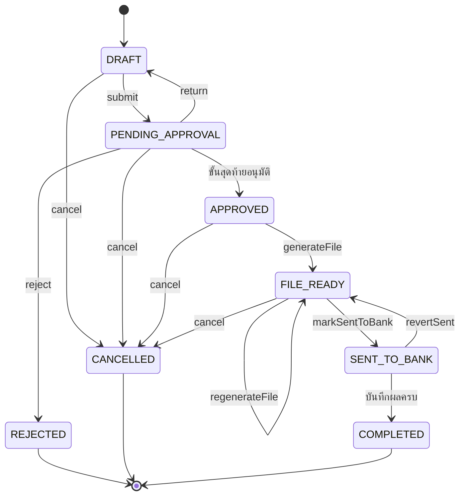

# S9 · รอบจ่ายเงินและไฟล์ธนาคาร — sub-spec

เอกสารนี้ขยาย §16.16 สำหรับการลงมือ · spec.md มีลำดับเหนือกว่าเสมอ ถ้าขัดกันให้ยึด spec แล้วแก้ไฟล์นี้

สถานะ: ร่าง P1-04 (2026-10-11) · ตรวจแล้วใน P1-05 · ผู้ใช้อนุมัติตามที่แนะนำทั้ง 88 เรื่องของ `docs/reports/p1-decisions.md` ใน P1-06 (2026-10-12) · เลข BR GC INV event error และความสามารถในไฟล์นี้เป็นร่าง จะเพิ่มลง spec ในข้อที่สร้างโค้ดนั้น

วิธีอ่าน: ไฟล์นี้ยาว ให้อ่านเฉพาะหัวข้อที่ข้อ checklist อ้าง (หาเลขบรรทัดด้วย `grep -n "^## " docs/sub-specs/S9.md`) · AC ของ FR ชั้น 2 อยู่ในหัวข้อ "FR และ AC" ของไฟล์นี้ เทสต์ใช้แท็ก `[FR-xxx-1nn/ACn]` ตามเลขในไฟล์นี้

เลข OQ และ ADR ในไฟล์นี้ออกต่อจาก S8 (OQ-130 ถึง OQ-137 · ADR-128 ถึง ADR-134) agent หลักเรียงเลขจริงในช่วง 121–139 · กฎของฐานร่วมอ้างด้วยเลขในร่าง `docs/sub-specs/P1.md` (BR-DOA-25 กฎ step-up ของ `BANK_ACCOUNT_CHANGE` ที่ฐานร่วมเป็นเจ้าของผู้เดียว · GC-DOA-48 ถึง GC-DOA-55) · ADR-BASE-n และ OQ-BASE-n เป็นตัวยึดของฐานร่วม

## ขอบเขต

| เรื่อง | อยู่ใน S9 |
| --- | --- |
| FR | FR-PAY-101 รอบจ่ายเงิน รวมยอดผู้ขาย อนุมัติตาม DOA (รวมเงินประกันผลงานที่คืนแล้วของ S8) · FR-PAY-102 ไฟล์ Batch Payment 1–2 ธนาคาร พร้อมตรวจก่อนส่งออก · FR-PAY-103 บันทึกผลการจ่ายและแจ้งผู้ขาย |
| งานที่ไม่มี FR แต่ S9 เป็นเจ้าของ | บัญชีรับเงินของผู้ขายและบัญชีผู้จ่ายขององค์กร (`BankAccount` `BankAccountChange`) เพราะระยะ 1 เปิด `PAY` โดยไม่มี `SUPPLIER` (§4.11 ย่อหน้าท้าย · BR-SOD-05) · FR-SUP-103 ของ S7 จะใช้ entity ชุดนี้ต่อผ่านพอร์ทัล |
| นอกขอบเขต | โอนเงินเองหรือเชื่อม API ธนาคาร (NG-2) · ลงบัญชีและส่งผลการจ่ายเข้า Express (NG-1 · OQ-10) · รูปแบบไฟล์ของธนาคารจริงและไฟล์ผลการโอน (รอ P0-03 · ข้อ `[go-live]`) · ใบลดหนี้ในรอบจ่าย (S8 ไม่รับใบลดหนี้ในระยะ 1 · ข้อ `[go-live]` S9-17 หลัง S8-18 · OQ-129) · หักภาษีตอนตั้งหนี้ (ระยะ 1 หักตอนจ่ายเท่านั้น · OQ-122 ของ S8) · ย้อนผลการจ่ายที่บันทึกแล้ว (ข้อ `[go-live]` S9-16 · OQ-136) · พอร์ทัลผู้ขาย (S7) · เครื่องมือให้ AI อ่านรอบจ่าย (S13 ไม่ทำในระยะ 1 · งานหลังระยะ 1) · การอนุมัติข้ามด้านความเสี่ยง (S11) · กฎภาษีหัก ณ ที่จ่าย 50 ทวิ และ ภ.ง.ด. (S8 · FR-AP-104) · การตัดงบ (เกิดตอนจับคู่ BR-MATCH-04 ใน S8) |
| ขึ้นกับ | **S8** (สาย 2 ทำก่อน): `Invoice` kind `INVOICE` สถานะพร้อมจ่าย · `Retention` สถานะ `RELEASABLE` · ฟังก์ชันถือและปล่อยของทั้งสองชนิด · `recordInvoicePayment` ตัวเดียวที่บันทึกจ่ายใบและเงินประกันของรายการ · `paymentWithholding()` · `SupplierNotice` `enqueueSupplierNotice` และงานส่ง · `Supplier.registryFlag` (S8-01 · ADR-132) · ตาราง `SensitiveAccessLog` และ helper บันทึก (S8-01 · ไม่ใช่โค้ดเดิม · §6.2) (หัวข้อ "interface") · **P1-07**: ชนิดเอกสาร DOA `PAYMENT_RUN` `BANK_ACCOUNT_CHANGE` ใน engine lint และ seed ของ SIMEC (ข้อ PAY-01 PAY-02 BA-01 ในชีต DOA ฉบับ 1) · ค่า `ApprovalSubjectType` และทะเบียน adapter พร้อมช่อง `decisionInput` `decide` (คืนผล) `allowsRequestInfo` `channels` `sodContext` (ADR-068) · BR-DOA-25 (`ALWAYS_STEP_UP_SUBJECTS` มี `BANK_ACCOUNT_CHANGE` และ `channels` ของ adapter นี้ปิดทั้งคู่ตั้งแต่ตัวว่าง) · `DECISION_STEP_UP_METHODS` · โมดูล `PAY` ของ SIMEC (ADR-070) · บล็อก `// --- S8 S9 ---` ใน `prisma/schema.prisma` · `numbering` ของ `org-settings.ts` หนึ่งคีย์ต่อบรรทัด · หัวข้อย่อยท้าย §7 ที่จองให้ S9 · **โค้ดเดิม**: `core/sla` (ปฏิทิน) `core/numbering` `core/sod` `core/pin` approvals storage email-provider `lib/encoding` |
| ของเดิมที่แตะ | เพิ่มค่า enum `FileLinkKind.BANK_PROOF` · เพิ่มคอลัมน์ `paymentRunItemId` ใน `WithholdingTax` และ `WhtCertificate` ของ S8 · เพิ่มกรณีใน `checkSod` · เติม adapter ของ subject ในไฟล์ของขั้น ไม่แก้ `decide.ts` `action-link.ts` `line-postback.ts` · แทรกบรรทัดเดียวต่อ subject ในหน้า `/liff/tasks/[id]` ของ S6 · ไม่เปลี่ยนผลการคำนวณของ `src/core` และ service เงินเดิม (§16.13) · ไม่สร้างหรือแก้ `Supplier.registryFlag` (ของ S8) · ข้อ `[go-live]` S9-16 เพิ่มสถานะยกเลิกของ `WithholdingTax` `WhtCertificate` และฟังก์ชันยกเลิกในโค้ดของ S8 พร้อมเทสต์ (สายเดียวกัน) |

## ชั้น demo และชั้นของจริงของ "เสร็จเมื่อ"

| เกณฑ์ต้นฉบับ (§16.8) | ชั้น demo รอบนี้ (`[demo]`) | ชั้นของจริง (`[go-live]`) และของที่ต้องได้ |
| --- | --- | --- |
| การเงินอัปโหลดไฟล์ทดสอบกับธนาคารได้ | `fin_tre1` สร้างและดาวน์โหลดไฟล์แม่แบบกลาง `BCS-NEUTRAL-1` ที่บอกชัดในแถว H ชื่อไฟล์ (`…_NOT-A-BANK-FORMAT_…`) และหน้าจอว่า "ไม่ใช่รูปแบบของธนาคาร ธนาคารจะไม่รับ" · golden byte-exact + sha256 ของแม่แบบกลาง (GC-BANK-12 ถึง GC-BANK-14) · ไม่มีการอัปโหลดจริง | S9-12: ตัวสร้างไฟล์ต่อธนาคาร 1–2 แห่ง golden byte-exact + sha256 เทียบไฟล์ตัวอย่างที่ผ่านระบบทดสอบของธนาคาร (BR-BANK-01) แล้วการเงินของลูกค้าอัปโหลดไฟล์ที่ระบบสร้างเข้าระบบทดสอบของธนาคารผ่าน · ต้องได้: สเปกไฟล์ ไฟล์ตัวอย่างที่ผ่าน และค่าที่ธนาคารให้ (เช่น รหัสบริษัท) จาก P0-03 |
| ยอดรวมตรงกับรอบจ่าย | trailer ของไฟล์ = Σ รายการ = `totalTransferSatang` ของรอบ (golden + property test INV-PAY-02 + อ่านไฟล์กลับหลังสร้าง) | ยอดในไฟล์ของธนาคารจริงและรายงานผลจากธนาคารตรงรอบจ่าย |
| (FR-PAY-103) บันทึกผล | บันทึกด้วยมือต่อรายการ · บันทึกแล้วแก้ไม่ได้ | S9-13: นำเข้าไฟล์ผลการโอนเมื่อได้รูปแบบ (OQ-135) · S9-16: ย้อนผลที่บันทึกผิด (OQ-136) |
| (§8.12) แจ้งผู้ขายทางอีเมล | อีเมลผ่าน `SupplierNotice` ของ S8 ไป Mailpit (ผู้ขายสังเคราะห์ `@supplier.simec.local`) | อีเมลจริงจากโดเมนที่ตั้งตาม OQ-22 |
| (§8.12) ธงสถานะทะเบียน | `Supplier.registryFlag` ที่ S8 seed จากชีต SupplierPayment (ADR-132) | S9-14: job `supplier-registry-recheck` ของ S4-16 ตั้งธงจากบริการจริง |
| บัญชีรับเงินของผู้ขาย | seed จากชีต SupplierPayment (ข้อมูลสังเคราะห์ขององค์กรตัวอย่าง) | S9-15: นำเข้าบัญชีจริงเป็นชุดผ่าน `BankAccountChange` ที่อนุมัติตาม DOA (OQ-133) · ห้ามใช้ seed กับข้อมูลจริง |

## Demo ของขั้น

ยอดด้านล่างคำนวณด้วยสคริปต์จากชีต Request_History ของไฟล์ระยะ 1 โดยสมมติว่า S8 ตั้งใบแจ้งหนี้ตามยอดคำขอ (กรณี MATCH และ SERVICE_2WAY) · ผู้ขายที่ไม่จด VAT ไม่มี VAT (BR-VAT-04) · งานจ้างเหมาหักเงินประกันผลงาน 5% ของยอดก่อน VAT (OQ-125 ของ S8) · หักภาษีตอนจ่ายตามค่าเริ่มต้นของ OQ-122 · P1-08 กำหนดฉากจริงและคำนวณยอดใหม่ถ้าข้อมูลเปลี่ยน

1. `fin_tre1` (แผนกการเงิน · FINANCE) เปิด "เตรียมรอบจ่าย" ระบบเสนอวันจ่ายเป็นศุกร์ถัดไป (OQ-130) บัญชีผู้จ่าย `CB-01` (ธนาคาร 004 · ••••••0016) และใบพร้อมจ่ายที่ครบกำหนดไม่เกินวันจ่าย (แถว OVERDUE และแถว DUE ที่ถึงกำหนดแล้ว · จำนวนขึ้นกับวันในสัปดาห์ของวันที่ seed · ใบที่ S8 ยังติด exception เช่น H162 QTY_OVER และ H167 PRICE_OVER ไม่อยู่ในรายการ)
2. `fin_tre1` เพิ่มใบ DUE ที่เหลือเอง (ครบกำหนดภายใน 14 วัน · ป้าย "จ่ายก่อนกำหนด") และเอางานจ้างเหมา 4 ใบ (H076 H085 H103 H146) ออกไปรอบที่ 2 → รอบที่ 1: 20 ผู้ขาย 21 ใบ ยอดที่ต้องจ่าย 1,983,870.10 ภาษีหัก 14,416.85 ยอดโอน 1,969,453.25 · `SP0171` มี 2 ใบ (H060 เลยกำหนด + H158 ถึงกำหนด) รวมเป็นรายการเดียว 37,152.54 · `SP0076` ค่าเช่า 5% หัก 5,359.25 · `SP0111` ผู้รับจ้างบุคคลธรรมดาที่ไม่จด VAT ยอด 49,920.00 หัก 3% เป็น 1,497.60
3. ผลตรวจทะเบียนของ `SP0031` เป็นเลิกกิจการหลังใบ H065 (52,430.00) พร้อมจ่ายแล้ว (P1-08 แก้ `p1_history.py` ให้ H065 มีใบแจ้งหนี้ และ seed ตั้ง `registryFlag` หลังใบพร้อมจ่าย เพราะ BR-VAT-06 ของ S8 ปฏิเสธใบที่มี VAT จากผู้ขายที่เลิกกิจการ) · `fin_tre1` เพิ่ม H065 เข้ารอบ ระบบติดธง "สถานะทะเบียนเปลี่ยน" และส่งไม่ได้จนใส่เหตุผล → รอบที่ 1: 21 ผู้ขาย 22 ใบ ยอดที่ต้องจ่าย 2,036,300.10 ภาษีหัก 14,416.85 ยอดโอน 2,021,883.25
4. `fin_tre1` ส่งขออนุมัติ → เลข `PAY-{BE}-nnnnn` · DOA ข้อ PAY-01 ของชีต DOA ฉบับ 1 (ไม่เกิน 5,000,000.00 · OQ-40) → `cfo` · การ์ด LINE ไม่มีปุ่มอนุมัติในแชท (ยอดถึงเกณฑ์ step-up และมีธง) จึงเปิด LIFF · `cfo` เห็นรายการที่มีธงก่อน ติ๊กรับทราบ ยืนยัน step-up แล้วอนุมัติ
5. `fin_tre1` สร้างไฟล์ → `BCS-NEUTRAL-1_NOT-A-BANK-FORMAT_PAY-…_v1.csv` แถว T มี 21 รายการ (หนึ่งรายการต่อผู้ขาย) ยอด 2,021,883.25 · หน้าจอมีป้าย "แม่แบบกลางสำหรับทดสอบ ไม่ใช่รูปแบบของธนาคาร" · ดาวน์โหลดแล้วกด "ส่งธนาคารแล้ว"
6. `fin_tre1` บันทึกผล "สำเร็จทั้งรอบ" ยกเว้น `SP0056` (ไม่สำเร็จ · บัญชีปิด) → ใบ H163 กลับพร้อมจ่าย · 20 ผู้ขายได้อีเมลแจ้งการชำระใน Mailpit ผ่าน `SupplierNotice` (ผู้ขายที่ถูกหักภาษีได้ 50 ทวิ แนบ เช่น `SP0111` ภ.ง.ด.3) · รอบเป็น COMPLETED
7. `fin_ap1` เสนอเปลี่ยนบัญชีของ `SP0056` พร้อมหนังสือจากผู้ขายและบันทึกการโทรยืนยัน → `cfo` อนุมัติด้วย step-up บนเว็บ (ไม่มีปุ่มในแชท · BR-DOA-25) → `SP0056` ได้อีเมลแจ้งเปลี่ยนบัญชีที่อีเมลในทะเบียน · รอบถัดไปรายการของ `SP0056` มีธง "เคยอยู่ในไฟล์ที่ดาวน์โหลดแล้ว" และ "บัญชีเพิ่งเปลี่ยน" (GC-PAY-32) และ `fin_ap1` เตรียมรอบที่มี `SP0056` ไม่ได้ภายใน 30 วัน (BR-SOD-10)
8. รอบที่ 2 งานจ้างเหมา 4 ราย (2 รายไม่จด VAT · หักเงินประกันผลงาน 5%) ยอดที่ต้องจ่าย 10,041,073.06 ภาษีหัก 293,699.86 ยอดโอน 9,747,373.20 → DOA ข้อ PAY-02 → `ceo` · ถ้า `cfo` (มีบทบาท FINANCE) เตรียมรอบที่ 1 เอง ระบบยกไป `ceo` พร้อมคำอธิบาย (BR-DOA-06)
9. `auditor` เปิดรอบจ่ายเห็นเลขบัญชีแบบ mask (BR-AUTH-04)

## Entity และ migration

กติการ่วม: ทุกตารางมี `organizationId` (INV-TEN-02) · `@@unique([organizationId, id])` และ FK คู่ `(organizationId, <ref>Id)` (ADR-039) · เงินเป็น `BigInt` ลงท้าย `Satang` CHECK ≥ 0 · อัตราเป็น `Int` ลงท้าย `Bp` · วันที่ล้วนใช้ `@db.Date` · unique ทางธุรกิจรวม `organizationId` · ทุกการเปลี่ยนสถานะผ่าน `runCommand()` และมี Event · บรรทัด relation ที่เพิ่มในโมเดลเดิม (`Organization` `Member` `Supplier` `ApprovalRoute` `FileObject`) วางใต้บล็อก `// --- S8 S9 ---` ที่ P1-07 จองไว้

**`BankAccount`** (บัญชีรับเงินของผู้ขาย และบัญชีผู้จ่ายขององค์กร · ADR-128)

| ฟิลด์ | ชนิด | กฎ |
| --- | --- | --- |
| ownerKind | enum `BankAccountOwner` (`SUPPLIER` `ORGANIZATION`) | CHECK `(ownerKind = 'SUPPLIER') = (supplierId IS NOT NULL)` |
| supplierId | uuid? | FK `(organizationId, supplierId)` → Supplier |
| code | text? | บัญชีองค์กร เช่น `CB-01` · unique `(organizationId, code)` |
| bankCode | text | อยู่ในรายการรหัสธนาคาร (ADR-131) |
| accountNo | text | ตัวเลขล้วน CHECK `"accountNo" ~ '^[0-9]{10,12}$'` (BR-SUP-07) |
| accountName | text | 1–200 ตัวอักษร ไม่มีอักขระควบคุม |
| branchName | text? | |
| accountType | enum `BankAccountType`? (`CURRENT` `SAVINGS`) | บังคับเมื่อ ORGANIZATION |
| status | enum `BankAccountStatus` (`ACTIVE` `SUPERSEDED` `CLOSED`) | partial unique `(organizationId, supplierId) WHERE status = 'ACTIVE' AND "ownerKind" = 'SUPPLIER'` (INV-PAY-04) |
| fileTemplateCode | text? | เฉพาะ ORGANIZATION · ค่าเริ่มต้น `BCS-NEUTRAL-1` (ADR-129) |
| fileParams | jsonb? | ค่าที่ธนาคารให้ ตรวจด้วย Zod ของแม่แบบ · แม่แบบกลางไม่มี |
| sourceChangeId | uuid? | FK → BankAccountChange ที่ทำให้มีผล · null = seed ขององค์กรตัวอย่าง (ข้อมูลจริงเข้าทาง S9-15) |
| activatedAt · supersededAt · closedAt | timestamptz | |
| version | int | optimistic lock |

index `(organizationId, bankCode, accountNo)` ใช้หาบัญชีที่ผู้ขายหลายรายใช้ร่วม (ธง SHARED_BANK_ACCOUNT)

**`BankAccountChange`**

| ฟิลด์ | ชนิด | กฎ |
| --- | --- | --- |
| number | text? | `BAC-{BE}-{SEQ5}` ออกตอนส่ง (OQ-12 · BR-NUM-01) · unique `(organizationId, number)` |
| kind | enum (`ADD` `REPLACE` `CLOSE`) | REPLACE CLOSE ต้องมี `targetBankAccountId` ที่ ACTIVE · partial unique `(organizationId, targetBankAccountId) WHERE status IN (DRAFT, PENDING_APPROVAL)` (บัญชีผู้จ่ายขององค์กรไม่มี supplierId จึงกันคำขอซ้อนด้วยบัญชีเป้าหมาย) · `IMPORT` เพิ่มใน S9-15 |
| ownerKind · supplierId · targetBankAccountId | เหมือน BankAccount | partial unique `(organizationId, supplierId) WHERE status IN ('DRAFT','PENDING_APPROVAL')` (คำขอค้างได้ทีละใบต่อผู้ขาย) |
| bankCode · accountNo · accountName · branchName · accountType · fileTemplateCode · fileParams | ค่าที่เสนอ | บังคับเมื่อ ADD REPLACE · ผ่าน BR-SUP-07 |
| reason | text | บังคับ |
| callVerifiedAt · callVerificationNote | timestamptz? · text? | บังคับเมื่อ REPLACE ของผู้ขาย (OQ-133) · note ห้ามมีเลขบัญชี |
| source | enum (`INTERNAL` `PORTAL`) | ระยะ 1 = INTERNAL · S7 ใช้ PORTAL |
| status | enum (`DRAFT` `PENDING_APPROVAL` `APPROVED` `REJECTED` `CANCELLED`) | |
| submittedById | uuid | FK Member |
| submittedAt · decidedAt | timestamptz? | |
| currentRouteId | uuid? | FK ApprovalRoute |
| appliedBankAccountId | uuid? | บัญชีที่สร้างตอนอนุมัติ |
| version | int | |

หลักฐานแนบเป็น `FileLink` kind ใหม่ `BANK_PROOF` (หนังสือจากผู้ขาย หน้าสมุดบัญชี)

**`PaymentRun`**

| ฟิลด์ | ชนิด | กฎ |
| --- | --- | --- |
| number | text? | `PAY-{BE}-{SEQ5}` ออกตอนส่งครั้งแรก · unique `(organizationId, number)` |
| status | enum `PaymentRunStatus` (`DRAFT` `PENDING_APPROVAL` `APPROVED` `FILE_READY` `SENT_TO_BANK` `COMPLETED` `REJECTED` `CANCELLED`) | |
| payDate | date | BR-PAY-02 |
| payerBankAccountId | uuid | FK BankAccount ที่ ownerKind = ORGANIZATION |
| fileTemplateCode | text | snapshot จากบัญชีผู้จ่ายตอนส่ง |
| currency | text | ค่าเริ่มต้น `THB` · CHECK `currency = 'THB'` (NG-9) |
| preparedById | uuid | FK Member · ผู้แก้ร่างได้คนเดียว (BR-PAY-09) |
| totalPayableSatang · totalWhtSatang · totalTransferSatang | bigint | CHECK ≥ 0 · CHECK `"totalTransferSatang" = "totalPayableSatang" - "totalWhtSatang"` |
| itemCount · documentCount | int | |
| flagsKey | text? | ข้อความธงตอนส่ง (BR-PAY-07) · `''` = ไม่มีธง |
| currentRouteId | uuid? | FK ApprovalRoute |
| submittedAt · approvedAt · sentToBankAt · completedAt · cancelledAt | timestamptz? | |
| cancelReason | text? | |
| version | int | |

**`PaymentRunItem`** (หนึ่งรายการต่อผู้ขายต่อรอบ)

| ฟิลด์ | ชนิด | กฎ |
| --- | --- | --- |
| paymentRunId · supplierId | uuid | unique `(organizationId, paymentRunId, supplierId)` |
| seq | int? | ออกตอนส่ง เรียงตามรหัสผู้ขาย · unique `(organizationId, paymentRunId, seq)` |
| bankAccountId · payeeBankCode · payeeAccountNo · payeeAccountName | snapshot ตอนส่ง | ADR-133 |
| payableSatang · whtSatang · transferSatang | bigint | CHECK ≥ 0 · CHECK `"transferSatang" = "payableSatang" - "whtSatang"` · service บังคับ transfer > 0 ตอนส่ง |
| flags | enum `PaymentFlag[]` | BR-PAY-06 |
| flagReason | text? | บังคับเมื่อมีธงที่ต้องมีเหตุผล |
| status | enum (`INCLUDED` `PAID` `FAILED`) | |
| paidOn · bankReference · failureReason | date? · text? · text? | BR-PAY-12 |
| resultRecordedById · resultRecordedAt | uuid? · timestamptz? | |

สถานะอีเมลแจ้งการชำระอ่านจาก `SupplierNotice` ของ S8 (`PENDING` `SENT` `FAILED` `NO_EMAIL` · BR-PAY-13) ไม่เก็บซ้ำในรายการ

**`PaymentRunItemWht`** (บรรทัดภาษีหักต่อรายการ จากใบและเงินประกันในรายการ): paymentRunItemId · incomeType · rateBp · baseSatang · whtSatang (CHECK ≥ 0) · unique `(organizationId, paymentRunItemId, incomeType, rateBp)`

**`PaymentRunDocument`** (ลิงก์เอกสารกับรายการ): paymentRunId · paymentRunItemId · docKind (`INVOICE` `RETENTION` · `CREDIT_NOTE` เพิ่มใน S9-17) · invoiceId? (FK → `Invoice` ของ S8) · retentionId? (FK → `Retention` ของ S8) · CHECK `("docKind" = 'RETENTION') = ("retentionId" IS NOT NULL)` และ `("docKind" = 'RETENTION') = ("invoiceId" IS NULL)` · payableSatang (snapshot) · status (`HELD` `PAID` `RELEASED`) · releaseReason · releasedAfterExport (boolean ค่าเริ่มต้น false · BR-PAY-06) · partial unique `(organizationId, invoiceId) WHERE status IN ('HELD','PAID') AND "invoiceId" IS NOT NULL` และ `(organizationId, retentionId) WHERE status IN ('HELD','PAID') AND "retentionId" IS NOT NULL` (INV-PAY-01)

**`PaymentFile`**: paymentRunId · version (unique `(organizationId, paymentRunId, version)`) · templateCode · fileId (FK FileObject · bucket private) · fileName · sha256 · byteSize · itemCount · totalSatang (CHECK ≥ 0) · reason (CHECK `version = 1 OR reason IS NOT NULL`) · status (`CURRENT` `SUPERSEDED` · partial unique ต่อรอบ WHERE CURRENT) · generatedById · generatedAt · firstDownloadedAt (timestamptz?) · trigger ตาม §6.3: ห้าม DELETE · UPDATE ได้เฉพาะ `status` จาก CURRENT เป็น SUPERSEDED และ `firstDownloadedAt` จาก null เป็นค่า (BR-BANK-03 BR-BANK-08)

**ของเดิมที่เพิ่ม**: `WithholdingTax.paymentRunItemId` uuid? FK `(organizationId, paymentRunItemId)` → PaymentRunItem · `WhtCertificate.paymentRunItemId` uuid? FK เดียวกัน + unique `(organizationId, paymentRunItemId)` (50 ทวิ หนึ่งฉบับต่อรายการจ่าย · BR-WHT-07 ของ S8 · `recordInvoicePayment` เขียนทุกแถว) · `FileLinkKind.BANK_PROOF` · `DocumentSequence` ประเภท `PAY` `BAC` (คีย์ใน `numbering` ของ `org-settings.ts` เป็นบรรทัดต่อท้ายตามที่ P1-07 แยกไว้) · `OrgSettingsSchema.payment` = `{ runWeekdays: Weekday[] (FRI), holidayShift: 'PREVIOUS' | 'NEXT' (PREVIOUS), recentBankChangeDays: 0–365 (30), adviceEmail: boolean (true) }` · ค่า `ApprovalSubjectType` `PAYMENT_RUN` `BANK_ACCOUNT_CHANGE` มาจาก P1-07 (ADR-068) · `Supplier.registryFlag` มาจาก S8-01 (ADR-132) · ไม่มีตาราง `BankFileTemplate` (ADR-129) และไม่มีตารางธนาคารแบบ global (ADR-131)

## State machine

**PaymentRun**



| จาก | คำสั่ง | ไป | ใครทำได้ | เงื่อนไขและผลข้างเคียง | event |
| --- | --- | --- | --- | --- | --- |
| — | `paymentRun.create` | DRAFT | FINANCE (`paymentRun.prepare`) | บัญชีผู้จ่าย ACTIVE มีแม่แบบ · วันจ่ายผ่าน BR-PAY-02 | `payment_run.drafted` |
| DRAFT | `paymentRun.addDocuments` · `paymentRun.removeDocuments` · `paymentRun.update` (วันจ่าย บัญชีผู้จ่าย) · `paymentRun.setFlagReason` | DRAFT | ผู้เตรียม | BR-PAY-03 · ถือหรือปล่อยเอกสารผ่าน S8 ในธุรกรรมเดียวกัน · BR-SOD-10 ตอนเพิ่ม | `payment_run.documents_added` · `payment_run.documents_removed` · `payment_run.updated` · `payment_run_item.flag_reason_set` |
| DRAFT | `paymentRun.submit` | PENDING_APPROVAL | ผู้เตรียม | ≥ 1 รายการ · ทุกยอดโอน > 0 · ทุกผู้ขายมีบัญชี ACTIVE · ธงที่บังคับมีเหตุผล · วันจ่ายผ่าน · BR-SOD-10 · หาผู้อนุมัติได้ → ออกเลข (ครั้งแรก) · seq · snapshot บัญชี · `flagsKey` · route | `payment_run.submitted` (ครั้งแรก) หรือ `payment_run.resubmitted` · `approval_task.assigned` |
| PENDING_APPROVAL | `approval.approve` ขั้นสุดท้าย | APPROVED | ผู้อนุมัติตาม DOA `PAYMENT_RUN` | `flagsKey` ตรง (BR-PAY-07) · SoD (BR-SOD-04 BR-SOD-09 BR-SOD-10) · step-up ตาม BR-TOK-05 · วันจ่ายยังไม่ผ่าน · ไม่ผ่าน → ล้มทั้งธุรกรรม งานยังเปิด | `approval_task.decided` · `payment_run.approved` |
| PENDING_APPROVAL | `approval.reject` | REJECTED | ผู้อนุมัติ | เหตุผล · ปล่อยทุกเอกสาร (S8 กลับพร้อมจ่าย) | `payment_run.rejected` |
| PENDING_APPROVAL | `approval.return` | DRAFT | ผู้อนุมัติ | เหตุผล · route CANCELLED · คงการถือเอกสาร | `payment_run.returned` |
| DRAFT · PENDING_APPROVAL | `paymentRun.cancel` | CANCELLED | ผู้เตรียม | ยกเลิกงานค้าง · ปล่อยทุกเอกสาร | `payment_run.cancelled` |
| APPROVED · FILE_READY | `paymentRun.cancel` | CANCELLED | FINANCE | เหตุผล · มีไฟล์ที่ดาวน์โหลดแล้วต้องยืนยันว่ายังไม่ได้ส่งธนาคาร (BR-PAY-10) · ปล่อยทุกเอกสาร · ไฟล์ทุกเวอร์ชัน SUPERSEDED · แจ้งผู้อนุมัติ | `payment_run.cancelled` |
| APPROVED | `paymentRun.generateFile` | FILE_READY | FINANCE (`paymentRun.file`) | ตรวจก่อนส่งออกผ่าน (BR-BANK-06) → PaymentFile v1 | `payment_run.file_generated` |
| FILE_READY | `paymentRun.regenerateFile` | FILE_READY | FINANCE | เหตุผล · ไฟล์เดิมดาวน์โหลดแล้วต้องยืนยันว่ายังไม่ได้ส่ง (BR-BANK-07) · ตรวจผ่าน → v n+1 · เดิม SUPERSEDED | `payment_run.file_generated` |
| FILE_READY · SENT_TO_BANK · COMPLETED | `paymentRun.requestFileDownload` (POST) | ไม่เปลี่ยน | FINANCE (`paymentRun.file`) | คืน presigned ≤ 5 นาที · ครั้งแรกของเวอร์ชันตั้ง `firstDownloadedAt` (BR-BANK-08) | `file.downloaded` |
| FILE_READY | `paymentRun.markSentToBank` | SENT_TO_BANK | FINANCE | — | `payment_run.sent_to_bank` |
| SENT_TO_BANK | `paymentRun.revertSent` | FILE_READY | FINANCE | เหตุผล · ยังไม่มีผลรายการใด | `payment_run.sent_reverted` |
| SENT_TO_BANK | `paymentRun.recordResults` | SENT_TO_BANK หรือ COMPLETED | FINANCE (`paymentRun.recordResult`) | รายการที่ยังไม่มีผล · ครบทุกรายการ → COMPLETED | `payment_run_item.paid` · `payment_run_item.failed` · `payment_run.completed` |

**PaymentRunItem**: `INCLUDED → PAID | FAILED` (เฉพาะ SENT_TO_BANK · บันทึกแล้วแก้ไม่ได้ในระยะ 1 · OQ-136) · **PaymentRunDocument**: `HELD → PAID | RELEASED` · **PaymentFile**: `CURRENT → SUPERSEDED`

**BankAccountChange**

| จาก | คำสั่ง | ไป | ใครทำได้ | เงื่อนไขและผลข้างเคียง | event |
| --- | --- | --- | --- | --- | --- |
| — | `bankAccountChange.create` | DRAFT | FINANCE (`bankAccountChange.propose` · OQ-133 OQ-137) | BR-SUP-06 BR-SUP-07 · เตือนเมื่อบัญชีซ้ำกับผู้ขายเลขผู้เสียภาษีอื่น | `bank_account_change.drafted` |
| DRAFT | `bankAccountChange.update` | DRAFT | ผู้เสนอ | — | `bank_account_change.updated` |
| DRAFT | `bankAccountChange.submit` | PENDING_APPROVAL | ผู้เสนอ | หลักฐาน ≥ 1 ไฟล์ (ADD REPLACE) · บันทึกโทรยืนยัน (REPLACE ของผู้ขาย) · หาผู้อนุมัติได้ → ออกเลข · route | `bank_account_change.submitted` · `approval_task.assigned` |
| PENDING_APPROVAL | `approval.approve` ขั้นสุดท้าย | APPROVED | ผู้อนุมัติตาม DOA `BANK_ACCOUNT_CHANGE` | SoD BR-SOD-05 · step-up ทุกครั้งบนเว็บหรือ LIFF (BR-DOA-25 ของฐานร่วม) · ตรวจซ้ำว่าบัญชีเป้าหมายยัง ACTIVE (ไม่ใช่ → `VALIDATION_FAILED` reason `TARGET_NOT_ACTIVE`) · หน้าอนุมัติเตือนเมื่ออีเมลหรือเบอร์ในทะเบียนของผู้ขายเปลี่ยนภายใน `recentBankChangeDays` วันก่อนส่ง (การแจ้งผู้ขายและการโทรยืนยันใช้ค่าในทะเบียน) → บัญชีใหม่ ACTIVE เดิม SUPERSEDED หรือ CLOSED · `enqueueSupplierNotice` ถึงผู้ขาย (BR-SUP-06) | `bank_account_change.approved` · `bank_account.activated` · `bank_account.superseded` · `bank_account.closed` |
| PENDING_APPROVAL | `approval.reject` · `approval.return` | REJECTED · DRAFT | ผู้อนุมัติ | เหตุผล | `bank_account_change.rejected` · `bank_account_change.returned` |
| DRAFT · PENDING_APPROVAL | `bankAccountChange.cancel` | CANCELLED | ผู้เสนอ | ยกเลิกงานค้าง | `bank_account_change.cancelled` |

**สิ่งที่ S9-05 ลงมือ (2026-10-16 · `src/server/services/payments/runs.ts`):** `proposePaymentRun` (วันจ่ายที่เสนอ บัญชีผู้จ่าย และเอกสารที่เสนอตาม BR-PAY-03) · คำสั่ง `paymentRun.create` `update` `addDocuments` `removeDocuments` `setFlagReason` `submit` `cancel` ของผู้เตรียม · เอกสารที่เอาออกจากร่างลบลิงก์ทิ้ง (ร่างไม่เคยมีไฟล์ ประวัติอยู่ใน event `payment_run.documents_removed` และ `invoice.payment_released`) และรายการที่ไม่เหลือเอกสารออกจากรอบ ลิงก์ RELEASED จึงเกิดเฉพาะเมื่อยกเลิก ไม่อนุมัติ หรือจ่ายไม่สำเร็จ · ยอด ธง และ `PaymentRunItemWht` คำนวณใหม่ทุกครั้งที่เพิ่ม เอาออก แก้วันจ่าย และส่ง · ผู้ขายที่ยังไม่มีบัญชี ACTIVE เพิ่มเอกสารได้แต่ส่งไม่ได้ (`BANK_ACCOUNT_NOT_APPROVED`) · บัญชีผู้จ่ายที่ไม่ ACTIVE → `VALIDATION_FAILED` reason `PAYER_NOT_ACTIVE` · การยกเลิกหลังอนุมัติ (FINANCE · `paymentRun.cancel` · ยืนยันเรื่องไฟล์) ทำใน S9-07 · เหตุผลที่ยกเลิกเก็บใน `PaymentRun.cancelReason` ไม่ลง event · ปิด `PAY` ขณะมีรอบหรือคำขอเปลี่ยนบัญชีค้าง → `MODULE_IN_USE` (เลขหรือ id)

**สิ่งที่ S9-04 ลงมือ (2026-10-15 · `src/server/services/bank-accounts`):** คำสั่ง `bankAccountChange.create` `update` `attachProof` `detachProof` `submit` `cancel` ของผู้เสนอ (FINANCE · แก้ ส่ง ยกเลิกได้เฉพาะผู้เสนอ) · reason ของ `VALIDATION_FAILED` นอก BR-SUP-07: `CHANGE_OPEN` (ผู้ขายหรือบัญชีมีคำขอค้าง) `ACCOUNT_EXISTS` (เพิ่มบัญชีให้ผู้ขายที่มีบัญชี ACTIVE ให้ใช้ REPLACE) `TARGET_NOT_FOUND` `TARGET_NOT_ACTIVE` `CLOSE_HAS_ACCOUNT` `PROOF_REQUIRED` `CALL_VERIFICATION_REQUIRED` `NOTE_HAS_ACCOUNT_NO` (ข้อความอิสระ — เหตุผลที่เสนอ บันทึกการโทร เหตุผลที่ยกเลิก — มีเลขบัญชีที่เสนอหรือเลขที่ถูกแทน อ่านเลขไทยและตัวคั่นทุกแบบ · เบอร์โทรได้) `REQUIRED` `OWNER` (ประเภทบัญชีของบัญชีผู้ขาย) · เหตุผลที่ยกเลิกเก็บเป็น Comment ไม่ลง event · แก้ธนาคาร เลข หรือชื่อบัญชีหลังบันทึกการโทรแล้ว การโทรถูกล้างและต้องบันทึกใหม่ · หลักฐานเป็น PDF หรือรูปที่ผู้เสนออัปโหลดเอง ไม่เกิน 10 ไฟล์ · บัญชีขององค์กรที่มาจากคำขอไม่มีรหัส (CB-nn เป็นของ seed) · ผู้อนุมัติของคำขอ (ผู้ถืองานหรือผู้ตัดสินแล้ว ไม่นับงานที่ถูกยกเลิกหรือโอนไป) ดูคำขอได้และเปิดเลขของคำขอได้ตาม `bankAccount.reveal` (ASSIGNED) · เลขเต็มของบัญชีที่มีอยู่เปิดได้โดย FINANCE และผู้ถืองานที่ยังเปิดของคำขอที่รออนุมัติบนบัญชีนั้น · หลักฐานแสดงเลขเต็มจึงดาวน์โหลดได้ตามกฎเดียวกันและบันทึก `SensitiveAccessLog` ทุกครั้ง · แม่แบบข้อความของ S9 อยู่ในไฟล์ของสาย 2 ตาม ADR-135

ตารางทั้งสี่อยู่ใน `src/core/state-machines` และเทสต์วนทุกคู่ (สถานะ, คำสั่ง) ว่าคู่ที่ไม่มีได้ `INVALID_STATE_TRANSITION` (§6.4) · งานอนุมัติของรอบจ่ายและการเปลี่ยนบัญชีไม่รับ `approval.requestInfo` (adapter `allowsRequestInfo = false` · ใช้ตีกลับแทน)

**adapter ของ subject (ADR-068 · ไฟล์ของขั้น)**: `src/server/services/approvals/subjects/payment-run.ts` และ `bank-account-change.ts` เติมช่องที่ P1-07 สร้าง · ห้ามแก้ `decide.ts` `action-link.ts` `line-postback.ts`

| ช่อง | `PAYMENT_RUN` | `BANK_ACCOUNT_CHANGE` |
| --- | --- | --- |
| `facts` | เลข วันจ่าย ยอดโอนรวม จำนวนผู้ขาย จำนวนธง `flagsKey` | เลข รหัสผู้ขาย ชนิดการเปลี่ยน (ไม่มีชื่อบัญชีหรือเลขบัญชี) |
| `decisionInput` | Zod `{ flagsKey: string }` ไม่บังคับ (ส่งผ่าน `subjectInput`) · หน้าเว็บและ LIFF ส่งเสมอ · ปุ่มในแชท (`line-postback.ts` ไม่ส่ง `subjectInput` และสายห้ามแก้) ไม่ส่ง จึงนับเป็น `''` แล้วเทียบตาม BR-PAY-07 · มีธง ณ ตอนตัดสิน → `PAYMENT_FLAGS_CHANGED` | ไม่มี |
| `decide` | อนุมัติ: ตรวจ `flagsKey` และวันจ่าย → คืน error ให้ล้มทั้งธุรกรรมโดยงานยังเปิด · ไม่อนุมัติ: ปล่อยเอกสาร · ตีกลับ: คงการถือ | อนุมัติ: บัญชีใหม่มีผลและเรียก `enqueueSupplierNotice` · ไม่อนุมัติหรือตีกลับ: ไม่มีผลกับบัญชี |
| `sodContext(facts)` (คืน `{ requesterMemberIds, extra }` ตามฐานร่วม) | requesterMemberIds = [ผู้เตรียม] · extra = ผู้บันทึกใบแจ้งหนี้ทุกใบ (เงินประกันนับผู้บันทึกใบต้นทาง) และผู้เสนอการเปลี่ยนบัญชีในช่วง BR-SOD-10 | requesterMemberIds = [ผู้เสนอ] |
| `allowsRequestInfo` | false | false |
| `channels` | `chatButton(facts)` = ไม่มีธง (เกณฑ์ยอดตาม BR-TOK-05 ระบบกลางตรวจเอง) · `emailLink` = false | `chatButton` = false · `emailLink` = false (ค่าของตัวว่างตาม BR-DOA-25 · ห้ามเปิด) |

## กฎ

| ID | กฎ |
| --- | --- |
| BR-PAY-01 | ทุกคำสั่งของขั้นเรียก `requireModule(ctx, 'PAY')` · รอบหนึ่งใช้บัญชีผู้จ่ายขององค์กรหนึ่งบัญชีที่ ACTIVE และแม่แบบไฟล์ของบัญชีนั้น · องค์กรมีบัญชีผู้จ่ายได้หลายบัญชี (ไฟล์ 1–2 ธนาคาร) · สกุลเงิน THB เท่านั้น (`PaymentRun.currency` · NG-9) |
| BR-PAY-02 | วันจ่ายต้องเป็นวันทำการตามปฏิทินขององค์กร (BR-SLA-01 · ตาราง Holiday) และไม่ก่อนวันนี้ตามเวลาไทย ตรวจตอนสร้าง แก้ ส่ง และอนุมัติ ไม่ผ่าน → `PAYMENT_DATE_INVALID` (reason `NOT_BUSINESS_DAY` หรือ `PAST`) · ระบบเสนอวันจ่ายถัดไปจาก `payment.runWeekdays`: วันแรกตั้งแต่วันนี้ที่ตรงวันในรายการ ถ้าเป็นวันหยุดเลื่อนตาม `holidayShift` (PREVIOUS = วันทำการก่อนหน้า) และถ้าเลื่อนแล้วก่อนวันนี้ ให้ใช้รอบถัดไป · เป็นข้อเสนอ ผู้เตรียมเลือกวันทำการอื่นได้ (OQ-130) |
| BR-PAY-03 | เอกสารที่เข้ารอบได้ (ระยะ 1): `Invoice` ของ S8 kind `INVOICE` สถานะ `READY_FOR_PAYMENT` และ `Retention` ของ S8 สถานะ `RELEASABLE` (เงินประกันผลงานที่คืนแล้ว · OQ-125) · ใบลดหนี้เข้ารอบได้เมื่อทำ S9-17 · ระบบเสนอใบที่ `dueDate ≤ payDate` และเงินประกันที่ RELEASABLE ทุกรายการ · เพิ่มใบที่ยังไม่ถึงกำหนดได้และติดป้าย "จ่ายก่อนกำหนด" · เพิ่มแล้วเอกสารถูกถือ (ลิงก์ `HELD` · S8 เปลี่ยนเป็น `IN_PAYMENT_RUN` ผ่าน `holdInvoicesForPayment` หรือ `holdRetentionsForPayment`) ในธุรกรรมเดียวกัน ล็อกแถวเรียงตาม id (INV-PLT-03) · เอกสารที่ไม่พร้อมจ่ายหรือถูกถือโดยรอบอื่น → `DOCUMENT_NOT_PAYABLE` (INV-PAY-01) |
| BR-PAY-04 | ยอดต่อรายการ (หนึ่งรายการต่อผู้ขาย): `payable` = Σ `payableSatang` ของใบ (รวม VAT หลังหักเงินประกัน ก่อนหักภาษี ตามที่ S8 คำนวณ) + Σ `amountSatang` ของเงินประกันที่คืน · S9 ไม่คำนวณ VAT และเกณฑ์ขั้นต่ำใหม่ · `wht` = `paymentWithholding()` ของ S8 กับบรรทัดฐานภาษีของทุกเอกสารในรายการ (ใบ: `whtBases()` · เงินประกัน: `retentionWhtBases()` ของ S8 คือฐาน = ยอดเงินประกัน ประเภทและอัตราเดียวกับใบต้นทาง ตาม BR-WHT-05 ของ S8) ซึ่งรวมต่อ (ประเภทเงินได้, อัตรา) แล้วปัด half-up ครั้งเดียวต่อกลุ่ม (BR-MONEY-02 (3) · BR-WHT-10 ของ S8) · ลำดับกลุ่มตามผลของ `paymentWithholding()` · ระยะ 1 หักตอนจ่ายเท่านั้น (`wht.timing` = `AT_PAYMENT` · OQ-122) · `transfer` = `payable` − `wht` ต้อง > 0 ไม่เช่นนั้น `PAYMENT_ITEM_NOT_POSITIVE` · คำนวณใหม่และตรวจทุกครั้งที่เพิ่มหรือเอาเอกสารออก และตอนส่ง |
| BR-PAY-05 | ยอดของรอบ = Σ ของรายการ (payable wht transfer) บันทึกพร้อมรายการในธุรกรรมเดียว · ตอนส่ง ออก `seq` เรียงตามรหัสผู้ขาย และ snapshot บัญชีผู้รับจากบัญชี ACTIVE ของผู้ขาย ณ เวลาส่ง · ผู้ขายที่ไม่มีบัญชี ACTIVE → `BANK_ACCOUNT_NOT_APPROVED` |
| BR-PAY-06 | ธงของรายการ คำนวณตอนเพิ่มเอกสาร ตอนส่ง และตอนอนุมัติ เรียงตามลำดับนี้: `REGISTRY_CHANGED` (`Supplier.registryFlag` ≠ NONE · BR-SUP-04) · `SUPPLIER_INACTIVE` · `RISK_OVERRIDE_EXPIRED` (การอนุมัติข้ามของ S11 ที่ `expiresOn` < payDate · ระยะ 1 ไม่มีแหล่งข้อมูล จึงไม่เกิด) · `PREVIOUSLY_EXPORTED` (เอกสารในรายการเคยถูกปล่อยจากรอบที่มีไฟล์ดาวน์โหลดแล้ว คือ `releasedAfterExport` = true จากการยกเลิกหลังดาวน์โหลดหรือบันทึกไม่สำเร็จ · OQ-136) · `BANK_ACCOUNT_RECENTLY_CHANGED` (วันมีผลของบัญชีตามเวลาไทย ≥ payDate − `recentBankChangeDays` วัน · บัญชีจาก seed ไม่นับ) · `BANK_CHANGE_PENDING` (มีคำขอเปลี่ยนค้าง) · `SHARED_BANK_ACCOUNT` (บัญชีเดียวกันเป็นบัญชี ACTIVE ของผู้ขายที่เลขผู้เสียภาษีต่างกัน · สาขาของเลขเดียวกันไม่นับ) · สี่ธงแรกต้องมี `flagReason` จากผู้เตรียมก่อนส่ง → `PAYMENT_FLAG_REASON_REQUIRED` · ธงไม่บล็อกการจ่าย (OQ-132) |
| BR-PAY-07 | ผู้อนุมัติเห็นธงก่อนอนุมัติ: หน้าอนุมัติบนเว็บและ LIFF แสดงรายการที่มีธงก่อนรายการอื่นพร้อมเหตุผลและประวัติ · `flagsKey` (pure ใน `src/core/payment`) = ข้อความ `<รหัสผู้ขาย>:<ธง>+<ธง>` ของรายการที่มีธง ธงเรียงตาม BR-PAY-06 รายการเรียงตามรหัสผู้ขาย คั่นด้วย `;` · ไม่มีธง = ข้อความว่าง · ไม่ hash (core ห้าม `node:*` · §4.10) · เก็บใน `PaymentRun.flagsKey` ตอนส่ง · คำสั่งอนุมัติบนเว็บและ LIFF ต้องส่ง `flagsKey` ที่หน้าจอแสดงผ่าน `subjectInput` ของ adapter · ไม่ส่ง (ปุ่มในแชท) = `''` · ถ้าไม่ตรงกับที่คำนวณ ณ ตอนตัดสิน → `PAYMENT_FLAGS_CHANGED` ล้มทั้งธุรกรรมและงานยังเปิด (ปุ่มในแชทจึงอนุมัติได้เฉพาะรอบที่ไม่มีธง ณ ตอนกด แม้การ์ดส่งไปก่อนธงเกิด) · ธงในสี่ธงแรกที่เกิดหลังส่งและยังไม่มี `flagReason` → อนุมัติไม่ได้ (`PAYMENT_FLAG_REASON_REQUIRED` · งานยังเปิด) ผู้อนุมัติต้องตีกลับให้ผู้เตรียมใส่เหตุผล ผู้อนุมัติใส่เหตุผลแทนไม่ได้ · ตีกลับและไม่อนุมัติไม่ต้องส่ง · การ์ด LINE ของรอบที่มีธงไม่มีปุ่มอนุมัติในแชท เปิด LIFF แทน (`channels.chatButton`) |
| BR-PAY-08 | เส้นทาง DOA ชนิด `PAYMENT_RUN`: ยอด = `totalTransferSatang` ส่งเป็น `{ netSatang: ยอดโอน, vatSatang: 0 }` จึงเท่ากันทั้งฐาน GROSS และ NET (OQ-131) · หน่วยงาน = แผนกราก · `conflictMemberIds` = ผู้เตรียม + ผู้บันทึกใบแจ้งหนี้ทุกใบในรอบ (เงินประกันนับผู้บันทึกใบต้นทาง) + ผู้เสนอการเปลี่ยนบัญชีที่มีผลภายในช่วงของ BR-SOD-10 ของบัญชีในรอบ · ชนิด `BANK_ACCOUNT_CHANGE`: ไม่มียอด หน่วยงาน = แผนกราก conflict = ผู้เสนอ · step-up ของรอบจ่ายตาม BR-TOK-05 (ยอดตั้งแต่ `stepUpThreshold`) ด้วยชุดวิธี `DECISION_STEP_UP_METHODS` ของ P1-07 (PIN · passkey เมื่อ S17 เปิด) · ไม่มีลิงก์ตัดสินทางอีเมลสำหรับสองชนิดนี้ (`channels.emailLink = false` · §9.1) |
| BR-PAY-09 | แก้รอบได้เฉพาะ DRAFT และเฉพาะผู้เตรียม (คนอื่นดูได้ ส่งต่องานด้วยการยกเลิกแล้วเตรียมใหม่) · ตีกลับเป็น DRAFT คงการถือเอกสาร · ส่งซ้ำคำนวณยอด ธง snapshot และเส้นทางใหม่ทั้งหมดตาม DOA ณ เวลาส่งซ้ำ (BR-DOA-09) |
| BR-PAY-10 | ยกเลิก: DRAFT และ PENDING_APPROVAL โดยผู้เตรียม · APPROVED และ FILE_READY โดย FINANCE พร้อมเหตุผลและแจ้งผู้อนุมัติ · ถ้ารอบมีไฟล์เวอร์ชันใดที่ดาวน์โหลดแล้ว (`firstDownloadedAt`) ต้องส่ง `confirmNotSentToBank = true` ไม่เช่นนั้น `VALIDATION_FAILED` reason `EXPORT_CONFIRMATION_REQUIRED` (OQ-136) · ทุกกรณีปล่อยเอกสารที่ถือ (ลิงก์ `RELEASED` · S8 กลับ `READY_FOR_PAYMENT` หรือ `RELEASABLE`) และตั้ง `releasedAfterExport` เมื่อมีไฟล์ที่ดาวน์โหลดแล้ว · หลัง SENT_TO_BANK ยกเลิกไม่ได้ ใช้ถอนการส่งหรือบันทึกผลไม่สำเร็จ |
| BR-PAY-11 | `markSentToBank` บันทึกว่าการเงินส่งไฟล์ CURRENT ให้ธนาคารแล้ว (ระบบไม่ส่งเอง NG-2) · `revertSent` ทำได้เมื่อยังไม่มีผลรายการใด พร้อมเหตุผล เช่น ธนาคารปฏิเสธไฟล์ |
| BR-PAY-12 | บันทึกผลต่อรายการ: `PAID` พร้อม `paidOn` (payDate ≤ paidOn ≤ วันนี้ตามเวลาไทย · ก่อน payDate → `VALIDATION_FAILED` reason `PAID_ON_BEFORE_PAY_DATE` · หลังวันนี้ → `PAID_ON_FUTURE`) และเลขอ้างอิงธนาคารถ้ามี หรือ `FAILED` พร้อมเหตุผล · มีคำสั่ง "สำเร็จทั้งรอบ ยกเว้นรายการที่เลือก" · บันทึกแล้วแก้ไม่ได้ในระยะ 1 (ยืนยันด้วย Alert Dialog · ย้อนผลเป็นข้อ `[go-live]` S9-16 ตาม OQ-136) · `PAID` → เรียก `recordInvoicePayment()` ของ S8 ครั้งเดียวต่อรายการในธุรกรรมเดียวกัน พร้อมใบ เงินประกัน บรรทัด `PaymentRunItemWht` และ `paymentRunItemId` (เอกสารเป็น PAID · S8 เขียน `WithholdingTax` และ `WhtCertificate` หนึ่งฉบับต่อรายการ) · `FAILED` → ลิงก์ RELEASED (`releasedAfterExport`) และเอกสารกลับพร้อมจ่ายผ่านฟังก์ชันปล่อยของ S8 · ครบทุกรายการ → COMPLETED |
| BR-PAY-13 | แจ้งผู้ขายทางอีเมล (§8.12 · OQ-134) ผ่าน `SupplierNotice` ของ S8: เมื่อรายการเป็น `PAID` เรียก `enqueueSupplierNotice(tx, ctx, { templateKey: 'payment.advice', supplierId, subjectType: 'PAYMENT_RUN_ITEM', subjectId: <itemId>, dedupeKey: 'payment_advice:<itemId>', data })` ในธุรกรรมเดียวกัน ถึง `Supplier.email` (เลขรอบ วันที่โอน ยอดโอน เลขใบแจ้งหนี้ ภาษีหักต่อประเภท แนบ 50 ทวิ ถ้ามี · เลขบัญชีแสดงเฉพาะ 4 ตัวท้าย) ภาษาไทยและอังกฤษในฉบับเดียว · งานส่งของ S8 ส่งจาก outbox · S9 ไม่มีงานส่งของตัวเอง · สถานะอ่านจาก `SupplierNotice` (`NO_EMAIL` เมื่อผู้ขายไม่มีอีเมล) · ส่งไม่สำเร็จ (`supplier_notice.failed`) → แจ้งผู้เตรียม · ส่งซ้ำได้ด้วยเหตุผล (`paymentAdvice.resend` · dedupeKey `payment_advice:<itemId>:r<n>`) · ปิดได้ด้วย `payment.adviceEmail = false` |
| BR-PAY-14 | รอบจ่ายไม่เขียน ledger งบ (ตัดงบจริงเกิดตอนจับคู่ BR-MATCH-04) ไม่ลงบัญชี (NG-1) และไม่โอนเงินเอง (NG-2) |
| BR-BANK-04 | แม่แบบไฟล์เป็นโค้ด (ADR-129): ตัวสร้างต่อแม่แบบเป็น pure function ใน `src/core/bankfile/<template>.ts` รับ `{ run, items }` คืน `{ fileName, text }` · service เข้ารหัสตามแม่แบบด้วย `src/lib/encoding` คำนวณ sha256 ของ bytes เก็บใน PaymentFile แล้วอ่านไฟล์กลับเพื่อตรวจว่า Σ แถว D = แถว T = `totalTransferSatang` · ไม่มีเวลาที่สร้างในเนื้อไฟล์ จึงสร้างซ้ำได้ไฟล์เดิมทุกไบต์ |
| BR-BANK-05 | แม่แบบกลาง `BCS-NEUTRAL-1` (ชั้น demo · ADR-130): CSV UTF-8 มี BOM ทุกบรรทัดจบด้วย CRLF · แถว `H,BCS-NEUTRAL-1,NOT-A-BANK-FORMAT,<เลขรอบ>,<เวอร์ชัน>,<วันจ่าย YYYY-MM-DD ค.ศ.>,<รหัสธนาคารผู้จ่าย>,<เลขบัญชีผู้จ่าย>,<จำนวนรายการ>,<ยอดรวม>` · แถว `D,<seq>,<รหัสธนาคาร>,<เลขบัญชี>,<ชื่อบัญชี>,<ยอดโอน>,<รหัสผู้ขาย>,<เลขรอบ>-<seq เติมศูนย์ 3 หลัก>` · แถว `T,<จำนวนรายการ>,<ยอดรวม>` · เงินเป็นบาทจุดสตางค์ 2 ตำแหน่ง ไม่มีตัวคั่น · ช่องที่มี `,` `"` CR LF ใส่ในอัญประกาศและ `"` เป็น `""` · ชื่อไฟล์ `BCS-NEUTRAL-1_NOT-A-BANK-FORMAT_<เลขรอบ>_v<เวอร์ชัน>.csv` · หน้าจอแสดง Alert "แม่แบบกลางสำหรับทดสอบ ไม่ใช่รูปแบบของธนาคารใด ธนาคารจะไม่รับไฟล์นี้" ทุกที่ที่สร้างหรือดาวน์โหลด |
| BR-BANK-06 | ตรวจก่อนสร้างไฟล์ทุกเวอร์ชัน (ขยาย BR-BANK-02) เรียงผลตามนี้: ระดับรอบ `PAYER_ACCOUNT_INVALID` (บัญชีผู้จ่ายไม่ ACTIVE หรือแม่แบบไม่ตรง snapshot) → `TOTAL_MISMATCH` (Σ transfer ของรายการ ≠ ยอดของรอบ) → `COUNT_MISMATCH` · แล้วรายต่อรายการตาม seq: `ACCOUNT_NOT_ACTIVE` → `ACCOUNT_MISMATCH` (field bankCode accountNo accountName ของ snapshot ≠ บัญชี ACTIVE ในทะเบียน) → `DUPLICATE_SUPPLIER` → `DUPLICATE_DOCUMENT_IN_RUN` → `DOCUMENT_NOT_HELD` (ลิงก์ไม่ใช่ HELD ของรอบนี้ เช่น จ่ายแล้วหรือถูกปล่อย) · มีข้อใด → `BANK_FILE_CHECK_FAILED` พร้อมรายการ และไม่มีไฟล์ถูกสร้าง |
| BR-BANK-07 | สร้างใหม่ (BR-BANK-03): เฉพาะ FILE_READY · ต้องมีเหตุผล · ถ้าเวอร์ชัน CURRENT ดาวน์โหลดแล้วต้องส่ง `confirmNotSentToBank = true` (`EXPORT_CONFIRMATION_REQUIRED` · OQ-136) และแจ้งผู้อนุมัติ · ได้ `version + 1` · เวอร์ชันเดิมเป็น SUPERSEDED แต่ยังดาวน์โหลดได้พร้อมป้าย "ไฟล์เก่า" เพื่อ audit · ทุกครั้งมี event พร้อม sha256 จำนวนรายการ ยอด และว่าเวอร์ชันก่อนหน้าดาวน์โหลดแล้วหรือไม่ |
| BR-BANK-08 | ไฟล์จ่ายเงินเป็นข้อมูลอ่อนไหว: bucket private · ดาวน์โหลดด้วยคำสั่ง POST `paymentRun.requestFileDownload` ที่คืน presigned ≤ 5 นาที (NFR-SEC-08 · ไม่มี GET ที่เปลี่ยนสถานะ) เฉพาะผู้มี `paymentRun.file` และเฉพาะเวอร์ชัน CURRENT ของรอบที่ยังไม่ COMPLETED หรือ CANCELLED (เวอร์ชันเก่าและไฟล์ของรอบที่ปิดแล้วดาวน์โหลดไม่ได้ → `VALIDATION_FAILED` reason `FILE_NOT_CURRENT` กันการส่งไฟล์เดิมเข้าธนาคารซ้ำ · ตรวจย้อนหลังดู sha256 จำนวนรายการ และยอดรวมบนหน้ารอบ) · ทุกครั้งบันทึก `file.downloaded` และครั้งแรกของเวอร์ชันตั้ง `firstDownloadedAt` · เลขบัญชีเต็มห้ามอยู่ใน log, `Event.data`, Notification, การ์ด LINE (NFR-SEC-09 · BR-NOTI-01) · event ใช้ `bankAccountId` และ 4 ตัวท้าย |
| BR-SOD-09 | ผู้เตรียมรอบจ่ายห้ามเป็นผู้อนุมัติรอบนั้น · ป้องกัน 2 ชั้นแบบ BR-SOD-01: ตอนคำนวณเส้นทาง (BR-DOA-06) และตอนกดตัดสิน |
| BR-SOD-10 | ผู้เสนอการเปลี่ยนบัญชีรับเงินที่มีผลภายใน `payment.recentBankChangeDays` วันก่อนวันจ่าย (วันมีผล ≥ payDate − N) ห้ามเป็นผู้เตรียมรอบที่จ่ายเข้าบัญชีนั้น (ตรวจตอนเพิ่มเอกสารและตอนส่ง) และห้ามเป็นผู้อนุมัติรอบนั้น (อยู่ใน `conflictMemberIds` และตรวจตอนกดตัดสิน) (OQ-133) |
| BR-SUP-06 | บัญชีรับเงินของผู้ขายและบัญชีผู้จ่ายขององค์กร เพิ่ม เปลี่ยน หรือปิดผ่าน `BankAccountChange` ที่อนุมัติตาม DOA ชนิด `BANK_ACCOUNT_CHANGE` เท่านั้น (§4.11 · บัญชีองค์กรตาม OQ-137) · บัญชีมีผลเมื่ออนุมัติ (BR-SOD-05) · การอนุมัติ step-up ทุกครั้งบนเว็บ (รวมแอป BCS Go) หรือ LIFF เท่านั้น ไม่มีปุ่มในแชทหรือลิงก์ตัดสินทางอีเมล และการ์ด LINE ไม่มีชื่อบัญชีหรือเลขบัญชี ตาม BR-DOA-25 ของฐานร่วม · ผู้ขายมีบัญชี ACTIVE ได้หนึ่งบัญชี · ผู้เสนอ = FINANCE (OQ-133) · แนบหลักฐาน `BANK_PROOF` · เปลี่ยนบัญชีเดิมของผู้ขายต้องบันทึกการโทรยืนยันที่เบอร์ในทะเบียน · เมื่อบัญชีของผู้ขายมีผล เรียก `enqueueSupplierNotice` ของ S8 ในธุรกรรมเดียวกัน (templateKey `bank_account.notice` · subjectType `BANK_ACCOUNT` subjectId = bankAccountId · dedupeKey `bank_account_notice:<bankAccountId>`) ถึงอีเมลในทะเบียน (4 ตัวท้ายของบัญชีใหม่ และช่องทางติดต่อถ้าไม่ได้ขอ) · ปิดบัญชีเดียวของผู้ขายได้ แต่ผู้ขายจะเข้ารอบไม่ได้จนมีบัญชีใหม่ |
| BR-SUP-07 | เลขบัญชีรับได้ทั้งแบบมีขีดและเว้นวรรค เก็บเป็นตัวเลขล้วน 10–12 หลัก (`ACCOUNT_NO_LENGTH` · `ACCOUNT_NO_FORMAT`) · รหัสธนาคารต้องอยู่ในรายการ (`BANK_CODE_UNKNOWN`) · ชื่อบัญชีห้ามมีอักขระควบคุม (`ACCOUNT_NAME_FORMAT`) · ทั้งหมดเป็น `VALIDATION_FAILED` พร้อม reason · แสดงแบบ mask `•` แทนทุกหลักยกเว้น 4 ตัวท้าย · เลขเต็มเปิดได้เฉพาะ FINANCE และผู้อนุมัติของคำขอนั้น พร้อมบันทึก `SensitiveAccessLog` ผ่าน helper ที่ S8-01 สร้าง (NFR-PRIV-03 · BR-AUTH-04) · การตรวจรูปแบบรายธนาคารเพิ่มกับแม่แบบจริง |

| ID | Invariant | ทดสอบด้วย |
| --- | --- | --- |
| INV-PAY-01 | ใบแจ้งหนี้หรือเงินประกันหนึ่งรายการมีลิงก์สถานะ HELD หรือ PAID ไม่เกิน 1 แถว และสถานะของ S8 ตรงลิงก์ (HELD ↔ `IN_PAYMENT_RUN` · PAID ↔ `PAID` · เอกสารที่ `READY_FOR_PAYMENT` หรือ `RELEASABLE` ไม่มีลิงก์ HELD หรือ PAID) จึงจ่ายซ้ำไม่ได้ | partial unique · property test ลำดับคำสั่งสุ่ม (เพิ่ม เอาออก ยกเลิก ตีกลับ ไม่สำเร็จ จ่าย) · concurrency test เพิ่มเอกสารเดียวกันเข้า 2 รอบพร้อมกัน |
| INV-PAY-02 | ทุกรายการ transfer = payable − wht และ wht = Σ `PaymentRunItemWht` · หลัง PAID Σ `WithholdingTax` ของรายการ = wht ของรายการ · ทุกรอบ ยอด = Σ รายการ · ทุกไฟล์ แถว T = Σ แถว D = `totalTransferSatang` และจำนวนรายการตรง | CHECK · property test · เทสต์หลังบันทึกจ่าย · อ่านไฟล์กลับ |
| INV-PAY-03 | หลังส่งอนุมัติ ยอด รายการ snapshot บัญชี และชุดลิงก์ของรอบไม่เปลี่ยน (ยกเว้นตีกลับเป็น DRAFT ช่องผลของรายการ และสถานะลิงก์ที่เปลี่ยนเป็น PAID หรือ RELEASED ตาม BR-PAY-10 BR-PAY-12) · ไฟล์ที่สร้างแล้วแก้ไม่ได้ | service guard + เทสต์ · trigger บน PaymentFile |
| INV-PAY-04 | ผู้ขายมีบัญชี ACTIVE ไม่เกิน 1 บัญชี และบัญชี ACTIVE ทุกบัญชีมาจาก `BankAccountChange` ที่ APPROVED หรือจาก seed ขององค์กรตัวอย่าง | partial unique · เทสต์ |

## ร่าง golden case

ตัวเลขทุกเคสคำนวณซ้ำด้วยสคริปต์อ้างอิง (Python จำนวนเต็มสตางค์แบบ `spec_check.py` และ `hashlib` สำหรับ sha256) · เงินเป็นสตริงบาท อัตราเป็น Bp

ตำแหน่งใน spec: กฎ BR INV และ golden ใหม่ของขั้นที่ไม่มีตารางหรือหัวข้อเดิมรองรับ ให้วางใต้หัวข้อย่อยท้าย §7 ที่ P1-07 จองไว้ให้ S9 (ตาราง BR-PAY INV-PAY และ suite `payment-run` รวม `payment-run-credit.yaml`) · ตระกูลที่มีตารางหรือบล็อกเดิมต่อท้ายที่เดิม (BR-SOD และ `sod.yaml` ใน §7.5 · BR-BANK `bank-precheck.yaml` `bankfile-neutral.yaml` ใน §7.14 · BR-SUP และ `bank-account.yaml` ใน §7.15) · ห้ามสร้างหัวข้อ §7.x เอง และห้ามอ้างเลขหัวข้อที่ยังไม่มีใน spec ใน checklist เพราะ spec_check FAIL

อภิธานศัพท์ของ suite `payment-run`: `payable` = ยอดที่ต้องจ่ายก่อนหักภาษี ณ ที่จ่าย (`payableSatang` ของ S8 · รวม VAT หลังหักเงินประกัน) · `wht` = ภาษีหัก ณ ที่จ่ายของรายการ · `transfer` = ยอดโอน = payable − wht · คำว่า `payable` ใน GC-WHT-01 (ตัวอย่างชั้น 2 ของ `src/core/wht`) หมายถึงยอดหลังหักภาษี จึงเท่ากับ `transfer` ที่นี่ · docs ของรายการคือใบ (`INVOICE`) และเงินประกันที่คืน (`RETENTION`) ของผู้ขายเดียว

```yaml
# draft: tests/golden/payment-run.yaml
suite: payment-run
calendar: { timezone: Asia/Bangkok, workdays: [MON, TUE, WED, THU, FRI], holidays: ["2026-10-13", "2026-10-23"] }
policy: { runWeekdays: [FRI], holidayShift: PREVIOUS, recentBankChangeDays: 30 }
cases:
  # ---- ยอดต่อรายการ (BR-PAY-04) ----
  - { id: GC-PAY-01, title: ใบเดียวไม่มีภาษีหัก, fn: buildItem, input: { docs: [{ kind: INVOICE, payable: "107000.00" }] }, expect: { payable: "107000.00", whtLines: [], wht: "0.00", transfer: "107000.00" } }
  - { id: GC-PAY-02, title: "ค่าบริการ 10,000 VAT 7% หัก 3% · transfer ตรง payable ของ GC-WHT-01", fn: buildItem, input: { docs: [{ kind: INVOICE, payable: "10700.00", whtLines: [{ incomeType: SERVICE, rateBp: 300, base: "10000.00" }] }] }, expect: { payable: "10700.00", whtLines: [{ incomeType: SERVICE, rateBp: 300, base: "10000.00", wht: "300.00" }], wht: "300.00", transfer: "10400.00" } }
  - id: GC-PAY-03
    title: สองใบประเภทเดียวกัน ปัดครั้งเดียวต่อกลุ่ม (21.01 ไม่ใช่ 10.51 + 10.51)
    fn: buildItem
    input:
      docs:
        - { kind: INVOICE, payable: "1124.04", whtLines: [{ incomeType: TRANSPORT, rateBp: 100, base: "1050.50" }] }
        - { kind: INVOICE, payable: "1124.04", whtLines: [{ incomeType: TRANSPORT, rateBp: 100, base: "1050.50" }] }
    expect: { payable: "2248.08", whtLines: [{ incomeType: TRANSPORT, rateBp: 100, base: "2101.00", wht: "21.01" }], wht: "21.01", transfer: "2227.07" }
  - id: GC-PAY-04
    title: สองประเภทเงินได้ในผู้ขายเดียว ปัดแยกกลุ่ม
    fn: buildItem
    input:
      docs:
        - { kind: INVOICE, payable: "103683.00", whtLines: [{ incomeType: RENT, rateBp: 500, base: "96900.00" }] }
        - { kind: INVOICE, payable: "4815.00", whtLines: [{ incomeType: TRANSPORT, rateBp: 100, base: "4500.00" }] }
    expect: { payable: "108498.00", whtLines: [{ incomeType: RENT, rateBp: 500, base: "96900.00", wht: "4845.00" }, { incomeType: TRANSPORT, rateBp: 100, base: "4500.00", wht: "45.00" }], wht: "4890.00", transfer: "103608.00" }
  - { id: GC-PAY-05, title: ภาษีหัก 0.5 สตางค์ ปัดขึ้น, fn: buildItem, input: { docs: [{ kind: INVOICE, payable: "0.54", whtLines: [{ incomeType: TRANSPORT, rateBp: 100, base: "0.50" }] }] }, expect: { payable: "0.54", whtLines: [{ incomeType: TRANSPORT, rateBp: 100, base: "0.50", wht: "0.01" }], wht: "0.01", transfer: "0.53" } }
  - { id: GC-PAY-06, title: ภาษีหัก 0.49 สตางค์ ปัดลง, fn: buildItem, input: { docs: [{ kind: INVOICE, payable: "0.52", whtLines: [{ incomeType: TRANSPORT, rateBp: 100, base: "0.49" }] }] }, expect: { payable: "0.52", whtLines: [{ incomeType: TRANSPORT, rateBp: 100, base: "0.49", wht: "0.00" }], wht: "0.00", transfer: "0.52" } }
  - id: GC-PAY-07
    title: ใบงวดกับคืนเงินประกันในรายการเดียว ปัดครั้งเดียว (ตรง GC-WHT-21 และ GC-RET-05)
    fn: buildItem
    input:
      docs:
        - { kind: INVOICE, payable: "755820.00", whtLines: [{ incomeType: CONTRACT, rateBp: 300, base: "703950.00" }] }
        - { kind: RETENTION, payable: "37050.00", whtLines: [{ incomeType: CONTRACT, rateBp: 300, base: "37050.00" }] }
    expect: { payable: "792870.00", whtLines: [{ incomeType: CONTRACT, rateBp: 300, base: "741000.00", wht: "22230.00" }], wht: "22230.00", transfer: "770640.00" }
  - { id: GC-PAY-08, title: คืนเงินประกันอย่างเดียว (ตรง GC-RET-09), fn: buildItem, input: { docs: [{ kind: RETENTION, payable: "37050.00", whtLines: [{ incomeType: CONTRACT, rateBp: 300, base: "37050.00" }] }] }, expect: { payable: "37050.00", whtLines: [{ incomeType: CONTRACT, rateBp: 300, base: "37050.00", wht: "1111.50" }], wht: "1111.50", transfer: "35938.50" } }
  - { id: GC-PAY-09, title: เอกสารยอดศูนย์, fn: buildItem, input: { docs: [{ kind: INVOICE, payable: "0.00" }] }, expect: { error: PAYMENT_ITEM_NOT_POSITIVE, transfer: "0.00" } }
  # ---- ยอดของรอบและลำดับ (BR-PAY-05) ----
  - id: GC-PAY-10
    title: หลายผู้ขาย seq ตามรหัสผู้ขาย และยอดรวมของรอบ
    fn: buildRun
    input:
      suppliers:
        - { code: SP0171, docs: [{ kind: INVOICE, payable: "17616.48" }, { kind: INVOICE, payable: "19536.06" }] }
        - { code: SP0076, docs: [{ kind: INVOICE, payable: "114687.95", whtLines: [{ incomeType: RENT, rateBp: 500, base: "107185.00" }] }] }
        - { code: SP0135, docs: [{ kind: INVOICE, payable: "17655.00", whtLines: [{ incomeType: SERVICE, rateBp: 300, base: "16500.00" }] }] }
    expect:
      items:
        - { seq: 1, code: SP0076, payable: "114687.95", wht: "5359.25", transfer: "109328.70" }
        - { seq: 2, code: SP0135, payable: "17655.00", wht: "495.00", transfer: "17160.00" }
        - { seq: 3, code: SP0171, payable: "37152.54", wht: "0.00", transfer: "37152.54" }
      totals: { payable: "169495.49", wht: "5854.25", transfer: "163641.24", itemCount: 3, documentCount: 4 }
  # ---- วันจ่าย ข้อเสนอเอกสาร และวันที่โอน (BR-PAY-02 BR-PAY-03 BR-PAY-12 · ปฏิทินของ suite) ----
  - { id: GC-PAY-11, title: จันทร์ → ศุกร์ถัดไป, fn: nextRunDate, input: { today: "2026-10-12" }, expect: "2026-10-16" }
  - { id: GC-PAY-12, title: ศุกร์เป็นวันหยุด เลื่อนเป็นพฤหัสบดี, fn: nextRunDate, input: { today: "2026-10-19" }, expect: "2026-10-22" }
  - { id: GC-PAY-13, title: วันนี้เป็นวันรอบ, fn: nextRunDate, input: { today: "2026-10-16" }, expect: "2026-10-16" }
  - { id: GC-PAY-14, title: วันนี้เป็นวันหยุดที่เลื่อนแล้วผ่านไปแล้ว ใช้รอบถัดไป, fn: nextRunDate, input: { today: "2026-10-23" }, expect: "2026-10-30" }
  - { id: GC-PAY-15, title: วันจ่ายเป็นวันหยุด, fn: checkPayDate, input: { payDate: "2026-10-13", at: "2026-10-12T03:00:00Z" }, expect: { error: PAYMENT_DATE_INVALID, reason: NOT_BUSINESS_DAY } }
  - { id: GC-PAY-16, title: เลยเที่ยงคืนเวลาไทยแล้ว วันจ่ายเมื่อวาน, fn: checkPayDate, input: { payDate: "2026-10-15", at: "2026-10-15T17:30:00Z" }, expect: { error: PAYMENT_DATE_INVALID, reason: PAST } }
  - { id: GC-PAY-17, title: วันจ่ายเป็นวันนี้ตามเวลาไทย, fn: checkPayDate, input: { payDate: "2026-10-16", at: "2026-10-15T17:30:00Z" }, expect: { ok: true } }
  - { id: GC-PAY-18, title: เสนอใบที่ครบกำหนดไม่เกินวันจ่ายและเงินประกันที่คืนแล้ว, fn: proposeDocuments, input: { payDate: "2026-10-16", docs: [{ id: I1, kind: INVOICE, dueDate: "2026-10-15" }, { id: I2, kind: INVOICE, dueDate: "2026-10-16" }, { id: I3, kind: INVOICE, dueDate: "2026-10-17" }, { id: R1, kind: RETENTION }] }, expect: { proposed: [I1, I2, R1] } }
  - { id: GC-PAY-19, title: วันที่โอนก่อนวันจ่าย, fn: checkPaidOn, input: { payDate: "2026-10-16", paidOn: "2026-10-15", at: "2026-10-16T05:00:00Z" }, expect: { error: VALIDATION_FAILED, reason: PAID_ON_BEFORE_PAY_DATE } }
  - { id: GC-PAY-20, title: วันที่โอนเท่าวันจ่าย, fn: checkPaidOn, input: { payDate: "2026-10-16", paidOn: "2026-10-16", at: "2026-10-16T05:00:00Z" }, expect: { ok: true } }
  - { id: GC-PAY-21, title: วันที่โอนเป็นวันนี้ตามเวลาไทยหลังเที่ยงคืน, fn: checkPaidOn, input: { payDate: "2026-10-16", paidOn: "2026-10-19", at: "2026-10-18T17:30:00Z" }, expect: { ok: true } }
  - { id: GC-PAY-22, title: วันที่โอนเป็นพรุ่งนี้ตามเวลาไทย, fn: checkPaidOn, input: { payDate: "2026-10-16", paidOn: "2026-10-19", at: "2026-10-18T16:59:00Z" }, expect: { error: VALIDATION_FAILED, reason: PAID_ON_FUTURE } }
  # ---- ธง (BR-PAY-06 · payDate 2026-10-16) ----
  - { id: GC-PAY-23, title: ผู้ขายเลิกกิจการ, fn: itemFlags, input: { payDate: "2026-10-16", supplier: { registryFlag: CEASED, status: ACTIVE, taxId: "0999998010311" }, account: { activatedOn: "2026-01-05", fromSeed: false } }, expect: { flags: [REGISTRY_CHANGED], requiresReason: true } }
  - { id: GC-PAY-24, title: ผู้ขายออกจากระบบ VAT, fn: itemFlags, input: { payDate: "2026-10-16", supplier: { registryFlag: VAT_CANCELLED, status: ACTIVE, taxId: "0999998010110" }, account: { activatedOn: "2026-01-05", fromSeed: false } }, expect: { flags: [REGISTRY_CHANGED], requiresReason: true } }
  - { id: GC-PAY-25, title: บัญชีมีผล 30 วันก่อนวันจ่ายพอดี, fn: itemFlags, input: { payDate: "2026-10-16", supplier: { registryFlag: NONE, status: ACTIVE, taxId: "0999998010560" }, account: { activatedOn: "2026-09-16", fromSeed: false } }, expect: { flags: [BANK_ACCOUNT_RECENTLY_CHANGED], requiresReason: false } }
  - { id: GC-PAY-26, title: บัญชีมีผล 31 วันก่อนวันจ่าย, fn: itemFlags, input: { payDate: "2026-10-16", supplier: { registryFlag: NONE, status: ACTIVE, taxId: "0999998010560" }, account: { activatedOn: "2026-09-15", fromSeed: false } }, expect: { flags: [], requiresReason: false } }
  - { id: GC-PAY-27, title: ผู้ขายไม่ใช้งานและมีคำขอเปลี่ยนบัญชีค้าง, fn: itemFlags, input: { payDate: "2026-10-16", supplier: { registryFlag: NONE, status: INACTIVE, taxId: "0999998010560" }, account: { activatedOn: "2026-01-05", fromSeed: true }, pendingChange: true }, expect: { flags: [SUPPLIER_INACTIVE, BANK_CHANGE_PENDING], requiresReason: true } }
  - { id: GC-PAY-28, title: บัญชีเดียวกับผู้ขายเลขผู้เสียภาษีอื่น, fn: itemFlags, input: { payDate: "2026-10-16", supplier: { registryFlag: NONE, status: ACTIVE, taxId: "0999998010560" }, account: { activatedOn: "2026-01-05", fromSeed: true }, sameAccountTaxIds: ["0999998011008"] }, expect: { flags: [SHARED_BANK_ACCOUNT], requiresReason: false } }
  - { id: GC-PAY-29, title: บัญชีเดียวกับสาขาของเลขผู้เสียภาษีเดียวกัน, fn: itemFlags, input: { payDate: "2026-10-16", supplier: { registryFlag: NONE, status: ACTIVE, taxId: "0999998010560" }, account: { activatedOn: "2026-01-05", fromSeed: true }, sameAccountTaxIds: ["0999998010560"] }, expect: { flags: [], requiresReason: false } }
  - { id: GC-PAY-30, title: การอนุมัติข้ามหมดอายุก่อนวันจ่าย (input จาก S11), fn: itemFlags, input: { payDate: "2026-10-16", supplier: { registryFlag: NONE, status: ACTIVE, taxId: "0999998010560" }, account: { activatedOn: "2026-01-05", fromSeed: true }, riskOverrides: [{ expiresOn: "2026-10-15" }] }, expect: { flags: [RISK_OVERRIDE_EXPIRED], requiresReason: true } }
  - { id: GC-PAY-31, title: การอนุมัติข้ามหมดวันจ่ายพอดียังไม่หมด, fn: itemFlags, input: { payDate: "2026-10-16", supplier: { registryFlag: NONE, status: ACTIVE, taxId: "0999998010560" }, account: { activatedOn: "2026-01-05", fromSeed: true }, riskOverrides: [{ expiresOn: "2026-10-16" }] }, expect: { flags: [], requiresReason: false } }
  - { id: GC-PAY-32, title: เคยอยู่ในไฟล์ที่ดาวน์โหลดแล้วและบัญชีเพิ่งเปลี่ยน (ฉาก SP0056), fn: itemFlags, input: { payDate: "2026-10-16", supplier: { registryFlag: NONE, status: ACTIVE, taxId: "0999998010560" }, account: { activatedOn: "2026-10-09", fromSeed: false }, previouslyExported: true }, expect: { flags: [PREVIOUSLY_EXPORTED, BANK_ACCOUNT_RECENTLY_CHANGED], requiresReason: true } }
  # ---- ข้อความธงที่ผู้อนุมัติต้องส่ง (BR-PAY-07) ----
  - { id: GC-PAY-33, title: เรียงตามรหัสผู้ขายและข้ามรายการที่ไม่มีธง, fn: flagsKey, input: { items: [{ code: SP0076, flags: [] }, { code: SP0056, flags: [BANK_ACCOUNT_RECENTLY_CHANGED] }, { code: SP0031, flags: [REGISTRY_CHANGED] }] }, expect: "SP0031:REGISTRY_CHANGED;SP0056:BANK_ACCOUNT_RECENTLY_CHANGED" }
  - { id: GC-PAY-34, title: หลายธงในรายการเดียวเรียงตามลำดับของกฎ, fn: flagsKey, input: { items: [{ code: SP0120, flags: [BANK_CHANGE_PENDING, SUPPLIER_INACTIVE] }] }, expect: "SP0120:SUPPLIER_INACTIVE+BANK_CHANGE_PENDING" }
  - { id: GC-PAY-35, title: ไม่มีธง, fn: flagsKey, input: { items: [{ code: SP0076, flags: [] }] }, expect: "" }
```

```yaml
# draft: tests/golden/bank-precheck.yaml
suite: bank-precheck
# ทุกเคสเริ่มจาก base แล้วเปลี่ยนตาม change (path แบบ items.<index เริ่ม 0>.<field>) · 109328.70 + 17160.00 = 126488.70
base:
  run: { totalTransfer: "126488.70", itemCount: 2, payerStatus: ACTIVE, payerTemplate: BCS-NEUTRAL-1, runTemplate: BCS-NEUTRAL-1 }
  items:
    - { seq: 1, supplier: SP0076, transfer: "109328.70", snapshot: { bankCode: "006", accountNo: "9123456780", accountName: "บริษัท ตัวอย่างเช่าเครื่องจักร จำกัด" }, register: { status: ACTIVE, bankCode: "006", accountNo: "9123456780", accountName: "บริษัท ตัวอย่างเช่าเครื่องจักร จำกัด" }, documents: [{ id: INV-A, link: HELD_BY_THIS_RUN }] }
    - { seq: 2, supplier: SP0135, transfer: "17160.00", snapshot: { bankCode: "014", accountNo: "9234567801", accountName: "บริษัท ตัวอย่างทดสอบวัสดุ จำกัด" }, register: { status: ACTIVE, bankCode: "014", accountNo: "9234567801", accountName: "บริษัท ตัวอย่างทดสอบวัสดุ จำกัด" }, documents: [{ id: INV-B, link: HELD_BY_THIS_RUN }] }
cases:
  - { id: GC-BANK-01, title: ผ่านทุกข้อ, change: {}, expect: { ok: true, failures: [] } }
  - { id: GC-BANK-02, title: เลขบัญชีในทะเบียนเปลี่ยนหลังอนุมัติ, change: { items.1.register.accountNo: "9234567899" }, expect: { ok: false, failures: [{ seq: 2, check: ACCOUNT_MISMATCH, field: accountNo }] } }
  - { id: GC-BANK-03, title: ชื่อบัญชีไม่ตรงทะเบียน, change: { items.0.register.accountName: "บริษัท ตัวอย่างเช่าเครื่องจักร (ประเทศไทย) จำกัด" }, expect: { ok: false, failures: [{ seq: 1, check: ACCOUNT_MISMATCH, field: accountName }] } }
  - { id: GC-BANK-04, title: บัญชีในทะเบียนถูกแทนแล้ว, change: { items.0.register.status: SUPERSEDED }, expect: { ok: false, failures: [{ seq: 1, check: ACCOUNT_NOT_ACTIVE }] } }
  - { id: GC-BANK-05, title: ยอดของรอบต่างจากผลรวม 1 สตางค์, change: { run.totalTransfer: "126488.71" }, expect: { ok: false, failures: [{ check: TOTAL_MISMATCH, expected: "126488.71", actual: "126488.70" }] } }
  - { id: GC-BANK-06, title: จำนวนรายการไม่ตรง, change: { run.itemCount: 3 }, expect: { ok: false, failures: [{ check: COUNT_MISMATCH, expected: 3, actual: 2 }] } }
  - { id: GC-BANK-07, title: ผู้ขายซ้ำสองรายการ, change: { items.1.supplier: SP0076 }, expect: { ok: false, failures: [{ seq: 2, check: DUPLICATE_SUPPLIER }] } }
  - { id: GC-BANK-08, title: เอกสารเดียวกันในสองรายการ, change: { items.1.documents.0.id: INV-A }, expect: { ok: false, failures: [{ seq: 2, check: DUPLICATE_DOCUMENT_IN_RUN, document: INV-A }] } }
  - { id: GC-BANK-09, title: เอกสารจ่ายแล้ว, change: { items.0.documents.0.link: PAID }, expect: { ok: false, failures: [{ seq: 1, check: DOCUMENT_NOT_HELD, document: INV-A }] } }
  - { id: GC-BANK-10, title: บัญชีผู้จ่ายถูกแทนแล้ว, change: { run.payerStatus: SUPERSEDED }, expect: { ok: false, failures: [{ check: PAYER_ACCOUNT_INVALID }] } }
  - { id: GC-BANK-11, title: หลายข้อพร้อมกัน เรียงระดับรอบก่อนแล้วตาม seq, change: { run.totalTransfer: "126488.71", items.1.register.accountNo: "9234567899" }, expect: { ok: false, failures: [{ check: TOTAL_MISMATCH, expected: "126488.71", actual: "126488.70" }, { seq: 2, check: ACCOUNT_MISMATCH, field: accountNo }] } }
```

```yaml
# draft: tests/golden/bankfile-neutral.yaml
suite: bankfile-neutral
template: BCS-NEUTRAL-1
# bytes = BOM (EF BB BF) + UTF-8 ของ lines ที่ต่อด้วย CRLF และมี CRLF ท้ายบรรทัดสุดท้าย · sha256 คำนวณจาก bytes ทั้งหมด (ชื่อไฟล์ไม่อยู่ในเนื้อไฟล์)
cases:
  - id: GC-BANK-12
    title: 3 รายการ ต่างธนาคาร ชื่อภาษาไทย
    input:
      run: { number: PAY-2569-00001, fileVersion: 1, valueDate: "2026-10-16", payer: { bankCode: "004", accountNo: "9991000016" } }
      items:
        - { seq: 1, bankCode: "006", accountNo: "9123456780", accountName: "บริษัท ตัวอย่างเช่าเครื่องจักร จำกัด", amount: "109328.70", supplierCode: SP0076 }
        - { seq: 2, bankCode: "014", accountNo: "9234567801", accountName: "บริษัท ตัวอย่างทดสอบวัสดุ จำกัด", amount: "17160.00", supplierCode: SP0135 }
        - { seq: 3, bankCode: "025", accountNo: "9345678012", accountName: "บริษัท ตัวอย่างอุปกรณ์นิรภัย จำกัด", amount: "37152.54", supplierCode: SP0171 }
    expect:
      fileName: BCS-NEUTRAL-1_NOT-A-BANK-FORMAT_PAY-2569-00001_v1.csv
      lines:
        - "H,BCS-NEUTRAL-1,NOT-A-BANK-FORMAT,PAY-2569-00001,1,2026-10-16,004,9991000016,3,163641.24"
        - "D,1,006,9123456780,บริษัท ตัวอย่างเช่าเครื่องจักร จำกัด,109328.70,SP0076,PAY-2569-00001-001"
        - "D,2,014,9234567801,บริษัท ตัวอย่างทดสอบวัสดุ จำกัด,17160.00,SP0135,PAY-2569-00001-002"
        - "D,3,025,9345678012,บริษัท ตัวอย่างอุปกรณ์นิรภัย จำกัด,37152.54,SP0171,PAY-2569-00001-003"
        - "T,3,163641.24"
      itemCount: 3
      total: "163641.24"
      bytes: 568
      sha256: 45530b3ee4c6e018cee14048176aedae9f82846ec4f6b8d7e18df86db64caecd
  - id: GC-BANK-13
    title: ชื่อบัญชีมีจุลภาคและอัญประกาศ ยอดต่ำสุดและหลักล้าน
    input:
      run: { number: PAY-2569-00002, fileVersion: 1, valueDate: "2026-10-16", payer: { bankCode: "004", accountNo: "9991000016" } }
      items:
        - { seq: 1, bankCode: "002", accountNo: "9456780123", accountName: "ห้างหุ้นส่วนจำกัด ช่าง \"เอ\" การโยธา, สาขา 2", amount: "0.01", supplierCode: SP0120 }
        - { seq: 2, bankCode: "004", accountNo: "9567801234", accountName: "นายสมปอง ทองขาว", amount: "1000000.00", supplierCode: SP0187 }
    expect:
      fileName: BCS-NEUTRAL-1_NOT-A-BANK-FORMAT_PAY-2569-00002_v1.csv
      lines:
        - "H,BCS-NEUTRAL-1,NOT-A-BANK-FORMAT,PAY-2569-00002,1,2026-10-16,004,9991000016,2,1000000.01"
        - "D,1,002,9456780123,\"ห้างหุ้นส่วนจำกัด ช่าง \"\"เอ\"\" การโยธา, สาขา 2\",0.01,SP0120,PAY-2569-00002-001"
        - "D,2,004,9567801234,นายสมปอง ทองขาว,1000000.00,SP0187,PAY-2569-00002-002"
        - "T,2,1000000.01"
      itemCount: 2
      total: "1000000.01"
      bytes: 378
      sha256: 42a098fd395a4346a0163b9b88d9bf10aa727a9de8f9fb88edaf6c18b22c3308
  - id: GC-BANK-14
    title: สร้างใหม่เป็นเวอร์ชัน 2 ต่างแค่ช่องเวอร์ชันในแถว H
    input: { sameAs: GC-BANK-12, run: { fileVersion: 2 } }
    expect:
      fileName: BCS-NEUTRAL-1_NOT-A-BANK-FORMAT_PAY-2569-00001_v2.csv
      lines:
        - "H,BCS-NEUTRAL-1,NOT-A-BANK-FORMAT,PAY-2569-00001,2,2026-10-16,004,9991000016,3,163641.24"
        - "D,1,006,9123456780,บริษัท ตัวอย่างเช่าเครื่องจักร จำกัด,109328.70,SP0076,PAY-2569-00001-001"
        - "D,2,014,9234567801,บริษัท ตัวอย่างทดสอบวัสดุ จำกัด,17160.00,SP0135,PAY-2569-00001-002"
        - "D,3,025,9345678012,บริษัท ตัวอย่างอุปกรณ์นิรภัย จำกัด,37152.54,SP0171,PAY-2569-00001-003"
        - "T,3,163641.24"
      itemCount: 3
      total: "163641.24"
      bytes: 568
      sha256: f8795132b27a8dcd193116c20507075687e82b708d9dd04d831b1e1ffbc4ca93
```

```yaml
# draft: tests/golden/bank-account.yaml
suite: bank-account
banks: ["002", "004", "006", "011", "014", "022", "024", "025", "030", "069", "073"]
cases:
  - { id: GC-SUP-01, title: เลขมีขีดตามสมุดบัญชี, fn: normalizeAccount, input: { bankCode: "004", accountNo: "999-1-00001-6", accountName: "บริษัท ตัวอย่างวิศวกรรมและก่อสร้าง จำกัด" }, expect: { accountNo: "9991000016", masked: "••••••0016" } }
  - { id: GC-SUP-02, title: 10 หลักพอดี, fn: normalizeAccount, input: { bankCode: "014", accountNo: "9234567801" }, expect: { accountNo: "9234567801", masked: "••••••7801" } }
  - { id: GC-SUP-03, title: 9 หลัก, fn: normalizeAccount, input: { bankCode: "014", accountNo: "923456780" }, expect: { error: VALIDATION_FAILED, reason: ACCOUNT_NO_LENGTH } }
  - { id: GC-SUP-04, title: 12 หลักพอดีแบบเว้นวรรค, fn: normalizeAccount, input: { bankCode: "030", accountNo: "9201 2345 6789" }, expect: { accountNo: "920123456789", masked: "••••••••6789" } }
  - { id: GC-SUP-05, title: 13 หลัก, fn: normalizeAccount, input: { bankCode: "030", accountNo: "9201234567890" }, expect: { error: VALIDATION_FAILED, reason: ACCOUNT_NO_LENGTH } }
  - { id: GC-SUP-06, title: มีตัวอักษร, fn: normalizeAccount, input: { bankCode: "004", accountNo: "99910000A6" }, expect: { error: VALIDATION_FAILED, reason: ACCOUNT_NO_FORMAT } }
  - { id: GC-SUP-07, title: รหัสธนาคารไม่อยู่ในรายการ, fn: normalizeAccount, input: { bankCode: "999", accountNo: "9991000016" }, expect: { error: VALIDATION_FAILED, reason: BANK_CODE_UNKNOWN } }
  - { id: GC-SUP-08, title: ชื่อบัญชีขึ้นบรรทัดใหม่, fn: normalizeAccount, input: { bankCode: "004", accountNo: "9991000016", accountName: "บริษัท ก\nจำกัด" }, expect: { error: VALIDATION_FAILED, reason: ACCOUNT_NAME_FORMAT } }
```

```yaml
# draft: tests/golden/sod.yaml (เพิ่มเคสต่อท้าย · sodPolicy เดิม · ขยาย run_sod ใน spec_check.py)
cases:
  - { id: GC-SOD-10, title: ผู้เตรียมรอบจ่ายอนุมัติเอง, input: { action: DECIDE_APPROVAL, subject: PAYMENT_RUN, actor: fin_tre1, requester: fin_tre1, invoiceRecorders: [fin_ap1] }, expect: { error: SOD_VIOLATION, rule: BR-SOD-09 } }
  - { id: GC-SOD-11, title: ผู้บันทึกใบแจ้งหนี้ในรอบอนุมัติรอบ, input: { action: DECIDE_APPROVAL, subject: PAYMENT_RUN, actor: fin_ap2, requester: fin_tre1, invoiceRecorders: [fin_ap1, fin_ap2] }, expect: { error: SOD_VIOLATION, rule: BR-SOD-04 } }
  - { id: GC-SOD-12, title: CFO อนุมัติรอบที่ผู้อื่นเตรียม, input: { action: DECIDE_APPROVAL, subject: PAYMENT_RUN, actor: cfo, requester: fin_tre1, invoiceRecorders: [fin_ap1] }, expect: { ok: true } }
  - { id: GC-SOD-13, title: ผู้เสนอเปลี่ยนบัญชีอนุมัติเอง, input: { action: DECIDE_APPROVAL, subject: BANK_ACCOUNT_CHANGE, actor: fin_ap1, requester: fin_ap1 }, expect: { error: SOD_VIOLATION, rule: BR-SOD-05 } }
  - { id: GC-SOD-14, title: ผู้เสนอเปลี่ยนบัญชีเตรียมรอบที่จ่ายเข้าบัญชีนั้นภายใน 30 วัน, input: { action: PREPARE_PAYMENT, actor: fin_ap1, payDate: "2026-10-16", recentBankChangeDays: 30, bankChanges: [{ proposer: fin_ap1, effectiveOn: "2026-09-16" }] }, expect: { error: SOD_VIOLATION, rule: BR-SOD-10 } }
  - { id: GC-SOD-15, title: การเปลี่ยนบัญชีเกิน 30 วันแล้ว, input: { action: PREPARE_PAYMENT, actor: fin_ap1, payDate: "2026-10-16", recentBankChangeDays: 30, bankChanges: [{ proposer: fin_ap1, effectiveOn: "2026-09-15" }] }, expect: { ok: true } }
  - { id: GC-SOD-16, title: ผู้เสนอเปลี่ยนบัญชีภายใน 30 วันอนุมัติรอบที่จ่ายเข้าบัญชีนั้น, input: { action: DECIDE_APPROVAL, subject: PAYMENT_RUN, actor: dm_fin, requester: fin_tre1, invoiceRecorders: [fin_ap1], payDate: "2026-10-16", recentBankChangeDays: 30, bankChanges: [{ proposer: dm_fin, effectiveOn: "2026-09-20" }] }, expect: { error: SOD_VIOLATION, rule: BR-SOD-10 } }
```

เคสของใบลดหนี้เป็นของข้อ `[go-live]` S9-17 (หลัง S8-18 · OQ-129) จึงมีเลขต่อจากเคสชั้น demo ทั้งหมด · ไฟล์แยกที่ใช้ suite เดิม (แบบ `doa-p1.yaml` ของฐานร่วม) · ผลมี `credit` เมื่อรายการมีใบลดหนี้ · ฐานภาษีของใบลดหนี้ให้เป็นค่าบวก engine ใส่เครื่องหมายลบเอง

```yaml
# draft: tests/golden/payment-run-credit.yaml
suite: payment-run
cases:
  - id: GC-PAY-36
    title: ใบลดหนี้ลดทั้งยอดที่ต้องจ่ายและฐานภาษีหัก
    fn: buildItem
    input:
      docs:
        - { kind: INVOICE, payable: "53500.00", whtLines: [{ incomeType: SERVICE, rateBp: 300, base: "50000.00" }] }
        - { kind: CREDIT_NOTE, payable: "5350.00", whtLines: [{ incomeType: SERVICE, rateBp: 300, base: "5000.00" }] }
    expect: { payable: "48150.00", credit: "5350.00", whtLines: [{ incomeType: SERVICE, rateBp: 300, base: "45000.00", wht: "1350.00" }], wht: "1350.00", transfer: "46800.00" }
  - { id: GC-PAY-37, title: ใบลดหนี้เท่ายอดพอดี, fn: buildItem, input: { docs: [{ kind: INVOICE, payable: "1070.00" }, { kind: CREDIT_NOTE, payable: "1070.00" }] }, expect: { error: PAYMENT_ITEM_NOT_POSITIVE, transfer: "0.00" } }
  - { id: GC-PAY-38, title: ใบลดหนี้น้อยกว่ายอด 1 สตางค์, fn: buildItem, input: { docs: [{ kind: INVOICE, payable: "1000.00" }, { kind: CREDIT_NOTE, payable: "999.99" }] }, expect: { payable: "0.01", credit: "999.99", whtLines: [], wht: "0.00", transfer: "0.01" } }
  - id: GC-PAY-39
    title: ภาษีหักมากกว่ายอดหลังหักใบลดหนี้ที่ไม่มีภาษีหัก
    fn: buildItem
    input:
      docs:
        - { kind: INVOICE, payable: "107.00", whtLines: [{ incomeType: SERVICE, rateBp: 300, base: "100.00" }] }
        - { kind: CREDIT_NOTE, payable: "106.00" }
    expect: { error: PAYMENT_ITEM_NOT_POSITIVE, transfer: "-2.00" }
  - id: GC-PAY-40
    title: ฐานภาษีของกลุ่มติดลบ
    fn: buildItem
    input:
      docs:
        - { kind: INVOICE, payable: "10700.00", whtLines: [{ incomeType: RENT, rateBp: 500, base: "10000.00" }] }
        - { kind: CREDIT_NOTE, payable: "1070.00", whtLines: [{ incomeType: SERVICE, rateBp: 300, base: "1000.00" }] }
    expect: { error: VALIDATION_FAILED, reason: WHT_BASE_NEGATIVE, incomeType: SERVICE }
```

เคส DOA ของ `PAYMENT_RUN` และ `BANK_ACCOUNT_CHANGE` เป็นของฐานร่วม (P1-07 · `tests/golden/doa-p1.yaml` บน fixture `org-p1` `doa-versions-p1` · ADR-069) ไม่เพิ่มซ้ำใน S9: GC-DOA-48 ขอบบนของ PAY-01 → `cfo` · GC-DOA-49 เกินขอบ 1 สตางค์ → PAY-02 `ceo` · GC-DOA-50 CFO เป็นผู้ขัดกันของรอบ ยกไป `ceo` · GC-DOA-51 CEO ขัดกันในช่วงบนสุด → `NO_HIGHER_AUTHORITY` · GC-DOA-52 ตำแหน่ง CFO ว่าง → `APPROVER_NOT_FOUND` · GC-DOA-53 เปลี่ยนบัญชีผู้ขาย → BA-01 `cfo` · GC-DOA-54 CFO แก้บัญชีเอง → `NO_HIGHER_AUTHORITY` · GC-DOA-55 ชนิดไม่มียอดแต่ส่งยอดมา → `VALIDATION_FAILED` · ถ้าฐานร่วมเปลี่ยนเลข ให้ยึดความหมายของรายการนี้

## FR และ AC

### FR-PAY-101 รอบจ่ายเงิน รวมยอดผู้ขาย อนุมัติตาม DOA

- AC1 — FINANCE สร้างรอบ → ระบบเสนอวันจ่ายตาม `payment.runWeekdays` และวันหยุด และเสนอใบ `READY_FOR_PAYMENT` ที่ครบกำหนดไม่เกินวันจ่ายกับเงินประกันที่ `RELEASABLE` · วันจ่ายที่ไม่ใช่วันทำการหรือผ่านมาแล้ว → `PAYMENT_DATE_INVALID` (GC-PAY-11 ถึง GC-PAY-18)
- AC2 — รวมยอดต่อผู้ขาย: หนึ่งรายการต่อผู้ขาย ยอดที่ต้องจ่ายของใบและเงินประกันที่คืน ภาษีหักตอนจ่ายรวมต่อกลุ่มในรายการ และยอดโอนตรง GC-PAY-01 ถึง GC-PAY-10 · ยอดโอนไม่เป็นบวก → `PAYMENT_ITEM_NOT_POSITIVE` · ระยะ 1 ไม่รับใบลดหนี้
- AC3 — เอกสารหนึ่งรายการอยู่ได้ในรอบเดียวที่ยังไม่จบและจ่ายได้ครั้งเดียว: เพิ่มเอกสารที่ไม่พร้อมจ่ายหรือถูกถือโดยรอบอื่น → `DOCUMENT_NOT_PAYABLE` · ยิงเพิ่มเอกสารเดียวกันเข้า 2 รอบพร้อมกันสำเร็จรอบเดียว (INV-PAY-01)
- AC4 — (§8.12) ผู้ขายที่สถานะทะเบียนเปลี่ยน (`registryFlag` ≠ NONE ตาม BR-SUP-04) หรือไม่ใช้งาน ถูกติดธงในรอบ (GC-PAY-23 ถึง GC-PAY-29) · ส่งโดยไม่ใส่เหตุผลของธงที่บังคับ → `PAYMENT_FLAG_REASON_REQUIRED`
- AC5 — (§8.12) ผู้อนุมัติเห็นธงก่อนอนุมัติ: หน้าอนุมัติบนเว็บและ LIFF แสดงรายการที่มีธงก่อนพร้อมเหตุผล · อนุมัติด้วย `flagsKey` ที่ไม่ตรง (ธงเปลี่ยนหลังเปิดหน้า) → `PAYMENT_FLAGS_CHANGED` และงานยังเปิด (GC-PAY-33 ถึง GC-PAY-35) · การ์ด LINE ของรอบที่มีธงไม่มีปุ่มอนุมัติในแชท
- AC6 — (§8.12) การอนุมัติข้ามหมดอายุ: ระยะ 1 ยังไม่มีการอนุมัติข้าม (S11 อยู่ระยะ 2) service จึงส่งรายการว่างและไม่เกิดธงนี้ · engine รับรายการการอนุมัติข้ามเป็น input และให้ธง `RISK_OVERRIDE_EXPIRED` ที่ต้องมีเหตุผล (GC-PAY-30 GC-PAY-31) · S11 เพิ่มแหล่งข้อมูลโดยไม่แก้ engine
- AC7 — ส่งอนุมัติ → เส้นทาง DOA ชนิด `PAYMENT_RUN` ด้วยยอดโอนรวมและแผนกราก (GC-DOA-48 ถึง GC-DOA-52 ของฐานร่วม) · ผู้อนุมัติที่หาได้เป็นผู้เตรียม ผู้บันทึกใบแจ้งหนี้ในรอบ หรือผู้เสนอการเปลี่ยนบัญชีในช่วง BR-SOD-10 → ยกช่วงถัดไป (BR-DOA-06)
- AC8 — SoD ตอนตัดสิน: ผู้เตรียม → `SOD_VIOLATION` (BR-SOD-09) · ผู้บันทึกใบแจ้งหนี้ในรอบ → `SOD_VIOLATION` (BR-SOD-04) · ผู้เสนอเปลี่ยนบัญชีที่มีผลภายใน N วันเตรียมหรืออนุมัติรอบที่จ่ายเข้าบัญชีนั้น → `SOD_VIOLATION` (BR-SOD-10) · ทุกครั้งมี `security.sod_blocked` (GC-SOD-10 ถึง GC-SOD-12 GC-SOD-14 ถึง GC-SOD-16)
- AC9 — ยอดตั้งแต่ `stepUpThreshold` ต้อง step-up (BR-TOK-05 · PIN หรือ passkey ตาม `DECISION_STEP_UP_METHODS`) · ตีกลับ → DRAFT คงการถือเอกสาร ส่งซ้ำได้เส้นทางใหม่ · ไม่อนุมัติ → เอกสารกลับพร้อมจ่าย · แจ้งผู้เตรียมทุกการตัดสิน · ทุกการเปลี่ยนสถานะมี event
- AC10 — ผู้ไม่มี `paymentRun.prepare` สร้างหรือแก้รอบ และคนที่ไม่ใช่ผู้เตรียมแก้ร่าง → `FORBIDDEN` · ปิดโมดูล `PAY` → `MODULE_DISABLED` · ปิด `PAY` ขณะมีรอบหรือคำขอเปลี่ยนบัญชีที่ยังไม่จบ → `MODULE_IN_USE` พร้อมรายการ (OQ-33)
- AC11 — ยกเลิกรอบที่มีไฟล์ดาวน์โหลดแล้วโดยไม่ยืนยันว่ายังไม่ได้ส่งธนาคาร → `VALIDATION_FAILED` reason `EXPORT_CONFIRMATION_REQUIRED` · ยืนยันแล้วผู้อนุมัติได้รับแจ้ง และเอกสารที่ปล่อยติดธง `PREVIOUSLY_EXPORTED` ที่ต้องมีเหตุผลในรอบถัดไป (GC-PAY-32 · OQ-136)
- AC12 — (`[go-live]`) ใบลดหนี้ของผู้ขายเดียวกันเข้ารายการ ลดทั้งยอดที่ต้องจ่ายและฐานภาษีหัก · ฐานของกลุ่มติดลบ → `VALIDATION_FAILED` reason `WHT_BASE_NEGATIVE` (เคสใน `payment-run-credit.yaml` · S9-17 หลัง S8-18 · OQ-129)

ข้อที่เป็นเจ้าของ: S9-02 S9-05 S9-06 S9-07 S9-17

### FR-PAY-102 ไฟล์ Batch Payment 1–2 ธนาคาร พร้อมตรวจก่อนส่งออก

- AC1 — รอบที่ APPROVED สร้างไฟล์ตามแม่แบบของบัญชีผู้จ่าย · ชั้น demo ใช้แม่แบบกลาง `BCS-NEUTRAL-1` ได้ไฟล์ byte-exact และ sha256 ตรง GC-BANK-12 ถึง GC-BANK-14 · แถว H ชื่อไฟล์ และหน้าจอบอกว่าไม่ใช่รูปแบบของธนาคาร
- AC2 — ตรวจก่อนส่งออก (BR-BANK-02): บัญชีไม่ตรงทะเบียนหรือไม่ ACTIVE ยอดหรือจำนวนไม่ตรง ผู้ขายหรือเอกสารซ้ำ เอกสารที่ไม่ได้ถืออยู่ บัญชีผู้จ่ายไม่ใช้งาน → `BANK_FILE_CHECK_FAILED` พร้อมรายการตามลำดับใน GC-BANK-01 ถึง GC-BANK-11 และไม่มีไฟล์หรือ PaymentFile ถูกสร้าง
- AC3 — ไฟล์ที่สร้างอ่านกลับแล้ว แถว T = Σ แถว D = ยอดโอนรวมของรอบ และจำนวนตรง (INV-PAY-02)
- AC4 — (BR-BANK-03) ไฟล์ที่สร้างแล้วแก้ไม่ได้ (trigger ปฏิเสธ DELETE และ UPDATE อื่นนอกจากสถานะและเวลาดาวน์โหลดครั้งแรก) · สร้างใหม่ต้องมีเหตุผล ได้เวอร์ชันใหม่ เวอร์ชันเดิม SUPERSEDED · เวอร์ชันเดิมดาวน์โหลดแล้วต้องยืนยันว่ายังไม่ได้ส่งธนาคาร (`EXPORT_CONFIRMATION_REQUIRED`) และแจ้งผู้อนุมัติ · ทุกครั้งมี event พร้อม sha256 จำนวน และยอด
- AC5 — 1–2 ธนาคาร: องค์กรมีบัญชีผู้จ่ายหลายบัญชี แต่ละบัญชีมีแม่แบบของตน · รอบหนึ่งใช้บัญชีเดียว · seed ระยะ 1 มีบัญชี `CB-01` `CB-02` ตามชีต CompanyBankAccounts
- AC6 — ขอลิงก์ดาวน์โหลดได้เฉพาะผู้มี `paymentRun.file` ด้วยคำสั่ง POST ที่คืน presigned ไม่เกิน 5 นาทีพร้อม `file.downloaded` และตั้งเวลาดาวน์โหลดครั้งแรก · ผู้ไม่มีสิทธิ์ → `FORBIDDEN` · log Event และ Notification ไม่มีเลขบัญชีเต็ม (เทสต์ redaction · NFR-SEC-09)
- AC7 — (§4.11 · BR-SOD-05) บัญชีรับเงินของผู้ขายและบัญชีผู้จ่ายขององค์กรเพิ่ม เปลี่ยน หรือปิดผ่าน `BankAccountChange` ที่อนุมัติตาม DOA ชนิด `BANK_ACCOUNT_CHANGE` เท่านั้น (GC-DOA-53 GC-DOA-54) · ผู้เสนออนุมัติเอง → `SOD_VIOLATION` (GC-SOD-13) · บัญชีใหม่ใช้ในรอบจ่ายไม่ได้จนอนุมัติ · ส่งโดยไม่มีหลักฐานหรือบันทึกการโทรเมื่อเปลี่ยนบัญชีเดิม → `VALIDATION_FAILED` · การอนุมัติต้อง step-up ทุกครั้ง (PIN หรือ passkey เมื่อ S17 เปิด) บนเว็บหรือ LIFF และทำไม่ได้จากปุ่มในแชทหรือลิงก์อีเมล (BR-DOA-25) · เมื่อมีผลผู้ขายได้อีเมลแจ้งที่อีเมลในทะเบียนผ่าน `SupplierNotice`
- AC8 — เลขบัญชีตรวจและเก็บตาม GC-SUP-01 ถึง GC-SUP-08 · แสดงแบบ mask โดยค่าเริ่มต้นทุกหน้า (AUDITOR ด้วย · BR-AUTH-04) · เปิดเลขเต็มได้เฉพาะ FINANCE และผู้อนุมัติของคำขอนั้น และทุกครั้งมีแถว `SensitiveAccessLog` (NFR-PRIV-03 · ตารางจาก S8-01)
- AC9 — (`[go-live]`) แม่แบบของธนาคารจริง: golden byte-exact + sha256 เทียบไฟล์ตัวอย่างที่ผ่านระบบทดสอบของธนาคาร (BR-BANK-01 · P0-03) และการเงินของลูกค้าอัปโหลดไฟล์ทดสอบผ่าน โดยยอดรวมตรงรอบจ่าย
- AC10 — (`[go-live]`) บัญชีรับเงินจริงของผู้ขายเข้าระบบเป็นชุดด้วยคำขอเปลี่ยนบัญชีชุดเดียวที่แนบไฟล์จากลูกค้า ตรวจทุกแถว และอนุมัติตาม DOA พร้อม step-up · ไม่มีบัญชีจริงจาก seed (OQ-133)

ข้อที่เป็นเจ้าของ: S9-03 S9-04 S9-07 S9-12 S9-15

### FR-PAY-103 บันทึกผลการจ่ายและแจ้งผู้ขาย

- AC1 — FINANCE บันทึกผลต่อรายการ (สำเร็จพร้อมวันที่โอนในช่วง GC-PAY-19 ถึง GC-PAY-22 หรือไม่สำเร็จพร้อมเหตุผล) หรือ "สำเร็จทั้งรอบ ยกเว้นรายการที่เลือก" · บันทึกแล้วแก้ไม่ได้ในระยะ 1 · ครบทุกรายการ → COMPLETED
- AC2 — สำเร็จ → ใบและเงินประกันของรายการเป็น `PAID` ผ่าน S8 ในธุรกรรมเดียวกัน · S8 บันทึก `WithholdingTax` ที่ผูก `paymentRunItemId` ผลรวมเท่าภาษีหักของรายการ และออก 50 ทวิ หนึ่งฉบับต่อรายการ · ไม่สำเร็จ → เอกสารกลับพร้อมจ่ายและเข้ารอบถัดไปได้พร้อมธง `PREVIOUSLY_EXPORTED` · ธุรกรรมล้ม = ไม่มีอะไรเปลี่ยนทั้งสองฝั่ง
- AC3 — (§8.12) ระยะ 1 แจ้งผู้ขายทางอีเมล: หลังบันทึกสำเร็จสร้าง `SupplierNotice` 1 ฉบับต่อรายการถึงอีเมลในทะเบียน (ไทยและอังกฤษ · เลขรอบ วันที่โอน ยอดโอน เลขใบแจ้งหนี้ ภาษีหัก แนบ 50 ทวิ ถ้ามี · เลขบัญชี 4 ตัวท้าย) · บันทึกหรือส่งซ้ำไม่ส่งซ้ำ (dedupeKey) · ไม่มีอีเมล → `NO_EMAIL` · ส่งไม่สำเร็จ → แจ้งผู้เตรียม · ผู้ขายดูสถานะในพอร์ทัลได้เมื่อมี S7 (ระยะ 2) โดยอ่านจาก `PaymentRunItem` ชุดเดียวกัน
- AC4 — ระยะ 1 บันทึกผลด้วยมือเพราะยังไม่รู้รูปแบบไฟล์ผลของธนาคาร (OQ-135) · การนำเข้าไฟล์ผลเป็นข้อ `[go-live]`
- AC5 — ถอนการส่ง (SENT_TO_BANK → FILE_READY) ได้เมื่อยังไม่มีผลรายการใด พร้อมเหตุผล · มีผลแล้ว → `INVALID_STATE_TRANSITION`
- AC6 — ผู้ไม่มี `paymentRun.recordResult` → `FORBIDDEN` · รอบจ่ายไม่สร้าง `BudgetLedgerEntry` ใด ๆ (BR-PAY-14)
- AC7 — (`[go-live]`) ย้อนผลที่บันทึกผิดก่อนสร้างไฟล์สรุป ภ.ง.ด. ของเดือนนั้น: ภาษีหักและ 50 ทวิ ของรายการเป็นโมฆะ เอกสารกลับพร้อมจ่ายพร้อมธง และผู้ขายได้แจ้งถ้าเคยได้อีเมลแจ้งการชำระ (OQ-136)

ข้อที่เป็นเจ้าของ: S9-02 S9-07 S9-08 S9-13 S9-16

## สิทธิ์ event error และการแจ้งเตือน

**ความสามารถ (ร่างแถว §2.4)**

| Capability | ผู้ได้รับ (scope) | ไม่ได้ |
| --- | --- | --- |
| `paymentRun.view` | FINANCE AUDITOR (ORG · AUDITOR เห็นเลขบัญชีแบบ mask) · ผู้ได้รับงานอนุมัติของรอบ (ASSIGNED) | role อื่น |
| `paymentRun.prepare` | FINANCE (ORG) · แก้ร่างได้เฉพาะผู้เตรียม (OWN) | PROCUREMENT EXECUTIVE ORG_ADMIN |
| `paymentRun.file` (สร้าง สร้างใหม่ ขอลิงก์ดาวน์โหลด) · `paymentRun.cancel` (หลังอนุมัติ) · `paymentRun.recordResult` · `paymentAdvice.resend` | FINANCE (ORG) | AUDITOR (อ่านอย่างเดียว) |
| `approval.decide` ของ `PAYMENT_RUN` `BANK_ACCOUNT_CHANGE` | ตาม DOA เท่านั้น | ไม่มี role ใดได้ |
| `bankAccount.view` | FINANCE PROCUREMENT AUDITOR (ORG · mask) | |
| `bankAccount.reveal` | FINANCE (ORG) · ผู้ได้รับงานอนุมัติของคำขอนั้น (ASSIGNED) · บันทึก `SensitiveAccessLog` | AUDITOR (เว้นแต่ได้สิทธิ์แยก BR-AUTH-04) |
| `bankAccountChange.propose` | FINANCE (ORG · OQ-133 OQ-137) · ยกเลิกได้เฉพาะผู้เสนอ (OWN) | PROCUREMENT ORG_ADMIN PLATFORM_ADMIN |

**Event (ร่างแถว §10.2)**: `payment_run.drafted` `payment_run.updated` `payment_run.documents_added` `payment_run.documents_removed` `payment_run.submitted` `payment_run.resubmitted` `payment_run.approved` `payment_run.rejected` `payment_run.returned` `payment_run.cancelled` `payment_run.file_generated` `payment_run.sent_to_bank` `payment_run.sent_reverted` `payment_run.completed` · `payment_run_item.paid` `payment_run_item.failed` `payment_run_item.flag_reason_set` `payment_run_item.advice_resent` · `bank_account_change.drafted` `bank_account_change.updated` `bank_account_change.submitted` `bank_account_change.approved` `bank_account_change.rejected` `bank_account_change.returned` `bank_account_change.cancelled` · `bank_account.activated` `bank_account.superseded` `bank_account.closed` · ใช้ของเดิม `file.downloaded` · ผลการส่งอีเมลเป็น event ของ S8 (`supplier_notice.sent` `supplier_notice.failed`) · ข้อมูลใน event มี `bankAccountId` และ `accountLast4` เท่านั้น · `payment_run.cancelled` และ `payment_run.file_generated` มี `afterExport` (มีไฟล์ที่ดาวน์โหลดแล้วหรือไม่)

**รหัส error (ร่างแถว §14.2)**

| Code | HTTP | ข้อความภาษาไทย (แม่แบบ) |
| --- | --- | --- |
| `PAYMENT_DATE_INVALID` | 422 | วันจ่าย {date} ใช้ไม่ได้: {reason} |
| `DOCUMENT_NOT_PAYABLE` | 409 | {kind} {number} ยังไม่พร้อมจ่ายหรืออยู่ในรอบจ่ายอื่น |
| `PAYMENT_ITEM_NOT_POSITIVE` | 422 | ยอดโอนของผู้ขาย {supplier} ต้องมากกว่าศูนย์ (ตอนนี้ {transfer} บาท) |
| `BANK_ACCOUNT_NOT_APPROVED` | 422 | ผู้ขาย {supplier} ยังไม่มีบัญชีรับเงินที่อนุมัติแล้ว |
| `PAYMENT_FLAG_REASON_REQUIRED` | 422 | รายการของ {supplier} มีธง {flag} กรุณาระบุเหตุผลก่อนส่ง |
| `PAYMENT_FLAGS_CHANGED` | 409 | ธงของรอบจ่ายเปลี่ยนตั้งแต่คุณเปิดหน้า กรุณาโหลดใหม่และตรวจอีกครั้ง |
| `BANK_FILE_CHECK_FAILED` | 422 | ตรวจก่อนสร้างไฟล์ไม่ผ่าน: {checks} |

reason ใหม่ของ `VALIDATION_FAILED` (เดิม): `EXPORT_CONFIRMATION_REQUIRED` (มีไฟล์ที่ดาวน์โหลดแล้ว ต้องยืนยันว่ายังไม่ได้ส่งธนาคาร) · `PAID_ON_BEFORE_PAY_DATE` · `PAID_ON_FUTURE` · `ACCOUNT_NO_LENGTH` · `ACCOUNT_NO_FORMAT` · `BANK_CODE_UNKNOWN` · `ACCOUNT_NAME_FORMAT`

**การแจ้งเตือน (ร่างแถว §10.1 · ข้อความ LINE ตาม BR-NOTI-01 · ไม่มีชื่อผู้ขาย รายการใบแจ้งหนี้ หรือเลขบัญชี)**

| เหตุ | ผู้รับ | ช่องทาง | ความด่วน | แม่แบบ |
| --- | --- | --- | --- | --- |
| `approval_task.assigned` ของรอบจ่าย | ผู้อนุมัติ | การ์ด LINE → อีเมล (ลิงก์เข้าเว็บ ไม่มีลิงก์ตัดสิน) | IMMEDIATE | `task.assigned` (เลขรอบ วันจ่าย ยอดโอนรวม จำนวนผู้ขาย จำนวนธง DOA ref) |
| `approval_task.assigned` ของการเปลี่ยนบัญชี | ผู้อนุมัติ | การ์ด LINE (ปุ่มเปิด LIFF เท่านั้น · BR-DOA-25) → อีเมล (ไม่มีลิงก์ตัดสิน) | IMMEDIATE | `task.assigned` (เลขคำขอ รหัสผู้ขาย ชนิดการเปลี่ยน) |
| `payment_run.approved` · `payment_run.rejected` · `payment_run.returned` | ผู้เตรียม | LINE → อีเมล | IMMEDIATE | `payment_run.decided` |
| `payment_run.cancelled` หลังอนุมัติ | ผู้อนุมัติ · ผู้เตรียม | ในระบบ · อีเมล | IMMEDIATE | `payment_run.cancelled` (มีข้อความ "ไฟล์เคยถูกดาวน์โหลด" เมื่อ `afterExport`) |
| `payment_run.file_generated` ที่ `afterExport` | ผู้อนุมัติ | ในระบบ · อีเมล | IMMEDIATE | `payment_run.file_regenerated` |
| `supplier_notice.failed` ของ templateKey `payment.advice` (event ของ S8) | ผู้เตรียม | ในระบบ · อีเมล | IMMEDIATE | `payment_run.advice_failed` |
| `bank_account_change.approved` · `.rejected` · `.returned` | ผู้เสนอ | LINE → อีเมล | IMMEDIATE | `bank_account_change.decided` |
| `bank_account.activated` ของผู้ขายที่อยู่ในร่างรอบจ่าย | ผู้เตรียมของร่างนั้น | ในระบบ | DIGEST | `payment_run.account_changed` |

แม่แบบใหม่ที่อยู่ใน `LINE_TEMPLATES` เพิ่มคีย์ `push.<templateKey>.title` ไทยและอังกฤษ ถ้า S17 อยู่ใน main แล้ว (BR-NOTI-06 ของ S17)

อีเมลถึงผู้ขาย (ไม่ใช่ Notification เพราะผู้ขายไม่ใช่ Member): templateKey `payment.advice` (BR-PAY-13) และ `bank_account.notice` (BR-SUP-06) เป็นแถว `SupplierNotice` ของ S8 (ADR-126) ที่สร้างด้วย `enqueueSupplierNotice` ในธุรกรรมของคำสั่ง S9 ทั้งไทยและอังกฤษ · แม่แบบวางที่เดียวกับแม่แบบ `SupplierNotice` ของ S8 · งานส่งเป็นของ S8 · S9 ไม่มีงาน Inngest ของตัวเองในชั้น demo (ไม่มีแถว §4.6)

## การอ่านชีตของไฟล์ระยะ 1

| ชีต · คอลัมน์ | แปลงเป็น | ข้อ |
| --- | --- | --- |
| Banks: code shortName nameTh | รายการรหัสธนาคารในโค้ด `src/core/bankfile/banks.ts` + เทสต์ว่าตรงชีตทุกแถว (ADR-131) · ไม่ seed ลงฐาน | S9-01 |
| CompanyBankAccounts: code bankCode branchTh accountType accountNo · purposeTh | `BankAccount` ORGANIZATION ACTIVE · accountNo ตัวเลขล้วน · `fileTemplateCode = BCS-NEUTRAL-1` เพราะคอลัมน์ fileFormat บอก "รอสเปกไฟล์จากธนาคาร (P0-03)" · event `bank_account.activated` แบบ SEED | S9-01 |
| SupplierPayment: bankCode bankBranchTh accountNo accountName | `BankAccount` SUPPLIER ACTIVE หนึ่งบัญชีต่อผู้ขาย (196) · `sourceChangeId = null` · สาขา `SP0196` ใช้บัญชีเดียวกับสำนักงานใหญ่ `SP0001` โดยไม่ติดธงเพราะเลขผู้เสียภาษีเดียวกัน | S9-01 |
| SupplierPayment: registryStatus · note · payeeType whtIncomeType paymentTermDays eTaxIssuer | ของ S8 (`Supplier.registryFlag` · ADR-132 · ไม่อ่านซ้ำ) | — |
| Settings (เพิ่มใน `p1_master.py`): `payment.runWeekdays` FRI (OQ-130) · `payment.holidayShift` PREVIOUS · `payment.recentBankChangeDays` 30 (OQ-132) · `payment.adviceEmail` Y (OQ-134) · `numbering.PAY` `PAY-{BE}-{SEQ5}` · `numbering.BAC` `BAC-{BE}-{SEQ5}` (OQ-12) | `OrgSettingsSchema.payment` และ `DocumentSequence` · `validate_inputs.py --profile p1` ตรวจคีย์ใหม่ | S9-01 |
| Request_History: paymentStatus = PAID | รอบจ่ายย้อนหลังผ่านคำสั่งของขั้น (นาฬิกาที่กำหนด · ศุกร์แรกตั้งแต่วันครบกำหนด · `fin_tre1` หรือ `fin_tre2` เตรียม · ผู้อนุมัติตาม DOA) | S9-10 |
| Request_History: paymentStatus = DUE OVERDUE NOT_DUE | คงเป็น `READY_FOR_PAYMENT` ที่ S8 seed ไว้ | — |
| DOA (ฉบับ 1): ข้อ PAY-01 PAY-02 BA-01 | P1-07 ย้ายจากชีต DOA_P1_Draft เข้าชีต DOA ฉบับ 1 ของ SIMEC และ seed (ADR-070 · ไม่อ่านซ้ำ) | P1-07 |
| Users Departments Positions Suppliers | P1-02 อ่านแล้ว (`fin_tre1` `fin_tre2` `fin_ap1`–`fin_ap3` `cfo` `ceo` `auditor`) | — |

## หน้าจอ

ตาม §9.9 §9.10 · คอมโพเนนต์ shadcn/ui · ข้อความใน `messages/th.json` และ `messages/en.json` · ตัวเลขเงินชิดขวา `tabular-nums` · วันที่ พ.ศ. ผ่าน `src/core/thai` · เมนู "รอบจ่าย" และ "บัญชีธนาคาร" ใต้การเงินเมื่อเปิด `PAY` และมีสิทธิ์

| Route | ทำอะไร | คอมโพเนนต์ |
| --- | --- | --- |
| `/finance/payments` | รายการรอบ แท็บตามสถานะ (ร่าง รออนุมัติ รอส่งธนาคาร ส่งแล้ว เสร็จ ยกเลิก) · ป้ายสถานะ · จำนวนธง · หน้าว่าง "ยังไม่มีรอบจ่าย" พร้อมปุ่ม "เตรียมรอบจ่าย" | Tabs · Data Table · Badge · Pagination |
| `/finance/payments/new` | เลือกบัญชีผู้จ่ายและวันจ่าย (เสนอค่าให้) แล้วสร้างร่างและไปหน้ารอบ | Field · Select · Calendar ใน Popover |
| `/finance/payments/[id]` | หัว: เลข สถานะ วันจ่าย บัญชีผู้จ่าย (mask) · แถวสรุป ยอดที่ต้องจ่าย ภาษีหัก ยอดโอน ผู้ขาย · Alert แม่แบบกลาง · แท็บ รายการ (รายการที่มีธงอยู่บนสุดพร้อมประวัติ · เพิ่มใบและเงินประกันผ่าน Sheet ที่จัดกลุ่มตามผู้ขายพร้อม Checkbox · ช่องเหตุผลของธง) · ไฟล์ (เวอร์ชัน สร้าง สร้างใหม่พร้อมเหตุผล ปุ่มดาวน์โหลดที่เรียกคำสั่ง POST แล้วเปิด presigned · ส่งธนาคารแล้ว ถอนการส่ง) · ผลการจ่าย (Radio Group ต่อรายการ วันที่ เลขอ้างอิง เหตุผล · "สำเร็จทั้งรอบ" · สถานะอีเมลแจ้งการชำระ) · ประวัติ · แถบตัดสินของผู้อนุมัติ: Checkbox "ตรวจรายการที่มีธง {n} รายการแล้ว" + step-up (PIN ด้วย Input OTP หรือ passkey เมื่อ S17 เปิด) | Tabs · Data Table · Sheet · Checkbox · Radio Group · Textarea · Alert · Alert Dialog (ยกเลิก สร้างใหม่ บันทึกผล ถอนการส่ง · ยืนยัน "ไฟล์ยังไม่ได้ส่งธนาคาร" เมื่อเคยดาวน์โหลด) · Input OTP · Sonner |
| `/finance/bank-accounts` | บัญชีผู้จ่ายขององค์กร · คำขอเปลี่ยนบัญชี (ค้าง ทั้งหมด) | Tabs · Data Table · Badge |
| `/finance/bank-accounts/changes/new` · `/finance/bank-accounts/changes/[id]` | ฟอร์มเสนอ (ธนาคาร เลข ชื่อ สาขา หลักฐาน การโทรยืนยัน) · หน้าคำขอแสดงบัญชีเดิมกับใหม่คู่กัน (mask · ปุ่ม "ดูเลขเต็ม" ตามสิทธิ์) · แถบตัดสินพร้อม step-up | Field · Native Select (มือถือ) · Input · ไฟล์แนบเดิม (react-dropzone) · Checkbox · Alert Dialog |
| `/suppliers/[id]` (ส่วนเพิ่ม) | การ์ด "บัญชีรับเงิน": ธนาคาร เลข mask ชื่อ วันมีผล · "ดูเลขเต็ม" (FINANCE) · "เสนอเปลี่ยนบัญชี" | Card · Button |
| `/liff/tasks/[id]` (subject ใหม่ · หน้าของ S6) | รอบจ่าย: ยอดโอนรวม จำนวนผู้ขาย รายการที่มีธงพร้อมเหตุผล การรับทราบ และ step-up · การเปลี่ยนบัญชี: เดิมกับใหม่แบบ mask ลิงก์หลักฐาน และ step-up · คอมโพเนนต์ในไฟล์ของขั้น `src/ui/liff/tasks/payment-run-body.tsx` `bank-account-change-body.tsx` แล้วแทรกบรรทัดเดียวต่อ subject ในหน้า · ชุดเบาของ LIFF (ADR-052) | คอมโพเนนต์ LIFF เดิม |

## เรื่องที่ผู้ใช้ต้องตัดสิน

| เรื่อง | ตัวเลือก | ค่าที่แนะนำ | เหตุผล | ผลถ้าเลือกทางอื่น | OQ |
| --- | --- | --- | --- | --- | --- |
| รอบจ่ายวันไหน และวันหยุด | (ก) ทุกวันศุกร์ (ข) วันที่ 15 และสิ้นเดือน (ค) ตามที่การเงินกำหนดเอง | (ก) ทุกวันศุกร์ ตรงวันหยุดเลื่อนเป็นวันทำการก่อนหน้า ระบบแค่เสนอวัน ทำรอบพิเศษได้ | ค่าเริ่มต้นในชีต Questions · จ่ายก่อนไม่ทำให้ผู้ขายรอ · ไม่บังคับวันจึงรองรับรอบเร่งด่วน | (ข) เปลี่ยนแค่ค่าตั้ง `runWeekdays` เป็นวันที่ของเดือน ต้องเพิ่มชนิดค่าตั้ง · บังคับวันจะทำให้จ่ายด่วนไม่ได้ | OQ-130 |
| ใครเตรียมรอบจ่าย และวงเงินนับจากยอดไหน | ผู้เตรียม FINANCE หรือคนอื่น · ฐานยอดโอนหรือยอดก่อนหักภาษี | FINANCE (แผนกการเงิน) เตรียม · นับยอดโอนรวม · ผู้เตรียม ผู้บันทึกใบแจ้งหนี้ในรอบ และผู้เสนอเปลี่ยนบัญชีในรอบที่เพิ่งมีผลห้ามอนุมัติ (BR-SOD-04 + ใหม่ BR-SOD-09 BR-SOD-10) | ยอดโอนคือเงินที่ออกจากบัญชีจริง · แยกคนเตรียมกับคนอนุมัติตามหลัก 4 ตา | ฐานก่อนหักภาษีทำให้ยกไป CEO เร็วขึ้นเล็กน้อย · ให้ผู้เตรียมอนุมัติได้เปิดช่องโอนเงินคนเดียว | OQ-131 |
| อนุมัติรอบจ่ายจากปุ่มในแชท LINE | (ก) ตาม §9.1 และ BR-TOK-05 (ข) ห้ามเสมอ | (ก) ปุ่มในแชทใช้ได้เมื่อยอดต่ำกว่า `stepUpThreshold` และไม่มีธง นอกนั้นเปิด LIFF พร้อม step-up | §9.1 ให้อนุมัติในแชทได้ แต่ §8.12 ต้องให้เห็นธงก่อน | (ข) ปลอดภัยกว่าแต่ช้ากว่า และต้องแก้ §9.1 | OQ-131 |
| วงเงินและผู้อนุมัติของ PAYMENT_RUN และ BANK_ACCOUNT_CHANGE | ตามข้อ PAY BA ในชีต DOA ฉบับ 1 หรือปรับ | PAY-01 ≤ 5,000,000.00 CFO · PAY-02 CEO · BA-01 ไม่มียอด CFO | ร่างของชีตเดิม · ลูกค้าต้องยืนยัน (P0-01) | ถ้า CFO เสนอเปลี่ยนบัญชีเอง BA-01 ไม่มีช่วงที่สูงกว่า → `NO_HIGHER_AUTHORITY` (ต้องเพิ่มข้อ BA-02 ถ้าต้องการ) | OQ-40 (ฐานร่วม) |
| ผู้ขายที่สถานะทะเบียนเปลี่ยนในรอบจ่าย | (ก) เตือน (ข) บล็อก | (ก) ติดธง ผู้เตรียมต้องใส่เหตุผล ผู้อนุมัติเห็นก่อนอนุมัติ · ธงบัญชีเพิ่งเปลี่ยน 30 วัน | สอดคล้อง BR-SUP-04 ชั้น 1 (เตือนพร้อมเหตุผล) · หนี้ของผู้ขายที่เลิกกิจการอาจยังต้องจ่ายให้ผู้ชำระบัญชี | (ข) ต้องมีทางปลดบล็อกและผู้อนุมัติข้าม ซึ่งเป็นงานของ S11 | OQ-132 |
| แม่แบบไฟล์ธนาคารกลางของชั้น demo และ golden | (ก) CSV กลาง `BCS-NEUTRAL-1` (ข) เลียนรูปแบบธนาคารที่หาได้ | (ก) ตาม BR-BANK-05 golden byte-exact + sha256 GC-BANK-12 ถึง GC-BANK-14 | §17.3 ห้ามเดารูปแบบที่ติด P0-03 · ป้ายในไฟล์ ชื่อไฟล์ และหน้าจอกันคนเข้าใจผิด | (ข) อาจทำให้ลูกค้าคิดว่าใช้กับธนาคารได้แล้ว และต้องรื้อเมื่อได้สเปกจริง | — (ADR-130) |
| บัญชีรับเงินของผู้ขาย: ใครเสนอ ใครอนุมัติ ยืนยันอย่างไร และนำบัญชีจริงเข้าระบบอย่างไร | ผู้เสนอ FINANCE หรือ PROCUREMENT · หลักฐาน · โทรยืนยัน · ผู้อนุมัติ · step-up · ช่องทางตัดสิน · นำเข้าทีละรายหรือเป็นชุด | FINANCE เสนอพร้อมหนังสือจากผู้ขายและหน้าสมุดบัญชี · เปลี่ยนบัญชีเดิมต้องบันทึกการโทรที่เบอร์ในทะเบียน · BA-01 CFO อนุมัติ ผู้เสนออนุมัติเองไม่ได้ · step-up ทุกครั้งบนเว็บหรือ LIFF ไม่มีปุ่มในแชทหรือลิงก์อีเมล (BR-DOA-25) · แจ้งผู้ขายที่อีเมลในทะเบียน · ผู้เสนอห้ามเตรียมหรืออนุมัติรอบที่จ่ายเข้าบัญชีนั้นใน 30 วัน (BR-SOD-10) · ตอน go-live นำเข้าเป็นชุดเดียวที่แนบไฟล์จากลูกค้า อนุมัติและ step-up ครั้งเดียว (S9-15) | การเงินถือเอกสารการจ่าย · กันการหลอกเปลี่ยนเลขบัญชีทางอีเมล · การกดปุ่มในแชทครั้งเดียวเป็นจุดที่ถูกใช้โกงบ่อย · อนุมัติทีละรายหลายร้อยครั้งตอน go-live ไม่สมเหตุผล และข้ามด้วยสคริปต์ไม่ได้ (BR-SOD-05) | PROCUREMENT เสนอได้ถ้าลูกค้าให้จัดซื้อดูแลทะเบียน (เปลี่ยนแค่ตารางสิทธิ์) · ไม่โทรยืนยันเพิ่มความเสี่ยงโอนผิดบัญชี · มีปุ่มในแชทเร็วกว่าแต่เสี่ยง · นำเข้าทีละรายช้ามาก | OQ-133 |
| บัญชีผู้จ่ายขององค์กรและแม่แบบไฟล์ | (ก) ผ่าน `BankAccountChange` แบบเดียวกับบัญชีผู้ขาย (ข) ORG_ADMIN ตั้งค่าเองไม่ต้องอนุมัติ (ค) BCS ตั้งให้ตอนติดตั้ง | (ก) FINANCE เสนอ CFO อนุมัติตาม DOA ชนิด `BANK_ACCOUNT_CHANGE` พร้อม step-up · ระยะ 1 มาจาก seed | บัญชีต้นทางและแม่แบบไฟล์กำหนดว่าเงินออกจากบัญชีไหนในรูปแบบไหน จึงเสี่ยงเท่าบัญชีผู้ขาย · คำอธิบายข้อ BA-01 ในชีตพูดถึงบัญชีผู้ขายเท่านั้น จึงต้องให้ลูกค้ายืนยัน | (ข) คนเดียวเปลี่ยนบัญชีต้นทางได้ · (ค) BCS ไม่แก้ข้อมูลอำนาจของลูกค้า (NG-12) และลูกค้าเปลี่ยนเองไม่ได้ | OQ-137 |
| แจ้งผลการจ่ายทางอีเมล | ส่ง · ไม่ส่ง · ส่งพร้อม 50 ทวิ | ส่ง 1 ฉบับต่อรายการที่สำเร็จ แนบ 50 ทวิ ถ้ามี เลขบัญชี 4 ตัวท้าย | §8.12 · ลดการโทรถามของผู้ขาย · 50 ทวิ ของผู้รับเงินบุคคลธรรมดามีเลขบัตรประชาชนเต็ม (OQ-123) แต่ส่งถึงอีเมลในทะเบียนของเจ้าของข้อมูลเอง | ไม่ส่ง: ปิดด้วย `payment.adviceEmail` ได้ทันที · ไม่แนบ 50 ทวิ: ผู้ขายต้องขอสำเนาจากการเงิน และเลขบัตรไม่ออกนอกระบบทางอีเมล | OQ-134 |
| จ่ายก่อนวันครบกำหนด | (ก) เพิ่มใบที่ยังไม่ถึงกำหนดได้พร้อมป้าย "จ่ายก่อนกำหนด" ผู้อนุมัติเห็น (ข) ต้องใส่เหตุผลเหมือนธงที่บังคับ (ค) ห้ามจ่ายก่อนกำหนด | (ก) ตาม BR-PAY-03 | ระบบเสนอเฉพาะใบที่ครบกำหนดแล้ว การเพิ่มเองเป็นการตัดสินของการเงินที่ผู้อนุมัติเห็นทุกครั้ง · ใช้กับผู้ขายรายย่อยหรือส่วนลดเงินสดได้ | (ข) ช้าขึ้นเล็กน้อยแต่มีบันทึกเหตุผล · (ค) ใบที่ครบกำหนดระหว่างรอบจะจ่ายช้ากว่ากำหนดหรือต้องทำรอบพิเศษ · spec และ OQ ยังไม่มีคำตอบเรื่องนี้ | OQ-138 |
| บันทึกผลการจ่าย | มือ · ไฟล์ผลจากธนาคาร | มือต่อรายการพร้อม "สำเร็จทั้งรอบ" จนกว่าได้สเปกไฟล์ผล | ยังไม่รู้รูปแบบไฟล์ผล (P0-03) | นำเข้าไฟล์ต้องรอสเปก (S9-13) | OQ-135 |
| ไฟล์ที่ดาวน์โหลดแล้วแต่ยกเลิกรอบหรือสร้างใหม่ และผลที่บันทึกผิด | (ก) ยืนยันว่ายังไม่ได้ส่งพร้อมเหตุผล แจ้งผู้อนุมัติ และติดธงเอกสารในรอบถัดไป · ผลที่บันทึกแล้วย้อนได้ในข้อ go-live (ข) ห้ามยกเลิกหลังดาวน์โหลดเลย (ค) ไม่มีการควบคุมเพิ่ม | (ก) · ระยะ 1 ผลที่บันทึกแล้วแก้ในระบบไม่ได้ (ยืนยันก่อนบันทึก) | ไฟล์ที่ดาวน์โหลดอาจถูกส่งธนาคารไปแล้ว การปล่อยเอกสารเข้ารอบใหม่เงียบ ๆ เปิดทางจ่ายซ้ำ · ผลที่บันทึก PAID ผิดทำให้ออก 50 ทวิ ทั้งที่ผู้ขายไม่ได้เงิน | (ข) ไฟล์ที่ธนาคารปฏิเสธหรือยังไม่ได้ส่งจะติดค้าง · (ค) เสี่ยงจ่ายซ้ำ · ย้อนผลได้ในระยะ 1 ต้องให้ S8 ยกเลิกภาษีหักก่อนยื่น ภ.ง.ด. | OQ-136 |
| จังหวะหักภาษี ณ ที่จ่ายและการปัด | ตอนจ่าย (ปัดครั้งเดียวต่อกลุ่มในรายการ) · ตอนตั้งหนี้ (ปัดต่อใบ) | ตอนจ่าย ตามค่าเริ่มต้นของ OQ-122 · ตรงกับ 50 ทวิ ที่ออกต่อการจ่าย | ผลต่างได้ 1 สตางค์ต่อใบ (GC-PAY-03) | S8 เป็นเจ้าของ · ระยะ 1 หักตอนจ่ายเท่านั้น · เลือกตอนตั้งหนี้ต้องเขียน golden ของ S8 และ S9 ใหม่ก่อนเขียนโค้ด | OQ-122 (S8) |
| การเก็บเลขบัญชีของผู้ขาย (บุคคลธรรมดาเป็นข้อมูลส่วนบุคคล) | ตัวเลขล้วนพร้อม mask และ log การเปิดดู · เข้ารหัสระดับคอลัมน์ | ตัวเลขล้วน mask และบันทึกการเปิดดู ห้าม log (NFR-PRIV-03 NFR-SEC-09) | แบบเดียวกับเลขผู้เสียภาษีบุคคลธรรมดาที่เก็บอยู่ · ต้องเทียบเลขตอนสร้างไฟล์ | เข้ารหัสคอลัมน์ต้องจัดการ key และใช้ HMAC เพื่อเทียบบัญชีซ้ำ | — (ADR-128) |

## OQ และ ADR ของขั้น

แถวคำถามค้างและการตัดสินใจของขั้นนี้อยู่ใน spec §18.3 (OQ-130 ถึง OQ-137) และ §18.1 (ADR-128 ถึง ADR-134) และไฟล์ `docs/decisions/ADR-nnn.md` · ไฟล์นี้ไม่เก็บสำเนา เพื่อไม่ให้สองที่ไม่ตรงกันเมื่อผู้ใช้ตอบ (P1-06) · ตารางเรื่องที่ผู้ใช้ต้องตัดสินข้างบนบอกว่าแต่ละเรื่องอยู่ใน OQ ไหน

## Checklist และ effort

checklist และตาราง effort ของขั้นนี้อยู่ใน spec §16.16 (S9-01 ถึง S9-17) ซึ่งเป็นฉบับที่ใช้ทำงานและติ๊ก · ไฟล์นี้ไม่เก็บสำเนา

## interface กับขั้นอื่นและความเสี่ยง

**S9 ใช้จากขั้นอื่น (สมมติฐานที่ต้องตรวจใน P1-05)**

| จาก | สิ่งที่ S9 สมมติ |
| --- | --- |
| S8 `Invoice` | ฟิลด์ id · supplierInvoiceNo · supplierId · kind (ระยะ 1 รับเฉพาะ `INVOICE` · `CREDIT_NOTE` ใน S9-17 หลัง S8-18) · status · dueDate (`@db.Date`) · `payableSatang` (รวม VAT หลังหักเงินประกัน ก่อนหักภาษี) · `whtBases()` (บรรทัด `{ incomeType, rateBp, baseSatang }` หลังเกณฑ์ขั้นต่ำของ BR-WHT-06) · `expectedWhtSatang` (แสดงเท่านั้น · ภาษีจริงคิดตอนจ่าย) · `recordedById` (BR-SOD-04) · สถานะ `READY_FOR_PAYMENT` → `IN_PAYMENT_RUN` → `PAID` และกลับ `READY_FOR_PAYMENT` ที่เปลี่ยนโดย S9 เท่านั้น (BR-AP-12) · S9 ไม่อ่าน `InvoiceConfirmation` ของชั้น 1 (องค์กรที่ไม่เปิด `PAY` ไม่มีรอบจ่าย) |
| S8 `Retention` | id · invoiceId · supplierId · amountSatang · สถานะ `RELEASABLE` → `IN_PAYMENT_RUN` → `PAID` และกลับ `RELEASABLE` เมื่อปล่อย · บรรทัดฐานภาษีของเงินประกันจาก `retentionWhtBases()` (ฐาน = amountSatang ประเภทและอัตราเดียวกับใบต้นทาง หลังเกณฑ์ขั้นต่ำ · BR-WHT-05) · ผู้บันทึกใบต้นทางเป็นผู้ขัดกันของรอบ |
| S8 service (รับ `tx`) | `holdInvoicesForPayment(tx, ctx, { invoiceIds, paymentRunId })` · `releaseInvoicesFromPayment(tx, ctx, { invoiceIds, reason })` · `holdRetentionsForPayment` `releaseRetentionsFromPayment` (รูปแบบเดียวกัน) · `recordInvoicePayment(tx, ctx, { invoiceIds, retentionIds, paymentRunItemId, paidOn, whtLines })` ตัวเดียวสำหรับใบและเงินประกัน (ไม่มี `recordRetentionPayment` แยก) ครั้งเดียวต่อรายการ: ตรวจว่า `whtLines` ที่ S9 ส่งเท่าผลของ `paymentWithholding` ไม่ตรง → `VALIDATION_FAILED` reason `WHT_MISMATCH` · เอกสารเป็น PAID · `WithholdingTax` ต่อกลุ่มต่อเอกสารที่ผูก `paymentRunItemId` · `WhtCertificate` หนึ่งฉบับต่อรายการ (BR-WHT-07) · แต่ละตัวเขียน event ของ S8 เอง (ADR-134) · S8 ระยะ 1 ไม่มีสถานะยกเลิกของ `WithholdingTax` และ `WhtCertificate` ข้อ `[go-live]` S9-16 เพิ่มในโค้ดของ S8 |
| S8 core | `paymentWithholding(lines)` ใน `src/core/wht` (BR-WHT-10 · ลำดับกลุ่มตามผลของฟังก์ชันนี้ GC-WHT-20) · `wht.timing` รับ `AT_PAYMENT` ค่าเดียวในระยะ 1 (`// TODO(OQ-122)`) · เกณฑ์ขั้นต่ำอยู่ใน `whtBases()` ของ S8 ไม่ใช่ใน S9 |
| S8 อื่น | `SupplierNotice` และงานส่ง `supplier-notice-send` (ADR-126 · สถานะ `PENDING` `SENT` `FAILED` `NO_EMAIL`) · `enqueueSupplierNotice(tx, ctx, { templateKey, supplierId, subjectType, subjectId, dedupeKey, data })` สร้างแถวในธุรกรรมของผู้เรียก (S9 ใช้ subjectType `PAYMENT_RUN_ITEM` และ `BANK_ACCOUNT`) · event `supplier_notice.sent` `supplier_notice.failed` ที่มี templateKey subjectType subjectId · `Supplier.registryFlag` และ `registryFlaggedAt` (S8-01 · ADR-132) · ตาราง `SensitiveAccessLog` และ helper บันทึก (S8-01 · §6.2) · seed ทิ้งใบของแถว Request_History ที่ paymentStatus = PAID ไว้ `READY_FOR_PAYMENT` ให้ S9-10 จ่ายผ่านรอบย้อนหลัง |
| P1-07 | `DoaDocumentType` และ `ApprovalSubjectType` ค่า `PAYMENT_RUN` `BANK_ACCOUNT_CHANGE` ใน migration เดียวของฐานร่วม · engine lint และ fixture `org-p1` (มี CFO) · ข้อ PAY-01 PAY-02 BA-01 ในชีต DOA ฉบับ 1 ของ SIMEC · `PAYMENT_RUN` ต้องมียอด > 0 · ทะเบียน adapter และช่อง `decisionInput` `decide` (คืนผลและล้มทั้งธุรกรรมโดยงานยังเปิด) `allowsRequestInfo` `channels` `sodContext` (ADR-068) · BR-DOA-25 (`ALWAYS_STEP_UP_SUBJECTS` มี `BANK_ACCOUNT_CHANGE` · `channels` ของ adapter นี้ปิดทั้งคู่ตั้งแต่ตัวว่าง และสายห้ามเปิด) · `DECISION_STEP_UP_METHODS` · เปิดโมดูล `PAY` ของ SIMEC (ADR-070) · บล็อก `// --- S8 S9 ---` ในโมเดลที่หลายสายแก้ · `numbering` ของ `org-settings.ts` หนึ่งคีย์ต่อบรรทัดเรียงตามชื่อ (S9 เพิ่ม `PAY` `BAC` ต่อท้าย) · หัวข้อย่อยท้าย §7 ที่จองให้ S9 (ตาราง BR-PAY INV-PAY และ golden `payment-run`) |
| S6 | หน้า `/liff/tasks/[id]` (S9 แทรกบรรทัดเดียวต่อ subject ตาม skill `bcs-lane` หัวข้อ 5) |
| S17 | ตัวสร้าง push ของทุก template (BR-NOTI-06 · แม่แบบใหม่ของ S9 เพิ่มคีย์ `push.<templateKey>.title` ถ้า S17 อยู่ใน main แล้ว) |
| S4-16 | job `supplier-registry-recheck` ตั้ง `Supplier.registryFlag` (S9-14) |

**S9 ให้ขั้นอื่น**

| ถึง | สิ่งที่ให้ |
| --- | --- |
| P1-07 | ความหมายของ `PAYMENT_RUN` (ยอดโอนรวม vat 0 แผนกราก conflict = ผู้เตรียม + ผู้บันทึกใบแจ้งหนี้ + ผู้เสนอเปลี่ยนบัญชีในช่วง BR-SOD-10) และ `BANK_ACCOUNT_CHANGE` (ไม่มียอด แผนกราก conflict = ผู้เสนอ) · ใช้เคส GC-DOA-48 ถึง GC-DOA-55 ของฐานร่วมโดยไม่เพิ่มซ้ำ · คำตอบของคำถามในแถว S9 ของ P1.md: ผู้เสนอเปลี่ยนบัญชีที่เพิ่งมีผลเป็นผู้ขัดกันของรอบจ่าย (BR-SOD-10) |
| S8 | `PaymentRunItem` เป็นปลายทางของ `WithholdingTax.paymentRunItemId` และ `WhtCertificate.paymentRunItemId` (S9-01) · การเรียกฟังก์ชันถือและปล่อยของใบและเงินประกัน และ `recordInvoicePayment` ครั้งเดียวต่อรายการ · templateKey `payment.advice` `bank_account.notice` ผ่าน `enqueueSupplierNotice` · (`[go-live]` S9-16) สถานะยกเลิกของ `WithholdingTax` และ `WhtCertificate` และฟังก์ชันยกเลิกของรายการจ่ายในโค้ดของ S8 พร้อมเทสต์ |
| S17 | งานอนุมัติ subject `PAYMENT_RUN` (แสดงจำนวนธงและเปิดหน้าเต็มเมื่อมีธง · step-up ตาม BR-TOK-05 ด้วย `DECISION_STEP_UP_METHODS`) และ `BANK_ACCOUNT_CHANGE` (step-up ทุกครั้ง ไม่มีปุ่มด่วน · "เว็บ" ใน BR-DOA-25 รวมแอป BCS Go) ในแอป BCS Go · push ใช้ Notification service เดิม |
| S13 | ไม่มีในระยะ 1 (S13 ไม่ทำเครื่องมืออ่านใบแจ้งหนี้และรอบจ่าย) · เครื่องมือให้ Insight Agent อ่านสถานะรอบจ่ายภายใต้ `paymentRun.view` ของผู้ถามเป็นงานหลังระยะ 1 · AI ห้ามเรียกคำสั่งของ S9 ที่เปลี่ยนสถานะ (NG-5) |
| S11 | input `riskOverrides` ของธง `RISK_OVERRIDE_EXPIRED` |
| S7 | `BankAccountChange.source = PORTAL` และหน้าสถานะการจ่ายของผู้ขายจาก `PaymentRunItem` |

**ความเสี่ยง**

| ความเสี่ยง | การควบคุม |
| --- | --- |
| ชื่อและสถานะของ S8 ไม่ตรงสมมติฐาน (ร่างขนานกัน) โดยเฉพาะการบันทึกจ่ายใบและเงินประกันในครั้งเดียวให้ได้ 50 ทวิ ฉบับเดียว | P1-05 ตรวจไขว้ S8 กับ S9 · unique `WhtCertificate.paymentRunItemId` กันออกซ้ำ · S9-01 เริ่มหลังรีวิวท้ายขั้นของ S8 |
| แถว H065 (ผู้ขายเลิกกิจการแถวเดียวใน Request_History) มี invoiceScenario = MISSING และใบที่มี VAT จากผู้ขายที่เลิกกิจการถูก BR-VAT-06 ปฏิเสธ | P1-08 แก้ `p1_history.py` ให้ H065 มีใบแจ้งหนี้ และ seed ตั้ง `registryFlag` หลังใบพร้อมจ่าย (ข้อ 3 ของ Demo) |
| ผู้ใช้เข้าใจว่าไฟล์แม่แบบกลางใช้กับธนาคารได้ | `NOT-A-BANK-FORMAT` ในไฟล์ ชื่อไฟล์ และ Alert ทุกหน้าที่สร้างหรือดาวน์โหลด |
| หลอกเปลี่ยนเลขบัญชี (อีเมลปลอม) | หลักฐาน + โทรยืนยัน + DOA + step-up บนเว็บหรือ LIFF + แจ้งผู้ขายที่อีเมลเดิม + ธงบัญชีเพิ่งเปลี่ยน + BR-SOD-10 |
| จ่ายซ้ำ: ไฟล์ที่ดาวน์โหลดไปอาจถูกส่งธนาคารแล้วแต่รอบถูกยกเลิก สร้างใหม่ หรือบันทึกไม่สำเร็จผิด | ยืนยัน "ยังไม่ได้ส่งธนาคาร" พร้อมเหตุผล + แจ้งผู้อนุมัติ + ธง `PREVIOUSLY_EXPORTED` ที่ต้องมีเหตุผลในรอบถัดไป + ผู้อนุมัติเห็นประวัติของเอกสาร (OQ-136) |
| บันทึก PAID ผิดแล้วออก 50 ทวิ ทั้งที่ผู้ขายไม่ได้เงิน | Alert Dialog ก่อนบันทึก · event · ย้อนผลเป็นข้อ `[go-live]` S9-16 ที่เพิ่มการยกเลิกภาษีหักและ 50 ทวิ ฝั่ง S8 พร้อมเทสต์ในข้อเดียวกัน (S8 ระยะ 1 ไม่มีสถานะยกเลิก) |
| บัญชีเปลี่ยนหลังรอบอนุมัติแล้ว | ตรวจก่อนสร้างไฟล์ทุกเวอร์ชัน (BR-BANK-06) · ต้องยกเลิกและเตรียมใหม่ (ADR-133) |
| สาย 1 (S6) และสาย 2 (S9) แก้หน้า `/liff/tasks/[id]` เดียวกัน | S9 วางคอมโพเนนต์ในไฟล์ของตัวเองและแทรกบรรทัดเดียวต่อ subject · รวมงานตาม skill `bcs-lane` หัวข้อ 5 |
| seed รอบย้อนหลังด้วยคำสั่งจริงทำให้ `db:reset` ช้า | S9-10 วัดเวลาและรายงาน ถ้าช้าเกินเสนอจำนวนรอบที่ตั้งได้ก่อนตัดข้อมูล |
| ผลการจ่ายยังไม่ส่งเข้า Express | นอกขอบเขต (NG-1 · OQ-10) · บอกในรายงานของ P1-12 |
